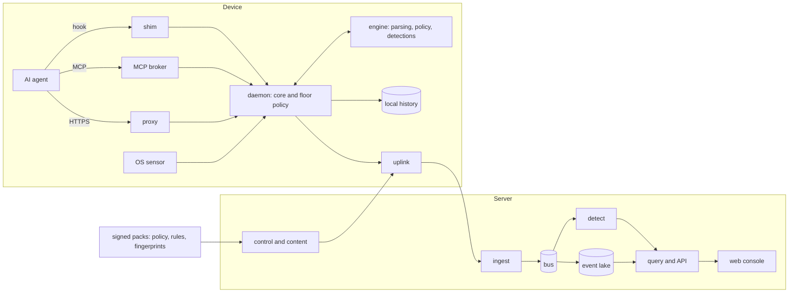

# Guardrails ADR: master plan

_Version 4, 2026-11-11. This is the entry point. The binding decisions are in [design/00-decisions.md](design/00-decisions.md) (version 5); every other document expands one part of it. The plan describes the complete product, not a schedule: ordering appears only as prerequisites._

## 1. The plan on one page

**What it is.** Guardrails ADR is an open-source agent detection and response (ADR) platform, published by Loonaro; the market calls the category AIDR. It finds every AI agent running on a company's machines, including home-made ones nobody registered. It works out which actions were the agent's and which were the person's. It applies policy before an action completes, protects credentials and data, detects misbehaviour and lets a person stop it. It runs on Windows, macOS and Linux, on laptops, servers, CI runners and Kubernetes, from a single machine to ten million endpoints, and inside networks with no route to the internet.

**Who it is for.** A single developer who wants a safety net with no account. A company that already runs CrowdStrike or Defender and now has thousands of developers using Claude Code, Cursor, Codex and Copilot. An MSP looking after eighty small clients. An EDR vendor that wants this capability inside its own product.

**Why there is room.** The commercial products are closed, cover Windows and macOS first, discover agents from a list of known names, and lean on the agents' own hooks, which fail open by default. Nobody ships discovery of unregistered agents by behaviour, an honest statement of how strong each control is, a fully open multi-tenant console, or published efficacy results. Section 2 has the detail.

**How it is built.** One Rust core that takes events and signed policy in and gives verdicts out, with no I/O of its own. The same core runs in the endpoint sensor, the network proxy, the server and other vendors' products. Around it sit five control points on the device (in-agent hooks, an MCP broker, a network proxy, a launch sandbox, an OS sensor) and three off it (browser, gateway, vendor connectors).

**Three shapes from one codebase.**

| Shape | What runs | For whom |
|---|---|---|
| Standalone | The endpoint software only. No server, no account, nothing sent anywhere | One developer, or a trial |
| Platform | Sensors plus a server and web console, self-hosted (the default) or hosted by Loonaro, with a provider tier | Teams, enterprises, MSPs |
| Embedded | Our detection content, event feed, hook broker or engine inside another vendor's product | EDR vendors, MDR providers |

**The decisions that shape everything else.**

1. Everything is Apache-2.0, the server included, with no paid-only features. It is the only licence EDR vendors can embed and foundations accept.
2. Every control is labelled a boundary (the OS or a gateway enforces it), a scoped boundary (holds for processes we launched) or a request (a cooperative hook). The product reports which applies, per kind of action, and never calls a request protection.
3. Every control point that counts as enforcement works from a level the agent cannot reach or switch off (principle P13); the hook, which runs inside the agent, never enforces alone.
4. Deterministic code makes every decision that allows something. Models may only add restrictions, raise risk and explain.
5. Policy is decided on the device from signed, cached bundles. A server outage never stops developers.
6. What the agent says it did (hooks, its own telemetry) is checked against what the operating system saw. A gap is a detection.
7. Windows runs with no kernel driver by default; an optional minimal driver depends on a sponsor or partner paying for its certificate and Microsoft's hardware programme. Microsoft's new endpoint security platform (WESP) is closed to us, so it is reached through an EDR partner that embeds our engine.
8. Linux gets full kernel enforcement in the open; macOS gets it if Loonaro pays Apple's developer fee and Apple grants an entitlement, and is useful without either.
9. Privacy is built into the data schema: people appear as pseudonyms, only metadata is uploaded by default, and nothing is scored per person.
10. Policy is written in Cedar; detections use the Sigma format the security industry already shares.
11. Every capability is a mechanism plus content: ports, adapters, signed packs, manifests and settings, with our own behaviour shipped as defaults anyone can replace without a code change. Nothing is hard-coded, not even the domain (principle P14).
12. Every design is sized for ten million endpoints: no synchronised timers, retries with jitter, admission by priority, content-addressed updates behind any cache or mirror, and cells with device shards (principle P15).
13. Air-gapped networks are first-class: every shape installs, updates, detects, responds and upgrades with no route to the internet, from one bundle that carries everything (principle P16).
14. There is one way to do each thing: one interface system, one vocabulary and one registry per kind of artefact, so the same object has the same name, look and behaviour on every surface (principle P17).
15. Every string a person reads is a language token compiled for every surface, so a missing translation or argument fails the build and adding a locale changes no code (D-69).
16. Whoever runs the server administers it in a separate operator plane; boot configuration stays in a file, and every other setting is a versioned runtime setting applied without a restart (D-70).
17. Components version on their own and declare the contract ranges they need; one resolver refuses any combination outside them, and a deployment upgrades from one tested bundle to the next (D-71).
18. The product is built by a team of AI agents running on your Claude subscription, under rules the repository and deterministic software enforce. No person is a step in building, reviewing, landing or releasing.

**The complete product.** Every capability in this plan is part of the product: the standalone shape, every agent and operating system in the support matrix, the server in all three profiles, the enterprise and MSP features, and the embedding options. Nothing is scheduled. Work on a component can start once its prerequisites exist, and section 11 lists them. A few capabilities also depend on something outside the team's control: Apple's Developer Program and its Endpoint Security entitlement for macOS tiers 2 and 3; a sponsor or partner for the optional Windows driver; an embedding partner for WESP and the L2 to L6 options; and revenue, sponsorship or donated cloud credits for the hosted service. No other work waits for any of them. Section 12 says what a zero budget means for each.

**What I need from you.** Nothing for daily work: no step of building, reviewing, landing or releasing waits for you. Questions 1 to 4 in section 13 are answered (Loonaro, a zero budget on your Claude subscription, your buddy, and the name Guardrails ADR). Questions 5 to 9 are still open; each blocks only the decision that needs it.

## 2. What the research found

Two research rounds produced 57 briefs, each fact-checked by a second agent, plus 114 captured pages of vendor documentation. They are indexed in [research/00-index.md](references/research/00-index.md). The full capability matrix and teardowns are in [design/01-competitive-capability-map.md](design/01-competitive-capability-map.md).

### The products you named

| Product | How it works | Weak points | What we take from it |
|---|---|---|---|
| **Origin** (formerly Prelude) | Points each tool's own telemetry at a local collector, reads transcripts and vendor compliance APIs, then has an LLM review sessions. macOS and Windows | No Linux. Does not block anything inline; "enforcement" is pushing configuration. Its own research shows the telemetry it relies on misses activity. No SIEM export | The light capture mode, the session-based review queue, and its published investigations as detection ideas |
| **BeyondTrust AI Agent Security** (GA October 2026) | A Windows driver and macOS system extension, plus machine-wide hooks for Claude Code, Codex, Cursor and Copilot. SaaS only | No Linux, containers or Kubernetes. Hooks fail open. Shipped policies only audit until edited. An approval relaxes the whole policy on a machine. Every console user is a full administrator. Web rules need TLS interception with a root certificate | Enforcing one policy at the hook and again at the OS; replaying a draft policy against recorded activity with an "almost matched" list; update rings |
| **Microsoft Agent 365** with Defender, Entra and Purview | A licence and admin view over existing products. Defender inventories about 60 named local agents on Windows and macOS | Runtime blocking is a Windows-only preview that catches prompt injection only. Needs Defender as the active antivirus, so it does nothing where CrowdStrike is primary. Home-made agents are invisible. No native Linux | Its inventory model; its open-source sandbox and hook contracts; its registry as an import source |
| **CrowdStrike Falcon Guardian** (GA September 2026) | The acquired Pangea service on top of Falcon telemetry, with thin open-source hook collectors | Every decision is a cloud call with a 30-second timeout that fails open. The hook's credential sits where the agent can read it. Its kill switch only blocks model access at gateways so far. Linux and Kubernetes are still to come | The integration surface: we can feed and enhance Falcon without a partnership |
| **Sidekick Security** | A browser extension and console for AI use inside SaaS apps: which account, which settings, which connected apps | Recently pivoted; no public documentation or pricing. Browser only | The idea that AI providers' tenant-restriction settings can be enforced from a managed browser extension without intercepting TLS |

### Others that matter

- **Palo Alto Cortex XDR** now sells a "targeted sensor" that adds agent security beside another vendor's EDR, on all three operating systems. It is the strongest rival to our "enhance the EDR you have" position.
- **Open source** is a set of single layers: Cisco DefenseClaw (hooks and a gateway for 12 agents), Uber ADR (discovery and detection, prevention withheld), Perplexity Numbat (visibility), NVIDIA OpenShell (a kernel sandbox for agents launched inside it), Microsoft's governance toolkit. None has a fleet console, identity, or discovery of agents that are already running. We integrate with them.
- **Consolidation is fast**: more than 30 acquisitions in the category since 2024. Vendor continuity is a buyer's main risk, which favours an open project.

### What nobody ships

- Discovery of unregistered agents from behaviour, not from a list of names.
- A check of the agent's own account of its actions against the operating system's.
- Decisions made locally and offline.
- An honest, per-machine statement of how strong each control is.
- Approvals scoped to one action instead of a whole policy, with role separation.
- A fully open console with multi-tenancy, sign-on and audit.
- Published efficacy numbers, prices and documentation.

### What every buyer now expects

Inventory of agents, MCP servers and extensions on Windows and macOS; hook verdicts for Claude Code, Cursor and Codex; some MCP control point; Allow, Ask and Block; connectors for SaaS-hosted agents; a session audit trail. We must match all of these.

## 3. How it works

### One tool call, end to end

1. An agent decides to run a shell command. Its pre-tool hook calls our small signed shim.
2. The shim passes the action to the local daemon over a socket whose owner it has verified.
3. The engine normalises the command into a canonical form, updates the session's state, and evaluates Cedar policy from the signed bundle on disk. This takes milliseconds and needs no network.
4. The verdict comes back: allow, deny with a reason the agent can act on, or "needs approval". Approval is always deny, approve, retry: a person approves on a surface the agent cannot drive, which mints a single-use grant.
5. If the daemon does not answer, the shim decides from a small signed table: deny for the few classes that must fail closed, allow and flag "degraded" for the rest.
6. When the command actually runs, the OS sensor sees the process, file and network activity inside the session's container and checks it against floor rules and against what the hook said would happen. Activity nobody declared is a finding.
7. Events go to local history, into a hash chain, and (if the machine is enrolled) to the server. Detections run on the device and across the fleet. Findings group into incidents around the session.

### The five jobs

| Job | How | Detail |
|---|---|---|
| **Discover** | Four passes: a catalogue of known agents; a scan for the building blocks of home-made ones (SDKs, MCP libraries, local model runtimes); behaviour (a process that talks to a model and then acts, in a loop); and a comparison of what registries say exists with what sensors see. Unknown agents go to a triage queue | [design/05](design/05-discovery-and-inventory.md) |
| **Attribute** | Each session gets a container the kernel tracks. Hook identifiers tie OS events to tool calls. Every event carries its evidence and a grade from 0 to 4; where human and agent share a process, the answer may be "undetermined" | [design/06](design/06-attribution-and-session-graph.md) |
| **Enforce** | Cedar policy with four modes (Off, Watch, Ask, Block), evaluated at the hook and again at the OS. Policy is also compiled down into the agents' own managed settings where that is sound | [design/07](design/07-control-points-and-hook-broker.md), [design/12](design/12-policy-engine.md) |
| **Protect** | Credential stores and agent control files are protected by default; secrets are redacted or injected by a broker so the model never sees them; session labels stop sensitive data reaching outside sinks | [design/15](design/15-identity-and-credential-broker.md), [design/16](design/16-data-protection.md) |
| **Detect and respond** | Deterministic rules, on by default; LLM review is optional and off until an organisation opts in. Responses run from "deny this call" to a kill switch that needs two approvers above device scope | [design/13](design/13-detection-engine-and-content.md), [design/18](design/18-response-approvals-and-soc-operations.md) |

### Your operating-system questions

| Platform | Decision | Why |
|---|---|---|
| **Windows: WESP** | Not a direct route for us. It is limited to Microsoft's antivirus partner programme, is still undocumented, and shows no way for a user-mode client to block. We reach it through an EDR partner that embeds our engine; that partner is an external precondition | [design/08](design/08-sensor-windows.md) |
| **Windows: drivers** | None by default: ETW telemetry, user-mode network filters, job objects and restricted tokens around the agent's tool subprocesses, with user-mode binaries signed through Sigstore and, once a free open-source signing programme accepts Loonaro, with Authenticode. An optional minimal driver ships on its own release train; it requires an EV certificate and Microsoft's hardware programme, paid for by a sponsor or partner, and the trust-core review of two independent evaluator agents | Same |
| **macOS** | Three tiers: hooks and launch sandboxing with no approval from Apple; a network content filter under a Developer ID; Endpoint Security when Apple grants the entitlement. Tiers 2 and 3 require Apple's Developer Program, which has an annual fee (question 8); the entitlement can be requested only once Loonaro's Team ID exists. Without the Program, macOS ships with tier 1 only and is not notarised | [design/09](design/09-sensor-macos.md) |
| **Linux** | The reference platform: eBPF with kernel-level blocking where the kernel allows it, and fallbacks that need no reboot. The same sensor covers WSL2, containers, Kubernetes and CI | [design/10](design/10-sensor-linux-containers-ci.md) |

### How strong is each control?

For every machine, agent and kind of action the product records four things: can we see it, can we control it and how firmly, what happens if we fail, and who can remove us. A simple label summarises this: AL0 Inventoried, AL1 Observed, AL2 Guided (hooks proven to fire), AL3 Contained (running inside a sandbox we launched), AL4 Enforced (the OS blocks for every process). Policy can require a minimum. This is how the product stays honest where rivals blur hooks and kernels.

### What the agent cannot get around

Detail and worked examples for each operating system: [design/07](design/07-control-points-and-hook-broker.md) section 15.

**The rule (principle P13).** Every control point on the device that counts as protection must work from a level the agent cannot reach, so the agent cannot escape it or switch it off. The table shows how the other four meet it. The hook runs inside the agent, which can skip it, so on its own it never counts. An action that nothing below the agent covers is reported as a request.

| Control point | Where it runs | Why the agent cannot get around it |
|---|---|---|
| Sensor | Inside the operating system: eBPF on Linux, Endpoint Security on macOS, the optional driver on Windows. Where it blocks, that is the kernel tier; elsewhere it only watches | It runs as administrator; the agent runs with your rights |
| Sandbox | A fence the operating system puts around a program when it starts: Claude Code's own on macOS and Linux (Seatbelt, bubblewrap), locked on by our settings; otherwise ours (Landlock, Seatbelt, or a locked-down container on Windows) | A program can tighten its fence but never loosen it, and every program it starts is inside it. Claude Code's own holds because our locked settings forbid commands outside it |
| Proxy | Our local network proxy | Only where the sandbox or a kernel tier makes it the only way out (on Linux, only with our reviewed network kernel program or a separate network) |
| MCP broker | Our broker between the agent and its MCP servers | Only for network servers, where the sandbox or the kernel makes it the only route; a local server the agent starts itself can bypass it |
| Hook | Inside the agent: the agent calls us before each tool call | Nothing stops the agent skipping it. It carries intent, reasons and approvals. Where the sandbox or a kernel tier covers an action, the real effect is checked again; a rule on the command text is checked only at the hook |

Three things follow from the rule.

- **Real protection needs the Protected install** (the system package, one administrator prompt), where our service runs as administrator and the agent does not. In the User install every control is a request.
- **The hook and the operating system check each other.** An agent action the operating system sees with no matching hook call, outside the agent's known routine work, is flagged (`undeclared-activity`), as tampering when the hook was working and the agent started it. A silent hook is flagged too (`hook-dark`).
- **Where the sandbox is on for an agent, Guardrails by default hands none of its managed secrets to a program outside it.** A credential added at our proxy, which never enters the session, still works.

**Three examples.**

- **Stop the agent creating files in `~/.ssh` or outside the workspace.** The sandbox lets commands write only to the workspace and a few folders such as temp and cache, so `echo >` or a Python one-liner is refused. Claude Code's own Write tool runs outside that sandbox, so until the whole agent is in the sandbox only the hook, a request, stops it. A kernel tier also refuses it for named paths such as `~/.ssh`, but not "anywhere outside the workspace".
- **Stop network access to an address, a domain or a URL.** For sandboxed sessions the operating system refuses a blocked address (on Linux, once our network kernel program has passed review); for every process, a kernel tier or the paid macOS network filter does. For a domain the sandbox lets a session reach only a proxy, which checks the name. A URL path is visible only in traffic we can read, such as model and MCP traffic; for other HTTPS only the site can be blocked. Claude Code's own web-fetch tool is fenced only when its Write tool is.
- **Stop the agent running `curl`.** Where the sandbox or a kernel tier covers running programs, the operating system judges the program that really runs, so command-text tricks fail. Elsewhere only the hook sees the command: it untangles quotes and encodings, and asks about a command it cannot untangle only under rules that must never slip through. Python can download too, so the rule that holds is about the effect: the destination, the path or the credential.

**Can the agent switch it off?** Not in the Protected install, with exceptions. A program running with your rights cannot stop or debug one running as administrator, and Claude Code's hook settings sit in a file only an administrator can change. Agents with no machine-wide settings, and Claude Code under WSL, keep hooks in your own files, so their removal is detected, not prevented. A killed hook shim is reported, as tampering when the agent did it. An administrator, including an agent you let use `sudo` without a password, can remove the product; against one the product promises detection, not prevention.

**What a zero budget leaves out.** The sandbox costs nothing and works on all three systems. Blocking every process, however the agent started, needs a layer under the whole system: a kernel tier, the macOS network filter for connections, or a gateway that is the only way out.

- Linux: our kernel programs, which need spikes S-12 and S-13 and the trust-core review of two independent evaluator agents on different models; a free external audit adds to it if one is granted. Where only the fallback tier works, they block only connections by address and opening protected files.
- macOS: Apple's annual developer fee for the network filter, plus the Endpoint Security entitlement for programs and files (question 8).
- Windows: the optional driver, which a sponsor or partner must pay for, or an EDR partner's sensor.

Without one, a session outside the sandbox is watched, but only the hook (a request) and any per-command sandbox stand in its way.

### What happens when you install it and start `claude`

Detail for each operating system and install choice: [design/28](design/28-desktop-and-developer-experience.md) section 9.

**The short answer.** Install one package, click "Turn on protection" once, then type `claude` as usual. There is nothing else to install and no new command for everyday use; step 5 says which sandbox is used.

1. **Install the package** (MSI, pkg, deb or rpm), the Protected install. On Linux it also pulls in bubblewrap and socat, which Claude Code's own sandbox needs.
2. **First run changes nothing.** It lists the agents it found and your recent sessions.
3. **Turn on protection.** No further prompt. Guardrails writes Claude Code's machine-wide settings: our hooks, plus settings Claude Code cannot change, such as bypass mode switched off.
4. **Type `claude`.** Each hooked tool call goes through the hook, and the sensor watches what really happens (on macOS without Endpoint Security, the agent's transcript stands in for program starts).
5. **Shell commands run in a sandbox** where it is on for Claude Code on your system: by default where everyday developer tasks pass inside it, otherwise when you switch it on. On macOS and Linux, Guardrails switches on Claude Code's own sandbox and locks it. On Windows (Protected install), and on Linux hosts where Claude Code's own cannot run, the hook sends each command through ours. If no sandbox can start, commands run as a request, and Guardrails shows why.
6. **Claude Code's file tools** (Read, Edit, Write) run inside Claude Code, not in the sandbox; the hook checks them, as does a kernel tier where there is one. `grdr run --contain -- claude` asks to run the whole agent in our sandbox, which covers them; on Windows it does. On macOS and Linux, Claude Code stays on the per-command sandbox unless spike S-11 shows its own still works inside ours; only then does plain `claude` start contained (section 13). An IDE panel's own copy keeps the hook and the per-command sandbox and is reported (`launcher-bypassed`).

## 4. Architecture

Detail: [design/03-system-architecture-and-modularity.md](design/03-system-architecture-and-modularity.md).

**Modularity is enforced, not hoped for.** Code sits in five layers, and a lint fails the build when a lower layer reaches upward: schema; the pure core (no I/O, clock injected); ports (traits) and shared libraries; adapters (sensors, stores, proxies); programs that only wire things together. The workspace starts with about twenty crates and splits one out only when it gains a second consumer.

**Every capability is a mechanism plus content** (principle P14), so people extend it without touching the core through: content packs (rules, fingerprints, policies); agent adapters written as manifests; integration manifests; verdict providers; storage and sandbox adapters; model back ends; mail adapters; SDK instrumentation for home-made agents.

**Storage.** Each dependency sits behind a trait with at most two supported adapters, chosen through three named profiles.

| Profile | Relational | Events | Bus | Needs |
|---|---|---|---|---|
| `embedded` (one process) | SQLite | Parquet on local disk | A log in SQLite | Nothing else |
| `ha` (replicas of the whole server) | PostgreSQL | Parquet on object storage | A log in PostgreSQL | PostgreSQL and object storage |
| `distributed` (hosted service, and self-hosted above the `ha` ceiling) | PostgreSQL | Parquet on object storage | NATS | PostgreSQL, object storage, NATS |

Events live in a lake of Parquet files in an open table format, queried in-process, so a customer can read their own data with any tool. At ten million endpoints, hosted or self-hosted, the server runs as several `distributed` cells behind a router, and an organisation larger than one cell spans cells as device shards (principle P15). Detail: [design/20](design/20-server-platform-and-storage.md).

**Transport.** Sensors send acknowledged batches over plain HTTPS that survives corporate proxies and TLS inspection; the device signs each request, so identity does not depend on mutual TLS. The server directs every device's schedule, retries carry jitter and admission sheds by priority, so a fleet never moves in lockstep. Updates are TUF targets: the project root's keys live in two separate GitHub Actions environments with a threshold of two, and every artefact is content-addressed and served from GitHub Releases and GitHub Pages, from any CDN or mirror added by configuration, or from a static file server inside an air-gapped network. Detail: [design/22](design/22-transport-fleet-and-updates.md).

**Schema.** Our own protobuf model, with OCSF as the export format for SIEMs and OpenTelemetry dialects as inputs. Detail: [design/04](design/04-event-model-and-schemas.md).

**API.** One protobuf contract served as Connect, gRPC and REST, with a Terraform provider, policy as code in git, and a read-only MCP server. Detail: [design/23](design/23-api-policy-as-code-and-mcp-server.md).

**Operator plane.** Whoever runs the server (an enterprise, any hoster, Loonaro's hosted service) administers it in a separate place, as in GitLab's self-managed model: its own listener, origin, accounts, authorisation and API, and no route to tenant content. Boot configuration holds only what the server needs before its database is reachable; every other setting is a versioned runtime setting, validated, applied without a restart and rolled back automatically if a health check fails. The plane also shows health with history, diagnostics, the upgrade path and preflight, organisation lifecycle, key rotation and backup drills. Detail: [design/20](design/20-server-platform-and-storage.md), [design/21](design/21-tenancy-keys-and-access.md) and [design/24](design/24-deployment-and-packaging.md) (D-70).

**Compatibility and upgrades.** Components (public crates, SDKs, programs, the eBPF object, the Windows driver) version on their own and declare the contract ranges they provide and require. One resolver checks the release manifest's `compat` block and refuses any combination outside the ranges before anything activates. A deployment upgrades from one tested product bundle to the next and transfers only the components whose digests changed; content, rules, intelligence and policy move on their own signed channels (D-58, D-71).

## 5. Where it runs

Detail: [design/24-deployment-and-packaging.md](design/24-deployment-and-packaging.md).

| Model | What is deployed |
|---|---|
| One developer | Signed installer; choose a Protected install (one elevation) or a User install (none) |
| Team, self-hosted | One server binary in `embedded` profile on one machine |
| Enterprise, self-hosted | `ha` profile on Kubernetes (Helm) or VMs; Terraform modules for AWS, GCP and Azure |
| Enterprise at ten million endpoints | Several `distributed` cells behind the installation's own router, with one deployment root (principle P15) |
| Hosted by Loonaro | `distributed` profile in regional cells; requires infrastructure funded by revenue, sponsorship or donated cloud credits |
| MSP | The provider tier, on the hosted service or self-hosted |
| Air-gapped | One signed bundle that carries everything every profile needs, third-party images and the sources of copyleft components included; terms are accepted at import, nothing is fetched on a connected host, and later releases arrive as delta bundles (principle P16) |
| Kubernetes workloads | A node sensor where the runtime allows it; a sidecar and forced gateway egress where it does not; a ledger showing what is covered |
| CI | The Linux sensor in an ephemeral mode, installed by one step |
| Inside another product | See section 6 |

Endpoints are managed through MDM. Where an organisation already manages an agent's settings through MDM, we never fight it: we hand its administrators the fragment to deploy and verify with a canary that the hook really fires.

## 6. Enhancing an existing EDR, OEM and white-label

Detail: [design/26-embedding-oem-and-white-label.md](design/26-embedding-oem-and-white-label.md). This is your "like Avira" requirement. There are seven options, and they are not a ladder: a partner picks what fits.

| Option | The partner takes | Effort for them | Can block before execution |
|---|---|---|---|
| L0 | Our detections compiled into their query language (KQL, LogScale, EQL, XQL, SPL, Sigma) | Very low | No |
| L1 | A local event feed their existing collector reads (Windows Event Log, journald, JSON lines, OTLP) | Low | No |
| L2 | The hook broker, so several vendors can share an agent's hooks | Medium | At hooks |
| L3 | The engine: a tiny fast-path library safe for a protected process, plus the full engine as a sidecar | High | Wherever their sensor can |
| L4 | Our core running over their data lake, responding through their API | Medium | No |
| L5 | The whole platform beside their EDR | None | Yes |
| L6 | Co-branding, or a full rebuild from source under their name and signing identity | Varies | Yes |

L0 and L1 need only the sensor and content, so they reach enterprises with no new server. L2 to L6 each require an embedding partner. Recruiting an MVI-member partner for an L3 pilot waits on no component, and that partner is the only way to reach WESP and Windows protected-process status.

## 7. Experience

Detail: [design/27-web-console-ux.md](design/27-web-console-ux.md) and [design/28-desktop-and-developer-experience.md](design/28-desktop-and-developer-experience.md).

- **Value before any change.** The first run scans without elevation and shows the agents it found and last week's sessions from existing transcripts. Only then does it offer to turn protection on.
- **One ladder everywhere:** Off, Watch, Ask, Block. A small Essentials pack blocks from first protection (tampering with agent or Guardrails configuration, credential theft patterns). Everything else starts in Watch and proposes promotion after a week with "this would have asked you N times".
- **Simple for a casual user, deep for an expert.** The same policy has three views: Simple (modes and lists), Advanced, and Code (Cedar). A draft can be replayed against history before it enforces.
- **No dead ends.** Every block says which component blocked, which rule, and how to request an exception. A prompt budget (median three a day) is a product metric.
- **The monitored developer is a user too.** A panel shows what is collected and who looked. There is no covert mode.
- **Web console:** React with Meta's Astryx for every component, behind our own thin `ui` layer that adds theme, tokens, strings and brand defaults and absorbs Astryx's fortnightly breaking changes. The product-defining components (timeline, policy editor, approval card) are compositions of Astryx components; a component of our own exists only as a registered exception where Astryx has a gap, with the condition for replacing it. The operator plane uses the same components.
- **One interface system for every surface** (principle P17): the web console, the Rune app, the tray, the CLI, notifications and the docs share the same tokens, names, icons, states and words, and every string is a language token shown in the reader's language (D-69).
- **Desktop in Rune,** as you asked, scoped to a six-screen developer app. Rune is three weeks old and needs a GPU, so the tray uses native menus, approvals use OS-native surfaces, and the full console is the web app, which the local daemon also serves. If Rune fails two soak tests the desktop becomes web-only until a new Rune release passes the soak.

## 8. Open source and business

Detail: [design/30-open-source-governance-and-community.md](design/30-open-source-governance-and-community.md) and [design/36-legal-brand-and-commercial.md](design/36-legal-brand-and-commercial.md).

- **Licence:** Apache-2.0 for everything, no CLA and no DCO sign-off.
- **Trust:** a public covenant, one of the first work items in a repository that is public from its first push, with a stated trigger to move the project's marks, domain, repository and update keys to a neutral foundation (CNCF or OpenSSF preferred). Loonaro holds them until then.
- **Two contribution lanes:** content (rules, fingerprints, policy packs) is open to anyone and checked by fixtures; code needs an accepted specification. Agents never hold merge rights or votes.
- **Revenue with nothing withheld:** hosting, support, long-term maintenance, OEM services, and live access to an intelligence feed whose records all become public after a delay. Every paid offer requires counsel's opinion first, sought through free legal programmes for open-source projects; until then Loonaro offers nothing paid.
- **Name:** the product is Guardrails ADR, published by Loonaro (question 4). The `guardrails` command belongs to another project and `grd` is taken, so the technical name is `grdr`. Every user-visible name, the domain and the addresses come from the brand manifest; Loonaro's distribution sets the domain to `guardrailshq.com`, and a self-hosted or white-label deployment sets its own (D-66).

## 9. Compliance

Detail: [design/29-compliance-and-privacy.md](design/29-compliance-and-privacy.md).

- **For customers:** a control library mapped to SOC 2, ISO 27001 and 42001, NIST, the EU AI Act's duties for deployers, UK NCSC and Five Eyes guidance on agentic AI, Singapore's framework and CSA's AARM specification, exported in a machine-readable format, with retention presets and legal hold.
- **For the hosted service:** SOC 2 Type I and Type II, and ISO 27001. These are paid certifications, so they require revenue or a sponsor.
- **For the project:** OSPS Baseline, OpenSSF Best Practices, SLSA Build L3 provenance, SBOM and VEX. These, the control library and evidence export cost nothing. The EU Cyber Resilience Act already imposes reporting duties on anyone who sells security software. Before any paid offer we need counsel's opinion, a human-staffed security response team (you and the buddy) and an EU contact.
- **Privacy:** pseudonymous users, metadata-only upload by default, no per-person scoring, and a works-council-ready configuration as the default, not a mode.

## 10. The agent team

Detail: [team/01-operating-model.md](team/01-operating-model.md), [team/02-agent-roster.md](team/02-agent-roster.md), [team/03-skills-hooks-and-plugins.md](team/03-skills-hooks-and-plugins.md), [team/04-power-prompts.md](team/04-power-prompts.md), [team/05-quality-gates-and-ci.md](team/05-quality-gates-and-ci.md), [team/06-repository-bootstrap.md](team/06-repository-bootstrap.md).

**Structure.** One writer per work item. Planners do not write code. Workers run isolated. Evaluators are separate agents with clean context that drive the real product, not the tests the worker wrote. The merge queue is plain software, not an agent.

**It runs on your Claude subscription.** Work is measured in share of the subscription's usage windows, not dollars. The dispatcher caps concurrent agents, pauses when a usage limit is reached, resumes after the window resets, and never fails work because of a limit; every recurring agent has a usage cap per run. The dispatcher runs on your machine under your existing Claude Code and `gh` logins, so nothing needs a new token or account; agent runs on GitHub-hosted runners are optional.

| Group | Roles | Model |
|---|---|---|
| Direction | Chief architect, product lead, programme manager | Fable 5.2 (chief architect), Opus 5.5 (product lead), Sonnet 5.5 (programme manager) |
| Squad leads (planners), one per squad | 18 squads: core, security, discovery, adapters, endpoint, linux, macos, windows, gateway, identity-data, content, fleet, server, interfaces, ecosystem, release, lab, agent-kit | Opus 5.5 |
| Implementers | Six worker profiles (Rust, kernel, Apple, web, content, docs; a localisation profile joins with D-69's translation work) drawn from one pool, one writer per work item | Sonnet 5.5; Opus 5.5 for kernel, trust-core paths and high-tier changes |
| Evaluators | Thirteen, including acceptance, architecture (nothing hard-coded, P14), security review, adversarial testing in the lab, UX review under the ui-architect skill, performance, API conformance, cross-platform compatibility, accessibility, documentation and licence hygiene. They publish check runs, never approvals | Opus 5.5 for security and adversarial; Sonnet 5.5 for the rest |
| Gardeners (scheduled) | Eleven, including de-slopping, architecture audit with the power-prompt library, dependencies, documentation freshness, test quality, agent-catalogue freshness, rules, intake, threat-intelligence intake and subscription usage | Sonnet 5.5 find pass, Opus 5.5 refute pass |
| Persona council | Nine seats: single developer, enterprise IT, SOC analyst, MSP, OEM partner, privacy officer, open-source contributor, simplicity, international operator. Consulted on RFCs and interface design items only | Opus 5.5 chair, Sonnet 5.5 seats |

There are 66 agent definitions today, including the operations agents for the hosted service, generated from one roster file (`.agents/roster.toml`); the localisation implementer, evaluator and gardener of D-69 bring it to 69.

**Models.** Detail: [design/_review/03-models-and-orchestration.md](design/_review/03-models-and-orchestration.md).

| Model | Id | Used for |
|---|---|---|
| Fable 5.2 | `claude-fable-5-2` | The chief architect only: one agent, one session at a time, on demand, for spine and RFC changes, architecture review and disputes between squad leads. Never in a loop, scheduled or as a worker |
| Opus 5.5 | `claude-opus-5-5` | Medium-to-heavy work: product lead, squad leads, `impl-kernel`, any worker on a trust-core path or high-tier change, security and adversarial evaluators, the council chair, audit refute passes, review of what Sonnet wrote |
| Sonnet 5.5 | `claude-sonnet-5-5` | Everything else, including review of what Opus wrote |

No Haiku and no other vendor's model. The dispatcher, not the worker, picks Opus or Sonnet from the change's risk tier and paths. `.agents/models.toml` binds `fable`, `opus` and `sonnet` to these ids, and the renderer refuses a second agent bound to `fable`.

**Orchestration.** No person is a step: agents decide, and deterministic software lands and releases. Work items are GitHub issues in one repository on your own account, `416rehman/Guardrails`, with labels for their status and fields; there is no organisation, no Project board and no work-item file. Agents drive the work: they find and file new issues, ready them and solve them, and no person gates the queue ([design/_review/04](design/_review/04-owner-kit-instructions.md)). The chief architect keeps the spine true, the programme manager orders the queue, and the product lead and squad leads specify and ready work items; none of them write code. The dispatcher is deterministic software (`cargo xtask dispatch`): it leases each ready item to one worker, starts a headless session (`claude -p --agent <name> --model <id>`) in a disposable VM and worktree, enforces caps, and keeps concurrency inside the usage windows. Evaluators check in clean context; the merge queue lands a pull request once verify is green on the rebased head and every evaluator its lane requires has passed, and closes the issue. release-please turns the one-line Conventional Commit subjects into versions, changelogs, tags and GitHub releases, and every artefact is signed keylessly through GitHub's identity, so no person holds a key. Fan-out research and audits run as a Claude Code multi-agent workflow started by the chief architect or the programme manager. Concurrency starts small, three writers and up to six evaluators in the calibration run (`.agents/harness.toml`), and Fable sessions never block other work.

**What keeps quality up automatically.**

- One `verify` command, called by hooks, by every harness and by CI. The local dispatcher's run is the gate on every change; hosted CI is the backstop.
- Review in proportion to the change: a deterministic classifier puts each pull request in a lane. A typo or a comment lands on deterministic proofs alone, a small change gets one review pass, and a trust-core change needs two independent evaluators on different models. The proof-only lane never takes a protected change, and takes a trust-core path only for a lockfile update that adds no package and no new major version (D-63).
- Code structure is checked on every edit: structures before implementations, files under 500 code lines, explicit state types instead of implicit state machines, no panic paths and nothing hard-coded.
- Architecture lints whose error messages state the fix.
- Acceptance tests where workers cannot edit them, plus a held-out suite that gates releases.
- Mutation testing, differential fuzzing against reference models for every parser and the policy evaluator.
- Every bug fix proves three things: it failed before, passes after, and fails again if reverted.
- Review by AI is capped at three rounds on the diff. Cross-model review uses a second Claude model (a different model or tier from the one that wrote the change) with clean context; no other vendor's model is needed.
- Power prompts, such as "find all of the implicit state machines", are versioned skills run on a schedule, each with a verifier that tries to refute the finding. Their value is measured against a plain "find the bugs" control, because early evidence for them is thin.
- The development fleet runs under the last signed release of Guardrails itself.

**What stays with people.** Nothing in building, reviewing, landing or releasing. People hold what third parties require of a legal entity: Loonaro's accounts and programmes (Apple, a Windows signing programme, the domain's DNS), counsel, any spending, and the pager for a hosted service, which you and the buddy share.

## 11. Build order

Detail: [design/33-build-order-and-risks.md](design/33-build-order-and-risks.md) and section 7 of [design/00-decisions.md](design/00-decisions.md). Nothing is scheduled. Work can start on any component whose prerequisites exist, a spike that a work item depends on must have a verdict before that item starts, and each design document states its own prerequisites.

**What needs nothing first.** The schemas, the sans-IO core, the agent team kit, `verify` and the merge queue. The repository is public from its first push, the seed, which carries `SECURITY.md`; `GOVERNANCE.md`, `MAINTAINERS.md`, the covenant and the recorded namespace and trademark search are early work items, not conditions of being public.

**The chain to standalone acceptance.** Kit and merge queue, then schema, then the core and Cedar schema (S-15), then the decision protocol and shim, then the daemon hub, then the Linux observe programs (trust core, reviewed by two independent evaluators), then the hook-against-OS cross-check (S-07), then the efficacy harness, then the install channel (S-05). The Essentials pack (needs the core and a benign corpus), macOS tier 1 (needs the daemon), discovery passes 1 and 2 (need the core), the release pipeline (release-please, the merge queue and keyless Sigstore signing, none of which needs a new account) and the signed pack and update channel (needs the project-root ceremony, run in two GitHub Actions environments) join at standalone acceptance. No platform signature gates a release: an artefact without one ships marked not platform-signed.

**Built on the daemon.** The Windows sensor (S-04 decides whether Windows is Tier 1 or Tier 2), containment (the launcher plus S-10 and S-11; on Linux the network fence also needs the `cgroup_sock` program's own review, or a launcher-added network namespace), the MCP broker and explicit proxy, the local web console subset and tray, and the Rune desktop app (S-19).

**Needs no server.** L0 content, L1 event feeds and the generic export sinks; the local audit chain; the mirrored intelligence pack; Kubernetes and CI modes (they need the Linux sensor). Linux kernel enforcement needs the Linux sensor, S-12 and S-13, and leaves the internal ring only after the trust-core review of two independent evaluators on different models.

**The server chain.** The S-01 capture study, then S-02 (storage) and S-03 (bus), then the storage ports, then the server and API, then fleet management and rollout rings. The server is the prerequisite for enrolment, organisation and group policy, the full web console, roles and sign-on, the review queue, hunting, the export contract, out-of-band approvals, the provider tier and customer compliance evidence. The credential broker and token service need the server's `identity` and `keys` targets and the launcher. Own reputation scanning needs the server's `intel` target. The operator plane needs the server. The `distributed` profile needs its load test (S-24) and the fleet herd simulation (S-23); several cells and organisation shards need S-28. Air-gap conformance (S-31) needs the bundle and isolated mode.

**External preconditions.** Things outside the team's control, stated as conditions.

| Precondition | What it unlocks | Without it |
|---|---|---|
| Apple's Developer Program for Loonaro (D-U-N-S number, organisation enrolment with the buddy as second administrator; annual fee, question 8) | macOS tier 2 (Network Extension), notarised package, behavioural discovery on macOS, and the right to request the Endpoint Security entitlement | macOS ships with tier 1 only and is not notarised |
| Apple's Endpoint Security entitlement | macOS tier 3 and AL4 on macOS | Endpoint Security only through an embedding partner; macOS keeps tiers 1 and 2 |
| Acceptance into a free open-source signing programme (for example SignPath Foundation) | Authenticode on Windows user-mode binaries | Windows binaries ship with Sigstore signatures and provenance, marked not platform-signed |
| An EV certificate and Microsoft's hardware programme (Partner Center with two administrators, WHCP, filter altitude), paid for by a sponsor or partner | The optional Windows driver and AL4 on Windows | Windows stays driverless |
| An MVI-member EDR or MDR partner | WESP, Windows protected-process status, the L3 pilot and L4 connector | Offer L1 and L4 to others |
| An embedding partner | L2 to L6 and stable public surfaces | The seams stay in the core |
| A free external audit (for example OSTIF or OpenSSF Alpha-Omega) | A review of the trust core beyond the evaluators'; the penetration test | The evaluators' review stands alone; no penetration test is claimed |
| Incumbent EDR licences through design partners or free vendor programmes | S-04's Falcon arm, Windows Tier 1, coexistence cells beyond Defender and free EDRs | Those cells are marked untested; Windows stays Tier 2 |
| Revenue, sponsorship or donated cloud credits | The hosted service and its cells, live-cloud tests of the Terraform modules, S-24's full-cell arm | Self-hosting only, up to ten million endpoints; modules tested with mocked providers; the cell cap stays at 50,000 endpoints until S-24 runs |
| Revenue or a sponsor | SOC 2 Type I and II, ISO 27001 for the hosted service | The project's own obligations and the control library still ship |
| Counsel, through free foundation legal programmes first | Paid offers; the first release (assignment, export); the scorecard; the stable channel | Nothing paid is offered |
| Each agent's hook interface, a browser's extension store account (unmanaged installs only), a customer with access to a SaaS compliance API, an external witness, a foundation's acceptance | Hooks per agent, the browser extension, SaaS connectors, transparency receipts, the foundation transfer | That capability is not claimed |

**Optional steps only you can take**, each unblocking one external precondition; nothing else waits for them: get a D-U-N-S number for Loonaro and, if you pay the fee (question 8), enrol in Apple's Developer Program with the buddy as second administrator and request the Endpoint Security entitlement on the Team ID; apply to a free open-source signing programme; add the DNS records and mail forwarding for the domain that the setup step prints, since the kit has no access to the registrar; create the repository `416rehman/Guardrails` on your account if it does not exist yet (every command that touches GitHub prints this step and stops until then); seek counsel through free legal programmes; apply to free audit programmes; start a conversation with one EDR vendor or MDR about an embed pilot.

**Thirty-one spikes** can overturn decisions before they are expensive, for example: what an agent-heavy machine really emits in two weeks; whether the hook is fast enough on Windows beside Defender; whether attribution works inside an IDE; whether agents can write safe eBPF; whether ten million devices stay inside every cell's capacity after an outage or a release; whether every shape works with no route out. None is scheduled: each runs once its prerequisites exist. They are listed with pass criteria in section 8 of the decisions file, and with fallbacks in section 7 of design/33.

## 12. Constraints and risks

- **Budget: zero.** There is no money for model API usage, lab hardware, paid audits, paid certifications or hosted infrastructure.
- **One Claude subscription.** The agent team runs on it (section 10). Work is measured in share of the subscription's usage windows; S-20 calibrates the share one accepted work item takes in each review lane. Model-driven efficacy runs use the same subscription with their own usage cap per run.
- **The lab is free.** Hosted CI runners, free because the repository is public from its first push (Linux x64 and arm64, Windows x64 and arm64, macOS arm64); your and the buddy's own machines as optional self-hosted runners; incumbent EDR licences only through design partners or free vendor programmes. Tests that need hardware nobody has are marked "requires hardware" and run when a machine is available.
- **The buddy is the second person:** second maintainer, second administrator on Loonaro's accounts, and on-call partner for a hosted service. Neither of you reviews, signs or approves anything for code to land or ship.
- **Audits are free.** Evaluator agents review the trust core: `eval-security` and `eval-adversarial` on Opus in clean contexts, cross-model review, and two independent passing evaluators on different models for every trust-core change. A free external audit adds to that review when a programme grants one.
- **The one unavoidable cost** is Apple's Developer Program annual fee (question 8). Without it macOS ships with the userspace tier only and is not notarised.
- **What depends on sponsorship or revenue:** the hosted service (infrastructure, from revenue, sponsorship or donated cloud credits); paid certifications (SOC 2, ISO 27001); the optional Windows driver (EV certificate, Microsoft's hardware programme and its test lab, from a sponsor or partner); live-cloud tests of the Terraform modules (donated credits or a sponsor); the full-cell load test S-24 (donated capacity). Self-hosting is the default way to run the platform and needs none of these.
- **Your time:** none is needed for daily work. The programme manager cuts writer concurrency when the evaluator queue passes its cap or when the subscription's usage window is the binding limit.

| Risk | What we do |
|---|---|
| The evaluator queue becomes the bottleneck | Review lanes keep small changes off it; the programme manager cuts writers to three when the queue passes 20 items or the oldest waits 48 hours |
| Subscription usage limits | The dispatcher pauses at a limit and resumes after the window resets, so no work fails; above twice the S-20 usage per item, writers are cut and new feature work pauses; trust-core, security and release work go first |
| Automation is bound to one account | The dispatcher and every agent act through your Claude Code and `gh` logins. The repository and its issues hold all state and the kit is harness-neutral, so the work continues under another login or harness |
| The subscription's data terms do not give zero retention | Embargoed security fixes are made by agents in a private fork with network tools off, and the terms are recorded (D-62) |
| Zero budget blocks a precondition | Apple's fee unpaid: macOS not notarised, tier 1 only. No driver sponsor: Windows stays driverless. No free audit: the evaluators' review stands alone. No hosting funds: self-hosting only. No donated capacity: the cell cap stays at 50,000 endpoints. No incumbent licences: Defender and free programmes, other cells untested |
| Evaluators miss a trust-core defect | Two independent evaluators on different models, reference models with differential tests, the matrix and soak; each defect found later becomes an audit prompt run over the whole tree |
| A fleet event overloads a cell | The herd simulation (S-23) reruns on every change to scheduling, admission or rollout pacing; the cell cap drops to the largest size the cell load test (S-24) passes |
| Agent-written kernel code crashes machines | Observe-only until kernel enforcement passes its review; any panic in the matrix or soak keeps it in the internal ring |
| Rune is not ready | Web-only desktop after two failed soak runs; the soak reruns on each new Rune release |
| Apple does not grant the entitlement | Endpoint Security only through an embedding partner; macOS keeps tiers 1 and 2 |
| Tests are gamed | A held-out suite; a release is blocked if the gap exceeds five points |
| An incumbent bundles the same thing free | We lead on what they do not do (section 2) and review the position by RFC when an incumbent ships one of our leads |
| Agent vendors change or close their hooks | Canary jobs install each new agent release within 24 hours; the OS control points carry enforcement |
| A platform-signing account is refused or suspended | Artefacts keep their Sigstore signatures and ship marked not platform-signed; the buddy as second administrator and a documented re-sign path restore it |

## 13. Decisions made for you, and questions

### Decisions you may want to reverse

| Decision | Why I made it | Cost of reversing |
|---|---|---|
| Apache-2.0 for the server too | AGPL blocks EDR embedding and foundation homes | Cheap before the first public release, impossible after |
| No Windows driver by default; WESP only through a partner | WESP is closed to us; a driver needs an EV certificate and Microsoft's hardware programme, which cost money a sponsor or partner must provide | Low: the optional driver is already designed, behind the same trait as the WESP adapter |
| Rune limited to a six-screen developer app | It is three weeks old, takes no pull requests and needs a GPU | Low: more screens can move to Rune once it passes soak tests |
| Astryx for every web component, behind a thin `ui` layer; our own component only as a registered exception | Your instruction of 2026-11-11: one component library prevents inconsistency and duplication; the `ui` layer absorbs Astryx's fortnightly breaking changes, and charts and other widgets Astryx lacks are registered once | Low |
| Language tokens in Unicode MessageFormat 2 with one compiler for Rust and TypeScript | One implementation of the message rules on every surface, with placeholder isolation for right-to-left text; ICU MessageFormat 1 with FormatJS would be a second one | Medium once strings exist; low before |
| An organisation larger than one cell spans cells as device shards | Keeps organisation-wide detection and one deployment root; a separate cell per organisation would break both | Medium |
| Update origins on GitHub Releases, GitHub Pages and jsDelivr | None needs a new account or an application; any CDN is one configuration entry | Low |
| Storage is a Parquet lake, not ClickHouse | Self-hosters need few dependencies; customers can read their own data | Medium: a ClickHouse adapter is the fallback if a spike fails |
| Standalone is a complete product with no server | One developer gets value with no account; enterprises can pilot through their own SIEM without running a server | Medium |
| The hosted service requires two people on call and funded infrastructure | A multi-tenant security service cannot have one person on the pager, and there is no budget for infrastructure | On-call is met by you and the buddy; funding needs revenue, sponsorship or donated cloud credits |
| Cross-model review uses a second Claude model, not another vendor's | One subscription and no API budget | Low: another vendor's model can be added as a reviewer if one becomes available |
| Metadata-only upload and pseudonymous users by default | EU law and works councils; prompt stores are a liability | Organisations can raise the capture level visibly |
| LLM review is off until an organisation opts in | Cost, privacy, and models that are easy to fool | Low |
| Working technical name `grdr` | `guardrails` and `grd` are taken | Mechanical if done before the first release |
| Typing an agent's command starts it inside the Guardrails sandbox in the Protected install, where the agent is cleared for it and whole-agent containment is its mode on that OS. For Claude Code that needs S-11 to admit it on macOS or Linux; on Windows its default is the per-command sandbox (hook rewrite) | You should not have to type `grdr run --contain`. Anthropic documents a `claude` launcher earlier on `PATH` for terminal sessions; on macOS and Linux, Claude Code's own launcher setting covers its background sessions. A shell-profile edit would rewrite your dotfiles and miss scripts, and a tray launcher would still change what you do | Low: one setting per agent. Turning it off loosens protection, so it needs your approval. IDE chat panels, and shells whose own profile puts the agent first, run without whole-agent containment (their shell commands still get the per-command sandbox where it is on) and raise `launcher-bypassed`. Covering those shells would mean writing one line into your shell profile, which D-27 rules out |

### Questions only you can answer

1. **Answered: the legal entity is Loonaro**, which holds the Apple, Microsoft and platform-signing accounts, the trademarks and the domains; the repositories live on your own GitHub profile until the foundation transfer.
2. **Answered: the budget is zero**, and the agent team runs on your Claude subscription (section 12).
3. **Answered: your buddy is the second person**: second maintainer, second administrator of Loonaro's accounts, and on-call partner for a hosted service. Since 2026-11-11 neither of you is a step in building, reviewing, landing or releasing.
4. **Answered: the name is Guardrails ADR** (agent detection and response), published by Loonaro, with `grdr` as the technical name. Agents run and record the registry and trademark search; a formal clearance opinion is outside the zero budget.

Still open:

5. **Foundation preference** and the transfer trigger.
6. **A go or no-go review of the server licence** before the first public release: do you want to test whether anyone will pay for hosting or support first, and with which design partners?
7. **Your own skills.** The agent kit uses skills you installed (cleanup, autopilot, ui-architect and others). Should they be licensed so the open kit can carry them, or stay private and optional?
8. **Apple's annual developer fee.** Does Loonaro pay for Apple's Developer Program? It is the one unavoidable cost. Without it macOS ships with the userspace tier only: no Network Extension, no Endpoint Security, no notarised package. It is also the first step to blocking, on macOS, a session that was not started in the sandbox: the network filter needs only the Program, and programs and files also need the Endpoint Security entitlement.
9. **Pseudonyms.** I chose two layers: the device pseudonymises, then the server re-pseudonymises with a key the device never holds, so a local administrator can link only their own machine's records. Moving issuance entirely to the server is stronger but loses standalone and offline operation. Keep my choice?

## 14. Where each thing you asked for lives

Every request item, the decisions that answer it, the documents that specify it, what it requires (prerequisites or external preconditions, or "nothing"), and the test or gate that proves it. Two-digit numbers are design documents. Test ids are defined in the linked documents.

| You asked for | Decisions | Documents | Requires | Proved by |
|---|---|---|---|---|
| Open-source agent detection and response (ADR) platform with guardrails and policies on agents | D-01, D-07, D-08, D-13, D-53 | [00](design/00-decisions.md), [07](design/07-control-points-and-hook-broker.md), [12](design/12-policy-engine.md), [13](design/13-detection-engine-and-content.md), [18](design/18-response-approvals-and-soc-operations.md) | Nothing | Standalone acceptance: inventory, session timeline and deterministic block within five minutes of install; zero silent fail-open per Tier 1 cell. |
| Fit for enterprises with CrowdStrike or other EDRs beside Claude and other agents | D-23, D-12, D-41, D-50, D-65 | [08](design/08-sensor-windows.md), [11](design/11-endpoint-engineering.md), [25](design/25-integrations-imports-exports.md), [26](design/26-embedding-oem-and-white-label.md) | Incumbent licences other than Defender through design partners or free vendor programmes | Zero Defender alerts on install, run, uninstall (EN-J4); Falcon plus third incumbent zero alerts and ceiling matrix published, cells without a licence marked untested. |
| Informed by RFCs, specifications, standards, talks, documentation | P10, D-06, D-27, D-46 | [research](references/research/00-index.md), [01](design/01-competitive-capability-map.md), [02](design/02-threat-model.md) | Nothing | verify fails on a rival claim without source or as_of (CM-1); threat ids resolve in pinned ATLAS, ASI, SAF-MCP (TM-2). |
| Teardown of Origin, BeyondTrust, Agent 365, Falcon Guardian, Sidekick, open source | D-65 | [01](design/01-competitive-capability-map.md) | Nothing | Generated matrix equals section 4 (CM-2); S-CM1 scorecards versus Numbat, Prempti, DefenseClaw; 90-day re-verification with no stale record at release. |
| Fully open source | D-02, D-03, D-61, P11 | [30](design/30-open-source-governance-and-community.md), [36](design/36-legal-brand-and-commercial.md) | Nothing | GitHub API reports Apache-2.0 per repository (30-01); governance-check passes once the governance files land; plans-lint rejects any feature flag. |
| Windows including WESP and drivers | D-17, D-41, D-23 | [08](design/08-sensor-windows.md), [11](design/11-endpoint-engineering.md), [26](design/26-embedding-oem-and-white-label.md) | Daemon; S-04 for Tier 1 and S-10 for containment. Authenticode through a free open-source signing programme when it accepts Loonaro (until then Sigstore signatures); WESP needs an MVI-member partner; the optional driver needs an EV certificate and Microsoft's hardware programme from a sponsor or partner | Sigstore-signed x64 and ARM64 binaries with provenance; S-10 three of four agents contained with fence holding; signed MVI partner letter; driver HLK pass. |
| Linux | D-19, D-21 | [10](design/10-sensor-linux-containers-ci.md), [06](design/06-attribution-and-session-graph.md) | Daemon for observation. Kernel enforcement: S-12, S-13 and the trust-core review of two independent evaluators | Probe tier matches live deny on every matrix cell (I1.1); synchronous deny with daemon killed, after the review (I4.1). |
| macOS | D-18, D-21 | [09](design/09-sensor-macos.md) | Tier 1: daemon only, not notarised without Apple's Developer Program. Tier 2: the Program (question 8). Tier 3: the Program and the Endpoint Security entitlement | Disabled-hooks run raises canary-missed (E1.3); held-out discovery recall 85% with Network Extension; ES calibrated per S-07 if entitled. |
| ADR plus identity plus data control | D-27, D-28, D-30, D-31 | [13](design/13-detection-engine-and-content.md), [15](design/15-identity-and-credential-broker.md), [16](design/16-data-protection.md), [18](design/18-response-approvals-and-soc-operations.md) | Sensor for credential inventory; the launcher and the server's `identity` and `keys` targets for the token service; S-14 for sink gating | Zero secret bytes in any sink from credential inventory (15-04); irreversibility gate test on Claude Code and Codex (16 A4); 99.9% Essentials block reliability. |
| Sustainable, contributor-friendly, modular structure | P5, P6, D-47, D-50, D-61 | [03](design/03-system-architecture-and-modularity.md), [30](design/30-open-source-governance-and-community.md), [team/06](team/06-repository-bootstrap.md) | Nothing | S-22: stranger gets green verify under 15 minutes; archlint fixtures fail with fix text; new agent added by manifest only (G1). |
| Rules and policies | D-08, D-09, D-10, D-11, D-12, D-53 | [12](design/12-policy-engine.md), [13](design/13-detection-engine-and-content.md) | Core; S-15 for speed on the device | Zero verdict mismatches over 10 million cases against grdr-policy-ref (E1.2); S-15 p99 under 1 ms; Essentials zero benign-corpus hits. |
| Storage and processing | D-33, D-34, D-52, D-57 | [20](design/20-server-platform-and-storage.md), [04](design/04-event-model-and-schemas.md) | S-01 capture study, then S-02 and S-03 | S-02 meets section 6 storage row at both volumes with no dangling files after restore; S-03 ack p99 under 200 ms, no loss on failover. |
| Features and mechanisms (control points) | D-07, D-13, D-14, D-15, D-16 | [07](design/07-control-points-and-hook-broker.md), [17](design/17-network-proxy-mcp-broker-gateway-browser.md), [11](design/11-endpoint-engineering.md) | Daemon; gateway and connectors need the server | S-06: no hang over 2 s, table denies only its classes; zero silent fail-open in 1,000 fault injections per Tier 1 cell. |
| API | D-38, D-55 | [23](design/23-api-policy-as-code-and-mcp-server.md), [21](design/21-tenancy-keys-and-access.md) | Server | Connect conformance suite green (23-2); descriptor test finds no method without console action; MCP server serves no policy or grant state. |
| Multi-tenant SaaS from Loonaro | D-33, D-35, D-56, D-63, D-68 | [21](design/21-tenancy-keys-and-access.md), [32](design/32-saas-operations-and-economics.md), [20](design/20-server-platform-and-storage.md) | `distributed` profile and its load test; two people on call (met by you and the buddy); written incident reporting; infrastructure funded by revenue, sponsorship or donated cloud credits | ops/hosted-gate.md refuses tenant creation lacking evidence (OPS-25); distributed load test passes (X-1); zero cross-organisation canary bytes (T5). |
| Self-hostable by others | D-58, D-59, D-67, D-70, D-71 | [24](design/24-deployment-and-packaging.md), [20](design/20-server-platform-and-storage.md), [32](design/32-saas-operations-and-economics.md) | Server; S-02 and S-03; live-cloud module tests need donated credits or a sponsor | Upgrade and restore drills pass (OPS-09, R-2); preflight refuses forbidden hops; modules green with mocked providers, and 14 nightly applies where funded cloud accounts exist (24-17). |
| Alerts and events | D-06, D-52, D-54 | [04](design/04-event-model-and-schemas.md), [18](design/18-response-approvals-and-soc-operations.md), [25](design/25-integrations-imports-exports.md) | Nothing for local events and generic sinks; paging needs the server | Linux thin-slice records become golden vectors (04-6); only threat and tamper findings reach paging (NTF-1); generic sinks pass fixtures (EXP-2). |
| Integrations | D-40, D-54 | [25](design/25-integrations-imports-exports.md) | Nothing for manifests; WebAssembly components, plugins and the decision API need the server | 20 hostile manifests rejected (INT-1); five generic sinks from manifests only (INT-2); verdict adapters never lift above AL1. |
| Detection and heuristics | D-09, D-29, D-53, D-54 | [13](design/13-detection-engine-and-content.md), [05](design/05-discovery-and-inventory.md) | Core; benign corpus; fleet-wide rules need the server | Default catalogue rows at `test` or above (E4.1); stable rules need zero benign hits; no heuristic finding triggers contain (E1.5). |
| Discovery of agents, especially bespoke | D-24 | [05](design/05-discovery-and-inventory.md) | Core for passes 1 and 2; an OS sensor with network visibility for pass 3, which on macOS needs the Network Extension (Apple's Developer Program) | Held-out recall 85% on generated bespoke agents on Linux, Windows and macOS; precision 95% against LLM-calling non-agents (S-09). |
| Attribution | D-25, D-26 | [06](design/06-attribution-and-session-graph.md), [04](design/04-event-model-and-schemas.md) | Shim and an OS sensor; S-08 for shared hosts | S-08 per-action precision 99% with at most 5% undetermined per shared host, else instance-level; the Linux thin slice raises exactly one finding for injected process. |
| Identity | D-27, D-26, D-35 | [15](design/15-identity-and-credential-broker.md), [21](design/21-tenancy-keys-and-access.md) | Sensor for observed identifiers; the token service (launcher, server `identity` and `keys`) for delegation | User profile never yields attested (15-03); delegation differential test over 10^6 scopes shows zero widening (15-22). |
| Secrets and keys | D-27, D-28, D-35, D-37 | [15](design/15-identity-and-credential-broker.md), [16](design/16-data-protection.md), [21](design/21-tenancy-keys-and-access.md), [22](design/22-transport-fleet-and-updates.md) | Project-root ceremony in two GitHub Actions environments; the credential broker for phantom tokens | Root ceremony transcript committed (22-19); Keys port kit green (K2); phantom token replayed outside session peer gets nothing (TM-19). |
| Transport, compression, auth | D-36, D-37 | [22](design/22-transport-fleet-and-updates.md) | Server (a stub first for S-18) | S-18: enrol, deliver, update policy and land a kill within 60 s in every proxy and inspection topology; dictionary only if over 30% saving. |
| Safety of the product | D-22, D-31, D-62, D-63 | [02](design/02-threat-model.md), [35](design/35-product-security-programme.md), [11](design/11-endpoint-engineering.md) | The trust-core review of two independent evaluators on different models (D-62, D-63) | S-16 zero grants in 1,000 attempts per platform; S-17 zero widening without presence proof; trust-core review findings closed before leaving internal ring. |
| Threat intelligence | D-32, D-04 | [14](design/14-threat-intelligence-and-reputation.md) | Pack verifier for the mirrored pack; own reputation scanning needs the server's `intel` target and data from many organisations | SP-14.2 zero malicious hits on benign corpus; withdrawal reaches a free standalone device within one rapid cycle (14.4.5). |
| AI/ML | P2, D-29 | [19](design/19-ai-and-ml.md), [16](design/16-data-protection.md) | Tier 0 detections; judge back-end trait; the organisation's chosen judge back end and a capture level that permits it | Rule reading model or heuristic key in a never-model class fails validation (AI-03); no model fact reaches a Cedar request; S-AI-4 at most 60%. |
| Desktop apps in Rune | D-43 | [28](design/28-desktop-and-developer-experience.md), [11](design/11-endpoint-engineering.md) | View-model crate; S-19 | S-19: idle CPU under 1% of a core, flat memory over 48 hours, clean GPU-less fallback; six-screen parity test (DX-12). |
| Web console with Astryx | D-42, D-44, D-69 | [27](design/27-web-console-ux.md) | Daemon local API for the local subset; the server for the full console | Astryx import outside ui fails CI (WEB-01); local-console routes pass Playwright with GPU disabled (WEB-10); zero WCAG 2.2 AA failures (WEB-35). |
| Team of AI agents building end to end | D-47, D-61, D-63 | [team/01](team/01-operating-model.md), [team/02](team/02-agent-roster.md), [team/06](team/06-repository-bootstrap.md) | Your Claude subscription and `gh` login, through the local dispatcher | S-20: no owner step per item, held-out gap under 5 points and no item failed by a usage limit; no GitHub App can merge or approve (TR-03). |
| Lenses: UX, simplicity vs control, single user vs enterprise IT vs MSP, security, threat intel, AI/ML, third parties | D-44, D-11, D-48, D-47 | [team/02](team/02-agent-roster.md), [27](design/27-web-console-ux.md), [28](design/28-desktop-and-developer-experience.md) | Nothing; provider onboarding needs the provider tier | Council reproduces reviewers' blocking points (TO-08); prompts median 3 per developer-day; provider onboards organisation in 10 minutes. |
| Agent-dev practice: hooks, plugins, skills, cleanup, de-slopping, power prompts | D-47 | [team/03](team/03-skills-hooks-and-plugins.md), [team/04](team/04-power-prompts.md), [team/05](team/05-quality-gates-and-ci.md) | Nothing; carrying your own skills in the open kit depends on question 7 | autopilot never pushes outside agent/* (K6); three-arm proof enforced (QG-10); prompts losing to plain control are retired. |
| Integrations, exports, imports, data portability | D-40, D-54, D-67 | [25](design/25-integrations-imports-exports.md), [21](design/21-tenancy-keys-and-access.md), [04](design/04-event-model-and-schemas.md) | Nothing for local history; importers need discovery pass 4 and the incumbent's API; organisation export needs the server | grdr export history round-trips (POR-1); importers yield Watch drafts with reports (IMP-1 to 3); organisation bundle round trip (L4). |
| Kubernetes, AWS, GCP | D-19, D-59 | [10](design/10-sensor-linux-containers-ci.md), [24](design/24-deployment-and-packaging.md) | Linux sensor for Kubernetes and CI; server for the modules; live-cloud tests need donated credits or a sponsor | AWS and GCP modules apply nightly 14 nights where funded cloud accounts exist, else mocked providers (24-17); EKS/GKE/AKS events carry identity tuple and coverage ledger shows no false green (I7). |
| Embedding or white-labelling by other EDR vendors | D-41, D-60, D-66 | [26](design/26-embedding-oem-and-white-label.md), [36](design/36-legal-brand-and-commercial.md) | Nothing for L0 and L1; an embedding partner for L2 to L6, an MVI-member partner for the L3 pilot | S-21: 90% same verdicts on foreign telemetry; L3 partner passes three kits (EM-19); white-label completeness test (EM-16). |
| Compliance such as SOC 2 | D-46, D-51, D-63 | [29](design/29-compliance-and-privacy.md), [35](design/35-product-security-programme.md), [32](design/32-saas-operations-and-economics.md) | Nothing for the project's obligations and the control library; customer evidence needs the server; SOC 2 and ISO 27001 need the hosted service and revenue or a sponsor | SLSA L3 provenance and SBOM verify on every artefact (24-3); AARM runner maps every row (E6.3); SOC 2 readiness has no unowned control. |
| Framework over features; nothing hard-coded | P14, D-66 | [03](design/03-system-architecture-and-modularity.md), [team/05](team/05-quality-gates-and-ci.md) | Nothing | Check S7 blocks a domain, host, bound, colour or user-visible string literal in code; `eval-architecture` fails hard-coded behaviour in review |
| Ten million endpoints: thundering herd, caching, compression, CDN | P15, D-33, D-35, D-36, D-37 | [20](design/20-server-platform-and-storage.md), [22](design/22-transport-fleet-and-updates.md), [32](design/32-saas-operations-and-economics.md) | The uplink scheduler; donated capacity for S-24's full cell | S-23 at 10 million simulated devices: no request class above twice its steady rate per cell after any common event; S-24 publishes the cell's capacity vector; spine section 6 fleet-scale row |
| Air-gapped networks | P16, D-58, D-59 | [24](design/24-deployment-and-packaging.md), [22](design/22-transport-fleet-and-updates.md), [21](design/21-tenancy-keys-and-access.md) | Server; the air-gap bundle and exports | S-31 and release gate 24-28: every step green, carrying in only the bundle, with zero frames and zero DNS queries outside the lab |
| Operator plane and GitLab-style configuration; sign-up, invitations and mail | D-70, D-38, D-55 | [20](design/20-server-platform-and-storage.md), [21](design/21-tenancy-keys-and-access.md), [23](design/23-api-policy-as-code-and-mcp-server.md), [24](design/24-deployment-and-packaging.md), [27](design/27-web-console-ux.md) | Server | A runtime setting applies without a restart and rolls back when a target fails its health check; the operator plane calls no content API |
| Compatibility and upgrades between independently versioned components | D-58, D-71 | [03](design/03-system-architecture-and-modularity.md), [22](design/22-transport-fleet-and-updates.md), [24](design/24-deployment-and-packaging.md) | Nothing for the resolver; the server for upgrades through the operator plane | The compatibility matrix runs in CI; the resolver refuses a combination outside the declared ranges and names the contract; upgrade drills pass (OPS-09) |
| Consistency and cohesion; language tokens and internationalisation | P17, D-42, D-69 | [27](design/27-web-console-ux.md), [28](design/28-desktop-and-developer-experience.md), [34](design/34-documentation-support-and-lifecycle.md), [03](design/03-system-architecture-and-modularity.md) | Nothing | Gate V26: interface checks UX1 to UX8 and the language-token compiler, with the pseudo-locales `en-XA`, `ar-XB` and `ja-XC`; gate V27 finds duplicate code |
| Anything else missed; no incomplete product | D-50, D-45, D-64 | [33](design/33-build-order-and-risks.md), [34](design/34-documentation-support-and-lifecycle.md), [35](design/35-product-security-programme.md), 36; design/31 missing | Nothing | Harness v0 gates every release and agent work item; all five jobs per Tier 1 cell with zero silent fail-open; PLAN.md generator fails on an empty cell (RM-6). |

## 15. How this plan was made

1. **Research round one:** 48 briefs from primary technical documentation, each verified by a second agent.
2. **Decisions, draft 1:** 47 decisions written from those briefs.
3. **Research round two:** nine search-backed briefs for what needed discovery, including the 2026 conference programmes.
4. **Critique:** 21 independent reviewers returned 209 findings, 32 of them blockers. The record is in [design/_review/](design/_review/00-resolution.md).
5. **Decisions, version 2:** 68 decisions with the critique and second round folded in.
6. **Design and team documents:** one author and one independent second reader per document, then a consistency pass per group and a completeness audit.
7. **Decisions, version 3:** 71 rulings settling the objections the documents raised ([design/_review/01-document-rulings.md](design/_review/01-document-rulings.md)), applied to every document by its own editor.
8. **Your answers, decisions version 4 and this plan's version 3:** you answered three questions (Loonaro as the entity; a zero budget, with the agent team on your Claude subscription; your buddy as the second person) and asked for no timelines or milestones. [design/_review/02-owner-answers.md](design/_review/02-owner-answers.md) records what that changes. Every document was then edited to describe the complete product: milestones, horizons, dates and budgets were removed, ordering is stated only as prerequisites and external preconditions, and money appears only where a precondition needs it.
9. **Your instructions of 2026-11-11, decisions version 5 and this plan's version 4:** you gave 27 instructions while the agent kit was being built ([design/_review/04](design/_review/04-owner-kit-instructions.md)) and asked for three read-only reviews: ten million endpoints, air-gapped networks, and consistency with language tokens. Together they named the product Guardrails ADR, added principles P14 to P17, decisions D-69 to D-71 and spikes S-23 to S-31, and removed every human gate from building, reviewing, landing and releasing.

Unverified or estimated items are marked as such where they appear. The research could not read some vendor pages behind logins; the briefs list what they could not reach.

## 16. Known gaps

These are open on 2026-11-11. Each design document also lists its own open objections in its last section.

- **The efficacy and test-lab document (design/31) was not written.** Writing it was stopped twice by a safety classifier, so I stopped trying. Decisions D-45 (three passes per scenario, an independent oracle, a held-out set, a public scorecard) and D-64 (the lab tiers) are the current specification, and the documents that depend on it point there.
- **Questions 5 to 9 in section 13 are open.** Each blocks only the decision that needs it: the licence review (6) before the first public release; your skills (7) before the kit carries them; Apple's fee (8) before macOS tiers 2 and 3 and notarisation; pseudonym issuance (9) before the device-side pseudonym ships.
- **macOS depends on Apple's fee.** Until question 8 is answered yes, macOS ships with tier 1 only and is not notarised: no Network Extension, no behavioural discovery on macOS, no Endpoint Security, no notarised package.
- **Windows kernel-level blocking** needs an antivirus-programme partner (for WESP), an L3 partner's sensor, or the optional driver, whose EV certificate and Microsoft hardware programme need a sponsor or partner. Without one of these, Windows has scoped boundaries and requests, not a mandatory boundary.
- **A plain `claude` start is not fully sandboxed everywhere.** Claude Code's file tools are checked only by the hook unless the whole agent runs in the sandbox or a kernel tier enforces, and a plain start puts the whole agent in the sandbox only where S-11 admits that for Claude Code on macOS or Linux. Starts that miss the launcher link run without whole-agent containment (shell commands are still sandboxed per command where that is on) and are reported as `launcher-bypassed`. Section 3, [What happens when you install it and start `claude`](#what-happens-when-you-install-it-and-start-claude), has the detail.
- **Claude Code's sandbox on Linux needs bubblewrap and socat.** The deb and rpm packages recommend both (design/24), and Ubuntu 24.04 and later restrict the user namespaces bubblewrap needs. Where either tool is missing or the namespaces are blocked, Guardrails does not switch Claude Code's sandbox on; the hook sends each shell command through our own Landlock and seccomp sandbox instead (design/10 section 7, D-21), which needs neither tool and no user namespace. Commands run at request level, with the reason shown, only if that also fails. Where user namespaces are blocked, the network fence for those commands holds only once the `cgroup_sock` program has passed its review. Still open: whether to set Claude Code's `sandbox.failIfUnavailable` where its sandbox is on, so that a sandbox that stops working refuses commands instead of running them unsandboxed.
- **IDE sessions have no separate sandbox test.** Shell commands from an IDE's agent should be sandboxed the same way as from a terminal, but no document tests this separately.
- **The hosted service has no funding.** Two-person on-call is met by you and the buddy, but infrastructure needs revenue, sponsorship or donated cloud credits, and SOC 2 and ISO 27001 need revenue or a sponsor. Self-hosting is the default way to run the platform.
- **No external audit is granted yet.** Evaluator agents alone review the trust core, and the penetration test waits for a free programme.
- **Full-scale load tests need donated capacity.** The herd simulation (S-23) runs at 10 million devices on a tier B machine and at 1 million on free runners, and the cell load test's `ha` arm (S-24) runs free; until its full-cell arm runs, the cell cap stays at 50,000 endpoints and self-hosted multi-cell installations stay gated.
- **Free origins are unproven at this scale.** GitHub Releases and GitHub Pages at 10,000 to 100,000 requests a second are untested; S-26 must pass before the first public release, and self-hosted devices fetch through their own server, so the project origin serves about one fetch per installation per file.
- **One component cannot be bundled for an air gap.** The FIDO Metadata Service BLOB's terms appear to forbid redistribution, so attestation checks that need it stay `not configured` until the operator imports one.
- **Right-to-left in the Rune app** waits on Rune issue #244; right-to-left readers use the web tier until then.
- **Coexistence coverage is partial without incumbent licences.** Defender and free EDRs are tested; Falcon and other paid incumbents need a design partner or a free vendor programme, so their cells may be marked untested and Windows stays at Tier 2 until S-04's Falcon arm passes.
- **Hosted agent runs are not set up.** The local dispatcher runs every agent on your machine; agents on GitHub-hosted runners would need a token you may add later. Whether the subscription's data terms give zero retention is unverified and recorded; embargoed fixes are made by agents with network tools off either way.
- **Two buyer-checklist items depend on the credential broker.** The credential halves of T12 and T16 require the credential broker and token service, which require the launcher and the server's `identity` and `keys` targets; a server without them meets those items only in part.
- **Some numbers are targets resting on spikes.** Discovery of bespoke agents without plaintext (S-09), attribution inside IDEs (S-08) and the provider-API kill-switch actuator are unproven until their spikes run.
- **Sidekick Security** publishes no documentation or pricing, so its teardown is thinner than the others.
- **The power-prompt library** rests on early evidence; each prompt is measured against a plain "find the bugs" control and retired if it loses.
