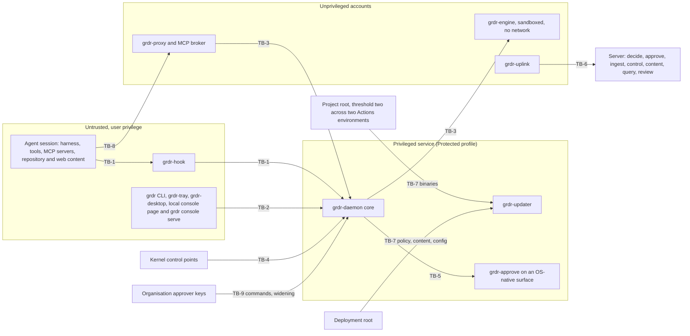

# 02 Threat model

_Status: draft for implementation, written against version 4 of the spine, the rulings in `_review/01-document-rulings.md` and the owner's answers in `_review/02-owner-answers.md`. Date: 2026-11-10. Owning squad: security and trust core (squad names are fixed in `team/`). Read with: `00-decisions.md`; doc 07 (verdict interface), 11 and 22 (updates), 12 and 18 (grants and approvals), 15 (credentials released to agents), 17 (MCP broker), 21 (organisation and device keys), 23 (our own MCP server), 35 (product security programme)._

## Summary

This document states what Guardrails ADR protects, from whom, how strongly, and what it does not protect. It also treats the product as a target: a sensor that holds policy, keys and a kill switch has the shape of LiteLLM, which gained three CISA KEV entries in 2026 (measured, research/21).

Key choices:

1. **Three stances.** Prevent against agent lineage with user privileges, in the Protected profile. Detect against administrators. Limit a compromised server, operator or provider to narrowing and to reversible, expiring containment (D-22, D-31, D-30).
2. **The default adversary has no adversary behind it.** Rules are designed first for the over-eager agent, then for the manipulated one.
3. **Every protection claim is typed by P1** per action class: boundary, scoped boundary, request, or no control (detect-only). Section 3.9 states residual risk in those terms.
4. **Our own local surfaces are untrusted callers.** They may only propose; widening completes only in `grdr-approve` or out of band, at the rule class's minimum approval grade.
5. **Claims can restrict; they cannot permit, explain or clear** (the operational form of P3, section 3.4).
6. **Channels carry data, never commands** (P7), under two trust roots (D-37). In hosted and provider deployments a device accepts a wider policy only with the organisation's signature.
7. **Models are untrusted readers of untrusted text.** They may only restrict (P2); their output is typed and rendered inert.
8. **Fifty security requirements (SR-01 to SR-50)** are the contract with other documents. Each has a component, an oracle and, where ordering matters, a prerequisite. Thirteen secure-development rules (SD-nn) bind our own code.
9. **The threat register is data** (`security/threats.yaml`), mapped to MITRE ATLAS v2026.10, OWASP ASI and SAF-MCP. CI fails when a threat has neither an SR nor a recorded residual risk.
10. **Design level only.** Reproduction detail lives in the held-out suite and embargoed advisories (D-45, D-62).

## Requirements

| # | Requirement | Source |
|---|---|---|
| R1 | Cover assets, adversaries and a trust boundary for every component in spine section 5 | Owner request ("safety", "security") |
| R2 | State each protection as boundary, scoped boundary or request per action class | P1; c3 F1 |
| R3 | No allow, grant, declassification, suppression or clearing depends on a model | P2; c8 F1; research/09, 22 |
| R4 | No verdict rests only on a spoofable source | P3; h02 |
| R5 | Prevent against user-level agent lineage in the Protected profile; detect against administrators | D-22, D-48; l01 F1, F5 |
| R6 | Widening anywhere needs proof of a person at a recorded grade | D-31; l01 F2, F7 |
| R7 | A compromised server cannot run code on devices, widen policy, or issue a response that is irreversible or wider than one device | D-37, D-30; l01 F3, F4 |
| R8 | Degradation never becomes silent fail-open and never bricks a host | D-15, D-37, P9; l01 F9 |
| R9 | Map threats to ATLAS, the OWASP agentic top ten and SAF-MCP | Owner request ("industry standards"); research/21 |
| R10 | Secure-development rules for agent-written privileged code | D-62, D-63; l01 F10 |

## Design

### 3.1 Scope and method

In scope: the three shapes, all eight control points, the four update channels, the server in three profiles, and the project's build and contribution pipeline. Method: assets, adversaries and trust boundaries; then per-component misuse; then abuse of our own features; then the agent kill chain against control points. Each finding becomes an SR, a detection reference or a residual risk. The register is reviewed whenever a spine decision changes, a component's reachable assurance changes, or an adapter canary reports a new control file or hook event.

### 3.2 Assets

| Id | Asset |
|---|---|
| A1 | What agents can reach: source, credential stores, cloud and production systems, the developer's files |
| A2 | Enforcement integrity: floor policy, bundles, the shim's fail-safe table, session state (labels, grants, denial ledgers), a truthful assurance record |
| A3 | Keys: project root, deployment root, organisation signing key, approver hardware keys and roster, device and per-boot keys, the device-local artefact key that signs the shim's fail-safe table (D-14), grant-signing key, identity-vault key, the device pseudonym key and the server re-pseudonymisation key the device never holds (D-51), per-session content keys, interception CA key, brokered leases (docs 15, 21, 22) |
| A4 | Evidence: events, receipts, audit chain, flight recorder, captured content, pseudonym mapping |
| A5 | Availability of the developer's machine and work, of the agents, and of server tier 0 |
| A6 | Channels: binaries, schema and policy, detection content, native agent configuration, response commands |
| A7 | Project integrity: source, CI and release configuration, signing accounts, held-out corpus |
| A8 | Privacy of monitored people: pseudonymity, no per-person scoring, the disclosure surface (doc 29) |
| A9 | Truth of published claims: assurance levels, scorecard, reputation verdicts |

### 3.3 Adversaries

| Id | Adversary | Starts with | Goal and evidence | Stance |
|---|---|---|---|---|
| ADV-1 | Over-eager agent, nobody behind it | The user's privileges, a legitimate task | Finishes the task past its authorisation: 43 to 61% of benchmark tasks (measured, research/22); 12 documented data-loss cases in 15 months (measured, research/21 as corrected by h07); has removed monitoring that was in its way (one vendor's internal report, h07) | Prevent at boundaries, otherwise Ask; designed for first |
| ADV-2 | Manipulated agent | ADV-1 plus an injected goal; reasons around controls; can read our source | Exfiltrate, persist, widen its own permissions | Prevent at boundaries in the Protected profile; detect elsewhere |
| ADV-3 | Malicious MCP server, skill, plugin, extension or repository content | Text the agent reads; code running as the user once started; OAuth metadata | Pre-trust execution, tool poisoning, rug pull, credential redirection | Digest pinning, broker-owned OAuth state, config integrity |
| ADV-4 | Local user | Own uid; on shared hosts, a neighbouring account | Bypass for convenience; read or approve for someone else | Protected profile holds against non-admins |
| ADV-5 | Local administrator or root | Can stop, unload, edit, block egress | Silence the sensor | Detect only; kernel-grade tamper resistance comes from a host EDR in embedded mode (D-22) |
| ADV-6 | Malware (stealer, worm, lifecycle script) | User or admin privilege, no agent session | Steal agent stores and our keys, weaponise agent CLIs, plant agent config, dead-man wipe | Detect reads of agent stores from outside agent lineage and block them where a sensor tier can (SR-12); contain in order |
| ADV-7 | Network attacker | On-path, DNS, a web page reaching loopback, a rogue proxy | Intercept uplink or updates, rebinding, forged telemetry | Application-layer device signature, TUF, Host and Origin checks |
| ADV-8 | Malicious organisation (tenant) | Valid account, its own sensors, content it uploads | Cross-organisation read, pipeline exhaustion, reputation poisoning, attack on review workers | Tenant context, quotas, single-organisation workers |
| ADV-9 | Compromised supply chain | A dependency, build step, signing account, content contribution, or text a development agent reads | Ship code or content to fleets | Two roots, reproducible builds, trust core, two independent evaluators on different models for community content and evaluator evidence for first-party content (D-61 as amended by owner instruction 7) |
| ADV-10 | Insider at an operator or provider, or whoever holds the server | Server, deployment root, console session, technician role | Mass policy change, capture increase, mass kill, content read | Narrow-only artefacts, organisation signature, approver signatures verified on the device |
| ADV-11 | External attacker on the hosted API, console or our MCP server | Internet | Account takeover; injection through fields analysts and models read | Doc 35 controls, inert rendering, organisation-bound tokens |
| ADV-12 | Rogue or compromised approver | One approver hardware key | Freeze or kill at scale | Two signatures for kill and revoke; freeze expires |

**Meaning of `tamper`.** The field names the lowest privilege that can disable or bypass the control without being stopped: `user` (the agent's own uid can), `admin` (only an administrator or root can; the Protected profile), `platform` (a host EDR or OS-protected component resists administrators; embedded mode only).

"User-privileged" is often admin-capable on developer machines (cached or passwordless sudo, docker group, auto-elevating UAC; research/37). A probe at install and at each session start records this without elevating: whether sudo works non-interactively (NOPASSWD rule or cached ticket), membership of container-socket and administrator groups, and the UAC consent level. When the agent is admin-capable and the session is uncontained, the assurance record reports `tamper: user` whatever the profile (l01 F5).

### 3.4 Trust boundaries and how P1 to P3 apply

| Id | Boundary | Rule |
|---|---|---|
| TB-1 | Agent session to shim to daemon | The shim and what it forwards are untrusted; each side authenticates the other by kernel facts |
| TB-2 | User surfaces to daemon | Propose-only; a caller inside an agent session is refused |
| TB-3 | Core to engine, proxy and broker | The core handles fixed-layout messages; untrusted content is parsed only in the sandboxed engine and, for model and MCP protocols, the unprivileged proxy |
| TB-4 | Kernel to core | Kernel-origin facts outrank everything; programs pinned, maps locked |
| TB-5 | Core to approval helper to the person | Presence proof over the action digest; never Rune, never agent-written text |
| TB-6 | Device to server | The server is authenticated but not trusted to widen, execute or kill |
| TB-7 | Update repositories to device | The project root alone authorises binaries; the deployment root authorises policy and configuration, never binaries. Standalone has no deployment root: the project root signs the default content and local policy is authored on the device |
| TB-8 | Proxy, broker and the server's `gateway` to providers and MCP servers | Responses, tool definitions and OAuth metadata are untrusted |
| TB-9 | Organisation, operator, provider | Operator-signed artefacts narrow only; wider commands need approver signatures |
| TB-10 | Server to integrations, judges, third-party APIs | Explicit grants; judge workers reach only their configured back end (SR-37) |
| TB-11 | Project to contributors and dependencies | D-61 rules; the trust core takes the `full` lane: two independent passing evaluators on different models (`eval-security`, `eval-adversarial`) and the independent review D-62 sets (D-63) |
| TB-12 | Host EDR to embedded engine | The host supplies a profile; embedded builds make no network call and embed no trust roots (D-60) |
| TB-13 | Contained session to the rest of the host | `grdr-run` and the sandbox adapters set the boundary at launch; it is claimed only for classes the sandbox conformance suite proves on that back end (D-21) |
| TB-14 | Browser extension and SDKs to the device | Everything they send is a claim (P3) and is parsed in the engine; they hold no keys and receive no policy |
| TB-15 | Connectors to SaaS and provider admin APIs | Responses are untrusted content; credentials are held by reference with the narrowest scope the action needs (SR-33, SR-48) |

Coverage of spine section 5: `grdr-hook`, `grdr-mcp` and `grdr-run` sit on TB-1 and TB-13; the CLI, tray, desktop app and local console on TB-2; `grdr-engine` and `grdr-proxy` on TB-3 and TB-8; sensors on TB-4; `grdr-approve` on TB-5; `grdr-uplink` on TB-6; `grdr-updater` on TB-7; the `grdr-server` targets on TB-6, TB-9 and TB-10; the browser extension and SDKs on TB-14; connectors on TB-15; `grdr-ffi`, `grdr-wasm` and `grdr-fastpath` inside a host on TB-12.

**P1 in practice.** Text about strength is generated from the assurance record, never written by hand. `mandatory-boundary` renders as "enforced by the OS or gateway"; `scoped-boundary` as "enforced for sessions started inside containment"; `request` as "asked of the agent, which can ignore it"; `none` as "not enforceable here, detection only". A rule whose effective control is `request` with `on_failure: open` cannot display Block without that qualifier (D-44).

**P2 in practice.** Every label and risk contribution carries `origin` (deterministic, heuristic, model). The pack linter marks a rule model-dependent if any input has model origin. Such a rule can only add a restriction, and with the model absent it must fall back to its rule-only outcome. The never-model-dependent list in P2 is a lint list of rule classes that reject model-origin inputs outright.

**P3 in practice.** Spoofable sources: hook payloads, harness OTel, transcripts, SDK instrumentation, anything received on a loopback listener, and the payload and provider identity of user-mode ETW events (the kernel-stamped header PID is trustworthy and is validated; h02 verification). A claim alone may restrict. A claim alone may never: satisfy a `forbid ... unless` evidence condition; explain an observed effect, unless the expectation was issued on our own peer-verified hook path and bound to tool-use id and process key; raise an attribution grade above 1; set `actor_kind: human`; clear or suppress a finding; or trigger automated response wider than deny or hold.

### 3.5 Per-component analysis

| Component | Runs as | Could be misused for | Protection |
|---|---|---|---|
| `grdr-hook` | User, in the agent tree | A forged allow from a squatted endpoint; a stall into the agent's fail-open timeout | SR-01, SR-14 |
| `grdr-daemon` core | root or SYSTEM (Protected); user (User) | Privilege escalation through IPC; policy or grant forgery | SR-02, 05, 06 |
| `grdr-engine` | Unprivileged, sandboxed, no network | Parser exploit from payloads, transcripts, MCP traffic; crash to force degradation | SR-05, 16; SD-04 |
| `grdr-uplink` | Unprivileged; the only path to the server and the update repository | Exfiltration channel; server-driven attack on the device | SR-41; downloads go to staging and it cannot verify, activate, or write policy or keys |
| `grdr-proxy` (model listener and MCP broker), `grdr-mcp` (stdio wrapper) | Unprivileged | Open relay; credential oracle; client-chosen destination | SR-38 to 40 |
| `grdr-updater` | Privileged, on demand, no network | Attacker binaries; rollback to a vulnerable build | SR-24, 28 |
| `grdr-run`, sandbox adapters | User | A broker path out of lineage; a false containment claim | SR-09; sandbox conformance suite (D-21) |
| `grdr-approve` | Privileged helper or OS authenticator | Synthetic approval; approve-then-swap | SR-18 to 22 |
| `grdr` CLI, `grdr-tray`, `grdr-desktop` | User | The agent pauses protection, lowers a Mode, accepts its own exception, joins a hostile server | SR-04, 23. Rune runs in our sandbox profile, built from a fork with the tooling flags removed (D-43); replacing argv through `App::args` is not enough, because `is_headless()` still reads process argv (research/29 verification) |
| Local web console | `grdr console serve`: a per-logon-session loopback listener started on demand, user privilege, client of the daemon's local API (D-42, D-43; doc 03); the daemon binds no TCP port | Cross-origin calls, DNS rebinding, token theft | SR-03 |
| Kernel programs: eBPF (observation; enforcement requires S-12 and trust-core review); macOS Network Extension (requires Apple's Developer Program) and Endpoint Security (requires the entitlement); optional Windows driver (requires a sponsor or partner for the EV certificate and Microsoft's hardware programme) | Kernel or system extension | Host crash or stall; unload by root | SR-15; D-19 pinning; SD-05 review before leaving the internal ring |
| Server inline path: tier 0 (`decide`, `approve`), `gateway`, and `router` (hosted service only; requires the `distributed` profile and its load test) | Service | Authorisation bypass, fail-open evaluation, command dispatch abuse | SR-29 to 31, 46 |
| `ingest`, `control`, `content`, `query`, `detect`, `store`, `keys`, `identity`, `audit`, `api` | Service | Cross-organisation read; operator content read; pipeline exhaustion; rogue enrolment; state rollback through restore | SR-41 to 45, 49, 50 |
| `notify`, web console | Service, browser | Stored injection through agent-written fields reaching analysts, tickets and chat | SR-36; doc 35 |
| `review`, judge back ends (the review stage requires the judge back-end trait) | Workers | Injection through reviewed text; leaks through verdicts | SR-36, 37 |
| `intel` (the mirrored pack needs no server; own scanning requires the server's `intel` target) | Service, signed pack | Reputation poisoning; a false "malicious" verdict used to disable a rival's tool | Verdicts ship as packs (SR-25, 28); D-32 two-source rule; scanner verdicts are risk signals, not controls |
| Our MCP server | API facet | An agent reads policy to plan around it; an injected analyst agent | SR-47 |
| Integrations host, connectors | WebAssembly, out-of-process | SSRF, secret theft, code on sensors; an over-scoped SaaS or EDR credential used for mass change | SR-48, 33; the provider-admin kill actuator sits behind SR-29 |
| Browser extension, SDKs | Page or application | Over-collection; forged self-attribution | P3 grading; P8 data classes |
| Content repository, build, release | CI | A malicious rule, pack or dependency | SR-25, 26; SD-03, 05 |

### 3.6 Abuse cases of our own features

| Feature | Abuse | Mitigation | Residual |
|---|---|---|---|
| Kill switch (session scope on the device; fleet scope requires the server) | A compromised server or technician stops every agent; a bad rule triggers mass response; a wiper fires on token revocation (research/21 items 103 and 104, single-vendor reports per h07); one user's agent ends another's session | SR-29 to 32; blast-radius cap and simulate-first for automated rules (D-30); P3 rule | One approver can freeze a scope for 60 minutes. A compromised server can send expiring session-scope and device-scope containment to each device in turn; devices rate-limit it, nothing is revoked or deleted, and it lapses |
| Approvals | Synthetic input or accessibility APIs press the button; padded prompt; argv swapped after approval; fatigue | SR-18 to 22 | A present human can approve a bad action |
| Policy push | Operator widens or raises capture; the configuration channel plants a hook command; narrowing used to stop work | SR-23 to 27 | Narrowing as denial of agent work: staged, visible, reversible by the organisation |
| Credential broker | The agent asks a helper for the real secret; the broker becomes a local credential endpoint | SR-34, 35 | `release` mode hands the session a short-lived real secret |
| Phantom tokens | Replayed from another process to frame the agent or obtain injection | SR-34 | Limited by platform coverage of the peer check |
| Local sockets and pipes | Squatting before the daemon starts; impersonating the daemon; another user's session connecting | SR-01, 02 | User profile: the daemon runs under the agent's uid |
| Loopback OTLP receiver | A web page or local process forges telemetry to hide activity, frame a session or flood | SR-39; P3 rule | Forged claims can still create findings, marked `claimed` |
| Local console | Rebinding or cross-origin calls; an agent fetches the page with the launch token | SR-03, 04 | Same-user read of what the user can already read |
| Tray and Rune desktop app | Accessibility APIs press a Rune button; headless flags drive the binary (research/29, verified) | SR-04, 18 | The agent sees the screens the user sees |
| Our MCP server | A governed agent reads policy and its exception state; an injected analyst agent proposes widening | SR-47 | Metadata the role is entitled to |
| LLM review of untrusted text | Reviewed text instructs the judge; verdicts leak a bit per query; the console renders judge prose as a link | SR-36, 37 | Published miss rates; never a control |
| Integrations runtime | SSRF; one plugin reads another's secret; an incumbent-EDR credential reaches remote shell | SR-48, 33 | Containment-scope credentials still contain |
| Update and content channels | Rollback, freeze, mix-and-match; a pack that crashes the engine fleet-wide; the rapid lane used for behaviour change | SR-16, 24 to 28 | A withheld update leaves a device Stale but enforcing |
| `grdr join`, `leave`, `uninstall` | An agent or a phished user enrols the device into a hostile server, which becomes the deployment root | SR-23 | A person who approves a hostile join hands over policy |
| First-run scan | Parses existing transcripts before protection exists | SR-05; the scan is read-only and unelevated (D-48) | Transcripts are claims: a planted one can misstate history in the first-run view |
| Evidence request, flight recorder, support bundle | A compromised server or technician pulls recorded content the capture level does not allow; a bundle leaks secrets | The device applies its capture level to every evidence request (D-52); content beyond it needs a content grant (SR-26); `grdr support-bundle --preview` redacts on the device (SD-11) | Whatever the organisation's capture level already permits |

### 3.7 The agent kill chain and framework mapping

Stages extend the seven-stage promptware kill chain (research/22 item 62). K1 and K3 to K8 follow its initial access, privilege escalation, reconnaissance (widened here to privilege and credential expansion), persistence, command and control, lateral movement and actions on objective; K2 (pre-trust execution) and K9 (defence impairment) are added. Identifiers come from research/21 section 15 (ATLAS v2026.10 and SAF-MCP data pulled 2026-11-09; OWASP ASI names confirmed in h06). The assignment of classes to identifiers is the brief author's, not the frameworks'; CI re-validates that every identifier exists in the pinned datasets. "First control" gives the control point that acts first and its P1 strength on Linux in the Protected profile with kernel enforcement; the register holds the same column per OS and profile.

| Stage | Techniques seen | ATLAS (AML.) | ASI | SAF-MCP (SAF-) | First control and strength |
|---|---|---|---|---|---|
| K1 Influence | Indirect injection through web, issues, tool output, tool descriptions, skills; or none (ADV-1) | T0051.001, T0068, T0134 | 01 | T1102, T1110 | Broker and proxy label sources `untrusted:*`; no prevention claimed |
| K2 Pre-trust execution | Repository-carried agent config, MCP stdio auto-start, lifecycle scripts | T0081, T0142 | 05, 04 | T1101, T1206 | Config integrity at clone (detect); sensor floor rules (boundary) |
| K3 Guardrail evasion | Shell-semantics gaps, path tricks, tool-fallback pivot, nested headless agent, hook stall | T0107, T0053 | 02, 09 | T1401, T1403 | Hook is a request; the sensor judges the concrete effect (boundary) |
| K4 Expansion | Sandbox escape, `elevate` paths, credential-store reads, cloud metadata | T0105, T0083, T0055 | 03, 05 | T1303, T1502 | Protected paths and `elevate` (boundary in contained sessions) |
| K5 Persistence | Writes to hooks, MCP entries, rules, memory, instruction files, autoruns | T0081, T0080.000 | 06 | T1204, T1202 | Essentials Block on control files (boundary) |
| K6 Command and control | Base-URL drift, heartbeat instruction files, tunnels, AI service as relay | T0108, T0096 | 10 | T1901, T1904 | Session egress profile (boundary with containment, else request) |
| K7 Lateral movement | One agent rewrites another's config; repository-borne propagation; shared stores; CI | T0118, T0143 | 07, 08 | T1705, T1701 | The control-file rule covers every agent on the host; cross-run detection is server-side |
| K8 Objective | Exfiltration to sinks, destruction, publishing, resource abuse | T0077, T0086, T0101, T0034 | 02, 08 | T1910, T2101 | Sink gating on `secret-read` (boundary for egress sinks, request for sinks seen only at the hook); irreversibility gate (Ask, request); mass-change breaker (detect, then end session) |
| K9 Defence impairment | Sensor or monitor tampering, alert-recipient edits, indicator removal, dead-man logic | T0138, T0121 | 10 | T1106 | D-22 protected state (boundary against users, detect against admins) |

Classes that span stages or belong to one adversary:

| Class | Adversary | ATLAS (AML.) | ASI | SAF-MCP (SAF-) | First control and strength |
|---|---|---|---|---|---|
| Tool poisoning, shadowing, rug pull | ADV-3 | T0110, T0109, T0099, T0111 | 04, 02 | T1001, T1008, T1201, T1501 | Broker pins tool definitions by manifest hash and re-asks on change (SR-40); request unless egress forces the broker path |
| MCP authorisation failures (mix-up, audience, confused deputy, rebinding) | ADV-3, ADV-7 | T0091.000, T0106 | 03 | T1009, T1007, T1307 | Broker-owned OAuth state bound to issuer and audience (SR-40); request, as above |
| Malicious skills, extensions, packages | ADV-3, ADV-9 | T0010.001, T0010.005 | 04 | T1002, T1003, T1004 | Digest pinning and drift detection; mirrored intelligence pack matched on the device (detect); disable by digest (D-30, D-32) |
| Agent CLI weaponised by malware | ADV-6 | T0112.000, T0053, T0103 | 02, 10 | T1111 | Hook dark and unmatched-effect findings (detect, D-13); SR-12 for the stores |
| Identity and privilege abuse through shared credentials | ADV-2, ADV-6 | T0012, T0073 | 03 | T1302, T1304 | Protected paths; broker `inject` mode wherever the credential broker runs (SR-34, 35) |
| Gateway and framework exploitation, ours included | ADV-7, ADV-11 | T0049, T0132 | 04 | T1005, T1404 | SR-40, SR-46; a host gateway that can fail open is reported as a request (D-40) |

The thirty default detections in c8 F5 carry a stage tag and these identifiers in pack metadata. The register records which stages have no boundary per OS and profile; that table feeds the ceiling matrix (D-23).

### 3.8 Security requirements

The Requires column names what must exist for the requirement to hold, or for its stronger form, where that matters; "None" means it holds wherever its component runs. Oracles are in the test section. A requirement on agent behaviour (SR-08, 09, 12) holds at the strength the assurance record reports for that device and action class: a request at hooks, a scoped boundary in contained sessions, a mandatory boundary on Linux with kernel enforcement. The component's own design document implements each SR; this document owns the wording, the oracle and the test id.

| SR | Requirement | Component | Requires |
|---|---|---|---|
| 01 | The shim verifies the daemon endpoint's owner before trusting a verdict; the daemon authenticates peers by kernel handle, never PID | `grdr-hook`, daemon | None |
| 02 | Local APIs are sockets or pipes, in privileged-owned locations in the Protected profile; the installer refuses multi-session hosts unless it supports per-logon-session policy and listeners (D-59); CI asserts the generated listener and egress-destination inventory (`grdr egress`) | daemon, installer | None |
| 03 | Local console: loopback, random port, one-time launch token, Host and Origin checks, no CORS, mutations only as proposals; the listener is `grdr console serve`, an unprivileged process, never the privileged core; blocked from session containers where a network boundary exists | console listener, daemon | None |
| 04 | Mutating calls from any local surface or our MCP server are proposals; calls from inside an agent session are refused | daemon | None |
| 05 | The core parses fixed layouts only; all untrusted content, the first-run scan included, is parsed in the sandboxed engine (model and MCP protocols in the unprivileged proxy); IPC frames are size-capped and versioned | core, engine, proxy | The unprivileged proxy, for model and MCP protocols |
| 06 | Protected profile: policy, keys, spool, shim and managed settings are not user-writable; only the two topologies are tested | installer | None |
| 07 | User profile reports `tamper: user` and `control: request` for every class, records local approvals at G0 at most (the grant-signing key sits under the agent's uid), runs no credential broker and no interception CA, and renders no boundary claim | daemon, `ui` | None |
| 08 | Agent-lineage writes to any agent's control files, our files, and monitoring or alerting configuration are Block from first protection | Essentials, sensors | An OS sensor tier that can deny, for the boundary form |
| 09 | `elevate` is Ask by default (Essentials: Ask in the Protected profile, Watch in the User profile; D-53) and fail-closed from contained sessions; the admin-capable probe feeds the record | sensors, `grdr-run` | `grdr-run`, for the fail-closed form |
| 10 | Hook dark, "configured, not effective", sensor stop, uninstall and heartbeat gaps are tamper findings; a signed going-down event exists; the server suppresses gaps inside its own outages | adapters, `detect` | Server `detect`, for heartbeat gaps |
| 11 | Session identity is sensor-assigned; labels, grants and denial ledgers inherit to children; the harness cannot reset them | `grdr-session` | None |
| 12 | Agents' local stores (tokens, MCP secrets, transcripts, conversation databases) are a protected-path class against processes outside agent lineage. A finding wherever a sensor observes the open. Denied on Linux by the kernel tier. macOS and Windows: no control without Endpoint Security or the driver; the record says `control: none` | sensors | An OS sensor; Linux kernel enforcement for denial |
| 13 | Core-to-engine liveness detects suspension of either process; bind-link redirection of the install directory is monitored on Windows. Both are admin-level techniques, so this is detection (research/37) | daemon, Windows sensor | Windows sensor, for redirection monitoring |
| 14 | The shim decides from its parse-free fail-safe table, compiled on the device by the privileged service and signed with the device-local artefact key, after 250 ms of silence or at the deadline in a valid update-handover marker (never beyond 2 s), and always returns within 2 s | `grdr-hook` | None |
| 15 | Zero silent fail-open: every open path sets Degraded and emits an event; fail-closed and kernel holds apply only inside session containers | control points | None |
| 16 | The crash-loop ladder never relaxes fail-closed classes or passes the signed security floor; an input-correlated crash quarantines the input | updater, engine | None |
| 17 | Malformed denies; unresolved is `exec.opaque`; an unrecognised harness version drops to Watch and is reported | normalisers | None |
| 18 | `grdr-approve` uses OS-native surfaces only and renders the canonical action with length and hidden-character warnings; the agent's own permission prompt is never an approval at any grade and may only point the person to `grdr-approve` | `grdr-approve` | None |
| 19 | A grant is exact and single-use by default. Its digest covers canonical argv, working directory, environment delta and content hashes of referenced executables and scripts; it is re-checked at the hook and at the OS control point, and voided by label escalation | `grdr-policy`, `grdr-session`, control points | None |
| 20 | Minimum grade unavailable: Ask becomes Block, except that for the user's own local policy in the User profile a disclosed time lock (default 10 minutes) may stand in for G1 (D-31). Three unanswered or denied requests in a row freeze the session. No self-approved exception | engine, `approve` | Server `approve`, for server-side approvals |
| 21 | Only G2 and G3 are called unforgeable; a tier that fails S-16 on a platform is relabelled G0 there before release | `grdr-approve`, release gate | None |
| 22 | Out-of-band approval shows the server-rendered canonical action and a binding code; timeout denies | `approve` | Server `approve` target |
| 23 | Step-up for join, leave, uninstall, pause, Mode down, exception, pack removal, capture level up, provider or exclusion registration and kill-switch release. A join shows the server address and deployment-root fingerprint | daemon, `grdr-approve` | Server, for the join display and provider registration |
| 24 | Only the project root authorises binaries; rollback, freeze, mix-and-match and wrong-root attacks fail; expiry marks Stale and never stops enforcement | updater | None |
| 25 | The pack verifier rejects any pack, adapter manifest or provider registration that introduces anything to execute, contact or set: a command, executable path, URL to fetch, environment variable to set or MCP server to start. Host patterns, environment variable names and path templates are allowed as typed match fields (P7) | verifier | None |
| 26 | Operator-signed artefacts narrow only, checked on the device (a timeout counts as widening; churn in feed-managed, restrict-only lists from signed intelligence packs does not, D-08); widening, capture increases and content grants need the organisation's signature in hosted and provider deployments | `grdr-policy` | A deployment root (`grdr join`), for the device-side check; the field needs none |
| 27 | Native agent configuration comes from code-defined templates whose only executable is our shim's absolute path; writes are atomic, journalled and never touch another vendor's entries | adapters | None |
| 28 | The updater verifies signed metadata only and does no network I/O; content is trial-loaded in the engine before activation and rejected if it needs a newer engine; the rapid lane takes indicators and reputation verdicts only and still bakes | updater, engine | Server rings, for the rapid lane |
| 29 | Commands above device scope carry approver hardware-key signatures, scope, counter and expiry, verified on the device against a quorum-changed roster | daemon, `control` | Server `control` target |
| 30 | A command signed only by the deployment key is limited on the device to session or device scope, to D-30's automatic actions, and to a stated expiry | daemon | Server `control` target |
| 31 | One approver may freeze for 60 minutes; re-freezing the same scope with the same key within 24 hours needs a second signature; kill, revoke and extension at organisation scope need two | daemon | Server `control` target |
| 32 | Devices rate-limit destructive commands; kill state survives reboot; order is freeze, isolate, capture, revoke | actuators | Server, for remote destructive commands |
| 33 | Incumbent-EDR credentials: containment scopes only, never script execution, under the organisation's key | integrations | Integrations host and an incumbent-EDR connector |
| 34 | The broker verifies kernel handle, executable identity and scope; a phantom token counts only with a matching kernel peer; no credential over TCP | broker | Credential broker (launcher, Protected profile) |
| 35 | `inject` by default; `release` at most 15 minutes, reduced scope, labels `secret-read`; leases never reach the hosted service; release is refused to uncontained sessions by default where containment is on for the agent (D-21, P13) | broker | Credential broker (launcher, Protected profile) |
| 36 | Text written by agents, tools or models is rendered inert (no links, images or Markdown) in console, notifications, tickets and exports. Judges trust policy only; other input is framed as untrusted; output fills typed fields | `ui`, `notify`; `review` | Console and `notify` for rendering; the review stage for judges |
| 37 | Judges and review workers: no egress except to the configured back-end endpoint, no credentials except that organisation's back-end key, unwrapped by `keys` per job and usable only against that endpoint (the exception doc 19 needs), one organisation at a time, verdict codes only, rate-limited; probing raises a finding | `review` | Review stage; judge back-end trait |
| 38 | Interception CA: opt-in, per device, name-constrained, memory-only, injected per process tree, never in an OS or browser store | `grdr-proxy` | None |
| 39 | Loopback receivers run in an unprivileged process, never the privileged core. They require the expected content type, reject any request carrying an Origin header, require a per-instance token set through the agent's managed settings, tag the kernel-derived peer where the OS provides one, and store everything as a claim | receiver process, engine | None |
| 40 | Proxy and broker take destinations from policy, pin tool definitions by hash, bind OAuth state to issuer and audience, never start a stdio server from API input, and deny on evaluation error | proxy, broker | None |
| 41 | Device authentication is an HTTP message signature by the device key; each transport downgrade is reported; two chains under one device id is a clone finding; enrolment tokens are single-use and a device enrolled with a deployment key stays in Watch until admitted | `grdr-uplink`, `control` | Server |
| 42 | No server read without a tenant context, backed by row-level security and per-organisation keys and prefixes | server | Server |
| 43 | The operator cannot read content; operator access needs a tenant-visible, time-boxed grant; break-glass needs two people; D-55 invariants are tested | `api`, `keys` | Server |
| 44 | Per-organisation limits on ingest, bus and query; at quota, verdicts, findings and audit are never dropped | server | Server |
| 45 | Hash-chained lanes with signed batch heads; byte-exact archive; cross-organisation actions in both audit logs | sensors, `audit` | Server `audit`, for the archive and cross-organisation logs |
| 46 | Tier 0 denies on evaluation error, has no default keys, and keeps master secrets off request paths | `decide`, `gateway` | Server `decide` and `gateway` |
| 47 | Our MCP server: stateless, read-only, organisation-bound tokens, no content without a content grant, no code execution, no response actions; a governed session cannot read policy, detection content or its own exception state | `api` | Server `api` |
| 48 | Sensors run declarative manifests only; server integrations are WebAssembly with explicit grants or out-of-process, with an egress allow-list and secrets by reference | integrations | Integrations host |
| 49 | Privacy floor: re-identification needs a purpose, an incident reference and two approvers and is shown to the subject; no layer can hide the disclosure surface; the pack validator rejects grouping by principal | `identity`, daemon, verifier | Server `identity`, for the vault |
| 50 | A server restore mints a new server epoch and replays revocations, kill states and consumed token ids from versioned object storage; the audit log is never restored backwards | `store`, `control`, `audit` | Server |

### 3.9 Non-goals and residual risks

This section is reviewed whenever the register is (3.1).

Non-goals: model safety and content moderation; anti-malware; stopping a malicious human who uses an agent as a tool (we attribute; policy may restrict); kernel and firmware vulnerabilities, vulnerable-driver attacks included; covert channels inside an allowed model provider; mobile and ChromeOS devices.

| Residual risk | What holds, in P1 terms |
|---|---|
| Agent on Windows or macOS that entered no containment route (without the optional driver or Endpoint Security) | Request at hooks; detect-only outside the hook. macOS tiers 1 and 2 report `visibility: claimed`, so no cross-check |
| Administrator or root | Detect-only: heartbeat gap, going-down event, chained spool. Kernel-grade resistance only inside a host EDR |
| Same-user malware reading agent stores on macOS and Windows | No control without Endpoint Security or the driver (SR-12); on Linux detect-only without kernel enforcement. Brokered `inject` credentials remove the secret from the store instead |
| Compromised server or deployment key | Narrowing and expiring session-scope or device-scope containment still land (SR-30); devices rate-limit, the organisation can reverse it, and receipts record it |
| Actions inside shared hosts (IDEs) with no per-call binding | Attributed `undetermined` (D-25); request at hooks only, and each rule class states how it treats `undetermined` |
| User profile | Every control is a request. The agent can remove hooks and stop a daemon under its own uid; a later scan or an enrolled server's gap finding is the only signal |
| SaaS-hosted agents; server-side tool execution | Connector visibility only, never above AL1 |
| Harm inside allowed scope (a bad commit to an allowed repository) | Not prevented. Irreversibility gate (Ask) and detections only |
| Exfiltration through an allowed multi-tenant host without the explicit proxy | Connect and SNI rules cannot see path or tenant; pinning is a scoped boundary for sessions routed through the proxy |
| Model-origin detections | Never a control. One vendor's classifier missed 17% of real overeager actions (measured on 52 cases, research/22) |
| A person approves a harmful action | Grades prove presence, not judgement |
| Self-hosted operator who is also the organisation | The deployment root can widen; receipts and the audit chain record it |
| Project root threshold compromised | Total. Offline keys and reproducible builds reduce it; a public tile log (D-39, which requires an external witness) exposes it |
| Late labels | A detection that arrives after the decision raises a finding; it undoes nothing |
| Trusted Dev Drive volumes on Windows | File filters outside the antivirus altitude range are detached there, which blinds the optional driver's minifilter and any incumbent filter we ingest from; the sensor reports the volume as a coverage gap and file evidence comes from hooks (claims) (h02) |
| Dead-man logic in malware | Response order shortens the window; no guarantee |

### 3.10 Secure-development requirements

Process and staffing are in doc 35; these are the rules code must meet.

| SD | Requirement |
|---|---|
| 01 | `#![forbid(unsafe_code)]` except in OS adapter crates and `grdr-ffi`, where each block carries a safety comment enforced by lint and its tests run under Miri where Miri can execute them and under AddressSanitizer otherwise |
| 02 | Privileged crates deny `unwrap`, unchecked indexing and unchecked arithmetic; our own programs build with `panic = "abort"` and are restarted by the supervisor; `grdr-fastpath` and `grdr-ffi` return errors and never abort a host process |
| 03 | `cargo-deny` and `cargo-vet` gate dependencies; SBOM and VEX from the first release; SLSA Build L3; reproducible builds; seven-day patch target for bundled dependencies (D-46, D-62) |
| 04 | Every parser and normaliser has a fuzz target and a differential target against its real consumer; the pack validator is differential-fuzzed against the production interpreter (D-10; the 2024 outage in research/37) |
| 05 | Trust-core paths (`security/trust-core.paths`, listed under Interfaces) always take the `full` lane: `eval-security` and `eval-adversarial` in clean contexts, cross-model review by the model that did not write the change, and two independent passing evaluators on different models; no evaluator judges its own change. A trust-core change also needs a reference model with differential tests, and matrix and soak evidence. A component leaves the internal ring only through the review D-62 sets for it, run by those evaluators plus any free external audit (OSTIF, OpenSSF Alpha-Omega or a similar programme for open-source projects) that has arrived; without it the component stays in the internal ring (D-62, D-63) |
| 06 | Agents that read outsider-authored text have no write access and no secrets; the development fleet runs under the last signed release; protected paths are enforced by sandbox rules and a CI diff check (D-47) |
| 07 | Cryptography composes vetted libraries only (rustls with aws-lc-rs); token comparison is constant-time |
| 08 | Embargoed fixes are made by agents in a private fork of the repository with network tools off; whether the subscription's data terms give zero retention is recorded, not a gate; pre-disclosure at least ten working days ahead |
| 09 | `SECURITY.md` exists at the first commit and private reports are triaged by `lead-security` in a sealed lane with no public write and no secrets. An engine or normaliser bypass, a memory-safety fault and any SR violation are vulnerabilities with CVE and VEX per supported line; a missed detection is a content gap |
| 10 | Signing accounts have two administrators (the owner and the buddy); artefacts are signed keylessly through GitHub's OIDC identity; the project root and `binaries` keys live only in two GitHub Actions environments (release signer and independent rebuilder), generated inside their jobs, and the threshold needs both; no person and no agent session reads a project key |
| 11 | No secret on a command line, in logs or in a support bundle |
| 12 | Third-party skills, plugins and actions are pinned by commit and verified after checkout against the resolved commit, not the ref name (research/21 item 12) |
| 13 | One classifier sets each change's tier and review lane from the diff: `static` lands on deterministic proofs, `light` on one evaluator pass, `standard` on its tier's evaluators, and `full` (high tier or trust core) on two independent passing evaluators on different models; an agent may raise a lane, never lower it. Tiers tighten automatically when revert or incident rates rise (D-63) |

### 3.11 Capabilities with prerequisites or external preconditions

| Item | Design | Seam in the core | Requires |
|---|---|---|---|
| Windows driver, macOS Endpoint Security | Raise `control` to `mandatory-boundary` and `tamper` towards `platform` | Sensor trait and assurance record already carry the values | D-17 and D-18 preconditions: a sponsor or partner for the EV certificate and Microsoft's hardware programme; Apple's Developer Program and the Endpoint Security entitlement; trust-core review (D-63) |
| Provider tier | Provider actions are reversible containment; anything wider needs the organisation's co-approval | Organisation-signature field in the pack format; a roster per organisation | Server; tenancy model (D-35) |
| Endpoint-sealed fields, third-party proof of policy integrity | Content the operator cannot decrypt; witnessed policy digests | Reserved schema fields (D-35) | Server `keys` target; an external witness for witnessed digests (D-39) |
| Model tiers beyond one review stage | SR-36 and SR-37 unchanged | `origin` on every label; typed judge output schema | Tier 0; judge back-end trait; the organisation's chosen judge back end and a capture level that permits it (D-29) |
| Own reputation scanning | Single-organisation, credential-free, egress-denied detonation workers | Pack type for reputation verdicts | Server `intel` target; data from many organisations (D-32) |

## Interfaces and contracts

- `security/threats.yaml`: per threat `id`, `adversaries`, `stage`, `assets`, `atlas`, `asi`, `saf_mcp`, `srs`, `detections`, `tests`, `residual`.
- `security/requirements.yaml`: the SR and SD tables with `component`, `requires`, `oracle`, `test_ids`. `verify` fails if an SR whose prerequisites exist in the build has no passing test id.
- `security/trust-core.paths`: read by the change classifier and CODEOWNERS (docs 30, 35). It holds path globs for exactly the D-63 list: the eBPF crate; the Windows driver; the macOS extension shell; `grdr-daemon`; the IPC peer-authentication code in `grdr-wire` and its OS adapters; `grdr-update` and `grdr-updater`; `grdr-crypto`; evaluator semantics in `grdr-policy`; the tenant context and row-level-security code; every `unsafe` block in `grdr-ffi`; `grdr-approve`; gate, CI and release configuration; and `audits/**`, listed explicitly. The file is itself on the list. The D-62 audit scope adds `grdr-hook` and the transport.
- Assurance record (doc 07): this document fixes the meaning of `tamper` (3.3), including the admin-capable rule, and the rendering rule in 3.4.
- Pack manifest (doc 22): the forbidden-field list of SR-25, the narrow-only signer class and the organisation-signature field of SR-26.
- Response command envelope (doc 22): the fields of SR-29 to SR-31.
- Finding class `tamper` and the evidence-origin rule of P3 (doc 04).
- Efficacy harness (D-45): the abuse-case track supplies scenarios; held-out variants stay private.

## Behaviour by deployment shape

| Shape | Differences |
|---|---|
| Standalone, User profile | No server adversary. Every control is a request (SR-07). Local approvals and widening are recorded at G0, because the agent could make the same change by editing files; a rule class whose minimum is above G0 follows D-31 and blocks, except that for the user's own local policy a disclosed time lock (default 10 minutes) may stand in for G1; the first-run screen says which classes that affects |
| Standalone, Protected profile | Prevent stance against ADV-1 to ADV-4. No remote commands exist; update fetches under the project root are the only remote input, and they can be turned off |
| Platform, self-hosted | Operator and organisation are usually one party, so narrow-only protects against server compromise only when the organisation key is held off the server; `grdr server preflight` warns when it is not |
| Platform, hosted | ADV-8, ADV-10 and ADV-11 apply in full. Organisation signature required for widening. A hosted organisation, beta included, requires the D-63 preconditions (two people on call, met by the owner and the buddy; Loonaro as the legal entity; a written incident-reporting process; infrastructure funded by revenue, sponsorship or donated cloud credits) and the `distributed` profile with its load test. Self-hosting is the default way to run the platform |
| Embedded | The host owns self-protection, updates and response. The engine returns "not evaluable" for rules the host profile cannot support (D-60). SR-01 to SR-07 become host-contract items in the conformance kits |

## Extension points

- A contributor adds a threat with a pull request to `threats.yaml` that carries one mapping and either an SR reference or a residual-risk entry.
- Abuse-case scenarios are harness data; a new one needs an oracle statement.
- Community adapters, verdict providers and integrations declare which SRs bind them; the port test kit carries the checks. Verdict providers receive minimised payloads and return only DENY or STEP_UP (D-14).
- Framework mappings are a pack, so a new ATLAS or SAF-MCP release is a content update.

## Security and privacy

The register is public and design-level. Reproduction steps and held-out scenarios stay private until two releases after use (D-45) or the advisory date (D-62). Privacy threats are security threats here: an operator who raises the capture level, re-identifies a pseudonym or hides the disclosure surface is ADV-10, and SR-23, SR-26, SR-43 and SR-49 apply. Doc 29 owns the regimes. This document adds no data collection.

## Test and evaluation strategy

| Property | Test | Oracle |
|---|---|---|
| No local widening without a person (SR-03, 04, 23) | S-17: real agents with a policy-conflicting goal, free to use CLI, pipes, loopback HTTP, accessibility APIs and deep links; 200 runs per OS | Semantic diff of effective policy, computed outside the product; target zero |
| Approval cannot be forged (SR-18 to 21) | S-16: synthetic input, accessibility invocation, an elevated-terminal agent, a script swapped after approval; 1,000 attempts per platform | Grants issued versus approvals the harness's scripted human gave; target zero |
| Self-protection (SR-08 to 13) | Real agents tasked to disable hooks, edit control files or stop the sensor | Control-file digests and sensor liveness measured by the harness |
| Compromised server (SR-24 to 31) | Drill against a test server: a red team holds the test server and deployment key | Device-side policy diff and command log: only narrowing and expiring session or device actions land |
| Zero silent fail-open (SR-14 to 16) | Fault injection: kill, stall, suspend, full disk, event storm from an agent tree, replayed crashing input | OS-level record of whether the action ran versus the reported state; no host-wide stall over 1 s (target) |
| Channel attacks (SR-24, 25, 28) | TUF attack suite; a corpus of packs each breaking one forbidden-field class, plus mutation | Installed version and last-known-good store; verifier rejection |
| Parser safety (SR-05, 17) | Continuous and differential fuzzing | Real-consumer behaviour; no crash in the privileged core |
| Claims cannot permit (P3, SR-39) | Forged hook, OTLP and transcript records from a non-agent process and a browser page | No grant, cleared finding, raised attribution grade or response beyond deny or hold |
| Judge containment (SR-36, 37) | Canary instructions in reviewed text; verdict-probing sequences | Typed fields unchanged; no packet leaves the worker except to the configured back end; probing finding raised |
| Organisation isolation (SR-42 to 44) | Canary records per organisation; every API and query path run under another organisation's context; quota exhaustion | Canary never returned; verdict and audit paths unaffected |
| Inventory (SR-02) | OS socket table and observed egress on a running install | Equal to the generated lists |
| Local peers and profiles (SR-01, 06, 07) | A squatted endpoint, a forged peer and a user-level write to each protected file, per OS and profile | Shim refuses the endpoint; OS denies the write in Protected; User-profile screens and records carry no boundary claim |
| Out-of-band approval and response order (SR-22, 32) | Approval with a mismatched binding code and after timeout; a burst of destructive commands; reboot under a kill | No grant minted; burst capped at the device limit; kill state present after reboot; actuator log shows freeze, isolate, capture, revoke in order |
| Proxy, broker and CA (SR-38, 40) | Client-chosen destination, changed tool definition, OAuth metadata naming another issuer, stdio start through the API, forced evaluation error; OS and browser trust stores inspected after interception | Each denied; no CA in any store and no key on disk |
| Transport and audit (SR-41, 45) | Replayed and unsigned batches; a cloned device key; a reused enrolment token; an edited spool | Server rejects each; clone finding raised; `grdr audit verify` fails on the edit |
| Credentials (SR-33 to 35) | Broker called from outside the session's kernel peer; a `release` lease past 15 minutes; a script-execution call with the stored EDR credential | No secret returned; the expired credential is rejected upstream; the call is outside the credential's scope and fails |
| Tier 0, MCP server, integrations (SR-46 to 48) | Evaluation error injected into `decide` and `gateway`; a governed-session token against every MCP tool; SSRF and cross-plugin secret reads | Deny on error; no policy, content or exception state returned; no request leaves the allow-list |
| Privacy floor (SR-43, 49) | A single approver attempts re-identification; a provider layer tries to hide the disclosure surface; a pack groups by principal | Request refused; surface still reachable from the CLI and tray; pack rejected |
| Restore (SR-50) | Restore a backup taken before a revocation, a kill and a consumed grant | All three still in force after restore; audit log length never decreases |
| Secure-development rules | One seeded violation per machine-checkable rule (SD-01 to 04, 06, 07, 11 to 13) in a CI fixture; SD-05, 08, 09 and 10 are items on the release checklist (doc 35) | `verify` fails on each seeded violation; the release is blocked while a checklist item is open |
| Register completeness | CI over the two YAML files | Every threat has an SR or residual; every SR whose prerequisites exist has a passing test |

Independent review (D-62) covers the privileged core, updater, shim and approval helper before their first stable-channel release, and the transport before the server's first release. With no money for paid audits, that review is run by `eval-security` and `eval-adversarial` on different models in every case, plus a free external audit from a programme for open-source projects (for example OSTIF or OpenSSF Alpha-Omega) when one is granted; a kernel component leaves the internal ring through that route plus any free audit that has arrived. Fleet-scope response commands (SR-29 to 31) leave the internal ring only after the compromised-server drill and a penetration test, run by `eval-adversarial` with the ZAP baseline, plus a free programme or a qualified volunteer when one is available, since a paid test is not available.

## Work breakdown

These items are the security squad's own. Every other SR is built by the squad that owns its component and lands with the test id this squad registers in `requirements.yaml`.

**E1 Register and traceability**
- TM-1 Both YAML files, schemas and the CI check. Accept: `verify` fails on an orphan threat or on an SR whose prerequisites exist but which has no passing test.
- TM-2 Seed the register from research/21 section 15 and the c8 detection list. Accept: each stage K1 to K9 has three or more entries, and every identifier resolves in the pinned ATLAS, ASI and SAF-MCP datasets.
- TM-3 `trust-core.paths` wired to the change classifier, with the machine-checkable SD rules as lints and CI checks. Accept: a change under a listed path is classified high; one seeded violation per machine-checkable SD rule fails `verify`.

**E2 Local trust boundary**
- TM-4 Mutual peer authentication on three systems (SR-01). Accept: a squatted endpoint and a forged peer are refused.
- TM-5 Proposal-only surfaces and in-session refusal (SR-04). Accept: S-17 passes in the Protected profile.
- TM-6 Console hardening and inventories (SR-02, 03). Accept: rebinding and cross-origin tests fail closed.
- TM-7 Loopback receiver rules (SR-39). Accept: forged records change no verdict.
- TM-8 User-profile honesty (SR-07). Accept: a snapshot test finds no boundary claim in a User-profile install, and every grant issued there records grade G0.
- TM-21 Admin-capable probe and tamper findings (SR-09, 10, 12, 13). Accept: the probe is correct on test images (free hosted CI runners, or tier B machines as self-hosted runners, D-64) with and without passwordless sudo, docker-group membership and auto-elevating UAC; removing a hook, stopping the sensor, uninstalling, and a non-agent read of an agent store on Linux each raise a finding within 60 s (target); suspension and install-directory redirection do on Windows (requires the Windows sensor).

**E3 Approval integrity**
- TM-9 `grdr-approve` with canonical rendering (SR-18, 19). Accept: S-16 at zero grants in 1,000 attempts per platform, or the tier is relabelled G0 there.
- TM-10 Step-up for the SR-23 list. Accept: each listed operation, attempted from the CLI, tray, console and a deep link, is refused without a grant at its class minimum, and is refused outright from inside an agent session.

**E4 Channel integrity**
- TM-11 Forbidden-field verifier and malicious-pack corpus (SR-25). Accept: full rejection; mutation score above 90% (target).
- TM-12 Narrow-only check and organisation signature (SR-26). Accept: the pack format carries the signer class and organisation-signature field; a widened operator-signed pack is rejected on the device (requires a deployment root).
- TM-13 Crash-loop ladder constraints (SR-16). Accept: a replayed crashing input never lowers a fail-closed class, never installs a build below the security floor, and each ladder step emits an event.

**E5 Response-command trust**

Requires: the server's `control` target.
- TM-14 Roster, approver signatures, deployment-key limits (SR-29 to 32). Accept: the compromised-server drill passes; a replayed, expired or under-signed command is rejected on the device; a kill state survives reboot.

**E6 Server and model hardening**

Requires: the server; judge containment also requires the review stage and the judge back-end trait.
- TM-15 Isolation suite, quotas and privacy floor (SR-42 to 44, 49). Accept: canary suite green on every API method and query path; at quota no verdict, finding or audit record is dropped; a single-approver re-identification is refused.
- TM-16 Inert rendering and judge containment (SR-36, 37). Accept: no link, image or Markdown is rendered from agent, tool or model text in console, notification, ticket or export; a judge worker sends no packet and a probing sequence raises a finding.
- TM-17 MCP server and integrations (SR-47, 48). Accept: a governed-session token cannot read policy, detection content or exception state; SSRF suite green.

**E7 Abuse-case track**

Requires: the efficacy harness (D-45). Each scenario runs once the feature it abuses exists.
- TM-18 One scripted scenario per row of 3.6, with an oracle. Accept: scenarios run in the three-pass harness and appear on the scorecard.

**E8 Credential broker and provider tier**

Requires: the credential broker (launcher, Protected profile) for TM-19; the server and tenancy model for TM-20.
- TM-19 Broker caller verification and phantom-token peer match (SR-34, 35). Accept: a phantom token replayed from a process outside the session's kernel peer obtains no injection and raises a finding; a `release` lease expires within 15 minutes and labels the session `secret-read`.
- TM-20 Provider co-approval and both-logs audit tests (SR-45, 3.11). Accept: a provider action wider than reversible containment is refused without the organisation's co-approval; every cross-organisation action appears in both audit logs.

## Risks, open questions and spikes

| Item | Experiment or trigger |
|---|---|
| Can any same-user surface reach G1 on Linux desktops and headless hosts? | S-16. On failure Ask becomes Block or out-of-band there |
| Does the macOS authenticator prompt resist an agent host holding the Accessibility grant when it falls back to a password? Unverified | S-16 with biometric-only and fallback arms; a failing arm is G0 |
| Can session containers be kept off the console port on Windows and macOS without kernel code? | Spike; otherwise the token is the only barrier and the record says so |
| Does the on-device narrow-only check finish in time on real policy sets? | Measure at 1,000 policies; a timeout counts as widening, so a slow check blocks legitimate narrowing |
| Kernel-derived peer for loopback TCP on macOS and Windows without a driver | Spike; if unavailable the record carries no peer and stays a claim |
| Load or crashes forcing fail-open (l01 S3) | Fault-injection run (S-06); pass: zero silent fail-open and no hang over 2 s |
| The register goes stale as agents change | Adapter canaries (D-49) open a register review when an agent adds a control file or hook event |
| Can the project root's threshold and the approver roster be held by two people from the first signed public release? | Answered by owner instruction 23: no person holds a project root key; the threshold is two of two GitHub Actions environments, the release signer's and the independent rebuilder's (22 section 6.2). The approver roster is a deployment's own and is held by its approvers (21 section 10) |

## Deviations from the spine and objections

1. **Project root with one human (D-37, D-63).** Earlier spine versions called the project root "offline threshold keys" while the project had one human, and a threshold across devices held by one person does not survive that person's compromise or loss. Resolved by owner instruction 23: the threshold spans two GitHub Actions environments, the release signer's and the independent rebuilder's, so it does not depend on one person's devices (22 section 6.2).
2. **Deployment-key commands (D-30).** The spine requires approver signatures only above device scope, which leaves many single-device commands to the server (l01 F4). SR-30 and the re-freeze limit in SR-31 are added as detail, not as a change to the decision. Open.
3. **Agent stores (D-22).** The spine says agents' local stores "are protected from non-agent processes". No control point can deny a same-user process outside agent lineage without Linux kernel enforcement, macOS Endpoint Security (which requires Apple's entitlement) or the Windows driver (which requires a sponsor or partner). SR-12 therefore requires detection first and denial only where a sensor tier exists, and 3.9 lists the gap. Objection recorded against the unqualified wording. Open: D-22 is unchanged in spine v4.
4. **Local console listener (D-42, D-43).** The spine says the daemon serves the local console. SR-03 and SR-05 keep HTTP parsing out of the privileged core, so the listener is an unprivileged per-logon-session process, as doc 03 also records. Resolved by R-03: `grdr console serve`, and the daemon binds no TCP port (spine v3 D-42, D-43).
5. **Review-stage prerequisites (D-29, section 7).** Earlier spine versions disagreed about how the review stage related to tier 0. Resolved by R-33 and R-34 and spine v4: the review stage requires tier 0 and the judge back-end trait (section 7). SR-37 and the judge half of SR-36 require the review stage; inert rendering requires only the console and `notify`.
6. **Approval grade in the User profile (D-31, D-48).** The spine does not say which grades the User profile can reach. SR-07 caps local approvals at G0 there because the daemon and its grant-signing key share the agent's uid; docs 12 and 18 must apply D-31's fallback (Ask becomes Block) to classes with a higher minimum. Resolved in spine v3: D-31 states the fallback and the User-profile time lock for the user's own local policy (R-11).

## Sources

Research briefs: `21-threats-incidents.md`, `22-research-conferences.md`, `37-sensor-engineering.md`, `38-network-gateways.md`, `35-data-secrets.md`, `29-rune.md`, `36-response-operations.md`, `23-schemas-transport.md`, `09-oss-detectors.md`, `h01-conference-talks-agents.md`, `h02-conference-talks-sensors.md`, `h06-standards-regulation-sweep.md`, `h07-incidents-sweep.md`. Review notes: `l01-threat-model.md`, `c3-endpoint-control.md`, `c8-detection-response-ai-data.md`, `00-resolution.md`.

Primary references, as cited in those briefs:
- MITRE ATLAS data v2026.10: https://github.com/mitre-atlas/atlas-data/releases/tag/v2026.10
- OWASP Top 10 for Agentic Applications 2026: https://genai.owasp.org/resource/owasp-top-10-for-agentic-applications-for-2026/
- SAF-MCP: https://github.com/secure-agentic-framework/saf-mcp
- CISA KEV: https://www.cisa.gov/known-exploited-vulnerabilities-catalog
- Promptware Kill Chain: https://arxiv.org/abs/2601.09625
- CrowdStrike Channel File 291 root-cause analysis: https://www.crowdstrike.com/wp-content/uploads/2024/08/Channel-File-291-Incident-Root-Cause-Analysis-08.06.2024.pdf

No fact in this document comes from outside the briefs and review notes.
