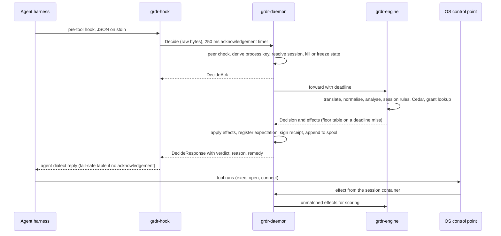

# 03. System architecture and modularity

_Status: draft 5 (rulings, owner answers and the owner's instructions of 2026-11-11 in `_review/04-owner-kit-instructions.md` applied). Owning squad: Core and architecture; the `security` squad owns `grdr-crypto`, `grdr-approve` and IPC peer authentication (R-50); a change to a path marked trust core lands only after two independent evaluators on different models pass it (D-63). Read with: `00-decisions.md` (spine v4, authoritative); `_review/01-document-rulings.md`; `_review/02-owner-answers.md`; 04 (canonical model, data classes, mappings); 07 (decision protocol, hook broker); 11 (on-device update mechanics); 12 (policy and grants); 16 (detectors, capture filter); 17 (MCP broker); 18 (approvals); 20 (lake); 21 (keys); 22 (update protocol, trust roots, rings); 23 (API, our MCP server); 24 (build, signing, packaging); 30 (governance); 33 (build order and risk register)._

## Summary

This document fixes the structure every other document builds into: component ownership, the crate graph, processes, the four main flows and the extension points. Key choices:

1. **Five layers, one direction**, enforced by `cargo xtask archlint` from `architecture.toml`; every error names the fix (D-47).
2. **The workspace starts with twenty-four crates.** The core modules of spine section 5 start inside `grdr-core` with a checked import table and split out on a second consumer or a different licence.
3. **One core entry point**, `Engine::step(input, now, entropy) -> Output`, byte-identical on native, C ABI and `wasm32` (D-05).
4. **Hub-and-spoke endpoint.** `grdr-daemon` is the only local rendezvous and links no content parser; `grdr-engine` parses everything in a sandbox (D-20).
5. **One session monitor per device**, in the engine. The daemon holds a fixed-layout projection of it for the floor table; the proxy links the parsers, not a second policy state.
6. **Ports resolve from a profile**; any other combination fails at start (P6).
7. **Every extension point is data or an out-of-tree adapter** with a contract, kit, tier, stability class and versioning rule (D-50, D-60). P14 makes this the rule for every capability: a mechanism plus content, never a hard-coded behaviour.
8. **Standalone is a runtime mode of the sensor build.** Build profiles are `sensor`, `server` and `embedded`, each with a `fips` variant.
9. **One configuration schema** with authority-ordered layers; the server splits it into boot configuration and runtime settings (D-70).
10. **A bill of materials with a do-not-use list** that the dependency gate enforces.
11. **Compatibility is declared against contract ranges**, not component versions, and one resolver refuses a combination outside them before anything activates (D-71).
12. **Nothing is hard-coded and nothing panics.** Code reads every value from five data sources, the language tokens of D-69 among them (section 10); no non-test code has a panic path, and every long-lived process recovers under supervision.

## Requirements

| # | Requirement | Trace |
|---|---|---|
| R1 | Module boundaries are enforced mechanically; lint messages state the fix | Owner (modularity "of extreme importance"); D-47; brief 31 |
| R2 | One deterministic core runs in the sensor, the gateway, server replay and other vendors' products | P5, D-05; brief 27 |
| R3 | No parser of untrusted content runs privileged; fail-closed classes never wait on a parser | D-20; brief 37 (Defender split, 2024 CrowdStrike root cause) |
| R4 | Each external dependency sits behind a port with at most two release-gating adapters; only two endpoint topologies and three server profiles are tested | P6, D-20, D-33; c1 F8; briefs 11, 24 |
| R5 | Everything that changes behaviour is one signed pack type checked by the production interpreter | P7, D-37 |
| R6 | A stranger gets a green `verify` in under 15 minutes (target) with stable Rust only | Spine section 5, S-22; l09 F7 |
| R7 | Every extension point has a contract, a conformance kit and a support tier | D-50; l09 F6; l10 F3 |
| R8 | Every public surface is experimental, beta or stable; none is stable before one external embed pilot | D-60 |
| R9 | Embedded builds make no network call to Loonaro, embed no trust roots and carry no brand string; standalone sends nothing but update fetches; every outbound connection goes through one `Dialer`, and in isolated mode nothing leaves the operator's allow-list; asserted in CI | D-60, D-66, D-48, P16 |
| R10 | Every failure path maps to a declared outcome; zero silent fail-open | D-15, D-50, spine section 6 |
| R11 | Third-party code is permissively licensed, behind our trait when single-maintainer, patched within seven days | D-02, D-62; briefs 10, 11, h05 |
| R12 | Every component declares the contract ranges it provides and requires; one resolver checks every combination before activation | D-71 |
| R13 | No panic path in non-test code; every long-lived process runs under a supervisor and resumes from journalled state | Owner instruction 15 |
| R14 | Each concern has one registry and one mechanism (errors, retries, ids, text, configuration keys, limits), and no value is a literal in code | P14, P17, D-69; owner instruction 26 |

## Design

### 1. Component map

| Component | Owns | Never does |
|---|---|---|
| `grdr-core` (library) | Normalisation, analysers, session rules, Cedar evaluation, detections, discovery classification, bundle compilation, verdict semantics | I/O, clocks, randomness, signature checks |
| `grdr-fastpath` (library) | The compiled floor table and the shim fail-safe table, over fixed-layout inputs; the bounded hook-field scanner the shim's table path uses (07) | General parsing, allocation, threads |
| `grdr-daemon` (the minimal core) | Process tree and session containers, floor-table evaluation, a fixed-layout projection of session state (enforcing-label bits, grant digests, kill and freeze state), expectation table, actuators, peer authentication, provider fan-out and merge (07), spool, local history and flight recorder (the only writer of every lane, `local` included; R-08), key handles, last-known-good pointer, supervision | Interpret payload content, reach a network |
| `grdr-engine` | The one session monitor; all parsing; bundle compilation and self-test; content-dependent policy; records for local history and the flight recorder, sent to the daemon | Hold keys, enforce, verify signatures, write a lane, reach a network |
| `grdr-uplink` | The only path to the server and update repository: batches, check-in, downloads to staging | Verify or activate downloads |
| `grdr-proxy` | Loopback OTLP receiver for harness telemetry (R-68); explicit model listener and MCP broker; protocol parsing; credential injection (requires the credential broker of D-27) | Keep session state |
| `grdr-infer` | Unprivileged host for 16's `DetectorPort` ML adapters; answers the engine over the daemon's IPC (19, R-67) | Reach a network, decide a verdict |
| `grdr-updater` | The one pack verifier (`grdr-update`, D-37); swaps binaries; on demand | Anything else |
| `grdr-hook`, `grdr-mcp`, `grdr-run` | Forward a hook call; wrap a stdio MCP server; launch into a session container | Decide beyond the signed fail-safe table |
| `grdr`, `grdr-tray`, `grdr-desktop`, local console | Show state, propose changes (D-31) | Mutate without a grant |
| `grdr-approve` | OS-native approval surface | Render agent-supplied text |
| `grdr-server` targets | `decide`, `approve` (tier 0, memory only); `ingest`, `control`, `content` (tier 1); `query`, `review`, `intel` (tier 2); `detect`, `store`, `notify`, `identity`, `keys`, `audit`, `api`; `gateway`; `router` (hosted); `operator`, the operator plane on its own listener and origin (D-70, 20) | Import another target's module |

Server targets are modules of one crate behind a `Target` trait. They talk only through ports and generated internal services (`grdr.internal.v1alpha1`): function calls in `embedded` and `ha`, network calls in `distributed`. Singletons hold a lease on the Jobs port.

### 2. Layers, crates and the lint

A crate may depend only on lower-numbered layers, plus the same-layer edges listed in `architecture.toml`. The `Requires` column names what must exist before a crate is useful; "Nothing" marks the twenty-four crates the workspace starts with.

| Layer | Crate | Content | Requires |
|---|---|---|---|
| 0 | `grdr-proto` | Generated types for every `grdr.*` protobuf package | Nothing |
| 0 | `grdr-schema` | Cedar schema, error codes, limits, config schema, mappings, pack manifest schema | Nothing |
| 1 | `grdr-model` | Domain types: ids, actions, verdicts, assurance record, `VerifiedBundle` | Nothing |
| 1 | `grdr-core` | Modules `analyze`, `session`, `policy`, `detect`, `discover` (the spine's `grdr-analyze` to `grdr-discover`), and `compile` (bundle to tables and interest sets) | Nothing |
| 1 | `grdr-llm-proto`, `grdr-mcp-proto` | Model-provider and MCP parsers (`grdr-mcp-proto` is the spine's "parsing half of `grdr-mcp`") | Nothing for `grdr-llm-proto`; `grdr-mcp-proto` is built with the MCP broker (17) |
| 1 | `grdr-fastpath` | `no_std` table evaluator and bounded field scanner, `#[repr(C)]` inputs, no dependencies | Nothing |
| 1 | `grdr-ffi`, `grdr-wasm` | C ABI and `wasm32` bindings | Nothing (skeletons) |
| 1 | `grdr-fastpath-ffi` | `extern "C"` entry points of the fast path, so `libgrdr_fastpath` carries no engine code (26); core squad | Nothing |
| 1 | `grdr-compat` | The compatibility resolver of section 7 (D-71): takes the components' declared contract ranges and a release manifest's `compat` block, returns the accepted combination or the first mismatch naming the component and contract; no I/O | The release manifest's `compat` block (24) |
| 2 | `grdr-ports`, `grdr-ports-testkit` | Port traits; reference in-memory adapters and conformance suite | Nothing |
| 2 | `grdr-crypto` | The only crate that links cryptography | Nothing |
| 2 | `grdr-wire` | IPC and uplink framing, size caps, peer-authentication traits, and the `Dialer` through which every outbound connection is made (24 section 3) | Nothing |
| 2 | `grdr-strings` | Language-token runtime (D-69): the MF2 function registry over ICU4X 2.4, locale negotiation and direction tables generated from CLDR, placeholder isolation, pseudo-locale transforms; feature `pack-text` formats the MF2 data model of pack messages; no I/O; builds for `wasm32` | Nothing |
| 2 | `grdr-messages` | Generated and committed by `cargo xtask interface gen`, unpublished: one typed accessor per language token, `present()` for every registered enum, route and notification ids, baked ICU4X data for the shipped locales | Nothing (generated from `interface/`) |
| 3 | `grdr-ui-model` | View-models of every desktop screen, `TrayVm`, `NotificationVm`, `Preferences`, intents and `reduce` (28 section 3); carries `MessageRef`s, never formatted text | `grdr-messages`; the desktop and tray surfaces (28) |
| 3 | `grdr-sensor-linux`, `grdr-sensor-linux-bpf` | Linux back end and its kernel programs (own licence, D-02; built to an object the back end loads, never a Cargo dependency) | Nothing |
| 3 | `grdr-agents` | Per-agent installers, managed-source probes, structural dialect translators | Nothing |
| 3 | `grdr-store-local` | Spool, SQLite local history, flight recorder | Nothing |
| 3 | `grdr-sandbox-engine` | Engine sandbox launcher for all three systems; only the daemon calls it; trust core (11) | Nothing |
| 4 | `grdr-daemon`, `grdr-engine`, `grdr-hook`, `grdr` | Section 1 | Nothing |
| 3 | `grdr-sensor-macos`, `grdr-sensor-windows`, `grdr-update`, `grdr-broker` | OS back ends; pack verifier and TUF client behind `UpdateTrust`; hook broker library (07) | The daemon for the OS back ends; the pack format for `grdr-update`; the shim for `grdr-broker` |
| 4 | `grdr-uplink`, `grdr-updater`, `grdr-approve`, `grdr-proxy` | Section 1; `grdr-proxy` with only the OTLP receiver, so untrusted telemetry stays out of the privileged daemon (R-68) | The daemon; `grdr-update` for the updater |
| 3 | Other `grdr-sandbox-*`, `grdr-export` | Launch sandbox back ends; export sinks and the local feed | `SandboxBackend` port and the launcher for the sandboxes; sensor and content packs for `grdr-export` |
| 4 | `grdr-mcp`, `grdr-run`, `grdr-tray`, `grdr-desktop` | Section 1; the desktop app only if S-19 passes; `grdr-proxy` gains its network-proxy functions | The daemon; the desktop app also requires `grdr-ui-model` and S-19 |
| 3 | `grdr-rel-sqlite`, `grdr-rel-postgres`, `grdr-lake`, `grdr-bus-log`, `grdr-blob` | Server port adapters (section 6) | `grdr-ports`; S-02 for the lake, S-03 for the log bus |
| 4 | `grdr-server`, `grdr-acp` | Section 1; the ACP wrapper of 07 | Core; wire; the server port adapters |
| 3 | `grdr-integrations` | Integrations host for manifests and WebAssembly components, server only (D-40) | `grdr-server` |
| 3 | `grdr-bus-nats`, `grdr-identity`, `grdr-judge-*` | `distributed` bus; token service and broker; judge back ends | The `distributed` profile for NATS; the launcher and the server's `identity` and `keys` targets for the broker; the judge back-end trait for judges |
| 1 | `grdr-review` | Sans-IO review stage: 18's priority score from pack weights, sample, framing, judge-output validation; consumed by the `review` target, the `grdr` CLI and embedding hosts (19, R-67). The deterministic priority score and sample serve the review queue; judge-output validation is used once an organisation selects a judge back end (D-29) | The server's review queue |
| 4 | `grdr-infer` | Section 1 (19, R-67) | 16's `DetectorPort` ML adapters; runs only where the ML tier is enabled |
| 3 | `grdr-driver-windows` | Own release train (D-17) | The Windows sensor and trust-core review; an EV certificate and Microsoft's hardware programme through a sponsor or partner (D-17) |

**Same-layer edges** (the complete list; adding one is an RFC). Layer 0: `grdr-schema` to `grdr-proto`. Layer 1: every crate except `grdr-fastpath` and `grdr-fastpath-ffi` to `grdr-model`; `grdr-core` to `grdr-fastpath` (table layout only); `grdr-fastpath-ffi` to `grdr-fastpath`, its only dependency; `grdr-ffi` and `grdr-wasm` to `grdr-core` and `grdr-fastpath`. Layer 2: `grdr-ports-testkit` to `grdr-ports`; `grdr-wire` to `grdr-crypto`; `grdr-messages` to `grdr-strings` (D-69). Layers 3 and 4 have none: adapters meet only in a program, and no program depends on another.

**Modules inside `grdr-core`.** A module becomes a crate when it gains a second consumer or a different licence (first expected: `policy`, for an in-browser `policy check`). Until then ARCH-013 holds the import table: `analyze`, `session`, `policy`, `detect` and `discover` import only `grdr-model`; `compile` and the `step` orchestration in the crate root import all five. A split is then a file move. Documents that write `grdr-policy` or `grdr-session` mean the module.

**Public crates** (spine section 5) are layers 0 to 2, except the generated `grdr-messages`: published, semver-checked, changed by RFC (D-61), each with its own version line (section 7). Layers 3 and 4 are unpublished. Test and tool crates (`xtask`, `grdr-policy-ref` in 12, `grdr-schema-lint` in 04, `grdr-conformance` in 07, `grdr-interface-gen` for `cargo xtask interface`, D-69) carry `layer = "tool"`: they may depend on any layer and are never linked into a layer 4 program.

Each crate declares `[package.metadata.grdr]`: `layer`, `privilege` (`privileged`, `sandboxed`, `untrusted`, `none`) , `surface` (`public`, `internal`) and `renders` (`person`, `agent`, `none`: whether the crate produces text or layout someone reads; interface checks UX1 to UX8 and `.agents/kit/path-skills.toml` read it). This metadata and `architecture.toml` are gate configuration under D-63.

**Lint rules** (`cargo xtask archlint`, part of `verify`):

| Code | Rule | Mechanism | Fix the message states |
|---|---|---|---|
| ARCH-001 | Layer N depends only on layers below N, plus listed same-layer edges; nothing depends on a `tool` crate except as a dev-dependency | `cargo metadata` graph | Return an `Effect`, or add a port method and let the program pass the adapter in |
| ARCH-002 | Layer 3 crates never depend on each other | Graph | Move the shared trait or type to layer 2; join the adapters in the program |
| ARCH-003 | Layers 0 and 1 contain no I/O, async runtime, clock or randomness source | Per-layer `clippy.toml` disallowed methods; banned crates; layer 1 builds for `wasm32-unknown-unknown` | Take the value as an argument (`now`, `entropy`) or return an `Effect` |
| ARCH-004 | The closure of a `privileged` program and of `grdr-hook` contains no content parser: not `grdr-core`, `grdr-llm-proto`, `grdr-mcp-proto`, `cedar-policy`, `yara-x`, `rsigma-*`, `serde_json`, `regex`. Two decoders are allowed and named in `architecture.toml`: the generated protobuf codec for IPC frames, and, in `grdr-updater` only, `grdr-update` with its TUF metadata parser | Graph | Parse in `grdr-engine` and hand the privileged process a fixed-layout result |
| ARCH-005 | Store, bus and object-store drivers appear only in their adapter crate | Graph; `cargo deny` bans | Call the port; add a port method if one is missing |
| ARCH-006 | Cryptography crates appear only under `grdr-crypto` | Same | Call `grdr-crypto`; a new primitive is a trust-core change there |
| ARCH-007 | A `public` crate exposes no `internal` type and no unlisted third-party type | `cargo public-api` diff | Wrap it in a `grdr-model` type, or list it in `surfaces.toml` by RFC |
| ARCH-008 | Layer 1 has no Cargo feature that changes a verdict (allowed: `std`, `serde`, `arbitrary`, `test-util`, and `jit`, which selects the YARA-X back end and is held to identical output by the golden vectors) | Manifest scan | Make the switch bundle data or a `HostProfile` field |
| ARCH-009 | No brand, product, company or vendor name string outside `brand/` | Text scan | Read the string from the brand manifest |
| ARCH-010 | A server target module imports no other target module | `use` scan | Call the generated `grdr.internal` service or a port |
| ARCH-011 | Default members build with stable Rust and no kernel, Swift, Node or GPU toolchain | Clean-container job | Take the crate out of `default-members` or fetch the prebuilt artefact |
| ARCH-012 | `VerifiedBundle::assume_verified` is called only from `grdr-crypto`, `grdr-update` and the documented FFI entry | Call-site scan | Obtain the bundle from `grdr-update`; tests use the fixtures in `grdr-ports-testkit` |
| ARCH-013 | A `grdr-core` module imports only what its row in the import table lists | `use crate::` scan | Move the shared type to `grdr-model`, or pass the value in from `step` |
| ARCH-014 `tier0-no-port` | A tier 0 server handler (`decide`, `approve`) holds no relational, bus, lake or blob port handle; its writes go to the tier 1 outbox (20) | Handler signature scan, plus 20's runtime trace | Serve from memory and hand the write to the outbox |
| ARCH-015 `tenant-path` | Every relational, lake, bus, blob and cache port method takes a `TenantCtx`, and no query or object key is built outside an adapter crate (21) | Port signature scan; fixture that builds SQL outside an adapter | Take the `TenantCtx` minted by the auth middleware or job runner and call the port |
| ARCH-016 `rune-leaf` | `rune` and `wgpu` appear only in the closure of `grdr-desktop`; `grdr-tray`, `grdr-approve` and `grdr-ui-model` link neither (28) | Graph | Move the logic into `grdr-ui-model` and keep only rendering in `grdr-desktop` |
| ARCH-017 `code-registry` | Every error variant is bound to an entry in `schema/codes/<area>.toml`; no `GRDR-` literal outside generated code; every registered code is constructed somewhere | `xtask` scan of the error enums against `schema/codes/` | `cargo xtask scaffold code <area> <REASON>`, then use the constant |
| ARCH-018 `one-retry` | No retry crate (`backoff`, `backon`, `tokio-retry`, `retry`, `again`, `exponential-backoff`); no sleep inside a loop outside `grdr-ports::retry` | `cargo deny` bans; ast-grep | Name a `[retry.<name>]` policy in `limits.toml` and call `retry::run` |
| ARCH-019 `no-literal-bounds` | No `Duration::from_*(<literal>)`, `with_capacity(<literal>)` or `bounded(<literal>)` outside generated limits and tests | ast-grep | Add the bound to `limits.toml` |
| ARCH-020 `ids-through-model` | Ids are minted only by `grdr-model`'s id constructor from injected clock and entropy; `Uuid::new_v4` and `now_v7` are disallowed elsewhere; `ulid`, `rusty_ulid` and `nanoid` are banned | Clippy disallowed methods; `cargo deny` bans | Mint through `grdr-model` (04 section 3) |
| ARCH-021 `endpoint-is-config` | No `http://`, `https://`, `wss://`, host-name, domain, email or IP literal outside `brand/`, the configuration schema's defaults, tests and external-dialect fixtures; every destination is a configuration key and appears in `grdr egress` | Text scan; the kit's S7 check | Add a configuration key whose default comes from the distribution's brand manifest or `dist.toml`, so a self-hosted or air-gapped install sets its own (P16) |
| ARCH-022 `json-from-proto` | Every machine-readable document we emit (`--json`, view-models, doctor and support-bundle manifests) is a protobuf message in proto3 JSON; `serde_json::json!` and hand-derived serialisation of emitted types are disallowed in layer 4 and `grdr-ui-model`, except external-dialect crates listed in `architecture.toml` | Clippy disallowed macros; ast-grep | Define the message in `proto/grdr/<area>/` |
| ARCH-023 `cli-registry` | Every command, flag, exit code and `--json` type comes from `interface/cli.toml`; each command has a golden text test, a golden `--json` test and its `cli.*` tokens; `main` returns the generated `ExitCode` and nothing calls `std::process::exit` | `xtask interface` against `interface/cli.toml` | `cargo xtask scaffold command <noun> <verb>` |
| ARCH-024 `strings-closure` | Only `grdr-strings` depends on `icu*` crates; its `pack-text` feature is enabled only in `grdr-engine`, `grdr-server` and `grdr`, never in a `privileged` program; `grdr-hook` links neither `grdr-strings` nor `grdr-messages` | Graph | Return a `MessageRef`; let the reader format it |
| ARCH-025 `one-dialer` | Outbound connections are opened only through `grdr-wire`'s `Dialer`: socket connects and HTTP, TLS or WebSocket clients built without its connector are disallowed elsewhere (P16) | Clippy disallowed methods and types | Take the `Dialer` the program passes in and connect through it, so `grdr egress` lists the destination and isolated mode applies |
| ARCH-026 `operator-no-content` | The `operator` module of `grdr-server` depends on no content read of the Events port and no content-key unwrap of the Keys port (20 section 16.2) | Graph | Call `control`'s lifecycle functions or the operator API, never a content path |

Every message has four parts: what was found, why the rule exists, the fix, the escape route.

```text
error[ARCH-001]: `grdr-core` (layer 1, core) depends on `grdr-store-local` (layer 3, adapter).
  why: core crates take data in and return data, so the same code replays on the server and embeds in other products.
  fix: return what you need written as an `Effect` in `Output`, or add a method to a port in `grdr-ports`
       and let the layer 4 program pass the adapter in. See docs/architecture/ports.md.
  if the layer assignment is wrong: open an RFC (D-61). Do not edit architecture.toml in this change.
```

### 3. The core contract (D-05)

```rust
impl Engine {
    pub fn load(bundle: &VerifiedBundle, host: &HostProfile) -> Result<(Engine, LoadReport), LoadError>;
    pub fn step(&mut self, input: Input<'_>, now: Timestamp, entropy: &mut dyn Entropy) -> Output;
    pub fn interest(&self, session: Option<SessionId>) -> InterestSet;
    pub fn snapshot(&self) -> StateSnapshot;
    pub fn restore(bundle: &VerifiedBundle, host: &HostProfile, s: &StateSnapshot) -> Result<Engine, LoadError>;
}
```

- `Input`: `Event`, `ActionRequest`, `Grant`, `ResponseCommand` or `Tick`. `Output`: an optional `Decision`, new events (facts, labels, findings), `Effect`s for the host (expectations, actuator requests, label-projection and interest-set changes) and diagnostics.
- `Decision` is the verdict message of 12 (`grdr.policy.v1alpha1.Verdict`): verdict, obligations, rule ids, session-state sequence number, cache key with scope and expiry, and a `not_evaluable` list. A rule whose inputs the `HostProfile` cannot supply is listed there and never passes silently (D-60). `step` on an `ActionRequest` calls the `policy` module's decision function (12).
- `InterestSet`: fixed-format tables (process scope, paths, hosts, ports) a host compiles into its own filters.
- Determinism: the same bundle digest, snapshot, input sequence, `now` sequence and entropy seed give byte-identical output on every target.
- The core does not verify signatures. A host verifies through `grdr-update` or its own verifier and constructs `VerifiedBundle`, which is why embedded builds need no trust roots.

### 4. Process topology (D-20, D-48)

Both endpoint topologies run the same processes; only the account differs.

| Process | `user` | `protected` | Network | Untrusted input |
|---|---|---|---|---|
| `grdr-daemon` | User service | root, LocalSystem | None | IPC frames (payload bytes opaque); fixed-layout sensor events |
| `grdr-engine` | User, sandboxed | Dedicated account, sandboxed (seccomp and Landlock; macOS sandbox profile; AppContainer or restricted token) | None | All content |
| `grdr-uplink` | User | Low-privilege account | Server and the origins in `updates.sources`, through the `Dialer` | Replies, opaque downloads |
| `grdr-proxy` | User | Low-privilege account | Loopback listener; upstreams the agent named | OTLP from agents (R-68); model and MCP protocols |
| `grdr-infer` | User, sandboxed | Low-privilege account, sandboxed | None | Text from the engine |
| `grdr-updater` | User | Privileged, on demand | None | Signed metadata, size-capped |
| Shim, wrappers, CLI, tray, desktop | Caller's session | Same | None | None |

1. **Hub and spoke.** Every local process holds one connection, to the daemon, which authenticates the peer (kernel credentials and process handle, pipe token or audit token; never a PID) and routes by message type. Payloads it does not need stay opaque.
2. **Supervision.** Every long-lived process runs under a supervisor: the daemon under the OS service manager, its children under the daemon, and the tray and `grdr console serve` under the user session's service manager, with 11 section 6's crash-loop ladder and safe mode. Each journals its state changes, so a restart resumes rather than repeats (the spool, leases and settings revisions already do). The daemon restarts the engine at 1.3 times its memory budget or after three consecutive deadline misses (both targets, in `limits.toml`). While the engine is down the daemon answers from the floor table: fail-closed classes deny, the rest follow the pack's loss-of-sensor setting, and the state is Degraded (D-15).
3. **One session monitor.** Session rules run in the engine. Each label or grant change returns as an `Effect`, which the daemon applies to its fixed-layout projection before it acknowledges the observing control point, so the floor table reads current enforcing labels (D-09; 12). `grdr-proxy` builds actions and facts with the parsers, then asks the engine for the decision through the daemon. The full core runs inside a proxy only in the server's `gateway` target, which owns its sessions.
4. **Who verifies.** The uplink stages opaque bytes. `grdr-updater` verifies them under the right root, checks `min_engine` and the signer class, and writes the pack store. A fresh engine instance that has read nothing but the verified bundle compiles it and runs its self-tests and the narrowing check (12). The daemon swaps the tables in between decisions and keeps the last-known-good pointer (11).
5. **Local console.** A per-logon-session `grdr console serve` process binds loopback under D-43's rules as a client of the daemon's local API. The privileged daemon binds no HTTP listener.
6. **The seam is never optional.** The smallest endpoint build already runs daemon and engine as two processes.

**Server** processes follow the profile (D-33): one process in `embedded`, N identical replicas in `ha`, one process per target in `distributed`, so tier 0 scales and fails apart from tiers 1 and 2. **Embedded:** the host owns the processes (D-41 L3, which requires an embedding partner).

### 5. Four flows

**5.1 Decision path for one tool call**



1. The shim verifies the owner of the daemon endpoint, then sends `Decide` with the raw payload (`grdr.decide.v1alpha1`, 07).
2. The daemon checks the peer, derives the process key itself, maps it to a session container, assigns the tool-call id, and denies at once if a kill or freeze covers the session. It then acknowledges; the acknowledgement is what the shim's 250 ms limit measures (D-14; 07).
3. It forwards to the engine with a deadline (07 sets it: the caller's `deadline_ms` minus 50 ms; 12 defers to 07). On a miss it answers from the floor table: fail-closed classes deny, the rest follow the pack's loss-of-sensor setting (D-15).
4. The engine translates the dialect to a canonical action, runs normalisers (`resolved`, `unresolved`, `malformed`; D-10) and analysers, applies session rules synchronously, evaluates each policy layer in Cedar with deny-wins, and looks up grants.
5. The daemon applies the returned effects: the label projection, and the expectation bound to the tool-use id and process key. Where verdict providers are registered, it fans the engine's minimised provider request out to them and merges deny-wins (07). It signs the receipt and appends it to the spool.
6. With no acknowledgement in 250 ms, or by the deadline in a valid update-handover marker (never beyond 2 seconds), the shim decides from its fail-safe table, which the privileged service compiles on the device and signs with a device-local artefact key (D-14; 21); it always returns within 2 seconds. `STEP_UP` is a denial with a retry token (D-07; 18).
7. The OS control point judges each effect against floor rules and the expectation. Floor rules are evaluated by `grdr-fastpath` in the daemon, or in kernel maps compiled from the same table, with no engine round trip. OS-side blocking requires a sensor tier that can block on that platform (D-17, D-18, D-19). Where the control point only observes, an unmatched effect is scored against the housekeeping profile and may raise a finding (D-13). Detections run asynchronously on the same events.

**5.2 Telemetry path from sensor to console**

1. A collector emits a fixed-layout event, filtered at source by the interest set (in the kernel where the back end allows).
2. The daemon stamps the envelope (id, organisation, device, epoch, lane, sequence, session) and sets `source` and the provenance grade from the authenticated peer. An event the engine returns carries at most the grade of the input it came from, so a compromised engine cannot mint a kernel observation (P3; grades and lanes: 04).
3. The engine enriches, applies the capture level per `data_class`, builds roll-ups (D-52), and sends full-fidelity records to the daemon.
4. The daemon, the only writer of every lane (R-08), writes the flight recorder and local history, appends the upload projection to the hash-chained spool and signs each batch head (D-39).
5. `grdr-uplink` posts acknowledged batches (D-36); loss becomes a gap event.
6. `ingest` verifies the device, takes the organisation from the credential, re-pseudonymises principals with a key the device never holds (D-51), applies quota, de-duplicates, appends to the bus and acknowledges.
7. `detect` consumes the bus in session order; `store` builds the lake; `control` keeps session summaries; `query` and `api` serve the console.

Standalone stops after step 4; the local console reads local history through the daemon. Steps 5 to 7 require the server.

**5.3 Control path for a policy change**

1. An author edits a pack draft in the console or pushes to the locked git source; `control` stores an audited draft.
2. `control` validates against the Cedar schema, computes the semantic diff and checks ceilings (D-11).
3. Replay runs the draft through the same `grdr-core` on history; rules that read content replay on devices and return counts.
4. A widening change needs an approver other than the author at the class's minimum approval grade (D-31, D-55). A narrowing change needs none but is staged.
5. `content` assembles the bundle per group, proves that it compiles and loads in every supported engine version, and has it signed under the deployment root through the Keys port (22). Compiled tables (floor, fail-safe, interest sets) are not shipped; each device compiles them from the verified bundle (12).
6. `control` opens a rollout; its fleet service (D-36) announces the desired digest.
7. The device downloads to staging, then verifies, compiles and activates as in section 4 item 4, keeping last-known-good (11). It reports applied or failed; gates promote or halt.

Standalone runs steps 2, 4 and 7 on the device: `grdr policy check` validates, the change is a proposal approved at the class's minimum grade (D-31; in the user profile the disclosed time lock may stand in for G1), and the daemon signs the layer document under the local deployment root (12, 21) before the same activation.

**5.4 Update path for a content pack**

Four channels use the one pack type, each with its own rings: binaries; schema and policy; detection content; native agent configuration (D-37). `kind` in the manifest names the channel. Only the project root authorises binaries; the deployment root authorises policy and configuration.

1. A change, first-party or community, lands in the content repository through the merge queue once the evaluators its risk tier requires have passed (D-61, owner instruction 7); CI loads the pack in the production interpreter of every supported engine line and runs the benign and attack corpora.
2. The release job writes the manifest (`kind`, `format_version`, `min_engine`, `requires_capabilities`, fields and data classes read), signs it (22, 24) and publishes it to the update repository as an immutable, content-addressed target, which any origin in `updates.sources` can serve: a CDN, an internal mirror or a static file server (22 section 6.4; P15, P16). Indicators use the rapid lane and still bake.
3. In platform shapes `content` mirrors, re-validates against named engine builds and assigns rings; a partner does the same with the content relay (D-60).
4. On the device the pack is staged, verified, compiled and activated as in 5.3 step 7. The crash-loop ladder never relaxes fail-closed classes (D-37).
5. Named gates halt automatically. In a deployment the operator resumes a halted rollout (22 section 7.3); the project's own rings resume only through a new release that passes the gates again (owner instruction 7).

### 6. Ports and profiles (P6, D-34)

| Port | `embedded` | `ha` | `distributed` | Owner |
|---|---|---|---|---|
| Relational | SQLite | PostgreSQL 18 | PostgreSQL 18 | 20 |
| Events | Lake, local disk | Lake, object storage | Lake, object storage | 20 |
| Bus | Log on relational | Log on relational | NATS JetStream | 20 |
| Blobs | Filesystem | Object storage | Object storage | 20 |
| Jobs | Step journal on relational | Same | Same | 20 |
| Keys | `local`, `kms` | `local`, `kms` | `local`, `kms` | 21 |

P6's two-adapter limit counts per profile here, and per operating system for endpoint ports (R-66). `local` holds the root key on the server host: a key file (a Kubernetes Secret in the chart), a systemd credential that may be sealed to the host's TPM 2.0, or the OS keystore for `embedded` on Windows and macOS. `kms` has four back ends, each run through the port test kit: AWS KMS, GCP Cloud KMS, OpenBao Transit (also HashiCorp Vault Transit, through the `openbao` client 15 ships for `SecretStore`) and PKCS#11. The PKCS#11 back end runs in `grdr-keys-pkcs11`, a dynamically linked glibc helper reached over a peer-checked Unix socket, because the static musl server cannot load a vendor module and vendor modules commonly require glibc; it is trust core (D-63). Operator KMS and customer-managed key are key modes (D-35), not adapters. No profile needs a cloud KMS or a route out; `preflight` warns when `local` holds the root in `ha` or `distributed`.

`grdr-server` compiles every release-gating adapter into one binary; `server.profile` selects the whole row set. Naming an adapter the profile does not include stops the start, as does a second organisation on `embedded` (D-34):

```text
error[GRDR-CFG-0007]: bus adapter `nats` is not part of profile `ha`.
  Profiles are tested as a whole: embedded, ha, distributed. Use `server.profile = "distributed"`,
  or build a distribution that includes a contrib adapter (docs/extending/storage-adapter.md).
```

Endpoint ports are chosen by operating system and capability probe: `SensorBackend`, `Actuator`, `SandboxBackend`, `KeyStore`, `UpdateTrust` (the TUF client), `Clock`, `Entropy`, `Meter`, `JudgeBackend` (the trait, D-29), and `SecretStore` (for the credential broker, D-27). A host vendor's sensor is a `SensorBackend` described by a `HostProfile` (D-60).

Contrib adapters enter a build through a **distribution manifest** (`dist.toml`: adapter crates, brand manifest, signing identity), the mechanism a rebuilt white-label also uses (D-41 L6). They never gate a release.

### 7. Versioning, compatibility and stability

| Surface | Version carrier | Compatible | Breaking | Gate |
|---|---|---|---|---|
| Protobuf | Package `grdr.<area>.v1alpha1`; renamed `v1` when the packages freeze before the server's first release (D-06; 04) | Add fields and enum values; unknown fields preserved; numbers never reused | New package; server accepts N and N-1 and ingests any sensor of the same wire major (D-58) | `buf breaking`; brief 23's eight evolution rules are normative |
| C ABI | `grdr_abi_version()`, negotiated at load | New functions; trailing struct fields behind a size field | New major, 12 months overlap once stable | Generated header diffed; no panic crosses the boundary |
| Pack format | `format_version`, `min_engine`, `requires_capabilities` | New optional sections and capabilities | New major; packs published for every supported engine line | Pack corpus against every supported engine |
| Cedar schema | `schema_version`, namespace `Grdr` | New entity types, actions, optional attributes | Remove, rename or retype, by RFC | Strict validation of shipped policies; Cedar's published integration corpus on upgrade (12) |
| HTTP API | Package path, served as Connect, gRPC, gRPC-Web | AIP rules | New package; 12 months deprecation | `buf breaking`; OpenAPI diff |
| Local IPC | Packages `grdr.decide.v1alpha1` (07) and `grdr.local.v1alpha1` | Shim and daemon tolerate one release of skew, so update handover denies nothing (D-15) | Every other pair of local processes is same-release | Skew test in the update drill |
| eBPF object interface | Interface version in the object's manifest (10) | New maps and programs the back end may skip | New major; the endpoint package pins an exact object version and digest | Every supported object loaded by every supported back end across the kernel matrix (10) |
| Driver interface | `grdr.winkm` header version (08 section 6) | New message types; trailing fields behind a size field | New major; outside the daemon's accepted range the sensor runs at W1 and reports it | Driver interface tests in the matrix (08) |

Configuration keys and public crates follow the same additive rule, gated by a schema diff and `cargo semver-checks`. An engine that meets an unknown pack construct marks the rule not evaluable and reports it. It never fails the load and never treats the rule as passed.

**Component versions.** The public crates, the SDKs, the eBPF object and the Windows driver each carry their own SemVer line and changelog. The endpoint programs, server binaries, packages, images and charts share the product version, and a product bundle version pins the exact version and digest of every component tested together (24). release-please proposes every version from the Conventional Commit subjects; the merge queue lands its release pull requests and release-please creates the tags (owner instructions 3 and 7).

**Compatibility is declared against contracts (D-71).** Every component declares in its build manifest the contract ranges it provides and requires, one entry per row of the table above plus the API package, for example `requires = { wire = "1", pack_format = ">=3, <4", driver_interface = "2" }`. The ranges are data (P14). `xtask dist` generates the release manifest's `compat` block from them; the bundle and its `compat` block are a TUF target, so a device, an air-gapped import and the operator plane read the same facts. One resolver, `grdr-compat`, is used by the updater, `grdr server preflight`, the operator plane and the release job: it refuses a combination outside the declared ranges before anything is activated, with a message naming the component and the contract that does not match. At run time the handshakes in the table (`Hello` capability bits, `grdr_abi_version()`, `min_engine` and `requires_capabilities`) degrade instead of failing: a missing capability makes a rule not evaluable and is reported (P9). `support.toml` generates the compatibility matrix CI runs: every supported sensor line against the server (N-2, N-1, N, N+1), every pack against every supported engine line, the driver and eBPF interface ranges, and the hops of the upgrade path. A change that breaks a declared range fails `verify` unless it also bumps that contract's major and adds the overlap its stability class requires.

**Stability classes (D-60).** Experimental: may change in any release. Beta: a break needs a deprecation release. Stable: additive-only within a major, 12 months of overlap. Every surface starts experimental. The event and API packages freeze as `v1` before the server's first release (D-06; 04) and then change only additively; at the same point the pack format, Cedar schema and configuration become beta. D-60 allows no stable label before one external embed pilot completes, which requires an embedding partner, so until then the frozen packages are labelled beta with the additive-only rule already in force. The C ABI, `wasm32` binding, provider protocol and host contract stay experimental until that pilot. `surfaces.toml` records each class and generates the published table.

### 8. Build profiles and feature flags

Build profiles choose what is compiled, a different axis from the server profiles of section 6: the build profile `embedded` makes the Embedded shape's libraries and is unrelated to `server.profile = "embedded"`. The `embedded` libraries are what S-21 tests and what an L3 pilot uses; the pilot requires an embedding partner.

| Profile | Produces | Rules |
|---|---|---|
| `sensor` | All endpoint programs for one target triple | Standalone is this build without enrolment state (D-01). A targeted install (D-23) is installer component selection plus configuration |
| `server` | `grdr-server`, one image | All release-gating adapters compiled in; server profile chosen at start |
| `embedded` | `libgrdr_fastpath` (`grdr-fastpath` and `grdr-fastpath-ffi` only), `grdr-ffi` with header, `grdr-wasm`, sidecar engine | No network crate, trust root, brand manifest or async runtime in the closure; YARA-X uses its interpreter because the default back end is a JIT (l08); `panic = "abort"` |
| `fips` variant | The same artefacts with `grdr-crypto` linked to the AWS-LC FIPS module | Linux (static or shared) and Windows (shared only). macOS compiles but is not on AWS-LC's platform list, so no claim there. On 2026-11-09 the active certificate covered AWS-LC 3, version 4 was in process, and aws-lc-rs's documents disagree on which it binds (brief 23). The SBOM records the bound module version; "uses a validated module" is said only when that version holds an active certificate for the operating environment |

Cargo features exist only in layers 3 and 4 (`linux-bpf`, `macos-ne`, `macos-es`, `windows-wfp`, `rune-desktop`), plus `fips` in `grdr-crypto` and `jit` where YARA-X is linked (ARCH-008). Prebuilt signed kernel objects are fetched as artefacts, so a default build needs no kernel toolchain. `default-members` are layers 0 to 2, `grdr-store-local`, `grdr-agents` and the four programs `grdr-daemon`, `grdr-engine`, `grdr-hook` and `grdr`. There is no runtime flag service: a toggle is a configuration key with a stability class, removed when it stops varying. Release builds of programs use `panic = "abort"` only where the process's supervisor restarts it within the restart budget `limits.toml` names for it (11 section 1); since no non-test code has a panic path (section 10), the setting decides only what a defect costs.

### 9. Configuration

One schema, `grdr.config.v1alpha1.Config`, defined in protobuf so keys carry options (`data_class`, `security`, `env_ok`, `stability`). Files are TOML; MDM payloads carry the same keys as plist, registry policy or JSON. Configuration is how the software runs; modes, lists, capture level and loss-of-sensor behaviour are policy and travel in packs (D-11).

Layers in authority order, highest first:

1. Signed deployment configuration from the server (a pack; operator-signed content only narrows, D-31).
2. MDM source.
3. Install file and `config.d/*.toml` in the admin-owned directory.
4. User file (the only file layer in the `user` topology).
5. Environment (`GRDR_*`), for `env_ok` keys only.
6. Command-line flags.

Below all six sit the defaults, which are data in the schema, never literals in code, and which a distribution's brand manifest may override (owner instruction 26).

A layer may lock a key; the highest-authority layer that locks it wins. An unlocked key takes its value from the most specific layer that sets it: 6, then 5, down to 1, then the schema default. Keys tagged `security` ignore layers 4 to 6 in the `protected` topology, and widening one is a proposal under D-31. `grdr config explain <key>` prints the value, its layer and what it overrode. On a server every key also carries a `tier` option, `boot` or `runtime` (D-70): boot keys come from layers 3 to 6 and the Helm values, runtime keys only from the runtime settings store (20 section 16.1), and a runtime key in a boot file stops the start. An unknown key stops a server start; a sensor ignores and reports one, because configuration must never stop enforcement.

**Server configuration has two tiers (D-70).** Boot configuration, in the install file, environment or Helm values, holds only what the server needs before its database is reachable: profile, listen addresses, references to the relational store, object store and KMS, and the operator listener. Every other server key is a runtime setting: a versioned revision in the relational store, validated against this schema (its `security` and `stability` options apply), changed through the operator plane or `grdr operator config apply`, and taken into effect without a restart; a target that fails its health check on a new revision returns to the previous one (20). A source lock makes git authoritative for chosen runtime keys, as for policy (D-11). `grdr config explain` prints the runtime layer and the revision or source lock that set the key.

### 10. Conventions

| Topic | Rule |
|---|---|
| Errors | One enum per crate; each variant is bound to an entry in `schema/codes/<area>.toml`: code `GRDR-<AREA>-<NNNN>` (four digits; `AREA` names the failing subsystem from `schema/codes/areas.toml`, never the surface that prints it), `reason` in UPPER_SNAKE (AIP-193), class (`input`, `policy`, `retryable`, `fatal`, `internal`), Connect code, the `code.<code>.message` and `code.<code>.fix` language tokens and a docs anchor. Every surface carries the same `grdr.common.v1alpha1.ErrorDetail` in its native slot (the API's `ErrorInfo` detail, the CLI's `error` object, RFC 9457 members at the proxy, JSON-RPC `data` at the MCP broker); no `GRDR-` literal outside generated code (ARCH-017); lint ids are `ARCH-NNN` and never carry `GRDR-`. No dynamic error type below layer 4. Every evaluator error maps to an outcome through the rule class's failure policy; in the `gateway` target it denies |
| Panics | No panic path in non-test code of any crate, `xtask` and the agent kit included. `[workspace.lints]` in the root `Cargo.toml`, inherited by every crate, denies Clippy's `unwrap_used`, `expect_used`, `panic`, `todo`, `unimplemented`, `unreachable`, `indexing_slicing`, `string_slice`, `get_unwrap`, `panic_in_result_fn` and `exit`, and `arithmetic_side_effects` in layers 0 to 2 and privileged crates (checked or saturating arithmetic elsewhere where overflow is possible). Test code (`#[cfg(test)]` and `tests/`) may unwrap. Every fallible path returns a typed error with its code; the kit's S6 check blocks a new panic path at edit time. A panic that happens is a defect with a regression test |
| Logging | Structured lines to the OS log and a rotating file. Log macros accept only `LogSafe` types, derived from `data_class`, so content and raw identifiers cannot be logged. Layer 1 returns diagnostics |
| Self-telemetry | Metrics through `Meter`, named `grdr_<component>_<thing>_<unit>`. Required: a loss counter per queue, enforcement state, deadline misses, fail-safe decisions, spool gaps (P9). Standalone exports none; `grdr doctor` reads them locally |
| Time | Layer 1 receives `now`. Adapters read time only through `Clock`; direct clock calls are disallowed elsewhere. Order is epoch, lane, sequence, never a timestamp |
| Randomness | Through `Entropy` only; ids are minted by `grdr-model`'s id constructor from injected clock and entropy (ARCH-020) |
| Resource budgets | Every queue, map, cache, body size and recursion depth has a named bound and owner in `limits.toml`; unbounded channels are disallowed; every drop is counted. Memory targets, re-cut once measured on real endpoints: daemon 40 MB, engine 140 MB, uplink 20 MB, proxy 30 MB, tray 8 MB, local console (`grdr console serve`, while running) 12 MB (together the spine's 250 MB, which excludes the on-demand Rune window). Every IPC request carries a deadline. Frame cap 2 MiB, hook payload cap 1 MiB (07), with bounded argument capture (h05: a 2026 Santa advisory). A full queue applies backpressure instead of growing |
| Text | Every string a person or an agent reads is a language token (D-69); crates that render declare `renders`; the core returns `MessageRef`s and formats nothing; interface checks UX1 to UX8 of gate V26 (team/05 section 8) |
| Retries, timeouts and backoff | One `RetryPolicy` in `grdr-model` (pure: attempt number, injected entropy and the server's hint in, next delay or give-up out) and one executor, `grdr-ports::retry::run`, over the `Clock` port. Policies are named entries `[retry.<name>]` in `limits.toml`, `kind = "exponential"` (base, factor, cap, full jitter seeded by device id, give-up, retry budget) or `kind = "schedule"`, with `honour_hint`, which treats the server's `retry_after_ms` or `Retry-After` as a floor and adds jitter (P15); each policy also names its call timeout and circuit breaker. The owning document sets the values and every other document names the policy: `uplink-reconnect` and `update-download` (22), `webhook-delivery` (23), `export-delivery` (25), `provider-suspend` (07), `engine-safe-mode` (11), `judge-backend` (19), `playbook-step` (18), `relational-call`, `bus-append`, `object-store-call` and `keys-unwrap` (20), `console-live` (27). `webhook-delivery` and `export-delivery` are `kind = "exponential"` with `honour_hint` for the `failing` probe; the adaptive-concurrency drain of 23 section 8 replaces a per-message schedule. No retry crate and no sleep in a loop elsewhere (ARCH-018); at ten million endpoints this one type is what keeps every client jittered and honouring the server's hint |
| Recovery | A watchdog covers every blocking wait, and every external call goes through a retry policy, so it has a timeout and a circuit breaker; degradation is recorded and shown, never silent (P9); 11 section 6's fault suite proves each process's recovery |
| Values | Code only reads values from five data sources: the configuration schema (`grdr.config`, whose defaults are data), the brand manifest (`brand/brand.toml`), `limits.toml` (every bound, timeout, retry budget and threshold), the design tokens and the language tokens. Behaviour lives in packs and manifests (P7, P14); platform paths come from per-OS tables in configuration. Compiled code holds no domain, host, URL, port, email or IP address, product or company name (ARCH-009, ARCH-019, ARCH-021, the kit's S7 check) |
| Unsafe | `unsafe_code` is forbidden by the workspace lints except in the layer 3 OS adapter crates (the driver included) and the FFI crates `grdr-ffi` and `grdr-fastpath-ffi`; every block carries a `// SAFETY:` comment stating its invariant |
| State machines | Each lifecycle is an explicit state type: an enum whose variants own their data, transitions that consume one state and return the next, and an exit from every non-terminal state. No status, phase or mode field held as a string, integer or set of flags (the kit's S4 check, audit A01) |

### 11. Repository layout

| Path | Content | Owner |
|---|---|---|
| `proto/`, `schema/` | Protobuf sources; Cedar schema, error codes, limits, mappings, pack manifest schema | Core; RFC to change |
| `crates/` | Layers 0 to 3 | Core (layers 0 to 2, except `grdr-crypto` and peer authentication in `grdr-wire`, owned by the security squad, R-50); Linux, macOS, Windows, Gateway, Platform squads (layer 3) |
| `bpf/`, `platform/macos/`, `platform/windows/` | Kernel programs; Swift shell and extensions; service and installer definitions; the optional driver | OS squads; trust core |
| `programs/` | Layer 4 binaries | Squad of the dominant adapter; `grdr-approve` belongs to the security squad (R-50); `grdr-daemon`, `grdr-updater`, `grdr-approve` are trust core |
| `web/`, `desktop/`, `sdk/` | Console, `ui` package, browser extension; Rune app and view-models; SDKs | Interfaces squad |
| `interface/` | The interface system (P17): tokens, pattern, presentation, icon, route, notification, shortcut and CLI registries, and the language tokens (D-69) | Interfaces squad; `interface/cli.toml` with core |
| `spec/`, `conformance/` | Language-neutral specifications (pack format, provider protocol, host contract); golden vectors and kits | Core; Embedding |
| `deploy/`, `lab/` | Helm, Terraform, packaging; matrix runner, public harness | Release; Lab |
| `xtask/`, `architecture.toml`, `surfaces.toml`, `support.toml`, `limits.toml`, `supply-chain/` | `verify`, `archlint`, `dist`; gate data | Core; trust core |
| `third_party/`, `brand/` | Vendored code with provenance; the brand manifest `brand/brand.toml` | Core; Release |
| `docs/`, `rfcs/`, `AGENTS.md`, `.agents/` | Design documents and decision records (`docs/decisions/`); RFCs (30); agent kit (`team/06` section 2.2). Work items are GitHub issues, never files | Gardeners; Agent-kit squad |

Other repositories: content, contrib, and the held-out suite behind its evaluator service, each created under the same profile as the main repository when the work that needs it starts.

### 12. Support tiers and "complete" (D-50)

`support.toml` holds one entry per agent adapter, host target, control point, integration and dialect: tier, maintainer, tested version range and cells (OS, architecture, topology). It generates the support matrix and the release-blocking job list.

- **Tier 1**: first-party, release-blocking, in the conformance suite and scorecard. **Tier 2**: community, conformance-gated, may lag. **Tier 3**: experimental, off by default.
- **Tier 1 cells**: Claude Code and Codex on Linux x64 and macOS arm64, which need no external precondition. Windows joins Tier 1 when S-04 passes, and each further agent and platform when it passes the conformance suite (D-50).
- **Promotion** needs a named maintainer and 30 consecutive green days (l10). Two releases without a Tier 1 maintainer demote, then remove. A contrib adapter red for two releases is removed (l09).
- **Complete**, for a shape: all five jobs work for every Tier 1 cell at the stated assurance with zero silent fail-open under fault injection. `PLAN.md` traces each requested item to a decision, document, prerequisites and acceptance test.

### 13. Bill of materials

Versions and licences come from the briefs' verification sections (2026-11-09 and 2026-11-10) and are re-verified for each release. They are floors: the bootstrap seed pins the newest stable release of each component at the moment it is written, provided it is not yanked, has no open advisory and its licence is on the allow-list (owner instruction 22). A component enters this table only with a version and licence verified that way; the async runtime, HTTP stack and WebAssembly runtime are not yet verified and are added once they are, and the web and desktop stacks are listed in 27 and 28.

| Component | Version | Licence | Role and note |
|---|---|---|---|
| Cedar | 4.14.1 | Apache-2.0 | Authorisation engine; bound policy size (2026 parser memory advisory) |
| `rsigma-parser`, `rsigma-eval` | 0.26.0 | MIT | Sigma behind our detection trait; vendored at a pinned commit; one maintainer |
| YARA-X | 1.23.0 | BSD-3-Clause | Content scanning |
| aya | 0.16.0 | MIT or Apache-2.0 | eBPF; `libbpf-rs` under its BSD option is the fallback |
| `windows` | 0.62.2 | MIT or Apache-2.0 | Win32 and our own ETW layer |
| `wfp` | 0.3.0 | MIT or Apache-2.0 | User-mode WFP filters; matches application path, not process |
| `landlock` | 0.4.7 | MIT or Apache-2.0 | Engine and launch sandboxes |
| `endpoint-sec` | 0.6.2 | MIT or Apache-2.0 | macOS tier 3, behind our trait; one maintainer |
| rustls with aws-lc-rs | 0.23.46 or later | Confirm in `cargo deny` | TLS 1.3; earlier 0.23 releases carry advisories |
| `tough` | 0.24.0 or later | MIT or Apache-2.0 | TUF client behind `UpdateTrust`; three 2026 CVEs fixed in 0.22.0; no commits since 2026-07-10 |
| Protobuf codec | Set by 04's spike SP-1 (`buffa` first, `prost` fallback) | Confirm in `cargo deny` | Generates `grdr-proto`; must preserve unknown fields |
| `rusqlite` | 0.41.1 | MIT; SQLite public domain | Endpoint history; `embedded` relational |
| PostgreSQL | 18 | PostgreSQL | External; `ha` and `distributed` |
| DataFusion | 55.2.0 | Apache-2.0 | Lake engine; `datafusion-ducklake` 0.9 is alpha, `iceberg-rust` 0.11.0 second (S-02) |
| `object_store` | 0.14.2 | Confirm in `cargo deny` | Blob and lake I/O |
| NATS server, `async-nats` | 2.15.2, 0.52.0 | Apache-2.0 | `distributed` bus; leafnode, MQTT and WebSocket listeners off |
| `connectrpc` | 0.9.1 | Apache-2.0 | Primary RPC binding, pre-1.0; `tonic` 0.14 (MIT) second binding in CI |

Build tools are installed at pinned versions and never linked (24). Integrated over their interfaces, never linked: Ceph RGW, agentgateway, Agent Router, osquery, Falco, Tetragon, Santa, OpenBao, SPIRE, OpenShell, numbat, LoongSuite Pilot. Sandbox back-end candidates `nono` and `mxc-sdk`, and the secret-detection crates, are decided in their own documents.

**Do not use.**

| Reason | Items | Rule |
|---|---|---|
| Not open source, or copyleft that blocks embedding | OpenEDR; Elastic rules, protections artefacts and non-GPL eBPF (Elastic License 2.0); Pipelock `enterprise/`; Redpanda, Restate, SurrealDB (BSL); FalkorDB, Inngest (SSPL); Flipt v2; TimescaleDB `tsl/`; Wazuh, Velociraptor, Hayabusa, OpenObserve, Zitadel, Loki, Garage (GPL-2.0-only or AGPL); Kunai, Chainsaw, Portmaster, Fort, Sandboxie, LuLu (GPL-3.0) | Never a dependency; on the agents' do-not-read list (D-02) |
| No licence | Sealighter, Aten, `hardenrun/aif` | Do not read |
| Content licence | Sigma community rules (DRL 1.1), Elastic rules | Never in a default pack |
| Unmaintained or unstable | `ferrisetw` (no commits since 2025-08), WinDivert, Fluvio, Tracee, `madsim`, TensorZero and MinIO (archived), Iggy, eBPF for Windows, `windows-drivers-rs` (prototypes only) | Not a release dependency |
| Wrong fit | chDB (no Windows), Pingora (Windows preliminary), in-process DuckDB, ClickHouse, Kafka, Redis, a graph database, OPA, `cel` | Not in a release-gating path |
| Security history | LiteLLM (two package compromises in 2026); `rsigma`, `rsigma-runtime`, `rsigma-mcp` (all five 2026 advisories); agentgateway and Agent Router as enforcement point of record | Adapter only; crates banned from the build graph |
| Development tools with terms | Trail of Bits skills (CC-BY-SA-4.0), Serena (GPL-3.0-or-later), Tart (FSL), desloppify (custom licence) | Install only; never vendor or redistribute |

## Interfaces and contracts

| Contract | Form | With |
|---|---|---|
| Core API (section 3) | Rust, C header, `wasm32` exports | 07, 12; embedders |
| `grdr.decide.v1alpha1` (07) and `grdr.local.v1alpha1` (supervision, engine and proxy calls, proposals, status, update handover) | Length-prefixed protobuf frames, 2 MiB cap, a deadline in every request | 07, 11, 17 |
| Pack manifest fields | `schema/pack-manifest` | 22 format, 11 activation, 24 signing |
| `HostProfile` | Protobuf: event classes with provenance grade, session mechanism, actuator verbs | 04; D-60 kits |
| Port traits and test kit | `grdr-ports`, `grdr-ports-testkit` | 20, 21 |
| `architecture.toml`, `surfaces.toml`, `support.toml`, `limits.toml`, `dist.toml`, `brand/brand.toml` | Repository data read by `xtask` | 24, 30, 33 |
| Contract ranges and the `compat` block (section 7, D-71) | `provides` and `requires` in each component's build manifest; `compat` in the release manifest | 22, 24 |
| Interface system (P17, D-69) | `interface/` registries and language tokens; generated `grdr-messages` and `@grdr/i18n` | 27, 28, 34 |

## Behaviour by deployment shape

| Aspect | Standalone | Platform, self-hosted | Platform, hosted | Embedded |
|---|---|---|---|---|
| Endpoint processes | Daemon, engine, uplink (update fetches only), updater; proxy (OTLP receiver, plus the model listener and MCP broker where enabled); `grdr-infer` where the ML tier is enabled | Same, enrolled | Same | L0: none (content only). L1: feed emitter. L2: broker library in the partner's shim. L3: fast path in the host process, engine as sidecar or WebAssembly |
| Server | None | `embedded` or `ha`; `distributed` above the `ha` ceiling, which requires the distributed load test (D-33, D-58) | `distributed`, cells behind `router` | L4: `ingest` and `detect` over the partner's lake. L5, L6: as platform |
| Organisation | Random id from install | From the device credential | Same | Supplied by the host |
| Trust roots | Project root; local deployment root | Project and operator roots | Project and cell roots; organisation signature for widening | Host-supplied; none embedded |
| Network | Update fetches from `updates.sources`, can be off | Operator's server | Loonaro cell | None to Loonaro; none at all from the L3 libraries |

Self-hosting is the default way to run the platform. The hosted column requires the hosted service's preconditions (D-63): on-call cover, a written incident-reporting process, and infrastructure funded by revenue, sponsorship or donated cloud credits. Embedded options L2 to L6 each require an embedding partner (D-41). Every other column also works in a network with no route to the internet (P16): update sources, IdP, KMS and time source are configuration pointing inside the network, and with `network.mode = "isolated"` no process dials outside the operator's allow-list (24 section 3).

## Extension points

These are the mechanisms P14 asks for: each capability is one of them plus content, and the product's own behaviour ships as default content and configuration on top. A vendor, agent, rule, threshold, workflow or integration written into code where one of these would carry it is a design defect, and `eval-architecture` fails the change.

| Extension point | Contract | Lives in | Class now | Versioning rule | Kit and tier |
|---|---|---|---|---|---|
| Content packs | Pack manifest and per-kind schema; cannot introduce a command, path to execute, URL to fetch, environment variable to set or MCP server to start; host patterns, environment variable names and path templates are allowed as typed match fields (P7) | Content repository | Experimental; beta once the server's packages freeze (section 7) | `format_version`, `min_engine`, `requires_capabilities`; an unknown construct is not evaluable, never a failed load | Production interpreter in CI; maturity tiers |
| Agent adapters | Manifest: fingerprints, config locations, managed-source probes, dialect match tables, tested version range, housekeeping profile, achievable failure mode | Content repository; translators in `grdr-agents` | Experimental | Pack rule, plus the tested agent version range: a version outside it drops to Watch (D-10) | Payload replay, start-the-agent proof, 24-hour canary (D-49) |
| Integration manifests | Declarative match and field tables; the only integration tier on sensors (D-40) | Content repository | Experimental | Pack rule; each mapping table carries its own version and golden files | Golden files |
| WebAssembly components | A component world with explicit grants, server only | Contrib | Experimental; requires the `grdr-integrations` host on the server (D-40) | World version carried in its pack kind; fixed by RFC before the first component ships | Grant conformance |
| Verdict providers | `grdr.provider.v1alpha1`: minimised payload in; DENY or STEP_UP out; one MODIFY provider per action class; deadline; deny-wins merge | Out of process | Experimental | Protobuf rule (section 7); the provider's registration names the package version | Provider kit (D-60) |
| Detector packs | Pack kind with YARA-X rules and patterns that emit facts and advisory labels with recorded origin | Content repository | Experimental | Pack rule | Corpus precision gate (16) |
| Store, bus, blob adapters | Port traits | Main for the profile adapters, contrib otherwise | Beta once the server's packages freeze (section 7) | Crate semver against `grdr-ports`; a trait change is an RFC and a new kit version; an adapter states the kit version it passed | `grdr-ports-testkit` against the reference adapter; Tier 2 |
| Sandbox and sensor back ends | `SandboxBackend`; `SensorBackend` with `HostProfile` | Main for Tier 1, else contrib | Experimental | Port rule; `HostProfile` follows the protobuf rule | Sandbox conformance suite (D-21); scenario pack |
| Judge back ends | `JudgeBackend`: typed fields out, no egress (D-29) | Contrib | Experimental; the seam is in the core, and an adapter requires the review stage and an organisation's chosen judge back end (D-29) | Port rule | Recall canaries |
| SDK instrumentation | Declare a bespoke agent and emit claims over the local socket or OTLP (D-24) | `sdk/` | Experimental | SDK semver; the wire is `grdr.decide` or a pinned OTel dialect (P10) | Claim-versus-observation scenario |

**Add an agent adapter.** (1) Copy `agents/_template/` in the content repository. (2) Fill fingerprints, config locations and the managed-source probe table. (3) Record hook payloads per tool with `grdr adapter record` and map fields to action classes. (4) State the tested version range and achievable failure mode. (5) Run `grdr adapter test`: it replays the payloads, starts the pinned agent and proves a canary tool call fires. (6) Open the pull request at Tier 3; promotion follows section 12. Only a dialect with different framing needs code, and then a translator in `grdr-agents`.

**Add a detection.** (1) Write a Sigma rule against the published log-source taxonomy, or a session rule if it must set an enforcing label. (2) Add an attack fixture and run the benign corpus. (3) Declare fields and data classes read. (4) `grdr content test` loads it in every supported engine. (5) Open the pull request in the content repository; once the evaluators its tier requires pass, the merge queue lands it and it enters in Watch (D-61).

**Add an integration.** (1) Pick the family: export sink, ingest dialect or response target. (2) Write the manifest: field mapping, limits and the configuration keys the operator must supply. The destination is configuration, never pack data (P7). (3) Add golden input and output files and run `grdr content test`. (4) If a manifest cannot express it, propose a server-side WebAssembly component (requires the integrations host); do not add code to the core.

**Add a storage adapter.** (1) Implement the port trait in a contrib crate. (2) Run `grdr-ports-testkit`: semantics, crash points, tenant-context enforcement, differential runs against the reference adapter. (3) Add it to a `dist.toml` and build with `cargo xtask dist`. (4) Name a maintainer. It is Tier 2 and never part of a named profile.

## Security and privacy

- **Privilege follows the graph.** ARCH-004 makes a content parser in a privileged process a build failure. The engine sandbox has no network and one writable directory.
- **Verification is separate from evaluation** (section 4 item 4): only verified bundles reach `Engine::load`.
- **Supply chain.** Licence allow-list in `cargo deny`; `cargo vet`; a minimum release age of 3 days for patch and minor releases and 7 for majors through Dependabot's cooldown (`.github/dependabot.yml`; no account beyond the repository, owner instruction 23) and Cargo's `min-publish-age` (stabilised for Rust 1.100 per brief 32's verification; confirm on release); security fixes skip the delay once `eval-security` has read the diff; seven-day patch target (D-62; owner instruction 22).
- **Extensions cannot widen.** Packs are data with declared reads; WebAssembly components get explicit grants; a contrib adapter reaches a sensor only through a rebuilt, re-signed distribution.
- **Privacy by construction.** `data_class` on every field drives the capture filter, `LogSafe` and export mappings (P8; 04, 16).

## Test and evaluation strategy

| Property | Test | Oracle |
|---|---|---|
| Lint rules hold | A fixture crate per rule that must fail | Exact error code and fix text |
| Core purity | Build layer 1 for `wasm32-unknown-unknown`; run golden vectors under a strict system-call filter | No call beyond memory and exit |
| Determinism and replay | Golden vectors, fuzzed sequences and recorded sessions through native, C ABI and `wasm32` | Byte equality of outputs and snapshots; decisions match the receipts |
| Port adapters | `grdr-ports-testkit` | Differential against the reference adapter |
| Profile closure | Enumerate adapter combinations | Only three profiles start; the rest stop with `GRDR-CFG-0007` |
| Topologies | Kill, suspend and starve each process in both topologies | Harness canary independent of the product: zero silent fail-open; Degraded within 60 s (target) |
| Compatibility | `buf breaking`; semver and header diffs; pack corpus per engine; the compatibility matrix from `support.toml` (section 7); archive round trip | No break; byte-identical archive; `grdr-compat` refuses every combination outside the declared ranges |
| Outsider build (S-22) | Clean free hosted CI runners on three systems (D-64) | Green `verify` under 15 minutes |
| Egress | Every shape in a network namespace, standalone and isolated mode included | Observed destinations equal `grdr egress` and `grdr server egress`; in isolated mode zero packets and zero DNS queries leave the allow-list |
| Recovery | 11 section 6's fault suite (kill, stall, disk full, clock jump, network partition, corrupt input) for every process; a fuzz target for every parser | The process resumes from its journal; zero silent fail-open; every degradation recorded |
| Embedded | Closure and symbol scan; load under dynamic-code prohibition (S-21) | No network symbol or executable page; spine fast-path targets |

## Work breakdown

The `Requires` column is filled only where ordering matters.

| ID | Issue | Acceptance | Requires |
|---|---|---|---|
| **A** | **Skeleton and gates** | | |
| A1 | Workspace with the 24 starting crates, metadata, `architecture.toml`, and the workspace lints of section 10 | `cargo metadata` matches section 2, including the same-layer edge list | |
| A2 | `xtask archlint` rules 001 to 025 with fixtures (014 and 015 bite once server and port code exist, 017 to 024 once the registries do); `cargo deny` allow-list and do-not-use list as data | Each fixture fails with its code and fix text; `serde_json` under `grdr-daemon` fails; adding `ferrisetw` or an AGPL crate fails | A1 |
| A3 | `verify` under 15 minutes on clean runners | S-22 passes | A1, A2 |
| **B** | **Core contract** | | |
| B1 | `Engine` API; `wasm32` and C ABI skeletons | Determinism test green on three targets | |
| B2 | `grdr-fastpath` evaluator and table compiler | Differential test against `grdr-core` on the floor subset | B1 |
| B3 | `embedded` build profile and the `fips` variant | Closure and symbol scans pass, S-21 run; FIPS builds on Linux and Windows with the bound module version in the SBOM | B1, B2 |
| **C** | **Endpoint topology** | | |
| C1 | Daemon hub, peer authentication, label projection, engine supervision and sandbox on Linux, macOS and Windows | Killing the engine yields floor-table answers and Degraded; a label set by a session rule is visible to the next floor lookup; the engine cannot open a socket or a file outside its directory | B1 |
| C2 | Both topologies in the installer; `grdr console serve` | Fault-injection suite green in each; S-17 passes | C1 |
| C3 | Proxy as parser host, decisions from the engine | A label set by a hook is visible to a proxy decision in the same session | C1; the MCP broker and explicit proxy (17) |
| C4 | `grdr egress`, `grdr server egress`, the `Dialer` and the CI egress assertion | Every shape in a network namespace reaches only destinations its egress command lists; with updates off standalone sends no packet; with `network.mode = "isolated"` zero packets and zero DNS queries leave the allow-list; a socket opened outside the `Dialer` fails archlint | C1 |
| **D** | **Conventions** | | |
| D1 | Error register, `LogSafe`, `Meter`, `Clock`, `Entropy`, `limits.toml`, `RetryPolicy` and `retry::run` | Disallowed-method fixtures fail; no content-class field loggable; every queue names a limit; a fixture with `unwrap`, a retry loop or a literal bound fails | |
| D3 | `grdr-strings`, `grdr-messages` and `cargo xtask interface gen` | A missing token or a wrongly typed argument fails the build; `en-XA` renders through every Rust surface | |
| D2 | Configuration schema, resolver, `explain` | Property test against a reference resolver; MDM lock honoured | |
| **E** | **Ports and profiles** | | |
| E1 | Port traits, reference adapters, test kit | Kit passes on references | |
| E2 | `Target` trait, profile resolver, lease singletons; `dist.toml` and `xtask dist` | Profile-closure test green; a sample contrib adapter builds and passes the kit | E1; `grdr-server` |
| **F** | **Compatibility and tiers** | | |
| F1 | `buf` module, breaking gate, evolution rules as lint | A renumbered field fails | |
| F2 | Pack corpus against every supported engine; skew drill | Unknown construct reported, not failed; an N-1 shim gets verdicts from an N daemon | C1; `grdr-update` |
| F3 | `surfaces.toml`, `support.toml`; promotion to beta | Published tables match the files; RFC accepted; freeze before the server's first release | F1 |
| F4 | Host contract kits | External pilot runs all three | B3; an embedding partner |
| F5 | Build-manifest ranges, the `compat` block, `grdr-compat` and the compatibility matrix | A pack outside an engine's range, an N+2 sensor and a driver interface outside its range are each refused before activation with the component and contract named | F1, F2 |
| **G** | **Extension kits** | | |
| G1 | `grdr adapter record` and `test`; template | A new agent added by manifest only, with no Rust change | C1 |
| G2 | `grdr content test`; guide for the four how-tos | A contributor outside the team lands a Watch detection from the guide alone | G1 |

## Risks, open questions and spikes

| Item | Risk or question | Settled by |
|---|---|---|
| Modules inside `grdr-core` | A `use`-path lint is weaker than a crate boundary | More than two ARCH-013 violations a month: split all five at once |
| Hub latency | Every decision crosses the daemon twice | S-04; if the hop costs over 2 ms at p99, the shim gets a daemon-brokered channel to the engine |
| Decoders in privileged processes | ARCH-004 admits the protobuf codec in the daemon and TUF metadata in the on-demand updater | Both fuzzed continuously, size-capped in `limits.toml` and inside the D-62 review scope (`eval-security` and `eval-adversarial` on different models, plus any free external audit that arrives) |
| Codec | Unknown-field preservation differs between Rust protobuf codecs (c5 F9) | 04's spike SP-1, required before `grdr-proto` fixes its codec: byte-identical archive across bindings |
| TUF client | `tough` has had no commits since July 2026 | Before `grdr-update` is built, choose `tough` or a minimal client checked against TUF conformance vectors |
| Settled: engine deadline for a hook request | 07 sets the caller's `deadline_ms` minus 50 ms and 12 defers to it | One entry in `limits.toml`, owned by 07 |
| Settled: `grdr-mcp` as the stdio wrapper | 17 uses the name as assigned here | 17 |
| Settled: which root signs detection content in standalone | The project `content` role in every shape; the local root signs only the device's own layers | 22 section 6 |

## Deviations from the spine and objections

No objections. Five readings, recorded so they can be overruled:

1. **D-42 and D-43 say the daemon serves the local console.** Resolved by R-03: the spine names `grdr console serve`, an unprivileged per-logon-session process, and the daemon binds no TCP port.
2. **P6's two-adapter limit** is applied per profile for server ports and per operating system for endpoint ports. Resolved by R-66: the spine counts it that way, and Keys has `local` and `kms` (D-35).
3. **Spine section 5 lists `grdr-analyze`, `grdr-session`, `grdr-policy`, `grdr-detect` and `grdr-discover` in layer 1.** Open. They start as modules of `grdr-core` under ARCH-013, which is how the workspace stays at about twenty crates.
4. **Names coined here** (open) for units the spine describes without naming: `grdr-mcp-proto`, `grdr-update`, `grdr-store-local`, `grdr-agents`, `grdr-compat` and the adapter crates in section 2. "Standalone" is a runtime mode (D-01), not a build profile. The build profile `embedded` shares its name with a server profile; renaming one is the architect's call.
5. **Pack verification sits in `grdr-updater`.** Resolved by R-04: the updater verifies and writes the last-known-good store; the daemon checks each pack's digest against the updater's signed index before loading.

## Sources

Research briefs: `08-oss-agent-security.md`, `10-oss-sensor-blocks.md`, `11-oss-platform-blocks.md`, `23-schemas-transport.md`, `24-platform-architecture.md`, `27-embed-oem.md`, `31-agentdev-operating-model.md`, `32-agentdev-quality.md`, `37-sensor-engineering.md`, `h05-open-source-sweep.md`.

Review notes: `l10`, `l09`, `c9`, `c1`, `l08`, `c5`, `00-resolution.md`, `02-owner-answers.md`.

Primary URLs, through the briefs: https://www.crowdstrike.com/wp-content/uploads/2024/08/Channel-File-291-Incident-Root-Cause-Analysis-08.06.2024.pdf ; https://www.microsoft.com/en-us/security/blog/2018/10/26/windows-defender-antivirus-can-now-run-in-a-sandbox/ ; https://github.com/VirusTotal/yara-x ; https://github.com/timescale/rsigma/security/advisories ; https://github.com/northpolesec/santa/security/advisories ; https://github.com/awslabs/tough/security/advisories ; https://github.com/rustls/rustls/releases ; https://doc.rust-lang.org/beta/cargo/reference/unstable.html#min-publish-age ; https://openai.com/index/harness-engineering/ . No fact was added from outside the briefs, the review notes, documents 04, 07 and 12, the owner's instructions of 2026-11-11 and the scale, air-gap and cohesion reviews of that date.
