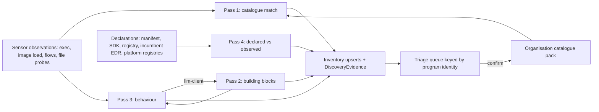

# 05. Discovery and inventory

_Status: draft 5 against spine version 4, rulings R-12, R-15, R-31, R-32 and R-37, the owner's answers in `_review/02-owner-answers.md` (no schedule; zero budget; the agent team runs on the owner's Claude subscription) and the owner's instructions of 2026-11-11 in `_review/04-owner-kit-instructions.md` (no human gates; P15, P16). Owning squad: Discovery and Inventory (module `discover` in `grdr-core`, the probe and collector adapters, the catalogue and building-block packs in the content repository). Read with: `00-decisions.md` (D-24, D-50, D-51, D-13, D-25, D-45, section 6), 04 (inventory records, identifiers, `AgentBom`), 06 (attribution), 07 (adapter manifests, SDK contract, assurance record), 08, 09, 10 (sensors that feed the probes), 12 (Cedar attributes), 13 (detections over inventory changes), 14 (reputation), 15 (credentials released to agents), 16 (secret detectors, capture), 17 (MCP broker), 18 (triage screens and workflow), 25 (importers and connectors), 27 and 28 (screens), spine D-45 and D-64 for the efficacy harness and test lab (the detailed document is pending)._

## Summary

Discovery answers "which agents run here, what are they built from, what can they reach, and who said so". It is four passes that each emit evidence (D-24): a catalogue of known agents, a scan for building blocks inside processes already talking to models, a behavioural classifier that needs no plaintext, and a diff of what registries declare against what sensors observe. Its output is the inventory: agent types, agent instances, MCP servers and tools, skills, plugins and extensions, model endpoints and credential references, exported as an agent bill of materials.

Key choices:

1. **The unit of discovery is a program identity**, a typed string with a fixed precedence (signer, package or image, source remote plus entry point, path). Hashes and versions are attributes, so triage decisions survive rebuilds.
2. **The catalogue schema is ours** (pack kind `catalogue`, three catalogue tiers A, B and C, plus organisation-scoped `bespoke` entries); `ai-detection-spec`, the Uber ADR catalogue, the ACP registry and Defender's support matrix are import dialects, and incumbent inventories are declared sources (section 10). No identifier enters catalogue tier A without a CI run on a real install.
3. **Building blocks are scanned only inside a process already classed `llm-client`**, only within that process's resolved environment or image, under a fixed budget. There is no crawl of home directories or repositories.
4. **The behavioural classifier is a deterministic rule, not a score.** `agent-suspected` needs three response-then-new-child cycles in one process lifetime, a coincidence ratio, and one agentic composition signal. It writes advisory facts and a triage item only, and never drives Ask or Block. An advisory noisy-OR score ranks the queue.
5. **Tool manifests are never obtained by launching a server.** They come from the broker, a gateway or a static manifest. Drift detection uses a first-seen baseline; a pin is an explicit approval.
6. **Declared versus observed is a first-class state on every inventory record**, with "not seen" kept separate from "could not look" (P9). The shadow-agent report is generated from it.
7. **Triage confirmation compiles a fingerprint** into an organisation-signed catalogue pack; proposing it upstream is a separate, previewed action.
8. **Three declaration routes, one record**: a manifest file, an SDK call, a registry entry. Every declaration is a claim (`self-asserted`) diffed against observation.
9. **Discovery efficacy is measured with a generator of bespoke agents and LLM-calling non-agents** whose labels are the oracle, reported per packaging cell and per visibility tier.

## Requirements

| # | Requirement | Source |
|---|---|---|
| R1 | Discover every agent on endpoints, servers, CI, clusters, browsers and SaaS, including unregistered bespoke agents, with MCP servers, skills, plugins, model endpoints and credentials | Owner request; spine section 1 job 1 |
| R2 | Four passes that produce evidence on every system; pass 3 on macOS requires the Network Extension (D-18 tier 2) | D-24; spine section 7 |
| R3 | Separate `llm-client` from `agent`; without plaintext the strongest outcome is `agent-suspected`, which never drives Ask or Block | D-24; c4 F3 |
| R4 | Stable identity for bespoke agents: program identity; triage decisions survive rebuilds; a changed signer or remote reopens triage | D-24; c4 F7 |
| R5 | Environment capture is an allow-list of names; composition scans only in `llm-client` processes; no home or repository crawl; `llm-client` findings stay on the device unless upload is enabled | D-24, D-51; c4 F8 |
| R6 | Catalogue tiers A, B, C; other catalogues are import dialects; install proof for tier A | D-24; c4 F9; brief 17 |
| R7 | Declared versus observed, local sources and incumbent EDR inventories first | D-24; c4 F10; brief g09 |
| R8 | A team can declare a bespoke agent by manifest file or SDK call; this document adds a registry entry | D-24; owner request |
| R9 | Precision 95% against LLM-calling non-agents; recall 85% on generated bespoke agents; at most one new triage item per ten developer endpoints per week after each endpoint's first week | Spine section 6; g08 |
| R10 | Inventory supports AL0 and the per-class declarations AL1 and AL2 read | Section 3; 07 section 11 |
| R11 | Every catalogue entry, adapter and dialect has a support tier; "complete" covers discovery in every Tier 1 cell | D-50 |
| R12 | Pseudonymous principals, metadata by default, exclusions, no input hooks, pre-enrolment history stays local, no per-person views | D-51; l07 F1, F3, F9 |
| R13 | Malicious skills, MCP servers and plugins are controlled by provenance (digest, signature, drift), scanner verdicts are signals only | D-32; threat model ADV-3 |
| R14 | Never execute what discovery finds; untrusted content is parsed in the sandboxed engine | Threat model SR-05, SR-40 |
| R15 | Content is signed data; a pack may not introduce anything to execute, contact or set; host patterns, environment variable names and path templates are allowed as typed match fields | P7; SR-25; R-12 |
| R16 | Discovery works beside an incumbent EDR without memory reads or injection into other processes | D-23; P12 |

## Design

### 1. Pipeline



The classification logic is the sans-IO `discover` module of `grdr-core` (03): observations in, inventory upserts, `DiscoveryEvidence`, advisory facts and triage findings out, with the clock injected. Collectors live in the sensor adapters (08, 09, 10). File probes follow the daemon and engine split of 03: the daemon opens a file only from a catalogue path template, read-only, without following symlinks, under a size cap, and passes the descriptor to the sandboxed engine, which parses it (SR-05). Nothing discovery finds is executed (R14).

Triggers: an exec or image-load event for pass 1; first inference contact for passes 2 and 3; a change notification on a catalogue configuration path (the config-integrity watch of D-22 already covers these) for MCP, skill and plugin inventory; a path-existence sweep every 6 hours at a per-device phase (`SHA-256(device_id || "sweep") mod 6 h`) on the boot-time clock, shipping only changed inventory records; session start for workspace-scoped inventory. The first-run scan (D-48) runs passes 1 and 4 plus configuration inventory for the current user, unelevated and read-only. Target: inventory within 60 seconds on a developer laptop, inside the five-minute first-value target (spine section 6).

### 2. Program identity

The grammar is a frozen contract: other components key on it, so a change goes through the public RFC process for wire formats (D-61).

| Scheme | Form | Used when |
|---|---|---|
| `sig` | `sig:apple:<team-id>:<signing-id>`; `sig:authenticode:<first 32 hex characters of the publisher certificate's SHA-256>:<product-name from the version resource>` | The executable has a valid signature from a publisher other than a runtime (Node, Python, Homebrew, Bun) |
| `pkg` | `pkg:<ecosystem>:<name>`; ecosystems `npm`, `pypi`, `cargo`, `go`, `maven`, `nuget`, `gem`, `deb`, `rpm`, `brew`, `winget`, `msix`, `snap`, `flatpak`, `vscode`, `jetbrains`, `chrome-ext` | The program, or the entry point of an interpreted program, is owned by an installed package |
| `img` | `img:<registry-host>/<repository>` | Containerised; the digest is an attribute |
| `src` | `src:<forge-host>/<owner>/<repo>#<entry-path>` | A script or build inside a work tree with a remote; in CI the entry path is the workflow file and the job name is an attribute |
| `path` | `path:<prefix-template>/<rest>` with `$HOME`, `$WORKSPACE`, `$TMP` tokens | Nothing else applies |

Interpreted programs are identified by their entry point, never by the interpreter: `python -m pkg` resolves the owning distribution in the resolved environment; `node script.js` resolves the nearest `package.json` on the script's path when it sits under a package root or the npx cache; otherwise the script's work tree gives `src`. A runtime signer never produces a `sig` identity (brief 13 infers that Node-hosted agents carry the Node or Homebrew signature; the runtime signer list is pack data, checked by the proof job). Attributes: executable digest, version, `cdhash` on macOS, build commit. An agent type minted from a bespoke identity is `agt_x_` plus HMAC under the organisation key (04 section 3); in clusters the instance is the workload, and pods are replicas (section 9).

Privacy class: `sig`, `pkg` and `img` on public registries are `identifier`. Sites without internet pull images through internal mirrors, so an organisation `registry_aliases` list (`org-catalogue` data: internal prefix to upstream prefix, for example `harbor.example.internal/dockerhub/` to `docker.io/`) is applied before `img` matching and privacy classification, and the image digest is a second route to `matched`, since mirroring by digest preserves it; an internal registry with no alias is not public, so its `img` identity travels as HMAC. `src` is `identifier` only when the forge host and owner are on the organisation's declared forge list; otherwise only its HMAC leaves the device and the readable form is `content.argument`. `path` travels as prefix template (structural) plus HMAC. The device always shows the readable form locally; a triager obtains it as an evidence span on the triage finding (D-51).

### 3. Pass 1: the catalogue

The catalogue is pack kind `catalogue` in the content repository, one YAML file per agent type under `catalogue/agents/<slug>.yaml`, compiled and signed with every other pack (P7, D-37). Routes extend `ai-detection-spec`'s set (brief 17): install routes (`bundle_ids`, `homebrew`, `npm`, `pypi`, `deb_rpm`, `binaries`, `state_dirs`, `process_paths`, `vscode_extensions`, `jetbrains_plugins`, `extension_ids`, `native_messaging_hosts`, `msix_families`, `uninstall_keys`, `launchd_prefixes`, `images`, `image_labels`), plus our additions: `codesign`, `env_markers`, `relocation_vars`, `net`, `mcp_config`, `model_config` (agent configuration files that name a model base URL), `model_endpoint_overrides` (variables and configuration keys that redirect the agent's model endpoint), `offline_capable` (`true`, `false` or `unknown`, set only from the offline proof cell), `skills`, `plugins`, `transcripts`, `credential_stores`, `autonomy_flags`, `acp_registry_id`, `os_registry`. Each entry also carries the facts other components read: `surfaces` with `session_exclusive`, `shared_host` and `min_attribution_grade` for per-action attribution (values owned by 06, D-25), `declared_action_classes` (07 AL1 and AL2), default containment mode (D-21), adapter reference (07) and kind (`cli`, `ide-extension`, `desktop`, `browser`, `local-runtime`, `cloud`, `saas`, `llm-client`). Entries of kind `llm-client` list known chat applications so that they never reach triage.

Worked entry (abridged). Install identifiers, state paths and env markers are from brief 17 (ai-detection-spec, Snyk paths, verification rows 5 and 8); credential and managed paths from brief 15; the API host is prior knowledge; signer values are absent from every open source and are filled by the proof job:

```yaml
schema: grdr.catalogue/v1alpha1
id: agt_claude-code
name: Claude Code
vendor: Anthropic
kind: cli
catalogue_tier: A
owner: discovery-squad
surfaces:
  - id: cli
    session_exclusive: true
    min_attribution_grade: 1       # 06 default for session-exclusive agents
  - id: ide-extension            # runs inside a shared host
    shared_host: agt_vscode
    session_exclusive: false
    min_attribution_grade: 2       # 06 default for shared hosts
declared_action_classes: [exec, file.read, file.write, net.request, mcp.call, agent.spawn, config.change]
containment_default: delegate
adapter: claude-code              # 07 adapter manifest; its fingerprints block references this entry
routes:
  npm: ["@anthropic-ai/claude-code"]
  deb_rpm: ["claude-code"]
  binaries: ["$HOME/.local/bin/claude", "$HOME/.local/bin/claude.exe"]
  state_dirs: ["$HOME/.local/share/claude/versions/", "$HOME/.claude/"]
  vscode_extensions: ["anthropic.claude-code"]
  codesign: { apple_team_id: null, authenticode_publisher: null }   # written only from a proof record
env_markers:                      # names only; values discarded unless join_key; join keys are 06's exec_tags
  - { name: CLAUDE_CODE_SESSION_ID, join_key: session }   # set in Bash, PowerShell, hook and stdio MCP children
  - { name: CLAUDE_CODE_CHILD_SESSION, marker: agent-child }
  - { name: CLAUDECODE, marker: weak }                    # also set in IDE integrated terminals
relocation_vars: [CLAUDE_CONFIG_DIR]
net: { hosts: ["api.anthropic.com"], via: [bedrock, vertex] }
mcp_config: [{ path: "$HOME/.claude.json", parser: claude-json }, { path: "$WORKSPACE/.mcp.json", parser: mcp-json, scope: project }, { path: managed:managed-mcp.json, parser: mcp-json, scope: managed }]
skills: ["$HOME/.claude/skills/", "$WORKSPACE/.claude/skills/"]
plugins: ["$HOME/.claude/plugins/"]
transcripts: [{ path: "$HOME/.claude/projects/*/*.jsonl", parser: claude-transcript }]
credential_stores: [{ kind: os-keystore, platform: macos }, { kind: file, path: "$HOME/.claude/.credentials.json" }]
autonomy_flags: [{ source: settings, key: permissions.defaultMode, value_class: bypass }]
superseded: []
```

**Install proof job.** Nightly in lab tier A (free hosted CI runners, D-64) for each tier A entry, OS and architecture. Login-gated or paid products run on lab tier B (optional self-hosted runners, D-64) only where a login for that product already exists on the host; no account is created for a proof (owner instruction 23) and there is no money for paid accounts, so otherwise the route stays unproven (see "Extension points"). For each install route the entry lists (npm, Homebrew, deb or rpm, MSIX, vendor installer, extension marketplace) the job: starts a clean image with the current sensor and `grdr catalogue probe`; installs the agent's latest release by that route; launches it headless against the replay model endpoint (D-45) with one scripted shell tool call and one stdio MCP server, so that exec, signer, state directories, child env markers, MCP configuration and transcript paths all occur; collects every identifier the probe observed; and compares them with the entry. Each run writes `catalogue/proofs/<slug>.json`, signed by the job's CI identity: OS, architecture, agent version, route, run id, and per identifier `observed`, `missing` or `new`. Proof records are never hand-written. A `missing` identifier fails the entry's release-blocking check; a `new` one (a changed bundle id or signer) opens a pull request adding it, so a rename reaches the catalogue from the next nightly run. The canary job of D-49 shares the images. Each tier A entry also runs an offline cell: its model endpoint is pointed, through one of its `model_endpoint_overrides`, at the replay endpoint under a non-provider internal name, with no public name resolvable and no external route; every identifier must still be observed, the endpoint must be learned by `env-base-url` or `config-file` (section 7), and the result sets `offline_capable`.

Matching is a table compiled per OS into the interest set (D-05): executable path templates and package owners at exec, bundle ids and signer at exec on macOS, Authenticode and MSIX family on Windows, extension ids in IDE and browser profile directories. A path or name match alone yields `candidate`; `matched` needs a second route (signer, package owner, state directory, or an env marker in a child). A listening port is never an identifier (brief 17). A process that matches a catalogued type by env markers or behaviour but by no current identifier stays `candidate` and records the probe's evidence bundle locally (c4 F9); the organisation's server keeps one content-issue candidate per (catalogue id, identifier digest), and only an organisation opted in to upstream proposals sends it, after section 11's preview, to the content repository's intake, which keeps one issue per (catalogue id, identifier digest) with a counter.

Relocation: `relocation_vars` are on the environment allow-list, so an agent moved by `CLAUDE_CONFIG_DIR` or `CODEX_HOME` is found through the exec-time environment, which closes the hole brief 17 records for file-only scanners.

**Catalogue tiers.** A: core-squad owned, every route, nightly install proof on each supported OS, release-blocking for that entry. B: identifiers imported from a dialect, unproven by us, attributed to the source. C: community, unproven, marked as such in every view. `bespoke`: an organisation-scoped entry produced by triage (section 11), never in the shared catalogue; Cedar sees the four values as `Agent.tier` (12). The catalogue tier is about identification; the support tier of D-50 is about the adapter. A Tier 1 agent must be catalogue tier A. Catalogue tier A covers Claude Code, Codex, Cursor, Copilot CLI, Claude Desktop, the ChatGPT and Codex desktop app, Antigravity, Gemini CLI, Ollama, LM Studio, OpenClaw, goose, opencode, Cline, Kiro and Devin Local. Tier A for a login-gated install requires a proof host where a login for that product already exists; without one the entry stays at tier B.

**Import dialects.** Each dialect is a pinned, versioned mapping manifest (D-40 tier 1) with golden files: `ai-detection-spec` (63 agents and 174 CI-proven identifiers, but a young single-vendor project created 2026-08-28; brief 17 verification row 3, c4 F9), the Uber ADR catalogue, the ACP registry JSON (45 agents on 2026-11-09, hourly updates; `quarantine.json` honoured; g09 verification row 6), and the agent names in Defender's support matrix (names only). Imported entries enter catalogue tier B.

### 4. Pass 2: building blocks

Pack kind `building-blocks`, one entry per component with a role and whether it is agentic:

| Role | Examples (initial list; brief 16, 17) | Agentic |
|---|---|---|
| `provider-sdk` | anthropic, openai, google-genai, Bedrock runtime clients, mistral, cohere | No |
| `agent-framework` | LangChain and LangGraph, OpenAI Agents SDK, Claude Agent SDK, Google ADK, Microsoft Agent Framework, CrewAI, Pydantic AI, smolagents, LlamaIndex, Strands, Semantic Kernel, Spring AI, langchain4j, Vercel AI SDK, Mastra, langchaingo, Genkit, Agno | Yes |
| `mcp-sdk` | MCP SDKs for Python, TypeScript, Go and Rust | Only with corroboration (below) |
| `mcp-server` | Known MCP server packages | No (feeds MCP inventory and signal class F) |
| `runtime` | Ollama, llama.cpp (`llama-server`), llamafile, vLLM, SGLang, Text Generation Inference, Triton, LocalAI, KoboldCpp, Xinference, LM Studio, Jan, GPT4All, Foundry Local (the additions are prior knowledge, confirmed by the proof job) | No (also feeds model-endpoint inventory) |
| `gateway-client` | LiteLLM and similar routers | No |

The MCP SDK packages carry both client and server code, and ai-detection-spec dropped `mcp-sdk` and `litellm` because library presence overcounts agents (brief 17, weak points). An `mcp-sdk` therefore counts as the agentic composition signal only when the same process also spawns an `mcp-server` child (class F) or holds an outbound flow to a configured MCP origin; otherwise it is recorded and scores as a bare SDK.

Each entry lists names per ecosystem (distribution, npm package, Go module path, crate, jar, NuGet id), native library names and, for runtimes, default listeners (Ollama 11434, LM Studio 1234, Jan 1337, llama.cpp 8080; prior knowledge in brief 16, unverified, confirmed per runtime by the proof job) that count only when the listener process matches the runtime's identity, on any address the host listens on (vLLM 8000, SGLang 30000, LocalAI 8080, KoboldCpp 5001, Xinference 9997, likewise prior knowledge).

Scan rules (R5): a scan runs once per (program identity, environment root digest) per 24 hours and only after the process is classed `llm-client`; it reads only the resolved environment of that process, records package name and version, and never reads source files or values. Budget per scan (targets, replaced by measurement on Linux): 200 ms CPU, 4,000 stats, 2,000 manifests, 32 MB read; overrun records `composition-budget` as could-not-look.

| Ecosystem | Method | Linux | macOS | Windows |
|---|---|---|---|---|
| Python | Prefix from executable path and `pyvenv.cfg`; `*.dist-info/METADATA` names and versions in that prefix only; frozen archives by table-of-contents names | Yes | Yes | Yes (file reads only) |
| Node, Bun, Deno | Package manifests on the entry point's resolution path, bounded depth; compiled single binaries by embedded module paths | Yes | Yes | Yes |
| Go | Embedded build information (module list) | Yes | Yes | Yes |
| Rust | `cargo auditable` section, else registry paths in strings | Yes | Yes | Yes |
| JVM | Class path from argv and the jar manifest; jar names | Yes | Yes | Yes |
| .NET | `*.deps.json` beside the entry assembly | Yes | Yes | Yes |
| Native libraries | Runtime libraries among loaded images | Memory maps | Region paths through `libproc` (to be confirmed by the macOS spike under "Risks"; otherwise `composition-skipped`) | ETW kernel image-load events; never module enumeration by memory read |

Windows rule (R16): no cross-process memory reads in the baseline, because reading another process's environment looks like credential theft to the incumbent EDR (D-23). Environment markers on Windows are therefore read only for processes our launcher or shim starts; elsewhere the record says `env-unavailable`. On Linux the exec-time environment comes from the exec event. On macOS it comes from Endpoint Security exec events at tier 3 (brief 17, Part 4), and without tier 3 from the `KERN_PROCARGS2` sysctl, which is prior knowledge settled by the macOS spike under "Risks"; where that fails the record says `env-unavailable`. Both are filtered against the allow-list in the collector before anything is stamped, even into the `local` lane. Values are kept only for join keys and markers; credential variables are recorded as name and presence (c4 F8).

### 5. Pass 3: the behavioural classifier

Requires an OS sensor with network visibility. On macOS, flow timing requires the Network Extension (D-18 tier 2), which requires Apple's Developer Program; without it macOS has connect-only visibility through socket-table polling (see the reachability table).

**Signals reachable without content.** All are counters, timings and process facts, never payloads:

| Class (brief 17) | Signal | Source |
|---|---|---|
| D Egress | Connect or SNI to a host or address in the inference set; a connection to a listener whose owning process, on this host or another enrolled host, has a runtime identity | Sensor flows; proxy |
| D Stream shape | Long-lived flow with a server-to-client burst; end of burst = 300 ms of no inbound bytes | Flow byte counters |
| E Loop | Response-then-new-child cycle (below) | Exec events plus flow counters |
| C Composition | Agent framework, or an `mcp-sdk` with corroboration, in the process | Pass 2 |
| F MCP | A child whose identity is an `mcp-server` building block, with pipes for stdin and stdout | Exec events, fd table |
| H Workspace | Opens of agent instruction files (`AGENTS.md`, `CLAUDE.md` and catalogue-listed rule files), recorded as a path class | File events |
| G Environment | Provider key or base-URL variable names present | Allow-listed exec environment |
| I Local model | Runtime connection, runtime library loaded | Flows, image loads |

The inference set is the union of catalogue `net` hosts, runtime identities on this device, the organisation's declared gateways and endpoints (configured internal gateways count, c4 F3), and endpoints learned through section 7, including runtime listeners the server has seen on other enrolled hosts. On a site without internet the catalogue hosts never occur, so the last three are the whole set.

**A cycle** in process P is: (a) a burst on an inference flow of P ends; (b) within 2 s P creates a new child C; (c) P starts a new inference request (new bytes outbound on an inference flow) after C was created and within 30 s of C's exit or 120 s of C's creation, whichever is first. S-09 variant (R-32): a write to the stdin pipe of an existing `mcp-server` child (class F) after a burst end also counts as the effect in (b), with the write's time standing in for C's creation in (c), so stdio MCP tools that spawn nothing can form cycles; the variant ships only if S-09 shows precision holds with it. The **coincidence ratio** is the share of P's children created within 2 s of a burst end; it must be at least 0.5, which removes hosts that spawn background helpers on a timer whatever the model says. Children matching the catalogue's or P's housekeeping list (crash reporters, P re-executing itself) do not count. All windows are targets, replaced by S-09 measurements.

**Outcomes**, in order:

| Outcome | Rule | Effect |
|---|---|---|
| `llm-client` | Any class D signal | Local inventory record in the `local` lane and the device store only; triggers pass 2. It becomes an `inventory.agent` event on the spine lane only when it rises to `agent-suspected` or the organisation enables `llm-client` upload, which is a capture widening under D-31 (R5) |
| `agent-suspected` | At least 3 cycles in one process lifetime, coincidence ratio at least 0.5, and one agentic composition signal: class C (agent framework or corroborated `mcp-sdk`), class F, or class H. A bare provider SDK or environment names alone do not qualify, because every LLM client has them | Advisory fact `discovery.agent_suspected` (origin `heuristic`, evaluates as absent in Cedar, D-09); triage finding; no agent instance, no change to `actor_kind` |
| `agent` | Plaintext loop evidence from an explicit listener, gateway, SDK or opt-in interception: requests carrying a tool definition array, followed by an effect whose arguments match the preceding response's tool call, twice; or a catalogue match; or a declaration matched to observation; or triage confirmation | Agent instance created; policy applies normally |

The score is brief 17's noisy-OR with its starting weights (A 0.99, B 0.99, E 0.80, F 0.60, D 0.50, C 0.40 framework or 0.20 SDK, I 0.30, H 0.20, G 0.15), scaled to 0 to 100, stored for ranking the queue only, not `policy_readable` (04). The weights are placeholders until labelled data from S-09 and the lab replace them through the content lane.

**Reachability by visibility tier** (c4 F3):

| Visibility | Reachable outcome for an unregistered agent |
|---|---|
| Connect and SNI with flow counters (default on Linux and Windows; on macOS requires the Network Extension) | `llm-client`, `agent-suspected` |
| Connect only, no flow timing (macOS without the Network Extension, via socket-table polling) | `llm-client`; `agent-suspected` only when the agent reuses no connection (recorded `no-flow-timing`) |
| Behind an undeclared proxy, ECH or QUIC to an unknown host | Nothing from D; `net-indirect` recorded; composition and MCP signals still collected for processes already known as clients |
| Explicit listener or declared gateway in the path | `agent` |
| SDK or hooks | `agent` (claims, corroborated by sensor) |

**Evidence record.** Every outcome carries a `DiscoveryEvidence` (section "Interfaces"): subject process and program identity, pass, tokens (class, signal, channel, provenance grade, first and last seen, count, `local` sequence range), cycle count and coincidence ratio with the window parameters, outcome, basis, advisory score, classifier pack digest and engine version, visibility tier, and could-not-look reasons (`no-flow-visibility`, `no-flow-timing`, `net-indirect`, `env-unavailable`, `composition-skipped`, `composition-budget`, `sandboxed-runtime`, `excluded`, `permission`, `size-limit`). Example at metadata, values illustrative:

```json
{"subject":{"process":"prc_7q2…","program_identity_hmac":"hm_4kd…","prefix_template":"$HOME/src/*","packaging":"python-venv"},
 "pass":"behaviour","outcome":"agent-suspected","basis":"behaviour-content-free","visibility":"connect-sni",
 "tokens":[{"class":"D","signal":"inference-host","host":"api.openai.com","provenance":"observed-kernel","count":14},
           {"class":"E","signal":"cycle","count":5,"coincidence_ratio":0.83},
           {"class":"C","signal":"agent-framework","block":"langgraph","version":"1.0.4"}],
 "score":91,"classifier":"sha256:9be1…@engine-0.4.0","could_not_look":["env-unavailable"]}
```

**Expected false positives and controls.**

| Source of false positives | Why it looks like a loop | Control |
|---|---|---|
| Batch summariser or ETL that spawns a converter per item | Response, child, request | Needs an agentic composition signal; bare SDK does not qualify |
| Notebook kernel calling a model then a shell | Cycles in the kernel process | Same; a notebook using an agent framework is reported, and is arguably an agent |
| IDE extension hosts, language servers, build watchers | Timed child spawning near model traffic | Catalogued as hosts; coincidence ratio; housekeeping list |
| Evaluation harnesses and CI test suites | Model call, then test subprocess | Triage disposition by program identity, organisation-wide; `src` identity keeps it stable |
| Chat applications writing their databases | File writes after each response | File writes are not cycle effects; `llm-client` catalogue entries |

The triage budget (at most one new item per ten developer endpoints per week after each endpoint's first week) is held by deduplication: one item per program identity per organisation with a device count, dispositions that persist across rebuilds, and catalogue tier B and C growth. The budget is a release gate measured on our own fleet, the lab tier B machines (D-64; section "Test").

### 6. MCP servers and tools, skills, plugins, extensions

**MCP servers.** Sources: catalogue `mcp_config` routes (user, project, managed and plugin scope, recorded as `config_scope`), Windows on-device registry entries and the `com.microsoft.windows.ai.mcpServer` app extension (g09, behind a capability probe), observed stdio children in agent lineage, the broker (17) and gateways. Identity follows 04: stdio `mcp_` over package identity and canonical launch command; HTTP over origin and declared registry name. `server_digest` for stdio servers is the Merkle root over the resolved package files in path order, computed at first launch observation; remote servers have none, and the record says so.

**Tool manifests** (`mct_`, `manifest_hash` per 04) come only from: broker observation of a real session's tool listing, a gateway, or a static manifest (MCPB `manifest.json`, the on-device registry's static responses). Discovery never starts a server to read its tools (SR-40; Snyk agent-scan does, which is why it warns users to sandbox it, brief 08). Protocol revisions: detectors match both the legacy `initialize` handshake and the 2026-07-28 per-request `_meta` keys, `server/discover` and `Mcp-Method` headers (brief 17, verification A).

**Baseline, pin and drift.** Two separate states. The *baseline* is the first-seen digest per id, recorded automatically for drift detection. The *pin* is an explicit approval (`unpinned`, `pinned`, `rejected`) by organisation pack or by a user grant at the rule class's minimum grade; it is never set automatically, because D-28's sink "calls to unpinned write-capable MCP tools" would otherwise be meaningless. Drift is the same id with a new digest: an `inventory.mcp_tool` or `.mcp_server` record with change kind `drift`, the old and new digests, and a description and input-schema fingerprint diff, plus the deterministic fact `mcp.manifest.drift` (04); 17 decides the re-ask and 13 the finding. A pin binds one digest, so Cedar needs no separate drift attribute: it reads `McpServer.identity_pinned` and `McpTool.manifest_pinned` (12), and a drifted tool reads `manifest_pinned: false` until it is pinned again. `rejected` is enforced as disable by digest (D-30), not as a policy attribute.

**Skills and plugins.** Locations come from catalogue `skills` and `plugins` routes. Identity per 04: `skl_` and `plg_` over source URI and install scope, `content_digest` as a Merkle root over files in path order; files are hashed, never uploaded. Cap: 10 MB and 2,000 files per skill, else `size-limit`. Workspace-scope skills and project MCP configurations are read only when a session starts in that workspace, and only at the catalogue's relative paths. Scanner verdicts (14) attach as signals; provenance is the control (D-32).

**IDE and browser extensions.** Only catalogue-listed extension ids are matched in IDE and browser profile directories, so a personal browser profile yields no list of everything installed (D-51). Browser automation is recorded from process facts: `--remote-debugging-port` or `--remote-debugging-pipe` with a non-default `--user-data-dir`, `DevToolsActivePort`, native messaging host manifests, and Chrome and Edge managed-policy values (`GeminiActOnWeb*`, `CopilotBrowserUse*`; g09). WebMCP tool inventory requires the browser extension.

### 7. Model endpoints: learn, declare, reject

`mdl_` records (04) carry provider, origin, deployment or model name, tenant marker (D-28) and state:

- **Declared**: the organisation lists endpoints and gateways, with tenant marker and an optional `tls_issuer_spki` (the SPKI digest of the issuing CA expected for that host), which 17 section 5 compares to detect an interceptor. Model endpoints, gateways and MCP origins take the same field. Standalone users may declare too.
- **Learned**: an endpoint enters the inference set as `learned` when the explicit listener or a gateway sees an API shape on it (paths `/v1/messages`, `/v1/chat/completions`, `/v1/responses`, `/api/chat`, Bedrock `/model/{id}/converse-stream`, Vertex `:streamGenerateContent`, Azure `/openai/deployments/…`; headers `anthropic-version`, `X-Stainless-*`; brief 17), when a runtime identity serves it, or when triage confirms it. The listener also learns from `/v1/completions`, `/v1/embeddings`, `/api/generate`, llama.cpp `/completion`, TGI `/generate` and KServe and Triton `/v2/models/{m}/infer` (prior knowledge, confirmed by the runtime proof cells). Three further bases need no plaintext and matter most where no public provider is reachable: `fleet-runtime-listener`, a non-loopback listener on an enrolled host owned by a process with a `runtime` or gateway identity, which the server publishes to the organisation's devices as address, port and runtime kind, never the host's device id or user; `env-base-url`, an allow-listed base-URL variable naming host H followed by a flow from the same process to H; and `config-file`, a model base URL in an agent configuration file read through the catalogue's `model_config` routes and parsed in the engine as `mcp_config` is (a new route under a home directory is privacy-relevant, Security). Learned endpoints count for pass 3 immediately, since that only increases observation; they reach the tenant marker and the proxy's allowed host classes (17 section 8) only after an organisation decision.
- **Rejected**: an administrator marks an endpoint as not inference. It leaves the inference set, so contacts no longer count for pass 3; because that reduces observation it is a widening operation under D-31, written as `audit.admin`, reversible, and a rejected endpoint is still recorded when contacted. "Not permitted" is not an inventory state: it is an entry in the model-provider list of the `grdr.egress` pack (12).

Base-URL variables (`ANTHROPIC_BASE_URL`, `OPENAI_BASE_URL` and catalogue-listed names) are on the allow-list; only the host part is kept, as an identifier.

### 8. Credentials referenced in agent configuration

The parsers for catalogue `mcp_config` and `credential_stores` routes emit `inventory.credential` records (`crd_`, 04): references in MCP `env` and `headers` blocks, key-helper settings, keystore item references, credential files by presence, provider files known to hold plaintext (Copilot CLI BYOK `providers.json`, brief 15). The identity follows 04: HMAC over type and a stable public part (key id, certificate fingerprint); a configured secret with no public part uses store and configuration field path as that part. It is never derived from secret bytes. 16's detectors classify a value on the device to set `type` and `plaintext`, then the value is dropped. Attributes: store (`plaintext-file`, `os-keystore`, `env-reference`, `helper`, `vault-reference`), scope where stated, the configuration file's modification time as a lower bound on age, last use from `cred.use` (D-27), honeytoken flag. A plaintext credential in agent configuration raises a policy-violation finding through 13. 15 owns what the broker releases; this inventory is its input.

### 9. Off the laptop

Containers, Kubernetes and CI require the Linux sensor; connectors require the integration host and access to the vendor's API; browser extension inventory requires our browser extension (spine section 7).

| Environment | Discovery | Identity and instance | Coverage limits |
|---|---|---|---|
| Linux servers and containers on one host | Same passes; composition scan through the container's root filesystem view of the `llm-client` process | `img:` with digest; instance per container workload | None beyond the host's tier |
| Kubernetes, runc nodes | Node sensor DaemonSet plus a controller that watches Pods, ServiceAccounts and `agents.x-k8s.io` resources; every Sandbox is a declared agent workload | Instance = workload (owner reference); `agents.x-k8s.io/sandbox-name-hash` is the only key on every pod, `claim-uid` only on claimed pods (g04) | Coverage ledger per workload by RuntimeClass |
| gVisor, Kata, Fargate | Unprivileged sidecar, hooks, gateway egress, OTLP; a gVisor `seccheck` consumer on self-managed nodes | Same | Pass 3 reports `sandboxed-runtime` from the host (host eBPF is blind there, g04) |
| CI | Ephemeral sensor mode installed by a first job step; catalogued agents invoked in jobs; agentic workflow definitions as declarations | `src:<forge-host>/<owner>/<repo>#<workflow-path>`, job as attribute; identity from the CI OIDC token | Hosted runners have sudo; `ubuntu-slim` runs in an unprivileged container and cannot run the sensor, so it gets proxy environment only (g04) |
| Cloud agent platforms | Connectors: AWS Agent Registry, Google Agent Registry, Agent 365 registry Graph API (preview), Foundry, Claude Managed Agents; Bedrock `InvokeModel`, `InvokeModelWithResponseStream`, `Converse` and `ConverseStream` management events reveal LLM-client workloads (streaming calls emit a second token-count event, not counted twice; brief 17 verification B) | Vendor agent ids as aliases of our agent type | Never above AL1 (D-13) |
| SaaS (the Anthropic Compliance API and OpenAI Compliance Logs connectors are read-only and require a customer with access to that API, spine section 7) | Anthropic (Claude) Compliance API, OpenAI (ChatGPT) Compliance Logs, GitHub audit (`actor_is_agent`, `agent_session_id`), OAuth grants to agent applications in the IdP | Connector account as principal mapping | Polling, plan-gated; the Claude Compliance API excludes API-key, Bedrock and Vertex workloads (brief 16) |
| Browsers (process facts and managed policy; WebMCP and in-page actions require our browser extension) | Section 6: catalogue-listed extension ids, remote-debugging launch facts, native messaging hosts, Chrome and Edge agent policy values; WebMCP tools and in-page agent actions through our browser extension (17) | Browser program identity plus extension id; the profile path is a `path` HMAC | Built-in browser agents that act through the user's own session are visible only through policy state where the extension is not installed |

Shared seams: the `img` and `src` schemes, the reserved inventory fields for workload owner, RuntimeClass and cloud principal (field numbers 900 to 999 in `grdr.inventory`), the `sandboxed-runtime` could-not-look reason, and the `DeclaredSource` trait. Every environment in the table uses them.

### 10. Declared versus observed and the shadow-agent report

**Declared sources**, each behind the `DeclaredSource` trait with a provenance grade (04 section 9): our declarations (section 12); agent configurations owned by MDM; platform registries (Windows on-device registry and agent accounts ending in `$`, ACP agent-server configuration, Xcode agent plug-ins); incumbent EDR inventories, which require access to the incumbent's API: Defender `AgentsInfo` (`Platform == "LocalAgents"`, `RawAgentInfo.localAgentMetadata` with `localMcps`, `autoApprove`, `trustedProcess`; polled, since it is not in the streaming API; brief 03 notes the `Name` versus `AgentName` column discrepancy, so the mapping is checked against a live tenant) and Falcon Guardian entities and session graph (read-only API, limit 500, offset cap 1,000, so the connector pages by last-modified slices halved until each fits the reachable rows, never by deep offset, polls at `SHA-256(organisation_id || connector) mod poll_interval`, and reports an irreducible slice as `could-not-look` reason `connector-cap`, never `incumbent-only` or `matched`; the graph is session-grained but its session-to-agent edge is present and empty, so Guardian rows join at device and agent-type grain; brief 04 verification row 6); cloud registries. Incumbent rows carry provenance grade `reported` (04) and join to our devices through the incumbent's sensor id, which our sensor reads locally and reports as a device alias, never through hostnames. For Falcon the id is the AID, readable from the `CSAgent\Sim` registry value `AG` on Windows or `falconctl info`, and absent on Linux (brief 04 verification row 2); the Defender equivalent is established in the lab check below.

**States** on each agent type and instance record:

| State | Meaning | Default finding |
|---|---|---|
| `matched` | Declared and observed | None |
| `shadow` | Observed, not declared | Coverage gap, through triage |
| `declared-unseen` | Declared, not observed where the sensor could look | None for 7 days, then an informational coverage-gap finding, rule `discovery.declaration-stale` |
| `declared-blind` | Declared, not observed, and the sensor could not look | Coverage gap (P9) |
| `mismatch` | Declared attributes differ: model endpoints, MCP servers, tools, credential mode, signer | Policy violation |
| `incumbent-only` | The incumbent sees it and we do not | Coverage gap against us; a content-issue candidate, sent upstream only as section 3 says |

**Shadow-agent report** (generated at metadata; screens in 27 and 28; a local view on the device, and an organisation report that requires the server): per organisation or group of at least five devices, never per person (D-51): agents by state, catalogue tier and assurance level; new shadow identities this week with device counts; unpinned and drifted MCP servers; plaintext credentials in agent configuration; could-not-look coverage by reason. Each tile is a sentence with a number, a comparison and one action (D-44).

### 11. Triage and fingerprint generation

Local triage works standalone; the organisation-wide queue requires the server.

A triage item is a finding of class coverage gap, rule `discovery.unknown-agent`, keyed by organisation and program identity, so its evidence spans can carry the readable identity under D-51. One item covers every device that reports the identity.

| Decision | Effect | Widening? |
|---|---|---|
| Confirm as new agent type | Choose kind, `session_exclusive`, `min_attribution_grade`, containment default and sponsor team; Mode starts at Watch | No |
| Variant of a catalogued type | Adds an organisation-scoped route that points at that type (renamed, relocated, repackaged); opens a content issue upstream if the user opts in | No |
| LLM client, not an agent | Suppresses `agent-suspected` for this identity | Yes |
| Not AI | Suppresses inventory as an agent | Yes |
| Snooze | Hides for at most 30 days | Yes |

The three widening dispositions are D-54 suppressions of `discovery.unknown-agent` scoped to the program identity, with owner, justification and expiry (default 180 days, at most 365; snooze at most 30). They survive rebuilds because they key on program identity, not on hash. Widening decisions are step-ups at the minimum grade of D-31 and, in the platform, need a policy approver other than the proposer (D-55). Triage reopens on a changed signer, remote or package name (D-24), on a new agentic building block in an identity disposed as `llm-client` (`composition-changed`), and when outcome rises from `llm-client` to `agent-suspected` after such a disposition.

**Confirmation generates a fingerprint.** The `discover` module emits an organisation catalogue entry from the evidence: id `agt_x_<hmac>`, the program identity as the primary route, observed identifiers (signer, package, image repository, entry point, path template), building blocks, inference hosts and env markers, with `catalogue_tier: bespoke` and `scope: organisation`. Public identities (`sig`, `pkg` and `img` on public registries) are stored readable; `src` outside the declared forge list and `path` are stored only as their HMAC under the organisation key, which every device of the organisation can compute at exec, so the entry matches without the readable form leaving a device (section 2). In the platform it is compiled into an `org-catalogue` pack signed by the deployment root (D-37) and delivered through rings; in standalone it is a local-layer artefact owned by the privileged service (Protected) or the user (User), like local policy (12). Organisation entries add types and never modify a global entry. "Propose upstream" strips organisation-specific identifiers, shows the exact payload, and opens a content-repository pull request only on the user's action.

### 12. Declaring a bespoke agent

One schema, `grdr.inventory.v1alpha1.AgentDeclaration`, three routes:

1. **Manifest file** `grdr-agent.toml` at the root of the entry point's package or work tree, or embedded as `[tool.grdr.agent]` in `pyproject.toml`, a `grdr.agent` key in `package.json`, or an OCI image label `dev.grdr.agent` holding the manifest (names fixed by the namespace search of D-66). The sensor reads it only for a process already classed `llm-client` or at session start, at that one path, so declaring never requires a crawl.
2. **SDK call** `declare(manifest)` (07 section 12), sent over the local socket with the same schema.
3. **Registry entry** through `RegistryService.DeclareAgent` on the server (requires the server), `grdr agent declare --file` locally, or the Terraform provider resource (23), for CI and infrastructure as code.

```toml
schema = "grdr.agent/v1alpha1"
slug = "invoice-triage-bot"
sponsor_team = "finance-platform"        # a team, never a person
identity = { pkg = "pypi:acme-invoice-triage", src = "github.com/acme/invoice-triage#bot/main.py" }
session_exclusive = true
tools = [ { name = "run_sql", action_class = "net.request" }, { name = "write_report", action_class = "file.write" } ]
mcp_servers = [ "pkg:npm:@acme/ledger-mcp" ]
model_endpoints = [ "https://llm-gateway.acme.internal" ]
credential_mode = "gateway"
expected_children = [ "psql" ]           # proposed housekeeping entries, inert until confirmed
```

Every declaration has `identity_proof: self-asserted` (D-27) until a workload identity binds it, which makes it `attested`. A declaration can never widen policy or detection; the organisation's policy decides what the declared tools may do. A declaration matched to observation makes the process an `agent` (section 5), which only adds coverage. `expected_children` would suppress unmatched-effect findings, so it stays inert, and those effects stay `undeclared` (07), until a person confirms the declaration through the triage "Confirm" decision or a reviewed registry entry. Mismatches against observation produce the `mismatch` state.

### 13. Agent bill of materials

04 owns the `AgentBom` message and its three exports (signed native JSON, CycloneDX 1.7 with the `grdr:*` taxonomy, OCSF 5020). This document fixes the content and generation. Components: agent types and instances with versions and catalogue tier; building blocks with versions; MCP servers with digest, transport and `config_scope`; tools with manifest hash and pin state; skills, plugins and extensions with digests; model endpoints with tenant marker; credential references (type, store, scope; never values); containment mode; assurance level per instance; declared-versus-observed state; provenance grade per observation; edges (`uses`, `loads`, `calls`, `runs on`). Scopes: `grdr abom --scope device` on the device; per organisation on the server; `grdr abom --repo <path>` reads one repository's manifests and configurations, the only place a repository is read, and only when a person or CI job invokes it. `grdr abom diff` compares two documents so that a pull request shows a change in declared authority; Docker Kit descriptors (h05) import as declarations.

### 14. Support tiers and "complete" for discovery (D-50)

Every catalogue entry, import dialect, declared source, connector and collector has a support tier in `support.toml` (03). Discovery is complete in a shape when, for every Tier 1 cell: the agent is identified by program identity within 60 seconds of first exec; its MCP servers, skills, plugins and credential references are inventoried; the shadow report shows it; and induced blind spots appear as could-not-look, never as absence. Tier 1 cells include Claude Code and Codex on Linux x64 and macOS arm64; Windows joins Tier 1 when S-04 passes, and each further agent and platform when it passes the conformance suite (D-50).

## Interfaces and contracts

| Interface | Form | Other party |
|---|---|---|
| `catalogue`, `building-blocks`, `org-catalogue` pack kinds | Signed packs; schema `grdr.catalogue/v1alpha1`; proof records | Content pipeline; 07 (adapter manifests reference catalogue ids); 11 and 22 (delivery) |
| Program identity grammar | String scheme of section 2, frozen; changes by RFC | 04 (agent type key), 06, 12, 14 |
| `grdr.inventory.v1alpha1`: `DiscoveryEvidence`, `AgentDeclaration`, `DeclaredSourceRow`, `DiffState`, `PinState` | Protobuf; `inventory.*` events carry them | 04 (owner of package and lanes), 20 (relational storage), 22 |
| Catalogue facts read elsewhere | `session_exclusive`, `shared_host`, `min_attribution_grade`, env markers with `join_key` (06's `exec_tags`), `declared_action_classes`, containment default | 06, 07 section 11, the containment sections of 08 to 10 |
| Cedar attributes (12's schema) | `Agent.tier` (A, B, C, bespoke), `McpServer.identity_pinned`, `McpTool.manifest_pinned`; the tenant marker feeds `context.tenant` on `llm.request`. `agent-suspected` is heuristic and never enters a request (P2) | 12 |
| Triage finding `discovery.unknown-agent` | Finding (04 section 8) | 13, 18 |
| `DeclaredSource` trait | Layer 2 port; members: local declarations, MDM-owned configuration, Windows on-device registry, ACP configuration, Defender, Falcon, cloud registries | 25 (connectors and credentials) |
| Interest set entries | Exec path, package-owner and host tables compiled from the catalogue | 03, sensors |
| Server API (requires the server) | `InventoryService`, `TriageService`, `RegistryService`, Google AIP mechanics | 23 |
| CLI | `grdr scan`, `grdr inventory list\|show\|export`, `grdr triage list\|decide`, `grdr agent declare`, `grdr abom`, `grdr catalogue probe\|lint\|test` | 27, 28 |

## Behaviour by deployment shape

- **Standalone.** All passes local; the user triages in the CLI or local console; the organisation catalogue is the user's own; pass 4 uses local declarations and platform registries only; `llm-client` records never leave the device; upstream proposals only on explicit action. History from before `grdr join` stays local unless the user back-fills it (D-48).
- **Platform, self-hosted and hosted.** Self-hosting is the default; the hosted service requires its preconditions in D-63, including infrastructure funded by revenue, sponsorship or donated cloud credits. Triage is deduplicated across devices; the organisation catalogue pack rides the rings; incumbent importers run as server connectors under the organisation's key; the shadow report is per organisation and group. In the hosted service, cross-organisation joins never happen (HMAC under each organisation's key); a provider may publish a provider-layer catalogue pack to its organisations, which requires the provider tier (D-35); sightings of public program identities feed 14 only under its opt-in k-tenant threshold.
- **Embedded.** The `discover` module and the packs run over the host's telemetry (D-41 L3, L4). The host profile (D-60) states which signals exist; without flow counters pass 3 returns "not evaluable" rather than nothing found. L0 content includes catalogue matches compiled to the partner's query languages; L1 feeds carry `inventory.*`.

## Extension points

- **A catalogue entry**: copy `catalogue/agents/_template.yaml`, run `grdr catalogue probe` on a machine with the agent installed (it writes an evidence bundle of observed identifiers with paths templated to `$HOME` and similar roots and no user names, and nothing else), run `grdr catalogue lint` and `test`, open a pull request at catalogue tier C with the bundle attached. The pull request runs the verifier (P7), the privacy-relevance check below and the install proof job of section 3 for every route the entry names; a route the job cannot install (login-gated) is marked unproven. Content lands through the merge queue once the evaluators its risk tier requires pass (D-61, owner instruction 7); a full proof match makes the entry eligible for tier A once a maintainer takes ownership in `support.toml`. Identifiers are never deleted: superseded ones keep `superseded_at`. Rot: three consecutive nightly proof failures mark an identifier `stale`; 14 days stale demotes the entry to tier B and files a `status:proposed` issue. Login-gated products use a proof host in lab tier B (D-64) where a login for that product already exists, and a proof run there is valid for 90 days; no account is created for a proof and there is no money for paid accounts, so a product with no such login keeps its routes unproven. Rot metrics (stale identifiers, demotions, days to absorb a vendor rename) are published per release.
- **A building block**: one entry with ecosystem names, role and agentic flag, plus a generator cell (section "Test") proving detection.
- **An import dialect**: a mapping manifest with golden files; no code.
- **A declared source**: implement `DeclaredSource` in the contrib repository against the port test kit; it is Tier 2.
- **Classifier tunables**: windows, thresholds and weights are declared tunables in the building-blocks pack; organisation overrides survive pack updates (D-54).

## Security and privacy

- **P7 and SR-25.** Catalogue packs contain path templates, host patterns and environment names, which P7 allows as typed match fields (R-12). The verifier admits them only in typed match and probe fields that the collector reads; no field names anything to execute, contact or set. Paths must start with a template root and are opened read-only without following symlinks.
- **Collection limits (D-51).** Environment: allow-list of names, filtered in the collector, values discarded except join keys and markers. Composition: `llm-client` processes only, resolved environment only, package names and versions only. Configurations: catalogue paths only. Skills: digests only. No home or repository crawl, no keyboard or mouse hooks; synthetic-input and screen-control capability comes from process facts and permission grants delivered through MDM profiles, never from the TCC database (macOS 27 removes direct access to it, g09 verification row 10) or input hooks. Excluded principals, paths and repositories produce no discovery events; the skip is counted in `health.coverage` with reason `excluded`.
- **Privacy-relevant content changes.** A pack version that adds an environment name to the allow-list, a path route under a home directory, or a new field read is privacy-relevant: it does not auto-promote and appears as a diff in the monitoring catalogue (l07 F7).
- **Planted evidence.** Transcripts, manifests and configuration files are claims (P3). A forged catalogue match on a renamed binary yields `candidate` without a second route. A planted manifest can only declare; it cannot widen policy, and its `expected_children` stay inert until a person confirms it (section 12).
- **Disclosure.** The developer's own view lists everything discovery records about their device. Reports are per group of at least five or per organisation, never per person.
- **Coexistence.** No memory reads of other processes on Windows, no injection, no server launches; probes are rate-limited file reads that an incumbent sees as ordinary I/O by a signed binary (D-23).

## Test and evaluation strategy

| Property | Method | Oracle |
|---|---|---|
| Catalogue identifiers are real | Nightly install proof per catalogue tier A entry, OS and architecture | The installed artefacts on a clean image |
| Recall on catalogued agents | Lab images with each tier A agent | Ground truth of the image; target 99% (g08) |
| Recall on bespoke agents | Generator (below), held-out cells, within 15 minutes of first run | Generator labels; target 85%, reported by packaging tier and visibility tier |
| Precision | Generator negatives plus two weeks of observation on our own fleet (lab tier B machines, D-64) | Generator labels; fleet items labelled by an evaluator agent from each item's evidence bundle, with a refuting pass on the other model; target 95% |
| Triage budget | Own fleet, after each endpoint's first week | Count of new items per ten endpoints per week, at most one |
| Blind spots | Induced faults: unreadable environment, undeclared proxy, gVisor pod, exclusion, size caps | Each appears as the expected could-not-look reason; 100% |
| Privacy limits | Canary strings in environments, source files and skill files at default capture | Zero canaries in uploads, findings, feeds and exports (l07 spike) |
| Never execute | Lab with a booby-trapped MCP server package and skill script | Exec tracing shows no execution by our processes |
| Identity stability | Rebuild, re-version and re-sign variants of a generated agent | Same program identity except on signer or remote change, which reopens triage |
| Determinism | Replay of recorded observation streams through `discover` | Byte-identical outputs on native and `wasm32` |

**Generator** (D-45 discovery track; g08 item 7). Cells are the product of: language and runtime (Python, Node, compiled Bun, Go, Rust, Java, .NET); construction (bare provider SDK with hand-written loop, LangGraph, OpenAI Agents SDK, Claude Agent SDK, Google ADK, MCP client library, raw HTTP); provider (Anthropic, OpenAI, Bedrock, Vertex, Azure, local Ollama or llama.cpp, a corporate gateway); transport (direct, explicit proxy, declared gateway); tools (shell exec, file write, stdio MCP, HTTP MCP, in-process only); packaging (venv script, installed console script, npx, single binary, container, renamed process, frozen archive, system service, scheduled job); cadence (fast tools, tools over 30 seconds, batched tools); declared or not. Negatives: chat application, batch summariser spawning converters, notebook with model calls, evaluation harness, embedding indexer, one-shot model CLI, translation service. Every agent talks to the replay model endpoint (D-45), so runs are deterministic and use none of the subscription's usage windows or any paid model API. Lab DNS resolves the real provider hostnames to the replay endpoint, which presents certificates from a lab CA trusted only inside the image, so connect, SNI and flow timing look as they would in the field; the corporate-gateway cell uses a hostname that only the organisation declaration puts in the inference set. Held-out cells live in the held-out suite and are published two releases after use.

Metrics. Recall: generated agents that reach `agent-suspected` or `agent` within 15 minutes of first run, over generated agents in cells reachable at that visibility tier. Precision: `agent-suspected` and `agent` outcomes on true agents, over all such outcomes, with generator negatives and the triaged fleet items pooled. Both are reported per cell group (packaging, construction, tool type, visibility tier) with a 95% Wilson interval. Small samples make gates meaningless (g08: 42 positives put recall 0.667 between about 0.52 and 0.79), so a gated group needs at least 200 labelled runs (target), which narrows the interval to about 5 points at 85%. Cells that cannot be reached at a visibility tier (in-process tools without plaintext) are reported as such, not averaged away.

## Work breakdown

**E1. Program identity and catalogue schema**
- DI-1 Freeze the program identity grammar and resolver for Linux. *Accept:* golden vectors for every scheme; a renamed, rebuilt Python agent keeps its identity; a changed remote changes it.
- DI-2 `grdr.catalogue/v1alpha1` schema, linter, compiler to interest-set tables. *Accept:* the Claude Code entry compiles; a field naming an executable, URL to contact or variable to set is rejected by the verifier.
- DI-3 Catalogue tier A entries for Claude Code, Codex, Cursor, Copilot CLI with proofs on Linux x64 and macOS arm64 (free hosted runners), and Windows x64 for identification. Requires DI-2 and DI-30. *Accept:* nightly proof green; each agent identified within 60 s of first exec; two routes required for `matched`.
- DI-4 Import dialects: `ai-detection-spec`, Uber ADR, ACP registry. Requires DI-2. *Accept:* golden files; imported entries are tier B and attributed; an entry listed in ACP `quarantine.json` is not imported.
- DI-30 Install proof job and contribution workflow: `grdr catalogue probe`, signed proof records, the pull-request checks of "Extension points", rot marking and demotion. *Accept:* a renamed bundle id in a test fixture produces a `new` identifier and a pull request; a removed route fails the entry's check; a probe bundle contains no user name (canary user name in the fixture); three injected failures mark the identifier `stale`.

**E2. Building blocks**
- DI-5 Building-blocks pack and Python and Node scanners on Linux. *Accept:* a scripted bespoke agent on Linux reports its framework and version; budget overruns record `composition-budget`.
- DI-6 Go, Rust, JVM and .NET scanners; macOS. *Accept:* generator cells for each language detected; no file outside the resolved environment opened (file-access trace).
- DI-7 Windows, via file reads and ETW image loads only. *Accept:* zero cross-process memory reads in a trace; Defender raises no alert in the interference test.

**E3. Behavioural classifier**
- DI-8 Cycle detector, coincidence ratio and outcomes on Linux from eBPF exec and flow counters. *Accept:* the scripted Linux agent reaches `agent-suspected`; a batch summariser negative stays `llm-client`; a negative that imports the MCP SDK without an MCP child or flow stays `llm-client`; an `llm-client` record appears in the `local` lane and in no uploaded lane.
- DI-9 `DiscoveryEvidence` record and advisory fact. *Accept:* Cedar sees the fact as absent; a Block rule that names it fails the pack linter.
- DI-10 Windows flow and exec sources; macOS socket-table polling with `no-flow-timing`. *Accept:* generator cells on both systems; reachability table holds.
- DI-11 macOS flow timing from the Network Extension. Requires the macOS tier 2 Network Extension (D-18), which requires Apple's Developer Program. *Accept:* macOS held-out recall 85% (the macOS discovery target, R-37), and within 5 points of Linux on the same cells.

**E4. Inventory**
- DI-12 MCP, skill, plugin and credential configuration inventory for tier A agents. *Accept:* every route in the entries parsed; drift raised within 10 s of a file change (target); no value of a credential stored.
- DI-13 Baseline and pin states. *Accept:* nothing becomes `pinned` without an approval record; after a manifest change the tool evaluates with `manifest_pinned: false` in a Cedar golden vector.
- DI-31 Collection limits. *Accept:* the canary test of the test table passes at default capture (zero canaries in uploads, findings, feeds and exports); a file-access trace of a full discovery cycle shows no open outside catalogue paths and resolved environments; an excluded path produces only a `health.coverage` count.
- DI-14 Broker-observed tool manifests and both MCP protocol eras. *Accept:* manifest hash matches 04's JCS vector; no server ever started by discovery.
- DI-15 Model endpoints learn, declare, reject. *Accept:* a generator agent on a corporate gateway is classified once the gateway is declared; rejection writes `audit.admin`; an undeclared internal endpoint is learned by each basis of section 7, with recall at least 85% per cell group within 15 minutes and no public name resolvable, and precision unchanged against a negative batch job calling the same endpoint; the offline proof cell (section 3) is green for Claude Code (internal gateway) and Codex (Ollama) on Linux x64 and macOS arm64; step 8 of the air-gap conformance run S-31 repeats this on its lab, with image identities matched through the internal registry by digest.
- DI-16 Browser and IDE extension matching, remote-debugging facts. *Accept:* only catalogue ids reported from a profile with 50 other extensions.

**E5. Declared versus observed**
- DI-17 Local declared sources and diff states. *Accept:* each state of section 10 produced by a lab scenario; `declared-blind` distinct from `declared-unseen`.
- DI-18 Defender and Falcon importers (with 25). Requires access to each incumbent's API; the Falcon licence comes only through a design partner or a free vendor programme (D-64). *Accept:* imported instances appear with provenance grade `reported`; a missing licence degrades with a stated reason.
- DI-19 Server diff and shadow report. Requires the server. *Accept:* report renders at metadata with no per-person breakdown; tiles follow D-44.

**E6. Triage**
- DI-20 Local triage, dispositions, reopen triggers. *Accept:* rebuild keeps disposition; signer change reopens; widening dispositions require the step-up and carry an expiry; an expired disposition reopens the item.
- DI-21 Fingerprint generation into the organisation catalogue. *Accept:* the confirmed agent matches by pass 1 on a second device without pass 3; the entry holds only the HMAC of a `path` or private `src` identity.
- DI-22 Organisation-wide queue and deduplication. Requires the server. *Accept:* 50 devices reporting one identity give one item.

**E7. Declarations**
- DI-23 Manifest file reader. *Accept:* read only at the entry package root of an `llm-client`; mismatch state on a false declaration; a planted `expected_children` entry leaves unmatched effects `undeclared` until confirmation.
- DI-24 SDK `declare` (with 07). *Accept:* the SDK route and the manifest route produce byte-identical `AgentDeclaration` records for the same agent.
- DI-35 `RegistryService.DeclareAgent`, `grdr agent declare --file` and the Terraform resource (with 23). Requires the server for the registry route. *Accept:* all three routes produce records identical to DI-24's; a registry entry for an unobserved agent shows `declared-unseen`, then `declared-blind` when the sensor's coverage for that device is induced to fail.

**E8. Bill of materials**
- DI-25 Device and repository scopes, diff. *Accept:* CycloneDX validates; a pull request adding an MCP server shows in `abom diff`.

**E9. Lab**
- DI-26 Generator on Linux: 20 cells and 5 negatives. Requires the efficacy harness and the replay model endpoint (D-45). *Accept:* the harness runs the discovery track and reports recall and precision per cell with the could-not-look reasons of unreachable cells.
- DI-27 Full generator on three systems, held-out partition. Requires DI-26. *Accept:* the section 6 discovery targets measured on Linux and Windows, macOS figures reported separately until DI-11 passes (R-37); scorecard per cell group.

**E10. Off the laptop**
- DI-28 Containers on a Linux host. Requires the Linux sensor. *Accept:* `img:` identity and per-container instance.
- DI-29 Kubernetes controller and node sensor discovery. Requires the Linux sensor. *Accept:* one agent instance per workload across 10 pod restarts; a `Sandbox` keyed by `sandbox-name-hash` appears as a declared workload; a gVisor pod reports `sandboxed-runtime`; the per-workload coverage ledger lists every pod's RuntimeClass.
- DI-32 CI mode. Requires the Linux sensor. *Accept:* a GitHub-hosted job running a catalogued agent yields a `src` identity with the workflow path and an OIDC-derived device identity; an `ubuntu-slim` job reports its coverage limit instead of absence.
- DI-36 Inventory mapping for the two read-only SaaS connectors, Anthropic Compliance API and OpenAI Compliance Logs (with 25). Requires the integration host; live use requires a customer with access to that API. *Accept:* golden payloads map to aliases of our agent types; API-key, Bedrock and Vertex workloads are reported as outside the connector's coverage; no connector instance rises above AL1.
- DI-33 Cloud-platform and remaining SaaS connectors: AWS and Google agent registries, Bedrock management events, GitHub audit. *Accept:* golden payloads map to aliases of our agent types; a streaming Bedrock call is counted once; no connector instance rises above AL1.
- DI-34 Browser extension inventory (with 17). Requires the browser extension. *Accept:* WebMCP tools of a test page appear as inventory; without the extension the browser row reports policy-state-only coverage.

## Risks, open questions and spikes

| Item | Risk or question | Settled by |
|---|---|---|
| S-09 content-free discovery | Does the cycle rule meet 95% precision and the triage budget? | Generator plus two weeks of observation on our fleet (lab tier B machines, D-64) with connect, exec and file events only; failure keeps pass 3 at `llm-client` and measures the discovery targets on plaintext routes only |
| Windows ETW network events | Do kernel network events give per-process byte timing at acceptable cost beside Defender and Falcon? | Spike on a Windows guest on a lab tier B machine (D-64), with Defender active and Falcon through a design-partner or free vendor-programme licence |
| macOS argument-area reads | Can the root daemon read exec-time environment of other users' processes under SIP on macOS 27? | Spike on a macOS 27 lab tier B machine (D-64), marked "requires hardware" until one is available; otherwise `env-unavailable` |
| Incumbent device join | Can the incumbent's sensor id be read locally without tripping its tamper protection? | Lab check per incumbent; requires that incumbent's licence through a design partner or free vendor programme (D-64) |
| In-process tools | Agents whose tools never spawn a child cannot reach `agent-suspected` | Reported per cell by tool type; the stdin-write variant of section 5 (R-32) covers stdio MCP tools if S-09 precision holds; HTTP and in-process tools stay unreachable without plaintext |
| Catalogue rot and burden | Nightly proofs for 16 tier A agents on three systems on free hosted runners, some login-gated with no paid accounts | Rot metrics per release; demotion rule |
| Learned endpoint poisoning | A hostile local process makes an endpoint look like inference | Learned endpoints only add observation; the tenant marker needs an organisation decision |
| Owner: upstream catalogue | Contribute our proven identifiers to `ai-detection-spec` and co-maintain it, or only import it? Recommended: contribute proofs, keep our schema | Owner decision; needed before DI-4 imports `ai-detection-spec` |
| Proof accounts | Login-gated agents need accounts on the proof hosts | Settled by the zero budget and owner instruction 23: no paid accounts and no account created for a proof; proofs use logins that already exist on a tier B host, and products without one keep unproven routes at tier B |

## Deviations from the spine and objections

1. **P7 wording.** Resolved by R-12: spine v3 P7 allows host patterns, environment variable names and path templates as typed match fields, and SR-25 reads the same way.
2. **D-24's content-free rule misses agents with in-process tools.** Resolved by R-32: the stdin-write cycle effect is an S-09 variant (section 5), kept only if precision holds; HTTP, in-process and remote MCP tools remain unreachable without plaintext and recall stays split by tool type.
3. **The discovery-recall target on macOS.** Resolved by R-37: the target applies on Linux and Windows without precondition; on macOS it applies once flow timing from the Network Extension exists (DI-11), which requires Apple's Developer Program.
4. **04's lane rule and `llm-client` records.** Resolved by R-15: 04 adds an outcome-dependent lane for inventory records so `llm-client` records stay local (section 5).

## Sources

Research briefs: `17-discovery-attribution.md` (catalogue routes, signal taxonomy, weights, verification rows 3, 5, 7, 8, A), `16-other-agent-surfaces.md` (desktop and cloud agents, runtimes, frameworks, connector matrix, verification), `g09-os-native-agent-platforms.md` (on-device registry, agent accounts, ACP registry, browser policies, macOS 27 TCC), `g04-server-k8s-ci-runtimes.md` (cluster, sandbox and CI coverage, agent-sandbox labels), `03-microsoft.md` (`AgentsInfo`, streaming gap, verification row 1), `04-crowdstrike.md` (Guardian API, AID, verification rows 2 and 6), `05-sidekick.md` (layered browser-agent evidence), `06-market-runtime.md` (bespoke agents unserved by signature discovery), `08-oss-agent-security.md` (Uber ADR discovery, Snyk agent-scan), `g02-edr-class-rivals-docs.md` (GitHub audit fields), `h03-incumbent-vendor-docs.md` (Netskope's signature-only scope), `h05-open-source-sweep.md` (LoongSuite Pilot, Docker Kit, AgBOM state), `g08-efficacy-eval-emulation.md` (discovery targets, generator), `13-macos.md`, `15-coding-agent-surfaces.md` (on-disk paths).

Review notes: `c4-discovery-attribution-identity.md` (F3, F7, F8, F9, F10), `l06-solo-developer.md`, `l07-privacy-works-council.md`, `00-resolution.md`.

Primary URLs: https://github.com/arthur-ai/ai-detection-spec ; https://learn.microsoft.com/en-us/defender-endpoint/discover-local-ai-agents ; https://learn.microsoft.com/en-us/defender-xdr/advanced-hunting-agentsinfo-table ; https://code.claude.com/docs/en/env-vars ; https://modelcontextprotocol.io/specification/2026-07-28/changelog ; https://cdn.agentclientprotocol.com/registry/v1/latest/registry.json ; https://learn.microsoft.com/en-us/windows/ai/mcp/overview ; https://github.com/kubernetes-sigs/agent-sandbox/blob/main/docs/configuration.md ; https://github.com/uber/ADR ; https://github.com/docker/sandbox-kit-spec .
