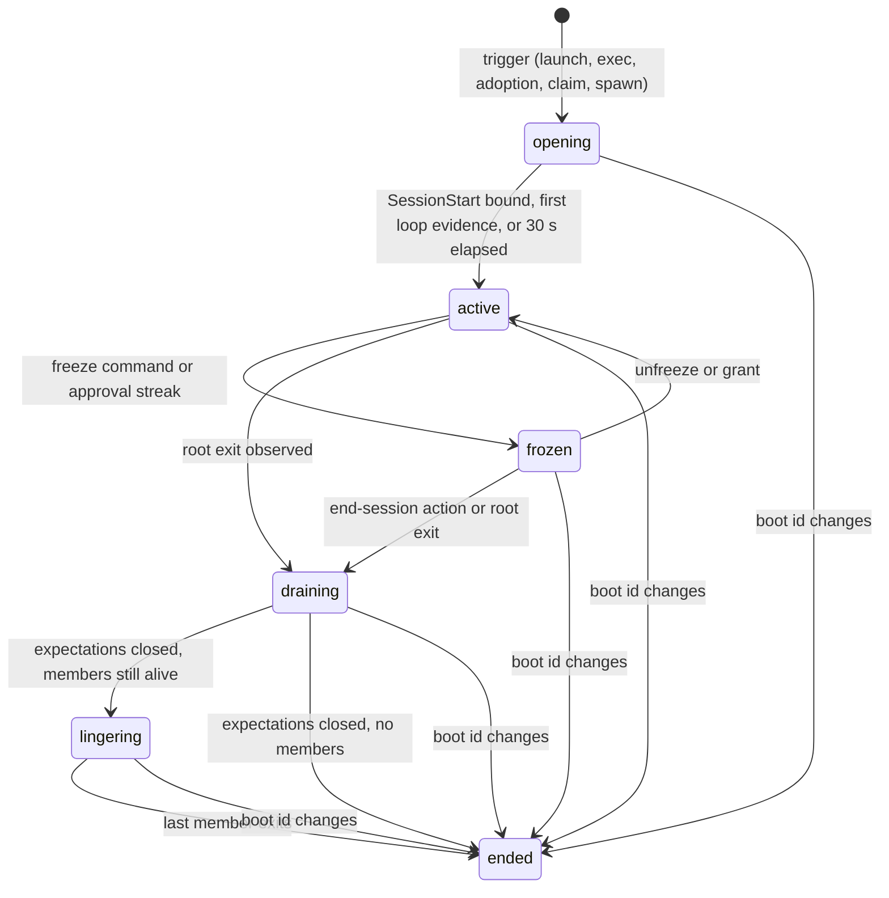

# 06. Attribution and the session graph

_Status: draft 5 against spine version 4, rulings R-07, R-10 and R-15 (`_review/01-document-rulings.md`), the owner answers (`_review/02-owner-answers.md`) and the owner's instructions of 2026-11-11 (`_review/04-owner-kit-instructions.md`; P15). Date: 2026-11-10. Owning squad: Session and attribution (`session` module of `grdr-core`, container code in `grdr-daemon`, attribution probes in the sensors). Read with: `00-decisions.md` (D-06, D-13, D-21, D-25, D-26, D-27, D-51, sections 3 and 7); 03 (daemon and engine split); 04 (envelope, evidence vocabulary, grade table, `session.link`); 05 (catalogue, program identity); 07 (expectations, hook-dark, assurance record); the sensor documents 08 to 10; 12 (Cedar context, rules for undetermined actors, grants); 13 (detection content); 15 (credentials released to agents); 16 (capture and redaction); 18 (approvals); 20 (lake); 21 (keys, pseudonym key); 25 (export); 27 and 28 (screens)._

## Summary

This document specifies how every event is bound to an agent session and the person behind it, with stated evidence, and how the product says "undetermined" when the evidence is not there (D-25). It owns the session lifecycle, the session container on each operating system, adoption of running agents, the join that binds OS effects to tool calls, the session graph and where it is stored, the rules for lineage breaks and brokered hops, sub-agents and handoffs, the rules that set `actor_kind`, the attribution-side divergence detections, the grade and basis values policy reads, outward identity (D-26) and the attribution evaluation. Document 04 owns the field shapes; 07 owns expectations and the hook-side detections.

Key choices:

1. **The sensor mints sessions; the harness only claims.** A session id exists from the first observation of a session-exclusive root, before any hook fires. Native session ids are claims joined to it (D-25, P3).
2. **A container is kernel-maintained or it is not a container.** Linux: a BPF task-storage tag that our fork hook copies to every child, plus a cgroup v2 scope where nesting is safe. Windows: a nested job object without breakaway. macOS: an Endpoint Security tree follower or, on macOS 27, a descendants client. A tree reconstructed by polling yields `lineage`, never `session-container`.
3. **Adoption gives attribution, not containment** (D-21). A running agent gets a session marked `adopted`, its pre-adoption history is back-filled as claims, and hook-dark is suppressed if it started before our hook entry existed.
4. **The join is a deterministic function in the core**, replayable from the receipts' inputs: inherited binding, then tool-call tag, then expectation match on process key, command digest and window, with fixed tie-breaks. Ambiguity is recorded and never resolved by guessing.
5. **The graph is events plus two relational tables.** Process-level edges live in the lake as `session.link` events; sessions and session-level edges live on the relational port; there is no graph database (03).
6. **Brokered hops are grade 1 unless we mediate them.** Docker, SSH and Kubernetes endpoints substituted per session by `grdr run` stamp the created object, which raises the far side to grade 3. Timing alone is grade 0.
7. **`human` needs positive, kernel-observed evidence** of an interactive entry point outside every agent session and agent-capable host. A claim never sets it (P3). Inside an IDE, unbound activity is `undetermined`.
8. **`influenced-by` never changes who acted.** File-, config- and schedule-mediated execution adds the basis value `influenced` and a graph edge; it is restrict-only in policy.
9. **Policy reads a closed list of basis values with declared origin.** Claim and heuristic values (`declared-only`, `traffic`, `timing`) can never satisfy an `unless`, and an exec tag counts toward the grade only when read from a kernel exec event or matched to our own stamp; the score is never readable.
10. **Outward identity has three grades** (D-26): `tag`, `receipt`, and `credential`, which requires the credential broker. Outward marks carry only a session pseudonym.

## Requirements

| # | Requirement | Trace |
|---|---|---|
| R1 | Every event carries `principal`, `actor_chain`, `actor_kind` and `attribution` (evidence, grade, score) populated by fixed rules | D-06, 04 section 9 |
| R2 | Session identity is assigned by the sensor; labels, grants and denial ledgers inherit to children and cannot be reset by the harness | D-25, threat model SR-11 |
| R3 | Containers exist only for session-exclusive roots; shared hosts need a per-call binding or yield `undetermined`; each rule class handles `undetermined` | D-25, c4 F1 |
| R4 | Adopting a running agent gives attribution, not containment; credential release to uncontained sessions is refused by default where containment is on (D-21, P13) | D-21, c3 F10 |
| R5 | OS effects are bound to tool calls by expectation; unmatched effects are scored against housekeeping, never assumed hostile | D-13, c3 F8, brief 01 via P3 |
| R6 | Lineage is a graph with fork, exec, IPC (XPC, COM, D-Bus, launchd) and artefact edges; brokered hops are lower-grade edges; file-mediated execution is "influenced by" | D-25, briefs 14, 13, h02 |
| R7 | A claim alone never raises a grade above 1, sets `actor_kind: human`, or satisfies an `unless` | P3, threat model section 3.4 |
| R8 | Attribution decided after emission supersedes through a new edge; nothing is edited | 04 section 9, D-09 |
| R9 | Divergence between claims and observations (undeclared activity, hook-dark, telemetry mismatch) are detections with stated windows | D-13, P3, brief 17 |
| R10 | Outward identity in three grades; tags carry the session pseudonym; git notes off by default | D-26, c4 F5 |
| R11 | Shared-host attribution reaches per-action precision 99% with at most 5% undetermined, or the agent ships instance-level only | Spine section 6, S-08 |
| R12 | Evaluation with scripted humans sharing credentials and the OS user with the agent, labelled at source | D-45, g08, h08 (26% of 200 US CISOs surveyed pass human credentials to agents; survey, read through a secondary summary) |
| R13 | No input hooks, keystroke timing, screen or clipboard capture; nothing scored per person | D-51, P8 |
| R14 | Bespoke agents are attributed by program identity and SDK sessions; Linux is first-class | Owner request, D-24, D-65 |

## Design

### 1. Who writes what

| Field (04) | Set by | Rule |
|---|---|---|
| `principal` | Daemon, from kernel credentials of the acting process | The human or service on whose behalf: owner of the session root's login session. If the root runs as a dedicated agent principal (our sandbox user, a Windows agent account), the principal is the launching human from our launch record and the evidence gains `os-principal` |
| `actor_chain` | Engine (`session` module) | Agent type and instance from the root's program identity (05); `sessions[]` from root to the deepest child bound at grade 2 or more; `tool_call_id` only when bound by section 5 |
| `actor_kind` | Engine | Section 9 |
| `attribution` | Engine, checked by the daemon | Evidence items, grade (section 11), advisory score |

The daemon owns process tree and container membership (03). It refuses any engine-authored record whose `session-container` evidence disagrees with its own projection and raises a tamper finding, the same rule 04 applies to lane writers. The engine owns bindings, edges and grades.

### 2. Session lifecycle

A session has a `start_basis`: `launched` (`grdr run`, a process-wrapper setting, the ACP conductor, an SDK session in our sandbox), `observed-exec` (kernel exec of a session-exclusive catalogued or declared agent), `adopted`, `claimed` (a `SessionStart` or SDK `session()` from a process with no container: shared hosts, macOS tiers 1 and 2), or `spawned` (child session).



Rules:

1. The `ses_` id is minted at `opening`, so the first effect already has a session for labels and grants. `opening` lasts until the hook delivery proof of 07 or 30 s. Expiry, or a tool-shaped child before any bound `SessionStart`, raises 07's `hook-dark` with 07's windows (30 s from process start for session-exclusive agents, from first loop evidence in shared hosts) unless section 4 suppresses it.
2. A `SessionEnd` claim sets `end_claimed` and never ends a session (P3). Only an observed root exit, or the root's disappearance from a kernel query where no process stream exists, moves it to `draining`.
3. `draining` waits for open expectations (at most 600 s, 07) and closes them with reason `session-end`.
4. `lingering` covers background processes the agent started (dev servers, watchers). They stay members with lineage-scoped labels, so a process that read a secret during the session cannot exfiltrate it later under a clean slate. Their actions carry the session class `lingering` and feed `post-session-activity` (section 10). There is no cap while members live.
5. **Resume.** A new root presenting a native session id already bound to an ended session of the same agent instance gets a new `ses_` with a `resume` edge. Lineage-scoped labels with decay `session-end` and the denial ledger are copied with origin `resume`, because the model context still holds what caused them; grants are not copied. A claimed native id may restrict and so may carry labels over (P3).
6. **Child sessions** (section 8) end at `SubagentStop`, at the child root's exit, or with their parent.
7. On a new boot id every open session of the old boot ends with reason `boot`; processes keep no identity across boots.

### 3. Session containers per operating system

`session-container` evidence needs membership maintained by a kernel mechanism, or established by a synchronous ancestry query through kernel handles while the peer is held (the shim's peer at `Decide`, 07). Membership reconstructed by polling yields `lineage` at `observed-user`.

| OS and profile | Launched | Observed exec | Adopted | Membership strength |
|---|---|---|---|---|
| Linux, protected | Tag set by our launcher's exec; cgroup v2 scope created through the user's systemd manager (transient scope), so logind kill semantics are kept | BPF task-storage tag (`proc_lineage`) written at the root's exec by 10's `exec_trace` and copied to each child by `fork_exit_trace` at `sched_process_fork`, in the forking context before the child runs, because the kernel does not inherit task storage by itself (10 section 2); these are tracepoints, so the tag needs no BPF LSM and works on every observe tier; it lives on the task, so it survives double fork, `setsid`, `nohup` and the setuid exec of `sudo` (brief 14 section 10, marked prior knowledge there; 06-3 tests it); scope as a nested child of the current cgroup where safe (SP-06-1), else tag only | Same as observed exec, tagging the live subtree by pidfd walk | Kernel |
| Linux, user | Transient user scope (no root needed); no eBPF | None: no kernel stream in this profile | None | Kernel for launched; otherwise peer query only |
| Windows, protected | Created suspended, assigned to a new job, resumed; our job never sets breakaway | Kernel-Process ETW start of the root, then `AssignProcessToJobObject`; children created before assignment are found by creator key and assigned | Same; nested jobs exist from Windows 8 and a process already in a job is nested by default unless either job sets UI limits, in which case the session is tag-only from the ETW tree | Kernel (job); ETW tree is kernel-origin |
| macOS tiers 1 and 2 | `grdr run` is the parent; tree tracked by the daemon | Not observable without Endpoint Security | Process enumeration | Peer query only; effects polled are `lineage` |
| macOS tier 3 (ES; requires Apple's Developer Program and the Endpoint Security entitlement, D-18) | macOS 27: descendants client scopes the subtree (entitled; a non-root client kills setuid and setgid execs in the subtree, 13 verification row 3, so in the protected profile 09's root supervisor holds it; its restrictions vanish if the client dies, so the tree follower, not the client, holds membership) | Own tree follower on `NOTIFY_FORK`, `EXEC`, `EXIT`, keyed by audit token and pidversion, carrying the agent-root pointer through every exec (13 verification row 6) | Same, seeded by enumeration | Kernel |

Why the Linux tag is primary: moving an observed agent out of its logind or systemd unit into our own scope changes what happens when the user closes the terminal, and systemd treats sub-cgroups of non-delegated units as its own. The tag carries attribution and BPF LSM socket and file hooks can key on it; the cgroup scope adds per-session cgroup network hooks where it is safe. On Windows, membership of our job is the anchor; a process created by a broker (WMI, Task Scheduler, AppInfo for UAC) is outside it by construction and is handled in section 7. Parent spoofing on Windows is defeated by using the creating process from the kernel event, not the declared parent; a mismatch is the fact `ppid-spoofed`.

Exec tags complement the container. Values we read: our own `GRDR_SESSION=<session pseudonym>` set by `grdr run` or the managed `env` block; `CLAUDE_CODE_SESSION_ID` (set in Bash, PowerShell, hook and stdio MCP children, matching the hook `session_id`); `CODEX_SESSION_ID` and `CODEX_TOOL_CALL_ID`; `TRACEPARENT` when Claude Code tracing is on (`CLAUDE_CODE_ENABLE_TELEMETRY=1` and `CLAUDE_CODE_ENHANCED_TELEMETRY_BETA=1`) and the base URL is unset or Anthropic's, or `CLAUDE_CODE_PROPAGATE_TRACEPARENT=1` is set, which our managed `env` block sets whenever our local listener is the base URL (brief 17 verification rows 5 and 8). `CLAUDECODE` is not evidence: IDE extensions set it in integrated terminals. Environment capture is the catalogue's allow-list of names (D-24). Tags are read at exec from kernel events on Linux and macOS tier 3 (provenance `observed-kernel`), and by user-mode reads elsewhere (`observed-user`): the `KERN_PROCARGS2` sysctl on macOS tiers 1 and 2, and on Windows only for processes our launcher or shim starts, because the baseline makes no cross-process memory reads (05 section 4). A process can rewrite its own environment before a user-mode read, so only kernel-read tags and our registered stamps count toward the grade (section 11); user-mode reads are recorded and used only to pick among K4 candidates in the join.

### 4. Adopting a running agent

At daemon start, on install and on every catalogue update:

1. Enumerate live processes through kernel handles (pidfd, audit token, process handle) and classify program identity (05).
2. For each session-exclusive root with no session, mint a session with `start_basis: adopted` and session class `adopted`; tag or assign its live subtree.
3. If the root started before our hook entry was journalled (07 install journal), set the session fact `hook.started-before-install`: 07's `hook-dark` does not fire for that session, one coverage-gap finding per instance says why, and the canary stays `pending` until the next session.
4. Read the native session id from the open transcript file (path per 07's telemetry table) as a claim, and back-fill tool uses since process start as `tool.call` records with `retro: true`, evidence `declared-only`, and no decisions. Back-fill obeys the capture level and exclusions like live capture (D-51).
5. Report `control` at most `request` for the session (D-21). The console offers "restart contained" (27); credential release to sessions whose `contained` is false is refused by default where containment is on for that agent and OS (`cred.release.requires-containment`, 15 section 2; D-21).
6. Shared hosts found running get an instance-level container only (section 9).

### 5. The join: binding OS effects to tool calls

The join is a pure function in the core's `session` module over events ordered by `(epoch, monotonic_ns)`. Expectations are 07's: session, tool-use id, agent process key, action class, effect descriptor, grant id, window.

**Keys.**

| Key | Content |
|---|---|
| K1 process key | Boot id, pid, start time, `exec_generation` (04) |
| K2 container | Session from tag, cgroup or job |
| K3 tool-call tag | `CODEX_TOOL_CALL_ID`, the `TRACEPARENT` span id, our launcher's tool-call tag when a hook rewrite routes a shell call through `grdr run` (D-17 route 4). `grdr-run` registers its own process key and tool-call id with the daemon over the peer-checked socket, so the launcher tag is a registered stamp on every OS |
| K4 command digest | HMAC of the command string extracted from argv by the adapter's wrapper pattern, canonicalised by the same D-10 canonicaliser that normalised the hook's `tool_input` |
| K5 working directory | Path digest at exec (kernel on Linux and ES; user-mode elsewhere); a tie-breaker only, because a command may `cd` |
| K6 targets | Path set and host set of the effect descriptor |
| W window | Effect start within decision time minus 50 ms and post-event time plus 2 s; without a post event, open for 600 s or until session end (07) |

**Steps for each effect e.**

1. Resolve the session: K2. With no container, a kernel-read K3 or session tag whose session root (or, in a shared host, whose host) is an ancestor of e, or a stamp from section 7, gives the session; otherwise descent from an agent-capable host gives the candidate sessions of that instance.
2. Inherited binding: if the nearest ancestor of e is bound to tool call `tc`, bind e to `tc` with that ancestor's evidence (07: descendants of a matched tool subprocess inherit it). A tag naming another session or tool call does not override this; it raises `attribution.tag-conflict`.
3. Tool-call tag: a kernel-read K3 value naming an open tool call in the session binds with `exec-tag`. A user-mode-read K3 value does not bind by itself; in step 4 it breaks ties between K4 candidates.
4. Expectation: if e is a tool-shaped child of the agent process (07 definition), match open `exec` expectations of that agent process key on K4 inside W; a match adds `declared-matched`.
5. In-process tools: a file or network effect by the agent process itself matches an open expectation of that class whose K6 contains the target, inside W.
6. Otherwise e is unbound and classified by 07's order: `housekeeping`, `declared-service`, `human-direct` (a claim, recorded as a fact), then `undeclared` in a session-exclusive session or `undetermined` in a shared host.

**Tie-breaks**, applied in order when several expectations match: exact K4 over pattern match; K5 equal over unequal; a user-mode K3 value naming the expectation's tool call over none; an expectation with no consumed effect over one already matched; earliest decision time. A tie that survives binds to the earliest and sets the fact `binding.ambiguous`. A grant is honoured at the OS control point on an ambiguous binding only if every tied expectation carries it. An `exec` expectation is consumed by its first matching child unless the housekeeping profile declares the wrapper's multiplicity.

**Lateness.** An OS control point that must decide an effect (an exec veto, a file hold) decides at once on the binding available then; only classification for findings waits. An effect that matches nothing waits up to 2 s (target, replaced by S-07) for a late claim, since a shim spooling offline (07) or a loaded ring buffer can reorder sources. After that it is classified; a later match emits a superseding `session.link`. Decisions already taken are not changed; if one would have changed, the finding `attribution.late` is raised, as `label.late` is for labels (D-09).

### 6. The session graph

**Nodes.** Agent instance, session, tool call, process (one node per `exec_generation`), artefact (path digest plus content digest), credential reference, destination, MCP server, external object (commit, cloud request, SaaS object), principal pseudonym. All ids are 04's.

**Edges.**

| Kind | From, to | Typical evidence and grade | In 04's `session.link` enum |
|---|---|---|---|
| `fork`, `exec` | Process to process | Kernel event; inherits the parent's binding | Yes |
| `member` | Process to session | Kernel container or kernel-read tag: 3; peer query: 3; polled: 1 | Added (R-15) |
| `bound` | Action or effect to tool call | Section 5: `exec-tag` 3, `declared-matched` 2 | Added (R-15) |
| `ipc` | Process to process through XPC, COM, D-Bus, a Unix socket | Kernel IPC event: 1 | Yes |
| `brokered` | Session to process created by a broker | Section 7: 1, or 3 when mediated | Yes |
| `artefact` | Process to artefact (wrote, read, executed) | Kernel file event with content digest | Yes |
| `influenced-by` | Process or session to session | Section 9 | Yes |
| `child-session`, `resume`, `handoff` | Session to session | Section 8 and section 2 | Added (R-15) |
| `outward` | Session to external object | Section 13 | Added (R-15) |

Every edge records kind, endpoints, grade, evidence items with their provenance, start time, cause event and `supersedes`. The grade of a path from a session root to an event is the minimum edge grade on it; the basis is the union of evidence.

**On the device.** The daemon holds a fixed-layout map from process key to session id, tool-call id and membership strength (capacity 65,536 live entries, a target; exited processes are evicted first) and the expectation table, so the floor table and OS control points never wait on the engine (03). When the map is full of live entries, new processes are looked up through the kernel container (task-storage tag, job, ES follower) only, and each miss is counted in `health.coverage`. The engine keeps the graph in SQLite inside local history (D-34): `sessions`, `processes`, `edges`, `bindings`, and `artefacts` (path digest, content digest, writer session, time; rolling seven days or 100,000 rows, both targets). An artefact that has left this table yields no `influenced-by` edge; control files stay covered by 07's config-integrity monitor. Retention and the 1 GB disk cap follow 04 and D-51.

**On the server** (requires the server). Tree edges (`fork`, `exec`, `member` at birth) are fields of `process.start`, never separate events; `session.link` events in the lake carry only edges that birth does not imply or that supersede. `store` writes `session_summary` at most once a minute per session and at session end (20 section 5.5). The relational port holds `session_summary` (one row per session: ids, session pseudonym, instance, device, root and parent, start basis, state, classes, times, minimum and maximum grade, counts, enforcing labels set) and `session_edge` (child-session, resume, handoff, cross-device brokered and outward edges). Session lineage queries are recursive common table expressions over `session_edge`, bounded at depth 16, identical on PostgreSQL and SQLite. Process trees inside a session are not queried recursively in the lake: the query service scans `session.link` and `process.*` by session id and assembles the tree in memory. Session timelines join the summary to lake scans by session id (target under 2 s, spine section 6).

### 7. Lineage breaks and brokered hops

A hop is **mediated** when a session reaches the broker only through an endpoint we created for that session, which stamps the object it creates with the session pseudonym and records the stamp in the device's stamp table; processes carrying a registered stamp get `exec-tag` (grade 3). An **unmediated** hop is matched from the session member's connection to the broker and the broker's spawn within 5 s (target): `brokered`, grade 1. If more than one session touched the same broker in the window, it is `timing`, grade 0. A hop through one of D-22's elevation and broker paths (sudo, UAC, container sockets, systemd, launchd, Task Scheduler, WMI, our launcher), and through cron and `at`, which this document adds to the same command class, is also an `elevate` action, Ask by default under D-22 (Essentials ships Ask from agent lineage in the protected profile and Watch in the user profile, D-53), so a hop the hook sees is decided and recorded before it happens. SSH, multiplexers and WSL are hops but not `elevate`; they get edges only.

| Break | What we observe | Rule |
|---|---|---|
| Double fork, `setsid`, `nohup`, daemonising | Re-parenting to init or launchd | Not a break where membership is kernel-maintained (tag, cgroup, job, ES follower); a break on polled trees, where the process becomes `lineage` |
| `sudo`, `su`, `pkexec` | Same lineage, new principal | Not a break; `elevate` action; principal unchanged, the event records the effective user |
| UAC elevation | Process created by the AppInfo service | Brokered from the consent request's session; job membership lost, so the elevated tree is tag-only from the ETW creator chain |
| Docker, Podman, containerd sockets | Unix-socket connect by a member; new container cgroup created by the runtime's shim | Mediated when `grdr run` sets `DOCKER_HOST` to a per-session proxy socket that adds the stamp as a container label and environment variable; a member connecting to the real socket directly is brokered. The Linux sensor maps the container cgroup to the stamped container. Under Docker Desktop on macOS and Windows the containers run in a VM: the stamp is recorded and the far side is a coverage gap unless a sensor runs in that VM (the WSL route on Windows) |
| SSH to localhost | Loopback connect from a member; `sshd` accept with the matching four-tuple | Brokered, matched on the four-tuple; with a per-session `SSH_AUTH_SOCK` helper (D-27; requires the credential broker) whose certificate key id is the session pseudonym, `session-credential`, grade 4 |
| SSH to another enrolled device | Connect on device A, accept on device B | Server-side join in `detect` on the four-tuple within 5 s; cross-device `brokered` edge in `session_edge` (requires the server). NAT defeats it; the per-session certificate does not |
| `kubectl exec`, `kubectl run` | Connect to the API server; process on another node | Mediated by a per-session `KUBECONFIG` exec credential plugin (requires the credential broker); otherwise only `connector` from the Kubernetes audit log |
| cron, `at`, crontab edits | `crontab` exec or a write to spool files; later run by `crond` | The scheduling call is an `elevate` action; the later run has its own actor and an `influenced-by` edge to the session that wrote the entry (section 9) |
| systemd (`systemd-run`, timers, unit files, D-Bus activation) | Unix connect to the manager or D-Bus from a member; a new unit | Brokered to the next unit created (brief 14); unit-file writes give `influenced-by` for later runs |
| launchd, `launchctl`, XPC services, `osascript` and Apple Events | ES `XPC_CONNECT`, `BOOTSTRAP_LOOK_UP` (macOS 27), `BTM_LAUNCH_ITEM_ADD`, responsible audit token | Tier 3 only: `ipc` edge to the service; the service's spawn is brokered; launch items give `influenced-by`. The responsible token recovers launchd-started helpers (brief 13). Tiers 1 and 2 cannot see these hops and report a coverage gap |
| Task Scheduler, WMI, COM and DCOM out-of-process servers, services | Kernel ETW process start whose creator is `svchost`, `WmiPrvSE` or `services.exe`, after an RPC or COM call from a member | Brokered within 5 s when exactly one session called that broker; `schtasks` and `sc create` are also `elevate`. Task and service definitions give `influenced-by` |
| tmux, screen, zellij | Unix-socket write to the server by a member; a child in a pane | A server started inside the session is a member. When a client outside the session attaches to it, the server becomes an agent-capable shared host from that moment and its later children are `lineage` (section 9). A pane child after a member's `send-keys` is brokered |
| IDE terminals and tasks (VS Code pty host, JetBrains terminal) | Children of the host's pty process | Shared host rules (section 9) |
| WSL | `wsl.exe` from a member; process in the utility VM | Brokered to the WSL session; the Linux sensor inside the VM (WSL plug-in route, brief 12) sees the guest tree and joins on our stamp passed through `WSLENV` |
| Git hooks, package lifecycle scripts, Makefiles, `.bashrc` | Exec of an artefact last written by a session | `influenced-by` when the executing process is not itself a member; if it is a member, ordinary lineage |
| VMs and microVM sandboxes (Cowork VM, Docker Sandboxes) | Host sees the VM process and shared-folder writes | VM process is a member if launched by the session; guest activity needs an in-guest sensor; otherwise coverage gap (brief 13) |

### 8. Sub-agents and handoffs

**In-process sub-agents** (Claude Code subagents, Codex sub-agents): the sensor mints a child session on the `SubagentStart` claim, bound to the parent's process key by peer check. Tool calls carrying the native `agent_id` route to the child. The child shares the parent's container, so its effects reach the root at grade 3; the child appears in `actor_chain.sessions` only when the effect is bound by tool-use id (grade 2); otherwise the chain stops at the parent and the fact `child.claimed` names the child.

**Out-of-process sub-agents**: exec of a catalogued or declared agent inside a container is an `agent.spawn` action and opens a child session with its own nested container (child cgroup or tag value, nested job), `start_basis: spawned`, and a `child-session` edge.

**Constraint carry-over** at every spawn, enforced by the core and not by the harness:

| Constraint | Carry-over |
|---|---|
| Lineage-scoped labels | Shared with the child (12 section 9) |
| Session-scoped labels | Copied at spawn |
| Grants, denial ledger, approval streak | Inherit (D-25) |
| Containment | A child of a contained session must be contained (12 policy 14) |
| Egress profile, capture level, exclusions | Inherit; a child can only narrow |
| Depth and weaker settings | 12 policy 14 (depth above 2, bypass flags, weaker settings) |
| Brokered credential leases | Not inherited; the child requests its own and delegation narrows per hop (D-27) |

**Handoffs** move work without a process edge: an A2A or MCP request to a local agent, an Agents SDK handoff, a task file another agent picks up. A handoff observed through a control point (MCP broker, proxy, SDK `session()` with a declared parent) gives a `handoff` edge at the grade of its evidence, and lineage-scoped labels carry over as advisory labels on the receiving session. They become enforcing only through the session rule `ses.handoff.labels` in the `grdr.agents` pack, shipped disabled and enabled per organisation. Because a session rule reads only deterministic input (12 section 9), it fires only on a `handoff` edge whose evidence has provenance `mediated` (the MCP broker or proxy carried the request); an SDK-declared parent is a claim and stays advisory. An artefact-mediated handoff gives `influenced-by` only.

### 9. Performed by agent, performed by human, influenced by

| `actor_kind` | Condition |
|---|---|
| `agent` | Grade at least the catalogue entry's `min_attribution_grade` (default 1 for session-exclusive agents, 2 for agents in shared hosts, 3 for agents the catalogue marks `multiplexer`, whose panes a person may share) |
| `human` | All of: the acting process descends, by kernel-observed lineage, from an interactive entry point (terminal emulator, login shell, desktop launcher for the logged-in user); no ancestor is a session member or an agent-capable host; the entry point itself was not created by a broker within the hop window of a session member's call to that broker (an agent that opens a terminal through D-Bus activation, `open` or `osascript` does not get a human one); no session's `ui.act` action or process-side synthetic-input fact (04, D-51) targeted the entry point's application within the hop window; it carries no exec tag; no brokered or IPC edge from a session reaches it within the hop window; the principal is a human. Evidence `human-entry`, grade 3. Where the sensor cannot see broker and IPC hops for the entry point (macOS tiers 1 and 2, the User profile), no process is `human` |
| `system` | The process runs as an OS service principal outside every session lineage, or is one of our components. Evidence `system-principal`, grade 3 |
| `undetermined` | Everything else, including unbound activity in shared hosts. The local graph keeps up to three candidate sessions for investigators; the event names none |

Shared hosts (VS Code extension host, Cursor, JetBrains, Claude Desktop, a multiplexer with an outside client) give instance-level containers: an effect inside one is `lineage`, grade 1, and becomes `agent` only through a per-call binding from section 5 (tool-use id with K4 and K5, or a kernel-read exec tag). A shared-host agent, the Claude Code IDE extensions included, is instance-level only wherever shared-host binding (06-11) is absent or that agent has not passed S-08: each unbound effect is `undetermined`, which is the spine's fallback. Copilot agent mode and similar run commands in the human's integrated terminal, so the shell is shared; the binding is the K4 match inside W. The confounder is a person running the identical command in the same window, which S-08 measures. Commands a person runs through an agent outside the tool loop (Claude Code `!`) stay `undetermined` with the fact `human-direct`, since only a claim identifies them.

`influenced-by` is an edge plus the basis value `influenced`, and never changes `actor_kind`. It is set when a process that is not a member: executes, sources or loads an artefact whose current content digest was written by a session; reads configuration or instruction files written by a session (git hooks, package scripts, crontab and unit files, launch items, shell rc files, agent instruction files); or runs a scheduled job a session defined. The influencing session's lineage labels appear on the influenced event as advisory labels only. Rules may use `influenced` to restrict (for example, raise a push from an influenced process to Ask).

How rule classes treat `undetermined` is 12's (rules scoped to `Session` do not apply; resource rules apply to everyone; `config-tamper` and `secret` add an Ask-capped rule for undetermined processes in agent-capable hosts). At OS control points in shared hosts no agent-scoped rule denies an undetermined effect, so a person's own terminal is never blocked by an agent rule.

### 10. Divergence detections

07 owns `hook-dark`, `hook-silent`, `undeclared-activity`, `claim-without-effect`, `effect-mismatch`, `bypass-flag`, `hook-timeout-open` and `canary-missed`. This document adds the attribution-side detections. Time windows and thresholds are targets until S-07 and S-08 replace them.

| Detection | Condition | Window | Finding class |
|---|---|---|---|
| `attribution.session-claim-mismatch` | A claim's native session id is bound to session X while the peer's process key is a member of Y | Immediate | Tamper; the claimed id is ignored |
| `attribution.tag-conflict` | An exec tag names session X while kernel membership or the inherited binding says Y; the container or binding wins | At exec | Tamper if X is live on the device, coverage gap otherwise (a stale inherited environment) |
| `attribution.undeclared-hop` | A brokered hop through an `elevate` route (section 7) from a session-exclusive session with no `elevate` decision for that session in the hop window | Hop window | Tamper; coverage gap in shared hosts |
| `telemetry.model-traffic-undeclared` | Kernel-observed connections to inference endpoints (D-24 pass 3) from a session member other than the agent process and its declared services, with neither native `api_request` events nor proxied `llm.request` records for that member | One turn, or 60 s | Coverage gap plus a discovery triage item: a nested agent or tool subprocess running its own loop |
| `telemetry.proxy-bypassed` | Agent configured to our proxy, yet kernel-observed connections from the agent process reach an inference endpoint other than the proxy, or native telemetry reports more model requests than the proxy saw | 60 s | Tamper |
| `telemetry.claim-unsupported` | Hook tool calls with no transcript entry for an agent whose transcript the catalogue marks reliable | Session end | Coverage gap |
| `attribution.late` | Later evidence would have changed a recorded decision whose rules read attribution | On supersession | Policy violation, informational severity |
| `post-session-activity` | A lingering member performs egress outside the session's profile or reads a credential store | Until the member exits | Policy violation; contributes to session risk |

### 11. Confidence calculus and the basis policy reads

**Grade.** 04's table, with two rows added for non-agent actors. An evidence item counts only at or above its provenance floor; below it, the item is recorded and does not count.

| Basis value | Grade | Origin | Provenance floor to count | May appear in `unless` |
|---|---|---|---|---|
| `os-principal` | 4 | deterministic | `observed-kernel` | Yes |
| `session-credential` | 4 | deterministic | `mediated` (broker) | Yes |
| `session-container` | 3 | deterministic | Kernel membership or peer query (section 3) | Yes |
| `exec-tag` | 3 | deterministic, consistency-checked against lineage, the inherited binding and the stamp table | `observed-kernel` (read from the exec event), or a registered stamp; a user-mode read does not count, and a tag inconsistent with lineage or binding is dropped | Yes |
| `human-entry` | 3 | deterministic | `observed-kernel` | Yes |
| `system-principal` | 3 | deterministic | `observed-user` | Yes |
| `declared-matched` | 2 | claim plus observation | Observation at `observed-user` or above | Yes |
| `declared-only` | 1 | claim | n/a | No (P3) |
| `lineage` | 1 | deterministic | `observed-user` | Yes |
| `brokered` | 1 | deterministic | `observed-user` | Yes |
| `connector` | 1 | reported | `reported` | Yes |
| `traffic`, `timing` | 0 | heuristic | n/a | No (P2) |
| `influenced` | none; does not count toward the grade | deterministic | `observed-user` | No: restrict only |

The grade is the highest row whose condition holds; uncorroborated sources do not add up. On conflict, precedence is kernel membership, then our stamp, then vendor tags, then declared matches, lineage, brokered and timing; every conflict raises a section 10 finding. An evidence value outside this table (04's open-enum `_OTHER`) is recorded and never enters `basis`. Synthetic-input signals (brief g09 section 7) are facts, never evidence; section 9 uses them only to withhold `human`.

**Score.** Brief 17's attribution weights, which it marks as its own inference: kernel container 100, inherited tag 95, hook match 95, brokered hop 60 to 80. The score is the weight of the strongest counted item times the product of the edge weights, as fractions, on the path from the session root, 0 to 100. Weights are pack data with origin `heuristic`, placeholders until S-08 provides labelled data; the score ranks queues only and is never `policy_readable` (04).

**Policy.** Cedar receives `context.attribution: { grade, actor_kind, basis }` (12). The pack validator rejects an `unless` that reads `declared-only`, `traffic`, `timing` or `influenced`, matching its origin rule for facts (04 section 6). Session classes `adopted`, `shared-host`, `lingering`, `resumed` and `spawned` are added to the existing `principal.classes` set, so no schema change is needed. Two examples:

```cedar
@id("agents.push.influenced") @class("irreversible") @max_mode("Ask")
forbid (principal, action == Grdr::Action::"data.flow", resource is Grdr::Sink)
when { resource.classes.contains("push-outside-org") && context.attribution.basis.contains("influenced") };

@id("agents.adopted.cred-release") @class("secret")
forbid (principal is Grdr::Session, action == Grdr::Action::"cred.use", resource)
when { principal.classes.contains("adopted") && context.mode == "release" };
```

### 12. Bespoke agents, servers, CI and SaaS

A declared bespoke agent (manifest or SDK `declare`, 07 section 12) is session-exclusive by default; its SDK `session()` is a claim joined to the observed root like a hook. An undeclared one found by behaviour (D-24 pass 3) gets an `observed-exec` session only once classed `agent`; `agent-suspected` processes get no session and drive no Ask or Block. In CI the job step is the root and the runner's cgroup or job is the container; in Kubernetes the workload is the instance, pods are replicas, and the node sensor maps the agent process's cgroup to the pod (D-19). Workload identity federation gives `os-principal` only where the agent has its own service account. SaaS-hosted agents reached through connectors carry `connector` evidence, grade 1, with vendor session ids as claims, and never exceed AL1 (D-13).

### 13. Outward identity

The **session pseudonym** is `sp_` plus 16 base32 characters: HMAC-SHA-256 of the session id under the device-side pseudonym key (21; the first layer of D-51, because the device sets the mark at launch and never holds the server's ingest key), truncated to 80 bits. It resolves only through `session_summary`; it never contains the principal pseudonym.

| Grade | Mechanism | Claim we make |
|---|---|---|
| `tag` | Launch environment or the agent's managed `env` block, never dotfiles (D-27): `AWS_SDK_UA_APP_ID=grdr.sp_<16>` (24 characters; limit 50, brief 17 verification row 10); `TF_APPEND_USER_AGENT=grdr/sp_<16>` (prior knowledge in brief 17; SP-06-5 tests it); `GRDR_SESSION`. The proxy adds no headers | Search only; caller-set and unsigned |
| `receipt` | `outward.receipt` record on the decision lane, signed like a decision receipt: external system, object id, session, pseudonym, tool call, grade, evidence. Git: when a `commit`, `merge`, `rebase` or `cherry-pick` exec bound to a session exits, or a member writes under a repository's `.git/refs` or `.git/logs` (in-process git libraries), the daemon reads the new reflog entries of that repository and hands them to the engine, which emits one receipt per new commit, keyed by commit id and by an HMAC of `git patch-id --stable`. The patch id follows rebase and cherry-pick; a squash produces a new patch id and is not followed (SP-06-5 measures what survives). Cloud: the CloudTrail connector links an event to a session when the user agent carries the app id | Our audit log says this session produced this object |
| `credential` | Broker-minted per session (D-27; requires the credential broker): AWS `AssumeRole` with `SourceIdentity=grdr.sp_<16>`, which persists through role chaining, cannot be changed in the session and appears in CloudTrail (AWS IAM user guide); a GitHub App installation token per session; RFC 8693 exchanged tokens with `act`; SSH certificates whose key id is the pseudonym | The only grade claimed to separate agent from human in third-party logs |

The **git note** is opt-in per organisation: ref `refs/notes/grdr`, content a device-signed JSON receipt reference with pseudonym, agent type and grade. Our installer never configures a push refspec for it, and git's default push and fetch refspecs do not include notes refs (prior knowledge; work item 06-23 tests it). `git push --mirror` and an explicit `refs/notes/*` refspec do push it, so the command classifier marks both, and a push of that ref to a remote outside the allow-list is a `push-outside-org` sink (D-28). Tags are on by default in platform shapes and off in standalone.

## Interfaces and contracts

| Contract | Form | Other party |
|---|---|---|
| Envelope attribution fields; evidence values `human-entry`, `system-principal`, `influenced` added to the open evidence enum; `lineage` redefined as "descent from a session root or an agent-capable host, observed without kernel-maintained membership of a session-exclusive container" (04's current text covers only the shared-host case); the `exec-tag` provenance floor of section 11 | `grdr.event.v1alpha1` | 04: R-15 adds the three values; the two grade rows, the definition and the floor are still requested |
| `session.link` edge kinds `member`, `bound`, `child-session`, `resume`, `handoff`, `outward`; event class `outward.receipt`; `retro` flag on `tool.call` for adoption back-fill | Same | 04: R-15 adds the edge kinds and the class; the `retro` flag is still requested |
| `crontab` and `at` added to the `elevate` command class | Analyser vocabulary (04 section 5) | 04, 12 (`grdr.elevate` pack) |
| Session attributes `start_basis`, `end_claimed`, `classes`, `state` | `Session` entity and `session.start`, `session.end` | 04 |
| Expectations, tool-shaped child, housekeeping classification | `grdr.decision.v1alpha1.Expectation` | 07 |
| `hook-dark` does not fire for a session carrying `hook.started-before-install` | Detection condition | 07 section 9 |
| `context.attribution`; new values in `principal.classes`; principal type is `Session` exactly when `actor_kind` is `agent` | Cedar schema | 12, per R-07: agent rules apply when `actor_kind` is agent, which requires the catalogue entry's `min_attribution_grade` (2 in shared hosts) |
| Catalogue fields `session_exclusive`, `shared_host`, `multiplexer`, `min_attribution_grade`, `exec_tags`, wrapper pattern, transcript reliability | Adapter manifest | 05, 07 |
| Broker table (socket paths, broker executables, windows) | Pack kind `attribution-hops`, match data only (P7) | 13, content pipeline |
| Stamp table and per-session broker endpoints | `grdr.local.v1alpha1` between daemon and `grdr run` | 03; 08 to 10, which specify `grdr-run` per OS |
| `HostProfile.session_mechanism` with the provenance of host session ids | Protobuf | D-60; a host id counts as `exec-tag` only if its profile proves kernel origin |
| `session_summary`, `session_edge` | Relational schema | 20, 23 (API read models), 27 and 28 (session tree and timeline) |
| Session pseudonym key | Device-side pseudonym key (D-51 first layer) | 21 |
| Outward tag injection and credential minting | Launch environment, broker | 15 |

## Behaviour by deployment shape

- **Standalone.** The graph lives only in local SQLite; incidents group by local lineage; outward tags are off; git notes are off unless the user turns them on. Pseudonyms use the install-time device-side key and become aliases on `grdr join` (04); after join the server re-pseudonymises at ingest with a key the device never holds (D-51).
- **Platform, self-hosted and hosted** (self-hosting is the default; the hosted service requires revenue, sponsorship or donated cloud credits). Sessions and session-level edges reach `session_summary`; cross-device SSH edges and connector correlation run in `detect`; tags default on, set per organisation. Provider views see sessions only through delegation (D-35).
- **Embedded.** An L3 or L4 host supplies its session mechanism in its host profile; its process tags or session ids are `exec-tag` only with kernel-origin proof, otherwise `connector`. Rules needing a grade the host cannot supply are `not_evaluable` (D-60).

## Extension points

- Catalogue entries for new agents and shared hosts (session exclusivity, tags, wrapper pattern) as adapter-manifest data.
- `attribution-hops` packs for new brokers: socket path patterns, broker executables, match windows.
- Exec-tag readers for new harness variables, as allow-listed names in the catalogue.
- SDK sessions for bespoke agents and frameworks (07 section 12).
- Connector correlators that turn a third-party audit record into `connector` evidence, as integration manifests (D-40).
- Host profiles for embedding partners.

## Security and privacy

- **Forged session identity.** The harness never mints a session id; a claim that disagrees with the peer's membership is ignored and raises `session-claim-mismatch`.
- **Escaping attribution.** Clearing exec tags drops to container or lineage evidence, never to `human`. Brokers are `elevate` actions (Ask in the protected profile, Watch in the user profile, D-53). Deferred execution leaves `influenced-by`. A process never gains `human-entry` from inside an agent-capable host, from a terminal a broker opened for a session, or from a terminal a session drove through `ui.act` or synthetic input, so an agent cannot make its actions look human by routing them through one. Lineage alone cannot see an agent typing into a terminal a person opened earlier without either signal; S-08's adversarial family measures it.
- **Laundering and framing.** A tag counts only when the kernel read it or our stamp matches, and it never overrides the container or an inherited binding, so a process cannot move itself into another session's cleaner state or acquire its grants. Copying a tag into a process that has no binding raises its attribution to `agent`, which only adds rules (P3).
- **Pid reuse and parent spoofing.** Process keys include start time and generation; peers are held by handle; Windows uses the creator.
- **Compromised engine.** The daemon verifies container evidence on every record the engine authors.
- **Privacy.** Human determination uses lineage only: no input hooks, keystroke timing, screen or clipboard (D-51). Outward marks carry the session pseudonym only. Command and path digests are keyed HMACs (04). The local graph obeys exclusions: an excluded path or principal yields no node.

## Test and evaluation strategy

| Property | Oracle |
|---|---|
| Grade function | Table-driven test over every evidence subset with provenance floors, cross-checked against an independent implementation written from this document |
| Join determinism | Replay of recorded sessions through native, C ABI and `wasm32` builds; identical bindings and edges |
| Join accuracy | Exec tracing under the replay model endpoint (D-45): each tool call's real subprocess tree is the ground truth |
| Containers hold | Per OS: double fork, `setsid`, `nohup`, `sudo`, Windows breakaway flags and PPID spoofing; membership checked by the kernel's own view (`/proc/<pid>/cgroup`, `IsProcessInJob`, ES audit tokens) |
| Adoption | Start agents before install; no `hook-dark`; back-filled calls marked `retro` |
| Brokered hops | One scripted scenario per row of section 7; edge kind and grade as the table states |
| Forgery resistance | Scripted forged tags, session ids and claims: zero raised grades, zero `human` labels |
| Outward marks | 06-23 and SP-06-5: AWS, GitHub and git through squash and rebase |
| Shared-host attribution (S-08) | Harness below |

**Attribution evaluation.** Three parts: a v0 track on Linux (06-25), the S-08 spike on Linux x64 with VS Code hosting the Claude Code extension and Copilot agent mode (06-26), and the full S-08 harness on all three systems (06-27), with a held-out scenario set kept behind the evaluator (D-45). The spike's result sets the catalogue's per-action grade for those hosts; a host is attributed per action only after it passes. Runs use free hosted CI runners for the public repository (Linux x64 and arm64, Windows x64 and arm64, macOS arm64), with lab tier B machines as optional self-hosted runners (D-64); a scenario that needs hardware nobody has is marked "requires hardware" and runs when a machine is available. A scripted human drives a real terminal emulator and IDE through pty and UI automation under the same OS user, git identity, SSH key, cloud profile and model key as the agent; the agent is driven by the replay model endpoint so its tool calls are fixed. Every scripted action embeds a unique nonce in a file name or argument, recorded by the harness with its true actor outside the product. The oracle joins observed events to nonces by exact match. Scenario families, at least 20 runs each: separate terminals; shared IDE terminal; identical commands in parallel; a human pasting an agent-suggested command; agent detaching processes; in-process and out-of-process sub-agents; agent-created cron, launchd and Task Scheduler jobs run later; Docker hops, mediated and not; SSH to localhost and to a second device; a shared tmux pane and a human attaching to the agent's tmux; an agent-written script a human runs; resume; adoption; an adversarial agent that clears tags, forges session ids and spoofs its parent, opens a terminal through a broker, and types into a person's terminal through a computer-use tool. Metrics, all targets: per-action precision of `agent` and `human` (target 99%); `undetermined` rate (at most 5% in shared hosts, published everywhere); recall of agent-caused events bound to the right session (95%, g08); tool-call binding accuracy (98%, our target); `influenced-by` recall (90%, our target); forged evidence accepted (zero); bind latency p99 (2.5 s). An agent host that fails S-08 ships with instance-level attribution only.

## Work breakdown

**E1 Session model**
- 06-1 Session ids, `start_basis`, state machine, boot handling in the `session` module. Accept: property tests over every transition; a `SessionEnd` claim alone never ends a session.
- 06-2 Resume and lingering. Accept: a resumed Claude Code session carries `secret-read` from its predecessor; a background process started by an ended session keeps lineage labels and is attributed to it.

**E2 Containers and adoption**
- 06-3 Linux BPF task-storage tag and launched cgroup scope. Accept: membership survives double fork, `setsid`, `nohup` and `sudo` on the kernel matrix; closing the launching terminal still ends a launched session.
- 06-4 Linux adoption. Accept: an agent started before the daemon gets an `adopted` session and no `hook-dark` finding.
- 06-5 SP-06-1 and nested scopes for observed and adopted sessions. Accept: spike report; where nesting is unsafe the session is tag-only and says so in `grdr doctor`.
- 06-6 macOS tier 1 tracked tree, peer query and adoption by enumeration. Accept: polled effects carry `lineage` only; hook intents from the peer carry `session-container`; an agent started before the daemon gets an `adopted` session and no `hook-dark` finding.
- 06-7 Windows nested job, creator-key tree, UAC as a brokered hop, adoption of a running tree. Accept: breakaway flags and PPID spoofing fail to leave attribution; UI-limited jobs fall back to tag-only and report it; an adopted agent's existing children are assigned to the job and later children are born in it (`IsProcessInJob`).
- 06-8 macOS ES tree follower, macOS 27 descendants container, and the launchd, XPC and Apple Events hop rules. Requires: Apple's Developer Program and the Endpoint Security entitlement (D-18). Accept: the agent-root pointer survives exec chains; setuid behaviour documented per tool; the section 7 launchd and XPC scenarios produce the stated edges.

**E3 Join**
- 06-9 Exec join on K1, K4 and W with tie-breaks. Accept: the join binds every tool subprocess in the replay scenario and raises exactly one finding for the injected process.
- 06-10 File and network joins, exec tags, lateness and supersession. Accept: a spooled claim arriving late produces one superseding edge and, where a decision would have changed, one `attribution.late` finding.
- 06-11 Shared-host binding. Requires: 06-10 and the S-08 harness (06-26, 06-27). Accept: S-08 pass criteria per Tier 1 shared-host agent, or that agent's catalogue entry is set to instance-level.

**E4 Graph storage**
- 06-12 Device projection and SQLite graph. Accept: daemon lookup p99 under 10 microseconds (target); graph survives engine restart.
- 06-13 `session_summary`, `session_edge`, recursive lineage queries. Requires: the server's relational port and lake (20). Accept: the session-timeline storage target at both D-52 volumes; identical answers on SQLite and PostgreSQL.

**E5 Hops**
- 06-14 Linux hop rules and the `attribution-hops` pack kind. Accept: section 7 scenarios for Docker, SSH localhost, systemd, cron, tmux.
- 06-15 Windows hop rules and the macOS tier 1 and 2 coverage-gap report. Accept: Task Scheduler, WMI, COM, services, UAC and WSL scenarios produce the section 7 edges; on macOS tiers 1 and 2 the launchd and XPC scenarios produce a coverage-gap finding and no edge.
- 06-16 Mediated Docker and SSH endpoints with stamps; cross-device SSH join. Requires: 06-13 for the cross-device join. Accept: mediated container processes reach grade 3; a second enrolled device shows the cross-device edge.

**E6 Sub-agents and handoffs**
- 06-17 In-process and out-of-process child sessions with carry-over. Accept: a child cannot clear an inherited label or exceed depth; grants inherit.
- 06-18 Handoff edges and `ses.handoff.labels` in Watch. Requires: the MCP broker or explicit proxy (D-13, D-16). Accept: an MCP-mediated handoff produces an edge and advisory labels on the receiver.

**E7 Actor rules and policy basis**
- 06-19 Grade function with provenance floors. Accept: grade-function oracle; a user-mode-read exec tag alone yields grade 1, the same tag from the kernel exec event yields 3.
- 06-20 `actor_kind` rules, `influenced` edges, Cedar context, validator checks. Accept: an `unless` reading `declared-only` fails validation; an agent-written script run by a person carries `influenced` and `actor_kind: human`; a terminal an agent opens through D-Bus activation yields `undetermined`, not `human`.

**E8 Detections**
- 06-21 Section 10 detections on Linux. Accept: each fires when induced in the test harness and stays under 1 per 100 benign sessions (target).
- 06-22 Same on macOS and Windows. Accept: as 06-21.

**E9 Outward identity**
- 06-23 Session pseudonym, tags, git receipts with patch-id keys, opt-in notes. Accept: SP-06-5 rows for git pass; with notes on, plain `git push` and `git fetch` transfer no notes ref, and `git push --mirror` to a remote outside the allow-list is caught as `push-outside-org`.
- 06-24 Credential grade with the broker; CloudTrail correlation. Requires: the credential broker and token service (D-27, 15). Accept: CloudTrail alone separates every scripted agent action from the human's in the S-08 shared-credential scenario.

**E10 Evaluation**
- 06-25 Attribution track v0 on Linux. Accept: nonce oracle runs in CI with three scenario families (separate terminals, agent detaching processes, adversarial tag clearing).
- 06-26 S-08 spike on Linux in VS Code with the Claude Code extension and Copilot agent mode, using recorded trees, tags and hook matches and a prototype of the section 5 join. Accept: a spike report with precision and `undetermined` rate per host against the spine's attribution row; each host that misses it is set to instance-level in the catalogue.
- 06-27 Full S-08 harness on three systems, results in the scorecard. Accept: published precision, `undetermined` rate and recall per agent host.

**E11 Bespoke agents, CI and Kubernetes**
- 06-28 SDK `session()` joined to the observed root; `observed-exec` sessions for behaviour-classed bespoke agents. Accept: a scripted bespoke agent from the g08 generator gets a session whose effects reach grade 3 on Linux; an `agent-suspected` process gets no session.
- 06-29 CI job-step roots and Kubernetes workload instances through the node sensor. Requires: the Linux sensor (D-19). Accept: in a runner job and a pod, agent effects carry the job or pod session; a pod restart keeps the agent instance.

## Risks, open questions and spikes

| Id | Question | Experiment and pass |
|---|---|---|
| S-08 | Per-action attribution inside shared hosts (spine) | The harness above; spine section 6 attribution row |
| SP-06-1 | Can an observed agent be moved into a nested cgroup under its logind or systemd unit without systemd undoing it or changing kill semantics? | Ubuntu 22.04, 24.04, 26.04, Fedora; close terminal, `systemctl --user` reload, logout. Pass: nesting kept, kill semantics unchanged; else tag-only |
| SP-06-2 | Does nesting our job fail for agents started from Windows Terminal, VS Code or ConPTY hosts that use jobs with UI limits? | The two newest Windows 11 feature updates, on free hosted Windows runners or lab tier B machines (D-64), with the four agents of S-10. Pass: nested in four of four, else tag-only for the failing hosts |
| SP-06-3 | How many short-lived processes does the macOS tier 1 tracked tree miss? | 50 benign sessions per agent against `eslogger` ground truth (Apple's own ES client, run as root with Full Disk Access) on a Mac where both can be granted: a free hosted macOS runner if it allows them, else a lab tier B Mac (D-64), marked "requires hardware" otherwise. Report the miss rate; it bounds what tier 1 can claim |
| SP-06-4 | Do vendor exec tags survive into grandchildren, sandboxes and package scripts? | Per Tier 1 agent, sandbox on and off. Pass: tag present in 99% of tool-subprocess descendants, else that tag is session-level only |
| SP-06-5 | Which outward marks survive in third-party logs (c4 S4)? | User-agent app id in CloudTrail; `SourceIdentity` through role chaining; receipts through squash and rebase. Failures become `tag` |
| Q1 | Does a person typing the same command as an open expectation fool the K4 match often enough to matter? | S-08 parallel-identical family; if precision misses 99%, require K5 equality and a direct child relation for shared terminals |
| Q2 | 12's principal rule (grade 1 or more) differs from section 9 here | Settled by R-07: section 9's rule holds and 12 changes |
| RK1 | macOS tiers 1 and 2 cannot see XPC, launchd or Apple Events hops | Stated as a coverage gap wherever tier 3 is absent; tier 3 requires Apple's Developer Program, whose annual fee is the one unavoidable cost, and the Endpoint Security entitlement (D-18) |
| RK2 | Brokered timing windows on busy build machines may tie often | Ties fall to `timing` (grade 0) by rule; S-07 measures the rate |
| RK3 | Excluding user-mode tag reads from the grade leaves Windows and macOS tiers 1 and 2 shared hosts on K4 matches (grade 2) only | S-08 on those systems; if precision misses, those hosts ship instance-level |

## Deviations from the spine and objections

1. **D-19, "one cgroup-v2 scope per session-exclusive session."** Followed for launched sessions and, where SP-06-1 shows it is safe, for observed and adopted sessions. Where it is not safe, the session uses the BPF task-storage tag alone. Objection: forcing a running agent out of its logind or systemd unit changes what happens when the user closes the terminal or logs out, which is a behaviour change a sensor must not make; the tag gives the same attribution and BPF LSM can key enforcement on it. Open: spine v4 keeps D-19's wording and no ruling settles it.
2. **Elaborations, not contradictions.** The grade table gains rows for `human` and `system`, and the evidence vocabulary gains `human-entry`, `system-principal` and `influenced` (04's evidence enum is open). The spine's grade 3 for "exec-time tag" is read as a tag the kernel delivered at exec or our own stamp; a tag read later from user mode is forgeable by same-user code and would let grade-reading `unless` clauses (12 policy 16) rest on a spoofable source, which P3 forbids. D-26's `credential` grade requires D-27's credential broker; `tag` and `receipt` do not.
   - Evidence values: resolved by R-15 (04 adds `human-entry`, `system-principal`, `influenced`).
   - D-26 and D-27: the dependency is stated as a prerequisite (the credential grade requires the broker), as in spine v4 section 7.
   - Exec-tag reading and the two grade rows: open; 04 has not yet adopted them.
3. **12's principal rule (grade 1 or more).** Resolved by R-07: agent rules apply only when `actor_kind` is agent, at the catalogue's `min_attribution_grade`.

## Sources

Research briefs: `17-discovery-attribution.md` (and its verification rows 4, 5, 7, 8, 10), `14-linux.md` (section 10 and verification), `13-macos.md` (sections 1, 6, 8 and verification rows 3, 6), `12-windows.md` (sections 5, 7, 8), `g09-os-native-agent-platforms.md` (sections 1, 6, 7), `16-other-agent-surfaces.md` (implications and verification), `02-beyondtrust.md` (section 4), `04-crowdstrike.md` (Agent Graph join key and verification of claim 6), `23-schemas-transport.md` (OTel GenAI and OCSF agent fields), `07-market-identity.md` (agent identities, delegation), `h02-conference-talks-sensors.md` (ETW header PID correction, IPC edges), `g08-efficacy-eval-emulation.md` (actor labelling, attribution targets), `h08-practitioner-voice.md` (shared credentials, privacy objections).

Review notes: `c4-discovery-attribution-identity.md` (F1, F2, F5, F7, F8, spikes S1 and S4), `c3-endpoint-control.md` (F2, F8, F10), `00-resolution.md`.

Primary URLs read for facts not in the briefs, 2026-11-10:

- https://docs.aws.amazon.com/IAM/latest/UserGuide/id_credentials_temp_control-access_monitor.html (source identity persists through role chaining, cannot be changed, 2 to 256 characters, allowed characters, CloudTrail `sessionContext.sourceIdentity`)
- https://learn.microsoft.com/en-us/windows/win32/procthread/nested-jobs (nested jobs from Windows 8; nesting by default unless UI limits; breakaway stops at the immediate job that does not permit it)
- https://git-scm.com/docs/git-notes (default notes ref; the page does not state push behaviour, which is therefore marked prior knowledge and tested)

Primary sources cited through the briefs: https://code.claude.com/docs/en/hooks , https://code.claude.com/docs/en/env-vars , https://code.claude.com/docs/en/monitoring-usage , https://github.com/openai/codex/blob/main/codex-rs/protocol/src/shell_environment.rs , https://docs.aws.amazon.com/sdkref/latest/guide/feature-appid.html , https://developer.apple.com/documentation/endpointsecurity/es_new_descendants_client(_:_:) , https://github.com/northpolesec/santa , https://learn.microsoft.com/en-us/windows/wsl/wsl-plugins , https://agentclientprotocol.com/protocol/overview , https://arxiv.org/html/2508.02736v2 .
