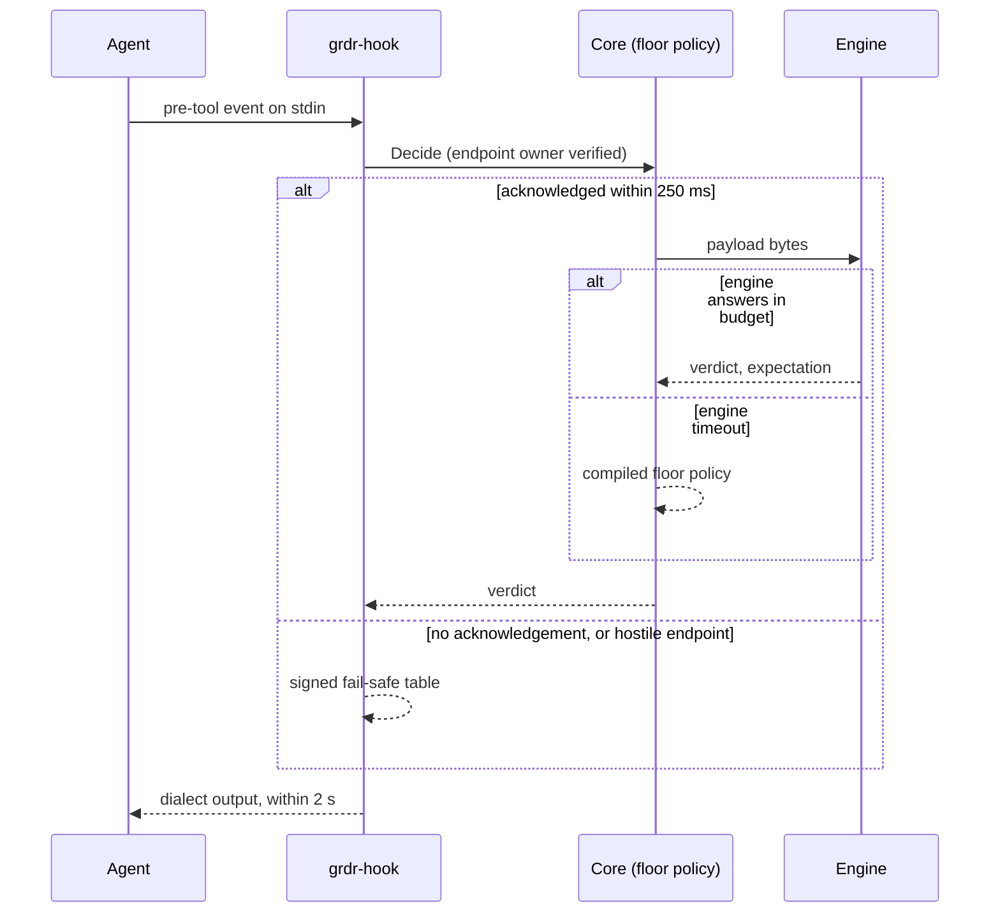

# Control points and the hook broker

_Status: draft 5 against spine version 4, `_review/01-document-rulings.md`, `_review/02-owner-answers.md` and the owner's instructions of 2026-11-11 (`_review/04-owner-kit-instructions.md`; P16, P17, D-69). The document describes the complete control-point design; ordering appears only as prerequisites. Owning squad: agent adapters and hooks. Read with: `00-decisions.md` (D-07, D-13, D-14, D-15, D-48, D-49, section 3), 05 (inventory), 11 (on-device update mechanics), 12 (grant model), 17 (MCP broker), 18 (approval flow and grades), 19 (model-backed providers), 21 (device-local artefact key), 22 (sensor protocol), 24 (signing and packaging), and the sensor, sandbox and policy-engine documents. For the efficacy harness and test lab see spine D-45 and D-64; the detailed document is pending._

## Summary

This document specifies how an action reaches a decision and how the answer is executed: the control points, their shared decision protocol, the hook shim and broker, wire adapters, the cross-check between hook claims and OS observations, and the assurance record. Key choices:

1. **One decision protocol** (`grdr.decide.v1alpha1`). A control point declares the verbs it can execute; the engine degrades the policy verdict by a fixed table and returns both.
2. **A command shim, not an HTTP hook.** `grdr-hook` is one signed static binary registered per agent in exec form. A command handler is the one handler type every hook-capable agent offers (agents with in-process plugins call the same binary); it can verify the daemon's endpoint owner and decide alone. An HTTP handler cannot carry the fail-safe table.
3. **Three fallback levels**: engine verdict, the core's compiled floor policy, the shim's signed fail-safe table. The daemon acknowledges within 250 ms (or by the deadline in a valid update-handover marker, never beyond 2 s) or the shim uses the table, and the shim always exits within 2 s.
4. **Hooks never hold for a person.** `STEP_UP` at a hook is always a denial with a retry token. The agent's own prompt is never an approval at any grade; it may only point the person to `grdr-approve` (spine section 3, R-01).
5. **Configuration installs are a release channel**: one owner per agent per device, a probe of the effective managed source, a journal, a health state.
6. **The session canary is passive**: a `SessionStart` handshake bound to the process key plus the session's first tool call, checked against OS observation. AL2 is "pending" until both are seen (see Deviations).
7. **The broker is a library and a specification.** Providers may return DENY or STEP_UP; one per action class may MODIFY, and its rewrite is re-evaluated by the built-in engine. Managed-hooks-only locks are never set by default.
8. **Per-agent-version contracts** from a conformance suite are the only source of capability and failure-mode claims. An unknown version drops to Watch and never denies.
9. **The assurance record is computed, not configured**; the level label is a published pure function over it.

## Requirements

| # | Requirement | Trace |
|---|---|---|
| R1 | Every control point states what it observes and which verdict verbs it executes; degradation is deterministic | D-07, D-13, P1 |
| R2 | A hook returns in 2 s worst case; p99 as in spine section 6 | D-14, section 6, l04 F9 |
| R3 | The shim decides fail-closed classes alone when the daemon is unreachable, with no command parsing | D-14, D-15, c3 F3, l06 F2 |
| R4 | The shim verifies the owner of the daemon endpoint | D-14, l01 |
| R5 | Vendor fail-closed flags only in managed installs with `on-sensor-loss: block`, after a self-test | D-14, l04 F1 |
| R6 | Never edit or drop another vendor's hook entries; survive first-wins managed sources | D-49, 15 verification C, h03 |
| R7 | AL2 only after proof that the hook fired, per session; "configured, not effective" is a health state and a finding | D-49, l02 |
| R8 | Hook-dark and undeclared-activity detections with stated windows; a version with no housekeeping profile reports "cross-check not calibrated" | D-13, P3, c3 F8, l03 |
| R9 | Failure mode is declared per rule class and the achievable mode is published per agent version | D-15 |
| R10 | Broker: registered providers, deadline, deny-wins, minimised payloads, one MODIFY provider per action class, useful with one provider | D-14, l08 F6, 27 |
| R11 | Adapters for OWASP ACS and Microsoft agent-hooks; capability claims in the portable-hook draft's vocabulary | D-14, P10, 19, 03, h03 |
| R12 | Server-side verdict hooks are thin adapters over one decision API, stateless policies only, vendor fail mode reported | D-40, 16 |
| R13 | Unknown harness version never denies | D-10, l06 F4 |
| R14 | First run changes nothing; User and Protected profiles; uninstall restores byte for byte | D-48 |
| R15 | Bespoke agents get an SDK contract; IDE-hosted agents an Agent Client Protocol conductor | Owner request (bespoke agents), D-24, g09 |
| R16 | Zero silent fail-open in every Tier 1 cell | Section 6, D-50 |

## Design

### 1. Control points and their verbs

The `gateway` requires the server (D-40); the `connector` requires the integration host; every other control point works without a server.

"Hold" means the control point can keep the action pending, which D-07 permits only with a known deadline and closed failure, capped at 80% of that deadline.

| Control point | Observes | Action classes | Executes | Hold | Highest `control` |
|---|---|---|---|---|---|
| `hook` | Declared tool calls before and after, prompts, session and sub-agent lifecycle, config-change events | `exec`, `file.*`, `mcp.call`, `net.request` (fetch tools), `agent.spawn`, `config.change`, `llm.request` where the agent has a model hook | ALLOW, DENY, MODIFY where the agent rewrites input, STEP_UP as denial with retry token | No | request |
| `mcp-broker` | MCP initialise, tool lists, calls and results | `mcp.connect`, `mcp.call` | ALLOW, DENY, MODIFY (arguments, results), STEP_UP as JSON-RPC error with retry token | Up to 80% of the client's request timeout, where known | request; scoped-boundary when the session's only MCP route is the broker (see 17) |
| `proxy` | HTTP requests on the explicit listener; bodies where plaintext is available | `net.request`, `llm.request` | ALLOW, DENY (403 with a machine-readable body), MODIFY (header injection, redaction) | No | request; scoped-boundary when a sandbox forces egress through it; mandatory-boundary when a kernel redirect does so for every process of the program identity (17 section 2) |
| `sandbox` | Nothing itself; enforces a profile compiled at launch | `exec`, `file.*`, `net.connect`, `elevate` | ALLOW, DENY (static). A grant takes effect by profile update where the back end supports it, otherwise at relaunch | No | scoped-boundary |
| `sensor` | Kernel-origin process, file and network effects; config writes | `exec`, `file.*`, `net.connect`, `agent.spawn`, `config.change`, `elevate`, `cred.use` | Per tier: observe only; or ALLOW and DENY. Linux file hold up to 30 s on the protected-path set; macOS full clients never hold | Linux fanotify tier only | mandatory-boundary |
| `gateway` | Model routes and MCP over HTTP in server mode | `llm.request`, `mcp.call` | ALLOW, DENY, MODIFY | No | mandatory-boundary for traffic that can only leave through it |
| `browser` | In-browser agent actions | `ui.act`, `net.request` | ALLOW, DENY, STEP_UP | No | request |
| `connector` | Vendor audit and compliance APIs; server-side verdict hooks | `llm.request`, `mcp.call`, `data.flow` | None, or ALLOW and DENY through a verdict hook | No | request; never above AL1 (D-13) |

The Executes column lists native forms only. Every control point that can DENY also executes STEP_UP as a denial with a retry token (section 3). A control point that cannot execute a verdict still receives it and reports it as `would-deny`; the gap appears in the assurance record, never as silence (P9).

### 2. Decision protocol

The package freezes with the other schemas before the server's first release (D-06).

**Transport.** Length-prefixed protobuf frames (4-byte little-endian length, 2 MiB cap) over a Unix socket on Linux and macOS and a named pipe on Windows. No HTTP stack in the shim. Endpoints: Protected profile `/run/grdr/decide.sock`, `/var/run/grdr/decide.sock`, `\\.\pipe\grdr-decide`; User profile under `$XDG_RUNTIME_DIR/grdr/`, `~/Library/Application Support/grdr/run/` and `\\.\pipe\grdr-decide-<user SID>`. Final names follow D-66.

**Peer checks, both directions.** The daemon reads the caller's kernel credentials (`SO_PEERCRED`, `LOCAL_PEERPID` with audit token, `GetNamedPipeClientProcessId`), holds the peer by handle (pidfd, audit token, process handle) so a recycled pid cannot stand in for it, and derives the process key itself; values claimed in the request are advisory. The client verifies the endpoint owner before sending anything: in Protected the socket and its directory are root-owned and the peer executable is the installed daemon; on Windows the pipe server process (`GetNamedPipeServerProcessId`) must run as the service identity from the install directory. A pipe or socket created by another principal while the service is down fails this check: the shim uses its table and leaves a tamper marker. In User the owner must equal the caller's uid and the record says `tamper: user`.

**Service `grdr.decide.v1alpha1.DecisionService`:** `Hello` (long-lived control points register capabilities and receive the interest set of D-05), `Decide`, `Report` (post-action and lifecycle events, acknowledged, no verdict). `Decide` is answered by two frames: `DecideAck` (decision id, daemon boot id), sent as soon as the peer check passes and the request is queued, then `DecideResponse`. The acknowledgement is what D-14's 250 ms limit measures: it proves a live, authentic daemon that will answer from the floor policy even if the engine does not. A re-hosted hook adds one intermediate `run_provider` frame and its reply (section 7).

| `DecideRequest` field | Content |
|---|---|
| `control_point` | Kind, instance id, version, capability bits: verbs, `can_hold`, `hold_deadline_ms`, `fails_closed` |
| `idempotency_key` | SHA-256 over control point kind, native session id, tool-use id or effect key, and payload digest. Where the dialect supplies no tool-use id the key also covers the caller's process key, so two identical commands in one session are never collapsed |
| `trace` | W3C trace and span ids; the daemon mints them when absent |
| `adapter` | Adapter id, dialect, claimed agent product and version |
| `process_key` | Boot id, pid, process start time, parent chain up to eight entries (advisory; the daemon recomputes) |
| `session_claim` | Native session id, turn or prompt id, agent id, parent agent id |
| `event` | `session.start`, `prompt.submit`, `tool.pre`, `tool.permission_request`, `model.pre`, `config.change`, `subagent.start`, and the post and end events for `Report` |
| `tool_use_id` | The agent's tool-call id; empty for OS effects |
| `payload` | `native_json` (raw hook bytes, 1 MiB cap, `truncated` flag, SHA-256) or `action` (a normalised action from a sensor, proxy, sandbox or SDK) |
| `deadline_ms` | Time the caller can still wait. The shim sends 1,800 minus its elapsed time; long-lived control points send their request or hold budget |
| `retry_token` | Echoed by callers that can carry it (SDK, MCP broker, proxy, conductor). A hook agent cannot, so the engine matches its retry to the grant by session lineage and action digest (12) |

| `DecideResponse` field | Content |
|---|---|
| `decision_id` | UUIDv7; the decision record id, and the receipt id for a non-default decision |
| `verdict`, `executed_as`, `degraded_reason` | The verb policy chose; what the control point executes (`allow`, `deny`, `deny-with-retry-token`, `hold`, `modify`, `observe-only`; field names as in 04 and 12, R-02); and the section 3 row that changed it |
| `effect` | `enforced`, or `would-be` when the agent has dropped to Watch (unknown version) |
| `reason` | Code, rule ids, blocking component, a message for the person, a message the agent can act on, a remedy hint from Cedar annotations (D-44) |
| `modified` | Replacement input in native form or as an action |
| `retry_token`, `approval` | Token bound to session, action digest and rule ids; request id, minimum approval grade and approver kind (see 12 and 18) |
| `expectation_id`, `grant_id` | Bindings for the OS control point (section 9) |
| `cache` | Key, scope (`none`, `call`, `session`, `bundle`), expiry (D-05) |
| `session` | Sensor-assigned session id and session-state sequence number (D-09, D-25) |
| `obligations` | Labels set, evidence spans to capture, stop-session flag |
| `health` | Degraded, stale bundle, uncalibrated cross-check |

**Deadlines.** Engine target p99 5 ms. The core waits for the engine, and for the provider fan-out of section 7, for at most the caller's `deadline_ms` minus 50 ms, then answers from its compiled floor policy (D-20) with `degraded_reason: engine-timeout`. Every decision gets a hash-chained decision record; only non-default decisions also get a signed receipt (04, 12, R-02). Receipts are appended to the spool before the reply; records of default ALLOWs are batched within 100 ms.

**Idempotency and correlation.** A repeated `idempotency_key` within 10 minutes returns the stored response and creates no new decision record or receipt. This absorbs shim retries and duplicate fires from agents that read each other's hook files (Cursor, Copilot and Devin read `.claude` settings; brief 15). A `tool.permission_request` for a tool-use id that already has a `tool.pre` decision links to it. The daemon identifies the calling agent by walking the peer's ancestry to the first executable that matches a catalogued or declared agent; if that disagrees with the `--agent` argument the observed identity wins and the mismatch is an event.

**Caching.** The shim caches nothing. Long-lived control points cache by the response's key and scope: `call` for a verdict that read session state, `session` or `bundle` for stateless rules. STEP_UP is never cached; a new bundle, label or grant invalidates by sequence number.

### 3. Verdict degradation

Implemented once in `grdr-policy` (the derivation that precedes it is in 12) and covered by golden vectors; control points do not improvise.

| Policy verdict | Control point can execute | Otherwise |
|---|---|---|
| ALLOW | Always | |
| DENY | Deny with reason and remedy | Observe-only point: `would-deny`, finding of class coverage gap, `control: none` for that class |
| MODIFY | Rewrite and continue; the engine re-evaluates the rewritten action | STEP_UP if every determining rule is liftable, otherwise DENY. Either way the agent message carries the remedy, so the agent can retry with the corrected input |
| STEP_UP | (a) Hold, only where D-07's conditions hold. (b) Denial with retry token; an approval mints a grant and the agent retries the identical call. The agent's own prompt is never used as an approval (R-01) | If the rule's minimum grade is unavailable on the device: DENY (D-31), except the user's own local policy in the user profile, where the disclosed time lock may stand in for G1 |
| DEFER (an input the rule needs is absent at this control point) | A stronger control point is attached for the action class: this one lets the call proceed and the engine issues an expectation marked `decide-at-effect`, which that control point judges (D-10, D-13) | No stronger control point: the engine re-derives with the input treated as opaque (D-10): STEP_UP in a fail-closed class, ALLOW with a finding elsewhere |
| A rule whose Mode is Watch | Evaluated in the shadow set: the executed verdict is unaffected and the rule's verdict is recorded as `would-be` | |
| A rule whose Mode is Off | Not compiled into the bundle: no verdict, no record | |

Translators never answer STEP_UP with the dialect's native ask. Where an agent shows its own prompt, its text may only point the person to `grdr-approve`. Agent-specific rows the table needs: Codex has no ask, and an `ask` reply marks the hook failed while the tool runs. goose cannot rewrite input (briefs 15, 36).

### 4. Per-agent matrix

Tier 1 is Claude Code, Codex, Cursor and Copilot CLI; the other agents are Tier 2 or 3 as marked.

Facts come from briefs 15, 16, 27, 36, g02 and h03 (their verification sections); "n/d" means not documented in a source the briefs read. Every cell is re-proved per agent version by the conformance suite (section 14) before a contract carries it. Our registered timeout is 5 s on pre-action events and 3 s on observation events for every agent; the shim's own limit is 2 s.

**Hook capability**

| Agent (tier) | Pre-action events registered | DENY | Native ask | MODIFY | Vendor fail-closed flag | Without the flag | Vendor default timeout |
|---|---|---|---|---|---|---|---|
| Claude Code, Agent SDK, IDE extensions (1) | `PreToolUse`, `PermissionRequest`, `UserPromptSubmit`, `ConfigChange`; observed: `SessionStart`, `SessionEnd`, `PostToolUse`, `PostToolUseFailure`, `SubagentStart`, `SubagentStop`, `Stop` | JSON deny or exit 2 | `ask`, `defer` | `updatedInput` | `onFailure: "block"`, 2.1.295+, command and http handlers only | Failed start, exit 1, bad JSON and timeout do not block. Agent SDK callbacks differ: a timed-out `PreToolUse` or `UserPromptSubmit` callback blocks | 600 s; 30 s on `UserPromptSubmit` |
| Codex (1) | `PreToolUse`, `PermissionRequest`, `UserPromptSubmit`, `PreModelRequest`; observed: session, sub-agent, `PostToolUse`, `Stop` | Exit 2 with non-empty stderr, or JSON deny | None | allow plus `updatedInput` | None | Every failure runs the tool. Hosted tools and `write_stdin` are not hooked | 600 s |
| Cursor (1) | `beforeShellExecution`, `beforeMCPExecution`, `beforeReadFile`, `preToolUse`, `beforeSubmitPrompt`; observed: session, `postToolUse`, `afterFileEdit`, sub-agent, `stop` | Yes | Shell and MCP events only | `updated_input` | `failClosed: true` per hook; not available on dashboard team hooks | Crash, timeout, other exit codes open; invalid JSON blocks | n/d |
| Copilot CLI (1); VS Code (2) | `preToolUse`, `permissionRequest`, `userPromptSubmitted`; observed: session, post, sub-agent, `agentStop`, `errorOccurred` | Yes | `ask` (deny in the cloud agent) | `modifiedArgs` | None | Command crash blocks; timeout runs the tool; HTTP handlers always open | 30 s |
| Gemini CLI (2) | `BeforeTool`, `BeforeModel`, `BeforeAgent` | Yes | n/d | Yes, including the model request | None | Open | 60 s |
| Antigravity (2) | `PreToolUse`, `PreInvocation` | Yes | `ask`, `force_ask`, `deny_unless_prior_grant` | `overwrite` | n/d | Undocumented; DefenseClaw reports the call runs on timeout | 30 s |
| Factory Droid (2) | Claude dialect, nine events | Yes | `ask` | `updatedInput` | None | Open | 60 s |
| Auggie (2) | `PreToolUse`, `PromptSubmit` | Yes | No | `updatedInput` | None | Open | 60 s |
| Devin Local (3) | `PreToolUse`, `PermissionRequest`, `UserPromptSubmit` | `block` | No | `updatedInput` | None | n/d | n/d |
| Kiro (3) | Pre Tool Use, Prompt Submit | Yes | n/d | n/d | n/d | n/d | 60 s |
| goose (3) | `PreToolUse` | Yes | No | No | `on_failure: block` | Open | 30 s |
| OpenHands (3) | `PreToolUse` | Exit 2 | No | n/d | None | Open | n/d |
| opencode and forks (3) | Plugin `tool.execute.before`; `permission.asked` observed | Throw | No | Mutate arguments | In-process: a throw blocks | n/a | n/a |
| Cline (3) | SDK plugin `beforeTool` | Yes | No | Yes | `hookErrorMode: "throw"` | Open | 3 s |
| Zed, JetBrains and other ACP hosts (2) | None; the conductor of section 13 | | | | | | |
| Amp, Hermes, OpenClaw, Aider, Continue, Warp, Roo, Kilo, Junie, Amazon Q | Hook surface not verified from vendor documents (Amp's managed-settings paths are known; Hermes and OpenClaw appear only in other vendors' connector lists, g02). Sensor, MCP broker and proxy only until a brief covers them | | | | | | |

**Admin-scope installation, precedence and locks**

| Agent | Linux | macOS | Windows | Precedence and lock options |
|---|---|---|---|---|
| Claude Code | `/etc/claude-code/managed-settings.d/50-grdr.json` | `/Library/Application Support/ClaudeCode/managed-settings.d/`; plist `com.anthropic.claudecode` | `C:\Program Files\ClaudeCode\managed-settings.d\`; `HKLM\SOFTWARE\Policies\ClaudeCode` value `Settings` | Server-managed, then MDM, then files, then HKCU. Default `managedSourcesBehavior: "first-wins"`: only the highest source with any policy key applies, hooks included; `merge` needs 2.1.242+. Locks: `allowManagedHooksOnly` (also stops plugin hooks unless the plugin is force-enabled), `allowedHttpHookUrls`. An unparseable admin document stops the agent starting. `/etc/claude-code` is user-writable on WSL |
| Codex | `/etc/codex/requirements.toml` with `[hooks] managed_dir` | plist `com.openai.codex` key `requirements_toml_base64` | `%ProgramData%\OpenAI\Codex\requirements.toml` with `windows_managed_dir` | Lowest to highest: system file, cloud bundle, legacy managed config, macOS MDM. Locks: top-level `allow_managed_hooks_only`; `[features]` pins. Managed hooks skip the trust prompt |
| Cursor | `/etc/cursor/hooks.json` | `/Library/Application Support/Cursor/hooks.json` | `C:\ProgramData\Cursor\hooks.json` | Enterprise file plus dashboard team hooks (Enterprise plan, 30-minute sync). deny over ask over allow across sources; for other fields the last response wins. No managed-only lock in the briefs |
| Copilot CLI | `/etc/github-copilot/policy.d/50-grdr.json` | Same path | `C:\ProgramData\GitHub\Copilot\policy.d\` or `HKLM\Software\Policies\GitHub\Copilot` value `Policy` | Managed settings: MDM over server over file, permissions merge most-restrictive. Lock: `permissions.disableBypassPermissionsMode`. POSIX files must be root-owned, not a symlink, not group or world writable. VS Code does not list `policy.d`; the cloud agent has no policy hooks |
| Gemini CLI | `/etc/gemini-cli/settings.json` | `/Library/Application Support/GeminiCli/settings.json` | `C:\ProgramData\gemini-cli\settings.json` | System settings override all |
| Auggie | `/etc/augment/settings.json` | n/d | `C:\ProgramData\Augment\settings.json` | System file highest and immutable |
| Factory Droid | Organisation console only | | | `allowManagedHooksOnly` |
| opencode | `/etc/opencode` | `/Library/Application Support/opencode`; plist `ai.opencode.managed` | `%ProgramData%\opencode` | Settings do not stop users adding plugins |
| Antigravity, Devin Local, Kiro, goose, OpenHands, Cline | No machine scope: user scope only (`~/.gemini/config/hooks.json`, `~/.config/devin/config.json`, `~/.kiro/hooks/`, `~/.agents/plugins/<name>/hooks/hooks.json`) | | | None; `tamper: user` in every profile, backed by the config-integrity monitor |

Windows `ProgramData` locations are a known weak spot (Claude Code stopped reading its `ProgramData` path after advisory GHSA-5cwg-9f6j-9jvx). The installer checks the ACL, reports a weak one as a finding and does not change another product's directory permissions.

**User-scope targets (User profile):** `~/.claude/settings.json`, `~/.codex/hooks.json`, `~/.cursor/hooks.json`, `~/.copilot/hooks/`; for Tier 2 and 3, `~/.gemini/settings.json`, `~/.factory/hooks.json`, `~/.augment/settings.json`, `~/.config/opencode/plugins/` and the user-scope paths in the table above. Project scope is never written (brief 15: repository-supplied configuration is the main bypass pattern); it is scanned for hostile entries by the inventory pass (05).

**Native telemetry and transcripts**

| Agent | Native telemetry | Transcript |
|---|---|---|
| Claude Code | OTel logs (`tool_decision` with `source`, and `permission_mode` from 2.1.301; `tool_result`, `api_request`, `managed_settings_resolved`); endpoint and exporter selectors must both be pinned in managed settings | `~/.claude/projects/<project>/<session>.jsonl`; path also in the payload |
| Codex | OTel (`codex.tool_decision`, `codex.sandbox_outcome`, `codex.api_request`); `[otel]` in `requirements.toml` from CLI 0.166.0 | `~/.codex/sessions/YYYY/MM/DD/rollout-*.jsonl` (unverified) |
| Cursor | n/d | `transcript_path` in the payload |
| Copilot CLI | Unverified | `~/.copilot/session-state/<id>/events.jsonl` |
| Gemini CLI | OTel (`telemetry.*` settings) | `~/.gemini/tmp/<project_hash>/` (unverified) |
| Antigravity | To Google Cloud only | `transcriptPath` in the payload |
| Others | Unverified | Payload path where given |

Native telemetry and transcripts are claims (P3). They are a second claim source for the canary and the cross-check, never evidence of enforcement.

### 5. The hook shim

`grdr-hook` is a static Rust binary with no interpreter, no shell form and no network code. Registrations invoke it by absolute path in exec form: `grdr-hook --agent <adapter> --event <native event>`. Install locations: Protected under the root- or SYSTEM-owned program directory (`C:\Program Files\...`, never `ProgramData`); User under the per-user data directory. Agents with in-process plugins (opencode, Cline) get a small JavaScript plugin that spawns the same binary, so there is one trust path.

**Per invocation:**

1. Read stdin up to 1 MiB. The bytes are not interpreted on this path; a longer payload is forwarded with `truncated` set and the engine treats it as `unresolved` (D-10).
2. Read own pid, parent chain and start times.
3. Connect and verify the endpoint owner (section 2).
4. Send `Decide` with the raw payload. If no `DecideAck` arrives within 250 ms (or, while a valid update-handover marker is present, by its deadline, never beyond 2 s; D-14), or the connection closes at any point, go to step 6. After the acknowledgement, wait for the verdict until 1,800 ms from process start.
5. Encode the verdict in the agent's dialect (stdout JSON and exit code) and exit.
6. Table path: verify the fail-safe table, scan the payload for the fields the table needs, evaluate, encode the result, append a record to the offline spool, exit.

A watchdog thread ends the process at 1,950 ms if anything above stalls: with the dialect's deny output when the handler was registered with `--strict` (below), otherwise with exit code 0 and a Degraded message. The allow case is reported by the sensor as `hook-timeout-open` (section 9).

**Field scanner.** The shim's dependency closure holds no general parser (03, ARCH-004). The table path uses a bounded scanner in `grdr-fastpath`: it finds the key paths the dialect table names (event, tool name, command string, file path, MCP server and tool; depth at most 4), unescapes those string values into a fixed buffer, skips everything else by bracket and string-escape counting, builds no tree and allocates nothing. No shell or path canonicalisation happens here (D-10 normalisers run in the engine). Input that is not well-formed JSON within those bounds is `malformed` and a pre-action event is denied (D-10). A well-formed payload that lacks a named key matches nothing and is spooled as `table-field-missing`, so a changed payload shape never denies. The scanner is fuzzed differentially against a full JSON parser.

**Offline spool.** An append-only file in the per-user state directory, capped at 4 MiB with a drop counter. The daemon ingests and truncates it on recovery and treats its records as claims (P3).

**Fail-safe table.** Compiled on the device by the privileged service from the last-known-good bundle and signed with a device-local artefact key (21's key table; D-14, R-05), stored beside the shim, at most 64 KiB and 512 entries. An entry is `(event class, field, matcher, bytes, rule id, reason code)` and always means DENY. Matchers are `tool_exact`, `path_prefix`, `path_suffix`, `argv_token`, `substring`, `mcp_tool_exact`: literal byte comparisons over the scanned fields. There is no regex, and the field scanner is the only code that reads structured input. Substring matching over a command string over-matches by design; that cost is paid only while Degraded. The table is verified only on the table path, so the normal path pays no signature cost. If the table is missing or invalid the shim uses a built-in minimal table (writes to our own control files) and marks the event for a tamper finding. Table expiry never stops enforcement (D-37).

**Messages.** A table denial prints, from its language token (D-69), the component (the brand manifest's product name, then "offline rule"), the rule id, a local reference code and the next step (`grdr doctor`), and gives the agent a reason it can act on (D-44).

**Daemon unreachable, by case**

| Case | Shim behaviour | Reported as |
|---|---|---|
| Daemon down or no acknowledgement in 250 ms | Table: DENY on match, otherwise ALLOW; offline spool | Degraded, shown three ways: a notice in the agent's hook message on every table decision; `grdr status`, which reads the spool; and, on recovery (the service manager restarts the daemon), a coverage-gap finding with counts. Enrolled devices also show it on the server through the heartbeat gap (22). Target: visible within 60 s (S-06) |
| Acknowledged, no verdict by 1,800 ms, or the connection closes after the acknowledgement | Table | `engine-slow` or `daemon-lost` event; counts toward rollout gates |
| Endpoint owner check fails | Table; tamper marker | Tamper finding |
| Table missing or invalid | Built-in minimal table | Tamper finding |
| Shim missing, quarantined or not executable (exit 126 or 127) | The agent's own failure behaviour applies (matrix) | Hook-dark or canary-missed (section 9); `grdr doctor` runs the registered command line to detect it |
| Update in progress | Linux and macOS: the old daemon hands its listening endpoint to the new one (11 section 8); the shim retries the connect once inside the 250 ms window. Windows: the service restarts and writes 11's handover marker; the shim waits for the acknowledgement 250 ms, or until the marker's deadline when the marker is valid, never beyond 2 s (D-14, R-06), then uses the table | Update-induced table decisions are counted; target zero denials |

**Vendor fail-closed flags.** Set only when all three hold: a managed install; the group sets `on-sensor-loss: block`; the on-device self-test passed (the registered command line runs, the signature verifies, three consecutive sessions reached `effective`). Because the flag is per handler, the adapter registers two handlers: a strict one (`grdr-hook --strict ...`) whose matcher lists the tool names that can reach a fail-closed class, carrying the flag, and a normal one for everything else. The console shows the blast radius before the setting is saved: if the shim cannot start, every tool in the strict matcher is blocked.

**Integrity.** The shim carries the platform's code signature: on Windows, Authenticode through a free open-source signing programme (for example SignPath Foundation), verified at setup (D-17); on macOS, Developer ID with notarisation, which requires Apple's Developer Program (D-18); on Linux, the package signature and a digest in the signed release manifest. Without the Developer Program the macOS shim has no Developer ID signature (it carries its Sigstore signature, D-59) and its identity rests on the digest in the signed release manifest and the install journal. The install journal records its path and digest. On every connection the daemon compares the peer executable's path and digest with the journal; a mismatch is the event `shim-identity-mismatch`, and the request is still evaluated because the shim is untrusted either way (D-20). The config-integrity monitor watches the binary, the table and every registration; in Protected all three are root- or SYSTEM-owned.

**Doctor.** `grdr doctor hooks` prints per agent: version and whether it is in a tested range; effective managed source; our entry and its health state; foreign hooks found; lock flags; shim signature; the 126/127 probe; last canary; table age; p50 and p99 over the last 1,000 calls.

### 6. Installing into agent configuration

Ringed delivery of templates requires the server's rings (D-37) and 11's update mechanics.

Health states per agent instance: `not-installed`, `awaiting-owner` (a fragment was rendered for another owner and is not yet in the effective source), `configured`, `effective`, `configured-not-effective`, `shadowed` (a higher-ranked source wins), `foreign-locked` (a managed-only lock set by another owner excludes us), `unknown-version`. Each session also carries a canary state (`pending`, `passed`, `missed`; section 11): the instance is `effective` while its latest session with a tool call passed and `configured-not-effective` once one missed.

Installer steps, per agent:

1. **Probe.** Read the agent version and every managed source in precedence order, including cached server-managed settings, and compute which source is selected. The probe is a prediction; the canary is the proof (S-05).
2. **Choose the owner.** If MDM or server-managed policy owns the agent, write nothing: `grdr hook render --agent <a> --format json|plist|reg|intune|jamf` emits the fragment, and for Claude Code the instructions require `managedSourcesBehavior: "merge"` where sources must compose. A single-file admin target (Cursor `hooks.json`, Codex `requirements.toml`) that exists and is not in our journal also has an owner: we render and do not edit. Otherwise we own a drop-in (`managed-settings.d`, `policy.d`), a single file we create, or, in User, our entries in the user-scope file.
3. **Compose.** Drop-in files contain only our entries. Single files we created and user-scope settings are edited structure-preservingly: our entries are appended, identified by our absolute path, and no other key is touched. A file that does not parse is not written; the state is reported.
4. **Validate.** Schema check; ownership check (root-owned, not a symlink, not group or world writable; Copilot's rule applied everywhere). Each template is proven in CI by starting the pinned agent.
5. **Write.** Temp file, fsync, atomic rename; journal the path, prior bytes and new digest. An agent-start probe follows; failure rolls back from the journal and halts the ring.
6. **Prove.** State stays `configured` until a session canary passes.
7. **Watch.** The sensor watches every path in the matrix. Drift in a file we own is re-applied and raises a `config.change` finding; drift in a file we do not own is only reported.

Uninstall replays the journal. If a file changed after our write, only our entries are removed and the difference is shown. CI asserts a zero byte-level diff on an untouched machine (D-48).

Templates are code (P7: a pack cannot introduce a command or path to execute). An adapter manifest selects template ids and supplies data: version ranges, tool-name to action-class maps, field maps, the housekeeping profile.

**Locks.** `allowManagedHooksOnly` and `allow_managed_hooks_only` are never set by default, because they silently stop other vendors' user and plugin hooks (h03). When an organisation's pack sets `hooks.managed_only`, the installer lists the foreign hooks that would stop and offers to re-host each as a `command-hook` provider (section 7); re-hosting is a provider registration and needs the approval D-31 requires.

### 7. Hook broker and verdict providers

Third-party host vendors building their own shim is the L2 integration level of D-41, which requires a third-party host vendor.

The broker is `grdr-broker`, a library used by the daemon, plus a specification directory (`spec/hook-broker/`: protobuf, dialect tables, capability vocabulary, provider kit). A host vendor may build and sign its own shim against it and run our engine as one provider.

**Provider kinds.** `builtin` (our engine); `native` (`grdr.provider.v1alpha1.VerdictProvider`, our own protobuf service in the framing of section 2; the provider connects to the daemon's provider endpoint and is peer-checked against its registration, so the core carries no HTTP stack and dials nothing); `command-hook` (a re-hosted foreign hook, below); `acs` (outbound to an ACS Guardian, section 8), hosted by `grdr-proxy`, which registers as a native provider because the core never opens a network connection (D-20). A cloud guardrail API is an integration (25) wrapped the same way, not a provider kind.

**Placement.** The engine produces the built-in verdict and the minimised provider request. The daemon, as the IPC hub, does the fan-out and the merge, which are fixed-layout work: a provider reply is a verdict code, a reason code, a bounded message and optional rewrite bytes that the daemon passes to the engine unread.

| Message | Fields |
|---|---|
| `ProviderRequest` | Decision id, `deadline_ms`, event, action class, tool class, analyser classes of the target, agent type and version, session pseudonym, enforcing labels; arguments or content only at the registered capture level |
| `ProviderResponse` | `objection` (`none`, `deny`, `step_up`), provider reason code, a message for the person (at most 256 bytes, rendered inert), `rewrite` (accepted only from the `may_modify` provider for that class) |

**Registration.** One file per provider in a root-owned `providers.d/`, signed by the deployment root in managed installs. Fields: id (reverse-DNS, unique on the device), kind, expected peer identity, action classes and events, capture level (default `metadata`), `deadline_ms` (default 150, maximum 1,000), `on_failure` per action class (`ignore` default, `deny`, `step_up`), `step_up_min_grade` (default G1), `may_modify` action classes, `model_backed` (default false; when true the broker applies 19's rules: `deny` executes as `step_up`, `may_modify` is refused, `on_failure` is forced to `ignore`, only catalogue reason codes reach the agent, calls are capped at 60 per session per minute), error budget. A provider's STEP_UP is approved and granted like a rule's, under the rule id `provider/<id>/<reason code>`. Registering a provider or raising its capture level is a widening operation (D-31, D-51).

**Evaluation order.**

1. `builtin` evaluates first. DENY ends the call; no provider sees the payload.
2. Otherwise the broker fans out in parallel to providers subscribed to the action class, each with the smaller of its deadline and the remaining budget (1,500 ms total inside the shim's 1,800 ms).
3. Merge: DENY over STEP_UP over DEFER over MODIFY over ALLOW. A provider may return DENY, STEP_UP or no objection; a provider's "allow" is no objection and overrides nothing.
4. If the result is not DENY or STEP_UP and the one provider with `may_modify` for this class returned a rewrite, the built-in engine re-evaluates the rewritten action. Only an ALLOW lets it through; the receipt records the provider id and both digests.
5. Every decision records `blocked_by` and `cause` (`policy`, `provider`, `provider-failure`), the idea taken from goose's post-decision event (brief 15).

The hook row of spine section 6 is measured with the built-in provider only. Each provider's added time is reported per provider by `grdr doctor hooks` and counts toward the hook-latency rollout gate (D-37).

**Failure policy.** A timeout or error applies that provider's `on_failure` for the class. By default five consecutive failures, or more than 5% failures in five minutes, suspend the provider under the `provider-suspend` retry policy (1, 5, 15 minutes; 03 section 10); suspension raises Degraded and a coverage-gap finding, and its `on_failure` applies statically while suspended.

**Re-hosted hooks.** A `command-hook` provider is a foreign hook command the agent no longer loads under a managed-only lock. The daemon never executes it. It answers the shim with a `run_provider` instruction naming the provider id; the shim takes the command from the signed provider index stored beside the fail-safe table (never from the wire), runs it in exec form as the session user with the original payload on stdin, and returns the exit code and at most 64 KiB of stdout, which the engine reads in that agent's dialect. The 1,000 ms ceiling applies: a hook that needs longer (Zscaler's cloud call has a 30 s default timeout and fails closed; h03) cannot be re-hosted without changing its behaviour, so the installer shows each foreign hook's registered timeout beside the ceiling before the lock is applied.

**Payload minimisation.** At `metadata` a provider receives only the fields listed for `ProviderRequest`. Arguments need the `redacted arguments` level; content also needs a content grant (D-51).

**Coexistence with hooks we do not host.** Other vendors' native entries keep running inside the agent. We list them in inventory (05), never edit them, and rely on the agent's own merge (Claude Code runs matching hooks in parallel with deny over defer over ask over allow). Three consequences are designed for:

- *Who blocked.* When our verdict was ALLOW and the tool did not run, the adapter attributes the block from the agent's own signals (`PermissionDenied`, OTel `tool_decision.source`) so the message can name "another product" (D-44).
- *Competing rewrites.* Which `updatedInput` wins among parallel hooks is undocumented. While a foreign pre-tool hook is present on the same event, our MODIFY takes the Otherwise column of section 3 unless the contract for that agent version proves a deterministic outcome. The sensor compares the executed command with the expectation; a mismatch is the finding `effect-mismatch`.
- *Removal.* An installer that replaces the whole `hooks` key (Zscaler's guide does) removes our entry; the state becomes `configured-not-effective`, and a write by agent lineage is the tamper detection in the Essentials pack.

**Capability claims.** Each adapter version publishes `capabilities.json` in the vocabulary of the `agent-hook-unity` draft 0.1 (`gate`, `observe`, `partial`, `unavailable` per canonical event), generated from conformance results. We map to the draft and do not depend on it.

### 8. Wire adapters

All adapters are thin translators onto `Decide`. Each is pinned to a version (P10) and marked experimental until the upstream specification is stable.

| Adapter | Direction | Pinned to | Mapping and checks | Fail mode reported |
|---|---|---|---|---|
| OWASP Agent Control Standard | We are the Guardian; also outbound to a Guardian as a provider | Spec v0.1.0, release 0.1.4 | JSON-RPC hook methods (`steps/toolCallRequest`, `toolCallResult`, session and sub-agent events) to our events; dispositions `allow`, `deny`, `modify`, `ask`, `defer` to the five verdicts. HMAC-SHA256 envelope verification with a per-device key generated at adapter install and readable only by the daemon and the configured client, replay rejection by nonce cache, clock skew limit 60 s (our choice), and refusal when no decision arrives. Listens on a socket or pipe only. An ACS client counts as the `hook` control point | Closed. The upstream reference Guardian defaults to proceed; ours does not |
| Microsoft agent-hooks | An interceptor package inside our Python SDK | 0.1 (v0.1.0-beta.3) | Eight interception points; `pre_tool_call` and `pre_model_call` call `Decide`; `transform` is MODIFY; deny with liftable approval is STEP_UP | Closed, unless a binding sets `on_error: continue`, which the SDK reports as `on_failure: open` |
| Anthropic inference hooks | Vendor calls our server `decide` target | Current configuration schema | `prompt` and `tool_call` events; Standard Webhooks signature check; allow, or deny with `deny_reason`. Verdict is binary and covers every tool call in a response; STEP_UP and MODIFY become deny, and `deny_reason` carries the reason code and the exception route (D-44). Timeout 1 to 10,000 ms, default 5,000 | The organisation's configured failure handling (default allow; block is selectable), declared by the admin in the adapter configuration and reported. The briefs show no way to read it back |
| Copilot Studio threat detection | Vendor calls our server | `api-version=2025-05-01` (preview) | `POST /validate`, `POST /analyze-tool-execution`; Entra bearer token validation; 1,000 ms budget against our tier 0 objective of 150 ms (D-56) | Default allow on timeout; admins can set block |
| Gateway guardrail APIs | Gateways call `POST /v1/guard` on our gateway or server | Per plugin | The body is a `DecideRequest` with an `action` payload (Connect unary, JSON or protobuf) and the reply is the `DecideResponse`; the caller authenticates with workload identity or an organisation-bound token. Thin plugins for agentgateway, Agent Router, LiteLLM and Kong (owned by 17 and 25); each declares verbs and fail mode | A host that can fail open is reported as a request (D-40) |
| AgentCore interceptors, Google Agent Gateway | Vendor calls our server | Pinned when built | The same server adapter trait. Requires a design partner on that platform | Reported per vendor, as for the rows above |

Server-side adapters evaluate only policies marked stateless (D-40), return a verdict, a reason code and the exception route and never policy text (D-38), support a shadow setting, and attach to the `connector` control point, which never raises an instance above AL1. The vendor-called members require a server `decide` target reachable at a public HTTPS endpoint (a self-hosted server, or the hosted service where it exists); the trait and its mock-vendor conformance test require neither. On a site without internet these members do not apply, because the vendors' services are themselves unreachable; the support matrix (24 section 9) marks them `requires internet`, and the assurance record shows them as not applicable, never as a gap.

### 9. Cross-validation of claims and observations

Covers Linux, macOS (process events where tier 3 exists, otherwise the transcript tail) and Windows. Each OS requires its sensor's observation source.

**Expectations.** On ALLOW or MODIFY of a `tool.pre` in classes `exec`, `file.*` or `net.*`, the engine issues an expectation: session, tool-use id, agent process key, action class, effect descriptor (for `exec`, the wrapper pattern and the command-string digest; for files, the path set; for network, the host set), grant id if any, and a window. The OS control point evaluates each effect against floor rules and the expectation, and honours the same grant, so the person is never asked twice (D-13). Descendants of a matched tool subprocess inherit the expectation and are judged by floor rules only.

A *tool-shaped child* is a direct child of the agent process that matches the adapter manifest's exec wrapper pattern for that agent version: how a tool's command reaches `argv`, for example a shell with `-c` and the command string. Matching is on that command argument, not on equality of a whole argv.

**Classifying an effect in agent lineage**, in order: matches an open expectation (`cross-checked`); matches the housekeeping profile for this agent version, a signed table of executable, literal argument patterns, required parent and rate (`housekeeping`); belongs to a declared non-tool lineage such as a configured MCP server or language server (`declared-service`); is a command the person ran through the agent outside the tool loop, such as a Claude Code `!` command, where a prompt event or the transcript identifies it (`human-direct`; whether any hook event announces these is not in the briefs and is measured in S-07); otherwise `undeclared`.

In shared hosts (D-25) an effect that matches none of these is `undetermined`, not `undeclared`, because the person's own terminal shares the lineage: it raises no tamper finding and sets no label. `hook-dark`, `claim-without-effect` and `effect-mismatch` still apply there.

| Detection | Condition | Window | Finding class |
|---|---|---|---|
| `hook-dark` | An agent process with a hook-capable, in-range version and a `configured` or `effective` entry has no `session.start` bound to its process key | 30 s from process start for session-exclusive agents; 30 s from first loop evidence (model connection or tool-shaped child) in shared hosts. Immediate if a tool-shaped child runs first | Tamper. Coverage gap if the state was already `shadowed` or `foreign-locked` |
| `hook-silent` | Session bound, model traffic continues, three or more undeclared tool-shaped executions and no `tool.pre` | 120 s | Tamper |
| `undeclared-activity` | An undeclared effect. One in a fail-closed target class, or three in 10 minutes, sets the enforcing label `undeclared-activity` by session rule (D-09) | Effect start between decision time minus 50 ms and post-event time plus 2 s; an expectation with no post event stays open 600 s or until session end | Tamper if the hook was `effective` and the effect is a direct child of the agent process; otherwise coverage gap |
| `claim-without-effect` | A successful post-tool `exec` claim with no observed process | 2 s after the post event | Coverage gap ("could not look") if the sensor reports loss; tamper if the sensor is healthy |
| `effect-mismatch` | The tool-shaped child that opens an expectation carries a command whose digest differs from the allowed or rewritten command | The `undeclared-activity` window | Tamper |
| `bypass-flag` | The agent command line carries a hook- or permission-disabling flag (`--dangerously-skip-permissions`, `--dangerously-bypass-approvals-and-sandbox`, `--dangerously-bypass-hook-trust`, `--yolo`, `--allow-all`, a `disableAllHooks` settings override) | At process start | Policy violation; Block in Essentials where a boundary exists |
| `hook-timeout-open` | A shim process for the agent ended with neither a delivered verdict nor a spool record (stalled, killed, or ended by its watchdog), or was still running, when a tool-shaped effect started | Per call | Coverage gap; tamper if the shim was signalled by agent lineage |

A version with no housekeeping profile reports "cross-check not calibrated": undeclared effects are still recorded, `hook-silent` and `undeclared-activity` raise no tamper finding on them, and visibility cannot reach `cross-checked`. The windows and counts in the table are targets; they are replaced by S-07's measurements (pass: under 1 unexplained execution per 100 sessions; injected process caught 20 of 20). Without a process event stream (macOS tiers 1 and 2) the transcript tail is the second claim source: tool-use entries with no matching hook event raise `canary-missed`, and visibility stays `claimed`.

### 10. Failure-mode policy by rule class

`on-sensor-loss` is declared per pack and group (D-15). "In the table" means the shim denies it offline.

| Rule class | Default | With `on-sensor-loss: block` | Backing boundary |
|---|---|---|---|
| Writes to any agent's control files or ours; disabling the product; honeytoken use (Essentials Block) | In the table | In the table; strict handler carries the vendor flag | Sensor protected paths; sandbox profile |
| Bypass or hook-disabling flags in a command | In the table (`argv_token`) | Same | Sensor, at process start |
| Credential-store and private-key reads; recursive delete outside the workspace; `elevate` from agent lineage in the protected profile (Essentials Ask, D-53) | Allow, Degraded, spooled: with no daemon there is nobody to approve and a denial would be a dead end (D-44) | In the table | Sensor protected paths; sensor `elevate` observation |
| `elevate` from a contained session | Denied by the core's floor policy and the sandbox, independent of the hook (D-22) | Same | Sandbox |
| Everything else | Allow, Degraded, spooled | Allow, Degraded, spooled | |

Fail-closed at the OS control point applies only to processes inside session containers (D-15); a person's own shell is never denied because our engine is down.

**Achievable failure mode** is published per agent version from the conformance suite and feeds `on_failure`. Expected results from the briefs, to be confirmed by S-06: Claude Code closed for the strict handler when the flag is set, otherwise open; Codex open in every case, so its fail-closed classes are `on_failure: open` unless a boundary backs them; Cursor closed with `failClosed` on file-based installs, open on dashboard team hooks; Copilot CLI open (timeouts run the tool).

### 11. Assurance record and level

The record is computed by `grdr-model` from four inputs: the adapter contract for the agent version; health state and canary; attached control points and their tier per action class; install profile. It is evaluated per session at decision time, passed to policy in the Cedar context (12), and rolled up to the instance as the field-wise minimum over the last seven days of sessions that made at least one tool call. It is emitted as an `assurance.record` event on change, carried in the heartbeat (22), shown by `grdr status --assurance` and by every Mode control (D-44).

| Field | Value rule |
|---|---|
| `visibility` | `none`; `claimed` if only hooks, native telemetry or transcripts see the class; `observed` if an OS or gateway control point sees it; `cross-checked` if both do, the housekeeping profile is calibrated and reconciliation ran without sensor loss in the last 24 hours |
| `control` | `none`; `request` if a hook is `effective`, or the proxy or MCP broker is in the agent's configured path; `scoped-boundary` if the session entered a sandbox whose conformance covers the class; `mandatory-boundary` if an enforcing sensor tier or gateway covers the class for every process of the program identity |
| `on_failure` | `closed` only if the contract proves closed for this version and it is configured and self-tested, or a boundary with a fail-closed floor covers the class; otherwise `open` |
| `tamper` | `user` (User profile, or a user-scope-only agent), `admin` (Protected), `platform` (supplied by a host EDR when embedded) |

**Level function** (published, pure, versioned; the label is the highest row whose predicate holds; policy never reads it). "Core classes" are `exec`, `file.write` and `net.connect`.

| Label | Predicate |
|---|---|
| AL0 Inventoried | The instance exists in inventory |
| AL1 Observed | `visibility` at least `claimed` for every class the agent's catalogue entry declares |
| AL2 Guided | AL1, `control` at least `request` for those of `exec`, `file.write` and `mcp.call` that the catalogue entry declares, and the session canary passed |
| AL3 Contained | `control` at least `scoped-boundary` for the core classes |
| AL4 Enforced | `control` is `mandatory-boundary` and `visibility` is `cross-checked` for the core classes, and `on_failure` is `closed` for the fail-closed classes |

AL3 does not require AL2, so a hookless bespoke agent on an enforcing Linux host is AL3, not AL1 (review c3 F1). An instance reached only through the `connector` control point is capped at AL1 (D-13). The output carries `next_level_blockers` so the console can say why a level was not reached.

**Session canary.** Two proofs, both bound to the agent's process key:

1. *Delivery.* The `SessionStart` hook reaches the daemon and receives a session nonce. This proves our entry is loaded from the effective source for this session.
2. *Gating.* The session's first tool call arrives as `tool.pre` before, or within 50 ms (target) of, the first tool-shaped effect the sensor sees. Where the sensor has no process events for the agent (macOS tiers 1 and 2, D-18) the second source is the transcript tail: the first tool-use entry has a matching `tool.pre`. AL2 can then hold with `visibility: claimed`.

After proof 1 the session's canary state is `pending` and the label stays AL1 with that reason; after proof 2 it is `passed` and AL2 can hold. A tool effect or transcript tool-use entry with no `tool.pre` sets it to `missed`, moves the instance to `configured-not-effective` and raises `canary-missed`. An active canary (a scripted headless run against the replay model endpoint) is used at install time, by `grdr doctor --canary` and in conformance only. On a device it would need credentials or a base-URL override, and review l04 F1 reports that a base-URL override makes Claude Code skip server-managed settings (brief 15, verification row 2, confirms only that the fetch depends on how the session authenticates), so it could test a different source than real sessions. S-05 includes that cell.

### 12. SDK contract for bespoke agents

Python and TypeScript, with framework middleware. Packages `grdr` (PyPI) and `@grdr/sdk` (npm), names subject to D-66. The SDK holds no policy; it speaks the section 2 protocol to the local daemon, to a sidecar socket in containers, or to the gateway's Connect endpoint with workload identity.

| Call | Contract |
|---|---|
| `declare(manifest)` | Registers the agent (D-24): name, program identity hints, tools, model endpoints. Identity proof is `self-asserted` |
| `session(...)` | Context manager; emits `session.start` and `session.end`; child sessions for sub-agents |
| `decide(action)` | Returns the response of section 2. The SDK executes ALLOW, DENY and MODIFY; STEP_UP raises `ApprovalRequired` carrying the retry token |
| `report(event)` | Post-action and model events |
| `guard(tool)` | Wraps a callable: `decide`, call, `report` |
| Middleware | LangChain or LangGraph `wrap_tool_call`; OpenAI Agents SDK tool guardrails (function tools only); Claude Agent SDK hooks with `onFailure: "block"` (its `PreToolUse` and `UserPromptSubmit` callbacks already block on timeout; brief 16); Google ADK plugin; the agent-hooks interceptor of section 8 |

Rules: 250 ms acknowledgement and 2 s total, as for the shim. `GRDR_ON_UNREACHABLE` is `allow` (default; the gap is reported on reconnect) or `deny`; the SDK reports the setting in `Hello` and the record's `on_failure` follows it. The SDK is in-process and cooperative, so its control is always `request` and its visibility `claimed` until a sensor cross-checks it. Tools a framework cannot gate (hosted tools, handoffs, `ComputerTool` and `ShellTool` in the OpenAI Agents SDK) are listed in the inventory record as uncovered. Both languages run the same golden vectors.

### 13. Agent Client Protocol conductor (Tier 2)

`grdr-acp` wraps an ACP agent for hosts with no hook surface (Zed, JetBrains, Neovim). It is built on the upstream `agent-client-protocol-conductor` crate (5.1.0) in the Proxy role and tracks the proxy-chains RFD, so it is a standard proxy and not a fork. The editor's agent-server setting launches `grdr-acp -- <agent command>`; transport is newline-delimited JSON over stdio.

The table is ACP v1 (schema 1.30.0). ACP v2 (alpha.14 on 2026-11-09) removes the client `fs/*` and `terminal/*` methods and the `tool_call` notification (the first `tool_call_update` creates the call); the RFD notes that the delegated surface saw little adoption (g09, verification B). Under v2 the conductor keeps observation and the `session/request_permission` veto, and gains enforcement only by supplying our MCP broker as a client-provided MCP server (17). It reads the negotiated version at `initialize` and publishes which rows are live in its capability claims. ACP is therefore an observation point with a partial veto, never the enforcement backbone.

| Message | Conductor behaviour |
|---|---|
| `session/new`, `session/prompt` | `Report`; the conductor is the session-exclusive root, so the session gets a container (D-25) |
| `session/update` with `tool_call` or `tool_call_update` | `Report` as a claim (tool-call id, kind, raw input, locations). These describe agent-internal execution and cannot be gated here |
| `fs/read_text_file`, `fs/write_text_file`, `terminal/create` (v1 only) | `Decide`. DENY returns a JSON-RPC error with the agent message; MODIFY rewrites the request parameters before forwarding them to the client, after the engine re-evaluates the rewrite (section 3) |
| `session/request_permission` | `Decide` first. DENY answers `reject_once` without showing the client. STEP_UP rejects with the retry-token message; the client's prompt is never an approval (R-01). ALLOW forwards to the person: the conductor never answers allow for them. The request is agent-initiated, so an agent in an auto-approve mode never asks and cannot be vetoed here |

No request is held, because the briefs record no client deadline for ACP (D-07). The conductor links the shim's library, so an unreachable daemon gives the same table behaviour; if the conductor itself dies the session ends, which is closed by construction and is counted as an availability risk. Control is `request`: a user can configure the agent without the conductor, and whether editors can lock agent-server settings is unverified.

### 14. Conformance suite and adapter freshness

`grdr-conformance hooks` runs one cell per agent, version, OS and install route, for every adapter. The real agent is driven through the replay model endpoint of D-45, so tool calls are fixed and use no model API or subscription usage. Cells run on free hosted CI runners for the public repository (Linux, Windows and macOS on x64 and arm64 where offered), with lab tier B machines as optional self-hosted runners; a cell that needs hardware nobody has is marked "requires hardware" and runs when a machine is available (D-64).

| Check | Question | Oracle |
|---|---|---|
| C1 | Does our entry load under each combination of managed sources, merge on and off? | Hook invocation log outside the agent, compared with the installer probe's prediction |
| C2 | Does DENY stop the effect? | Exec tracing and a marker file, not the agent's report |
| C3 | Does a denial with retry token stop the effect in each permission mode, including bypass modes, and does the retry after a grant run it? | Effect absent until the grant exists and the identical call is retried |
| C4 | Is MODIFY applied? | Executed argv from exec tracing |
| C5 | What happens when the shim is killed, stalled, deleted, exits 1, prints bad JSON, or the daemon is stopped, with and without the vendor flag? | Whether the effect occurred, and elapsed time |
| C6 | Can the agent rewrite its own hook entry in each scope? | File digest before and after a scripted attempt |
| C7 | Do cross-read configurations fire twice? | Idempotency-key collisions |
| C8 | With a second vendor's hook present: deny wins, and which rewrite wins? | Effect and executed argv |
| C9 | Hook latency as seen by the agent | Wall clock around the registered command, against the hook row of spine section 6 |
| C10 | Do hook-dark, canary-missed and bypass-flag fire when induced? | Finding presence within the window |

Each cell emits a signed `contract.json`: capability claims, achievable failure mode, the fail-closed handler layout, tested version range. Contracts ship in the adapter pack and are the only input the assurance record accepts. The same data generates the public per-agent failure-mode table.

Freshness: a canary job installs each catalogued agent's new release within 24 hours (D-49) and runs the suite; a fix for a break goes to the early ring first and then to stable through the normal rings (review l08 F7). On a version outside every range, the adapter runs the nearest contract in Watch, reports `adapter-unknown-version` and denies nothing (D-10).

### 15. Enforcement explained, with worked examples

_The full answer to the owner's questions on what the agent can and cannot get around. `PLAN.md` section 3 carries the short version; the first-session walkthrough is the block "The first `claude` session after protection is on" in 28 section 9. Principle P13 binds this section._

There are three layers, and they differ in who does the checking.

**A hook asks; the agent decides.** A hook is a question the agent program asks Guardrails before it acts. The agent program decides which actions it asks about and whether to obey the answer. If the hook breaks or is removed, Claude Code and Codex go ahead by default. A rule on one tool also misses the same action done another way. A rule on the Write tool, for example, does not see a file that a Python command writes. So the product records every hook, and the agent's own permission settings, as a request (`control: request`), never as protection.

**A sandbox or the kernel checks; the agent cannot argue.** A sandbox is a fence the operating system puts around a program when it starts. The program can write only where the fence allows and connect only where it allows, and every program it starts is inside the same fence. The operating system lets a program tighten its own fence but never loosen it, so the agent cannot take it off. A kernel tier (our checks inside the core of the operating system) goes further. The operating system checks each program the agent runs, and each file and connection a rule names, however the agent started. Switching that off needs administrator rights, and the agent runs with your ordinary rights.

**What that leaves open.** A sandbox covers only what starts inside it; step 5 of "The first `claude` session after protection is on" in 28 section 9 says what that leaves out for Claude Code. Anyone with administrator rights, including an agent you let use `sudo` without a password, can remove the product.

**The sandbox is not another install.** There are two sandboxes, and each comes with something you already install. Claude Code ships its own on macOS and Linux; Guardrails switches it on and locks it once Claude Code is cleared for it. On Windows Claude Code has none, and on some Linux hosts it cannot run, so Guardrails uses its own there. Guardrails' own sandbox is part of the Guardrails package. Both use features the operating system already has, with one exception on Linux, covered in step 1 of that block.

Claude Code's own sandbox counts as a scoped boundary once our settings lock it on and our tests prove it holds.

Two install choices recur below. The Protected install is the system package, which asks for administrator rights once (the protected profile in the design documents). The User install needs no administrator rights, and in it every control is only a request.

| Layer | What enforces it | Can the agent get around it? | Control |
|---|---|---|---|
| Hook | The agent itself: before each hooked action it runs our small checker, `grdr-hook`, and waits for the answer. For Claude Code the hooked events are `PreToolUse`, `PermissionRequest`, `UserPromptSubmit` and `ConfigChange`. Some calls are never hooked, such as Codex's hosted tools and `write_stdin` | Yes. It can do the same thing through a call the rule does not see (a `python -c` one-liner instead of the Write tool), use a command we cannot untangle, or break the hook. When a hook fails, Codex always goes ahead, and Claude Code goes ahead unless `onFailure: "block"` is set. Our hook always answers within 2 seconds, so breaking it means removing, killing or stalling it, which raises `hook-dark` or `canary-missed` (missing), `hook-timeout-open` (killed or stalled) or `hook-silent` (broken mid-session). `disableAllHooks` turns hooks off; `--dangerously-skip-permissions` skips only Claude Code's own prompts, not our hook. Essentials blocks both in any command the hook sees, managed settings turn bypass mode off, and the sensor flags both when a program starts (`bypass-flag`) | `request` |
| Sandbox | The operating system. Each shell command, or the whole agent where the catalogue allows it, starts inside a sandbox. For Claude Code on macOS and Linux this is Claude Code's own sandbox (Seatbelt on macOS, bubblewrap on Linux), switched on and locked by our settings; on a Linux host where bubblewrap, socat or user namespaces are unavailable, the hook rewrites each command into our Landlock launcher instead (10 section 7, D-21). Ours uses features the OS already has: Seatbelt on macOS, Landlock and seccomp on Linux. On Windows it is a locked-down container (AppContainer or MXC) or a separate sandbox account, held in a job object so its child programs cannot leave, with Windows network filters (WFP) and file denies on it (Protected install only) | No, once it is applied. The program cannot remove it, and every program it starts inherits it; on Windows the job lets no child leave. Claude Code's own sandbox holds only because our settings forbid commands outside it (`allowUnsandboxedCommands: false`); in the User install the agent can edit that settings file. On Linux, a tool command found outside it raises `sandbox-bypass` (`effect-mismatch` when a command skips our launcher in the Linux fallback). It covers only what starts inside it. Routes out through a more powerful helper (`sudo`, container sockets, Task Scheduler) count as `elevate` and are denied. Our Linux sandbox (Landlock) does not cover reading file details, changing ownership or permissions (`stat`, `chown`, `chmod`), or files already open when the command started | `scoped-boundary`, for the classes its conformance suite proves |
| Kernel | The operating system's kernel, for every process. Linux: our eBPF programs (Linux enforcement tiers T1 and T2; on kernels where only T3 works, it covers network and protected files only; 10 section 1). macOS: Apple's Endpoint Security, where the kernel asks our extension before each action it covers (tier 3). Windows: the optional driver, or an embedding partner's sensor | No. It decides for every process of the agent, however it started, over the paths and hosts its rules name. The Windows driver's file filter covers only the configured list of protected paths. Agent rules do not block actions whose owner is unclear (`undetermined`), such as activity inside an IDE that cannot be tied to one tool call | `mandatory-boundary` |

The proxy and the MCP broker are scoped boundaries only where the sandbox or a kernel tier makes them the only route (section 1); otherwise they are requests, and a local MCP server the agent starts itself can always bypass the broker (17 section 7.10). Where containment is on for an agent, a program outside it is refused credential release by default, while a credential injected at our proxy, other than a production one, still works (P13, D-21, 15 section 2). Such a session is still watched, but below the agent only a kernel tier, or the per-command sandbox its shell commands keep, blocks it.

The levels of section 11 follow from this table. AL2 needs a working hook, proven by a session check: the session-start event arrives, and the first tool call matches what the OS saw. An agent whose check has not passed is AL1. AL3 needs at least a sandbox on running programs, writing files and opening connections (`exec`, `file.write`, `net.connect`); a kernel tier on them also counts. Without an enforcing kernel tier, Claude Code reaches AL3 only when the whole agent runs in the sandbox. AL4 needs the kernel on those three, the OS seeing them as well (`cross-checked`), and a block when our software fails for the few classes that must never slip through. On Linux only kernel tiers T1 and T2 qualify.

The hook still earns its place. It sees what the agent meant to do (which tool, with what input), tells the agent why something was refused, and starts an approval. It never makes the agent wait for a person. It refuses with a retry token, you approve in `grdr-approve`, and the agent retries the identical call. The agent's own permission prompt never counts as an approval. The OS layers then check each real effect against the floor rules (simple rules they can check on their own) and against what the hook allowed. They honour the same approval, so nobody is asked twice.

Some effects from the agent or a program it started match nothing: not what the hook allowed, not routine background work, not a service the agent declared, not a command you ran. Those are `undeclared-activity`. It is a tamper finding when the hook was working and the agent itself started the process; otherwise it is a coverage gap. An agent version with no profile of its routine work raises no tamper finding, and inside an IDE the effect is `undetermined`. A separate finding, `hook-dark`, means an agent process ran with no session start from its hook within the window section 9 sets. On macOS without Endpoint Security there is no process stream, so the agent's transcript is the second account, and a mismatch raises `canary-missed`.

**Three examples.** Each shows which layer stops the action, and where it can still slip through.

- **Deny creating files outside the workspace or in `~/.ssh`.** The sandbox lets a command write only to the workspace and a few paths its profile names, such as the agent's own folders and temp or cache folders. It never grants protected paths such as `~/.ssh`, so `echo >` or Python in a shell command is refused. Claude Code's Write tool runs inside Claude Code, outside the per-command sandbox, so only the hook (a request) stops it. That changes when the whole agent is in the sandbox or a kernel tier is enforcing. A kernel tier refuses the create, whatever tool made it, for the paths a rule names; on Windows only the configured protected paths. So `~/.ssh` can be a kernel block, while "anywhere outside the workspace" is the sandbox's job.
- **Deny network access.** *By address:* refused when the connection opens. On Linux a small kernel program (`cgroup_sock`) does this for agent sessions in the Protected install, once it passes its own review. On Windows, network filters on the sandbox identity do it for sandboxed sessions in the Protected install. On macOS the sandbox profile lets a sandboxed session reach only our proxy, and the tier 2 content filter, which needs Apple's Developer Program, refuses for every process. *By domain name:* the OS filters see only addresses, so our sandbox lets a session reach one place, our local proxy, which checks the name. On Linux that fence is firm only with the reviewed `cgroup_sock` program or a separate network the launcher can create; otherwise it is a request. Programs outside our sandbox are not fenced by it. That includes Claude Code itself and, when Claude Code uses its own sandbox, its shell commands, which that sandbox's network filter covers. Where Linux traffic does not go through our proxy or gateway, a name rule is matched by address. Other sites on the same address then get through too, and the record says the match was by address. The macOS content filter reads the name itself. *By URL path:* we see the path only where traffic is readable: a fetch URL in a hook call (a request), model and MCP traffic sent to our local listener, or model and MCP traffic under the experimental opt-in decryption (Protected install only). For ordinary HTTPS the OS can enforce the host, not the path.
- **Deny running `curl`.** The hook sees only the command text, but we untangle it before matching. Quotes and escapes are removed, and up to three layers of encoding (`-EncodedCommand`, `base64 -d | sh`) are decoded, so `cu''rl` still matches `curl`. The one exception is the shim's emergency table, used when our service does not answer, which matches the text as written. A command we cannot untangle, such as `$(echo curl)` or `eval`, is marked opaque (`exec.opaque`). Where a sandbox or kernel tier covers running programs, the OS judges the program that actually runs. Otherwise a rule for a class that must never slip through asks you, and other rules let it run and record a coverage gap. A rule that asks on every opaque command (`destructive.opaque-command`) ships in Watch. A command that does not parse at all is refused. The kernel check sees the file actually run, so quoting tricks do not help. A rule on a command name still covers only that command: the same download by Python or Node arrives as a network connection. So write rules about actions (writing to a path, connecting to a host, using a credential), which the OS layers check again when the action really happens. A rule on the command text is checked only at the hook; a floor rule on a program (an executable class) is checked again by a kernel tier, where one enforces, when that program runs, but still covers only that program.

**Can the agent switch it off?** In the Protected install our service runs as administrator (root or SYSTEM), and the agent runs as you. A program running as you cannot stop, unload or debug a program running as administrator. So the agent cannot switch off our service, our kernel programs or the sandbox. Our hook settings for Claude Code sit in a machine-wide file only an administrator can change, or with your device-management (MDM) or server owner as a fragment we prepare. On Windows we report that folder's permissions if they are too loose. On Linux with kernel enforcement, the kernel also refuses the agent's attempts to kill, debug or detach our programs.

Some pieces run as you and can be killed: the hook shim, the launcher, the command line and the tray. A killed shim is reported (`hook-timeout-open`), as tampering when the agent sent the signal. If our service dies, Linux enforcement, the Windows network fences and driver, and the macOS sandbox keep working. Endpoint Security on macOS is the exception: if our Endpoint Security extension itself dies, Apple drops its blocks.

Some cases stay at "the user can remove us" (`tamper: user`) in every install. Agents with no machine-wide settings (Antigravity, Devin Local, Kiro, goose, OpenHands, Cline) keep their hooks in your own files. So does Claude Code under WSL, where its settings folder is yours to write. If you can become administrator without a prompt (passwordless `sudo`, the docker group, auto-elevating UAC), an agent outside the sandbox can too. In the User install everything is a request.

Essentials blocks the agent from writing any agent's or our own control files. At the hook that is a request. The OS refuses it inside a sandbox, for files only an administrator can change, with Linux kernel enforcement, and on macOS tier 3. Elsewhere the sensor watches those files and restores ours. When the agent asks for administrator rights (`sudo`, UAC, container sockets), the hook asks you in the Protected install and only records it in the User install; from inside a sandbox it is refused. Any administrator, or an agent running as root, can remove the product. Against an administrator the product promises detection, not prevention.

**Where it is weaker on a zero budget.** Without the paid or reviewed pieces, blocking comes from hooks and the sandbox, not the kernel. Linux kernel blocking of all three core actions (running programs, writing files, opening connections) needs the Protected install, a kernel where T1 or T2 works, passing spikes S-12 and S-13, and the kernel-component review of D-62 and D-63; on other kernels T3, after the same review, blocks only connections by address and opens of protected files. Without the reviewed `cgroup_sock` program, the Linux destination fence holds only where the launcher can give the session its own network. macOS blocks connections for every process only with Apple's Developer Program (tier 2). Blocking programs and files for every process (tier 3) also needs Apple's Endpoint Security entitlement and the trust-core review of D-63 (two independent evaluators on different models). Without the Program, macOS has tier 1: our sandboxed sessions and Claude Code's locked shell commands are fenced, and programs and files are known only from the agent's own account (`claimed`). Windows kernel blocking needs the optional driver, which a sponsor or partner must pay for and which needs the same review, or an embedding partner's sensor. Without either, Windows blocks with hooks and, for sandboxed sessions in the Protected install, the sandbox identity, job object, network filters and file denies. `PLAN.md` section 11 lists these preconditions and what happens without each.

## Interfaces and contracts

| Interface | Form | Other party |
|---|---|---|
| `grdr.decide.v1alpha1` | Protobuf, framed over socket or pipe | Every control point; SDKs; 17 (MCP broker); the sensor and sandbox documents |
| `grdr.provider.v1alpha1` | Protobuf service in the same framing, plus provider kit | Third-party providers; host vendors at L2 (D-41) |
| Fail-safe table and provider index | Signed binaries, compiled on the device by the privileged service and signed with the device-local artefact key | 12 (compiler); 21 (key table); 11 for storage; 26 for embedded hosts that cannot compile |
| Adapter manifest and `contract.json` | Signed pack entries | Content pipeline; 05 (inventory reads capabilities) |
| Housekeeping profile | Signed pack entry per agent version | Detection content |
| Install journal | Root-owned append-only file | 24 (uninstall), `grdr doctor` |
| Events `hook.*`, `assurance.record`, `expectation.*`, findings in section 9 | Canonical model (D-06) | 04 (schema, export), 22 (transport) |
| Retry token, grant lookup | Fields in the decision response | 12 (grant model), 18 (approval flow) |
| `POST /v1/guard`, inference-hook and Copilot Studio endpoints | HTTP on the server `decide` target | Server and gateway documents |
| CLI | `grdr hook install`, `grdr hook render`, `grdr hook status`, `grdr doctor hooks`, `grdr status --assurance` | 27 and 28 for the screens that show the same data |

## Behaviour by deployment shape

| Aspect | Standalone | Platform | Embedded |
|---|---|---|---|
| Install scope | User: user-scope files, `tamper: user`, every control a request. Protected: admin-scope files | Managed; fragments for MDM where MDM owns the agent | L2: the host builds and signs the shim, owns registration and the trust root |
| `on-sensor-loss` | Default only (allow with Degraded, table for Essentials Block) | Per pack and group; vendor flags allowed | Host decides; its fail mode is reported |
| Table signature | Device-local artefact key | Device-local artefact key | Device-local artefact key; for a host that cannot compile on the device, 26's relay compiles the table and the partner's root signs it (D-60: we embed none) |
| Providers | Built-in only unless the user registers one | Organisation-registered, signed | Our engine is one provider behind the host's broker |
| Server-side adapters | None | Server `decide` target | Partner's own endpoint, if any |
| `tamper: platform` | Not reachable | Not reachable without a host EDR | Supplied by the host |

## Extension points

- **Agent adapter manifest**: a new agent that speaks an existing dialect is data only: tool-name maps, field maps, template ids, version ranges, housekeeping profile. It enters Tier 2 or 3 and must pass the conformance suite before its contract is accepted.
- **New dialect or install template**: code in the agent-adapter crate (`grdr-agents` in 03), through the normal review path, because it defines executables and paths (P7).
- **Verdict provider**: implement `VerdictProvider` and pass the provider kit; the id is the vendor's reverse-DNS name.
- **Wire adapter**: a translator onto `Decide` behind the server adapter trait or the broker's outbound trait.
- **SDK middleware**: a package mapping a framework's interception points onto the SDK calls of section 12, checked against the shared vectors.
- **Housekeeping profiles and fail-safe matchers**: content, through the content repository.

## Security and privacy

- The shim, the conductor and SDKs are untrusted (D-20). They hold no keys; a compromised shim can lie about one caller's request, which the cross-check is designed to expose.
- Endpoint squatting is covered by owner verification in both profiles; in User the residual risk is stated as `tamper: user`.
- Hook payloads are untrusted content. The core forwards bytes; only the sandboxed engine parses them. The shim's field extraction is bounded and fuzzed.
- The fail-safe table and adapter contracts are signed data and cannot introduce a command, URL or environment variable to execute, contact or set; literal patterns appear only as typed match fields (P7). The retry token is opaque, single-purpose and useless without a grant.
- Agent sessions cannot widen: `grdr hook` mutating verbs and provider registration refuse callers whose lineage is an agent session (D-31).
- Providers receive metadata by default; the offline spool holds metadata only and redacts on write. Nothing here raises the capture level (D-51). Reason messages returned to the agent never include policy source or exception state (D-38).
- A MODIFY provider could widen an action; mandatory re-evaluation by the built-in engine and the receipt of both digests are the controls, and no model-backed provider may hold `may_modify` (P2).

## Test and evaluation strategy

| Property | Oracle |
|---|---|
| Zero silent fail-open (R16) | Fault injection over C5 cases: every tool effect seen by exec tracing has a decision record (R-02) or lies inside a reported Degraded interval with `on_failure: open` |
| 2 s bound (R2) | Wall clock around the hook command under daemon kill, hang and socket black-hole; 10,000 runs per OS |
| Latency | C9 beside Defender and one more EDR (S-04); licences for EDRs other than Defender come through design partners or free vendor programmes (D-23, D-64) |
| Table soundness | Zero denials on the benign command corpus; every Essentials Block attack scenario denied; differential run against the engine records over-matches |
| Degradation table | Golden vectors: verdict, capability set, mode, expected output |
| Dialect translators | Round-trip fixtures captured from pinned agent versions; differential fuzz against each agent's own parser where it is open source (Codex) |
| Install safety (R6, R14) | Property test over a corpus of real settings files including other vendors' entries: all foreign bytes preserved; uninstall is byte-identical |
| Probe accuracy | S-05 matrix: prediction equals observed firing in every cell; no file of ours stops an agent starting |
| Cross-check | S-07: 50 benign tasks per Tier 1 agent before and after profiles; 20 injected processes |
| Canary | Induced `shadowed`, removed entry and disabled-hooks runs reach `configured-not-effective` within one session |
| Broker merge | Model-based test against a reference implementation of the five-step order, with provider timeouts injected |
| Site without internet (P16) | The support-matrix golden for the isolated profile lists none of the vendor-called members of section 8, and a lab device's assurance record shows no gap for them |
| ACS, inference-hook, Copilot Studio adapters | Upstream example Guardian and harness for ACS; recorded vendor fixtures and signature vectors for the others |

## Work breakdown

**E1 Decision protocol and degradation**
- E1.1 `grdr.decide.v1alpha1` messages, framing, Linux socket with peer credentials. Accept: thin-slice scenario returns a verdict from shim to engine and back.
- E1.2 macOS and Windows endpoints with owner verification both ways. Accept: a squatted endpoint yields the table path and a tamper marker on each OS.
- E1.3 Idempotency store, decision records for every decision, signed receipts before reply for non-default decisions, cache fields. Accept: duplicate keys produce one decision record.
- E1.4 Degradation table with golden vectors. Accept: vectors pass in native and `wasm32` builds.

**E2 Shim**
- E2.1 `grdr-hook` for the Claude dialect on Linux. Requires E1.1. Accept: slice passes; binary under 2 MiB.
- E2.2 Fail-safe table format, compiler output, verifier, built-in minimal table. Accept: S-06 pass criteria.
- E2.3 Codex dialect; strict and normal handler layout; self-test. Accept: C5 results match the published contract.
- E2.4 Offline spool and Degraded signalling. Accept: Degraded visible within 60 s.
- E2.5 Windows build and latency work. Requires S-04. Accept: the hook row of spine section 6; zero EDR alerts beside Defender and each incumbent available through a design partner or free vendor programme.
- E2.6 Cursor and Copilot dialects; JavaScript plugin forwarder (Tier 3). Accept: C2 to C5 match the published contracts for Cursor and Copilot CLI; an opencode `tool.execute.before` throw driven by the forwarder stops the effect under exec tracing.

**E3 Install channel**
- E3.1 Probe and owner selection for every Tier 1 agent. Accept: S-05 cells correct.
- E3.2 Composer, validator, atomic writer, journal, uninstall. Accept: zero-diff test; foreign entries preserved.
- E3.3 `grdr hook render` for JSON, plist, registry, Intune and Jamf. Accept: rendered fragment loads in the pinned agent.
- E3.4 Health states and `grdr doctor hooks`. Accept: each state reachable in test and reported.
- E3.5 Ringed delivery with agent-start gate (with 11 and 22). Requires E3.2 and the server's rings (D-37). Accept: a template that stops the pinned agent starting halts the rollout in the first ring and every device in that ring is restored from its journal.

**E4 Broker and providers**
- E4.1 `grdr-broker` with the built-in provider and decision records (`blocked_by`, `cause`). Accept: every decision record in a conformance harness run carries both fields; the degradation vectors pass through the broker path.
- E4.2 `VerdictProvider` service, registration files, merge, failure policy, suspension. Requires E4.1. Accept: model-based merge test; provider kit passes against a sample provider; a provider registered at `metadata` receives no argument bytes.
- E4.3 `command-hook` re-hosting and foreign-hook listing. Requires E4.2. Accept: a re-hosted hook's deny is honoured within the deadline; the daemon spawns no process; a hook that overruns has its `on_failure` applied and is named in the Degraded state.
- E4.4 `capabilities.json` generation. Requires E6.2. Accept: generated from conformance output with no hand edits; each of the draft's 18 canonical events has a claim for every Tier 1 agent.

**E5 Cross-check and assurance**
- E5.1 Expectation issuance and one finding for an unmatched effect on Linux. Requires the Linux sensor's observation tier. Accept: in the thin-slice scenario, a process in the session scope with no matching tool call raises exactly one finding and a matched tool call raises none.
- E5.2 Housekeeping profiles for Tier 1 agents; detections of section 9. Requires E5.1. Accept: S-07.
- E5.3 Assurance record computation, level function, canary states, and the transcript-tail claim source for macOS tiers 1 and 2 (with 09 E1.3), which AL2 on macOS tiers 1 and 2 requires. Accept: record vectors; induced-failure canary test; on macOS tiers 1 and 2 a disabled-hooks run raises `canary-missed` within one session.
- E5.4 Windows and macOS observation sources. Requires the Windows sensor and, for macOS process events, tier 3 (D-18). Accept: S-07 pass criteria on Windows; macOS polled effects are classified by section 9's order.

**E6 Conformance**
- E6.1 Harness skeleton on the replay endpoint. Accept: C2 runs against Claude Code on Linux in CI and uses no model API or subscription usage.
- E6.2 C1 to C10 for Claude Code and Codex; signed contracts; public table. Requires E6.1. Accept: one signed `contract.json` per Tier 1 cell; the public table is generated from them; the assurance record rejects an unsigned contract.
- E6.3 24-hour release canary job. Accept: replaying the last 90 days of Claude Code and Codex releases flags every contract break within 24 hours of the release time (review l08, spike 4).
- E6.4 Cursor and Copilot CLI cells; coexistence cells with two other vendors' hooks. Accept: C8 shows deny wins with two other vendors' hooks installed, and our install leaves their entries byte-identical.

**E7 Wire adapters**
- E7.1 ACS Guardian with signature, replay and skew checks. Accept: upstream harness passes; a replayed or unsigned envelope is refused.
- E7.2 agent-hooks interceptor in the Python SDK. Requires E8.1. Accept: the upstream conformance kit passes; a binding with `on_error: continue` is reported as `on_failure: open`.
- E7.3 Server adapter trait with mock-vendor test. Requires the server `decide` target. Accept: the mock exercises timeout, bad signature and shadow mode; a policy not marked stateless is refused at load.
- E7.4 Anthropic inference hooks and Copilot Studio adapters; `POST /v1/guard`. Requires E7.3 and a server `decide` target at a public HTTPS endpoint. Accept: recorded vendor fixtures and signature vectors pass; p99 inside the tier 0 objective of D-56; each adapter's declared fail mode appears in the assurance record.

**E8 SDK and conductor**
- E8.1 Python and TypeScript SDK. Requires E1.1. Accept: shared vectors; scripted bespoke agent reaches AL2 with a sensor cross-check.
- E8.2 Middleware for the frameworks of section 12; uncovered-tool reporting. Requires E8.1. Accept: each middleware passes the shared vectors; an OpenAI Agents SDK app with a hosted tool lists that tool as uncovered in inventory.
- E8.3 `grdr-acp` conductor. Accept: Zed with one ACP v1 agent, DENY on `terminal/create` verified by exec tracing; with one v2 agent, DENY on `session/request_permission` answers `reject_once` and the capability claims mark the `fs` and `terminal` rows unavailable.

## Risks, open questions and spikes

| Item | Experiment or trigger |
|---|---|
| Command-shim latency on Windows beside EDRs (S-04) | If the hook row of spine section 6 fails: Claude Code only, register an `http` handler to a loopback listener for non-strict tools and keep the command handler for the strict matcher, so the table still applies where it matters |
| Probe accuracy under first-wins sources (S-05) | The matrix in the test table; failure keeps affected fleets on rendered fragments only |
| Shim failure behaviour (S-06) | C5; any hang over 2 s blocks the shim's release until fixed |
| Cross-check noise (S-07) | Above 1 unexplained execution per 100 sessions: tamper rows stay off and visibility is capped at `observed` |
| Does `SessionStart` delivery predict `PreToolUse` delivery from the same source? | C1 with matchers and partial disables; if not, proof 1 of the canary is dropped and only proof 2 counts |
| Which rewrite wins among parallel hooks | C8 per agent version; until known, MODIFY degrades when a foreign hook is present |
| Cursor default hook timeout, CLI hook coverage and Windows sandbox are not in the briefs | Read vendor docs and run C5 before the Cursor adapter's contract is accepted |
| Substring matchers over-match while Degraded | Measure table denials on the benign corpus; target zero |
| Hook interfaces change or close (spine risk) | Release canary within 24 hours; OS control points carry enforcement |
| ACP agent-server settings may not be lockable | Check Zed and JetBrains managed settings before claiming more than `request` |
| ACP v2 removes the delegated `fs` and `terminal` methods | With an editor on v2, the conductor provides observation plus the permission veto, and enforcement depends on the client-provided MCP route (17) |
| ACS and agent-hooks are pre-1.0 and change in place | Adapters pinned and marked experimental; re-run upstream harness on each release |
| A shim stall before the table is evaluated ends in allow outside strict handlers | C5 measures how often; the sensor's `hook-timeout-open` is the report. If the rate is above zero on the benign corpus, the read and connect steps get their own 100 ms limits |

## Deviations from the spine and objections

1. **Canary (D-49). Resolved:** spine v4 D-49 adopts the passive canary (session-start event plus the first tool call's hook event matched to an OS observation, never an injected tool call). The earlier spine text required "a canary tool call" at each session start. A synthetic tool call at every session start uses model usage on the person's account, needs credentials or a base-URL override that changes which managed source the agent reads, and writes into the user's transcript. This document implements the canary as a `SessionStart` handshake plus the session's first real tool call, checked against OS observation, and shows AL2 as pending until then. The synthetic canary is kept for install, `grdr doctor` and conformance. The consequence is that a session with no tool calls never shows AL2, which is accurate.
2. **Essentials Ask classes and the fail-safe table (D-15, D-53).** The spine says the default is deny "for the fail-closed classes in the shim's table" without listing them. This document puts Essentials Block rules in the default table and adds the Essentials Ask classes only under `on-sensor-loss: block`, because an offline denial of a credential read has no approver and would be a dead end. No objection to the decision; this is the detail chosen. Spine v3 D-53 adds elevation from agent lineage (protected profile) to the Ask classes, and section 10 treats it the same way.
3. **Native ask (D-07).** Resolved by R-01: the agent's own prompt is never an approval at any grade; the native-ask row and the `pending-ask` expectation are deleted.

## Sources

Research briefs: `15-coding-agent-surfaces.md`, `16-other-agent-surfaces.md`, `06-market-runtime.md`, `08-oss-agent-security.md`, `27-embed-oem.md`, `g02-edr-class-rivals-docs.md`, `04-crowdstrike.md`, `03-microsoft.md`, `36-response-operations.md`, `19-identity-industry.md`, `g09-os-native-agent-platforms.md`, `02-beyondtrust.md`, `h03-incumbent-vendor-docs.md`. Review notes: `c3-endpoint-control.md`, `l04-it-endpoint-engineer.md`, `l06-solo-developer.md`, `l08-oem-edr-vendor.md`, `00-resolution.md`.

Primary sources cited through those briefs:

- Claude Code hooks, managed settings, sandboxing, monitoring: https://code.claude.com/docs/en/hooks , https://code.claude.com/docs/en/managed-settings , https://code.claude.com/docs/en/monitoring-usage
- Codex hooks and managed configuration: https://learn.chatgpt.com/docs/hooks , https://learn.chatgpt.com/docs/enterprise/managed-configuration , https://github.com/openai/codex
- Cursor hooks: https://cursor.com/docs/agent/hooks
- GitHub Copilot hooks and managed settings: https://docs.github.com/en/copilot/reference/hooks-reference , https://docs.github.com/en/copilot/how-tos/administer-copilot/manage-for-enterprise/use-managed-settings/deploy-managed-settings
- Hook references for the other agents: as listed in brief 15
- OWASP Agent Control Standard: https://github.com/GenAI-Security-Project/agent-control-standard
- Microsoft agent-hooks: https://github.com/responsibleai/agent-hooks
- Agent Hook Unity draft: https://github.com/trendmicro/agent-hook-unity
- Anthropic inference hooks: https://platform.claude.com/docs/en/manage-claude/inference-hooks
- Copilot Studio external threat detection: https://learn.microsoft.com/en-us/microsoft-copilot-studio/external-security-webhooks-interface-developers
- Agent Client Protocol and its Rust SDK: https://agentclientprotocol.com/protocol/overview , https://github.com/agentclientprotocol/rust-sdk
- Cisco DefenseClaw fail modes and connector contracts: https://cisco-ai-defense.github.io/defenseclaw/docs/reference/fail-modes/
- Zscaler AI Guard integrations (hook overwrite): https://github.com/zscaler/zguard-ai-integrations
- CSA AARM: https://aarm.dev/spec
