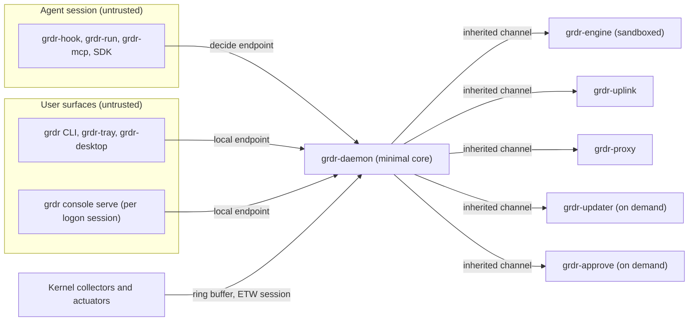
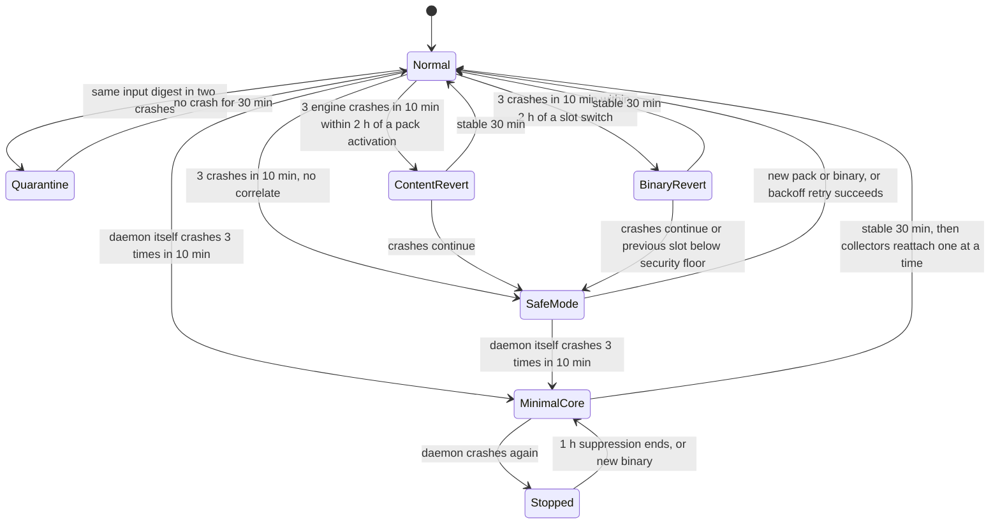

# 11. Endpoint engineering: processes, self-protection, performance, coexistence

_Status: draft 5, against spine version 4, rulings R-03, R-05, R-06 and R-59, the owner's answers (`_review/02-owner-answers.md`) and the owner's instructions of 2026-11-11 (`_review/04-owner-kit-instructions.md`; instruction 15, P15, P16). Owning squad: Endpoint platform (Linux, macOS and Windows sensor squads contribute their OS rows). Trust core under D-63: the daemon, IPC peer authentication, the engine sandbox launcher, the updater, the handover path. Read with: `00-decisions.md`; 03 (component map, crates, `limits.toml`, configuration schema); 04 (envelope, lanes, integrity, capture levels); 07 (decision protocol, shim, install journal, assurance record); 12 (floor tables, bundle activation); 21 (device keys); 22 (uplink protocol, trust roots, rings); 24 (build, signing, packages)._

## Summary

This document fixes how the endpoint programs run on a real machine: which processes exist and how they talk, how the engine is confined, what each process may consume, where state lives, how the device reports health, survives crashes and updates, protects itself, shares the host with an incumbent EDR, stays fast under developer workloads, works offline and comes off cleanly. Key choices:

1. **Children by birth, not by rendezvous.** The daemon spawns the engine, uplink, proxy, updater and approval helper itself (on Windows in the Protected profile it starts the first three as demand-start services, 08 section 2) and hands each a private channel no other process can open. The daemon exposes only three named endpoints (`decide`, `local` and `provider`), and every one is peer-checked by kernel facts in both directions. The loopback listeners of section 14 belong to unprivileged processes.
2. **Credit-based IPC with one unblockable message.** Every channel advertises credit; `Decide` is never credit-blocked: when the engine queue is full the daemon answers from the floor table with `degraded_reason: overload`.
3. **The engine runs in the strongest sandbox each OS gives without a gatekeeper**: namespaces, a dedicated uid, Landlock and a seccomp allow-list on Linux; a dedicated role account and a Seatbelt profile on macOS; on Windows a virtual-account service with a restricted service SID at low integrity (Protected) or a no-capability AppContainer (User), with Win32k, dynamic-code and child-process lockdown in both. It has no network and one writable directory in both profiles.
4. **Budgets are named, measured and enforced by the daemon**, with a soft rung (shed fidelity) before a hard rung (graceful engine restart), and every shed is counted.
5. **One spool, one recorder, one history.** The daemon-owned spool is the only write-ahead log in every shape; in standalone the local history writer, not a server, acknowledges it. Recorder and history are SQLite (D-34); the daemon stamps and chains every record they hold.
6. **A crash-loop ladder whose floor only rises.** Input quarantine, content revert, binary revert and safe mode never remove a fail-closed floor entry: the effective floor is the union of the newer and last-known-good tables. Every long-lived process is supervised and resumes from journalled state, and a fault suite proves each process's declared outcome under kill, stall, disk full, clock jump, partition and corrupt input.
7. **Updates hand over without a gap**: exec-in-place with inherited listeners, inherited open connections and a pre-warmed engine on Linux and macOS; a SYSTEM-owned handover marker the shim honours on Windows (D-14 as amended in spine version 3, R-06).
8. **Self-protection is file ownership plus detection.** In the Protected profile nothing an agent can write affects policy, keys, spool or binaries; against an administrator we detect, record a signed going-down event, and leave kernel-grade resistance to a host EDR (D-22).
9. **The slot broker never takes an exclusive slot** and reports a chosen rung per slot; each release ships a coexistence pack generated from the build and the brand manifest, so white-label rebuilds regenerate theirs.
10. **Performance is a release gate measured three-armed** (absent, Watch, enforce) per incumbent, with interleaved runs and a confidence bound on overhead.

## Requirements

| # | Requirement | Trace |
|---|---|---|
| R1 | Same processes in `user` and `protected`; only accounts differ; exactly these two topologies are tested | D-20, D-48 |
| R2 | No untrusted content parsed in a privileged process; fail-closed classes never wait on the engine | D-20, P5; 03 ARCH-004; brief 37 (Defender content process) |
| R3 | Every local endpoint authenticates peers by kernel handle and executable identity, never by PID; clients verify the server's owner | D-14; SR-01, SR-02; l01 F1 |
| R4 | The engine has no network, no keys, one writable directory, and cannot spawn processes | D-20; 03 section 1; SR-05 |
| R5 | Footprint targets: under 1% of one core idle, under 250 MB resident for all processes excluding the on-demand Rune window, 1 GB disk cap; build overhead under 3% alone, under 2% added per incumbent | Spine section 6; l04 F9 |
| R6 | Every budget breach and every dropped item is counted and visible; "could not look" is distinct from "nothing found" | P9; D-52 |
| R7 | Spool is hash-chained per lane, sheds in 04's order and records gaps; flight recorder keeps full fidelity locally (default 72 hours) and answers signed evidence requests within the capture level | D-52, D-39; 04 sections 2, 10 |
| R8 | Crash-loop ladder never relaxes fail-closed classes, never goes below a signed security floor, quarantines input-correlated crashes, and every step is a server-visible event | D-37; l01 F9; SR-16 |
| R9 | Updates: A/B binary slots with commit after a healthy period, last-known-good per pack channel, handover with zero update-induced denials; update authority `self`, `managed`, `image`; expiry marks Stale and never stops enforcement | D-37, D-15; l04 F3 |
| R10 | Prevent against user-level agents in the Protected profile; detect against administrators; agent configuration, our files and monitoring configuration are protected state for agent lineage; `elevate` is Ask by default and fail-closed from contained sessions | D-22; SR-06 to SR-10, SR-13 |
| R11 | Slot broker probes and degrades (enforce, observe, ingest and delegate); no exclusive slot, no injection, signed native binaries in default paths, no encoded scripts | D-23; brief g05 |
| R12 | Each release ships a generated coexistence pack and ceiling matrix and passes an interference test against Defender, Falcon and one more incumbent (licences other than Defender through design partners or free vendor programmes); no Defender alert on install, run or uninstall | D-23, D-64 |
| R13 | `grdr doctor` reports capabilities, slot owners, hook-fired per agent, network path and overhead; `grdr support-bundle --preview` redacts on the device | D-59; l04 F10 |
| R14 | Install silent, idempotent, offline-capable, no secret on a command line; multi-session hosts served through per-logon-session listeners and refused by any build without them; uninstall restores every changed file byte for byte | D-59, D-48, D-49 |
| R15 | Offline: local decisions continue, spool holds, metadata expiry marks Stale; uplink works through explicit, PAC and authenticating proxies and TLS inspection with each downgrade reported | D-36, P4; l04 F2 |
| R16 | Standalone sends nothing except anonymous update fetches from `updates.sources`, which can be off; a site without internet never resolves a public name | D-48; SR-02; P16 |
| R17 | Dev Drive volumes, slot losses and user-mode ETW spoofing are detected and reported as coverage facts | D-17; brief h02 |
| R18 | Every long-lived process runs under a supervisor and resumes from journalled state; every external call has a timeout, a named retry policy and a circuit breaker; a watchdog covers every blocking wait; no non-test code panics; each process passes the fault suite of section 6 | Owner instruction 15; P9 |

## Design

### 1. Process topology and channels

03 section 4 fixes the process list. This section fixes how they are started and connected.

**Start order.** The service manager starts only `grdr-daemon` (systemd system unit, LaunchDaemon, Windows service; in `user`: systemd user unit, LaunchAgent, a per-user scheduled task at logon). The daemon (1) opens its state directory and checks ownership (section 7), (2) increments the epoch (04), (3) opens the spool, (4) loads the last-known-good floor and fail-safe tables, (5) creates the named endpoints, (6) spawns the engine and waits for `Ready`, (7) attaches collectors through the slot broker (section 9), (8) spawns the uplink and the proxy. Steps 1 to 5 complete before any collector attaches, so a decision can always be answered from the floor.

**Inherited channels.** For each child the daemon creates a connected pair (Unix `socketpair(AF_UNIX, SOCK_SEQPACKET)`; Windows an anonymous duplex pipe passed through `PROC_THREAD_ATTRIBUTE_HANDLE_LIST`, which restricts inheritance to the listed handles) and passes the verified bundle as a second, read-only descriptor (a sealed `memfd` copy on Linux, a read-only file handle elsewhere). On Windows in the Protected profile the engine, uplink and proxy are demand-start services (08 section 2), which cannot inherit a handle: the daemon creates a single-instance pipe (`FILE_FLAG_FIRST_PIPE_INSTANCE`, `PIPE_REJECT_REMOTE_CLIENTS`) whose DACL admits only that service's SID, passes its random name as the service start argument, and accepts only a client whose `GetNamedPipeClientProcessId` is the process it started. No child has a name another process can connect to, so squatting and impersonation of children are impossible by construction. The daemon still holds each child by pidfd, audit token or process handle and confirms the child's executable path and digest against the install journal at `Hello`.

**Named endpoints** (paths as in 07; final names under D-66).

| Endpoint | Clients | Server-owner check by client | Peer check by daemon | Mutations |
|---|---|---|---|---|
| `decide` | shim, `grdr-run`, `grdr-mcp`, SDK, ACS adapter | Protected: socket and directory root-owned or pipe server is the service identity; User: owner equals caller uid | Kernel credentials, held handle, derived process key, session container lookup | None: decisions and reports only |
| `local` | CLI, tray, desktop, `grdr console serve` | Same | Same, plus caller lineage: a caller inside any session container is an agent caller | Proposals only (D-31); agent callers may read their own status and nothing else (SR-04) |
| `provider` | Registered verdict providers | Same | Must match the registration's expected peer identity (07 section 7) | None |

**IPC framing and schema.** All local traffic uses 07's framing (4-byte little-endian length, 2 MiB cap, protobuf body). `grdr.decide.v1alpha1` belongs to 07. This document owns `grdr.local.v1alpha1`:

| Message family | Direction | Key fields |
|---|---|---|
| `Frame` | Both | `request_id`, `deadline_ms`, `credit` (frames the sender will accept), `oneof body` |
| `Hello`, `Ready` | Child to daemon | Role, binary version and digest, boot id, capabilities, sandbox report (section 2) |
| `Heartbeat` | Both, every 1 s | Monotonic counter, queue depths, loss counters, RSS, CPU ms since last beat |
| `EngineForward` | Daemon to engine | Kind (`decide`, `observe`, `report`, `query`, `tick`), opaque bytes, `local` sequence number or request id, deadline |
| `EngineResult` | Engine to daemon | Decision, effects (label projection, expectations, interest-set changes), authored records for the daemon to append (04 writers rule), diagnostics |
| `BundleLoad`, `BundleReport` | Daemon to engine and back | Descriptor index, digest, generation; compile result, self-test result, narrowing check, compiled floor and fail-safe tables as fixed-layout blobs |
| `Snapshot`, `Restore` | Both | Engine `StateSnapshot` (03 section 3) for supervised restart and handover |
| `Status`, `Explain`, `Propose`, `Query`, `Subscribe` | `local` clients to daemon | Status and health conditions; config explain; a proposal that the daemon routes to `grdr-approve`; a history query relayed opaque to the engine; state-change stream |
| `UplinkBatch`, `UplinkAck`, `Staged` | Daemon and uplink | Lane segment references; verified ack ranges (section 12); downloaded artefact staged with its path and digest |
| `Verify`, `Activated` | Daemon and updater | Staged artefact, expected channel and root; result |

The daemon decodes only `Frame` headers and the fixed fields above; payload bytes it does not need stay opaque (ARCH-004).

**Back-pressure.** Credit starts at 64 frames per connection. A sender with no credit queues locally up to its `limits.toml` bound, then drops by class and counts the drop, with three exceptions: `Decide` is never blocked, because the daemon answers it from the floor table when the engine queue is above its high-water mark; the `decision` and `spine` lanes are never dropped by the daemon (only the spool's disk cap sheds `spine`, section 3 and 04); and `Heartbeat` bypasses credit. Under engine overload the daemon stops forwarding R-fidelity observations (04 section 4: repeated and allowed), so neither the recorder nor a roll-up receives them; it counts them per collector and class in fixed-layout counters, writes a `health.coverage` record with reason `engine-overload` when shedding starts, one with cumulative counts every 60 s while it lasts and one when it ends, and raises the `engine-overload` condition. The recorder then holds a counted hole, never a silent one. Kernel ring-buffer overflow is counted per CPU and per collector and shown as loss (P9).

**Supervision.** Restart rules from 03 (engine at 1.3 times its memory budget or after three consecutive deadline misses) plus: a child that misses five heartbeats (5 s) is treated as suspended, killed and restarted, and raises `child-unresponsive`, which catches process freezing of the kind EDR-Freeze performs (brief 37; SR-13). The engine also watches the daemon's heartbeat; on loss it stops evaluating and exits, so a frozen daemon never leaves an engine answering nobody.

**Journalled state and recovery.** Every long-lived process has a supervisor: the service manager for the daemon, the daemon for the children it spawns, and the user session's service manager for the tray and `grdr console serve`. Each process journals its state changes before acting on them (spool positions, pack-store channel pointers, the pending slot commit, the quarantine ring, crash counters, the handover snapshot, the proxy's listener assignment), so a restart resumes rather than repeats. Every blocking wait (a channel read, a lock, a fanotify or ES reply, a child's `Ready`) has a deadline from `limits.toml`, and a watchdog turns a missed one into the condition that names it. Release builds use `panic = "abort"` only for processes whose supervisor restarts them within the restart budget `limits.toml` names for each; since no non-test code has a panic path (03 section 10), a panic that happens is a defect with a regression test.

**First-run scan.** The daemon starts in 24's `scan-only` state, with the same processes as every other state. Existing transcripts are read by the CLI or the console process running as the user, so no privileged process opens a user file and follows its links, and are sent over `local` as opaque bytes that the daemon forwards to the engine unparsed (SR-05). Nothing is written outside our own state directory.

### 2. Engine sandbox per OS

One crate, `grdr-sandbox-engine` (layer 3, trust core), implements the launcher for all three systems; only the daemon calls it. The engine applies nothing itself except the steps marked "self", which run before it reads its first frame. The launcher returns a sandbox report that the engine echoes in `Hello`; any missing element sets the health condition `engine-sandbox-partial` naming it.

| Layer | Linux | macOS | Windows |
|---|---|---|---|
| Identity | Protected: system user `grdr-engine` (24), no login shell, all capabilities dropped. User: caller's uid | Protected: hidden role account `_grdr-engine` created by the pkg (24). User: caller's uid | Protected: demand-start service under the virtual account `NT SERVICE\grdr-engine`, service SID type `restricted`, started by the daemon through the service control manager; it lowers itself to low integrity before its first frame (08 section 2; 24). User: a child of the user daemon with a write-restricted copy of the user's token at low integrity in an AppContainer from profile `grdr.engine` with no capabilities, launched through `PROC_THREAD_ATTRIBUTE_SECURITY_CAPABILITIES`; LPAC where the OS accepts it (spike EN-S3) |
| Network | Protected: new empty network namespace. Both: seccomp denies `socket`, `socketpair`, `connect`, `bind`, `listen`, `accept4` | Seatbelt profile denies `network*` | Protected: persistent WFP block on the engine's service SID (08). User: AppContainer with no network capability; isolation is the documented default (Microsoft, AppContainer isolation) |
| Files | Protected: private mount namespace, read-only root, private tmpfs. Both: Landlock ruleset (best available ABI) allowing read-write on the engine data directory only; probe reports the ABI | Seatbelt `deny default`, read on the engine binary and the system libraries dyld needs, read-write on its data directory (self, `sandbox_init_with_parameters`, as Santa's sandbox command does; Codex instead execs `/usr/bin/sandbox-exec`; both interfaces are undocumented or deprecated, brief 13, so EN-S2 decides) | Data directory ACL grants modify to the engine's service SID (Protected) or AppContainer SID (User); nothing else is granted |
| Processes | `PR_SET_NO_NEW_PRIVS`; seccomp denies `execve`, `execveat`, `ptrace`, `process_vm_*`, `bpf`, `perf_event_open`, `io_uring_*`, `mount`, `unshare`, `setns`, `keyctl`; denied calls kill the process | Seatbelt denies `process-exec`, `process-fork`; hardened runtime with library validation | User, at creation: `PROCESS_CREATION_CHILD_PROCESS_RESTRICTED`. Both, self, before the first frame, through `SetProcessMitigationPolicy`: Win32k system-call disable, extension-point disable, image-load restrictions (no remote, no low label), dynamic-code prohibition and the Microsoft-signed-only image policy, applied after our own statically linked image is mapped; the job's active-process limit of 1 stops child creation in both. Defender's content process runs in an AppContainer with Win32k disabled and signed code only (brief 37); the rest of this set is ours and EN-S3 proves it |
| Resources | cgroup v2 child of the service (`memory.high` at budget, `memory.max` at 1.5 times budget, `pids.max` at the worker count plus two); User: `RLIMIT_AS` at four times budget and daemon RSS polling | Daemon polls `phys_footprint`; `RLIMIT_NOFILE` 64 | Job object: process memory limit 1.5 times budget, active process limit 1, kill on job close, UI restrictions |

Consequences fixed now: YARA-X runs its interpreter in the Windows engine, because prohibiting dynamic code rules out the JIT (03 ARCH-008 already holds the two back ends to identical output). A seccomp kill or job-limit kill is reported as `sandbox-violation`, the in-flight inputs receive a strike (section 6), and the event is a tamper-class finding if it recurs without a code change, because the engine has no legitimate reason to make those calls.

**Desktop window profile (R-59, D-43).** The Rune window (`grdr-desktop`) is launched by the same launcher crate with its own profile: no network, and IPC only to the daemon's `local` endpoint. Linux: seccomp denies every socket family except `AF_UNIX`, and Landlock allows connect only to the `local` socket path plus read-write on its own cache directory. macOS: Seatbelt denies `network*` except the `local` socket path. Windows: an AppContainer from profile `grdr.desktop` with no network capability, and the `local` pipe's DACL admits that AppContainer SID. The window still counts as untrusted (D-20) and may only propose (D-31).

Sandbox conformance (oracle in the test section): a test-only binary `grdr-sandbox-probe`, built from the same launcher code path but never shipped, attempts every denied operation under each configuration and must fail each one, while an observer outside the sandbox (packet capture on the host, file audit) confirms nothing happened.

### 3. Resource budgets and what happens when they are exceeded

Values are targets in `limits.toml` (03), replaced by measured values from S-01 and the I1 and S1 runs of section 10. Every queue, cache, map and recursion depth below also has its bound there, and a full one applies backpressure or sheds with a count instead of growing. The resident-memory rows are 03's split and sum to the spine's 250 MB in steady state; the on-demand updater and approval helper are reported in the peak figure, not the steady-state one (reading 5).

| Item | Budget | Soft rung (above budget) | Hard rung |
|---|---|---|---|
| Daemon resident memory | 40 MB | Shrink process-key cache, stop R-fidelity forwarding with counts (section 1) | At 2 times for 60 s: controlled restart through handover (section 8); never killed by itself mid-decision |
| Engine resident memory | 140 MB | Evict flight-recorder write buffer, pause discovery pass 2 scans, defer detections to batch mode | At 1.3 times: drain, snapshot, restart (03); at 1.5 times: OS kill (cgroup, job) |
| Uplink; proxy; tray and local console together | 20 MB; 30 MB; 20 MB | Shrink buffers | At 1.5 times: restart |
| Updater, approval helper (on demand) | 32 MB each while running | | At 1.5 times: killed; the staged artefact is kept by digest and the step retries under section 8's per-digest backoff, the approval is re-asked |
| CPU, all processes, idle | Under 1% of one core over 10 minutes | Report `budget-exceeded` with the top consumer (`doctor perf`) | |
| CPU, engine sustained | 50% of one core over 60 s outside a declared burst (bundle compile, first-run scan) | Batch observations every 50 ms instead of 10 ms; pause YARA-X scans of non-protected content | 100% of one core for 120 s: restart, count toward the ladder |
| Disk, total | 1 GB | Per-store caps below are maxima and sum above 1 GB on purpose. The daemon's disk controller enforces the total by shedding across stores in this order: logs and crash reports to half their cap; flight-recorder hours beyond 24 h; enrolled history cache to 2 days; then the spool by its own order | Raise `disk-cap`; the spool's `decision` reserve is never used by another store |
| Spool | 512 MB maximum (22 section 2.4), of which 64 MB is reserved for `decision` | Shed `bulk`, then `evidence`, then `spine`, oldest first, each range with a `health.gap` of reason `spool-full` (04, 22) | `decision` is never shed by the device; only an operator-approved `grdr spool purge` frees it (22). With the reserve full the device is `critical`, keeps deciding, holds unwritten non-ALLOW receipts in a 1,000-entry memory ring and counts the rest, the only non-durable receipts in the design |
| Flight recorder | 256 MB, 72 h | Expire oldest early, never below 24 h; `recorder-short` names the hours actually held | |
| Local history | 128 MB standalone, 64 MB enrolled | Apply retention by class early; report | |
| A/B slots, pack store, intel index, staging | 128, 96, 64, 96 MB | The pack store is content-addressed, so `active`, `lkg` and `staged` share unchanged members and intel segments; a download that cannot fit raises `pack-store-full` naming the channel | |
| Logs, crash reports, shim spools | 32 MB, 8 MB, 4 MiB per user | Rotate | |
| Hook latency added | Spine section 6 | Reported per provider (07) | Rollout gate halts (D-37) |

The osquery reference point (200 MB, 10% CPU for 12 s, measured against the whole machine per brief 37's verification) is looser than ours; ours is per core so it does not scale with core count. Battery and metered networks: no periodic full scans; inventory is driven by file-change events; upload scheduling on battery saver follows 22 section 2.2 (`bulk` deferred, the other lanes not); on a metered network `bulk` also waits, up to the same 6 hours.

### 4. Spool, flight recorder and local history

**Spool** (daemon-owned, `grdr-store-local`). Segment format, lanes and shed order are 22 section 2.4 and 04: one directory per lane, append-only 4 MiB segments. Durability: a non-ALLOW receipt is fsynced before the reply (07); other appends group-commit every 100 ms. A segment is deleted only when its whole range is durable: below `durable_through` in an ingest response whose signature verifies through a fleet-certified response key (22 sections 2.3 and 4.4, section 12 here) when enrolled, after the local history writer's commit in standalone. Every gap carries the chain value on each side. At 04's heavy-endpoint estimate of 4 to 13 MB a day for the shipped lanes, a full 512 MB spool holds about 40 to 125 days offline (estimate until S-01).

**Flight recorder** (engine-owned SQLite database `recorder.db`, separate from history, through `grdr-store-local`, as D-34 requires). Rows are the daemon-stamped `local`-lane records with their lane sequence and digest; payloads are zstd-compressed in blocks of up to 64 KiB; each hour is its own table, so expiry drops a table rather than deleting rows. Records are stored at the organisation's capture level (`redacted arguments` by default, 04 section 11), retention 72 hours unless policy says otherwise, capped as above. The daemon is the only writer of the lane's chain (04 section 2); the engine only stores what the daemon stamped. The daemon signs an `audit.checkpoint` of the `local` chain head every 10 minutes and at shutdown, so a recorder the engine dropped or altered fails `grdr audit verify` (this settles 04's risk R3). Look-back upload around a finding: the window and lane are 22 section 2.5 (15 minutes before the first contributing event to 5 minutes after the last, `evidence` lane, inclusion proofs); the device caps one finding's look-back at 8 MiB, uploads it only within 22 section 2.5's evidence credit and records the rest as available on request. Evidence requests are verified by the daemon against the fleet key and 22's `EvidenceRequest` rules and filtered by the capture level; data past retention is answered with a `health.gap` of reason `recorder-expired`.

**Local history** (engine-owned SQLite through `rusqlite`, WAL mode). In standalone it is the store behind the local console and `grdr history`; when enrolled it is a cache of the last seven days. Tables are a projection of the spine and decision lanes plus findings, inventory, grants, labels and health; each row carries its lane, epoch, sequence and event digest, so `grdr audit verify` recomputes the chain against the daemon's signed checkpoints even after the standalone spool segment is gone. Content columns hold only what the capture level allows. Files are owned by the engine account with mode 0600 (on Windows an ACL to the engine's service SID or AppContainer SID) and sit on the default protected-path list. By default there is no application-level encryption, because the engine holds no keys (03). Per-session device-side content keys use the reserved `content_key_ref` column and apply where an organisation requires them (D-57's device counterpart).

### 5. Configuration on the device

03 section 9 owns the schema and layer order; 24 owns the package layout. This section fixes slots, locations of state, protection and endpoint keys.

| Item | Linux | macOS | Windows |
|---|---|---|---|
| Binaries and slots | Default `managed` (deb, rpm): `/usr/bin/grdr`, `/usr/libexec/grdr/`, no slots (24, 22 section 6.6). Under `self`: `/opt/grdr/slots/{a,b}` with a `current` symlink | `/Library/Application Support/grdr/slots/{a,b}` (pkg, `self`); `/Applications/<brand>.app` for the system extensions (tiers 2 and 3, which require Apple's Developer Program, D-18) | `%ProgramFiles%\<brand>\slots\{a,b}` (MSI, `self`) with a `current` pointer file |
| Admin config | `/etc/grdr/config.toml`, `config.d/` | `/Library/Application Support/grdr/config/`; MDM domain in the brand manifest | `C:\ProgramData\grdr\config\`; `HKLM\SOFTWARE\Policies\<brand>` |
| State (epoch, spool, pack store, journal) | `/var/lib/grdr` | `/Library/Application Support/grdr/state` | `C:\ProgramData\grdr\state` |
| Engine data | `/var/lib/grdr-engine` | `/var/db/grdr-engine` | `C:\ProgramData\grdr\engine`, granted to the engine's service SID |
| Runtime endpoints | `/run/grdr` | `/var/run/grdr` | `\\.\pipe\` names from 07 |
| User profile (everything, slots included) | `~/.local/share/grdr/` and the XDG config, state and runtime directories | `~/Library/Application Support/grdr/` | `%LOCALAPPDATA%\grdr\` |
| Status snapshot for unprivileged readers | `/var/lib/grdr/status.pb` | `.../grdr/state/status.pb` | `C:\ProgramData\grdr\state\status.pb` |

The paths in this table are a per-OS table in the configuration schema's defaults (03 section 10), read by every program; none is a literal in code, and `<brand>` comes from the brand manifest. The status snapshot is written by the daemon every 10 s, holds health conditions, versions and counters only (no identifier or content class), and is the one world-readable file in the state directory; `grdr doctor` reads it when the daemon is down. The installer creates every Protected directory with an explicit owner (root, SYSTEM) and a non-inherited ACL, and refuses to install if one already exists with another owner (anti-squatting). The daemon re-checks at every start: owner, mode or DACL, no symlink, no reparse point, no bind link (EDR-Redir used bind links on install folders; brief 37). Endpoint keys in `limits.toml` and the config schema, all tagged `security` (ignored from user layers in Protected, 03): budgets of section 3, `updates.authority` (`self`, `managed`, `image`), `updates.enabled`, `updates.sources` (an ordered list; each entry is `server`, an `https://` or `http://` origin serving 22 section 6.4's layout, or `dir:<path>` for a mounted directory; the default comes from `dist.toml`'s `endpoints`, 26, and is written into the default `install.toml`, never compiled into a binary), `updates.freshness_root` (22 section 6.5), `network.mode` and `network.allow` (24 section 3), `uplink.proxy` (explicit, `pac`, `system`, `none`), `uplink.allow_downgrade` (per rung), `components` (section 9's targeted install), `recorder.hours`. Modes, lists, capture level and `on-sensor-loss` are policy, not configuration, and arrive in packs. An unknown key is ignored and reported, never fatal (03).

### 6. Crash-loop ladder and safe mode

The engine rungs (quarantine to safe mode) and the daemon rungs (minimal core, stopped) are counted separately; a daemon crash moves to minimal core from any engine rung. Fleet rollback is a new signed release (22 section 7.4); the slot revert here is local recovery before that release arrives.

Rules for every rung:

- **Crash attribution.** Before forwarding, the daemon records the digests of in-flight inputs in a fixed ring in its state directory. On an engine crash each in-flight digest gets a strike; two strikes on one digest quarantine it: that input is answered from the floor table and raises the finding `input-quarantined` (l01 F9). A quarantine entry outlives the return to Normal and is cleared after 24 hours or by a new pack or binary. The daemon's own crash counter lives in the state directory and survives restarts.
- **The floor only rises.** On content revert the daemon keeps the fail-closed floor and fail-safe tables of the newer bundle and unions them with last-known-good's; on binary revert the floor tables are kept as data. Reverting removes content-dependent rules, never a deny. The daemon accepts compiled tables only from the fresh compile instance of section 8 step 3, which has read nothing but the verified bundle, never from the serving engine, and signs the fail-safe table with the device-local artefact key (D-14, R-05, 21's key table) before the shim may use it.
- **Security floor.** Binary revert goes only to a slot whose version is at or above the `security_floor` of the current verified binary pack manifest (22). Otherwise the ladder skips to safe mode.
- **Safe mode.** The engine is not started (retries under the `engine-safe-mode` retry policy (15 minutes, 1 hour, then every 4 hours; 03 section 10), or on a new pack or binary). The daemon answers from the floor; the shim's table holds; collectors observe and spool; content-dependent rules are reported not evaluable and follow the pack's loss-of-sensor setting (D-15); the device shows the surface state Safe mode with condition `safe-mode`.
- **Minimal core.** The daemon starts with no kernel collectors (the likeliest cause of a daemon crash), keeps the `decide` endpoint and the floor. A further crash leaves the daemon stopped; the service manager's restart is suppressed by our crash counter for 1 hour; the shim's table and offline spool carry fail-closed classes.
- **Boot-loop guard.** A boot counter is written before any kernel program loads and cleared after 10 minutes of uptime with a `boot-ok` mark. Two unexplained reboots inside that window cause the next start to load no kernel program (Linux), activate no system extension (macOS), load no driver (Windows, where the optional driver is installed), and report it (g05 implication 7).
- **Visibility.** Every transition is a `health.sensor` record on the decision lane with rung, reason and correlated digest, and uploads ahead of other traffic (D-37).

**Fault suite.** Every endpoint process, long-lived (daemon, engine, uplink, proxy, `grdr-infer`, `grdr console serve`, tray) or on demand (updater, approval helper), takes the same six faults in both topologies on every OS: kill; stall (the process stopped, or its I/O blocked past its watchdog); disk full; a clock jump forwards and backwards; a network partition, for processes that have a network; and corrupt input on each of its channels and files. For each process and fault the suite asserts the declared outcome: the supervisor restarts the process within its restart budget or the ladder moves to the stated rung; the process resumes from its journal without repeating a completed step or losing an acknowledged record; the matching condition is raised and recorded; and no decision fails open silently. Every parser has a fuzz target, and S1's soak runs with faults injected at random. The suite runs in `verify`'s full form and in CI (owner instruction 15).

### 7. Self-protection and tamper detection

**Against a user-level agent, Protected profile (prevent).**

| Asset | Mechanism | Strength |
|---|---|---|
| Binaries, slots, pack store, keys, spool, journal, shim, fail-safe table, managed settings we own | Root or SYSTEM ownership, non-inherited ACLs, checks of section 5 | Boundary: the agent's uid cannot write them |
| Service lifetime | System service; Windows service DACL allows stop only to SYSTEM and Administrators; no user-facing stop | Boundary |
| Process memory and signals | Different uid or SYSTEM; hardened runtime on macOS; engine under its own virtual account on Windows | Boundary |
| Local endpoints | Section 1 checks; squatting fails because directories are root-owned and the pipe server identity is checked | Boundary |
| Agent configuration, our files, monitoring and alerting configuration (protected system state for agent lineage) | Essentials Block at hooks (D-53); sensor `config.change` on every watched path; drift in files we own is re-applied (07); Linux kernel deny with kernel enforcement (D-19) | Request at hooks; observed by sensor; boundary on Linux with kernel enforcement |
| `elevate` paths: sudo, pkexec, doas, UAC, container sockets, `systemd-run`, `launchctl`, Task Scheduler, WMI process creation, `grdr-run` | `elevate` action class: Essentials Ask from agent lineage in the Protected profile, Watch in the User profile (D-53); fail-closed from contained sessions (floor table and sandbox) | Request at hooks; scoped boundary in containers |
| Agents' local stores (tokens, MCP secrets, transcripts) against non-agent processes | Protected-path class (SR-12) | Finding on Linux from observation, deny with kernel enforcement (D-19); `control: none` on macOS and Windows without Endpoint Security (tier 3) or the optional driver |
| Approvals and widening | Step-up through `grdr-approve` only; CLI, tray, console and deep links propose (D-31) | G-grade as proven by S-16 |

The admin-capable probe (02 section 3.3) runs at install and each session start; an admin-capable, uncontained agent makes the record say `tamper: user` regardless of profile.

**Against an administrator (detect).**

| Technique | Signal |
|---|---|
| Stop, kill or uninstall the service | Signed going-down record missing before the heartbeat gap; server gap finding (suppressed inside server outages, D-22). With no server, the next start finds no going-down record for the previous run and raises the tamper finding locally |
| Suspend our processes (EDR-Freeze, an elevated technique per brief 37's verification) | Mutual heartbeats between daemon and engine and between daemon and uplink; `child-unresponsive`. A frozen daemon is seen by the shim (table path, coverage-gap finding, 07) and by the server's heartbeat gap |
| Redirect our folders (EDR-Redir bind links, Cloud Files sync roots) | Start-time and hourly check of install and state directories for reparse points, bind links and sync-root registration |
| Block our egress (driverless EDR killers, brief h02) | Uplink failure plus enumeration of local firewall rules naming our binaries or service SID (WFP filter enumeration on Windows, nftables and cgroup programs on Linux); `egress-blocked` condition |
| Unload eBPF, rewrite maps | Programs pinned, maps frozen where supported; enforcement state attested in every heartbeat (h02); Tetragon-style loader-death survival (D-19) |
| Edit managed settings or our config | Config-integrity monitor; journal digest mismatch |
| Restore an old state directory or image | Epoch reappearing with another chain: clone finding (04, D-36) |
| Forge user-mode ETW | Provider identity and payload untrusted; kernel-stamped header PID validated (h02 verification); spike-then-silence alert |

**Going-down and resume.** On shutdown, sleep, update, uninstall and service stop the daemon appends a signed `health.sensor` going-down record (reason, monotonic and boot-time clocks) to the decision lane and flushes it; on resume it records the sleep duration. A gap that begins with a going-down record is not a tamper signal.

**Linux kernel lockdown.** Requires BPF LSM enforcement (D-19, S-12) and leaves the internal ring only after the review D-62 sets for kernel components. With it we add programs that deny, for processes outside our service cgroup, signals to our processes, `ptrace` of them, `bpf` operations on our pinned objects and writes under our paths. They ship in audit mode by default with a signed break-glass token (brief 37), because enforcing them against root is a choice the operator makes, not a default.

**Windows handle protection.** The optional Windows driver adds `ObRegisterCallbacks` handle protection; PPL is reachable only through an MVI embedding partner (D-17). The `tamper` field already carries `platform`. Requires the optional driver and its external preconditions (an EV certificate and Microsoft's hardware programme, through a sponsor or partner, D-17).

### 8. On-device update flow

22 owns the protocol, roots and rings; 24 owns building and signing. Binaries move as part of a tested product bundle, but the device fetches only the artefacts whose digests changed; packs, intelligence, adapter manifests, policy and, within its declared interface range, the eBPF object move on their own channels, each checked against the engine line by `min_engine` and `grdr-compat` (03 section 7). On the device:

1. **Stage.** The uplink fetches the delta or the full target from the first working source in `updates.sources` into `staging/<sha256>` (the only directory it can write), size-capped, resuming an interrupted transfer with HTTP `Range` against the immutable URL and never reading past the length TUF declares, and sends `Staged`. A staged artefact is kept by digest until activated or superseded, so a retry never downloads it twice; a digest that fails verification, self-test or activation is retried after 1 hour, 4 hours, then every 24 hours, or at once when a different digest is offered, each failure an `UpdateReport`.
2. **Verify.** The daemon launches `grdr-updater`, which verifies TUF metadata and the artefact under the right root (project root only for binaries; deployment root for policy and configuration), checks `min_engine`, signer class, generation and the security floor (03 section 4; 12).
3. **Packs.** A verified pack goes to the pack store channel's `staged` slot; a fresh engine instance compiles it and runs self-tests (12); the daemon swaps tables between decisions and moves the old `active` to `lkg`. Four channels each keep `active`, `lkg` and `staged` (D-37).
4. **Binaries (`updates.authority = self`).** The updater writes the inactive slot. The daemon runs the new daemon binary with `--self-test` (load state read-only, open no endpoint, exit), then hands over.
5. **Handover on Linux and macOS.** The daemon spawns the new slot's engine, loads the bundle and waits for `Ready`. It then stops accepting, stops forwarding to the old engine and waits up to 50 ms for in-flight engine results. It snapshots its projection (sessions, labels, grants, expectations, kill and freeze state, spool positions) and, for every open connection, the descriptor number, the peer handle and the ids of requests not yet answered, to a sealed file. It clears close-on-exec on the listening sockets, the open connections and the new engine channel, and `execve`s the new daemon binary. The process id, and so the service manager's tracking, is unchanged; no socket closes, so new connections queue in the kernel backlog and open ones keep their peer credentials. The new daemon restores, re-reads each connection's peer credentials, re-forwards the unanswered requests to the new engine and acknowledges queued `Decide` requests. The old engine's channel was close-on-exec, so it sees end of file and exits (section 1, supervision). Target: exec to first `DecideAck` under 100 ms at p99, inside 07's 250 ms acknowledgement window.
6. **Handover on Windows.** The service is restarted by the service manager. Before stopping, the daemon writes a handover marker (`state/handover`, SYSTEM-owned, holding a deadline 3 s ahead) and its snapshot. A shim whose connect fails reads the marker and keeps retrying until the earlier of the marker deadline and 1,800 ms from its start before taking the table path (D-14: never beyond 2 s; R-06). Outside a marker window the shim keeps 07's single retry inside 250 ms. A forged marker can only add delay; in Protected an agent cannot write it, and in User the record already says `tamper: user`. The new daemon acknowledges before its engine is ready and answers fail-closed classes from the restored floor tables, which include grant digests (12).
7. **Other children.** The uplink and proxy are restarted from the new slot after the new daemon is serving. The proxy's listening socket is passed to its successor through the daemon's channel (`SCM_RIGHTS`; `DuplicateHandle` on Windows), so its port in the agents' settings never changes; the old proxy drains open streams for up to 60 s (target) and exits.
8. **Commit.** The new slot becomes `current` after 30 healthy minutes with at least one decision and no ladder event. Three failed starts of the new slot before commit revert `current` to the old slot (section 6 rules apply). A pending commit survives reboot.
9. **Managed authority.** When MDM or a package manager owns binaries, the updater writes no binaries and A/B slots are absent; package scripts call `grdr-daemon --prepare-handover` before stop (marker and snapshot) and the device reports version skew. On Linux and macOS the `decide` and `local` listeners are held by a systemd socket unit or the launchd `Sockets` key in every authority, so a package-driven restart keeps them open and the marker covers only the restart time. `image` authority performs no binary writes at all. Content and policy flow in all three.
10. **Expiry.** Expired TUF metadata not covered by a valid freshness statement (22 section 6.5), expired certificates or expired bundle validity mark the device Stale and never stop enforcement or renewal (D-37). When enrolled, every expiry is judged against trusted time (22 section 5).
11. **macOS Network Extension replacement.** Replacing an active filter drops every flow (l04 F3), so it waits for reboot, wake or 10 minutes of idle with no remote shell sessions.

### 9. Coexistence slot broker and coexistence pack

**Slot broker.** At start and every hour the broker probes each slot, records owner and outcome, and selects a rung: `enforce`, `observe`, `ingest` (read the incumbent's local telemetry; response delegated through its API by 25), or `none`. The chosen rung per slot is product state in `health.sensor` and the assurance record, never an error.

| Slot | Probe | Rule |
|---|---|---|
| Linux BPF LSM and trampoline hooks | `bpf` in `/sys/kernel/security/lsm`; attach errors; trampoline link count probed at run time (the per-function cap differs by kernel version, g05 verification) | Chain, never detach others; on link exhaustion fall to the next tier of D-19 |
| Linux fanotify permission | Our own init result; other listeners from `/proc/*/fdinfo` | Marks on the protected-path set only; 30 s hold cap; report other owners |
| Linux audit netlink | Socket owner | Never take; read incumbents' output if present |
| Linux cgroup and TCX network programs | Multi-attach results | Attach alongside; never legacy `tc` priorities or nftables redirects |
| macOS Endpoint Security client (requires tier 3, D-18) | `es_new_client` result (`TOO_MANY_CLIENTS`, `NOT_ENTITLED`, `NOT_PERMITTED`) | Mute other security products' processes; full clients never hold |
| macOS content filter (requires tier 2, D-18) | Active filter configurations and grades | Grade `inspector` (09 section 5); DNS proxy, transparent proxy, VPN and PF never by default |
| Windows ETW sessions | Session count against the system limit; existing kernel-provider sessions | One session of our own |
| Windows WFP | Our provider and sublayer; other providers' redirect state at connect-redirect | Hard blocks only in our sublayer; never force a permit; yield to an earlier redirect |
| Windows Security Center, ELAM, PPL | n/a | Never register (keeps Defender active, brief 37) |
| Windows Sysmon | Installed service and channel | Read only; never install, enable or configure (D-17) |
| Windows Dev Drive | Trusted Dev Drive volumes and allowed filters | Report coverage loss for any filter outside the antivirus range (h02) |
| AMSI | Provider registration | Opt-in only (D-17) |
| System proxy, PAC, ZTNA interceptor, TLS inspection | Proxy settings; known inspection CAs in the OS store; issuer of the upstream certificate | Chain or stand down (D-16) |
| Agent managed settings | 07's probe | One owner per agent (D-49) |

**Rules everywhere (D-23).** No injection, no `LD_PRELOAD` or `DYLD_INSERT_LIBRARIES`, no API hooking; signed native binaries in default paths only (every artefact carries a Sigstore signature and provenance; Windows user-mode binaries are Authenticode-signed once Loonaro holds a free open-source signing programme account, D-17, and macOS binaries are Developer ID signed only with Apple's Developer Program, otherwise tier 1 only, D-18; until then the release manifest marks them "not platform-signed", owner instruction 23; ASR rules flag copied or impersonated tools in non-default paths, g05); no encoded or obfuscated scripts; installer custom actions are native code, never PowerShell; the service never spawns shells, WMI or PsExec-style processes.

**Targeted install.** `components = "targeted"` installs the hook broker, shim, managed-configuration writer, discovery passes 1 and 2 and the daemon and engine, and no kernel collectors, ETW kernel session or proxy. The assurance record reports `visibility: claimed` for OS classes. It is a supported configuration beside any EDR (D-23).

**Coexistence pack.** `cargo xtask dist` generates it per release and per brand manifest (D-66), so a rebuilt white-label gets its own: signer identities (Authenticode subject and thumbprint, Apple Team ID where Apple's Developer Program is held, deb and rpm key fingerprints), executable names, paths and digests per OS and architecture, service names, endpoint names, BPF program, map and pin names, ETW session name, WFP provider and sublayer GUIDs, extension bundle ids, loopback listener behaviour (random ports, no fixed port), the uplink's outbound host list (22 section 2.8), and the optional driver's names and altitude. It contains exclusion snippets as templates per incumbent (Defender including per-rule ASR exclusions, Falcon, SentinelOne, Cortex, Elastic, Zscaler, Netskope), allowlisting by signer and process rather than path (Elastic's pattern, g05), and macOS MDM payloads. Exclusions ask the incumbent only not to block our signed binaries; we never ask it to stop watching agents.

**Ceiling matrix.** Generated from conformance results: rows (OS, architecture, agent and version range, incumbent and version) to the reachable assurance record and level per action class, with the blockers. It is published with the release, ships in the signed release metadata the updater reads and in the air-gap bundle, and drives the "effective outcome" text of every Mode control (D-44), which the console reads locally.

### 10. Performance engineering for developer workloads

**Techniques.** Kernel-side filtering by the interest set (agent-lineage tag in task storage inherited at fork, the protected-path set, the destination table), so a build with no agent in its tree costs one map lookup per event; roll-ups of R-fidelity events (D-52, 04); executable hashing once per (device, inode, change time) with a bounded cache; no allocation per event in the daemon (fixed rings); observations batched to the engine every 10 ms or 256 events; the shim is static and caches nothing (07). `grdr doctor perf` attributes our CPU, events per second and drops per collector, initiator executable class and path-prefix class, after Defender's `mdatp diagnostic ebpf-statistics` (g05).

**Measurement method.** Three arms per workload: product absent, installed in Watch, installed enforcing Essentials plus defaults; each arm per incumbent (none, Defender; Falcon and Elastic only through a design partner's licence or image or a free vendor test programme, D-64, and only while one is held). Incumbent licences often restrict benchmarking (g05), so a per-vendor figure is published only where the licence allows; otherwise the report gives the added overhead beside an unnamed licensed EDR. One discarded warm-up and ten measured runs per arm, interleaved across arms to cancel drift, on fixed hardware (a tier B machine, an optional self-hosted runner, D-64; AC power, fixed CPU frequency policy, background services listed). Report median and p95 wall-clock and CPU time, the product's own CPU and memory, and the overhead ratio with a 95% bootstrap interval. The gate compares the interval's upper bound with the target (3% alone, 2% added per incumbent). Results are published per release with conditions (Datadog's format, g05).

| Id | Workload | OS |
|---|---|---|
| W1 | Linux kernel `defconfig` build, all cores (public bar: Tetragon's 1.68% with exec tracking, h02) | Linux |
| W2 | `cargo build --release` of our workspace, clean target, warm registry | All |
| W3 | `npm ci` of a pinned lockfile of about 1,500 packages, warm cache | All |
| W4 | `git status` and `git log -p -1000` on a pinned large repository | All |
| W5 | `pytest -n auto` suite spawning many subprocesses | All |
| W6 | Scripted agent loop through the replay model endpoint (D-45): 500 tool calls producing about 5,000 short processes | All |
| W7 | MSBuild of a pinned solution on NTFS and on a trusted Dev Drive | Windows |
| B1 to B4 | Microbenchmarks: (B1) 10,000 no-op hook calls spawned the way each agent spawns hooks (S-04); (B2) IPC round trip; (B3) floor lookup; (B4) exec storm at 10,000 per second (no host stall over 1 s, loss counted) | All |
| I1 | Idle: 30 minutes, two agents open, no tool calls | All |
| S1 | 72-hour soak with a scripted daily workload; memory slope under 1 MB per hour after warm-up | All |

Microbenchmarks run on every merge on tier A (free hosted CI runners, D-64). W1 to W7 run before each release on a tier B machine when one is available, and gate the release there. W runs on hosted runners are reported but do not gate, because shared runners give no fixed hardware; without a tier B machine the release gate is B1 to B4, I1 and S1, and the report says W1 to W7 did not gate. Workloads whose hardware nobody has (for example W7 on Windows ARM64 with a trusted Dev Drive) are marked "requires hardware" and run when a machine is available.

### 11. Health model, doctor and support bundle

**Health.** Health is a set of conditions, each with a code, severity (`info`, `warn`, `degraded`, `critical`), scope (device, component, collector, agent instance, action class), first-seen time and counters. The device summary is the worst severity mapped to the surface states `Protected`, `Degraded`, `Safe mode`, plus the independent flag `Stale`. Codes live in `grdr-schema/health.toml`, each with its `health.<code>.*` language tokens (D-69), are stable once released, and include: `engine-down`, `engine-restarting`, `engine-sandbox-partial`, `engine-overload`, `deadline-misses`, `safe-mode`, `minimal-core`, `input-quarantined`, `stale-bundle`, `stale-metadata`, `spool-shedding`, `disk-cap`, `recorder-short`, `collector-loss`, `collector-detached`, `slot-unavailable`, `dev-drive-uncovered`, `child-unresponsive`, `sandbox-violation`, `egress-blocked`, `uplink-offline`, `uplink-downgraded`, `clock-jump`, `clock-skew`, `egress-unlisted`, `authenticode-chain-untrusted`, `host-class-unpopulated`, `pack-store-full`, `update-pending`, `handover`, `budget-exceeded`, plus 07's hook states. Every heartbeat carries enforcement state per control point and action class (attached, enforcing, monitor-only) with loss counters (P9, h02); 22 owns the schedule.

**`grdr doctor`.** Unprivileged, read-only, works with the daemon down (it then reads the status snapshot of section 5 and the caller's own shim spools). Sections: install and profile; process tree, sandbox report and budgets; health conditions; collectors and slot rungs (section 9); hooks (07's `doctor hooks`); packs, generations, last-known-good and expiry; update authority and slots; network path (proxy rung, TLS downgrade facts, last successful contact); keys (protection class, never values); disk per store; overhead (`doctor perf`). Output is text or `--json` (schema in `grdr-schema`); exit codes are 23 section 11's: 0 when every condition is `info`, 1 otherwise, with the worst severity in the JSON's `severity` field. Fixes are printed as commands; any that widen go through a proposal (D-31).

**`grdr support-bundle`.** Collects doctor JSON, config explain, health history, metrics, logs (already `LogSafe`), install journal digests, slot reports, and crash reports. Crash reports are symbolised backtraces without memory contents; no memory dump is ever included, because the engine's memory holds content. `--preview` writes the bundle to a local directory and lists every file and field class before anything is packaged; the bundle passes through the capture filter at `metadata` (04), so no content-class field leaves even in a bundle. It leaves only as a file the person writes with `--out` and carries out, or by `--submit --to <origin>` to an origin the person names on the command line; nothing has a default destination (34 section 6).

### 12. Offline and behind proxies: the device side of D-36

Standalone update fetches require nothing; the enrolled uplink requires the server (D-33, D-36). 22 section 2 owns the protocol, lane scheduling, flow control and the network ladder (proxy resolution order, proxy authentication, HTTP/2 then HTTP/1.1, hybrid then classical key exchange, TLS 1.2 only toward an inspecting proxy, push then long-poll, mutual TLS where the path allows). This section fixes only what the device does around it.

- **Offline.** Decisions, grants, approvals by local authenticator and floor tables continue (P4, D-56). The spool holds per section 4 and the device turns Stale only through metadata or certificate expiry, never through being offline. On return the uplink follows 22 section 2.7: `decision` and the last 10 minutes of `spine` first, older backlog within the server's backfill credit.
- **Accounts and proxy credentials.** In Protected the uplink runs as its own low-privilege account and authenticates to a proxy as the machine (22 section 2.8); the logged-on user's proxy credentials are never borrowed. Where a proxy accepts only user credentials, the device reports `uplink-offline` with reason `proxy-auth-user-only`. In User the uplink is the user's process and uses the user's own proxy session.
- **Sticky rungs.** Each move down the ladder is the condition `uplink-downgraded` with the rung facts of 22 section 2.8, and is remembered per network (keyed by gateway address and DNS suffix) for 24 hours so the device does not re-probe a failing rung on every connection.
- **TLS inspection.** Device authentication is an HTTP message signature by the device key (D-36), so it survives re-signing proxies. An inspecting proxy can read but not forge responses, because each response carries a signature bound to the request by a response key the fleet key certifies (22 section 4.4). The spool deletes a range only on a response whose signature verifies through a response key certified by the fleet key pinned at enrolment (22 section 4.4); an unsigned or mis-signed acknowledgement is ignored and raises `uplink-downgraded` with reason `ack-unverified`.
- **Backoff.** The `uplink-reconnect` retry policy of 22 section 2.7 (full-jitter exponential under the server's `Schedule`; `retry_after_ms` is a floor plus jitter; the attempt counter survives an uplink restart; 03 section 10).
- **Timeouts and circuit breakers.** Every call the uplink, updater and proxy make has a timeout and a named retry policy from `limits.toml`, and each destination has a circuit breaker that opens when the policy's failure budget is spent, raises the condition that names the destination, and probes again under the policy's backoff; an open breaker delays sends and never drops a spooled record.
- **Standalone.** The uplink makes only anonymous update fetches from `updates.sources`, in order, carrying no device id; `updates.enabled = false` stops them. A source that fails is retried with backoff and never replaced by a default, so a device on a site without internet never resolves a public name. `grdr egress` prints every destination; CI asserts it (03 C4).

### 13. Install and uninstall

24 builds the MSI, pkg, deb and rpm. The endpoint install contract: silent and idempotent (a second run converges, a run over a newer version refuses); offline-installable from the package alone; no secret on a command line (enrolment material comes from a file or MDM payload and is masked in logs); default paths only; first run changes nothing (D-48); the Protected profile needs one elevation and the User profile none; multi-session hosts are detected by 24's rules and served through per-logon-session policy and listeners; a build without that support refuses such a host with a message (D-59). User-profile endpoint names already include the user SID or uid (07), so the per-logon-session form only adds a session id (24). `grdr join` and `grdr leave` are specified in 22 and 28; on the device, join changes no process, adds the uplink's enrolled state and the deployment root, and leave removes them and keeps local history (24).

Uninstall, in order: (1) authorisation: in Protected a step-up through `grdr-approve` (SR-23); when enrolled, additionally an uninstall authorisation file signed for that device or an MDM context (24). An administrator can still force removal by deleting files, so this is defence in depth, as Elastic describes its own uninstall token (brief 37); forced removal is a tamper finding from the heartbeat gap; (2) a signed going-down record of reason `uninstall` and a final flush attempt; (3) journal replay restoring every changed file byte for byte, removing only our entries where a file changed since (07); (4) unpin and unload kernel programs, remove services and endpoints; (5) delete the device key from its keystore; (6) delete spool, recorder and history unless the person chose an export first (default: delete); (7) write a residue report. CI asserts a zero byte-level diff on an untouched machine (D-48).

### 14. Security of every local listener

| Listener | Process | Bound to | Who may connect | Controls |
|---|---|---|---|---|
| `decide` socket or pipe | daemon | Root-owned directory or pipe with explicit DACL, `PIPE_REJECT_REMOTE_CLIENTS`, first instance flag | Local processes of the device's users | Section 1 and 07 peer checks; 2 MiB frame cap, 1 MiB hook payload cap; idempotency (07) |
| `local` socket or pipe | daemon | Same | Same | Propose-only; agent callers refused for mutations; results scoped to the caller's principal |
| `provider` socket or pipe | daemon | Same | Registered providers only | Peer identity must match the signed registration |
| Local console | `grdr console serve`, one per logon session | Loopback, random port | The person's browser | One-time launch token, Host and Origin checks, no CORS, mutations as proposals, unreachable from session containers where a network boundary exists (SR-03, D-43) |
| OTLP receiver for harness telemetry | `grdr-proxy` in receiver role | Loopback; port chosen at random at install, persisted, written into the agent's managed settings through 07's journalled writer, and re-chosen only when the bind fails | Agents we configured | Expected content type only, any request carrying an `Origin` header refused, per-instance token, kernel peer tagged where available, everything stored as a claim (SR-39) |
| Model listener, MCP broker over HTTP | `grdr-proxy` | Loopback | Agents configured to use it | Destinations from policy only; token per agent instance; SR-38 to SR-40 (17 owns the details) |
| ACS adapter | daemon `decide` endpoint | Socket or pipe only | ACS clients | HMAC envelope, nonce cache, 60 s skew (07) |

No listener binds a non-loopback address; the privileged daemon binds no TCP listener at all; CI enumerates listeners from a running install in each topology and compares them with this table.

## Interfaces and contracts

| Contract | Form | Owner, consumers |
|---|---|---|
| `grdr.local.v1alpha1` | Protobuf, 07's framing | This document; 03, 07, 17, 18, 22 |
| Sandbox report | Protobuf in `Hello`; health condition | This document; 07 assurance record |
| `limits.toml` endpoint keys | TOML, gate configuration | 03 file, values here |
| `grdr-schema/health.toml` | Condition registry | This document; 04 `health.*`, 22 heartbeat, 27 and 28 screens |
| Doctor JSON, support-bundle manifest | JSON schemas in `grdr-schema` | This document; 34 support |
| State directory layout, handover marker, snapshot file | Files, versioned header | This document; 24 package scripts |
| Pack store channels `active`, `lkg`, `staged` | Directories under state | This document; 12 activation, 22 offers |
| Spool truncation on signed responses | 22's response signature and `durable_through` | 22 owns; this document consumes |
| Status snapshot `status.pb` | Protobuf file, world-readable, metadata only | This document; `grdr doctor`, 28 tray |
| Slot report | Protobuf in `health.sensor` | This document; 07, 05 |
| Coexistence pack, ceiling matrix | Release artefacts generated by `xtask dist` | This document; 24 publishes, 34 documents |
| Install journal | 07 owns it (format and hook entries) | This document reads it for the identity checks of section 1, the directory checks of section 5 and uninstall replay; 24 |

## Behaviour by deployment shape

| Aspect | Standalone | Platform (self-hosted and hosted) | Embedded |
|---|---|---|---|
| Processes | Daemon, engine, uplink (update fetches only), updater, approval helper; proxy in receiver role | Same, uplink enrolled | Host owns processes (D-41 L3); our engine as sidecar runs under the host's sandbox; no daemon |
| Spool acknowledgement | Local history writer | Signed server ack | Host |
| Ladder visibility | Local status and console | Server-visible events, rollout gates | Host's own recovery; we export ladder events in the feed |
| Update authority | `self` by default; can be off | Group setting | Host's channel; content relay (D-60) |
| Self-protection | Profile-dependent | Same, plus heartbeat-gap findings and the uninstall authorisation file | Host EDR supplies kernel-grade resistance (D-22) |
| Coexistence | Slot broker | Same; incumbent ingest and delegation through the server (25) | Not applicable: we are inside the incumbent |
| Network | Update fetches from `updates.sources` only | Operator server, or a Loonaro cell where the hosted service's preconditions are met (D-63) | None to Loonaro |

## Extension points

- **Sensor and sandbox back ends** behind `SensorBackend` and `SandboxBackend` (03): a contributor adds a back end in a contrib crate and passes the sandbox conformance suite and probe kit.
- **Slot probes** are a table in `grdr-sensor-*` keyed by slot id; a new incumbent's detection is a data row (process names, signer, service name) in the content repository, not code.
- **Exclusion templates** for a new incumbent are files under `coexistence/templates/<vendor>/` with a golden-output test; generation fills in our identities.
- **Health conditions** are added by RFC to `health.toml` with a code, severity rule and doctor text as language tokens (D-69).
- **Workloads** for the performance harness are declared in `lab/perf/*.toml` (inputs pinned by digest).

## Security and privacy

- Privilege follows the topology: only the daemon and the on-demand updater and approval helper are privileged; none of them parses content beyond the codecs ARCH-004 allows.
- Every listener is in section 14 and enumerated by CI; none is non-loopback; the daemon binds no TCP.
- Local data at rest holds no more than the capture level allows; files are owned by the account that writes them; no keys in the engine.
- Logs are `LogSafe`; support bundles pass the capture filter at `metadata`; no memory dumps.
- The standalone egress contract and isolated mode's allow-list are asserted in CI (03 C4).
- The device never sets kernel lockdown against root by default; it records instead.
- No input hooks, keystroke timing, screen or clipboard capture (D-51); `grdr doctor perf` reports path-prefix classes, never user names.

## Test and evaluation strategy

| Property | Test | Oracle |
|---|---|---|
| Engine confinement | `grdr-sandbox-probe` under each OS and profile attempts network, file, exec, ptrace, io_uring and signal escapes | Each attempt fails; external packet capture and file audit see nothing |
| Peer authentication | Squat each endpoint before the daemon starts; connect as another user; impersonate a child | Shim takes the table path with a tamper marker; daemon refuses; no verdict from a squatter |
| Back-pressure | Flood `Report` and observations while issuing `Decide` | Every `Decide` answered within 2 s; drops counted; no decision-lane loss |
| Budgets | Inflate engine memory and CPU by fault injection | Soft rung, then restart at the stated thresholds; counters match |
| Spool and gaps | Fill disk; kill mid-write; corrupt a segment; feed an acknowledgement through an inspecting proxy that rewrites it | Shed order as section 3 and 04; `decision` never shed; `grdr audit verify` passes across each gap and names it; the rewritten acknowledgement deletes nothing |
| Recorder | Request evidence beyond retention and above capture level | `recorder-expired` gap; filtered output only |
| Crash-loop ladder | Crashing input, crashing pack, crashing binary, crashing collector | Each reaches its rung; the effective floor is a superset of the previous one (set comparison of compiled tables); events visible |
| Recovery | Section 6's fault suite for every process, in both topologies on each OS | The declared outcome per process and fault; resumes from its journal with no repeated step and no lost acknowledged record; zero silent fail-open |
| Handover | 1,000 updates under a hook load of 50 calls per second on each OS, with requests in flight at the moment of exec | Zero table-path denials; zero lost decisions; same pid on Linux and macOS; exec to first `DecideAck` under 100 ms at p99 (target) |
| Self-protection | Agent red team in Protected (S-17) with the user's uid: write our files, stop the service, drive the CLI, squat endpoints | Zero widening and zero writes; detection fires for every admin technique in section 7 |
| Coexistence | Install, run W6, upgrade, uninstall beside Defender, and beside Falcon and Elastic where a design partner or free vendor programme provides the licence (D-64); query each incumbent's alerts afterwards | Zero alerts (the interference oracle of g05); slot rungs match the ceiling matrix |
| Performance | Section 10 | Upper confidence bound inside spine section 6 targets |
| Uninstall | Install and uninstall on clean images and on one with MDM-managed agents | Zero byte diff; residue report empty |
| Listener inventory | Enumerate listening sockets and pipes from a running install | Exactly section 14's set |
| Site without internet (P16) | Steps 10, 12 and 14 of the air-gap conformance run S-31 | Endpoints update from an internal mirror with one mirror down and reject a byte-flipped blob; with freshness statements devices are not Stale, and without them they turn Stale with denials unchanged; support bundles leave only as files written with `--out`; no public name is resolved |

## Work breakdown

| Id | Issue | Acceptance | Requires |
|---|---|---|---|
| **EN-A** | **Topology and IPC** | | |
| EN-A1 | Daemon start order, inherited channels, `Hello`/`Ready`, supervision with heartbeats | Killing or freezing the engine yields floor answers and `child-unresponsive` within 6 s | |
| EN-A2 | `grdr.local.v1alpha1` with credit flow control | Flood test green; `Decide` never blocked | |
| EN-A3 | `decide` and `local` endpoints with two-way owner checks on three OSes | Squat and forged-peer tests of the test table green on each OS | EN-A1; on Windows, S-04 |
| EN-A4 | `scan-only` state with CLI-read transcripts | First-run scan from both package families writes nothing outside our state directory (file-tree snapshot); no privileged process opens a file under a user's home (syscall trace) | |
| **EN-B** | **Engine sandbox** | | |
| EN-B1 | Linux launcher, both profiles | Probe suite green on the x64 kernel matrix | |
| EN-B2 | macOS launcher (Seatbelt) | Probe suite green on macOS 26 and 27 | EN-S2 |
| EN-B3 | Windows launcher (virtual-account service in Protected, AppContainer in User, mitigations, job, private pipe) with YARA-X interpreter | Probe suite green on Windows 11 x64 and ARM64 in both profiles; YARA-X golden vectors identical to the JIT build | S-04; EN-S3 |
| EN-B4 | Desktop window profile (R-59) on three OSes | Probe suite run under the desktop profile: every network attempt fails and the only reachable endpoint is `local` | EN-B1 to EN-B3; the Rune desktop app (D-43, S-19) |
| **EN-C** | **Budgets**: `limits.toml` keys, soft and hard rungs, disk controller, `budget-exceeded` | Injected memory, CPU and disk pressure trips each rung within 10% of its configured threshold; disk controller sheds in section 3's order; counters match | |
| **EN-D** | **Stores** | | |
| EN-D1 | Spool segments, group commit, shed order, `decision` reserve, gaps | Disk-fill, kill-mid-write and rewritten-acknowledgement tests green | |
| EN-D2 | Local history and `grdr audit verify` against the chain | A tampered, deleted or reordered row is detected after the spool segment is gone | |
| EN-D3 | Flight recorder in SQLite, checkpoints, look-back and evidence requests | Evidence beyond retention yields a `recorder-expired` gap; output never exceeds the capture level; an engine that drops recorder rows fails verification | |
| **EN-E** | **Configuration**: locations, directory checks, status snapshot, endpoint keys | Pre-created hostile directory, symlink or reparse point makes install refuse and start fail; status snapshot contains no identifier or content field (field-registry check) | |
| **EN-F** | **Health, doctor, support bundle** | | |
| EN-F1 | `health.toml`, heartbeat enforcement state | Every condition reachable by a fault test | |
| EN-F2 | `grdr doctor` with JSON and exit codes; works with daemon down | Golden output per fault | |
| EN-F3 | `grdr support-bundle --preview` | Seeded secrets and content absent from the bundle | |
| **EN-G** | **Crash-loop ladder**: rungs, union floor, boot-loop guard | Each injected fault of the test table reaches its rung at the stated counts; the compiled floor after every transition is a superset of the one before; two injected early reboots make the next start load no kernel program; every transition is a `health.sensor` record | |
| **EN-H** | **Updates** | | |
| EN-H1 | Pack store channels, activation, last-known-good | Bad pack keeps last-known-good and reports | |
| EN-H2 | A/B slots, self-test, commit and revert | Three failed starts revert | |
| EN-H3 | Exec handover with inherited connections (Linux, macOS); marker handover (Windows); proxy listener passing | Handover test of the test table green; Windows measured against EN-S1 | EN-A1; EN-H2 |
| EN-H4 | `managed` and `image` authority; `--prepare-handover` in package scripts | Package upgrade under load: zero denials | EN-H3 |
| EN-H5 | Ring participation and gate metrics from the device | Gates halt a seeded regression | The server's rollout rings (D-37) |
| **EN-I** | **Self-protection** | | |
| EN-I1 | Ownership, service DACLs, going-down records | In Protected, S-17 runs with the user's uid that write our files, stop the service or squat endpoints produce zero writes, zero stops and zero widening on each OS; every shutdown, sleep and update leaves a signed going-down record | |
| EN-I2 | Windows liveness, bind-link, sync-root and WFP filter checks | EDR-Freeze-style suspension, a bind link and a sync-root registration on the install folder, and a WFP block on our binaries each raise their signal within 60 s (TM-21) | |
| EN-I3 | Linux BPF lockdown in audit mode with break-glass | On the x64 kernel matrix, signal, ptrace, bpf and write attempts from outside our cgroup are audited by default and denied in enforce mode; the break-glass token disables enforce; 72-hour soak with no panic; before leaving the internal ring, the kernel review of D-62 by `eval-security` and `eval-adversarial` on different models, plus any free external audit that arrives (D-63) | Linux kernel enforcement (D-19, S-12) |
| **EN-J** | **Coexistence** | | |
| EN-J1 | Slot broker probes and rungs per OS | On lab images with and without each available incumbent, the rung reported per slot in doctor and heartbeat equals the expected rung, and no probe detaches or replaces another product's attachment | |
| EN-J2 | Targeted install | Beside Defender, the D-45 hook-enforcement scenarios pass with no kernel collector, ETW kernel session or proxy running, and the assurance record says `visibility: claimed` for OS classes | |
| EN-J3 | Coexistence pack and ceiling matrix generation | Regenerating for a test brand manifest with different signers changes every identity field and no template; golden-output tests per incumbent template green | |
| EN-J4 | Interference gate (Defender; Falcon and Elastic through a design partner's licence or image or a free vendor test programme, D-64) | Zero alerts and zero blocks in each incumbent's console on install, W6, upgrade and uninstall; an incumbent whose licence is not held blocks broad release (D-23) | EN-J1; for Falcon and Elastic, a licence through a design partner or free vendor programme |
| **EN-K** | **Performance**: harness W1 to W7, B1 to B4, I1, S1 | B1 to B4 gate every merge; the release gate fails when a 95% upper bound exceeds spine section 6; W1 to W7 gate only on a tier B machine; the per-release report lists hardware, conditions and every arm | |
| **EN-L** | **Uplink device side**: accounts, sticky rungs, signed-response spool truncation | S-18 topologies pass; a rewritten acknowledgement deletes nothing | Standalone fetches: none. Enrolled side: the server (D-33, D-36) |
| **EN-M** | **Install and uninstall**: contract of section 13, multi-session refusal | Zero byte diff on an untouched machine; residue report empty; refusal with nothing written on a multi-session host by a build without per-logon-session listeners | |
| **EN-N** | **Listeners**: OTLP receiver role, inventory test | Enumerated sockets and pipes equal section 14 in both topologies; a request with an `Origin` header is refused | |
| **EN-O** | **Recovery**: journalled state, watchdogs, restart budgets, circuit breakers, the fault suite | Every process and fault of section 6's suite reaches its declared outcome on each OS; a kill at each journalled step resumes without repeating it | EN-A1, EN-G |

## Risks, open questions and spikes

| Item | Risk or question | Settled by |
|---|---|---|
| EN-S1 Windows handover gap | Service restart to first acknowledgement may exceed the marker window under Defender scanning | Measure on Windows 11 x64 and ARM64 with Defender and one EDR (its licence through a design partner or free vendor programme, D-64); pass: under 1 s at p99. Fail: keep the old service alive as a short-lived broker during restart, a trust-core change that two independent evaluators on different models review (D-63) |
| EN-S2 macOS engine sandbox | SBPL is undocumented and `sandbox-exec` deprecated (brief 13) | Build the profile, run the probe suite on macOS 26 and 27; fail: App Sandbox entitlement on the engine helper |
| EN-S3 LPAC and mitigation set | Some mitigations or LPAC may break the engine on older Windows 11 builds | Probe matrix on supported builds; fall back to AppContainer without LPAC and report |
| EN-S4 Budget fit | 250 MB across all processes with real workloads is unmeasured | S-01 plus I1 and S1 |
| Kernel trampoline exhaustion | Other vendors' programs consume link slots | Run-time probe; next tier of D-19 |
| Compiled-table authenticity | Who signs the device-compiled floor and fail-safe tables | Settled by R-05: the privileged service compiles on the device and signs with the device-local artefact key (21's key table) |
| Handover state compatibility | Snapshot format across versions | Snapshot carries a version; a new daemon that cannot read it restarts cold and counts table decisions |

## Deviations from the spine and objections

**Objection 1, to D-14 and 07's "update in progress" row.** D-14 has the shim decide from its table when the daemon does not acknowledge within 250 ms. A Windows service restart cannot meet that, so D-15's zero update-induced denials would fail on Windows. Inside a SYSTEM-owned handover marker window only, the shim keeps retrying up to 1,800 ms from its start, still inside D-14's 2-second bound. Proposal: amend D-14 to "250 ms, or until a valid handover marker's deadline, never beyond 2 s", and 07's row to match. If EN-S1 shows the old service can stay alive as a short-lived broker, the marker is removed. Resolved by R-06 (spine v3 D-14 adopts the amendment).

Readings recorded so they can be overruled:

1. The OTLP loopback receiver (04 section 14, SR-39) runs as a receiver role of `grdr-proxy`, so that program is present in every endpoint install, in the receiver role even where no other proxy function is configured; no other proxy function changes.
2. Pack verification stays in `grdr-updater` as 03 assigns; where 12 says "the core verifies signatures", this document follows 03. Resolved by R-04 (the updater verifies; the daemon checks each pack's digest against the updater's signed index).
3. D-52's 72-hour recorder default yields to the 1 GB disk cap: when the cap binds first, the device reports `recorder-short` with the hours held.
4. D-15's "zero update-induced denials" is met by design on Linux and macOS and is a measured target on Windows until EN-S1 passes.
5. The spine's 250 MB footprint is read as steady state: the on-demand updater and approval helper are reported in the peak, and the Rune desktop app is measured by S-19, not inside this budget. The Rune exclusion is resolved in spine v3 (section 6 footprint row); the updater and approval-helper peak reading stays open.
6. D-42 and D-43 say the daemon serves the local console; this document follows 03's reading (a per-logon-session `grdr console serve`), so the privileged daemon binds no TCP listener. Resolved by R-03 (spine v3 D-42, D-43).

## Sources

Research briefs: `37-sensor-engineering.md`, `g05-edr-coexistence-testlab.md`, `23-schemas-transport.md`, `25-deployment.md`, `10-oss-sensor-blocks.md`, `29-rune.md`, `24-platform-architecture.md`, `h02-conference-talks-sensors.md`, `12-windows.md`, `13-macos.md`, `14-linux.md`. Review notes: `c3`, `l01`, `l04`, `l06`. Design: 00, 02, 03, 04, 07, 12, 22, 24, 28.

Primary sources checked for this document: Microsoft, AppContainer isolation, https://learn.microsoft.com/en-us/windows/win32/secauthz/appcontainer-isolation (network isolation by default, 2025-07-08); Microsoft, UpdateProcThreadAttribute, https://learn.microsoft.com/en-us/windows/win32/api/processthreadsapi/nf-processthreadsapi-updateprocthreadattribute (handle list, AppContainer security capabilities, mitigation and child-process policy constants). Other OS facts (exec preserving process id and inherited descriptors, seccomp and Landlock semantics) are proven by the sandbox and handover tests rather than taken on trust.
