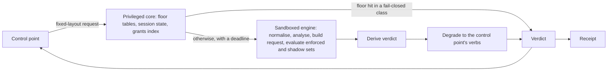
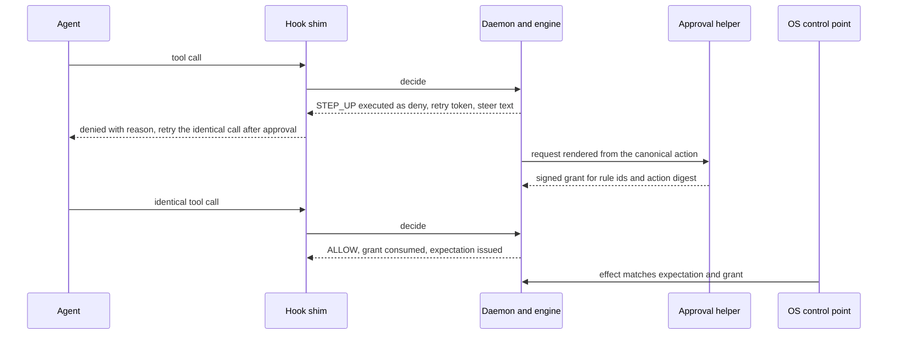

# 12. Policy engine

_Status: draft for implementation. Revised 2026-11-11 for principles P15 to P17 and the owner's kit instructions (`_review/04-owner-kit-instructions.md`). Owning squad: `core` (SQ-01). Specifies D-07 to D-12, D-31 (the grant model) and D-53. Read with `00-decisions.md` (the spine); 04 (data classes, receipts); 06 (attribution evidence); 07 (the verdict interface at control points); 11 and 22 (pack delivery, trust roots, rings); 13 (detections); 16 (labels and sinks); 17 (MCP broker); 18 (approval flow and grades); 21 (keys); 23 (API); 27 and 28 (screens)._

## Summary

The policy engine turns a normalised action plus session state into one of five verdicts, on the device, from signed data. It lives in `grdr-policy`, with the schema in `grdr-schema`, analysers in `grdr-analyze`, session state in `grdr-session` and precompiled tables in `grdr-fastpath`. It does no I/O (D-05, P5), so the same code decides in the sensor, the proxy, server replay and another vendor's product.

Key choices:

1. **Cedar 4.x is the only enforced language, and every pack outside the base pack is forbid-only.** `permit` exists only in the built-in base pack. Every layer can then only add denials, so "any layer's deny wins" (D-11) is Cedar's own forbid-overrides.
2. **A fixed schema with open class sets.** Fifteen actions, twelve resource types. What a rule needs to know about a path, host, command or MCP argument arrives as class names computed by analysers whose vocabularies are signed pack data (D-08).
3. **Mode is a compile step.** Off drops a rule, Watch puts it in a shadow set, Ask and Block put it in the enforced set, tagged with its mode, as `forbid ... unless` a grant lifts it. One normative table derives the five verdicts.
4. **Ask never uses the agent's own prompt.** `STEP_UP` is a denial with a retry token; an approval mints a signed, exact, single-use grant; the retry passes because the grant is evidence in the request context (D-07, D-31).
5. **Enforcing labels live in a linearised session state.** Each decision reads a snapshot whose sequence number is in the receipt; an allowed action sets its labels in the same critical section (D-09).
6. **Two evaluators, one meaning.** The privileged core answers fail-closed classes from fixed-layout floor tables; the sandboxed engine runs full Cedar over parsed content (D-20). Enumeration and differential fuzzing test that they agree.
7. **The device compiles its own effective policy** from signed layers and packs with the compiler the server uses, and refuses a non-narrowing change that lacks the organisation's signature.
8. **Nothing leaves Watch without replay**, and Essentials enforces from first protection (D-53).
9. **One representation**: a pack directory of Cedar text, lists and settings. Simple, Advanced and Code are views of it. Natural-language authoring can only add a Watch-mode forbid.

## Requirements

| # | Requirement | Source |
|---|---|---|
| R1 | Decide locally from signed, cached data; a server outage changes nothing | P4, D-56 |
| R2 | Five verdicts plus obligations; control points declare their verbs; degradation is predictable | D-07 |
| R3 | No allow, grant or lifting of a forbid depends on a model | P2, c2 F4 |
| R4 | A label policy reads is visible to the next decision in that session; replay is exact | D-09, c2 F2 |
| R5 | Ceilings hold by construction across layers; operator-signed artefacts can only narrow | D-11, D-31 |
| R6 | Evaluation p99 under 1 ms at 1,000 policies including request construction | Spine section 6, S-15 |
| R7 | Fail-closed classes are decided when the engine or the daemon is down | D-14, D-15, D-20 |
| R8 | A default install enforces something useful and nothing noisy | D-53; brief 02 (allow-by-default) |
| R9 | Exceptions are scoped to an action digest or pattern, expire and are revocable | D-31; brief 02 weak point 7 |
| R10 | Subjects richer than "any AI agent": agent, instance, session, depth, group, attribution, assurance | Brief 02 implication 5, D-25 |
| R11 | Simple enough for a casual user, full control for a professional | Owner request, D-11, brief 33 |
| R12 | Only sound constructs compile to native agent settings | D-12, c2 F6 |
| R13 | The decision point is callable through AuthZEN 1.0 | D-27, D-33, D-40 |
| R14 | Evaluator semantics are trust core: reference model, differential tests | D-63, D-10 |
| R15 | A pack introduces no command, executable path, URL to fetch, environment variable to set or MCP server to start, and declares what it reads; host patterns, environment variable names and path templates are allowed as typed match fields | P7 |

## Design

### 1. Component and data flow



The shim holds a third, smaller copy of the fail-closed rules (the fail-safe table, D-14) for when the daemon is silent for 250 ms, or past the deadline in a valid update-handover marker (never beyond 2 seconds). The privileged service compiles that table on the device and signs it with a device-local artefact key (21's key table).

### 2. Cedar schema

Namespace `Grdr`, Cedar 4.14.x (language 4.6) pinned; an upgrade is a trust-core change. The schema is frozen together with the wire format. The schema file is `grdr-schema/policy/v1alpha1.cedarschema` and changes by RFC (D-61). Cedar has no regex, path type or set quantifier (brief 20), so the schema carries classes, not raw strings.

**Principals.** `Session` when `actor_kind` is agent, which requires the catalogue entry's `min_attribution_grade` (2 in shared hosts); otherwise `Process` (a human, system or undetermined actor). Below that grade the actor is `undetermined` and each rule class states its handling (R-07). Agent versus human is the principal type. A `Session` is in its `AgentInstance`, which is in its `Agent`, `Device` and `Group`, so `principal in Grdr::Agent::"claude-code"` or `principal in Grdr::Group::"platform"` scopes a rule to an agent type or a group.

| Entity | Parents | Attributes |
|---|---|---|
| `Organisation`, `Group` | `Group` in `Group` or `Organisation` | none |
| `Device` | `Group` | `os`, `profile` (`user`, `protected`) |
| `Agent` | none | `tier` (A, B, C, bespoke), `classes` |
| `AgentInstance` | `Agent`, `Device`, `Group` | none |
| `Session` | parent `Session`, `AgentInstance` | `depth: Long`, `contained: Bool`, `containment`, `classes` |
| `Process` | `Device` | `actor_kind` (`human`, `undetermined`, `system`), `agent_capable_host: Bool`, `classes` |

No entity carries a human pseudonym, so a rule cannot target a person (P8, D-51).

**Actions and resources.** Action ids are the spine's action classes verbatim, for example `Grdr::Action::"file.write"`, with groups `"file"`, `"net"`, `"mcp"`, `"any"`. Every resource type has `classes: Set<String>`.

| Action | Resource | Extra attributes and context |
|---|---|---|
| `exec` | `Executable` | `context.command: { classes }`. An unresolved command sets the fact `exec.opaque` and marks `context.command.classes` absent (D-10) |
| `file.read`, `file.write`, `file.delete` | `Path` (`in_workspace: Bool`) | `context.recursive: Bool` |
| `net.connect` | `Endpoint` (`port`) | none |
| `net.request` | `Endpoint` | `context.http: { classes }`, `context.cloud: { provider, account_classes, tenant_classes, verified: Bool }` |
| `llm.request` | `ModelEndpoint` (`provider`) | `context.tenant: { classes, verified: Bool }` |
| `mcp.connect` | `McpServer` (`transport`, `identity_pinned: Bool`) | none |
| `mcp.call` | `McpTool` in `McpServer` (`manifest_pinned: Bool`, `write_capable: Bool`) | `context.args: { classes, extracted: Bool }` |
| `cred.use` | `Credential` | `context.mode` (`inject`, `release`) |
| `agent.spawn` | `Agent` | `context.child: { depth: Long, contained: Bool, classes }` |
| `config.change` | `ConfigTarget` | `context.change_classes` |
| `elevate` | `ElevationRoute` | none |
| `ui.act` | `UiTarget` | none |
| `data.flow` | `Sink` | `context.source_labels` |

The engine derives a `data.flow` request whenever the analysers place a concrete action in a default sink class (D-28): `egress-outside-profile`, `push-outside-org`, `pkg.publish`, `message.send`, `mcp-unpinned-write`, `llm-non-tenant`. It is evaluated in the same decision as the concrete action, both must pass, and the receipt names both. A caller can neither raise nor suppress it.

Context records are always present. A field the control point cannot supply takes its neutral value (empty set, `false`) and is listed in the request's `absent` set, or in `pending` if the core expects it within a bound; section 4 uses both. `verified: false` marks a cloud account or model tenant that could not be established, for example without plaintext (D-16).

**Common context** on every action:

| Field | Meaning |
|---|---|
| `session.labels: Set<String>` | Enforcing labels only; advisory labels are absent (D-09). Empty for a `Process` principal. The monitor maintains the roll-ups `untrusted` and `sensitive` so rules need no prefix match |
| `session.label_epoch: Long` | Incremented on each label escalation |
| `grants: Set<String>` | Rule ids lifted by a valid grant matching this action (section 6) |
| `attribution: { grade: Long, actor_kind, evidence: Set<String> }` | Grade 0 to 4 and its evidence set, with 04 section 9's values (D-25) |
| `assurance: { visibility, control, tamper: Long, fail_closed: Bool }` | The assurance record for this device, instance and action class, as ranks: control is none 0, request 1, scoped-boundary 2, mandatory-boundary 3; visibility 0 to 3; tamper 0 to 2; `fail_closed` is `on_failure: closed`. Policy never reads the AL label |
| `facts: Set<String>` | Deterministic analyser facts not tied to the resource, such as `exec.opaque`, `flag.bypass-permissions`. Heuristic and model results never enter the request (P2) |
| `control_point: String` | Which control point asked |

There is no clock in context. Time lives in grant expiry and label decay, which keeps evaluation cacheable and replay exact. A reserved `schedule` field is the seam for time-of-day rules.

**Analysers.** `grdr-analyze` has five engines: path classifier, host classifier, command classifier over canonical argv, MCP argument extractor keyed by tool-manifest hash, and cloud-request classifier (AWS account from the request signature, Entra tenant from a verified token, GCP project header; brief 02). Their vocabularies are pack lists. A list has a type, a class name such as `cred-store` or `org.mcp-approved`, and a polarity, `protect` or `allow`. A reference is protective when it is positive in `when` or negated in `unless`, and permissive when it is positive in `unless` or negated in `when`. Lint rejects a reference that contradicts the list's polarity, which is what makes growing a `protect` list and shrinking an `allow` list always narrowing. Lint allows `like` only on identifier fields of at most 64 characters. Intelligence adds the list types `package-key`, `artefact-key` and `host`, `protect` polarity only, marked `managed_by: feed`; their entries come from the signed intel pack and their semantics are 14's (sections 1 and 5).

### 3. Rules, modes and how they compile

A rule is one Cedar `forbid` with annotations: `@id` (unique across packs; the validator requires the pack's prefix), `@class` (rule class), `@max_mode` (default Block), `@approver` (`self`, `sponsor`, `admin`, `quorum`; default `self`), `@min_grade`, `@on_loss`, `@final`, `@message` (for the person: the English source of a language token translated in the pack's `messages/<locale>.mf2.toml`, D-69), `@steer` (for the agent: an English `agent`-domain message, never translated), `@remedy`, `@obligation`, `@intent`, `@status` (`draft` until a replay is attached, section 11). Annotation text is inert: length-capped, no URLs, never executed (P7).

The rule class sets two defaults, each of which a rule may only raise.

| Rule class | Covers | Minimum approval grade | On loss of sensor |
|---|---|---|---|
| `routine` | Reversible actions inside the workspace | G0 | allow |
| `out-of-boundary` | Actions outside the workspace, the egress profile or an allow-list | G1 | allow |
| `secret` | Credential stores, keys, tokens | G1 | allow; the honeytoken rule sets `@on_loss("block")` |
| `elevate` | The `elevate` action class | G1 | allow; block from a contained session (D-22) |
| `irreversible` | Destructive or externally visible actions | G1 | allow |
| `config-tamper` | Control files, bypass flags, weaker child settings | G2 | block |

A rule is *fail-closed* on a device when its loss-of-sensor behaviour resolves to block: by the default above, by `@on_loss("block")`, or because the pack or group sets `on-sensor-loss: block` (D-15), which covers every enforced rule in the pack. "Fail-closed classes" in this document means these rules. Ask rules default to allow because a denial with no daemon has no approver (D-44); document 07 gives the same table from the shim's side. At an OS control point fail-closed applies only to processes inside session containers (D-15).

**Undetermined actors (D-25).** A rule scoped to `Session` does not apply to a `Process` principal; that is the default for classes where a person doing the same thing is normal. Rules on resources only agents use (MCP servers, model endpoints, brokered credentials, honeytokens) leave the principal unscoped. For `config-tamper` and `secret`, packs add a second rule for an undetermined `Process` in an agent-capable host (policy 16), capped at Ask so that a person editing their own settings is never blocked.

The pack-level Mode control sets M; each rule runs at `min(M, max_mode)`. That is how Essentials holds Block and Ask rules under one switch. A layer may override one rule's mode up to its `max_mode`; going further means forking the rule into the organisation's own pack.

| Mode | Compiled into | Effect |
|---|---|---|
| Off | Nothing | None |
| Watch | Shadow set, as written | A policy-violation finding with the would-be verdict; never changes a verdict |
| Ask | Enforced set, tagged `@mode("Ask")`, with `unless { context.grants.contains("<id>") }` appended | `STEP_UP`; lifted by an Approval from the rule's approver at or above its minimum grade |
| Block | Enforced set, tagged `@mode("Block")`, with the same clause unless `@final("true")` | `DENY`. A non-final rule is lifted only by an Exception: a grant whose approver is not `self`, at the rule's minimum grade and never below G1. A final rule has no grant clause; its only route is a mode change, which is a widening step-up (D-31) |

```cedar
// source (pack grdr.essentials)
@id("essentials.cred-store.read") @class("secret") @max_mode("Ask") @approver("self") @min_grade("G1")
@message("Reading credential stores and private keys needs your approval.")
@steer("If you need a token, use the configured credential helper or ask the user.")
forbid (principal is Grdr::Session, action == Grdr::Action::"file.read", resource)
when { resource.classes.containsAny(["cred-store", "private-key"]) };

// compiled at Ask in layer "local"; the other annotations are carried over
@id("local/grdr.essentials@1.0.0/essentials.cred-store.read") @mode("Ask")
forbid (principal is Grdr::Session, action == Grdr::Action::"file.read", resource)
when { resource.classes.containsAny(["cred-store", "private-key"]) }
unless { context.grants.contains("essentials.cred-store.read") };
```

The instance id adds the layer and pack version for receipts. Grants bind to the rule id, so an Exception survives a pack update that keeps the rule.

Where a device cannot offer a rule's minimum approval grade, the compiler marks the rule not self-liftable there: Ask behaves as Block (D-31) and the message names the route to an Exception, never a dead end (D-44). The one exception is the user's own local policy in the user profile, where a disclosed time lock (default 10 minutes) stands in for G1 (D-31).

### 4. Verdict derivation and degradation

The engine evaluates the enforced set with `cedar-policy`'s authoriser and applies this table in order. An enforced rule for the request's action is *pending* when its computed read set (section 7, step 7) meets the request's `pending` set (session binding, an MCP manifest pin, a content hash still being computed), and *not evaluable* when it meets the `absent` set.

| # | Condition | Verdict |
|---|---|---|
| 1 | A normaliser returned `malformed` | `DENY` (D-10) |
| 2 | Any forbid policy errored during evaluation | `DENY`, reason `policy-error`, plus a finding. Cedar skips errored policies and "a skipped forbid blocks nothing" (brief 07, verification row 9); we invert that |
| 3 | Every determining forbid carries `@remedy("modify:<transform>")` and the control point can apply the transform | `MODIFY`; the transformed request is evaluated again, at most twice, after which this row is skipped |
| 4 | A determining forbid runs at Block, or at Ask where the device cannot offer its minimum grade | `DENY`; the reason names the route to an Exception or a mode change (D-44) |
| 5 | Every determining forbid runs at Ask | `STEP_UP` with the union of rule ids and the highest minimum grade |
| 6 | No forbid is satisfied and a rule is pending | `DEFER`: no approval request; the caller holds or retries after `retry_after_ms`. Unresolved at the caller's deadline it becomes `DENY` (AARM R4; brief 34) |
| 7 | No forbid is satisfied, but a rule is not evaluable and no grant lifts it | Where a control point at scoped-boundary or above covers the action class for this session: `ALLOW` with `expect`, and that control point judges the effect (D-10, D-13). Elsewhere: `STEP_UP` on that rule if it is fail-closed; otherwise `ALLOW` with the rule id in `not_evaluable` and one coverage-gap finding per session and rule |
| 8 | No forbid is satisfied and the base permit matches | `ALLOW` with obligations |
| 9 | Nothing matches | `DENY`, `default-deny` (unreachable while the base pack is intact) |

The shadow set is evaluated on the same request and contributes only findings. When an adapter reports an unrecognised harness version, that agent's hook requests are evaluated against the shadow set only and the agent is reported as dropped to Watch (D-10).

Each control point declares `ControlPointCaps { verbs, can_hold, hold_deadline_ms, fails_closed, obligations }` (wire form in document 07). `degrade(verdict, caps)` is total, and never less restrictive at a control point that can deny. `STEP_UP` is executed as a denial with a retry token; a hold replaces it only where `can_hold` is true, the deadline is known and failure is closed, for at most 80% of the timeout and 30 seconds on Linux file holds (D-07). `DEFER` is a hold under the same conditions and otherwise a denial with `retry_after_ms`. An observe-only control point executes nothing: the verdict is recorded as would-be with a coverage-gap finding, and the assurance record carries `control: none` for that class. The receipt records the decided and the executed verb.

**Obligations** are a closed enum set by `@obligation` or by the engine: `receipt` (every decision is recorded; document 04 says which records are signed), `expect` (issue the expectation to the OS control point), `snapshot` (copy-on-first-write before a write or delete, D-28), `pin-recorder`, `notify-user`, `notify-sponsor`. `snapshot` is a must-obligation: where the control point's capabilities do not list it, the engine answers `DENY` with reason `obligation-unmet` instead of `ALLOW`, so safety never rests on a host honouring advice. The engine issues `expect` only where an OS control point is attached for the class. `@message`, `@steer` and `@remedy` are hints; a control point that ignores one executes a plain deny (brief 20, layer 2).

**Transforms** named by `@remedy("modify:...")` are a closed enum in code; a pack can name one and never define one (P7). `redact-secrets` replaces detected secret spans in a request body or tool argument (hook and proxy). `wrap-launcher` rewrites an exec to run under `grdr-run` (D-17). `swap-credential` replaces a static secret with a brokered one (D-27; requires the credential broker).

### 5. Worked policies

Source form. Policies 1 to 4 are Essentials; the rest ship in Watch, and the cloud templates of policy 13 ship Off.

```cedar
// 1. Protected paths: agent lineage may not change control files. Block, final.
@id("essentials.control-files.write") @class("config-tamper") @final("true")
@steer("Do not edit hook, settings or MCP configuration. Ask the user to make this change.")
forbid (principal is Grdr::Session,
        action in [Grdr::Action::"file.write", Grdr::Action::"file.delete", Grdr::Action::"config.change"],
        resource)
when { resource.classes.containsAny(["agent-control", "grdr-control", "monitoring-config"]) };

// 2. Bypass or hook-disabling flags; honeytoken use. Block, final.
@id("essentials.bypass-flags") @class("config-tamper") @final("true")
forbid (principal is Grdr::Session,
        action in [Grdr::Action::"exec", Grdr::Action::"agent.spawn", Grdr::Action::"config.change"], resource)
when { context.facts.containsAny(["flag.bypass-permissions", "flag.hooks-disabled", "grdr.disable"]) };

@id("essentials.honeytoken") @class("secret") @final("true") @on_loss("block")
forbid (principal, action == Grdr::Action::"cred.use", resource is Grdr::Credential)
when { resource.classes.contains("honeytoken") };

// 3. Recursive delete outside the workspace. Ask.
@id("essentials.delete-outside-workspace") @class("irreversible") @max_mode("Ask")
forbid (principal is Grdr::Session, action == Grdr::Action::"file.delete", resource)
when { context.recursive && !resource.in_workspace }
unless { resource.classes.contains("session-tmp") };

// 4. Credential stores and private keys: section 3.

// 5. Destructive commands. Shipped as one rule per hazard family so the message names it.
@id("destructive.infra-teardown") @class("irreversible") @approver("sponsor")
@steer("Infrastructure teardown needs approval. Propose the plan output instead of applying it.")
forbid (principal is Grdr::Session, action == Grdr::Action::"exec", resource)
when { context.command.classes.contains("infra-teardown") };

// 6. Stricter than the engine default (section 4, row 7): every opaque command at request
//    level steps up; at a boundary the OS judges the effect (D-10).
@id("destructive.opaque-command") @class("out-of-boundary") @max_mode("Ask")
forbid (principal is Grdr::Session, action == Grdr::Action::"exec", resource)
when { context.facts.contains("exec.opaque") && context.assurance.control < 2 };

// 7. MCP default-deny with an allow-list.
@id("mcp.server-allow-list") @class("out-of-boundary")
forbid (principal, action == Grdr::Action::"mcp.connect", resource is Grdr::McpServer)
unless { resource.identity_pinned && resource.classes.contains("org.mcp-approved") };

// 8. MCP tool pinning.
@id("mcp.tool-pin") @class("out-of-boundary")
@message("This tool's definition changed since it was approved.")
forbid (principal, action == Grdr::Action::"mcp.call", resource is Grdr::McpTool)
when { !resource.manifest_pinned };

// 9. Package publishing needs the sponsor's approval.
@id("supply.publish") @class("irreversible") @max_mode("Ask") @approver("sponsor")
forbid (principal is Grdr::Session, action == Grdr::Action::"data.flow", resource is Grdr::Sink)
when { resource.classes.contains("pkg.publish") };

// 10. Lethal-trifecta gate: untrusted input and sensitive data, then a sink.
@id("dataflow.trifecta") @class("out-of-boundary")
@steer("This session read untrusted content and sensitive data. Summarise what you want to send and ask the user.")
forbid (principal is Grdr::Session, action == Grdr::Action::"data.flow", resource is Grdr::Sink)
when { context.session.labels.containsAll(["untrusted", "sensitive"]) };

// 11. A session that read a secret may not reach a sink (D-28).
@id("dataflow.secret-to-sink") @class("secret")
forbid (principal is Grdr::Session, action == Grdr::Action::"data.flow", resource is Grdr::Sink)
when { context.session.labels.contains("secret-read") };

// 12. Model-provider allow-list, and tenant pinning where the tenant is verifiable.
@id("egress.model-provider") @class("out-of-boundary")
forbid (principal, action == Grdr::Action::"llm.request", resource is Grdr::ModelEndpoint)
unless { resource.classes.contains("org.model-approved") };

@id("egress.model-tenant") @class("out-of-boundary")
forbid (principal, action == Grdr::Action::"llm.request", resource is Grdr::ModelEndpoint)
when { context.tenant.verified && !context.tenant.classes.contains("org.model-tenants") };

// 13. Cloud-account conditions: pin accounts; gate mutations in production.
@id("cloud.aws-account-pin") @class("out-of-boundary")
forbid (principal is Grdr::Session, action == Grdr::Action::"net.request", resource is Grdr::Endpoint)
when { context.cloud.provider == "aws" && context.cloud.verified &&
       !context.cloud.account_classes.contains("org.aws-approved") };

@id("cloud.prod-mutation") @class("irreversible") @approver("sponsor") @min_grade("G2")
forbid (principal is Grdr::Session, action == Grdr::Action::"net.request", resource is Grdr::Endpoint)
when { context.cloud.account_classes.contains("org.production") && context.http.classes.contains("mutating") };

// 14. Sub-agent ceilings: depth, and no child weaker than its parent.
@id("agents.subagent-ceiling") @class("config-tamper")
forbid (principal is Grdr::Session, action == Grdr::Action::"agent.spawn", resource is Grdr::Agent)
when { context.child.depth > 2 ||
       context.child.classes.containsAny(["bypass-flags", "weaker-settings"]) ||
       (principal.contained && !context.child.contained) };

// 15. Minimum assurance, read from the record for this action class: production credentials
//     only where credential use is brokered at a fail-closed boundary, and only to a contained
//     session (D-21's enforceable "requires containment").
@id("agents.min-assurance.prod-cred") @class("secret") @final("true")
forbid (principal is Grdr::Session, action == Grdr::Action::"cred.use", resource is Grdr::Credential)
when { resource.classes.contains("production") }
unless { principal.contained && context.assurance.control >= 2 && context.assurance.fail_closed };

// 16. Minimum attribution grade, and the undetermined actor in a shared host (D-25).
@id("agents.min-attribution.cred-release") @class("secret") @final("true")
forbid (principal, action == Grdr::Action::"cred.use", resource is Grdr::Credential)
when { context.mode == "release" }
unless { context.attribution.grade >= 3 };

@id("agents.undetermined.control-files") @class("config-tamper") @max_mode("Ask")
forbid (principal is Grdr::Process, action in [Grdr::Action::"file.write", Grdr::Action::"file.delete"], resource)
when { principal.agent_capable_host && principal.actor_kind == "undetermined" &&
       resource.classes.contains("agent-control") };

// 17. Remedy hint: redact detected secrets from a model request, then evaluate again.
@id("secrets.prompt-redact") @class("secret") @remedy("modify:redact-secrets")
@message("A secret was removed from this request before it was sent.")
forbid (principal, action == Grdr::Action::"llm.request", resource is Grdr::ModelEndpoint)
when { context.facts.contains("content.secret") };
```

The tenant rule of policy 12 and the cloud rules of policy 13 are inert when the tenant or account cannot be verified (no plaintext, D-16); replay reports those requests as not evaluable, and a strict variant forbids unverified tenants for organisations that route model traffic through the local listener. In policy 17 the transform removes the spans that raised `content.secret`, so the second evaluation passes; a control point that cannot rewrite the request denies it.

### 6. Grants, Ask and STEP_UP

A grant is `grdr.policy.v1alpha1.Grant`: id (`grt_` plus a UUIDv7, in 04 section 3's id form); organisation; binding (a session and its lineage, or an agent instance for Exceptions); `rule_ids` it lifts; `match`, an action digest by default or a typed pattern over the same canonical fields; `uses` (default 1); `not_before`, `expires`; `label_epoch`; approver kind and pseudonym; approval grade and channel; request id; signature. The digest is SHA-256 over a canonical encoding of action class, canonical argv, working directory, environment delta, content hashes of referenced executables and scripts, resource identity, and for `mcp.call` the tool-manifest hash and canonical arguments (D-31). It is recomputed at the hook and again at the OS control point, which honours the same grant through the expectation (D-13).

Grant matching is core code, not Cedar. For a request, the grants index returns the rule ids of grants that are signed by an accepted key, unexpired, unspent, bound to this lineage, issued at the current `label_epoch`, and whose approver kind and grade satisfy each rule's `@approver` and `@min_grade` (for a rule at Block, the Exception conditions of section 3). That set is `context.grants`. A label escalation bumps the epoch and voids outstanding grants. Grants and the denial ledger inherit to child sessions (D-25).



The retry token (`rty_` id) is 128 random bits bound by the daemon to session, action digest, rule ids and a ten-minute expiry. It names the pending request and lifts nothing by itself; the agent never sees grant state (D-38). Minimum grades come from the rule-class table in section 3. For a routed approval (approver other than `self`) the daemon renews the token until 18's route timer (default 4 hours) expires, and the request counts as unanswered then; a self-approval request counts as unanswered when its token expires (R-09). Three unanswered or denied requests in a row trip the built-in session rule `grdr.approval-streak`, which sets `session:frozen`; the base pack's final forbid denies every action in a frozen session and the response layer freezes it (D-30, D-31). Self-approval covers G0 to G2 on the device; the approver kinds `sponsor`, `admin` and `quorum`, and G3, require the server (document 18). Approval surfaces, channels and grade proofs belong to document 18.

### 7. Layers and the effective-policy compiler

A layer document is a signed settings file: packs pinned by digest, per-pack and per-rule Mode, list contents and loss-of-sensor behaviour per pack (D-15), each marked `default` or `locked`. Locked is a floor: a lower layer may narrow (raise a mode, grow a `protect` list, shrink an `allow` list, add a pack) and may not widen. A default may be changed either way; a lower layer widening one is a widening operation under D-31. Narrowing needs no approval but is still staged through rings (D-11). Provider and operator layers can only narrow privacy settings. Standalone has two layers: `local`, which is the device layer (owned by the privileged service in the protected profile), and `user`. The organisation and group layers require the server; the provider layer requires the provider tier (D-35).

`compile(layers, packs, device_facts) -> EffectiveBundle` is pure and identical on server and device:

1. Verify signatures and pack digests (on the device, check each pack's digest against `grdr-updater`'s signed index, section 10); reject unknown schema or engine versions.
2. Resolve settings top-down. A lower setting looser than a locked ancestor is dropped and reported as `policy.layer-violation`.
3. Check each list against its parent by set containment (an `allow` list inside the parent's maximum, a `protect` list containing the parent's minimum): literal sets by membership, pattern sets by a decidable glob-inclusion check. "Cannot decide" counts as widening.
4. Instantiate each active rule as `<layer>/<pack>@<version>/<rule>` and apply the mode transform.
5. Check origins: an `unless` may read only deterministic evidence (grants, classes, assurance, attribution, enforcing labels); no rule may read an advisory label.
6. Validate strictly against the schema and lint: missing `has` guards, `like` misuse, list polarity, `permit` outside `grdr.base`, unknown class, list, label, transform or obligation, shadowed rule.
7. Compute the fields and data classes each rule reads and reject a pack that declares fewer (P7). Mark each rule `stateless` or not and `floor-eligible` or not.
8. Emit the enforced set, shadow set, floor tables, shim fail-safe table, analyser tables, interest set (D-05), compile-down fragments and a manifest with the input hash.

**The ceiling argument.**
- Every pack outside `grdr.base` is forbid-only, and adding a forbid to a Cedar policy set never turns a deny into an allow. The union of layer sets therefore equals per-layer evaluation with any-deny-wins; a property test asserts it.
- Settings resolution enforces floors over the order Off, Watch, Ask, Block and over list containment.
- The device recomputes steps 1 to 8 and compares the device-independent output for the organisation and above (steps 1 to 4, before `device_facts` apply) with the `effective_hash` the server published.
- The device classifies each change structurally. It is narrowing if every changed setting moves up the ladder, protect lists grow, allow lists shrink, rules and session rules are only added and no label decay shortens. Anything else, including a pack version that edits or removes a rule or removes a pattern from a protective class, is widening and needs the organisation's signature in hosted and provider deployments (D-31; key custody in document 21). Entry churn inside a subscribed feed-managed list is not a layer change and not widening, because the list is restrict-only and comes from a signed intelligence pack (D-08, R-13); unsubscribing is widening (14 section 1 and its deviation 2).

Cedar's symbolic analyser (`cedar-policy-symcc` 0.8.1 with an external cvc5 1.3.1) runs only in the server `control` target and in `grdr policy check`. It gives the semantic diff per request environment and lints (unsatisfiable, vacuous, denies a whole environment). Grants and labels are free variables. A timeout (60 seconds per environment) or unknown counts as widening. On the server a change is widening, and needs a second person (D-55), if either the structural check or the analyser says so. Nothing on a device depends on the analyser, and standalone falls back to the structural diff when cvc5 is absent.

### 8. Evaluation on the device

| Evaluator | Process | Holds | Decides |
|---|---|---|---|
| Fail-safe table | `grdr-hook` shim | Literal patterns for fail-closed classes, signed with the device-local artefact key; no parsing | Only when the daemon is silent for 250 ms, or past a valid handover marker's deadline (never beyond 2 seconds) |
| Floor tables (`grdr-fastpath`) | Privileged core | Rows `(action class, principal kind, resource class mask, required labels, forbidden labels, grant digest) -> deny, step-up or pass`, with path, host and executable classifiers over fixed-layout inputs | Floor-eligible rules in fail-closed classes; OS control points that cannot wait |
| Cedar (`grdr-policy`) | Sandboxed engine | Enforced and shadow sets, analyser tables | Everything else, and every content-dependent rule |

A rule is floor-eligible when its scope and conditions use only class membership, facts whose vocabulary is literal tokens (bypass flags are `argv_token` matches), enforcing-label membership, principal kind and its own grant. The pack validator requires every Essentials Block rule to be floor-eligible. The same tables are the embedded fast path of D-41 L3.

**Caching.** Each verdict carries a cache key (bundle hash, action, principal, resource identity, and the cacheable context fields the evaluated rules read), a scope and an expiry (D-05). Scopes are document 07's: `bundle` for rules that read neither session state nor the principal, `session` for other stateless rules, `call` for a verdict that read labels, and `none` for `STEP_UP`, `DEFER`, a verdict that consumed a grant, and any action a session rule matches, so that a host-side cache never hides an event that would set a label or counter. A bundle swap clears the cache.

**Deadlines and latency targets.** All are targets, to be measured by S-15 on a low-end x64 and an arm64 machine (free hosted CI runners, or D-64's tier B machines as self-hosted runners); the briefs hold no primary measurement of Cedar latency on endpoint hardware (brief 20).

| Step | Target |
|---|---|
| Floor lookup, cached / uncached | p99 100 microseconds / 1 ms (spine section 6) |
| Normalise and analyse one tool call | p99 300 microseconds |
| Build the Cedar request and entities and evaluate 1,000 policies | p99 1 ms together (spine section 6) |
| Derive, degrade, enqueue receipt | p99 100 microseconds |
| The engine's whole answer | p99 5 ms (document 07) |
| Core's wait on the engine | The caller's `deadline_ms` less the reserve document 07 sets. On expiry, fail-closed classes are answered from the floor tables; the rest follow the pack's loss-of-sensor setting (default allow, Degraded, finding) |
| Local compile of 1,000 rules | 200 ms |

The bundle carries a per-action-class policy index that stays unused until S-15 shows slicing is needed (D-08 revisit).

### 9. Session state and the label interface

`grdr-session` owns session rules; this section fixes its contract with `grdr-policy`.

A session rule is a match-table entry, not an expression (D-09): `on` (action class; phase `decided-allow` or `observed`; class or fact sets; deterministic origin only), then `set` a label, or `count` a counter whose threshold sets a label. Each has a scope (`session` or `lineage`) and a decay (`session-end`, a duration or an event count). Cedar sees labels, never counters. Limits: 64 enforcing labels and 32 counters per session.

Ordering guarantees, each with a test:

1. Per session lineage the core linearises `observe` and `decide`. Each state change increments `state_seq`.
2. A decision reads a snapshot at least as new as every event acknowledged to any control point before the request arrived. Session rules run before the observing control point is acknowledged.
3. When a decision allows an action that a session rule matches at phase `decided-allow`, the label is written in the same critical section. `secret-read` therefore precedes the next egress decision even when tool calls run in parallel. If the action later fails the label stays.
4. Lineage-scoped labels are shared by parent and child; session-scoped labels copy to a child at spawn. The harness cannot reset either (D-25).
5. An eventual label (late OS telemetry, server origin) is applied with its event time. The engine re-evaluates receipts in the gap whose rules read that label; any that would have changed raise a `label.late` finding (D-09).
6. A receipt (schema in document 04) records bundle hash, `state_seq`, `label_epoch`, the labels and facts read, grant ids consumed, determining rule ids, and the decided and executed verbs. Replaying it through any build of the core (native, C ABI, wasm32) yields the same bytes.

### 10. Bundle contents, signing and distribution

A policy bundle is the spine's one signed pack type (D-37). The envelope, trust roots and rings belong to documents 22 and 11.

| Member | Content |
|---|---|
| `manifest` | Organisation, scope, monotonic generation, the engine-line and Cedar `schema_version` ranges each pack requires (checked by the compatibility resolver of D-71 before activation), member hashes, declared reads and data classes, `effective_hash` |
| `layers/*.settings` | Each layer's settings with its own signature, so the device can check authority and narrowing |
| `packs` | References only: `<id>@<ver>` and the digest of each pack. Pack bytes (`pack.toml`, `rules/*.cedar`, `lists/*`, `session-rules.yaml`, `tests/*.yaml`, `messages/<locale>.mf2.toml` as one update target per locale) are separate content-addressed targets fetched once per digest and shared across layers, groups and organisations (project packs from the project origins, organisation packs from the organisation repository), so a layer change moves one layer document of a few kilobytes (estimate) |

Compiled artefacts are not shipped. `grdr-updater` verifies signatures and writes the last-known-good store; the core checks each pack's digest against the updater's signed index before loading (R-04). A fresh, short-lived instance of the sandboxed engine that has read nothing but the verified bundle compiles it and runs the packs' `selftest` unit tests against the compiled sets. The core then swaps atomically between decisions; in-flight decisions finish on the old generation. On any failure the device keeps the last-known-good bundle and reports. A lower generation is refused. Expiry marks the device Stale and never stops enforcement (D-37). Project packs are signed by the content role under the project root; layer documents by the deployment root or the organisation key (D-37; document 22). A pack with no accepted signature, such as one a user wrote or fetched from git, is active only while a signed layer document pins its digest. Propagation target with a server: 60 seconds at p99 (D-56).

### 11. Simulation, replay and unit tests

`grdr policy replay --draft <dir> --window 7d` runs a draft through the production core over recorded requests and session state, locally on the device or, where a server is present, on the server.

| Bucket | Definition |
|---|---|
| Matched | The rule is determining for the recorded request |
| Almost matched | Scope matches, and flipping exactly one atomic condition would make the rule match. The compiler splits conditions into atoms and reports "unavailable" for rules it cannot split |
| Not matched | Neither |
| Not evaluable | A field the rule reads was not captured at that capture level, or the control point could not supply it (P9) |

Output per rule: counts per bucket, estimated prompts per developer-day (per group of five or more on a server), and sample receipt ids. Rules that read content-class fields replay on the device against local history and the flight recorder and return counts only, per rule and per group of five or more (D-11, D-51). A draft hash cannot leave Watch until a replay over at least seven days of history (all of it if shorter) is attached; the promotion screen reads "this would have asked you N times" (D-53). On a server the promotion is approved by someone other than the author (D-55). Essentials is exempt: it is admitted by the harness gate of section 14. Server replay at scale (P15) evaluates only recorded requests whose action and resource classes meet the changed rules' interest set (D-05), evaluates each distinct canonical request digest once per group and window weighted by its count (a `request_digest_daily` roll-up), and above a budget (default 50 million evaluations, an organisation setting) samples, stratified by group and agent type with a seed from the draft hash; each bucket shows a 95% interval and the label "sampled", promotion gates read the interval's upper bound for prompts, and exact replay is an Operation charged to the organisation's scan budget. Device fan-out for content rules rides check-in with a 60-minute deadline; each device answers once after a delay of up to 5 minutes seeded by its device id.

Unit tests live in `tests/*.yaml`: a fixture (a structured request, or raw input such as a command line and working directory so normalisers are exercised), session labels and grants, and the expected verdict, rule ids and obligations. The validator requires one positive and one negative test per rule. Tests run in `grdr policy test`, in CI under the production interpreter (P7), at publish, and the `selftest` subset on every device at activation.

### 12. Authoring views and natural language

The one representation is the pack directory plus layer settings files.

| View | Edits | Surface |
|---|---|---|
| Simple | Modes and lists only; writes settings, never Cedar | Desktop Rules screen, local and web console |
| Advanced | The builder subset: one `forbid` with a typed scope and `when` and `unless` as conjunctions of atoms from a closed list (class, label, fact, attribute comparison) | Web console (requires the server) |
| Code | Anything valid, with tests and diff | Files, git, `grdr policy fmt, check, test, replay, diff, explain, apply` |

Round-trip rule: for any pack, `parse(print(parse(x)))` equals `parse(x)`; for the builder subset, `print(build(parse(x)))` equals the canonical formatter's output byte for byte, comments included. Anything outside the subset renders as a read-only "written in code" card. Every Simple or Advanced edit shows its text diff before save. With the GitOps lock on, Simple and Advanced are read-only apart from an audited two-person "edit anyway" (D-55).

Natural-language authoring is a pipeline in which the model is the least trusted step:

1. The model receives the schema, the class, list and label names, and the user's sentence; never events or content. It returns a builder-subset rule and tests.
2. Parse, validate, lint.
3. `grdr policy explain` back-translates the rule deterministically, with no model, for the user to compare with their sentence.
4. The symbolic analyser flags unsatisfiable, vacuous and environment-wide rules; where cvc5 is absent the step is skipped and the draft says so.
5. The generated tests must pass and the user confirms them as examples.
6. Replay.
7. The rule is saved as a Draft in Watch with the sentence in `@intent`.

Packs outside `grdr.base` are forbid-only, so the pipeline cannot allow anything; it also cannot touch allow lists, lower a mode or remove a rule (P2). It requires the judge back-end trait and the review stage (D-29, R-34), and is off until the organisation selects a model back end.

Dogwood syntax is accepted as a front end that lowers to this Cedar plus session-rule entries, which already carry what a temporal slot needs. It requires its reference interpreter to be declared production-ready, or two design partners asking for it. Rego import is a one-way converter for arrivals from OpenShell and the Agent Control Standard.

### 13. Compile-down and drift

Targets: Claude Code managed settings and Codex `requirements.toml`. A rule compiles to native deny settings only if it is in Block, final, locked at the layer that owns the device's managed source, has no `unless`, reads no session state, and ranges over a path class, a host class or MCP server identity. No command-string rules and no native "ask" (D-12). Hardening flags come from code-defined templates (managed hooks only, bypass mode off, the agent's sandbox on). Output is a fragment or MDM artefact handed to the D-49 writer; this component never writes files.

Soundness direction: native denials must be a subset of what Cedar always denies.

1. In CI, per agent version: expand each native deny entry into probe requests, evaluate them against the enforced set with every grant and label free, and require `DENY` for all assignments. Then start the pinned agent with the fragment and confirm the probes are denied and control probes are not.
2. At each session start and on every `config.change` event: the D-49 adapter reports the installed fragment's digest as a fact and the engine compares it with the bundle's. A mismatch is a tamper finding and the health state "configured, not effective".
3. On bundle change: regenerate; a rule that stops being eligible loses its native entry in the same ring step.

Further targets (browser policies, an incumbent EDR's prevention policy, Tetragon or Santa rules) plug in behind a `CompileTarget` trait with the same subset test. Each requires a partner API and a passing spike. Brief 20's verification shows the failure this prevents: Leash's transpiled Cedar became most-specific-path-wins.

### 14. Default packs

| Pack | Shipped mode | Content |
|---|---|---|
| `grdr.base` | Built in, not removable | One permit per action class; the frozen-session forbid; built-in session rules |
| `grdr.essentials` | Block (Ask rules capped by `@max_mode`) | Block: agent-lineage writes to any agent's or our own control files; honeytoken use; bypass or hook-disabling flags; disabling the product. Ask: reads of credential stores and private keys; recursive delete outside the workspace; `elevate` from agent lineage in the protected profile, Watch in the user profile (D-53, R-10) |
| `grdr.destructive` | Watch | Infrastructure teardown, disk destruction, destructive database operations, Git history rewrite, opaque commands |
| `grdr.secrets` | Watch | Dotenv and token files, password managers, agents' local stores read by non-agent processes (D-22) |
| `grdr.elevate` | Watch | The rest of the `elevate` action class beyond Essentials; fail-closed from contained sessions once enforced (D-22) |
| `grdr.egress` | Watch | Tunnels, paste sites, instance metadata, model-provider and tenant allow-lists; `egress.intel-host` (14 section 5) |
| `grdr.supply-chain` | Watch | Package publishing; installs matched by the mirrored intelligence pack (`supply.known-malicious` at most Block, `supply.suspicious` at most Ask; 14 section 5) |
| `grdr.agents` | Watch, except `cred.release.requires-containment`, which is Block wherever containment is on for the agent and OS (D-21, P13) | Sub-agent ceilings, minimum assurance, minimum attribution, unknown and Tier C agents; 15's identity rules `cred.release.requires-containment`, `identity.no-ceiling.deny`, `identity.orphan.no-mint` and `cred.inject.requires-peer`, which require the credential broker (R-24) |
| `grdr.cloud` | Off until its first list is set, then Watch | Account, tenant and project pinning; production mutation gate |
| `grdr.mcp` | Watch; requires the MCP broker (17) | Server allow-list, tool pinning, unpinned write-capable tools; `mcp.intel` and `mcp.intel.suspicious` (14 section 5) |
| `grdr.dataflow` | Watch; sink gating beyond Essentials requires session rules and S-14 inside the prompt budget | Default labels and sinks, secret-to-sink, trifecta gate |

Admission to Essentials: zero hits on the benign corpus and zero block-induced task failures in the efficacy harness (D-53, D-45). After seven days each Watch pack proposes promotion with its replay numbers. The thirty default detections and ten response actions are in documents 13 and 18.

### 15. AuthZEN decision API

The decision point is offered on the local socket and, where a server is present, on the server `decide` target. It is an AuthZEN Authorization API 1.0 decision point: `POST /access/v1/evaluation`, `POST /access/v1/evaluations` (honouring `deny_on_first_deny`), discovery at `/.well-known/authzen-configuration`. Transport and authentication are document 23's. The local socket admits registered control points and SDK callers identified by kernel peer (document 07): the core takes the principal from the peer, not from `subject`, and a mismatch is an event. A caller in agent lineage may ask only about its own session's actions, and its queries are rate-limited and recorded, because the endpoint is otherwise an oracle for policy (D-38). A remote caller's `subject` is a claim, accepted only from an authenticated gateway or adapter.

| AuthZEN | Maps to |
|---|---|
| `subject` | `{ type: "session" or "process", id, properties }` |
| `action.name` | The action class |
| `resource` | `{ type, id, properties }`; raw values are classified by our analysers |
| `context` | Caller capabilities (`modify`, `defer`), control point name, optional session reference |
| `decision` | `true` only for `ALLOW` |
| response `context.grdr` | `verdict`, rule ids, `reason_user`, `reason_agent`, `retry_token`, `retry_after_ms`, grant requirement, the modified request for `MODIFY`, obligations, `not_evaluable` rule ids, `stateless_only` |

`MODIFY` is returned as `false` with the transformed request, which the caller submits again; a caller that ignores it has a plain deny. `DEFER` is returned as `false` with `retry_after_ms` to callers that declare the capability and as a plain deny to the rest. For a remote caller a rule that is not evaluable denies (brief h05; D-40). A caller with no session state known to the answering core gets only rules marked stateless, and the response says so (D-40). The AuthZEN approval and MCP mapping profiles are working-group drafts (briefs 19, h06) and stay behind adapters until they are final.

### 16. Reference model and differential fuzzing

Cedar's evaluator has a Lean model upstream; we do not re-model it. We pin the crate and run Cedar's published integration corpus on every upgrade. We model our own semantics in `grdr-policy-ref`, an unpublished test-only crate: a slow, table-free implementation of settings resolution, the mode transform, verdict derivation, degradation, grant matching and the session-rule interpreter, written by a different worker with no shared code (D-47, D-63).

| Property | Oracle | Method |
|---|---|---|
| Verdict equals the reference | `grdr-policy-ref` | Schema-directed generation of bundles and requests; libFuzzer and proptest |
| Floor tables agree with Cedar on eligible rules: no floor deny Cedar allows, no fail-closed Cedar deny the floor passes | `cedar-policy` | Exhaustive up to 20 class bits, random above |
| Fail-safe table covers the floor: every entry names a fail-closed rule, and on canonical inputs nothing a fail-closed floor row denies passes the table. Over-matching on raw command strings is accepted while Degraded (document 07) | Floor tables | Exhaustive over the class vocabularies |
| Monotonicity: adding a forbid, raising a mode, growing a protect list or shrinking an allow list never yields a new `ALLOW` | Metamorphic | Random edits to random bundles |
| Union of layers equals per-layer any-deny-wins | Per-layer evaluation | Random layer stacks |
| Cached verdict equals fresh verdict | Fresh evaluation | Deterministic simulation |
| No decision reads a stale enforcing label; every late label raises a finding | Linearised reference trace | Deterministic simulation of hook, proxy and delayed OS events with parallel tool calls (c2 S4) |
| Replay is byte-exact on native, C ABI and wasm32 | Recorded receipts | Golden vectors |
| Builder round-trip | Parser and formatter | proptest, 100% required |
| Native denials are a subset of Cedar always-denies | Enforced set with free grants and labels | Enumeration per target and agent version |

Normalisers have their own oracles under D-10 (real shells, kernel path resolution, each agent's parser) and feed this engine's raw-input tests. Short runs gate pull requests through `verify`; long runs are nightly on free hosted CI runners; the corpus is in the repository; every fix carries the three-arm proof.

## Interfaces and contracts

| Interface | Shape | Other side |
|---|---|---|
| `decide(Request, SessionView, GrantsView, Caps) -> Verdict` | Trait in `grdr-core`; C ABI and wasm exports | Control points (07), broker (17), proxy, embedders |
| `Verdict` | `grdr.policy.v1alpha1.Verdict`: verdict, `executed_as`, rule ids, reasons for person, agent and admin, retry token, `retry_after_ms`, grant requirement, modification, obligations, cache key, scope and expiry, bundle hash, `state_seq`, `label_epoch`, `not_evaluable`, evaluator path (`failsafe`, `floor`, `engine`) | The decision response (07); receipts and export mappings (04) |
| `Grant` | Section 6 | Approval flow (18), keys (21) |
| `SessionView` | Enforcing labels, `label_epoch`, `state_seq` | `grdr-session` |
| Analyser tables | Path, host, command, MCP extractor, cloud | Normalisers (D-10), inventory (05), reputation (14) |
| Pack and layer files | Section 10 | Pack format and rings (22, 11) |
| Interest set | Process scope, path, host and port tables per bundle and session | Sensors |
| Compile-down fragments | Per target and agent version | D-49 writer |
| CLI `grdr policy ...` | `apply` only proposes when called inside an agent session (D-31) | CLI, CI action |
| AuthZEN | Section 15 | API (23), gateways (D-40) |

## Behaviour by deployment shape

| Shape | Difference |
|---|---|
| Standalone | Layers `local` and `user`; replay over local history; structural diff unless cvc5 is installed. Every approver kind resolves to the device owner. Widening is a step-up through the approval helper. In the user profile every control is reported as a request, rules needing G2 behave as Block, and a disclosed time lock may stand in for G1 on the user's own local policy (D-31) |
| Platform, self-hosted | Organisation and group layers from the server; operator and organisation usually hold the same key; symbolic diff in `control`; server replay for metadata rules, device fan-out for content rules |
| Platform, hosted | Operator-signed artefacts are accepted only if structurally narrowing; widening needs the organisation's signature; provider layer with organisation-unit rollouts (requires the provider tier, D-35). The hosted shape requires revenue, sponsorship or donated cloud credits; self-hosting is the default way to run the platform |
| Embedded | The partner supplies a host profile; rules whose inputs or verbs the host lacks return not evaluable instead of passing (D-60). L3 takes `grdr-fastpath` in the protected process and the Cedar engine as a sidecar or WebAssembly. The partner re-signs bundles through the content relay; no Loonaro roots are embedded |

## Extension points

- **Packs**: rules, lists, session rules, tests and messages through the content repository; first-party content lands once `eval-acceptance` (benign corpus), `eval-adversarial` and `eval-licence` pass with their evidence, and community content needs those passes from two evaluators on different models (D-61).
- **Analyser vocabularies**: new path, host and command classes and MCP extractors are pack data, with no binary release (c2 F7).
- **Compile targets**: a `CompileTarget` adapter plus the subset conformance test, in the contrib repository at Tier 2.
- **Verdict providers** (D-14): may add `DENY` or `STEP_UP`, never lift one; one provider per action class may `MODIFY`, and the engine evaluates the result again.
- **Authoring front ends**: anything that lowers to the pack directory and passes `grdr policy check`.
- **Callers**: any AuthZEN client.

## Security and privacy

- **Widening through our own surfaces.** CLI, tray, desktop, console and MCP server only propose; a mutating call from inside an agent session is refused; widening needs a grant at the class minimum grade (D-31, S-17).
- **Grant forgery and replay.** Grants are signed, single-use, bound to digest and label epoch, and re-checked at execution. The prompt is rendered from the canonical action by our component (brief 36, Lies-in-the-Loop). Tested by S-16.
- **Rollback and substitution.** Monotonic generations, last-known-good, the device's own recompilation and the narrowing check.
- **Evaluator as attack surface.** Untrusted content is parsed only in the sandboxed engine; the core sees fixed-layout inputs. Cedar has no loops; limits apply to policy count (5,000), list size, labels, counters and annotation length.
- **Error polarity.** Missing attributes, errored forbids, malformed requests and unverifiable bundles fail towards deny or last-known-good.
- **Policy secrecy.** A governed session cannot read policy, detection content or its own exception state (D-38); the policy store is a protected path for agent lineage; deny text carries rule id, reason and steer only.
- **Privacy.** No human principal in the schema. Declared reads are checked against computed reads. Content-reading rules evaluate and replay on the device and return counts per rule and group. Receipts obey the capture level (classes in document 04).

## Test and evaluation strategy

Section 16 lists the properties and their oracles. In addition:

- **Golden vectors**: request, state and bundle in, verdict bytes out; the first conformance kit of D-60.
- **Pack CI**: each rule's tests under the production interpreter; Essentials against the benign corpus (zero hits) and the efficacy harness (zero block-induced task failures; 99.9% block reliability, spine section 6).
- **Fault injection**: kill, hang and corrupt engine, daemon and bundle; assert zero silent fail-open and that only fail-closed classes are denied (S-06).
- **Prompt budget**: replay Ask rules over the development fleet's history against the median 3, p95 8 target (S-14).
- **Performance**: S-15 at 100 and 1,000 policies on both reference machines, published per release.
- **Held-out**: bypass attempts against Essentials gate releases (D-45).

## Work breakdown

**E1 Schema and core evaluation**
- E1.1 `v1alpha1.cedarschema` and request builders for all fifteen actions. Accept: every policy in section 5 validates strictly; builders fuzz without panic.
- E1.2 Verdict derivation and degradation with `grdr-policy-ref`. Accept: zero mismatches over 10 million generated cases; each table row has a named test.
- E1.3 S-15 benchmark harness. Accept: published numbers for both reference machines; pass, or a slicing proposal.
- E1.4 Analysers with vocabulary tables. Accept: a new path class takes effect from a pack with no rebuild.
- E1.5 Verdict cache key, scope and expiry. Accept: cached equals fresh in deterministic simulation; no action a session rule matches is cacheable by a host.

**E2 Modes, grants and session contract**
- E2.1 Mode transform, enforced and shadow sets. Accept: the monotonicity test is green.
- E2.2 Grant model, digest, index and retry tokens for self-approval at G0 to G2 (grade proofs are document 18's). Accept: one changed byte in argv, working directory or a referenced script voids the grant; so does a label escalation.
- E2.3 Session-state ordering contract. Accept: no stale-label decision in one million simulated interleavings; receipts replay byte-exact on three builds.
- E2.4 Approver kinds sponsor, admin and quorum; pattern grants; central revocation. Requires the server. Accept: a revoked grant stops lifting within the propagation target.

**E3 Compiler, layers and bundle**
- E3.1 Compiler for `local` and `user`. Accept: a looser user setting under a locked local setting is dropped and reported.
- E3.2 Floor and fail-safe tables. Accept: section 16 table properties; every Essentials Block rule floor-eligible.
- E3.3 Bundle members, activation self-test, last-known-good. Accept: a corrupt or failing bundle never activates and never leaves the device unprotected.
- E3.4 Organisation and group layers, structural narrowing check, `effective_hash`. Requires the server. Accept: an operator-signed widening is refused on the device.
- E3.5 Symbolic diff in `control` and `grdr policy check`. Accept: a timeout is reported as widening; a 300-policy layered set finishes in 60 seconds or the feature ships as lints only.
- E3.6 Provider layer and organisation-unit rollouts. Requires the provider tier (D-35). Accept: a provider-layer change reaches organisations ring by ring and halts on a named gate; a provider layer cannot widen an organisation's privacy settings.

**E4 Replay, tests and authoring**
- E4.1 `grdr policy test` and the per-rule test requirement. Accept: a pack with a rule lacking a positive or a negative test is rejected; CLI, CI and device self-test give the same result for the same pack.
- E4.2 Local replay with four buckets and the Watch promotion gate. Accept: a draft without an attached replay cannot be promoted.
- E4.3 Simple view contract and `explain`. Accept: every Simple edit changes settings only and shows its text diff; `explain` output is byte-stable for a given rule.
- E4.3a Advanced builder subset in the web console. Requires the server. Accept: round-trip tests at 100%.
- E4.4 Server replay and device fan-out. Requires the server. Accept: a content-reading rule returns counts only, per rule and per group of five or more; a test asserts no content-class field leaves the device.
- E4.5 Natural-language pipeline. Requires the judge back-end trait and the review stage (D-29). Accept: by test, no pipeline output yields an `ALLOW` the previous bundle denied.
- E4.6 GitOps lock and CI action. Accept: with the lock on, Simple and Advanced saves are refused except through the audited two-person path; the CI action fails a pull request whose check, test or replay fails.

**E5 Content and compile-down**
- E5.1 `grdr.base`, `grdr.essentials` and the Watch packs of section 14 that need no broker. Accept: the admission gates of section 14.
- E5.2 Compile-down for Claude Code and Codex. Accept: the subset test of section 13 passes for each pinned agent version; an ineligible rule produces no native entry.
- E5.3 `grdr.mcp` and `grdr.dataflow` in Watch. Requires the MCP broker (17) and session rules. Accept: replay over the development fleet's history is attached and shows prompts inside the prompt budget (spine section 6), or the rule stays in Watch with the number published.
- E5.4 Sink gating beyond Essentials; further compile targets where a partner API exists and the spike passes. Accept: each promoted sink rule carries its replay; the new target passes the subset test.

**E6 Decision API**
- E6.1 AuthZEN on the local socket, and on the server `decide` target with stateless marking. Accept: golden request and response vectors for evaluation, batch with `deny_on_first_deny` and discovery; a caller without session state never receives a verdict from a stateful rule; an agent-lineage caller cannot query another session's actions.

## Risks, open questions and spikes

| Item | Risk or question | Settled by |
|---|---|---|
| Cedar latency on endpoints | Unverified in every brief | S-15; fallback is the reserved per-action index |
| Forbid-only is too restrictive | Authors may want positive rules for MCP arguments | Port the ten most-requested rules from design partners; if two cannot be written as forbid-unless, add scoped permits by RFC |
| Almost-matched usefulness | One-atom distance may be noisy or empty | Run over the development fleet's history; compare with human judgement on 100 samples |
| Floor eligibility | Rules needing parsed content cannot fail closed without the engine | Count eligible rules per pack; an ineligible fail-closed rule is backed by a boundary or reported `on_failure: open` (D-15) |
| Glob-inclusion check | Undecided cases count as widening and may annoy authors | Measure the undecided rate on shipped lists; target under 1% |
| Symbolic analyser | No upstream timeout; external binary | E3.5 (c2 S2); advisory either way |
| Pattern grants | A broad pattern recreates the policy-wide exception of brief 02 | Patterns limited to canonical fields; replay shows what a pattern would have lifted before approval |
| Opacity and prompt noise | Rule 6 and the trifecta gate may exceed the prompt budget | S-14 |
| SP-Q3 Sampled replay | Does sampled server replay (section 11) stay close to exact at scale (P15)? | 50,000 endpoints over 7 days: under 10 minutes on the reference cell; buckets within ±5% (or ±50) of exact for 95% of rules; the prompt upper bound never below exact |
| Pack updates classed as widening | An edited rule is never structurally narrowing, so routine content updates would need the organisation's signature in hosted deployments | Count such releases; decide by RFC whether an organisation may sign a standing subscription to a pack channel. The decision is a prerequisite of E3.4 in hosted deployments |
| Signer of compiled tables | The device compiles its own floor and fail-safe tables, as 03 also says | Settled by R-05 (spine D-14): the privileged service compiles them on the device and signs with a device-local artefact key from 21's key table |
| `action_digest` at the default upload level | 04 Q3: it is a plain SHA-256 of the canonical action, so a holder of a `metadata` upload can test a guessed command against it | Decide with 04 and 29 before E2.2: key the digest under the organisation key, or keep it out of the `metadata` upload |
| Native ask at G0 | Document 07 lets a hook execute `STEP_UP` as the agent's own ask for G0 rules. This document follows D-07 and never does: a native ask mints no grant, so the OS control point would deny the effect | Settled by R-01 (spine section 3): the agent's own prompt is never an approval at any grade; 07 deletes its native-ask row |

## Deviations from the spine and objections

1. **Mode per rule inside a pack.** D-11 gives a pack "a mode"; D-53 needs Block and Ask rules in one pack. This document reads the pack Mode as a ceiling applied through each rule's `@max_mode`.
2. **Elevate on day one.** Resolved by R-10: Essentials ships Ask for `elevate` from agent lineage in the protected profile and Watch in the user profile (spine D-53); section 14 follows it.
3. **A fourth replay bucket.** D-11 names matched, almost matched and not matched. "Not evaluable" is added because P9 requires "could not look" to be distinct.
4. **Permits only in the base pack.** The spine does not forbid permits in other packs. This document does, to make D-11's ceilings structural; the schema RFC should confirm it.
5. **`grdr.cloud` ships Off.** D-53 starts everything outside Essentials in Watch. The cloud rules mean nothing until an organisation fills its account, tenant and project lists, so the pack is Off until the first list is set.
6. **The meaning of `DEFER`.** The spine adopts AARM's five verdicts without defining them. This document uses `DEFER` in AARM's sense (suspended pending an input, deny on timeout). Handing an action to a stronger control point is `ALLOW` with an expectation (D-13), not `DEFER`.
7. **Failure mode per rule.** D-15 declares it per rule class, pack and group. Section 3 also lets one rule raise its class default with `@on_loss`, because honeytoken use and credential-store reads share the class `secret` and need different defaults.

## Sources

Research briefs: `20-policy-languages.md` (Cedar 4.14.1, SymCC 0.8.1, Dogwood, AuthZEN, Leash drift, hook verbs; verification rows 1 to 10); `g07-control-plane-api-access.md` (policy-as-code workflow, Cedar analysis CLI); `33-ux-personas.md` (mode ladder, replay tabs, three views, prompt budget); `36-response-operations.md` (hook verbs and failure modes, approvals, grants); `07-market-identity.md` (skipped forbid, delegation ceilings); `02-beyondtrust.md` with `_sources/beyondtrust/docs-policies.md`, `docs-policies-details.md` and `docs-beyondtrust-managed-policies.md` (mode ladder, builder, managed catalogue, cloud-aware conditions); `35-data-secrets.md` (labels, sinks, protected paths); `34-compliance.md` (AARM R4, deny on timeout); `19-identity-industry.md`, `h06-standards-regulation-sweep.md` (AuthZEN drafts); `h05-open-source-sweep.md`.

Review notes: `c2-policy-detection.md` (F1 to F10, spikes S1 to S4), `l10-simplicity-auditor.md` (finding 10), `l06-solo-developer.md` (findings 3 to 5), `l03-soc-detection-engineer.md` (finding 1), `00-resolution.md`.

Primary URLs, as cited in the briefs: https://github.com/cedar-policy/cedar/blob/main/cedar-policy/CHANGELOG.md ; https://github.com/cedar-policy/cedar/tree/main/cedar-policy-symcc ; https://docs.cedarpolicy.com/auth/authorization.html ; https://openid.net/specs/authorization-api-1_0.html ; https://github.com/dogwood-policy/dogwood ; https://github.com/strongdm/leash/blob/main/docs/design/CEDAR.md ; https://docs.beyondtrust.com/bt-docs/docs/policies ; https://code.claude.com/docs/en/hooks ; https://learn.chatgpt.com/docs/hooks .
