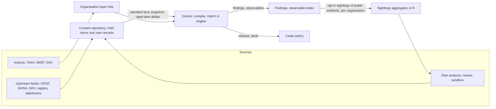

# 14. Threat intelligence and reputation

_Status: draft 4 against spine version 4, rulings R-13 and R-14 (`_review/01-document-rulings.md`) and the owner answers (`_review/02-owner-answers.md`). Date: 2026-11-10. Revised 2026-11-11 for principles P15 to P17 and the owner's kit instructions (`_review/04-owner-kit-instructions.md`). Owning squad: `content` (SQ-08, SQ-09; team/02). Read with: `00-decisions.md` (D-32, D-04, D-08, D-37, D-48, D-54, D-60, D-61, D-63, P2, P7, P8, P11); 02 (ADV-3, ADV-8, ADV-9, SR-25, SR-26, SR-28); 04 (artefact ids, observables, data classes); 05 (inventory of MCP servers, skills, extensions, models); 07 (verdict interface); 11 (on-device update mechanics); 12 (analyser lists, `grdr.supply-chain`); 13 (detections and finding classes); 17 (MCP broker pinning); 18 (response actions); 22 (pack envelope, trust roots, rings); 25 (export destinations); 29 (privacy regimes); 32 (costs); 36 (prices and legal terms)._

## Summary

This document specifies D-32 (threat intelligence and reputation) and the intelligence part of D-04 (paid live access; malicious verdicts and withdrawals public immediately, enrichment and prevalence public after a delay). It covers where intelligence comes from, how it is keyed, how it reaches devices, how it becomes policy input and findings, how we exchange and publish it, and how we keep it from being used against users or publishers.

Key choices:

1. **Intelligence may only restrict.** An intel pack contains only `protect`-polarity lists. No record, score or absence of a record produces an `ALLOW`, a grant, a cleared finding or a widened list. "No record" is shown as "no intelligence", never "clean".
2. **Provenance is the control; reputation is a signal.** Digest pinning in the broker (17), organisation allow-lists by identity (12) and config integrity carry enforcement. Scanner verdicts are evidence entries, because every skill scanner Trail of Bits tested in June 2026 was bypassed (h05 verification row 10; NVIDIA SkillSpector was not tested).
3. **Content-addressed keys.** Every record is keyed by a digest, a tool-manifest hash or a version-exact coordinate; a name alone is used only where the source has no versions, and then caps at Ask. A changed artefact has a new key and starts unrated, which is what re-pinning means.
4. **Evidence arrays, not scores.** A record carries named evidence (source, tool, version, finding code, date). The status of a record we issue is computed from evidence by a published deterministic function; `malicious` needs two independent sources, or one published human review by a reviewer outside the project, which has no human reviewer of its own (D-32). Mirrored records keep their source's classification under the source's id.
5. **The base is a mirror matched on the device.** OpenSSF malicious-packages and GHSA malware records (all ecosystems), GHSA vulnerability advisories scoped to agent software, and CISA KEV ship as a signed pack and match locally with no lookups and no server (D-32, D-48). Agent vulnerability intelligence becomes findings against inventory on the device.
6. **The rapid lane is narrow and braked.** It carries only indicator, reputation-verdict and withdrawal entries into existing feed-managed classes, bakes in rings, and a device-side guard list holds any restrictive entry that names a high-prevalence artefact until the standard lane confirms it.
7. **Exchange through standards.** OSV for artefact records, STIX 2.1 and TAXII 2.1 for indicators, MISP formats through a connector. Imports land in the organisation's own layer in Watch.
8. **Sharing is opt-in, per organisation, limited to keys of publicly distributed artefacts, and counted only above five organisations.** Sightings never carry device, principal or sub-day time, never drive a "good" outcome, and never gate what an organisation receives (l07).
9. **Corrections are free and follow from the evidence.** Disputes have a public route and target turnarounds, and a record is withdrawn when its cited tools no longer reproduce its finding (section 14); a withdrawal ships to every device, paid or not, on the rapid lane as soon as it is signed.
10. **Own sandbox scanning** requires the server `intel` target, artefacts to analyse (sightings above k or registry enumeration) and worker compute. The evidence schema, the `scanner-dynamic` source kind and the worker contract are part of the record model, so scanners add evidence without a schema change.

## Requirements

| # | Requirement | Trace |
|---|---|---|
| R1 | Mirror OpenSSF malicious-packages, GHSA and KEV into a signed pack matched on the device, with no server required | D-32; g06 |
| R2 | Key records by content digest and tool-manifest hash; re-key on change | D-32; g06 weak point 1; 04 |
| R3 | Publish evidence arrays and a computed status, never one opaque score | D-32; c8 F8; g06 |
| R4 | `malicious` only with two independent sources or a published human review by a reviewer outside the project | D-32; c8 F8 (Enigma v. Malwarebytes) |
| R5 | Never execute unknown servers or skills on an endpoint to classify them | g06 TL;DR; c8 agreed |
| R6 | Turn vulnerability intelligence about agents, MCP SDKs and gateways into findings against inventory | c8 F5 detection 21; 21 item 59 |
| R7 | Rapid lane carries indicators and reputation verdicts only, still bakes, never raises a ceiling | D-37; SR-28; g06 pipeline 6 |
| R8 | High-prevalence verdicts go through rings, not the rapid lane | D-32; c8 F8 |
| R9 | STIX 2.1, TAXII 2.1 and MISP exchange; OSV publication; upstream ecosystem work | Owner request ("standards", "integrations, exports, imports"); 26; g06 |
| R10 | Sightings as prevalence only above a k-organisation threshold; privacy by schema | D-32; P8; D-51 |
| R11 | Anti-poisoning against malicious tenants, contributors and sources | 02 ADV-8, ADV-9; g06 weak point 6 |
| R12 | A dispute and correction route for publishers we flag | D-32; c8 F8 |
| R13 | Framework mappings carry the release and are CI-checked | g06 (ATLAS renumbering, verified) |
| R14 | Standalone sends nothing; matching works offline | D-48; P4 |
| R15 | Live intelligence is the paid freshness exception; malicious verdicts and withdrawals are public immediately, enrichment and prevalence after a fixed delay | D-04; P11; R-14 |

## Design

### 1. Rules every part follows

- **Restrict only.** The pack verifier rejects any `kind: intel` pack containing an `allow`-polarity list, a rule, a mode, an action ceiling, a command, a path to execute, a URL to fetch, an environment variable to set or an MCP server definition (SR-25). Host and digest values are typed match fields (P7), not destinations.
- **Feed-managed classes.** Intel lists are referenced by policy through classes such as `intel.malicious`. Subscribing an organisation or device to a feed is the policy object, and unsubscribing is a widening operation at the class's minimum approval grade (D-31). Entry churn inside a subscribed feed, including withdrawal, is not a layer change and not a widening change: D-08 exempts churn in feed-managed, restrict-only lists delivered by signed intelligence packs (R-13), so its "removing a pattern from a protective class is widening" applies to people's lists, not to feed membership. The reason: corrections must flow without an approval queue, and a withdrawal is authenticated by issuer (section 13) instead.
- **Absence is unknown.** We never publish a `no-known-issue` record. A lookup with no record returns `unrated` plus the list of scans run, if any. Mondoo skillcheck shows unknown skills as clean (h05); we do not.
- **Origin is recorded.** Every class or fact derived from intelligence carries origin `deterministic` (exact key match), `heuristic` (lookalike distance, diff scoring) or `model` (analyst-drafted, review-stage). Only deterministic results enter the Cedar request (12 section 2). Heuristic and model origins produce at most advisory labels and findings, in line with P2 and D-09.

### 2. Sources and licences

| Source | Licence (from brief) | What we take | Use | Requires |
|---|---|---|---|---|
| OpenSSF malicious-packages | Apache-2.0; 240,309 reports, several ingest commits per hour (g06, verified) | OSV `MAL-` records for npm, PyPI, crates.io, Go, Maven, NuGet, Packagist, RubyGems, `VSCode`, `VSCode:https://open-vsx.org` | `intel.malicious-package` keys; redistributed in our mirror pack with NOTICE | Mirror job |
| GitHub Advisory Database | CC-BY-4.0 (g06 matrix; not in its verification table) | Reviewed advisories: `type=malware` in every ecosystem, vulnerabilities only in the agent-software scope (section 6) | Mirror pack kept separate under its own licence, attribution shown on every record (l09 F10) | Mirror job |
| CISA KEV | Not covered by the briefs; the author's search found CC0 stated in the `cisagov/kev-data` README, unconfirmed (Q6) | CVE, date added, ransomware flag; no version ranges, so it joins inventory only through OSV aliases (section 6) | Raises posture findings to `known-exploited` | Mirror job; KEV terms settled (Q6) |
| MCP Registry | Code MIT moving to Apache-2.0; data terms unstated (g06) | `status: deleted` and `statusMessage` via `include_deleted=true`; enumeration via `updated_since` | `registry-takedown` evidence; never a trust signal (V.A.P.E stayed active 28 days, h07 verification row 5). The fetched response is kept by digest as `artefact_ref`: deleted metadata may be erased (g06 verification row 3) and takedowns may be reversible (h07 row B) | Takedowns: mirror job. Enumeration: server registry connectors (section 8) |
| VS Marketplace `RemovedPackages.md` | Repository MIT (g06) | `publisher.name`, date, reason; no versions or hashes | Name-level `registry-takedown` evidence for extensions | Mirror job |
| Hugging Face scan status | Hugging Face terms; reuse at scale unverified (g06) | Per-repo `securityRepoStatus` for observed public models | Server-side evidence by reference only; not redistributed | Server registry connectors; Q2 |
| MITRE ATLAS | Apache-2.0, YAML authoritative, monthly by stated policy since v2026.05 with actual gaps of two to six weeks (g06 verification row 8) | Technique ids per release | Mappings (section 15) | None |
| Customer TAXII and MISP feeds | The customer's | Indicators | Organisation layer only, never our public feed | Server `intel` target (file import works standalone) |
| Scanners: Cisco mcp-scanner (offline static mode only: its other modes call Cisco AI Defense and VirusTotal, g06) and skill-scanner, NVIDIA SkillSpector, modelscan, guarddog (Apache-2.0); picklescan (MIT); malcontent own rules (Apache-2.0, not its `third_party` set) | As listed (g06, h05, 09) | Findings run in our workers | `scanner-static` and `scanner-dynamic` evidence | Own scanning workers (section 11) |
| Test fixtures: `canack/bad-mcp` (MIT), `m10x/malim` (Apache-2.0), MaliciousAgentSkillsBench (MIT), DataDog malicious-packages dataset (Apache-2.0) | As listed (g06) | Inert samples | Efficacy and matcher tests only, never shipped | None |

Excluded: Snyk agent-scan's analysis API (proprietary; bulk use is called abuse, g06 verified), Backslash, Socket, Koi and other proprietary verdicts; PromptIntel data (reuse terms unstated). A customer with its own licence may run a contrib connector for these; results stay in that organisation and never enter our records. Proprietary or unclearly licensed verdict data never becomes evidence in a public record. A published third-party write-up (a vendor blog, an incident report) is different: it may be cited as a `community-report` entry carrying the link, a retrieval digest and our own `finding_code`, with no copied text.

### 3. Artefact keys

Keys are global, unkeyed digests of public artefacts (data class `identifier`, 04 section 11). They differ from 04's per-organisation HMAC ids (`mcp_`, `skl_`), which never leave the organisation. 04 supplies both on each inventory and action record.

| Artefact | Key | Provenance fields (not part of the key) |
|---|---|---|
| Package | `purl` with exact version, plus artefact digest when known | Registry, publish time |
| Local (stdio) MCP server | Package key of the launched package, plus the manifest set digest from 04's `action.mcp.connect` | Launch command class |
| Remote MCP server | Origin and the manifest set digest (17 section 7.3) | Declared registry name; SHA-256 of the TLS SPKI |
| MCP tool | 04's `manifest_hash` (SHA-256 over the JCS form of name, description, input schema, annotations) | Server key |
| Skill, plugin | 04's `content_digest` (Merkle root over files in path order) | Source URI, commit |
| Editor extension | `publisher.name@version` plus VSIX SHA-256 | Marketplace (VS Marketplace, Open VSX) |
| Model file | File SHA-256 | Repository and commit |
| Executable | File SHA-256 | Signer |
| Host | Registrable domain or exact host name | None |

An OSV record whose range is `introduced: 0` with no fix (the usual OSSF form for a malicious package) is a version-range record that covers every version; it matches at its status ceiling. A name-level key (`purl` without version, `publisher.name` without version, a registry server name) is used only for sources that carry no versions at all, such as VS Marketplace removals and MCP Registry deletions. Name-level keys match at Ask at most, because they cannot express "1.4.1 was fine, 1.4.2 is malicious" (g06 weak point 1).

**Re-pinning.** When a server's manifest set digest or a skill's content digest changes, the new key is `unrated`; the broker's tool-pin rule (12 policy 8, 17 section 7.3) re-asks; the old record stays attached to the old key. A changed TLS SPKI does not re-key, because certificate renewal and CDN fronting can rotate it with no change to the server; it is recorded as provenance drift on the inventory record (05) and as the observable `mcp.remote.spki`. Drift is also a detection input (13 section 10, rows 22 and 23).

### 4. Record model and the status function

The canonical record is `grdr.intel.v1alpha1.Record` (protobuf, D-06); OSV JSON is the publication form (section 10).

| Field | Content |
|---|---|
| `id` | `GRDRI-YYYY-NNNNN` for our records (provisional prefix, final under D-66; `GRDR-` belongs to error codes alone); mirrored records keep their source id |
| `aliases` | `MAL-`, `GHSA-`, `CVE-` ids |
| `subject` | One `ArtefactKey` (section 3) |
| `affected` | OSV ranges, for `vulnerable` records |
| `evidence[]` | `{source_id, source_kind, producer, tool, tool_version, finding_code, method_family, observed_at, key, artefact_ref, licence, reference_url}` |
| `status` | `malicious`, `suspicious`, `vulnerable`, `withdrawn`: computed for records we issue, the source's for mirrored records (below) |
| `remediation` | Fixed versions; `requires_config[]` facts where an upgrade alone does not fix (MCP SDK audience checks are off by default after the fix, 21 verification row 7) |
| `mappings[]` | `{framework, id, release}` |
| `dispute` | `{state: none, open, upheld, rejected; ref}` |
| `published`, `modified`, `public_after` | `public_after` implements D-04 (section 17) |
| `prevalence` | Bucket (`5-20`, `21-100`, `>100` organisations), present only above k |

`source_kind` is one of `upstream-feed`, `registry-takedown`, `scanner-static`, `scanner-dynamic`, `human-review`, `community-report`. `finding_code` comes from a closed vocabulary (for example `exfil.network-at-install`, `instr.hidden-unicode`, `exec.credential-store-read`); there is no free-text claim, so every published statement is a reproducible fact about a named tool's output. This is the c8 F8 response to Enigma v. Malwarebytes, where "malicious" labels were held to be statements of fact.

**Mirrored records** keep their source's classification and id and are republished as the source's statement: an OSSF `MAL-` record or a GHSA `type=malware` advisory is `malicious` (subject to section 13's noise filter), any other GHSA advisory `vulnerable`, a withdrawn upstream record `withdrawn`. This is what makes the mirror usable at Block; the two-source rule governs what we assert ourselves.

**Status function** for records we issue (`grdr-analyze::intel::status`, pure, published with golden vectors), first match wins:

1. Any signed `withdrawal` from the record's issuer: `withdrawn`.
2. Two or more evidence entries with a malicious-class `finding_code` from independent sources: `malicious`. Independent means different producers and different method families (static, dynamic, registry action, human review, upstream feed). All Loonaro tools count as one producer; OSSF and GHSA records that alias each other count as one; an entry whose stated basis is another producer's report (a registry takedown citing a vendor post, as in V.A.P.E) counts as that producer.
3. A `human-review` entry (a published manual analysis by a reviewer outside the project) with a malicious class: `malicious` (D-32). A `community-report` becomes a counted entry only when the scan workers reproduce its finding code (section 11).
4. Exactly one malicious-class source: `suspicious`.
5. An advisory with affected ranges and no malicious entry: `vulnerable`.
6. Otherwise no status: the evidence is kept on the server and nothing ships to devices.

A record whose subject is published by a vendor named in 01 (a competitor) cannot reach `malicious` on Loonaro evidence alone; it needs a non-Loonaro source. This closes the "false verdict to disable a rival's tool" abuse in 02.

### 5. On-device matching and how it reaches policy

The sandboxed engine compiles the verified intel pack into an mmap'd sorted key table per key type plus a binary fuse filter for negative lookups (compiled tables are never shipped, 12). Targets: filter under 2 MB resident for 500,000 keys, lookup p99 under 5 microseconds, table under 60 MB on disk (targets; SP-14.1 measures).

Intel lists are pack lists of new types `package-key`, `artefact-key` and `host` consumed by 12's existing analysers; no sixth analyser is added.

| Where | Match | Reaches policy as | Default |
|---|---|---|---|
| `exec` of package managers and runners (`npm`, `npx`, `pnpm dlx`, `yarn dlx`, `pip`, `uv`, `uvx`, `pipx`, `cargo install`, `go install`, `gem`, `code`/`cursor --install-extension`, `claude mcp add`, `codex mcp add`) | Command classifier extracts ecosystem, name and version spec from canonical argv | `context.command.classes` gains `intel.malicious-package` or `intel.suspicious-package` | `grdr.supply-chain` rules `supply.known-malicious` and `supply.suspicious`, Watch; the first is a candidate for Essentials if it passes D-53 admission |
| `mcp.connect`, `mcp.call` | Server key and tool `manifest_hash` | `resource.classes` `intel.malicious` or `intel.suspicious` on `McpServer` and `McpTool` | `grdr.mcp` rules `mcp.intel` and `mcp.intel.suspicious`, Watch |
| `net.connect`, `net.request` | Host classifier | `resource.classes` `intel.host-malicious` | `grdr.egress` rule `egress.intel-host`, Watch |
| Inventory (05): installed packages in LLM-client processes, skills, plugins, extensions, model files, executables in agent lineage | Artefact-key lookup, asynchronous | Detection over `inventory.*` facts: finding plus observable (D-54); 13 section 10, row 20 | Finding only; optional automatic "disable by digest" with time limit (D-30) |

**Version specs at exec time.** The registry resolves the version after the decision, so a spec is matched against the record's affected set: an exact pin or a spec every admissible version of which is affected (always true for an `introduced: 0` record) takes the record's class; a spec admitting both affected and unaffected versions takes the `suspicious` class; an unparseable spec is `exec.opaque` (D-10), not a match. The resolved version is then matched exactly when inventory sees the installed package or lockfile.

**Mode ceilings by status**, enforced with `@max_mode` on rules that read one class each: the `malicious` classes up to Block; the `suspicious` classes, which name-level keys always produce, up to Ask. Heuristic results (`intel.lookalike`, `intel.diff-risk`) never enter the request (12 section 2), so no Cedar rule reads them. A rule that reads only resource intel classes reads no session state, so verdict caching (12) applies with `bundle` scope and the intel pack digest in the cache key.

**Lookalike matching**, heuristic origin: observed MCP package names, skill names and extension ids are compared with a shipped popular-name list (MCP reference servers, the top catalogue entries) by Damerau-Levenshtein distance at most 2 after confusable folding, plus scope confusion (`@modelcontextprotocol/server-fetch` against `mcp-server-fetch`, the squat pattern reported in h07 N19 from a secondary source, unverified). A hit sets the advisory fact `intel.lookalike` and raises a threat finding bound at ceiling `record` (13 section 2), so a heuristic never pages or disables anything.

**Manifest diff**: on a tool-manifest change the broker passes old and new manifests to a deterministic diff in the engine: new invisible or bidi Unicode, new credential-path or URL tokens in descriptions, a read-only tool gaining write-capable annotations. The result is the advisory fact `intel.diff-risk` with the named changes (malcontent's version-diff idea, g06).

### 6. Vulnerability intelligence about agents, turned into findings

We are not a software composition analysis tool. The advisory scope is the catalogue's agent software (D-24 tiers A and B), the building blocks of pass 2 (agent SDKs, MCP SDKs, frameworks, model runtimes) and gateways (LiteLLM, Langflow, n8n, agentgateway, Agent Router). The mirror job filters GHSA and OSV to packages on that list, which is itself signed pack data.

- **Package-distributed agents** match by OSV ranges using each ecosystem's own version comparator. The reviewed database is not complete for them: npm `@anthropic-ai/claude-code` has 30 reviewed advisories while the repository lists 36, including a Claude Desktop advisory and a CoworkVMService privilege escalation (21 verification row 3). The mirror job therefore also reads each catalogued agent's repository advisories and curates any not in the reviewed database.
- **App-distributed agents** (Cursor, Claude Desktop, IDE builds) are absent from package ecosystems; their repository advisories are curated into our own records under the provisional ecosystem `grdr:agent`, keyed by catalogue agent id and version. Cursor has 33 repository advisories (21 verification row 3).
- **Joins and severity.** KEV lists CVEs without version ranges, so a KEV entry raises a finding only when an OSV alias joins it to an advisory with ranges; an unjoined KEV CVE in scope goes to the analyst queue (section 16). CVE numbers in third-party reports are not trusted as join keys without that alias check (a LiteLLM CVE cited by GTIG maps to a different advisory in GHSA, h07 verification row 9). Where the issuer's severity differs from the database's CVSS score (21 verification row A), the record keeps both and the finding uses the issuer's.
- **Findings.** Detection `grdr.det.vulnerable-version` (13 section 10, row 21): one finding per organisation, agent or building block, version and advisory, with a device count; class threat, ceiling `record`, so it never pages; behaviour severity from the issuer's severity, raised one step when the CVE is in KEV. There is no enforcing rule by default.
- **Remediation** names fixed versions and any `requires_config` facts; where inventory reports the config fact, the finding closes only when both version and config are right.
- **Policy reach.** The engine adds the deterministic fact `intel.agent-version-kev` to `context.facts` for every action of a session whose agent instance version (05) is inside a KEV-joined range, so an organisation can write a forbid on, for example, `mcp.connect` from such sessions.

### 7. Delivery: standard lane, rapid lane and their limits

The standard lane works with no server. Rings and the rapid lane require 22's ring mechanics; the 15-minute check-in and push nudges require a server, and a standalone device takes rapid deltas on its 4-hour fetch.

The intel pack is the D-37 pack type in the detection-content channel, signed by the project `content` role in every shape: manifest `kind: intel`, with `lane: standard` for a full snapshot and `lane: rapid` for a delta (22 section 6.3). The envelope, roots and ring mechanics are 22's and 11's.

| Property | Standard lane (snapshot) | Rapid lane (delta) |
|---|---|---|
| Entry kinds | `indicator`, `reputation-verdict`, `advisory`, `guard`, popular-name and public-artefact-filter lists | `indicator`, `reputation-verdict`, `withdrawal` only (a withdrawal is a reputation verdict of status `withdrawn`, so D-37 and SR-28 hold) |
| May create a class | Yes (with a reviewed policy pack release) | No; entries go into existing feed-managed classes |
| Ceiling, mode, rules | Never (verifier) | Never (verifier) |
| Size | A base (24 MB compressed at about 500,000 keys, target, SP-14.1) and immutable daily segments of at most 4 MB; a new base is cut weekly or when segments since it exceed 25% of its size | 10,000 entries or 4 MB compressed per hourly segment; larger goes standard |
| Rings and bake | Detection-content bakes: 2 h, 4 h, 12 h (22 section 7.2) | 30 minutes in ring 0 (internal and synthetic devices), 30 minutes in ring 1, then all (22 section 7.2). D-37's named gates halt automatically |
| Check interval | One TUF timestamp check serves both lanes: every 4 hours with jitter in standalone (22 section 7.1); with a server, `CheckInResponse` carries any project or deployment `timestamp.json` newer than the version the device reported (22 section 3), so a check-in adds no origin request; the device fetches snapshot and role metadata only when a version changed, then the segment at a time drawn from the lane's fetch window (rapid 30 minutes, standard 4 hours); project releases are never nudged | Same |
| Freshness target | Source publication to the last ring under 30 hours p95 (target) | Source publication to the last ring under 4 hours p95 (target) for devices with a server; standalone devices add up to their 4-hour fetch interval |

**Base and segments.** The intel lanes are a log: a base, then immutable daily segments, with hourly rapid segments that the next daily segment absorbs. Each base and segment declares `state_digest`, a Merkle root over the sorted key table after it is applied; a device that has applied every segment since its base computes the same digest and adopts the next base without downloading it, so only a new install, a device more than one base behind or a digest mismatch fetches a base. At 10 million devices this moves about 0.4 TB a day instead of about 200 TB (estimates, S-27).

**Guard list (high-prevalence brake).** A standard-lane `guard` list holds keys of artefacts above a prevalence bar: the top catalogue agents' own packages, MCP reference servers, the most downloaded packages per ecosystem by public registry counts, model provider and package registry hosts, and, where reciprocal sharing (section 12) is running, keys whose sighting bucket is `>100` organisations and that were first seen in their ecosystem at least 14 days ago (section 13). A rapid-lane `indicator` or `reputation-verdict` entry that names a guard key is held by the device in Watch, reported, and applied only when the same entry arrives in a standard-lane release. Withdrawals are never held, since they only remove restriction. This implements "verdicts on high-prevalence artefacts through rings" on the device, so a bad source or signing mistake cannot reach a fleet-wide block through the fast path.

**Device circuit breaker.** If the entries an activation adds relative to the device's previous active state, whichever lane, segment or import delivered them, produce more than three new Block-mode matches on distinct artefacts on one device within an hour, the device caps those entries at Ask and raises a finding. Intel classes are never in the fail-closed floor table, so this does not touch the crash-loop guarantees of D-37.

**Staleness.** Each intel base and segment carries `sources[] {source_id, upstream_ref, as_of}`, where `as_of` is when the mirror job read that source, and a pack-level `as_of`, the oldest of these. Intelligence age is now minus the pack `as_of`, computed on the device. Neither TUF expiry nor freshness statements (22 section 6.5) change it, so a site that keeps its repository fresh by statement still shows a 40-day-old snapshot as 40 days old. Intelligence is `current` while its age is under `intel.stale_after` (default 7 days, settable from 1 to 90 by the organisation, recorded in `audit.admin`), and `stale` above it or when its metadata expires. A stale snapshot keeps matching and never stops enforcement (D-37). `grdr intel status`, the console's intelligence page, every `unrated` lookup and every intel-derived finding state the snapshot id and age ("no intelligence in snapshot 2026.11.02, 9 days old"), and `health.sensor` reports `intel.age_s`, so the server shows the fleet's oldest snapshot.

**Without internet.** Neither lane needs a route to Loonaro: the bundle and content exports (24 section 7) bring the latest base and every segment after it to `content` or an internal mirror, or to a standalone device by `grdr update import`. The freshness targets above then run from import, and the age shows what the transfer interval costs. Imported segments are offered through the deployment's local rings with the detection-content bake times and gates (22 section 7).

### 8. The server `intel` target

`intel` is a tier 2 target (D-33); a failure never blocks tier 0 or 1. In the hosted service it is global (D-35) with per-organisation overlays.

1. **Mirror.** Default: pull our signed intel packs and re-serve them unchanged through `content`. Option: mirror upstream sources directly; because only the project `content` role signs `intel` packs (22 section 6.1), the result is delivered as deployment-signed, feed-managed lists in the organisation layer document, narrow-only on devices (SR-26). In hosted and provider shapes those lists can only grow without the organisation's signature, so their corrections arrive as project-signed withdrawals or need that signature. Air-gapped installs import intel with the air-gap bundle or a content export (24 section 7): the latest base plus every segment after it, and a segment whose base is absent is skipped, never applied. Every upstream source adapter also reads the upstream's own published file from disk (`grdr server intel source import <source> <file>`: the KEV JSON catalogue, an OSV ecosystem archive, a git bundle of an OSV repository), so the upstream-mirror option runs from carried-in files, with `as_of` taken from the file's own release date or newest record.
2. **Organisation lists.** Indicators an organisation adds by hand, by TAXII or MISP import, or by promoting a finding's observable. Stored on the relational port and delivered as pack kind `org-intel` (22 section 6.3; channel detection-content, signer `deployment` or `organisation`, narrow-only), published as segments as in section 7 at most once per 15 minutes per organisation and referenced from the layer document by role, so a feed poll changes a segment, never the layer document.
3. **Retro-match.** `store` keeps per cell a binary fuse filter over the (type, value) pairs in any organisation's `observable_first_seen` (values only, no organisation id), rebuilt hourly and extended at each flush. A new record set is intersected with it; only matches are looked up in `observable_first_seen (type, value, organisation_id)` and confirmed from the lake `observable` table (20 section 5.5), without a scan of `activity`. Each (organisation, indicator) match raises one retro finding with device and session counts and at most 32 sample sessions.
4. **Lookups.** Devices in platform shapes ask their own server, never Loonaro. A server holding a live-feed subscription mirrors the live record set (base plus segments, about 0.5 GB compressed, estimate) and looks up locally, so Loonaro runs no lookup service and learns no query. A server with no route out makes no outside request: a subscriber's server mirrors the same set from content exports (section 17), lookups answer at the export's age, and `status` shows `lookups: unavailable (no route out)` for the live origin instead of retrying.
5. **Registry connectors.** MCP Registry enumeration and takedowns, the repository-to-package provenance check (an entry whose linked repository carries agent autorun config, the V.A.P.E pattern, h07 N13), optional registry metadata (package age) fetched from the organisation's own egress, at base URLs set in `intel.registries[]` with no compiled default, so they can name an internal package mirror or a private MCP sub-registry; with none configured, the facts these connectors produce are `not evaluable` with the reason.

### 9. Exchange: STIX 2.1, TAXII 2.1, MISP, OSV

File import and export work in standalone; TAXII and MISP connectors and the feeds served by `api` require the server.

| Direction | Format | Mapping | Rules |
|---|---|---|---|
| Import | STIX 2.1 bundles, TAXII 2.1 collections (poll) | `indicator` patterns limited to equality over `file:hashes.'SHA-256'`, `domain-name:value`, `url:value` (host extracted), `software` with purl; other patterns are kept as reference and not matched | Organisation layer, Watch; honour TLP 2.0 markings; never re-share beyond the marking |
| Import | MISP feeds (manifest and event JSON) and MISP REST pull | Attribute types `sha256`, `filename\|sha256`, `domain`, `hostname`, `url`, `vulnerability`; only `to_ids: true` attributes become indicators | Distribution level and TLP tags honoured; indicators matching a MISP warninglist are dropped |
| Import | OSV JSON | As our records | Organisation layer, Watch |
| Export | STIX 2.1 | Our records as `indicator` plus `malware` or `vulnerability`, `relationship`, `identity` for the producer, ATLAS `attack-pattern` by external reference; artefact keys for MCP servers, tools and skills through a published STIX extension definition `x-grdr-artefact` | Public records from the public feed; organisation sightings only to that organisation's own TIP |
| Export | TAXII 2.1 server, read-only | API root per organisation; collections `grdr-public` and `org-indicators` | Organisation-bound tokens (D-38) |
| Export | MISP feed format | Event per record, attributes as above | Feed URL servable by `api` |
| Export | OSV JSON | Section 10 | Public |

Finding and incident export to SIEMs is 25's; mappings to OCSF are 04's. STIX 2.1 and TAXII 2.1 are OASIS standards (URLs under Sources); MISP v2.5.50 and OpenCTI's connector catalogue are noted in 26 as verified, the formats themselves are from 26's unverified list and are checked against live MISP and OpenCTI instances, run as free open-source containers in CI, before the connectors are marked supported.

### 10. Publication as OSV and work with upstream ecosystems

- **Format.** OSV JSON validated against the pinned OSV schema. Artefacts in an existing ecosystem (`npm`, `PyPI`, `crates.io`, `VSCode`, `VSCode:https://open-vsx.org`, `GitHub Actions`) use it with `purl`. Artefacts with no ecosystem (remote MCP servers, skills, plugins, model files, app-distributed agents) use provisional `grdr:mcp-remote`, `grdr:skill`, `grdr:plugin`, `grdr:model-file`, `grdr:agent`, with artefact keys in `affected[].database_specific.grdr`. Standard OSV consumers ignore these until upstream accepts ecosystems; we say so in the feed README.
- **Upstream first for packages.** A `malicious` package record of ours is also submitted to OpenSSF malicious-packages, which assigns the `MAL-` id; ours becomes an alias. A finding about a registry entry is filed as a takedown request with the registry (MCP Registry issue tracker, VS Marketplace, Open VSX, Hugging Face).
- **Upstream proposals.** Participate in osv-schema issue #568 (ecosystem for agent skills and MCP registries, open; two MCP id-prefix requests were closed, g06 verified) with our key definitions and a sample feed; propose an `atlas` tag namespace to the Sigma specification; supply agent, MCP and skill component examples to CycloneDX 2.0 work through 04.
- **Hosting.** The public feed is a git repository in the content repository plus a GCS-style bucket mirror, the two forms osv.dev ingests (to confirm with the OSV maintainers before relying on ingestion; see Q1). With no budget and no new third-party account, the git repository alone serves osv.dev's git ingestion; the bucket mirror is added by configuration once free hosting for open-source data or donated storage exists.

### 11. Reputation service and central sandbox analysis

Design. Workers analyse public artefacts that fleets observe above the k threshold, plus registry enumeration; we do not try to out-scan vendors (g06; c8 F8). A worker fetches the artefact by key from its source (the public one by default, or on a self-hosted server an internal mirror named in configuration), never from a device. It runs in a single-use microVM with no credentials, egress denied except to a recording sinkhole and fake model and package endpoints, honeytoken files, and our own Linux sensor in observe mode. For an MCP server it starts the server, calls `tools/list`, computes the manifest set, and calls each tool with schema-generated arguments. For a skill it runs a scripted agent through the D-45 replay model endpoint with the skill loaded. Model files are scanned statically (modelscan, picklescan) and never loaded. Static scanners run alongside. Each tool's output becomes an evidence entry; the worker trace bundle is stored by digest as `artefact_ref`. Version diff scoring compares a new version with the previous one. Before building, compare the open-source detonation sandbox Zenity is reported to have released (h07 N24, secondary sources).

Seams in the record model: the `evidence` schema and `scanner-dynamic` source kind; the `Scanner` worker contract (input key, output evidence list, resource budget, exit code 2 for "could not complete", Quarry's convention, g06); 02's worker trust boundary (single-organisation, credential-free, egress-denied). Requires: the server `intel` target, artefacts to analyse (sightings above k from section 12, or registry enumeration from section 8) and worker compute. Cost belongs to 32; with a zero budget, worker compute comes from D-64's tier B machines as self-hosted runners or from donated cloud credits, and the microVM runner needs a host with hardware virtualisation (marked "requires hardware" where none is available).

### 12. Reciprocal sharing

Requires the server `intel` target and enough sharing organisations to pass k. The `Sighting` message is part of the record model.

- **Opt-in by the organisation only.** Turning sharing on is a widening operation at the privacy class's minimum grade and, in hosted and provider shapes, needs the organisation's signature (SR-26). Providers and operators can only narrow it (D-11).
- **What is sent.** Per organisation per day, at `SHA-256(organisation_id) mod 24 h` plus up to 1 hour of jitter, compressed and retried with full-jitter backoff (the aggregator answers 429 with `Retry-After` while its daily merge is behind), from the organisation's server: `{key, first_seen_day, device_bucket (1, 2-10, 11-100, >100)}`. No device id, principal, session, path, host name or sub-day time. Only keys present in the shipped public-artefact filter (a binary fuse filter over keys we know are publicly distributed: our records, mirrored sources, registry enumeration) are eligible, so private and bespoke artefacts never leave. The aggregator rechecks exact membership and discards the rest without storing them.
- **What the aggregator keeps.** Per key: a count and a set of per-quarter HMAC tokens of contributing organisation ids (keyed by a secret rotated each quarter), which enforces one vote per organisation. The organisation-to-key rows are deleted after the daily merge. The residual exposure, stated in the opt-in screen: the aggregator sees in transit which public artefacts that organisation uses.
- **Threshold.** k = 5 organisations, matching D-51's group-of-five floor. Below k a key's prevalence is not stored beyond 30 days, not published and not used for ring routing; at or above k it may trigger analysis and is published only as a bucket.
- **Reciprocity in kind, never in access.** Every organisation receives the same feed whether or not it shares (l07). Sharing buys coverage: keys above k are queued first for analysis (section 11) and their verdicts route through rings by measured prevalence. Prevalence buckets follow D-04 like other own data (section 17).
- **Standalone and air-gapped servers.** Not offered: there is no aggregator, in an air gap no route to one, and a direct send would expose the source address. Seam: the `Sighting` message is transport-independent, so a DAP or OHTTP aggregation adapter can be added when DAP becomes an RFC with two independent aggregators (DAP is draft-20, g06 verified).

### 13. Anti-poisoning rules

| Threat | Rule |
|---|---|
| A contributor adds an exclusion for an attacker's server (g06) | Intel packs have no allow lists (verifier); guard and popular-name lists cannot exempt anything, they only slow verdicts or raise lookalike findings; any change to them, to the mirror job, its scope list or its noise filter is first-party content and lands only on evaluator passes with evidence (D-61) |
| One report reaches `malicious` by being echoed (a registry takedown or second blog citing the first) | Evidence whose stated basis is another producer's report counts as that producer (section 4, rule 2) |
| A malicious tenant floods sightings (ADV-8) | One vote per organisation; only organisations with 30 days' tenure and 10 enrolled devices count towards k or ring routing; per-organisation rate limit; prevalence never lowers a status or raises trust |
| A tenant inflates a malware artefact's prevalence so its verdict takes the slow rings | Sightings put a key on the guard list only after 14 days in its ecosystem (section 7); the standard lane still delivers within its 30-hour target |
| A tenant or user submits false "malicious" reports | A `community-report` is one evidence entry and counts as a source only after the scan workers reproduce its finding code (section 4, rule 3) |
| A compromised operator or deployment root withdraws a project-signed verdict | A withdrawal must be signed by the issuer of the record; devices refuse a deployment-root withdrawal of a project-root record and keep a tombstone set so a withdrawn id cannot be reissued silently |
| A poisoned import blocks common infrastructure | Imports land in Watch; guard-list keys and MISP warninglist matches are dropped from imports; promotion of an imported feed to Block is per feed and staged |
| GHSA noise (npm spam floods, g06) | Mirror filter: malware advisories outside the agent-software scope that name no install script, binary or network capability are mirrored as `suspicious`, not `malicious`, unless OSSF corroborates |
| Text the analyst agent reads instructs it (section 16) | The agent cannot sign, merge, set `malicious` or `withdrawn`; its drafts are checked by a citation verifier |

### 14. Dispute and correction

The process is live before the first own record is published.

1. **Intake.** Any publisher may dispute through a public form, the disputes address in the brand manifest (private; `brand/brand.toml`, D-66) or a `dispute-record` issue template (public). No account, no fee.
2. **Marker.** Within 2 working days (target) the record shows `dispute.state: open`; enforcement is unchanged, so an attacker cannot lift a block by filing.
3. **Review.** The scan workers re-run the cited tools at the cited versions (section 11), and deterministic code recomputes the status function over the evidence that still reproduces plus any new entry that meets section 4's rules (an upstream withdrawal, a registry reinstatement). Two evaluators on different models, never the analyst agent, check the result against the dispute. A dispute is upheld only when the recomputed status drops: the evaluators may hold a withdrawal for a re-check but cannot cause one (P2: clearing never depends on a model). A claim no re-run can test is rejected with that reason, and the publisher's statement is published beside the record. Decision target: 10 working days.
4. **Outcome.** Upheld: a signed `withdrawal` with a reason code ships on the rapid lane to every subscriber, paid and free, and to every export format; the OSV record gets `withdrawn`. An air-gapped site receives it with its next content export; until then an Exception (12 section 3) bound to the artefact key lifts a disputed Block with no network, and every `malicious` match shows its snapshot age. Rejected: the reason is published with the record. Changed artefact: the new version is a new key, unrated; the publisher may request a re-scan.
5. **Mirrored records.** A dispute about an OSSF or GHSA record is forwarded to that source the same day. If our review upholds it before the source acts, we withdraw our mirror entry with a project-signed withdrawal and say so in the source's tracker; the upstream record is not ours to change.
6. **Notification.** For `suspicious` and `vulnerable` records we notify the publisher at publication through the registry contact or `SECURITY.md`. `malicious` records are not pre-notified. Vulnerabilities our own analysis finds in non-malicious software follow coordinated disclosure with a 90-day default (35 owns the process).
7. **Transparency.** Every status change is a signed commit in the public feed repository; dispute counts, outcomes and median times are published per quarter.

Counsel reviews the record templates, the `finding_code` vocabulary and this process before the first own record (36). With no budget, the first route is free legal help for open-source projects (foundation legal programmes); no own record is published without that review.

### 15. Framework mapping maintenance

Mappings for ATLAS, ATT&CK, the OWASP agentic, LLM and MCP lists and SAF-MCP live as data in `grdr-schema` (layer 0) and in rule and record metadata as `{framework, id, release}`. Control-framework crosswalks (SOC 2, ISO and so on) belong to the compliance document (D-46).

- The vendored ATLAS release file is pinned (v2026.10 at the time of writing; the pin moves only through the gardener's pull request below). CI fails when any mapping names an id absent from its pinned release; ATLAS removes ids with no tombstone (AML.T0056, AML.T0057 in v2026.10, g06 verified), so a stale mapping fails lookup.
- A scheduled gardener checks each framework weekly, as a recurring agent on the owner's Claude subscription with a usage cap per run. On a new release it opens one pull request that bumps the pin and proposes remaps for moved or removed ids; an evaluator checks each remap against the release's published changes before the merge queue lands it. Findings keep the mapping release current at their creation, so history does not shift.
- We carry ATLAS ids in our metadata, not in Sigma tags, until Sigma has an `atlas` namespace (section 10).
- We cite framework ids only and never copy framework text, so their licences impose no duty on our packs.

### 16. The analyst agent

The analyst agent is a role in the development team (`team/`), not a product component, and it works on public data only. Tenant data is never in its context; in-product review of an organisation's sessions is D-29's review stage.

**Who approves what.** Mirrored segments ship from the deterministic mirror job with no per-segment approval, otherwise the rapid lane could not meet its target; the job's code, scope list, noise filter, guard and popular-name lists are first-party content under D-61 and land on evaluator passes with evidence per change. Each record we issue, and each withdrawal, passes two evaluators on different models in clean contexts (D-63, Q4); a withdrawal also needs the recomputed status to drop (section 14). The agent is never on the shipping path.

Its job:

1. Triage each upstream delta after it ships: confirm scope filtering, flag GHSA noise, propose noise-filter changes and `suspicious` versus `malicious` mirroring per section 13.
2. Draft own records from public reports (vendor write-ups, registry takedowns, incidents in 21 and h07) and resolve unjoined KEV CVEs (section 6): artefact keys, evidence entries with `reference_url` and a retrieval digest, `finding_code`, mappings.
3. Draft detection proposals from incidents and hand them to the detection content lane (13).
4. Open the weekly framework-mapping pull request (section 15).
5. Draft dispute responses for the evaluators of section 14.
6. Publish a weekly digest of feed changes and coverage gaps.

Constraints: runs on the owner's Claude subscription within the dispatcher's limits, with a usage cap per run; when a usage limit is reached it pauses and resumes after the window resets, and segments keep shipping because the mirror job is deterministic and does not use the agent. It runs as a versioned skill under D-47 (trigger, one concept, read-only evidence, a refuting verifier); fetches go through an allow-listed fetcher that strips active content and hands text as untrusted data; a verifier checks mechanically that each cited fact appears in the fetched source (D-29's span check); it cannot sign, merge or set `malicious` or `withdrawn`. Measured: share of drafts accepted unchanged, citation-verifier failure rate, time from source to draft, share of the subscription's usage windows per accepted draft.

### 17. D-04: live access and the public delay

| Record class | Subscribers of the live feed | Public feed |
|---|---|---|
| Mirrored upstream records | Live | Live (they are already public) |
| Own `malicious` records and all withdrawals | Live | Live, delay 0 |
| Enrichment (own `suspicious` and `vulnerable` records, evidence updates) and prevalence buckets | Live | After 7 days (`public_after`), delivered on the public rapid lane when the delay ends |
| Live record set for local lookups (section 8), delivery SLA | Paid | Not offered |

The live feed is published on the public origins (`updates.sources`) as `intel` packs encrypted under a daily feed key, so any CDN or mirror caches the ciphertext and no origin checks tokens. Each day's key is wrapped (HPKE, RFC 9180) to the public key of every active subscriber and published beside the packs as one small static file per subscriber under an opaque id, so Loonaro runs no key or lookup service and needs no third-party account for one; a cancelled entitlement gets no wrapped key from the next day. The subscriber's private key is its entitlement file, held only by the host that fetches (`grdr server mirror export --entitlement-file`, 24 section 7), so an air-gapped subscriber receives the same packs, decrypted on that host, by content export. It holds no tenant data and is not a hosted tenant under D-63. The live feed is a paid offer, so it requires counsel's opinion first (D-04); Loonaro sells no entitlement before that, and the public feed with its delay works without it. Prices are 36's.

## Interfaces and contracts

| Interface | Shape | Other side |
|---|---|---|
| `grdr.intel.v1alpha1.Record`, `Evidence`, `ArtefactKey`, `Sighting`, `Withdrawal` | Protobuf, frozen with the rest before the server's first release (D-06) | 04 (registry of messages), 25 (export) |
| Status function | `intel::status(&[Evidence], &[Withdrawal]) -> Option<Status>` for records we issue (`None` is rule 6), pure, golden vectors | Content CI, server, devices |
| Pack kind `intel` with `lane: standard` (snapshot) or `lane: rapid` (delta); entry kinds `indicator`, `reputation-verdict`, `advisory`, `withdrawal`, `guard` | Pack manifest `kind` and `lane` (22 section 6.3) and the per-kind entry schema | 22 (envelope, rings, issuer rules), 11 (activation) |
| List types `package-key`, `artefact-key`, `host`, polarity `protect` only, `managed_by: feed` | Analyser list schema | 12 section 2 |
| Cedar classes and facts (deterministic) | `intel.malicious-package`, `intel.suspicious-package`, `intel.malicious`, `intel.suspicious`, `intel.host-malicious`, `intel.agent-version-kev` | 12 (policy), 13 (detections) |
| Advisory facts (heuristic, detections only) | `intel.lookalike`, `intel.diff-risk` | 13 |
| Global artefact keys on inventory and action records | Alongside 04's HMAC ids | 04 sections 3 and 8 (observable types `extension.key`, `model.file.sha256`, `plugin.digest`, `mcp.remote.spki`), 05 |
| Manifest diff | `diff(old, new) -> Vec<DiffRisk>` | 17 broker |
| Cedar rules `supply.known-malicious` and `mcp.intel` (`@max_mode("Block")`), `supply.suspicious` and `mcp.intel.suspicious` (`@max_mode("Ask")`), `egress.intel-host`; detection `grdr.det.vulnerable-version` | Rules in default packs `grdr.supply-chain`, `grdr.mcp`, `grdr.egress`; detection in 13's catalogue | 12 section 14, 13 section 10 |
| Response "disable by digest" triggered by intel findings | Response action contract | 18 |
| `Scanner` worker contract | Key in, evidence list out, budget, exit 2 for incomplete | Own scanning workers (section 11); 02 trust boundary |
| TAXII 2.1 API root, MISP feed, OSV feed, STIX extension `x-grdr-artefact` | Section 9 | 23 (API mechanics), 25 |
| CLI | `grdr intel status`, `grdr intel lookup <key>`, `grdr intel import --format osv\|stix\|misp <file>`, `grdr intel export --format stix\|misp\|osv` | Standalone, CI |

## Behaviour by deployment shape

| Concern | Standalone | Platform, self-hosted | Platform, hosted | Embedded |
|---|---|---|---|---|
| Source | Public intel pack via anonymous update fetch, or file import | Our packs through `content`, or an own upstream mirror delivered as deployment-signed organisation-layer lists (section 8) | Global `intel` target with organisation overlays | Partner's content relay re-signs our packs (D-60); partner may add its own narrow-only intel packs |
| Matching, posture findings, lookalike and manifest diff | On the device, offline | On the device; server adds retro-match | Same | In the embedded engine |
| Lookups | None | Devices ask their own server; a server with a live-feed subscription looks up in its local mirror of the live record set (section 8) | Same, inside the service | None to Loonaro (D-60) |
| Organisation indicators | User layer via `grdr intel import` | Organisation layer, TAXII and MISP connectors | Same | Partner's own lists |
| Sightings | Never | Opt-in, from the organisation's server | Opt-in per organisation | Partner's choice; never to Loonaro by default |
| Retro-match | Local history only | Observable index over retention | Same | Partner's lake (L4) |
| L0 content | Not applicable | Not applicable | Not applicable | Indicator lists as SIEM lookup tables beside L0 rules |
| Turned off | `grdr intel off` (a widening step-up, D-31): no intel targets fetched and the last snapshot is unloaded; the update origin stays in `grdr egress` while other updates are on, because intel shares it | Per group | Per organisation | Build option |

## Extension points

- **Intel source adapters** as declarative integration manifests (D-40): OSV git, OSV bucket, JSON over HTTPS with a field map, TAXII 2.1 collection, MISP feed. The first-party pair is OSV git and TAXII 2.1; others arrive through the content lane.
- **Scanner adapters** as out-of-process containers meeting the `Scanner` contract; a new scanner adds evidence, never a status.
- **Organisation lists** in the layer document; no code.
- **Framework mapping files** in `grdr-schema` with a release field and a CI lookup check.
- **New artefact kinds** need an RFC (D-61) because they change `ArtefactKey`.

## Security and privacy

- Threats addressed: ADV-3 (malicious artefacts) by digest-keyed matching and pinning; ADV-8 and ADV-9 by section 13; 02's `intel` row by the two-source rule and restrict-only packs.
- SR-25 and SR-28 are enforced by the verifier on both lanes; SR-26 by issuer-bound withdrawals and narrow-only deployment-signed lists (section 8).
- Data classes: global artefact keys are `identifier`; sightings are `derived` and leave only under section 12. Matching sends nothing in any shape by default; the only standalone destination is the update endpoint, which `grdr egress` lists and CI asserts (D-48).
- No record or sighting names a person. Prevalence is per organisation, never per principal (P8, D-51).
- Imported indicators from customers stay in their organisation; TLP and MISP distribution are honoured on export.
- Analyst agent and workers process untrusted text with no signing rights, no tenant data and, for workers, no egress (SR-36 and SR-37 by analogy).
- Legal exposure of published verdicts is handled by the evidence-only record language, the status function, the competitor rule and section 14, reviewed by counsel (36).

## Test and evaluation strategy

| Property | Oracle | Method |
|---|---|---|
| Version-range matching is correct | Each ecosystem's own comparator (node-semver, Python `packaging`, Cargo semver) under D-10's real-consumer rule | Differential fuzzing of ranges and versions |
| Exec-time spec classes | The package manager's own resolver run against a recorded registry index | For each spec and record: `malicious` class only when every resolvable version is affected; mixed specs give the `suspicious` class |
| KEV and advisory joins | Hand-built alias table including a CVE that maps to the wrong advisory | No KEV raise without an OSV alias; the bad CVE reaches the analyst queue |
| Matcher agrees with a reference | Slow test-only reference matcher written by a different worker | Property tests over random packs and keys |
| Status function | Golden vectors plus a hand-written independence table, including echoed reports and mirrored records | Exhaustive over evidence combinations up to four entries |
| Restrict-only and rapid-lane limits | Pack verifier | Corpus of packs each breaking one rule (allow list, rule, mode, ceiling, oversize, new class, deployment-root withdrawal); mutation |
| Guard list holds | Device state | Rapid delta naming a guard key; assert Watch until the standard release |
| Circuit breaker | Device state | Delta matching four local artefacts; assert Ask cap and finding |
| No benign blocking | Benign corpus (top packages, reference MCP servers, catalogue agents' own packages) | Zero `malicious` matches; entry gate for Essentials (D-53) |
| Detection of known-bad | Inert fixtures (bad-mcp, malim, MaliciousAgentSkillsBench, OSSF samples) in the efficacy harness (D-45) | Intel track in the scorecard: matched, missed, time to match |
| Posture findings | Hand-labelled inventory snapshots with known advisories | Precision and recall; one finding per (organisation, version, advisory) |
| No egress in standalone | Packet capture against `grdr egress` | CI on three operating systems (free hosted runners) |
| Sightings carry only allowed fields and public-artefact keys | Schema and capture of the sighting payload; synthetic private artefacts | Zero private keys stored server-side; no organisation-to-key row after the daily merge; k behaviour with synthetic organisations |
| STIX, TAXII, MISP, OSV conformance | OASIS STIX 2.1 validator; a TAXII 2.1 client; MISP and OpenCTI instances in CI containers; OSV JSON schema and `osv-scanner` reading our feed | Round-trip golden files |
| Mapping freshness | Vendored ATLAS release | CI lookup of every id |
| Freshness and lanes | Timestamps from source to the last ring | Weekly measurement against section 7 targets |
| Poisoning drills | Red-team tenants and contributors | Each section 13 row as a scripted drill before sharing is turned on for any organisation |
| Data age without internet | A 40-day-old snapshot kept fresh by freshness statements (air-gap conformance run S-31, step 12) | Status, the console and an `unrated` lookup report `stale, 40 days` while the fixture package stays denied |
| Circuit breaker on import | Device state | An import that adds four Block matches on one device is capped at Ask |
| KEV from a carried file | Fixture KEV file and a packet capture | Import raises the fixture finding, shows the catalogue's own age and sends zero egress |
| Live feed by content export | A test-entitlement export | Verifies under `content`; a byte scan finds no organisation identifier |
| Withdrawal with no route out | Lab | An Exception lifts a Block before the withdrawal arrives |

## Work breakdown

**E14.1 Mirror and on-device matching**
- 14.1.1 `grdr.intel.v1alpha1` messages and status function with golden vectors. Accept: vectors pass on native, C ABI and wasm32; competitor rule, echoed-report independence and rule 6 covered.
- 14.1.2 Mirror job for OSSF, GHSA and KEV producing the standard-lane `intel` snapshot with per-source licence files, landing on evaluator passes with evidence per change (section 16). Accept: snapshot reproducible from pinned source commits; GHSA records in their own pack with attribution; KEV licence settled (Q6) before the first public snapshot.
- 14.1.3 Engine compile of intel tables and filters. Accept: SP-14.1 targets met at 500,000 keys; malformed entry is "could not evaluate", never a load failure.
- 14.1.4 Command-classifier extraction of package coordinates for the runner list, and the section 5 spec classes. Accept: differential tests against each package manager's parser on 2,000 recorded invocations; unparseable specs produce `exec.opaque`, not a match; the spec-class test of the test strategy passes.
- 14.1.5 `supply.known-malicious` and `supply.suspicious` rules and the row 20 detection, Watch. Accept: fire on fixtures at their `@max_mode`; zero hits on the benign corpus.
- 14.1.6 `grdr intel status|lookup|import|export|off`. Accept: offline import works; after `off`, packet capture shows no intel target fetched and `lookup` reports intelligence off.

**E14.2 Agent vulnerability intelligence**
- 14.2.1 Agent-software scope list, repository-advisory curation and `grdr:agent` records for Cursor and Claude Desktop. Accept: covers every Tier 1 and Tier 2 agent in the catalogue; every repository advisory of a Tier 1 agent is in the mirror or our records (Claude Code listed 36 on 2026-11-09).
- 14.2.2 `grdr.det.vulnerable-version` detection with alias-joined KEV raise and `requires_config`. Accept: labelled-snapshot precision and recall both 1.0 on the test set; the KEV join test passes; MCP SDK audience case stays open until the config fact is present.
- 14.2.3 `intel.agent-version-kev` session fact. Accept: visible to a test forbid in Cedar.

**E14.3 MCP, skills, extensions, models**
- 14.3.1 Artefact-key lookup over inventory (05) for skills, plugins, extensions, model files, executables. Accept: fixture artefacts matched; drift produces a new unrated key.
- 14.3.2 `mcp.intel` and `mcp.intel.suspicious` rules and broker hand-off (17). Accept: malicious manifest hash denies in Block; a suspicious one is capped at Ask; changed manifest is unrated and re-asked; an SPKI change alone does not re-key.
- 14.3.3 Lookalike matcher. Accept: catches the scope-confusion fixtures; findings bound at ceiling `record`; under one finding per hundred developer endpoints per week on the benign corpus (target).
- 14.3.4 Manifest diff. Accept: each diff class detected on fixtures; no finding on description whitespace changes.
- 14.3.5 MCP Registry takedown and VS Marketplace removal sources. Accept: V.A.P.E reproduced as `registry-takedown` evidence from the recorded API response.

**E14.4 Server `intel`, rapid lane and exchange**

Requires the server (D-33) and 22's ring mechanics.
- 14.4.1 `intel` target: mirror, organisation lists, retro-match. Accept: a new indicator raises retro findings over 30 days of history within 10 minutes (target) at 5,000 events per endpoint per day.
- 14.4.2 Rapid lane with guard list and circuit breaker (with 22, 11). Accept: the guard-list and circuit-breaker tests pass; source to last ring p95 under 4 hours (rapid) and 30 hours (standard) on the test fleet (CI runners and D-64's tier B machines).
- 14.4.3 STIX 2.1 and MISP import and export; TAXII 2.1 server and client. Accept: round-trip with MISP and OpenCTI in CI containers; TLP honoured; warninglist matches dropped.
- 14.4.4 OSV publication feed and upstream submission to OSSF. Accept: `osv-scanner` reads the feed; a fixture `malicious` package record generates an OSSF submission draft.
- 14.4.5 Dispute process, forms, templates, withdrawal signing, upstream forwarding for mirrored records. Accept: withdrawal reaches a free standalone device within one rapid cycle and is not held by the guard list; a mirrored-record dispute produces a forwarded upstream issue; counsel sign-off recorded (free foundation legal programme first); an upheld dispute carries the recomputed status and both evaluators' check runs, and a fixture dispute whose re-run still reproduces is never withdrawn.
- 14.4.6 D-04 live feed entitlement and `public_after`. Accept: public feed omits delayed classes until their time; malicious and withdrawals are immediate. Requires counsel's opinion before any entitlement is sold (D-04).

**E14.5 Mappings and analyst agent**
- 14.5.1 ATLAS release pin and CI id check. Accept: CI fails on a removed id (AML.T0057 against v2026.10).
- 14.5.2 Weekly mapping gardener. Accept: on a synthetic new release it opens one pull request with remaps and no merge rights; a run that reaches its usage cap opens no partial pull request.
- 14.5.3 Analyst skill with fetcher and citation verifier. Accept: injected instruction in a fetched README changes no draft field; 95% of cited facts pass the verifier on a held-out sample (target).
- 14.5.4 Upstream proposals: osv-schema #568 comment with key definitions and sample feed; Sigma `atlas` namespace proposal. Accept: proposals filed and linked from the feed README.

**E14.6 Sharing**

Requires E14.4 and organisations opting in.
- 14.6.1 Public-artefact filter, `Sighting` producer on the organisation server, aggregator with k = 5, tenure rules and rotating vote tokens. Accept: the sightings test of the test strategy passes; SP-14.3 passes; each section 13 drill passes; an organisation that does not share receives a byte-identical feed.
- 14.6.2 Registry connectors and provenance check; Hugging Face evidence by reference. Accept: provenance check flags the V.A.P.E fixture repository.

**E14.7 Own scanning**

Requires E14.4, artefacts to analyse (E14.6 or registry enumeration) and worker compute (section 11).
- 14.7.1 Worker image and microVM runner meeting 02's boundary; Zenity comparison recorded. Accept: no packet leaves except to the sinkhole; honeytoken reads recorded.
- 14.7.2 MCP and skill detonation with scripted agent; diff scoring. Accept: detects every fixture in the inert corpus; trace bundles reproducible by digest.

## Risks, open questions and spikes

| Item | Kind | Response or experiment |
|---|---|---|
| SP-14.1 Device footprint | Spike | Compile 500,000 keys on the three reference CPUs (free hosted runners where they exist, otherwise marked "requires hardware"); pass at the section 5 targets, else shard by ecosystem and load on demand |
| SP-14.2 Benign hit rate of mirrored feeds | Spike | Run OSSF and scoped GHSA over the benign corpus and two weeks of dogfood installs; pass at zero `malicious` hits, else tighten the noise filter before `supply.known-malicious` leaves Watch |
| SP-14.3 Public-artefact filter leakage | Spike | Measure the share of private artefact keys passing the filter at the chosen false-positive rate; pass under 0.01% with server-side discard verified |
| Sources consolidate (Koi into Palo Alto, Protect AI's reports on a Palo Alto domain, g06) | Risk | Independence counts producers, so consolidation lowers the number of independent sources; review the source table whenever a source changes owner |
| A false `malicious` on a popular artefact | Risk | Guard list, rings, two-evaluator review, competitor rule, immediate withdrawal |
| Q1 Will osv.dev ingest a feed with non-standard ecosystems, and will an id prefix be granted after #627 and #643 were closed? | Open | Ask the OSV maintainers with a sample feed before relying on osv.dev ingestion; fallback is our own feed with standard-ecosystem records only going to osv.dev |
| Q2 Hugging Face scan-result reuse terms | Open | Written question to Hugging Face before its scan results are used beyond reference; until then reference only |
| Q3 Delay length for D-04 (7 days chosen) and the live-feed price | Open, 36 | Decide with the first paying conversations |
| Q4 Who is the second reviewer for own `malicious` records and disputes | Answered (owner instruction 7), 30 | Two evaluators on different models pass every own record and every withdrawal; an upheld dispute also needs the recomputed status to drop (sections 14 and 16) |
| Q5 Counsel's view on record language and dispute terms in the US and EU | Open, 36 | Opinion before the first own record; free legal help for open-source projects is the first route |
| Q6 CISA KEV redistribution terms | Open | Read the `cisagov/kev-data` licence file and CISA's terms; settle before the first public snapshot (14.1.2) or drop KEV from the pack and apply the KEV raise only on servers, from CISA's file fetched by the server or carried in (section 8) |

## Deviations from the spine and objections

1. **D-04 delay by record class.** Resolved by R-14: D-04 now makes malicious verdicts and withdrawals public immediately and delays only enrichment and prevalence (section 17).
2. **Feed-managed classes.** Resolved by R-13: D-08 now states that churn in feed-managed, restrict-only lists from signed intelligence packs is not widening; the subscription itself stays a D-31 widening object.
3. **D-61 approval for content.** Open. The spine sets first-party content at evaluator passes with evidence (owner instruction 7); this document applies that to the mirror job, its scope list, noise filter and guard lists, but ships mirrored upstream segments without per-segment evaluation (section 16). Per-segment evaluation would put model latency and usage on every hourly segment against the rapid lane's 4-hour target, and the entries are the source's statements, not ours.

## Sources

Research briefs: `g06-threat-intel-content-ops.md` (sources, licences, reputation design, pipeline, verification rows 1 to 10); `21-threats-incidents.md` (incident items 12, 42, 53 to 58, 93 to 96, backlog 57 to 59, verification rows 3, 6, 7, A); `08-oss-agent-security.md` (scanners, Uber ADR Discovery indicators, ClawSec); `09-oss-detectors.md` (scanner and model licences, Sigstore model signing); `26-integrations.md` (OpenCTI, MISP v2.5.50, TAXII and OSV as integration targets); `h07-incidents-sweep.md` (N13 V.A.P.E, N14, N15, N16, N19, N24, verification rows 4, 5, 9, B); `h05-open-source-sweep.md` (skill-scanner bypass, verification rows 10 and C; scanner list); `h04-market-news-sweep.md` (supply-chain vetting market, AIR, Knostic). Review notes: `c8-detection-response-ai-data.md` F5 and F8; `l07-privacy-works-council.md` (sharing never gates the feed); `l09-oss-maintainer.md` F10; `_review/00-resolution.md`.

Primary URLs:
- https://github.com/ossf/malicious-packages
- https://github.com/github/advisory-database
- https://github.com/cisagov/kev-data (licence unconfirmed, Q6)
- https://github.com/ossf/osv-schema/blob/main/docs/schema.md and https://github.com/ossf/osv-schema/issues/568
- https://github.com/modelcontextprotocol/registry/blob/main/docs/modelcontextprotocol-io/moderation-policy.mdx and https://github.com/modelcontextprotocol/registry/issues/1563
- https://github.com/microsoft/vsmarketplace/blob/main/RemovedPackages.md
- https://github.com/mitre-atlas/atlas-data/releases/tag/v2026.10
- https://blog.trailofbits.com/2026/06/03/the-sorry-state-of-skill-distribution/
- https://docs.oasis-open.org/cti/stix/v2.1/stix-v2.1.html and https://docs.oasis-open.org/cti/taxii/v2.1/taxii-v2.1.html
- https://www.first.org/tlp/
- https://www.misp-project.org/feeds/
- https://datatracker.ietf.org/doc/draft-ietf-ppm-dap/
- https://www.winston.com/en/blogs-and-podcasts/competition-corner/potential-lanham-act-reverberations-malicious-and-threat-are-statements-of-fact-not-opinion (via c8)
