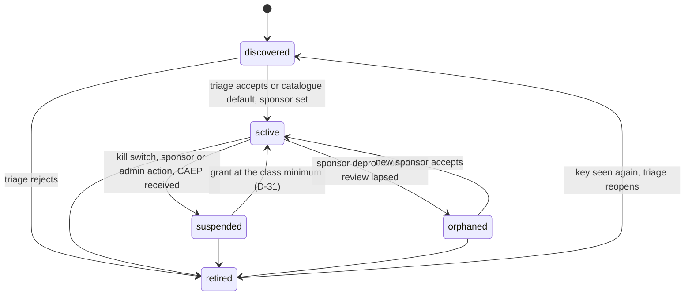
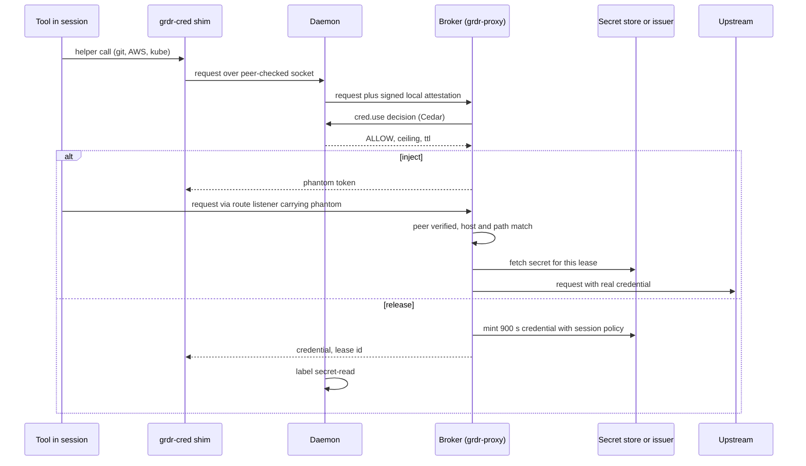

# 15. Identity and the credential broker

_Status: draft 4 against spine version 4, the rulings in `_review/01-document-rulings.md` (R-33 confirmed) and the owner's answers in `_review/02-owner-answers.md`. Revised 2026-11-11 for principles P15 to P17 and the owner's kit instructions (`_review/04-owner-kit-instructions.md`). Owning squad: identity and data. Trust-core paths (broker peer checks, token service signing, `grdr-crypto` use) need two independent passing evaluators on different models under D-63 (`eval-security` and `eval-adversarial`). Read with: `00-decisions.md` (D-21, D-26, D-27, D-25, D-30, D-31, D-36, D-38, D-48, D-51); 04 (entities, `identity_proof`, `action.cred.use`, attribution grade); 06 (attribution evidence and the session graph); 07 (peer checks, decision protocol); 12 (Cedar schema, grants, AuthZEN mapping, compile-down); 16 (secret detection, redaction, honeytokens, sinks); 17 (MCP broker and proxy); 18 (approval flow and grades); 21 (organisation, device and signing keys); 22 (enrolment and transport); 23 (API and SCIM surface); 25 (connectors); 10 (Linux, containers, CI sensors)._

## Summary

This document specifies how Guardrails ADR names agents, proves those names, binds a human sponsor to them, and releases credentials to them without building an identity provider (D-27). It also fixes the three grades of outward identity (D-26) and the identity-facing half of session containers and containment (D-21). The containment back ends themselves belong to the sensor and endpoint documents (08 to 11).

Key choices:

1. **One identifier per agent instance, never reassigned.** It is a SPIFFE URI in the organisation's trust domain, `spiffe://org-<org id>/agi/<agi id>`. The trust domain is named by the opaque organisation id and never by an operator hostname. A separate `identity_proof` field (`observed`, `self-asserted`, `idp-issued`, `attested`) says how well the name is proven. The proof can rise without the identifier changing.
2. **Only an enrolled sensor in the Protected profile can attest a local process.** The evidence is the kernel peer handle, the executable's identity checked at exec, membership of a session container and lineage. The User profile tops out at `observed`, because the attester shares a uid with the agent.
3. **The broker lives in `grdr-proxy`, runs as a separate OS principal, and exists only in the Protected profile.** Callers reach it through tiny helper shims routed by the daemon. Each helper is bound per session through the launch environment or the agent's managed environment block. User dotfiles are never rewritten.
4. **Inject is the default; release is the exception.** Inject means a phantom token is substituted at the proxy (route mode, no CA) or a key is used for signing only (the SSH agent). Release means a credential minted for the request, of at most 15 minutes with reduced scope, and the session is labelled `secret-read`. Where the upstream can neither issue at 15 minutes nor revoke at lease end, release is not offered.
5. **One embedded authority, SPIRE by federation.** The `identity` server target is the token service: two JWT profiles on published RFCs (`grdr-access`, an RFC 9068 JWT bound with DPoP and carrying an RFC 8693 `act` chain; `grdr-federation`, a short OIDC-style assertion for cloud and model-provider workload identity federation) and X.509-SVIDs for our gateways. A customer's SPIRE is trusted through SPIFFE bundle federation; we never operate SPIRE. Draft claims are emitted only through version-tagged adapters.
6. **Delegation is set intersection, computed by the token service and realised by the upstream's own narrowing mechanism.** The mechanisms are AWS session policies, GitHub permission subsets and narrower OAuth `scope` and `resource`. An agent with no ceiling gets no minted credential. Each hop can only narrow.
7. **Our gateways are OAuth protected resources.** They publish RFC 9728 metadata, check audience per RFC 8707 and never pass tokens through. AuthZEN callers are authenticated by token or SVID. Their `subject` is taken from the credential; only a registered gateway or adapter may name another subject in the body, and that subject is a claim (12).
8. **Revocation is short lifetimes plus pushed state.** We transmit and receive CAEP over the Shared Signals Framework (SSF). We add a jti deny list at our relying parties. Token Status List sits behind an adapter. CAEP events about human principals are sent only if the organisation opts in.
9. **Credential inventory and hygiene findings need no broker and no server.** They are the cheapest high-value control (brief 35).
10. **Prerequisites**, following D-27. The identifier grammar and reserved fields need nothing. Observed identifiers, credential inventory with H1 to H8 (except H6) and H11, the `tag` grade, `vendor-login` pins and local lifecycle states need only the sensor. The `identity` target, IdP mapping, sponsors, SCIM, Shared Signals, the gateway as protected resource, remote AuthZEN callers, `gateway` model-credential mode and the `receipt` grade require the server. The broker and launcher-bound helpers require the launcher (`grdr run`) and the protected profile, and serve from the customer's store without the token service. The token service, minted cloud and forge credentials, federation and the `credential` grade require the server's `identity` and `keys` targets. Kubernetes and CI identity require the Linux sensor's cluster and CI modes. ID-JAG, CIMD, transaction tokens, Token Status List, SCIM Agent export and registry correlation require the token service and, for correlation, the registry connectors.

## Requirements

| # | Requirement | Trace |
|---|---|---|
| R1 | Every agent instance has exactly one identifier, which is never reassigned, even after retirement | D-27; brief 18 (AIMS-01) |
| R2 | The identifier records how it was proven, and the proof can rise without the identifier changing | D-27; brief 18 whitespace 2; c4 F6 |
| R3 | Every instance has an accountable sponsor that is a principal, not a free-form string. An ownerless instance is a finding | Owner's request (identity); brief 19 requirement 2; brief 07 (Vault weakness) |
| R4 | Secrets stay out of the session by default. Released credentials last at most 15 minutes, are narrowed, and label the session | D-27, D-28; brief 35; NCSC (h06) |
| R5 | The broker verifies callers by kernel handle, executable identity and request scope. A phantom token counts only with a matching kernel peer | D-27; threat model SR-34 |
| R6 | User dotfiles are never rewritten. Helpers are bound per session | D-27; c4 F4 |
| R7 | Model-credential modes are chosen by the compiler, which rejects conflicts (forced login against key helpers) | D-27, D-12; brief 07 verification |
| R8 | Effective rights are the human's rights intersected with the agent's ceiling, narrowing at each hop and recorded as RFC 8693 `act` | D-27; brief 07 (Vault, Keycard) |
| R9 | Leases never reach the hosted service | D-27; SR-35 |
| R10 | Only a minted, distinct upstream principal is claimed to separate agent from human in third-party logs | D-26; c4 F5 |
| R11 | Human principals are pseudonymous in every token and signal we emit | P8, D-51 |
| R12 | Drafts (ID-JAG, CIMD, transaction tokens, actor profile, Token Status List) sit behind version-pinned adapters | P10; briefs 18, 19 |
| R13 | Standalone is fully useful for identity hygiene with no server | D-01, D-48 |
| R14 | Workloads in clusters and CI get one instance per workload, not one per pod or run | D-24; c4 F7; brief g04 |
| R15 | Credential release to uncontained sessions is refused by default where containment is on for the agent and OS | D-21, P13 |
| R16 | No model output influences issuance, release or revocation | P2 |

## Design

### 1. Identifiers and `identity_proof`

**Grammar.** Identifiers are SPIFFE IDs. Their trust domain is `org-<26 lowercase base32 characters of the organisation id>`. Paths contain only our minted ids, so they carry no personal data and no brand string (D-66). Rules follow `draft-ietf-wimse-identifier-04`: no query, fragment, userinfo or port; identifiers SHOULD NOT exceed 2,048 bytes and implementations MUST accept at least that (brief 18 verification). Ours are under 120 bytes; external ids are accepted up to 2,048 bytes and rejected above. The rules are enforced by `grdr-model::SpiffeId` and its fuzz target.

**The identifier is a function of the instance key.** 04 derives `agi_` as an HMAC over program identity (through the agent type), device (or workload, not pod) and sponsor reference, so one id can never be bound to a second key: that is how R1 holds (R-63). The human principal is never an input. It is a separate `principal` field holding the `prn_` pseudonym, which the server re-pseudonymises at ingest. The sponsor reference is the one fixed at first sighting, so a later change of owner (section 3) keeps the identifier. A changed signer or remote reopens triage (D-24); for a bespoke agent it also changes the agent type (`agt_x_` is keyed by program identity) and therefore the instance id. A catalogue agent keeps its `agt_<slug>`, so its instance id survives the change and only triage reopens.

| Subject | Path | Minted by | Notes |
|---|---|---|---|
| Device | `/dev/<dev_id>` | Server at enrolment; installer in standalone | Key-bound per 21 and 22 |
| Agent instance | `/agi/<agi_id>` | Sensor | The identifier of R1. `aid_` principals in 04 are the HMAC of this URI |
| Session | `/agi/<agi_id>/ses/<ses_id>` | Sensor | The subject of session-scoped tokens |
| Workload instance | `/agi/<agi_id>` with `workload` attributes | Node sensor or CI sensor | Same form; the key differs (section 13) |
| Gateway | `/gw/<gateway id>` | `identity` target (section 6) or the customer's SPIRE | X.509-SVID for mTLS to the server and for remote AuthZEN calls. Server targets authenticate with the operator's own certificates (21, 22), not in an organisation's trust domain |

Humans never get a SPIFFE ID. They remain `prn_` pseudonyms (04).

**`identity_proof`** is a closed enum on principals and agent instances. It is not the assurance record (section 3 of the spine) and must never be called "assurance" (c4 F6). The values are not ordered. Policy tests membership.

| Value | Set when | Who sets it |
|---|---|---|
| `observed` | The sensor derived the instance from kernel-observed program identity, without a key-bound credential. Always the case in standalone and in the User profile | Sensor |
| `self-asserted` | The agent declared itself: SDK `declare`, a manifest file, an unsigned A2A card, a CIMD URL or a `Signature-Agent` header, with no key proof | Sensor, proxy, gateway |
| `idp-issued` | We verified a token or object from an external issuer and correlated it: an Entra agent token, Okta UD, AgentCore workload identity, a Google agent SPIFFE ID, or an IdP subject for a human | `identity` target, gateway |
| `attested` | Our token service accepted a local attestation (section 2), or a workload credential issued after the platform's own attestation: a federated SPIRE SVID, a Kubernetes pod certificate or projected token, a CI OIDC token (section 13) | `identity` target |

An upgrade such as `observed` to `attested` keeps the identifier. A downgrade happens when the attestation lapses, for example when the sensor tier is lost. It is an `identity.lifecycle` event, and tokens are not renewed while it lasts. On `grdr join` the standalone trust domain and the `agi_` ids minted under the standalone pseudonym key become aliases of the ones minted under the organisation's key, as 04 does for every other id. That is the only case where an instance's identifier changes, and the old one stays resolvable. Pseudonyms have two layers (D-51): the sensor derives `prn_` with its device-side key, and in platform deployments the server re-pseudonymises human principals at ingest with a key the device never holds, so every token, receipt and signal the server emits carries only the server-layer pseudonym. `agi_` and the SPIFFE ID carry no principal input (R-63), so they are not re-keyed at ingest and stay stable across the two layers.

**Seams reserved in the base schema** `grdr.identity.v1alpha1`: `external_ids[]` (system, id, join method), `sponsor`, `lifecycle`, `ceiling_ref`, `containment_mode`, `credential_mode` on the instance record, and `lease_id` on `action.cred.use`. Reserving them in the base schema means no capability in this document adds a field.

### 2. What attests a local process

The record needs only the sensor; its use for issuance requires the token service.

A **local attestation** is a fixed-layout record that the daemon signs with its per-boot key (21). It is never a claim from the caller.

| Field | Source |
|---|---|
| `process_key` | Derived by the daemon from the kernel peer handle (pidfd, audit token or process handle, per 07). A PID is never accepted |
| `program_identity` | Signing identity (Team ID, Authenticode publisher, package signature) or file digest. Taken at exec and re-checked against the mapped image's inode and generation |
| `session_id`, `container_ref` | Session container membership: cgroup id, job object or launch-scoped Endpoint Security client (D-21, D-25) |
| `lineage_grade`, `evidence` | The attribution grade of this process within the session and the evidence set it was computed from (04 section 9) |
| `profile`, `sensor_tier` | `protected` or `user`; the enforcing tier per OS |
| `time`, `boot_id` | Injected clock and the daemon's boot |

The token service accepts an attestation as `attested` evidence only when four conditions hold. The profile is `protected`. The daemon's boot key chains to an enrolled device key. The evidence set contains `session-container` (04 section 9); `exec-tag` alone is not enough, because the caller's parent controls its environment. The program identity matches the instance record. Anything less yields `observed`, and an `observed` instance never receives a token from the token service (section 6). Standalone has no enrolled device key, so its instances stay `observed` (D-27). The broker's own inject and release from the local store do not depend on `identity_proof`; they depend on the request checks of section 5.

**Session containers (D-21).** The container is attribution only. It is the root of the attestation, and a container whose root is not session-exclusive proves only "inside an agent-capable host" (D-25). Each instance records `containment_mode` (`none`, `delegate`, `wrap-tools`, `wrap-agent`), and each session records `contained`. For the credential rules, `contained` is true for every process of a `wrap-agent` session and, in `delegate` and `wrap-tools`, only for a caller that the broker resolves from the kernel peer to a tool subprocess inside the agent's or our sandbox; the agent process itself is uncontained in those modes, and 12's `Session.contained` carries the value for the calling process. The broker uses them in three ways:

- **Where credentials are bound.** In `wrap-agent` the launcher builds the agent's environment from an allow-list and inserts helper bindings. In `wrap-tools` the launcher injects bindings into each tool subprocess it wraps. In `delegate`, and for agents we did not launch, the bindings go into the agent's managed environment block. That block is the same for every session of the agent on the device, so its values are session-neutral (a shared helper command, one socket per agent and user) and the broker resolves the session from the kernel peer at call time. The sandbox conformance suite proves that the helper socket is reachable inside the agent's own sandbox. Until that is proven for an agent version, that agent's helpers are `not_evaluable` (D-60) and release is refused.
- **Refusing release.** The rule `cred.release.requires-containment` in the `grdr.agents` pack (12) forbids `release` of any credential to a session where `contained` is false. Unlike the rest of that pack it is in Block by default wherever containment is on for the agent and OS, and in Watch elsewhere (D-21, D-53, P13). Inject is allowed uncontained, because the secret never enters the session, except for `production` credentials: 12's `agents.min-assurance.prod-cred` requires a contained session at a fail-closed boundary in either mode. Together these are the enforceable form of "requires containment" on every OS (D-21).
- **Adopted running agents.** These get attribution and no containment. A refused release returns `@remedy("restart-contained")`, which the console and the agent's steer text render (D-44).

### 3. Sponsor and lifecycle

Local states need only the sensor; the full state machine, sponsor groups and SCIM-driven transitions require the server.

The sponsor is a principal reference: a human pseudonym or an IdP group. It is never a name string. It defaults to the instance's principal on a personal device. For workloads and CI it defaults to the owner group named in the declared manifest or in the triage decision (05). A sponsor is required to leave `discovered`. An instance of a catalogue tier A or B agent on a personal device leaves `discovered` at first sighting with that default sponsor; bespoke and tier C instances wait for triage.

| Transition | Rule |
|---|---|
| Create | The sensor mints `agi_` at first sighting in `discovered`. Triage (05) attaches to the program identity, so a rebuild keeps the instance (section 1 covers a changed signer or remote) |
| Change of owner | Two steps. An organisation owner (D-55) or the current sponsor proposes, and the new sponsor accepts on an approval surface at G1 or above. Exceptions bound to the instance must be re-confirmed by the new sponsor within 7 days or they lapse. The change is written to `audit.admin` in each affected organisation's log |
| Orphaned | Triggered by SCIM deprovisioning or a RISC account-disabled event for the sponsor, or by a missed 90-day sponsor review for instances that hold credential-grade identities. Minting stops (narrowing, so it needs no approval). Mode and policy are unchanged. A finding goes to the organisation's queue |
| Suspend | Leases are revoked, minting stops and CAEP `session-revoked` is emitted (section 10). Resuming is a widening operation |
| Retire | Leases are revoked, outstanding tokens are added to the deny list, minting stops, and inventory and history are kept. The id stays bound to its key. If the key is seen again, the instance returns to `discovered` with its history and raises the finding `identity.retired-seen`; it never becomes `active` without triage. CI and workload instances retire automatically after 30 days with no sighting (target, tunable); a job's end only ends its session |

In standalone the sponsor is the local user. Only `discovered`, `active` and `retired` exist, and the states live in local history.

### 4. Model credentials: one mode per agent instance

`vendor-login` needs only the compiler and the sensor. `gateway` requires the local listener and either the `gateway` target or a customer-run gateway. `key-helper` requires the broker. `federated` requires a platform token or the token service.

The policy compiler (12, D-12) chooses `credential_mode`. It rejects conflicting combinations at compile time and names the conflict.

| Mode | What happens | Agents | Known conflicts |
|---|---|---|---|
| `vendor-login` (default) | The organisation's login is pinned (Claude Code `forceLoginMethod`, `forceLoginOrgUUID`). The broker is not involved | Claude Code; Codex (ChatGPT login); Cursor and Copilot CLI vendor login | With `forceLogin*` set, Claude Code blocks `apiKeyHelper`, `ANTHROPIC_API_KEY` and `ANTHROPIC_AUTH_TOKEN` at startup (brief 07 verification). `claude setup-token` enforces only `forceLoginMethod`, so it can mint a token in another organisation: this raises hygiene finding H1 |
| `gateway` | The base URL points at our local listener, which chains to the `gateway` target or a customer-run gateway. The provider key is held there; the agent holds nothing, or a phantom where the broker is present. The listener forwards only flows that pass the `peer_verified` check of section 5 (on each OS where that check is available: Linux through the sensor, Windows where S-ID-4 passes, macOS with the tier 2 Network Extension), because otherwise any local process could spend the organisation's key | Claude Code (`ANTHROPIC_BASE_URL`); others once conformance proves their base-URL setting | Behind a custom base URL, Claude Code sets `TRACEPARENT` only with `CLAUDE_CODE_PROPAGATE_TRACEPARENT=1` (v2.1.152 or later), so the compiler sets it (brief 17 verification). `CLAUDE_CODE_SESSION_ID` is unaffected. Review l04 reports that a base-URL override may change which managed source Claude Code reads. S-05 includes this cell, and gateway mode is not offered for an agent version until S-05 passes |
| `key-helper` | The agent's key helper (Claude Code `apiKeyHelper`) calls `grdr-cred model`. It returns a real lease only through an issuer adapter that meets the release rule of section 5. Anthropic and OpenAI federated tokens last 1 hour (brief 07) and no revocation path is documented in the briefs, so until an adapter proves one the helper returns a phantom and the compiler points the base URL at the route listener | Claude Code only (no other Tier 1 agent documents a key helper; c4 F4) | Incompatible with `vendor-login` pins. Valid only for API-key billing. The helper runs outside Claude Code's sandbox (brief 15 verification), so it is bound through the managed environment |
| `federated` | The agent's runtime exchanges a platform token (CI OIDC, a projected service-account token) or a `grdr-federation` assertion (section 8) for a provider token through the provider's workload identity federation. The provider token lives in the agent process | Headless and CI agents with Anthropic or OpenAI WIF (OpenAI also accepts SPIFFE; brief 07) | Provider tokens last 1 hour (brief 07), which exceeds the release bound, so the session is labelled `secret-read` at its first model request, the receipt records the lifetime, and the compiler offers `federated` only where no gateway is reachable (deviation 2) |

### 5. The endpoint broker

Requires the launcher (`grdr run`) and the protected profile. Serving from the customer's store does not require the server.

**Placement.** The broker is a module of `grdr-proxy`, from the `grdr-identity` crate (03). It runs under the proxy's low-privilege service account. That account is a different OS principal from the user, which is why the broker counts as a boundary only in the Protected profile. The User profile runs no broker (D-48, SR-07) and reports credential use as observed only. Helper clients are static shims (`grdr-cred <helper>`, plus `docker-credential-grdr`) with no secrets and no parsing beyond their protocol framing. They connect to the daemon like any other spoke. The daemon peer-checks them per 07, derives the process key and session, and routes the request to the broker together with a local attestation. The SSH agent socket is served by the broker directly. The broker then asks the daemon to resolve that socket's kernel peer the same way. No credential is ever served over TCP or an unauthenticated loopback port (SR-34).

**Request check, in order.** A request passes only when all six checks pass. Otherwise the broker returns nothing and records `action.cred.use` with verdict `DENY`.

1. The peer resolves to a session at attribution grade 3 or more. Release additionally needs `session-container` in the evidence set (section 2); `exec-tag` alone suffices only for inject.
2. The program identity of the calling process is allowed by the credential binding. This is the helper shim for helpers, or the expected tool executable, such as `git` or `ssh`.
3. The requested scope is within the session's effective ceiling (section 7).
4. The Cedar decision on `cred.use` passes (12), including `agents.min-attribution.cred-release`, `agents.min-assurance.prod-cred` and `cred.release.requires-containment`. The context carries `mode`, `ttl_s`, `scope_classes` and `peer_verified`.
5. The instance is `active`.
6. Leases outstanding for the session are below the rate cap: 30 per 5 minutes by default, a tunable.

**Modes and the release rule.** In `inject` the secret never enters the session. In `release` the caller receives a credential minted for this request, with TTL `min(900 s, session remaining)` and scope narrowed to the binding. The session gets the label `secret-read`, so sink gating applies (D-28, 16). Each `CredentialIssuer` adapter declares its minimum lifetime and whether it can revoke. Release is offered only when the issuer can mint at 15 minutes or less, or can be revoked through the upstream's API at lease end (the broker then revokes). Otherwise the row's fallback below applies.

**Helpers, the tools that use them, and their conflicts.** Bindings set by the launcher are per session (per-session files and sockets). Bindings in the managed environment block are session-neutral, and the session comes from the kernel peer (section 2). Each row is proven per agent version by spike S-ID-1 before it ships.

| Helper | Binding | Mode | Users | Known conflicts and our handling |
|---|---|---|---|---|
| git HTTPS | `GIT_CONFIG_COUNT`/`GIT_CONFIG_KEY_n`/`GIT_CONFIG_VALUE_n` set `credential.helper` to the empty value and then to `grdr-cred git`. Env-set config overrides configuration files, and an empty helper resets the helper list (git-config and gitcredentials docs). Forge hosts get `url.<route>.insteadOf` pointing to our route listener, plus `GIT_TERMINAL_PROMPT=0` | Inject: the helper returns a phantom token and the proxy substitutes it on the route leg. That also gives `push-outside-org` plaintext method and path | All coding agents that run `git` | A repository's own `insteadOf` or a `credential.<url>.helper` entry with a narrower scope can still win. The install probe detects both, and the session's assurance for `cred.use` on that remote drops to `request`. `gh` reads `GH_TOKEN` or its own store: `GH_TOKEN` gets a phantom, and `~/.config/gh/hosts.yml` is a protected path |
| SSH | `SSH_AUTH_SOCK` points at a broker socket: per session under the launcher, per agent and user otherwise | Sign-only (inject). Approval is per key and per host. Keys live in the store and never in the session | git over SSH, `ssh`, `scp` | `IdentityAgent` in `~/.ssh/config` overrides `SSH_AUTH_SOCK` (ssh_config(5)), and on-disk `~/.ssh/id_*` keys bypass the socket entirely. We never rewrite the file. The probe reports both, and Essentials asks on private-key reads (D-53) |
| AWS | `AWS_CONFIG_FILE` points at a generated profile with `credential_process = grdr-cred aws`. `AWS_SHARED_CREDENTIALS_FILE` points at an empty file, and `AWS_ACCESS_KEY_ID`, `AWS_SECRET_ACCESS_KEY` and `AWS_SESSION_TOKEN` are scrubbed | Release: STS session of 900 s (the `DurationSeconds` minimum; brief 35 gives the same floor for `aws_signing_helper`) with an inline session policy (section 7). Inject only in opt-in intercept mode (SigV4 re-signing cannot cover streaming uploads, presigned URLs or SigV4A; brief 35) | AWS CLI v2 and SDKs | `aws_signing_helper serve` exposes credentials on 127.0.0.1:9911 to any local process (brief 35; 1.8.6 added Host and Origin checks, not caller checks). It raises hygiene finding H7 |
| Google Cloud | `GOOGLE_APPLICATION_CREDENTIALS` points at an `external_account` file with an executable source (`grdr-cred gcp`). This needs `GOOGLE_EXTERNAL_ACCOUNT_ALLOW_EXECUTABLES=1` (Google auth library docs) | Release only if 15-23 proves a 15-minute or revocable path; the briefs do not establish Google's federated token lifetime. Fallback: inject in intercept mode for bearer-token APIs | gcloud libraries | ADC at `~/.config/gcloud/application_default_credentials.json` is a protected path |
| Docker registries | `DOCKER_CONFIG` points at a directory whose `credsStore` is `grdr` | Release per registry issuer adapter under the release rule. Fallback: none; the helper answers "credentials not found" | docker, buildx | The Docker socket is a broker hop. Under the launcher, `DOCKER_HOST` points at a per-session socket proxy, so the hop carries the session id (c4 F5) |
| Kubernetes | `KUBECONFIG` points at a file whose user is an `exec` plugin (`grdr-cred kube`) | Release per cluster issuer adapter under the release rule. Fallback: none | kubectl, client-go | Static tokens in `~/.kube/config` raise finding H2. In-cluster service-account tokens: section 13 |
| Package publish | `NPM_CONFIG_USERCONFIG` and `PIP_CONFIG_FILE`/`TWINE_*` point at generated files with phantom tokens | Inject; publishing is a sink (16) | npm, twine | `.npmrc` and `.pypirc` tokens raise finding H2 |
| Model key | Section 4 | Inject (`gateway`, or `key-helper` returning a phantom); release only under the release rule | Section 4 | Section 4. Claude Code's own credential masking (`sandbox.credentials` mode `mask`, which substitutes its own sentinel at its sandbox proxy; brief 35) and our inject on the same credential would substitute twice, so the compiler rejects that combination |
| stdio MCP server env | `grdr-mcp` (17) launches the server with phantom values in place of the credential variables named in its configuration | Inject on the server's own HTTP egress through the proxy | Any agent | A server that ignores proxy variables gets no substitution. 17 forces its egress or the record says `request` |
| Remote MCP OAuth | The broker is the OAuth client. Client credentials are keyed by issuer and never reused across authorisation servers (MCP 2026-07-28, SEP-2352; brief 19); refresh tokens are stored under the same key, and every request carries RFC 8707 `resource` | Inject (17 owns the protocol leg) | Agents configured with remote MCP servers | Section 9 covers ID-JAG |

**Phantom tokens and the proxy leg.** A phantom is 160 random bits, shaped to the credential type's declared prefix and length class from its locator manifest (section 12). Matching the shape means SDK format checks pass. The phantom table lives only in proxy memory: `{phantom, session, crd_, host set, method and path rules, expiry ≤ session end}`.

- **Route mode** (default, no CA). Clients reach `http://127.0.0.1:<port>/<route>/...` through a base URL or `insteadOf`. The proxy opens TLS upstream with the OS trust store (D-16).
- **Intercept mode.** Opt-in per host, using D-16's per-process-tree, memory-only CA.

Substitution requires `peer_verified`. On Linux, the sensor's connect event for the flow's 5-tuple must resolve to a process key inside the phantom's session lineage. On Windows the owning process of the loopback connection must be held by handle and cross-checked against kernel ETW. On macOS this needs the tier 2 Network Extension flow audit token. If the peer is not verified, nothing is substituted and the record names the reason.

A phantom that appears at a host outside its host set, or from a process outside its lineage, is denied. It also raises the finding `cred.phantom.misuse` in the threat class, because a phantom behaves like a honeytoken (16). Phantoms cannot be used to frame an agent, because `session-credential` evidence (04) is recorded only on a peer-verified substitution.

**Leases.** A lease is `{lease_id, crd_, session, mode, scope digest, issued, expires, upstream public id (for example the STS AccessKeyId), revocation handle}`. Leases exist only on the device or on a customer-run gateway, and the hosted service sees only `crd_` and `lease_id` (SR-35). The D-30 action "revoke brokered leases" walks this table. Scope can be one session, one instance, a principal or the whole device. Revocation takes effect locally within 5 s (target) and calls upstream revocation where it exists.

**Secret custody.** The `SecretStore` port has two release-gating adapters (P6). `os-keystore` covers Keychain, DPAPI with CNG, and the kernel keyring with the Secret Service on Linux. `openbao` is a Vault-compatible API, so it also serves HashiCorp Vault. 1Password, Infisical and the cloud secret managers are contrib adapters. The proxy fetches a secret per lease and zeroizes it at lease end. Secret pages are locked against swap where the OS allows, and they are excluded from crash dumps and support bundles.

### 6. Token service

Requires the server's `identity` and `keys` targets. The token service is the `identity` server target. It has no users and no directory, and it is trusted only by our gateway, our broker and relying parties the customer federates. Its signing keys are per organisation and held by `keys` (21). The default algorithm is ES256; RS256 is configurable per relying party, because the briefs do not establish which algorithms each cloud STS accepts (15-21 records it). Both stay inside the RS, ES and PS families that WIT-SVID allows (brief 18), so a WIT adapter needs no new key type. Discovery is `<issuer>/.well-known/openid-configuration`, keys are at `<issuer>/jwks.json`, and keys rotate every 30 days with 7 days of overlap (defaults). The issuer URL is set by the operator, one per organisation, with the form `https://<issuer host>/o/<org id>`.

**Issuance paths.** The token service is the embedded authority. It issues the two JWT profiles below and, for customer-run gateways and node sensors, X.509-SVIDs with a 24-hour lifetime (default) under a per-organisation intermediate held by `keys`. It never issues an SVID to an agent process: agents get audience-bound JWTs, held by the broker where DPoP applies. Where the customer runs SPIRE, two integrations exist and neither makes us a SPIRE operator: our gateways and node sensors may take their SVIDs from the local SPIRE Workload API instead of from us, and the `identity` target trusts the customer's trust domain through SPIFFE bundle federation, so SPIRE-issued JWT-SVIDs are accepted as `subject_token` (section 13). We do not depend on WIT-SVIDs: SPIRE 1.16.0 ships them experimental and off by default (brief 18 verification).

**Grant.** The token service accepts one grant: RFC 8693 token exchange at `<issuer>/oauth2/token`, with these inputs:

- `subject_token`: one of the parent session's `grdr-access` token; for a root session, a device-signed local attestation (`urn:grdr:params:token-type:local-attestation`); or a workload credential from a configured issuer (CI OIDC token, Kubernetes projected service-account token, SPIRE JWT-SVID; section 13).
- `actor_token`: the child's local attestation, present only for sub-agents.
- `requested_token_type`, `resource`, `audience` and `authorization_details`.

The service refuses to mint in any of these cases: the proof is `observed` or `self-asserted`; the instance is not `active`; there is no ceiling; or the requested scope is not a subset of the parent's.

**Profiles.**

| Claim | `grdr-access` (RFC 9068 `at+jwt`, DPoP RFC 9449) | `grdr-federation` (assertion for an STS) |
|---|---|---|
| `iss` | Organisation issuer | Same |
| `sub` | Principal pseudonym (`prn_` or `svc_`) on whose behalf | Agent instance or session SPIFFE ID, per relying-party configuration, so trust policies can name an agent |
| `client_id` | Instance SPIFFE ID | Instance SPIFFE ID |
| `aud` | One resource (RFC 8707) | The cloud or provider audience |
| `act` | Nested chain. The outermost entry is the current session and earlier sessions are nested inside it (RFC 8693 section 4.1). Each entry has `sub` set to a session SPIFFE ID | `act.sub` set to the session |
| `exp - iat` | At most 900 s | At most 300 s; presented once by the broker (external STSs do not enforce single use) |
| `cnf` | `jkt` of the session's DPoP key, held by the broker | None (the STS call is made by the broker or, in `federated` mode, the agent runtime) |
| `scope`, `authorization_details` | Type `grdr_credential` (section 7) | Not used |
| Private | `grdr_org`, `grdr_proof`, `grdr_grade`, `grdr_label_epoch`, `grdr_containment` | `grdr_org`, `grdr_proof` |
| `jti` | Always | Always; our relying parties keep a deny list |

Neither profile carries a name, email or IdP subject (R11). Draft claims (`sub_profile: ai_agent` and per-actor `iss` from `draft-mcguinness-oauth-actor-profile-01`, and `agent_instance_id`) are added only through the `actor-profile` adapter. That adapter is tagged with the draft revision and off by default; per-actor `iss` and `sub_profile` exist only in individual drafts (brief 18 verification).

**Offline (P4).** When the server is unreachable, the broker continues to serve inject and helper requests from the customer's store for the cache lifetime stated in policy (default 8 hours; D-56). It mints nothing that needs the token service. A customer-run gateway that cannot reach the token service may accept a device-signed local attestation in place of `grdr-access`, only for instance ids bound to that device in its instance cache. External relying parties trust only the server issuer.

### 7. Delegation: intersection with per-hop narrowing

The ceiling seam needs nothing; delegated tokens require the token service.

A **ceiling** is pack data (P7): lists over credential type, upstream account or organisation, actions, resource patterns, maximum TTL and maximum depth. It is defined per agent type and narrowed per instance and per session. Effective rights at hop *n* are

`R_n = R_principal ∩ C_agent ∩ C_instance ∩ C_session_0 ∩ … ∩ C_session_n`

with TTL equal to the minimum and depth no greater than the ceiling's maximum. Depth counts `act` entries. The default maximum is 4, the depth `draft-mcguinness-oauth-actor-profile-01` says cross-domain implementations SHOULD support (brief 18). Local spawning is already capped by 12's `agents.subagent-ceiling` (child depth at most 2, so at most three session entries), so the fourth entry is reachable only through a gateway or cross-domain hop. The token service computes the right-hand side as set intersection over the typed `grdr_credential` details. Removing an entry from a protective list is a widening change (D-08).

`R_principal` is not known to us, so the upstream realises the intersection:

- **AWS:** `AssumeRole` or `AssumeRoleWithWebIdentity` with an inline session policy. AWS grants the intersection of the role policy and the session policy.
- **GitHub:** an installation token requested with a subset of `permissions` and `repositories`.
- **OAuth resources:** exchange with narrower `scope` and `resource`.

Upstreams without a narrowing mechanism get inject only. They never get release.

Two rules are copied from Vault's agent ceilings (brief 07 verification). An instance with no ceiling is denied every minted credential (`identity.no-ceiling.deny`). The default ceiling excludes our own API, policy, exception and identity scopes, so an agent cannot use the human's rights to edit its own constraints. A child session's request is checked against its parent's effective set, and `agents.subagent-ceiling` forbids an uncontained child of a contained parent.

### 8. Workload identity federation with model providers and clouds

Requires the token service. The customer registers the organisation issuer with each relying party. Work item 15-21 proves each registration in free-tier or design-partner accounts; there is no money for paid cloud or model-provider accounts, so a relying party with no such account is marked "requires account" and tested when one is available.

| Relying party | Our role | Notes |
|---|---|---|
| AWS IAM OIDC provider | `grdr-federation` to `AssumeRoleWithWebIdentity` | Role trust conditions on `sub` and `aud`. Source identity is set from a token claim. This is unverified in the briefs and decided by spike S-ID-2 |
| Google Cloud workload identity pool | Same, through STS token exchange | |
| Azure federated identity credential | Same | |
| Anthropic and OpenAI WIF | Exchange an OIDC token for a short-lived API token (OpenAI also accepts SPIFFE; brief 07). Tokens last 1 hour (brief 07) | Used by `federated` mode and by the `gateway` target, so the gateway holds no static model key |

Self-hosted servers whose issuer is not reachable from the internet need relying parties that accept an uploaded key set. Which providers do is unverified and is decided by spike S-ID-5. Standalone has no issuer, so `federated` mode there uses the platform's own token directly (section 13).

### 9. ID-JAG, client ID metadata documents and transaction tokens

The adapters require the token service; their seams need only the server.

| Standard | Adapter behaviour | Pinning | Seam without the adapter |
|---|---|---|---|
| ID-JAG (`draft-ietf-oauth-identity-assertion-authz-grant`) | As a client, the broker asks the customer IdP for an ID-JAG (`requested_token_type=urn:ietf:params:oauth:token-type:id-jag`) and redeems it at an MCP server's authorisation server with the JWT bearer grant. As a resource authorisation server, our gateway accepts ID-JAGs whose `aud` is the gateway, and enforces single use by `jti`, because the draft makes `jti` tracking optional for the resource authorisation server, and an AWS sample showed one ID-JAG serving a whole session and opening a second session within its 5-minute life (brief 07 verification; a single-vendor result) | Adapters `id-jag-04` (MCP Enterprise-Managed Authorization 2026-07-28) and `id-jag-06` | MCP credential records carry `grant_route` (`pre-registered`, `id-jag`, `client-credentials`). ID-JAG governs the connection, not the tool call, so hook and gateway policy still apply per call |
| CIMD (`draft-ietf-oauth-client-id-metadata-document`) | The `identity` target hosts one client metadata document per organisation at `<issuer>/clients/mcp-broker`, so the broker can register with MCP authorisation servers without dynamic registration (deprecated in MCP 2026-07-28) | `cimd-00` (MCP 2026-07-28's pin) and `cimd-03` (current, and the MCP draft changelog's repin; briefs 18, h06) | `client_registration` field on MCP server credential records |
| Transaction tokens (`draft-ietf-oauth-transaction-tokens-11`) | The `gateway` target mints a transaction token (`txn`, `sub`, `scope`, `tctx`, `rctx`, `req_wl`) for calls into the customer's internal services in one trust domain | `txn-tokens-11` | The gateway propagates `txn` set to the decision id without the adapter, so lineage survives the adapter swap |

Interoperability acceptance for ID-JAG requires an IdP that issues ID-JAGs: a design partner's, or a free developer tenant where one offers it.

### 10. Gateways as protected resources; AuthZEN; shared signals

Requires the server, except local AuthZEN callers, which need only the daemon.

**Protected resource.** The `gateway` target and `grdr-proxy` in server mode publish `/.well-known/oauth-protected-resource` (RFC 9728). They accept only tokens whose `aud` is themselves (RFC 8707). They validate `iss` against configured issuers: our token service, plus customer IdPs such as Entra and Okta, with claim normalisation (section 11). They never forward a received token upstream. They obtain upstream credentials from the store or the token service. A `grdr-access` token must be presented with a matching DPoP proof.

**AuthZEN.** 12 owns the mapping. This document fixes caller identity. A local caller is identified by its kernel peer, as 12 states. A remote caller authenticates with a workload token from a configured issuer or the gateway's device credential (D-36), and, where the token service is present, also with a `grdr-access` token or an X.509-SVID over mTLS. For an ordinary caller the `subject` is built from the verified credential (the outermost `act.sub` session, else `client_id`); a `subject` in the body that disagrees is an event and is ignored. A caller whose credential is a registered gateway or verdict-provider adapter (D-40) decides on behalf of sessions it mediates, so its body `subject` is accepted as a claim, as 12 states, and the receipt records the gateway as the source.

**Shared Signals.** The `identity` target is an SSF transmitter and receiver.

| Direction | Event | Trigger or effect |
|---|---|---|
| Out | CAEP `session-revoked` | Session ended, instance suspended or killed (D-30). The subject is the instance identifier, or its correlated external id |
| Out | CAEP `credential-change` | Lease revocation of a brokered credential, or adoption of a credential (section 12) |
| Out | CAEP `assurance-level-change` | The instance's assurance level drops, for example when it becomes hook-dark. The level is sent in a custom namespace `grdr-al` (AL0 to AL4), never as an authentication assurance level |
| Out, opt-in | `session-revoked` for the human's IdP session | Only when the organisation enables "propagate to user sessions". That is a privacy raise under D-31 and D-51, and it is listed in the monitoring catalogue |
| In | CAEP `session-revoked`, `credential-change`, `token-claims-change`; RISC `account-disabled` | Revoke leases for every session of instances whose principal or sponsor is the subject. Stop minting. Add outstanding `jti`s to the gateways' deny lists. Run the orphan check |

Propagation target: 60 s at p99, matching policy propagation (D-56). Agent-specific event types (agent quarantined, tool definition changed, delegation revoked) are part of the transmitter. They go in our own event namespace behind an adapter, offered upstream to the working group.

**SCIM.** 21 section 6 owns the inbound SCIM 2.0 server. This document adds three consequences: names go only to the identity vault, groups can be sponsor groups, and deprovisioning a sponsor triggers the orphan check (section 3). Export as the SCIM Agent resource (`draft-wzdk-scim-agent-resource-00`) is an adapter.

### 11. Correlation with Entra, Okta, AWS and Google agent objects

Requires the token service and the registry connectors; the `external_ids[]` seam is in the base schema.

A correlation is `{system, external_id, agt_ or agi_, join_method, first_seen, last_seen}`. Allowed join methods, strongest first:

1. `verified-token`: our gateway or proxy saw a token from that system, presented by a process in the instance's lineage.
2. `declared`: the manifest or SDK names the external id. This sets `self-asserted` until a token confirms it.
3. `registry-diff`: a registry object and an observed instance share program identity attributes. This method is advisory only.

Name similarity is never a join method.

| System | Object and key | Normaliser notes |
|---|---|---|
| Entra Agent ID | Agent identity service principal (`appId`), blueprint and sponsors through Graph beta | Read `xms_act_fct`, `xms_sub_fct` and `xms_tnt_fct` as space-separated sets. Read values per claim, because 11 and 13 mean different things in `xms_idrel`. The actor is in `azp` or `appid`, and Entra emits no `act`. `idtyp` alone does not separate an agent's user account from a human (briefs 18, 19) |
| Microsoft Agent 365 registry | `/copilot/admin/catalog/packages` | Needs the customer's licence. We degrade to "could not look" without it |
| Okta | Universal Directory agent, owner; ID-JAG `act.sub` with `sub_profile: ai_agent` | CIMD URLs as `client_id` |
| AWS AgentCore | Workload identity ARN `arn:aws:bedrock-agentcore:<region>:<account>:workload-identity/directory/default/workload-identity/<name>` | |
| Google Agent Identity | `spiffe://agents.global.org-<ORG>.system.id.goog/resources/...` | A deleted and redeployed agent gets a new principal (brief 07 verification). The correlation treats it as a successor of the old object |

The two directions of the diff go to discovery pass 4 (05). A registry object with no observed instance is "declared, not observed". An observed instance with no registry object is "unregistered".

### 12. Inventory of non-human credentials and hygiene findings

A pack type, `credential-locator` (P7), declares for each credential type: paths per OS, store kind, a parser that extracts only the public part, prefix and length class, whether expiry can be read, and the honeytoken flag. The seed set comes from briefs 35 and 15:

- `.env*`, `~/.git-credentials`, `~/.aws/credentials`, `~/.config/gcloud/application_default_credentials.json`, `~/.azure/`, `~/.docker/config.json`, `~/.kube/config`, `.npmrc`, `.pypirc`, `*-service-account.json`, `*.pem`, `*.key`, `~/.ssh`, `~/.config/gh/hosts.yml`;
- agents' own stores: `~/.claude/.credentials.json` (macOS uses the Keychain first), `~/.claude.json`, `~/.codex/auth.json` or the OS keyring (path unverified), `~/.copilot/config.json`, Copilot BYOK `providers.json`, `~/.local/share/opencode/auth.json` (path unverified);
- MCP configuration `env` blocks;
- shell profiles;
- every other default that 16 section 2 requires of this pack for its `cred-store`, `private-key` and `agent-store` classes (for example `~/.netrc`, `~/.gnupg/`, `/proc/<pid>/environ`, Windows paths under `%APPDATA%`).

Parsing runs in the sandboxed engine. Events carry `crd_` (HMAC over type and public part, never over secret bytes; 04), type, store, path class, mtime, expiry if known, and `readable_by`: the agent lineages that can read the credential under current protected paths and containment. Scanning is limited to known locations and the working directories of active agent sessions. There is no home-directory or repository crawl (D-24).

| Id | Finding | Default Mode |
|---|---|---|
| H1 | Long-lived model token: Claude `setup-token` (one year, and it enforces only `forceLoginMethod`, so it can belong to another organisation), a Codex access token created with "No expiration" (brief 07) | Watch |
| H2 | Plaintext credential file readable by an agent lineage | Watch |
| H3 | Secret-shaped value in an MCP server's `env` configuration | Watch |
| H4 | Unencrypted SSH private key | Watch |
| H5 | Credential exported in a shell profile | Watch |
| H6 | Static cloud keys where federation is configured for the organisation | Watch |
| H7 | Unauthenticated local credential endpoint (an IMDS-style listener, `aws_signing_helper serve`) | Watch |
| H8 | One `crd_` used by both `agent` and `human` actor kinds. Attribution in third-party logs is impossible for it | Watch |
| H9 | Instance without an active sponsor | Watch |
| H10 | `production` credential readable by uncontained agent sessions | Watch |
| H11 | Model-credential configuration drifts from the compiled `credential_mode` | Watch |
| H12 | Agent pod mounts a service-account token; agent-sandbox recommends `automountServiceAccountToken: false` (brief g04) | Watch |

H1 to H5, H7 and H11 need only the sensor. H8 requires the `readable_by` map. H6, H9 and H10 require the server. H12 requires the Kubernetes mode (section 13).

All of these are findings in the `policy violation` class, and none pages (D-54). `grdr cred adopt <crd>` (requires the broker) moves a secret into the configured store and binds it to the broker. It never deletes the original file. The finding stays open until the user removes the file.

### 13. Kubernetes and CI workload identity

Requires the Linux sensor's cluster and CI modes; enrolment requires the server (D-36), and minting `grdr-access` requires the token service.

**Clusters.** The instance key is `{cluster uid, namespace, top-level owner (Deployment, Job, Sandbox or SandboxClaim uid), service account, container name, program identity}`. Pods are replicas. `agents.x-k8s.io/sandbox-name-hash` is the only agent-sandbox key on every pod; `claim-uid` appears only on claim-owned pods, and idle warm-pool pods carry `warm-pool-sandbox` instead (brief g04 verification). A warm-pool pod joins the claim's instance when it is claimed.

Proof reaches `attested` in three ways:

- a SPIRE SVID from the customer's SPIRE, trusted through SPIFFE bundle federation (section 6), with its SPIFFE ID kept in `external_ids`;
- a `podCertificate` volume, GA in Kubernetes 1.37 and therefore absent from older and most managed clusters (brief g04 verification);
- a projected service-account token with our audience, matched to the pod the node sensor observes.

Default credential handling is `gateway` mode: CNI default-deny egress except to the gateway, which holds provider and tool credentials (g04 composition). The no-kernel tier (Fargate, gVisor, Kata without a guest sensor) runs the broker as an unprivileged sidecar. Every container in the pod is the same peer to it, so the record for `cred.use` says `control: request`, and 12's `agents.min-assurance.prod-cred` therefore refuses `production` credentials there. Service-account token mounts on agent pods raise H12.

**CI.** The GitHub Actions OIDC token (repository, workflow, ref, run, job) or a GitLab ID token enrols an ephemeral device (D-36). The instance key is repository plus workflow path plus job name, so triage survives runs; each run is a session that ends with the job, and the instance retires only under section 3's 30-day rule. The token service accepts the CI token as `subject_token` to mint `grdr-access` for our gateway. Cloud credentials keep the customer's existing CI federation, with our session policy applied when the broker performs the exchange. Standalone CI mode has no issuer, so `federated` there uses the CI token directly.

### 14. Outward identity: D-26 grades

`tag` needs only the sensor, `receipt` requires the audit log (server lookup requires the server), and `credential` requires the broker and, for minted principals, the token service or a customer-owned issuer.

| Grade | Mechanism | Claimed as |
|---|---|---|
| `tag` | Set in the launch or managed environment at session start: `GRDR_SESSION=<ses_ id>`, `AWS_SDK_UA_APP_ID=grdr-<ses_ id>` (at most 50 characters; unsigned and set by the caller; brief 17), `TF_APPEND_USER_AGENT`. At the proxy and gateway, a `Grdr-Session` header on agent-originated egress. It is on by default for the organisation's own hosts and off for public destinations until the organisation enables it (NCSC attribution clause, h06). We add no git trailers, because they rewrite commit messages | Search only |
| `receipt` | A sensor-signed record in our audit log keyed by the external object id. The ids are the commit SHA plus `git patch-id --stable`, so a rebase still matches; a squash merge changes the patch, so it is matched through the pull request number, which the forge links to the squash commit (25); the cloud request id seen at the proxy or gateway; the MCP call id; the pull request number. Lookup is `GET /v1/organisations/*/outwardReceipts?filter=external_id="<id>"` (AIP-160 filter; 23). The record can be published to the forge as a check run (25). Signed git notes under `refs/notes/grdr` are off by default and pushed only to allow-listed remotes | Proof in our log that a session produced the object |
| `credential` | A distinct upstream principal minted by the broker: an AWS role session named `grdr-<ses_ id>` with source identity (pending S-ID-2); a token from a customer-owned GitHub App; an exchanged token whose `client_id` and `act` name the agent | The only grade claimed to separate agent from human in third-party logs |

For brokered hops (Docker, SSH, Kubernetes) the launcher substitutes per-session endpoints so the hop carries the session id. Timing alone is grade 0 (04). 06 owns the graph edges.

## Interfaces and contracts

| Contract | With | Content |
|---|---|---|
| `grdr.identity.v1alpha1` | 04 | `AgentIdentity` (SPIFFE ID, `identity_proof`, `external_ids[]`, sponsor, lifecycle, `containment_mode`, `credential_mode`, `ceiling_ref`), `LocalAttestation`, `Ceiling`, `Lease`, `Correlation`. 04 adds the event classes `identity.lifecycle`, `identity.correlation` and `credential.lease` (issued, renewed, revoked, expired) in the `spine` lane, and `lease_id` and `peer_verified` on `action.cred.use` |
| `grdr.local.v1alpha1.BrokerService` | 07, 17 | `Request {helper, protocol frame, attestation}`, `RegisterPhantom`, `Revoke {scope}`, `ListLeases`. Spokes only reach it through the daemon |
| Cedar schema additions | 12 | `AgentInstance` attributes `identity_proof`, `lifecycle`, `sponsor_active: Bool`. `Credential` classes `production`, `model`, `cloud`, `forge`, `ssh`, `publish`, `honeytoken`. `cred.use` context adds `ttl_s`, `scope_classes`, `peer_verified: Bool` to 12's `mode`. Rules in `grdr.agents`, alongside 12's `agents.min-attribution.cred-release` and `agents.min-assurance.prod-cred`: `cred.release.requires-containment`, `identity.no-ceiling.deny`, `identity.orphan.no-mint`, `cred.inject.requires-peer` |
| Compile-down | 12 | `credential_mode` per instance (including `vendor-login` pins); managed `env` entries for helper bindings; conflict errors. These are settings outputs, not native denies, so 12's subset test does not apply; the D-49 start probe does |
| HTTP, `identity` target | 22, 23 | Under `<issuer>`: `/.well-known/openid-configuration`, `/jwks.json`, `/oauth2/token` (token exchange), `/.well-known/ssf-configuration` and SSF stream endpoints, `/clients/mcp-broker`. SCIM is 21's (section 10 here lists its identity consequences) |
| API resources (AIP style) | 23 | `organisations/*/agentInstances/*` with `:transferSponsor`, `:acceptSponsor`, `:suspend`, `:retire`; `credentials/*` with `:adopt`; `leases/*:revoke`; `outwardReceipts` |
| Gateway | 17, 25 | RFC 9728 metadata; issuer allow-list; DPoP verification; jti deny list fed by `identity` |
| Keys | 21 | Per-organisation token signing keys (ES256 default, RS256 per relying party), per-organisation SVID intermediate, device and per-boot keys for attestations, device-side pseudonym key for `crd_` HMAC, server re-pseudonymisation key that never reaches the device (D-51) |
| Response | 18 | D-30 action `revoke-leases` with scopes; CAEP emission on containment |

## Behaviour by deployment shape

| Shape | Behaviour |
|---|---|
| Standalone | Identifiers `observed`. Credential inventory and H1 to H5, H7, H8 and H11 in local history (H6 needs an organisation federation setting). `tag` grade, and local receipts readable through `grdr audit`. Protected profile: the broker with the `os-keystore` adapter, inject and release, and local ceilings; no token service, federation, CAEP or SCIM. User profile: no broker. Sends nothing anywhere (D-48) |
| Platform, self-hosted | All of the above plus the `identity` target in `embedded` or `ha`, or in `distributed` above the `ha` ceiling (D-33, D-58). Self-hosting is the default way to run the platform. The issuer URL is the operator's. Leases stay on devices and customer gateways. `openbao` or `os-keystore` custody |
| Platform, SaaS | Requires the `distributed` profile and its load test, plus revenue, sponsorship or donated cloud credits for infrastructure and the other hosted-service preconditions of spine section 7. Token service per organisation in the hosted cell, keys under operator KMS or a customer-managed key (21). The hosted service never holds leases, secrets or provider keys. Model and tool credentials in `gateway` mode sit in a customer-run gateway. Provider views see instance metadata through delegation (D-35) |
| Embedded | No token service, and no network call to Loonaro or trust roots (D-60). The host's `HostProfile` declares its credential mechanisms and its `identity_proof` mapping. The broker library may be embedded behind the host's own peer checks, and the record then carries the host's grades |

## Extension points

- **`credential-locator` packs**: new credential types, paths and public-part parsers, as signed data (P7). Paths and environment variable names are typed match fields. No code.
- **`SecretStore` adapters** (1Password, Infisical, cloud secret managers) and **`CredentialIssuer` adapters** (GitLab, Azure, Google downscoping) in contrib, passing the port test kit (P6).
- **Helper descriptors**: a manifest naming the environment variables, the protocol framing (from a closed set) and the expected tool executables. Because a descriptor sets environment variables and names executables, which P7 forbids packs to do, descriptors ship with core code as code-defined templates (as D-12's compile-down does), not as pack data. A new framing is core code.
- **Correlation connectors** for further registries, as integration manifests or WebAssembly components (D-40).
- **Token adapters** for new draft revisions, registered by version tag.

## Security and privacy

- **Credential oracle (SR-34).** Kernel peer, program identity, grade, scope and rate checks. No TCP and no loopback credential endpoint. Calls from outside the lineage get nothing and raise a finding.
- **Custody inside a parsing process.** The broker shares `grdr-proxy` with protocol parsers (D-20). Mitigations: per-lease fetch with zeroize, a seccomp or AppContainer profile, no secret in logs, and fuzzing of every parser in that process. Risk R1 tracks this.
- **Token service compromise.** Keys are per organisation, so one organisation cannot mint for another. Lifetimes are 15 minutes or less. Rotation and jti deny lists apply. The `keys` target holds keys in KMS or a customer-managed key (21).
- **Confused deputy.** Audience is checked at every relying party we run. There is no passthrough. Refresh tokens are keyed by issuer.
- **P2.** Issuance, release and revocation read only deterministic facts. Model labels are advisory and absent in Cedar (D-09).
- **P8.** Tokens, receipts and signals carry pseudonyms. Human-subject CAEP is opt-in. Sponsors are pseudonyms resolved only in the vault. `readable_by` names lineages, not people.
- **Phantoms** are memory-only and never uploaded. A phantom seen anywhere unexpected is a threat finding.

## Test and evaluation strategy

| Property | Oracle |
|---|---|
| Inject keeps the secret out of the session | Canary secret values planted in the store. A scan of session process environments, files written, transcripts, model request bodies at the proxy and every lane finds zero occurrences |
| Release lasts 15 minutes or less | The upstream's own answer: an STS `GetCallerIdentity` and a forge API call with the leased credential fail after expiry |
| Caller verification | Test harness on CI runners launches processes outside the lineage (cron, `systemd-run`, a scheduled task, launchd): no secret, one finding (TM-19) |
| Narrowing per hop | Reference model `grdr-identity-ref` (plain set semantics), differential-fuzzed against the token service. The test upstream's actual allow or deny (a free-tier or design-partner account) matches the model |
| No identifier reassignment | Property test over 10^6 random instance keys, retirements and re-sightings: no two keys share an id, and a re-sighted retired key returns to `discovered`, never `active`. The relational store's uniqueness constraint covers retired ids |
| Helper reach without dotfile edits | S-ID-1: agent calls hit the broker, human calls in the same terminal do not, and forced login still applies (the pinned agent is started in CI per D-49) |
| Separation in third-party logs | CloudTrail and the forge audit log, read alone, separate every scripted agent and human action at `credential` grade (S-ID-2) |
| Normaliser correctness | Golden token fixtures built from each vendor's documented claims, including multi-valued Entra facets |
| Privacy | All emitted tokens, SSF events and receipts are scanned for names, emails and IdP subjects: zero hits |

## Work breakdown

**E1 Identifiers and proof**
- 15-01 `SpiffeId` grammar, `identity_proof` enum and reserved fields in `grdr.identity.v1alpha1`. Accept: 10^4 generated ids round-trip; invalid forms are rejected; fields are in the `buf breaking` baseline.
- 15-02 Sensor mints `agi_`, the SPIFFE ID and `aid_`. Alias on `grdr join`. Accept: after join, old ids resolve and no history is rewritten.
- 15-03 `LocalAttestation` record signed by the boot key. Accept: in the User profile it never yields `attested`; a record whose evidence holds `exec-tag` but not `session-container` never yields `attested`; a record with a forged field fails verification.
- 15-29 Local lifecycle (`discovered`, `active`, `retired`), catalogue default sponsor, `identity.retired-seen`. Accept: a tier A agent is `active` at first sighting on a personal device; a bespoke agent stays `discovered` until triage; a re-sighted retired key raises the finding and stays `discovered`.

**E2 Credential inventory and hygiene**
- 15-04 `credential-locator` pack type and seed set for three operating systems. Accept: 40 fixture stores are found; zero secret bytes appear in any sink; `crd_` is stable across rescans.
- 15-05 H1 to H7 and H11 as detections. Accept: each fires on its fixture and not on the clean fixture set; zero hits on the benign corpus.
- 15-06 `readable_by` map and H8. Accept: matches the protected-path oracle on the CI runner matrix.
- 15-07 `tag` grade injection. Accept: markers are present in child environments; `AWS_SDK_UA_APP_ID` is at most 50 characters.
- 15-30 `vendor-login` compile-down and H11 (with 12). Accept: the pinned Claude Code version started in CI with the fragment rejects `ANTHROPIC_API_KEY`; editing the installed pins raises H11 within one session start.

**E3 Server identity** (requires the server)
- 15-08 `identity` target, server lifecycle state machine, sponsor transfer, exception re-confirmation. Accept: every transition in section 3 is tested and illegal transitions are rejected.
- 15-09 OS user to IdP subject binding through `grdr login` (OAuth device authorisation grant, RFC 8628). Accept: the human principal gets `idp-issued`; no name appears in any lane.
- 15-10 Sponsor groups and the orphan check on SCIM events (server in 21, item A2). Accept: with free Entra and Okta developer tenants, deprovisioning a sponsor orphans the instance within 60 s and no name leaves the identity vault.
- 15-11 SSF transmitter and receiver. Accept: a kill emits `session-revoked` within 60 s; a received `credential-change` revokes leases and adds `jti`s to the deny list within 60 s.
- 15-12 Gateway as protected resource. Accept: a token for another audience is rejected; a canary upstream sees no forwarded token.
- 15-13 Remote AuthZEN caller authentication (with 12, 23). Accept: a body `subject` that contradicts the token is ignored and logged.
- 15-14 `credential_mode` compiler for `gateway` (with 12) and the local listener's peer gate. Accept: every conflict in section 4, and the Claude Code masking conflict of section 5, is rejected with its message; gateway mode keeps the organisation login on the pinned versions; a non-agent process calling the listener on Linux gets no upstream response.
- 15-15 `receipt` grade and lookup. Accept: a receipt is found after a rebase through `patch-id` and after a squash merge through the pull request number.

**E4 Broker and token service** (the broker items require the launcher and the protected profile; 15-21 to 15-25 require the token service, that is the server's `identity` and `keys` targets; trust-core paths need two independent passing evaluators on different models under D-63)
- 15-16 Broker module, daemon routing, request checks and the four `grdr.agents` rules. Requires S-ID-1, S-ID-3 and S-ID-4 results. Accept: the caller-verification and helper-reach oracles pass; a release to an uncontained session is denied by default where containment is on for that agent and OS, and is allowed only after the rule is set to Watch through a widening step-up (D-31).
- 15-17 Helpers: git, SSH, AWS, Google Cloud, Docker, Kubernetes, package publish. Accept: each passes S-ID-1 on Linux and macOS; on Windows a row ships only where S-ID-4 passes for it, and every other Windows row reports `not_evaluable`.
- 15-18 Phantom tokens: route mode, intercept opt-in, peer match, `cred.phantom.misuse`. Accept: TM-19.
- 15-19 Leases and `revoke-leases` (with 18). Accept: device-wide revoke completes in 5 s or less; no lease appears in any upload.
- 15-20 `SecretStore` adapters `os-keystore` and `openbao` with the port test kit. Accept: kit green on three operating systems.
- 15-21 Token service, both profiles, gateway X.509-SVIDs, SPIRE bundle federation, rotation, deny list. Accept: interoperates with AWS, Google Cloud, Azure, Anthropic and OpenAI federation in free-tier or design-partner accounts (a relying party without one is marked "requires account"), recording the accepted algorithm per relying party; a JWT-SVID from a federated test SPIRE is accepted as `subject_token` and one from an unfederated trust domain is rejected.
- 15-22 Ceilings, intersection, `act` chains, depth 4. Accept: differential test against `grdr-identity-ref` over 10^6 random scopes shows zero widening.
- 15-23 `CredentialIssuer` adapters `aws-sts` and `github-app`, each declaring minimum lifetime and revocation; a Google Cloud lifetime probe. Accept: upstream permissions equal the computed intersection; a `github-app` lease is revoked upstream at lease end; Google Cloud release stays off unless the probe shows a lifetime of 15 minutes or less or a working revocation.
- 15-24 Kubernetes and CI identity, H12. Accept: 100 pod restarts yield one instance; 20 CI runs of one job yield one instance; a SPIRE-federated SVID yields `attested`; H12 fires on a pod with a mounted service-account token.
- 15-25 `credential` grade and `grdr cred adopt`. Accept: S-ID-2 passes for AWS and GitHub.

**E5 Standards adapters** (require the token service; 15-28 also requires the registry connectors)
- 15-26 ID-JAG client and resource adapters (-04, -06). Accept: replay of a used `jti` is rejected; interoperates with one IdP that issues ID-JAGs (a design partner's or a free developer tenant).
- 15-27 CIMD hosting, transaction tokens, Token Status List, SCIM Agent export. Accept: each passes its draft's examples, tagged with the revision.
- 15-28 Registry correlation: Entra, Agent 365, Okta, AgentCore, Google. Accept: golden fixtures pass; no join is made on name alone.

## Risks, open questions and spikes

| Id | Item | Settles it |
|---|---|---|
| R1 | Secrets live in the same process as protocol parsers | Continuous fuzzing of every parser in `grdr-proxy` on free CI runners, plus trust-core evaluation by `eval-security` and `eval-adversarial` on different models (D-63) before the broker leaves the internal ring. If a parser CVE reaches the proxy, the review weighs a separate custody process, which would be a spine RFC under D-20 |
| R2 | Agents change helper and base-URL semantics between releases | Adapter canaries within 24 hours (D-49); helper rows are proven per version |
| S-ID-1 (decides which helper rows 15-16 and 15-17 ship) | Do helpers reach tool subprocesses without touching dotfiles, in every containment mode and through the managed environment block? (c4 S3) | Run git, AWS, SSH and kubectl as agent and as human for each Tier 1 agent. Pass: agent calls hit the broker, human calls do not, login pins hold |
| S-ID-2 (decides which marks 15-25 claims at `credential` grade) | Which outward marks survive in third-party logs? (c4 S4) | User-agent app id and role source identity in CloudTrail (neither is confirmed by an AWS page; brief 17 verification); GitHub App bot in the forge audit log. Pass: the log alone separates every scripted action. Marks that fail are downgraded to `tag` |
| S-ID-3 (decides where 15-18 needs intercept mode) | Which SDKs accept route-mode base URLs and phantom-shaped keys? | Provider SDKs plus git, npm and twine against the route listener. Pass: no CA needed for the helper set of section 5 |
| S-ID-4 (decides Windows inject in 15-17 and 15-18) | Can Windows map loopback flows to a held process reliably enough for `peer_verified`? | 10^4 flows under load beside Defender. Pass: zero mismatches; otherwise Windows inject is limited to helpers with pipe peers |
| S-ID-5 (decides the self-hosted federation path in 15-21) | Can self-hosted issuers federate without a public JWKS? | Per relying party in section 8. Pass: each is classified as accepting an uploaded key set or requiring a public fetch, and 24's install guide states the result |

## Deviations from the spine and objections

1. **D-27 ordering.** Resolved by R-33 and R-35, and by spine version 4, which states D-27's ordering as prerequisites: observed ids and credential inventory need only the sensor; launcher-bound helpers require the launcher and the protected profile; the token service requires the server's `identity` and `keys` targets; minted credentials require the token service. This document follows them, and helpers serving from the customer's store do not require the token service. Document 01 should state the same prerequisites (inventory needs only the sensor; helpers require the launcher and the protected profile).
2. **D-27 release limit and `federated` mode.** Open: no ruling or spine change settles it. "At most 15 minutes" cannot be met by upstreams with fixed longer lifetimes and no revocation. For broker release this document offers only inject for those upstreams rather than relaxing the limit. `federated` mode, which D-27 lists, puts a provider token of about 1 hour into the agent process. This document treats it as outside broker release, labels the session `secret-read` and offers it only where no gateway is reachable. The architect should confirm that reading or drop `federated` for interactive agents.
3. **D-51 second layer and instance ids.** Resolved by R-63: `agi_` and the SPIFFE path derive from program identity, device and sponsor reference, never from the human principal; the principal pseudonym is a separate field, re-pseudonymised at ingest. Original objection kept for the record: spine v3 re-pseudonymises human principals at ingest, but `agi_` and the SPIFFE ID are derived on the device from the principal and appear in server-issued tokens. Either the server re-keys `agi_` at ingest (and keeps R1 by mapping) or `agi_` stays device-derived; 04 should decide with this document. Owner question 9 could move issuance entirely to the server.

## Sources

Research briefs: `07-market-identity.md`, `18-identity-ietf.md`, `19-identity-industry.md`, `35-data-secrets.md`, `g04-server-k8s-ci-runtimes.md`, `03-microsoft.md`, `17-discovery-attribution.md`, `h06-standards-regulation-sweep.md`, `15-coding-agent-surfaces.md` (credential stores), each read with its independent-verification table. Review notes: `c4-discovery-attribution-identity.md` (F4 to F7 and F10, spikes S3 and S4), `l02-enterprise-buyer.md`, `00-resolution.md`. Design documents: 00, 02, 03, 04, 07, 12.

Primary URLs added beyond the briefs, checked 2026-11-10:
- git environment configuration and helper reset: https://git-scm.com/docs/git-config#ENVIRONMENT ; https://git-scm.com/docs/gitcredentials
- `IdentityAgent` overrides `SSH_AUTH_SOCK`: https://man.openbsd.org/ssh_config
- Google executable-sourced credentials and `GOOGLE_EXTERNAL_ACCOUNT_ALLOW_EXECUTABLES`: https://cloud.google.com/java/docs/reference/google-auth-library/1.18.0/com.google.auth.oauth2.PluggableAuthCredentials ; https://googleapis.dev/nodejs/google-auth-library/8.6.0/interfaces/PluggableAuthClientOptions.html

Standards through the briefs: RFC 8693, 8707, 9068, 9396, 9449, 9728, 8628; `draft-ietf-wimse-identifier-04`, `draft-ietf-wimse-aims-01`, `draft-ietf-oauth-identity-assertion-authz-grant-06`, `draft-ietf-oauth-client-id-metadata-document-03`, `draft-ietf-oauth-transaction-tokens-11`, `draft-ietf-oauth-status-list-21`, `draft-mcguinness-oauth-actor-profile-01`, `draft-wzdk-scim-agent-resource-00`; OpenID AuthZEN Authorization API 1.0, Shared Signals and CAEP; MCP authorization 2026-07-28; SPIFFE WIT-SVID.
