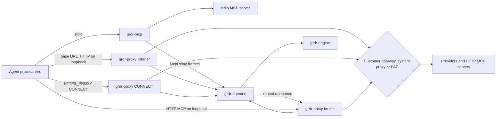

# 17. Network control: endpoint proxy, MCP broker, gateway and browser

_Status: draft 4, aligned with spine version 4 and `_review/02-owner-answers.md` (no ruling in `_review/01-document-rulings.md` names this document). The document describes the complete control points; ordering is stated only as prerequisites. Date: 2026-11-10. Revised 2026-11-11 for principles P15 to P17 and the owner's kit instructions (`_review/04-owner-kit-instructions.md`). Owning squad: Gateway (endpoint proxy, MCP broker, server `gateway` target); Interfaces squad for the browser extension. Read with: `00-decisions.md` (D-13, D-16, D-27, D-28, D-30, D-40); 03 (topology, `grdr-proxy`, `grdr-mcp`); 04 (`action.net.*`, `action.llm.request`, `action.mcp.*`, `manifest_hash`); 07 (decision protocol, degradation, conformance); 12 (Cedar schema, `grdr.mcp` and `grdr.egress` packs, AuthZEN); 05 (inventory); 14 (reputation); 15 (credentials released to agents); 16 (detection and redaction); 18 (approval flow); 21 (keys); 23 (our MCP server); 25 (integrations); 27 and 28 (screens); 29 (privacy); the sensor and sandbox documents. A bare two-digit number is a design document; research is cited as "brief NN" or by its letter-prefixed id._

## Summary

This document specifies the control points on network paths: the explicit listener and CONNECT proxy in `grdr-proxy`, the MCP broker, the server `gateway` target with adapters for other gateways, and the browser extension; their honest limits; and the hardening suite we hold ourselves to. Key choices:

1. **Explicit routing first, interception last (D-16).** Plaintext comes from making our loopback listener the agent's base URL or MCP endpoint, which needs no CA. Selective TLS interception is opt-in, Protected profile only, support Tier 3 (experimental, D-50) until N3.3's acceptance criteria pass, and never touches browsers or updaters.
2. **Never take the proxy slot.** We never set the system proxy or PAC; steering is per process tree, and our listener chains to whatever the customer already uses.
3. **Three steering routes with honest grades:** `configured` (request), `contained` (scoped-boundary, with D-21), `redirected` (mandatory-boundary; each OS has its own prerequisite, section 2).
4. **The proxy holds no session state** (03). Pins, grants and labels live in the engine; only the server `gateway` target runs the full core in process.
5. **One broker for both MCP eras,** without translation, keyed on nothing the protocol lets a client choose.
6. **Tool definitions are pinned by `manifest_hash` in every Mode** (D-32); drift is always a finding; Block is the broker's default-deny mode.
7. **Elicitation carries approvals but never grants them;** the grant comes from `grdr-approve` at the rule's minimum grade (D-07, D-31).
8. **The broker owns OAuth binding state for every flow it sees, and tokens for servers set to `auth: broker`** (D-27 inject mode; requires 15's credential broker). While a server is `auth: agent`, an OAuth-protected HTTP server keeps its own URL, because rewriting it would change the audience the agent requests.
9. **The gateway enforces; it does not route** (D-40). agentgateway, LiteLLM, Agent Router and Kong are adapters, and each adapter's fail mode is measured, not declared.
10. **A public bypass suite** built from the 2026 gateway advisories gates our proxy and grades everyone else's.

## Requirements

| # | Requirement | Trace |
|---|---|---|
| R1 | Four visibility tiers; interception opt-in, per process tree, never browsers or updaters | D-16; brief 38; h08 |
| R2 | Never take the system proxy slot; chain to customer gateway, proxy and PAC; trust the OS store; detect interceptors and chain or stand down | D-16, D-23; l02 F3; h03 |
| R3 | Interception CA per device, name-constrained, memory-only, never in an OS or browser store | D-16; SR-38; l01 F6 |
| R4 | Destinations from policy; tool definitions pinned; OAuth bound to issuer and audience; no stdio start from API input; deny on evaluation error | SR-40; brief 38 |
| R5 | MCP broker for stdio and Streamable HTTP across 2025-06-18, 2025-11-25 and 2026-07-28 | D-13; brief 19, g03 |
| R6 | Argument-level MCP policy through extractors keyed by manifest hash | D-08; 12 |
| R7 | STEP_UP never relies on the agent's prompt; hold only within D-07's limits | D-07, D-31 |
| R8 | Gateway with in-process policy, fail-closed defaults, kill actuator; other gateways as adapters with measured verbs and fail mode | D-40, D-30; h05 |
| R9 | Browser control point with force-install, native messaging, tenant restriction, page and WebMCP instrumentation, stated blind spots | D-13; briefs 05, 16, g09 |
| R10 | A2A traffic parsed and governed | Owner request; briefs 19, 38 |
| R11 | Added p99 under 20 ms; streaming first byte under 5 ms added (targets) | Spine section 6 |
| R12 | Achievable `control` and `on_failure` measured per agent version; zero silent fail-open | P1, P9, D-50 |
| R13 | Seams for D-27 inject mode: credential substitution at the proxy, broker-owned MCP tokens | D-27 |
| R14 | Metadata upload by default; no clipboard or keystroke capture | D-51, P8 |
| R15 | Public hardening suite runnable against third-party gateways | brief 38; 02 |

## Design

### 1. Components and paths

| Component | Runs as | Does | Never does |
|---|---|---|---|
| `grdr-proxy` | Protected: low-privilege account; User: the user (03) | Model listener, CONNECT listener, MCP broker, parsing (`grdr-llm-proto`, `grdr-mcp-proto`), outbound `acs` providers (07); the credential broker module and its lease table (15 section 5; requires the launcher and the Protected profile, D-27) | Keep session state; read outside its state directory; set system proxy settings |
| `grdr-mcp` | Agent's user, spawned in place of a stdio server | Execs the real server; relays frames through its one daemon connection, which routes them unopened to `grdr-proxy` (03 hub and spoke); applies the fail-safe table, compiled and signed on the device by the privileged service (D-14), when the daemon or proxy does not answer | Parse beyond the bounded scanner; fetch packages; connect to anything but the daemon |
| Upstream helper (`grdr-proxy --upstream-helper`) [Protected profile only] | Session user, one per logon session | Authenticated CONNECT to a customer proxy that needs the user's identity; pipes ciphertext | See plaintext, hold keys, decide |
| `gateway` target | Service (D-33) | Model routes and HTTP MCP with the full core; decision endpoints for other gateways; kill actuator | Route by cost or model; start stdio servers from API input |
| Browser extension and `grdr-hook --native-messaging` | Browser; user | Page instrumentation, tenant headers, decisions via the daemon | Hold policy or keys; read clipboard or keystrokes |

The native messaging host is the signed shim in relay mode, so the browser has the same trust path as hooks (07). Signing follows D-59: on Windows through the free open-source signing programme; on macOS only with Apple's Developer Program, otherwise the shim ships with its Sigstore signature and provenance, marked not platform-signed (D-18, D-59).



The proxy parses, builds an action at `phase: intent`, sends `Decide` with `payload.action` (07), executes the verdict and later sends `Report`. Its `Hello` declares ALLOW, DENY, MODIFY (header set, body redaction, MCP list filtering, argument rewrite) and STEP_UP as deny with retry token, plus `can_hold` only where the agent contract states the client's MCP timeout (used only for section 7.7's hold case). Connection state the proxy keeps for routing (an `Mcp-Session-Id` map, token digests) carries no labels, grants or pins. When a hook already decided the same tool call (such as `WebFetch`), the proxy judges the request against floor rules and the hook's expectation and honours the same grant, so nobody is asked twice (D-13).

### 2. Visibility tiers and steering routes

D-16's visibility tiers, with the provenance grade (04) of what each yields: (1) connect and SNI, from sensor tiers and our CONNECT listener (`observed-kernel` or `mediated`); (2) claims from hooks, native OTel and transcripts (`claimed`); (3) the explicit listener, with full plaintext (`mediated`); (4) selective interception (`mediated`). These are not D-50's support tiers, which this document always names as "support Tier N".

| Route | Mechanism | Requires | `control` for `net.*`, `llm.request` |
|---|---|---|---|
| `configured` | Base URL or proxy variables through the agent's managed environment block, `grdr run` or its process wrapper; MCP entries through the D-49 writer | The listener; the D-49 writer or the launcher | `request` |
| `contained` | The session sandbox leaves only the listener (D-21): Linux the `cgroup_sock` program, which allows the session's tree only the listener (10, R-40), or else an empty network namespace whose only route is a socket bridge to the listener; macOS Seatbelt with one loopback port; Windows user-mode WFP filters on the sandbox SID (D-17). On Windows the agent uses base-URL routes only, because Schannel clients cannot complete HTTPS under the sandbox's restricted token (brief 38, verification row 7); the proxy, outside the sandbox, does the upstream TLS | Containment (D-21) on that OS, where S-10 and S-11 pass; the Protected profile (in the User profile the route is reported as `request`, D-48); on Linux, the `cgroup_sock` program's own review (R-40), which exists only in the Protected profile, or else unprivileged user namespaces for the launcher's network namespace | `scoped-boundary` |
| `redirected` | Transparent redirect of agent lineage: Linux cgroup BPF connect rewrite (sensor document); macOS transparent proxy; Windows WFP redirect callout | Linux: kernel enforcement (D-19) and the kernel-component review D-62 sets (`eval-security` and `eval-adversarial` on different models, plus any free external audit or qualified volunteer review that arrives); macOS: a Network Extension under Apple's Developer Program, and an organisation that opts in, because D-18 bars a transparent proxy by default; Windows: the optional driver (D-17), which depends on a sponsor or partner | `mandatory-boundary` only when it covers every process of the program identity |

Rules:

1. Our upstream is what the customer already has: the agent's configured base URL or gateway, then proxy variables, then OS proxy and PAC (WinHTTP on Windows, CFNetwork on macOS; on Linux explicit and static settings only, PAC reported unsupported). Where MDM or server-managed policy owns the agent, we write nothing and render a fragment (D-49).
2. **Claude Code:** a non-default base URL skips the server-managed settings fetch; MDM and file settings still apply (h08, verification row 6). The base-URL route is refused for instances whose effective source is server-managed (`route-unsafe-for-source`). `allowedProviders: ["customEndpoint"]` with the base URL in the managed file's `env` block pins Claude Code 2.1.285 and later to the listener (brief 38, verification row 4).
3. **Proxy canary.** A route is `effective` after the session's first model request arrives through it. A direct connection from the session to a `model-provider` or `mcp-server` host with no matching listener request raises `proxy-bypass` (coverage gap), marks the route `configured-not-effective` and drops `control` to `none`. This catches runtimes that ignore proxy variables (Node without `NODE_USE_ENV_PROXY`; Go's `net/http`, which never proxies loopback destinations, brief 38) instead of assuming them.
4. Group settings, where lowering either is a widening operation (D-31): `steering: off | configured | contained | redirected` (`redirected` only where the table's prerequisites hold), default `off`, with the console recommending `configured` once canaries pass in the early ring; `mcp-broker: off | wrap`, default `wrap` once the device is protected (D-48), with `grdr.mcp` in Watch so wrapping changes no outcome until a rule leaves Watch. Standalone offers both switches per agent after first run (D-48).

### 3. Explicit listener

**Base-URL mode.** One port on `127.0.0.1` and `::1` per device (per logon session in User and on multi-session hosts, D-59). Routes are `/t/<instance token>/<route id>/...`; the route id maps to a fixed upstream from the instance's configuration, never to the client's Host or path, so there is no open relay. Requests must pass SR-39: no `Origin` header, Host equal to the bound address, token present, JSON content type on POST. The token, Origin and Host checks stop browser pages; they do not stop local processes, because the token sits in a managed file other local users can read. The peer check does: the daemon derives the peer from the socket (socket inode, `GetExtendedTcpTable`, libproc) at grade `observed-user`, and a request whose peer is not in a governed session of the instance the token names is refused with 403 and recorded.

**CONNECT mode.** The same peer check applies, so the CONNECT listener is never a relay for processes outside governed sessions. The CONNECT host is a `net.connect` decision. The proxy peeks the ClientHello, records SNI and ALPN, then tunnels or intercepts (section 5). SNI different from the CONNECT host sets `net.sni-mismatch`, or `net.ech` when the outer name is a known ECH public name. A SOCKS5 mode is part of the listener, under the same peer check, with the target host decided as `net.connect`.

**Port ownership.** The service manager holds the listening socket and hands it to the proxy (systemd and launchd socket activation; on Windows the proxy binds with `SO_EXCLUSIVEADDRUSE` and passes the handle to its successor on update). The daemon itself binds no TCP port (D-42). Restarts never free the port for a squatter, and updates drop nothing (D-15). The daemon checks the owner every 60 s; a foreign owner is a tamper finding.

**Upstream.** rustls with the platform verifier (enterprise roots honoured), TLS 1.2 or later, HTTP/2 by ALPN. An upstream is dialled in cleartext only when the declared endpoint or the agent's own configured base URL is `http://`, as is common for Ollama, vLLM and llama.cpp servers inside a site; an `https` upstream is never downgraded, and a cleartext upstream sets `transport.cleartext` on the event. Revocation follows the OS verifier, but a CRL or OCSP location that does not answer may not stall a handshake beyond 2 s (measured per OS, not assumed), and the result is the fact `tls.revocation` (`good`, `revoked`, `unknown`). When the customer proxy needs the user's identity, the upstream helper performs the authenticated CONNECT. That keeps the customer's per-user attribution and keeps the CA key out of same-user memory. Each authentication downgrade is a reported fact, as on the uplink (D-36).

**Bodies.** Requests are buffered for evaluation up to 32 MiB; `gzip`, `br` and `zstd` are decoded with a 100:1 cap. Oversize sets `body.oversize`, and content rules are then not evaluable. A modified body is sent uncompressed. Responses stream unchanged while a parallel parser extracts usage, stop reason and proposed tool calls. Nothing is held unless a response-side transform is active (none in the default packs); a holding proxy emits keep-alive pings (Claude Code's 180 s watchdog, brief 38).

**Denials** are HTTP 403, never 5xx (agents retry 5xx), with the body 34 section 7 fixes: the provider's error shape on model-provider routes, RFC 9457 elsewhere. They name the component, rule and exception route (D-44) and carry `grdr-decision-id` and `grdr-retry-token`. Retries match by session lineage and action digest (07).

**Events:** `action.llm.request` (intent, then result), plus a `tool.call` at phase `requested` for each tool call the model proposes. That second, mediated source feeds 07's `hook-silent` and `undeclared-activity` detections.

### 4. Per-process trust and proxy variables

Delivered only through a steering route, never through dotfiles (D-27).

| Variable | Purpose |
|---|---|
| `HTTPS_PROXY`, `HTTP_PROXY`, `NO_PROXY` | CONNECT route; `NO_PROXY` keeps customer entries and never lists provider or MCP hosts |
| `NODE_USE_ENV_PROXY=1` | Node 24.0 / 22.21 and later honour proxy variables (brief 38, verification row 5) |
| `WS_PROXY`, `WSS_PROXY` | Codex WebSockets |
| `ANTHROPIC_BASE_URL`, `OPENAI_BASE_URL`, per-agent equivalents from the adapter manifest | Base-URL route, only where conformance proves a loopback `http://` URL works |
| `SSL_CERT_FILE`, `NODE_EXTRA_CA_CERTS`, `REQUESTS_CA_BUNDLE`, `CURL_CA_BUNDLE`, `DENO_CERT` | Interception only: a read-only bundle of OS roots plus our CA certificate |

Without interception no trust variable is set. `NODE_EXTRA_CA_CERTS` is ignored by code that passes its own `ca` (brief 38), which the pinning rule below treats like a pinned client.

### 5. Certificates and selective interception

Selective interception is support Tier 3 (experimental, off by default) until N3.3's acceptance criteria pass, and support Tier 1 after that.

**CA.** An ECDSA P-256 key generated in proxy memory: never on disk or over IPC, excluded from core dumps, zeroised on exit. The certificate's `nameConstraints` permit only the `intercept-eligible` host class as dNSName subtrees (a class entry that cannot be written as a subtree is rejected by the pack validator), with a 7-day validity. A proxy restart creates a new CA generation and bundle path. Sessions holding the old bundle fall back to pass-through, which still validates against the OS roots in that bundle, and the fall-back is reported. The CA is never added to an OS or browser store (SR-38). Name-constraint enforcement is measured per runtime (N-20), not assumed. Leaf certificates are P-256 with 24-hour validity, exact-host SAN, and an in-memory LRU cache.

**A flow is intercepted only if all of these hold:**

1. `interception: selective` is set (default `off`). Setting it is a widening operation at its class minimum (D-31) and is shown in the disclosure surface (D-51). It is refused in the User profile, where the proxy runs as the user and same-user code could read the CA key from its memory.
2. The flow comes from a session container of a catalogued or triaged agent (D-24, D-25).
3. The host is in `intercept-eligible` (model APIs and MCP hosts).
4. The program identity is not in the catalogue's `browser` or `updater` classes or the coexistence pack's own-TLS list. Updaters are excluded for a reason seen in the field: Cursor's macOS updater rejects even a system-trusted inspection CA and dead-ends (h08, verification row 7).
5. No client certificate is presented (mTLS tunnels).
6. The host and program pair is not marked `pinned`. A handshake aborted after our leaf marks the pair for 24 hours and raises a coverage-gap finding (h08).
7. No existing interceptor covers the host.

**Existing interceptors.** After the boot delay of 22 section 3, on every change of network, proxy or PAC settings, and once every 24 hours at a per-device phase, the proxy reads OS proxy and PAC settings, matches running services against the coexistence pack (Zscaler, Netskope, Prisma Access, Cloudflare WARP, Falcon and Defender network inspection, Check Point's desktop proxy, Prompt Security's local proxy, BeyondTrust; D-23; h03), and classifies each class's path from the certificate chains of connections agents already make through it, comparing each chain's issuer with the issuer recorded for that host (the declaration's optional `tls_issuer_spki`, else the first-seen issuer). It opens a probe of its own only for a class with no such connection in 24 hours, at most once per class and network a day, to one resolvable host from the effective host classes, never a fixed public host; a class with no host that resolves on this network is skipped and recorded as `probe-skipped`. Results are kept per network (gateway address and DNS suffix). A changed issuer, not a non-public root, marks an interceptor, because on a site without internet every legitimate endpoint chains to an enterprise root. If an interceptor is found, we chain through it and stand down for the hosts it covers; plaintext then comes only from base-URL routes. Each case becomes a ceiling-matrix row.

### 6. Protocol parsers

| Parser | Consumers |
|---|---|
| Anthropic Messages with SSE | Replay model endpoint of the efficacy harness (D-45), proxy, gateway |
| OpenAI Responses | Replay endpoint for Codex, proxy, gateway |
| Chat Completions (covers Ollama, vLLM and other OpenAI-compatible servers); Gemini | Proxy, gateway |
| MCP 2025-06-18, 2025-11-25, 2026-07-28 over stdio and Streamable HTTP; the deprecated HTTP+SSE transport decided with ALLOW and DENY only, never modified | Broker, gateway |
| Bedrock Converse and InvokeModel event streams; A2A 1.0.1 JSON-RPC and HTTP+JSON | Gateway, proxy |
| OpenAI Realtime over WebSocket | Proxy, gateway |
| A2A gRPC | Gateway, proxy; requires a partner whose agents use it, which supplies the test traffic |

The efficacy harness needs the Anthropic Messages and OpenAI Responses parsers for its replay endpoints, so those two are prerequisites of D-45's harness.

Parsers return `resolved`, `unresolved` or `malformed` (D-10). Malformed input (broken JSON, duplicate keys, an index past its bound, a framing violation) denies the request or ends the stream with an error. Unknown events and fields are `unresolved` and pass, so a provider feature never breaks an agent. JSON is parsed with duplicate-key rejection and depth 64, numbers are kept as decimal strings, and every upstream-controlled index and length is bounded in `limits.toml` (1,024 tool calls per response, 1 MiB per SSE event).

### 7. MCP broker

**7.1 Routes.** For stdio, the D-49 writer rewrites user-scope entries, and managed-scope entries only where we are the agent's managed-configuration owner, to `grdr-mcp --server <mcp id> -- <original argv>`; where MDM or server-managed policy owns them we render the wrapped entries as a fragment for that owner (D-49). The wrapper execs the original argv with the agent's environment minus D-28's scrub list, verifies the daemon endpoint's owner as the shim does (07), and relays frames over that one connection; frames above the 2 MiB IPC cap (03) travel in chunks under one frame id. The proxy answers each frame with `forward`, `replace`, `reply` or `drop`, keeping order per direction.

For HTTP, the entry's URL becomes `http://127.0.0.1:<port>/t/<token>/mcp/<mcp id>`; the broker forwards over TLS through the resolved upstream and never follows redirects. The rewrite applies only to servers with no OAuth (static header credentials or none). A server that answers with RFC 9728 protected-resource metadata keeps its own URL while it is `auth: agent`, because the agent derives the RFC 8707 resource indicator from the URL it is configured with, and a loopback URL would make it request a token for the wrong audience. Such a server is reached through the CONNECT route, where the broker sees its frames only under selective interception (MCP hosts are `intercept-eligible`), and is rewritten once it moves to `auth: broker` (7.8). Project-scope entries are never written (07). They are covered by hooks (request grade), by native deny of server identity where the agent supports it (D-12), and by the sensor; the assurance record shows no broker for them. A stdio command whose launch digest differs from inventory is a new server, decided as `mcp.connect`. The gateway starts stdio servers only from its signed deployment configuration (SR-40).

**7.2 Revisions.**

| Concern | 2025-06-18, 2025-11-25 | 2026-07-28 |
|---|---|---|
| Detection | `initialize` | `_meta` protocol version on every request; `MCP-Protocol-Version` header must equal it |
| Binding | `Mcp-Session-Id` mapped to our (route, principal, session) and never forwarded to another upstream | By connection (stdio) or by peer and `traceparent` (HTTP) |
| Header checks | n/a | `Mcp-Method` on all requests, `Mcp-Name` on `tools/call`, `resources/read`, `prompts/get`, and `x-mcp-header` values must match the body, else deny (`HeaderMismatch`, -32020) |
| Server input | `elicitation/create` (form mode); from 2025-11-25 also URL mode and the URL-elicitation error -32042 | `resultType: "input_required"` with `requestState`; the client retries (the -32042 error and `elicitationId` are gone, brief 36) |
| List changes | `notifications/tools/list_changed` | `subscriptions/listen`; `ttlMs`, `cacheScope` |

The broker does not translate revisions: that doubles parser surface, and agentgateway offers it to those who want it (brief 38, verification row 2). HTTP+SSE may be removed in the next revision (brief 19, verification row A).

**7.3 Pinning.** For every `tools/list` result the broker computes each tool's `manifest_hash` (04: SHA-256 over JCS of name, description, input schema, annotations) and a `manifest_set_digest` over tools sorted by canonical name, since deterministic order is only a SHOULD. Names are compared after NFC and case folding. A collision inside one server makes the list malformed; a collision with another server in the session sets `mcp.tool-shadow`. Pins live in the engine's local history keyed by agent instance, server and tool; the first sighting is recorded for drift detection only and never sets `manifest_pinned`. `McpTool.manifest_pinned` (12) is true only when the hash matches an organisation pack list or an Exception bound to the instance and hash. Every list is hashed in every Mode (D-32). A change sets `mcp.manifest.drift`, raises a finding, and updates inventory (05) and reputation (14). A changed tool is a new tool: Watch runs it with a finding; Ask steps up with a before-and-after card (27, 28); Block denies.

**7.4 Default-deny mode** is rules `mcp.server-allow-list` and `mcp.tool-pin` (12) at Block. In Block the broker also removes denied tools from `tools/list` results, preserving order, as a MODIFY whose receipt holds both digests. The `grdr.mcp` pack ships in Watch and leaves it under D-53's evidence rule.

**7.5 Arguments.** An extractor is pack data keyed by `manifest_hash`: entries of JSON pointer (with `*`), analyser (path, host and URL, command, `email-recipient`, `git-remote`, `sql-verb`) and class prefix. The results fill `context.args.classes`. `extracted` is true only if an extractor exists for the exact hash and every pointer resolved; otherwise argument rules are not evaluable and the class failure policy applies. Canonical arguments (sorted keys, decimal-string numbers, NFC strings, normalised URIs) feed both classes and the `mcp.call` grant digest (12). Drift voids the extractor, and the console says that visibility was lost. Result values under an extractor marked `state-handle` are bound to the session, and their use from another session denies.

**7.6 Results** go to the engine for D-28 labels by the server's pack trust class (`untrusted:external-tool`, `untrusted:web`), never by server annotations, which are advisory facts. Detectors are 16's. `resources/read` and `prompts/get` are decided like calls.

**7.7 Approvals and elicitation.**

```mermaid
sequenceDiagram
  participant C as MCP client
  participant B as Broker
  participant D as Daemon and engine
  participant P as grdr-approve
  C->>B: tools/call
  B->>D: Decide (mcp.call)
  D-->>B: STEP_UP, request id, retry token
  D->>P: OS-native approval at the rule's grade
  alt 2026-07-28, client declares elicitation
    B-->>C: input_required, URL-mode request naming the approval; requestState carries the retry token
    C->>B: retry with requestState
  else 2025-11-25, client declares URL elicitation
    B-->>C: URL elicitation required error (-32042) naming the approval
    C->>B: retry after completion
  else self approver, client timeout known
    B->>B: hold the call within D-07's limits while grdr-approve asks
  else otherwise
    B-->>C: isError result with reason and retry token
    C->>B: identical retry
  end
  B->>D: Decide with retry token
  D-->>B: ALLOW if a grant matches, else DENY
```

Elicitation text is a language token rendered in the person's `ui.locale` (D-69), with the product name from `:grdr:brand`, naming tool and server ids, with no agent or server bytes. Its URL opens a local console page (served by `grdr console serve`, D-42) that may only propose (D-31); the approval itself is taken by `grdr-approve`. Form-mode elicitation is never used as an approval, because the client renders it inside the agent host and the agent's own prompt is not an approval at any grade, G0 included (spine section 3, D-07; R-01 removed 07's native ask on the same ground). Whether a client retries by itself after URL elicitation is measured per client (NS-3); a client that does not leaves the agent with the error's reason and retry token, as in the last branch. Broker request ids are prefixed `grdr:` and never forwarded.

A denied `tools/call` returns `isError: true` with an actionable reason (D-44) and `_meta["grdr/decision"]` (decision id, retry token), so the model can read why. A denial of any other method is a JSON-RPC error with `data["grdr/decision"]`. Its code is fixed in `grdr-schema`, and a schema test fails if any supported MCP revision assigns it: -32042 is 2025-11-25's URL-elicitation error and -32020 is 2026-07-28's `HeaderMismatch` (brief 36; brief 38), so neither is ours. Wire names are final under D-66.

**7.8 OAuth state.**
- *Binding,* for every OAuth flow the broker sees (intercepted flows, and its own flows under `auth: broker`). On the first approved `mcp.connect` the engine records the server's protected-resource metadata (RFC 9728) and named issuer. A later issuer change, a resource indicator other than the server origin (RFC 8707), or a cross-origin metadata redirect steps up as credential redirection (ADV-3). The broker holds per-boot HMAC digests of bearer tokens per server. A digest seen for server A and presented to B is denied (`mcp.token-reuse`), the pattern of October's MCP SDK advisories (g03).
- *Ownership* (with 15; requires 15's credential broker). Per server, `auth: agent | broker`. In `broker` mode the broker is the OAuth 2.1 client: PKCE in the system browser with a loopback redirect (RFC 8252); a pre-registered client id, or the Client ID Metadata Document the `identity` target hosts where a server is present (15 section 9; requires the server's `identity` target), never DCR by default; `iss` validated (RFC 9207); tokens in the OS keystore under the proxy account, keyed by issuer and resource (SEP-2352). It injects the token per request, so the secret never enters the session (D-27). Enterprise-Managed Authorization (ID-JAG) is consumed through 15 section 9's adapters, which require the token service and registry connectors (D-27); it governs the connection, not the call.

**7.9 Failure.** Engine timeout: floor policy, then the pack's loss-of-sensor setting (D-15), Degraded. Daemon unreachable from `grdr-mcp`, or the daemon reports the proxy down (the daemon cannot parse MCP, ARCH-004): the device-signed fail-safe table (D-14, 07, `mcp_tool_exact`) over `method` and `params.name`, applied after 250 ms or at a valid update-handover marker's deadline, never beyond 2 s; other frames pass and are reported when the daemon answers again. Evaluation error: DENY (D-10, SR-40).

**7.10 Claims.** stdio `mcp.call` is at most `request`, because an agent can always speak MCP to a child outside the wrapper. HTTP MCP reaches `scoped-boundary` in `contained` sessions, where CONNECT to `mcp-server` hosts is denied unless it comes through the broker route; an OAuth-protected server before `auth: broker` reaches it only when its flow is intercepted, and is otherwise `request`.

### 8. Egress, DNS and the kill switch

`net.request` reads `Endpoint` host classes and `context.http.classes` (method, path, `mutating`) for D-28's pinning. The proxy resolves each name once and dials the vetted address. Loopback, private, link-local and metadata addresses are denied unless a host class allows them (declared model endpoints, gateways and MCP origins, 05 section 7, compile into the `model-provider` class and an `org.*` class for MCP origins with every address they resolve to, so on a site without internet declaration alone makes them reachable; a learned endpoint is allowed only after an organisation decision, a widening under D-31; metadata addresses never are), IPv4-mapped IPv6 is normalised, and TTLs never reopen a decision. Tenant headers (16 section 7 owns the header set and its reach) are set, never appended, on base-URL routes and intercepted flows; they cannot apply when the agent uses Bedrock, Vertex or another gateway (brief 05, verification row 1). On the same plaintext flows the proxy and gateway add 15 section 14's `Grdr-Session` outward tag, under 15's destination rules. D-30's "cut session egress" closes the session's streams and tunnels within 1 s (target) and denies new requests, backed by the sandbox in `contained` sessions. Kill and freeze state lives in the daemon's fixed-layout projection (03) and is read on every decision; a change invalidates every cached verdict in its scope (12, caching). `grdr egress` (D-48) lists proxy upstreams separately as "relayed for agents".

### 9. Gateway target and third-party gateways

The `gateway` target requires the server (D-33) and runs customer-side and offers (a) model routes with the listener's layout, with the organisation taken from the workload credential (D-36); (b) an HTTP MCP reverse proxy with the broker's logic; (c) `POST /v1/guard` (07) and AuthZEN evaluation (12). Sessions are keyed by the claimed session header or `traceparent` plus the workload principal, at attribution grade 1 unless a sensor links them. Labels are held in memory, sharded by consistent hash in `ha`. A replica loss emits `session.state-reset`, after which label-reading rules are not evaluable and deny in fail-closed classes. Evaluation errors and missing bundles deny, and there are no default keys (SR-46). The kill actuator holds signed kill state in tier 0 memory (D-30).

| Adapter | Hook | Verbs | Fail mode |
|---|---|---|---|
| agentgateway v1.7.0 | ExtMCP guardrail on `mcp.params` and `mcp.result` (its `mcpAuthorization` CEL cannot see arguments, so argument rules need the guardrail); LLM guardrail and external-authorisation hooks | ALLOW, DENY, MODIFY | No documented default (brief 38, verification row 2): set to deny, proven by N-01 per version |
| LiteLLM, external only, minimum patched version | We serve its Generic Guardrail API contract (`POST /beta/litellm_basic_guardrail_api`, labelled beta upstream) | ALLOW (`NONE`), DENY (`BLOCKED`), MODIFY of texts (`GUARDRAIL_INTERVENED`); STEP_UP becomes `BLOCKED` with the exception route | `unreachable_fallback` defaults to `fail_closed` (brief 26, verification row 8); a deployment set to open is recorded as `on_failure: open` |
| Agent Router | Envoy external processing and authorisation filters | ALLOW, DENY, MODIFY | Set to deny; proven by N-01 (its 2026 fail-open advisory) |
| Kong | Plugin calling `/v1/guard` | ALLOW, DENY | Measured |

Adapters evaluate only stateless policies (D-40), never return policy text (D-38) and offer shadow mode. Our gateway's events are `mediated`; third-party gateway events and ingested logs (OTLP, LiteLLM callbacks, agentgateway access logs; 25) are `reported`. A host that fails open under N-01 is recorded as `control: request`, `on_failure: open`. The hosted service (which requires revenue, sponsorship or donated cloud credits, D-63; self-hosting is the default) runs the `decide` endpoints only, not a data-plane gateway, because customer content would transit it against D-51 and leases may not live there (D-27); see open question 2.

### 10. Browser extension

The extension requires the engine in WebAssembly. A managed fleet needs no store; store listings serve unmanaged installs only (spine section 7).

**Building it.** The extension is a pnpm workspace like every JavaScript and TypeScript workspace of the project. Work on it loads, in order, `ui-architect`, `frontend-design` (for new screens) and `modern-web-guidance` with its `chrome-extensions` pack, as `.agents/kit/path-skills.toml` maps them; where the guidance and this document differ, this document, 27's stack and D-44 win, and built-in browser AI APIs are used only where a spec asks for them (P2, P8).

**Self-hosted packages.** Each release builds them, lists them as `binaries` targets under `project/targets/browser/` and carries them in the air-gap bundle, so the update repository, any mirror or `content` serves them:
- Chrome, Edge and Brave: a CRX3 signed with the project's extension key in the release environment, with its update manifest. The key fixes the id that the native-messaging allow-list and the coexistence pack name.
- Firefox: an XPI signed through Mozilla's free unlisted channel at release time, which needs a Mozilla add-ons account in Loonaro's name. That account is an external precondition like Apple's programme: until it exists the XPI ships with Sigstore signatures and provenance only and is marked "not platform-signed" in the release manifest, Firefox release builds, which install only Mozilla-signed extensions, report the extension absent, and nothing else waits for it.
- Safari: the Safari Web Extension inside the notarised, stapled Developer ID app, which requires Apple's Developer Program (D-18).

`grdr mdm render --product browser --base-url <mirror>` writes Chromium `ExtensionSettings` with `installation_mode: force_installed`, `update_url` on the mirror and `override_update_url: true`, and Firefox `ExtensionSettings` with `install_url` on the mirror. The signed manifest names no update host of ours, so the site's policy alone decides where updates come from; NS-6 settles how a force-installed XPI updates with no route to addons.mozilla.org. Chromium force-installs an off-store package only on a managed machine (joined to Active Directory on Windows, MDM-enrolled or directory-bound on macOS). Elsewhere the extension is reported absent, and an air-gapped Mac with neither uses Firefox or Safari. Policy names and these conditions are prior knowledge, confirmed by N6.1.

**Deployment.** One MV3 code base for Chrome, Edge and Brave (`ExtensionInstallForcelist`, `ExtensionSettings`) and Firefox (`policies.json`); Safari as a Safari Web Extension from the same code base, which requires Apple's Developer Program for signing and distribution (D-18). Configuration comes only from `chrome.storage.managed`. Host permissions are a static list in the signed manifest (AI sites plus tenant-header hosts), not `<all_urls>`. Adding a host is an extension release, except for an organisation's own internal AI web origins, which no project release can list: `grdr server browser pack` adds the origins declared in the organisation layer to the Chromium package's host permissions, signs it with an extension key held in the Keys port, and the endpoint package writes that build's id into the native-messaging allow-list from signed configuration; site adapters for those origins are organisation-layer data, and Firefox keeps the project's list, because only Mozilla signs an XPI; site adapters for listed hosts ship through the content lane. Incognito is enabled by policy or reported as a gap.

**Native messaging.** Host `grdr.browser` (D-66), with the host manifest's allow-list (`allowed_origins` on Chromium, `allowed_extensions` on Firefox) limited to our ids, a rebuild's ids and an organisation build's id. Messages: `hello`, `event` (claims, TB-14), `decide`, `verdict`. The extension never receives policy. Without the host it applies only managed tenant rules and reports Degraded.

**Tenant restriction.** Managed organisation ids compile into `declarativeNetRequest` `modifyHeaders` rules with `set`: `anthropic-allowed-org-ids`, `ChatGPT-Allowed-Workspace-Id`, `X-GoogApps-Allowed-Domains`, `sec-Restrict-Tenant-Access-Policy`, `sec-GitHub-allowed-enterprise`. Block rules cover `*.individual.githubcopilot.com` and, at medium confidence because the path is undocumented, `chatgpt.com/backend-anon/` (brief 05, verification row 4). `modifyHeaders` rules are capped at 5,000 dynamic plus 5,000 session rules (brief 05, verification row 2). Each header's reach, from 16 section 7's provider table, is shown with the rule.

The same tenant pack also compiles to the proxy's header sets and to native agent settings through D-12; 16 section 7 owns that mapping, including the rule that `forceLoginOrgUUID` is emitted only for `vendor-login` instances. One rule therefore reaches up to three enforcement points.

**Page context.** A main-world script at `document_start` wraps and freezes `fetch`, `XMLHttpRequest`, `WebSocket.send`, `EventSource` and `sendBeacon` on listed origins. Requests to endpoints named by a site adapter (signed match tables, never URLs to fetch; P7) wait for `decide` with a 300 ms budget; timeout follows loss-of-sensor. A blocked submission is cancelled, and the notice names component, rule and sanctioned alternative (D-44). The in-page notice, popup and options page are `@grdr/kit` patterns (`BlockCard`, `StatusSummary`), which compose Astryx components through `@grdr/ui` (27), rendered inside a closed shadow root with Astryx's stylesheet adopted there, using the token CSS and `@grdr/i18n` in the person's `ui.locale`, which the native host's `hello` reply carries, so the extension matches the tray and console; the notice is announced through `aria-live` and its CSS uses `__MSG_@@bidi_dir__`. The store name and description are generated into `_locales/<locale>/messages.json`, the only use of that format. The extension loads no remote font, image or script. The script registers no paste, clipboard or key listeners (D-51). Firefox's `filterResponseData` also yields response bodies (brief 38, verification row 9).

**WebMCP** (Chromium origin trials only: WebKit opposes it and Mozilla is neutral; g09, verification row 7). The script wraps `document.modelContext.registerTool` so each tool's `execute` runs through us: the tool is inventoried with transport `webmcp` and an origin-derived server id, and every invocation is an `mcp.call` decision. `toolactivated` and `toolcancel` are recorded. Annotations are advisory. WebMCP has no observer API, so coverage is limited to the listed origins where the script runs.

**Browser-agent evidence**, never a verdict: debugger attachment, `navigator.webdriver`, AI extension inventory, and from the sensor `--remote-debugging-port` or `-pipe` with a non-default profile (g09).

**Policy compile-down** (a D-12 target): `RemoteDebuggingAllowed=false`, which covers only the remote-debugging switches of that browser, not `chrome.debugger` agents or a bundled browser (brief 05, verification row 10); `GeminiActOnWebSettings=1` set explicitly, because the client default allows (brief 05, verification row 7); Gemini URL lists; `GeminiSparkSettings`; Edge 158 `CopilotBrowserUseAllowList` and `BlockList` and `AgentProfileEnabled` (g09); AI extension blocklists. Never `GenAiDefaultSettings`, which only the Admin console can set (brief 05).

**Blind spots**, carried in the assurance record: CDP-driven input (trusted native input); `chrome.debugger` extension agents; separately installed or bundled browsers; browsers and profiles without the extension; Incognito unless allowed; service-worker fetches; Chromium response bodies outside the wrappers; WebTransport; WebMCP tools on unlisted origins; built-in browser agents' internal actions; desktop apps and CLIs. `control` is `request`, `visibility` `claimed`.

### 11. Agent-to-agent protocols

A2A 1.0.1 is recognised by `A2A-Version` and its methods. `SendMessage` and `SendStreamingMessage` to a remote agent are a `net.request` (class `a2a.message`) on an `Endpoint` classed from its Agent Card, plus a `data.flow` to the `message.send` sink, so label gating applies (D-28). Card signing is optional in 1.0 (JWS over JCS; brief 19, verification row 9); signed cards are verified and a bad signature denies. `a2a.card.unsigned` and `a2a.card.api-key-scheme` feed Watch rules, and card digests are pinned like tool definitions. 1.1 (release-candidate tag 2026-10-29) will be a new adapter version. The Agent Client Protocol belongs to 07's conductor, which uses this broker as a client-provided MCP server. **Outward identity:** outbound Web Bot Auth signatures (RFC 9421; `draft-ietf-webbotauth-httpsig-protocol-01`) as D-26 outward identity for agents fetching web sites; the working group's charter excludes HTTP APIs and agent-to-agent interfaces (brief 18), so it is not a model-API or A2A identity. It is a gateway outbound-request obligation, and proving it end to end requires a partner whose destinations verify it.

### 12. Honest limits

The table is reviewed with each release's ceiling matrix (D-23).

| Limit | Response | Recorded as |
|---|---|---|
| Certificate-pinned clients | Tunnel, mark `pinned`, prefer base-URL routes | Coverage gap; visibility tier 1 |
| QUIC and HTTP/3 | `contained` sessions block UDP/443 so clients fall back to TCP (common practice, not verified per runtime; NS-2 measures it); elsewhere only sensor connect rules | `net.quic` |
| Encrypted Client Hello | Explicit routes are unaffected: CONNECT names the host and base-URL routes name the upstream. In `redirected` mode the proxy sees only the destination address; agent-lineage connections to known DoH endpoints are denied so the sensor still observes name resolution, and a flow whose name cannot be established is judged as an unknown host | `net.ech` |
| Signed bodies (SigV4) | Observe and deny; MODIFY degrades per 07, because the payload hash is signed; bearer-key Bedrock (`AWS_BEARER_TOKEN_BEDROCK`) is modifiable (brief 38) | Degraded reason on receipt |
| Server-side connectors (claude.ai connectors via `mcp-proxy.anthropic.com`, Cowork cloud sessions, hosted tools) | Allow or block the route; native disables (`disableClaudeAiConnectors`); connectors (25) | `connector`, never above AL1 (D-13) |
| Agents inside a vendor VM (Cowork local sessions, brief 16) | Steering routes do not reach inside the VM; the host sensor sees its connections at most at connect level; Cowork OTLP and the Compliance API through connectors (25; the read-only Anthropic Compliance API connector requires the integration host and a customer with access to that API, spine section 7) | Coverage gap; visibility tier 1 |
| Runtimes ignoring proxy variables | Proxy canary; `contained` closes it | `control: none` |
| Local administrator | Detection only (D-22) | `tamper: admin` |
| Agents with their own proxy (Codex) | Delegate to its own policy (D-21); chain upstream only if it honours proxy variables (NS-5) | Per-version contract |

### 13. Hardening

Rules: no `unsafe` in the parsers or `grdr-proxy`; pinned hyper and rustls; strict HTTP/1.1 parsing (both `Content-Length` and `Transfer-Encoding`, bad header bytes or duplicate Host are refused); all queues and caches bounded; seccomp and Landlock, macOS sandbox profile, restricted token on Windows; filesystem limited to the state directory; no core dumps; secrets zeroised; Authorization, cookie and key headers never logged; auth caches keyed by issuer, audience and organisation, with Host never part of authentication; no caller-supplied templates or expressions; no file-serving routes.

`grdr-conformance net` runs in CI against our proxy, broker and gateway, and in the test lab (D-64: free hosted CI runners, plus the tier B machines as optional self-hosted runners) against each third-party gateway version, using the open-source or free editions of those gateways.

| Case | Attack (origin in briefs 38, g03) | Pass |
|---|---|---|
| N-01 | Evaluator error or timeout (Agent Router GHSA-qcwp-vgvh-h3cm) | Denied |
| N-02 | Session reuse across routes (agentgateway GHSA-mvgg-jvj2-4frq; Agent Router GHSA-72hp-5vm2-frr7) | Refused |
| N-03 | Large numeric argument (ToolHive GHSA-9r8f-m39c-5rv5) | Reaches extractor intact |
| N-04 | URI respelling (ToolHive GHSA-gxq5-f6xj-f7w2) | Same class as canonical |
| N-05 | Tool shadowing, case and Unicode variants (Docker CVE-2026-76097, GHSA-qg99-jrvf-j9fh) | Malformed or `mcp.tool-shadow` |
| N-06 | Unsigned pack, extension or manifest (Docker CVE-2026-76094) | Refused |
| N-07 | Unbounded SSE index (GHSA-vgp6-h389-r473) | Malformed; memory flat |
| N-08 | Duplicate JSON keys (GHSA-w5rr-gc4v-5946) | Malformed |
| N-09 | Malformed 2xx (GHSA-99m8-cq7v-gw4g) | Stream ends with error |
| N-10 | Rebinding, resolution TOCTOU, private and metadata targets (CVE-2025-64443, CVE-2026-53708, CVE-2026-55245, CVE-2025-66405) | Vetted IP dialled; denied |
| N-11 | stdio start through an API (CVE-2026-42271, GHSA-86gf-xh3g-rvxq, CVE-2026-105697) | No spawn |
| N-12 | Unauthenticated MCP route (CVE-2026-59822, KEV) | 401 |
| N-13 | Token to a server-chosen issuer, wrong audience, cross-origin redirect (MCP TypeScript SDK, October 2026) | No token leaves |
| N-14 | Routing headers disagreeing with body (MCP 2026-07-28) | Denied |
| N-15 | `Origin` present, wrong Host, missing token (SR-39) | Refused |
| N-16 | Client-chosen upstream in base-URL mode (SR-40); base-URL or CONNECT request from a process outside a governed session | Refused |
| N-17 | Request smuggling | Refused |
| N-18 | Decompression bomb | Refused at 100:1 |
| N-19 | State handle from another session | Denied |
| N-20 | CA key on disk or in a store; name constraints per runtime (SR-38) | None; results published |
| N-21 | Interception of browser or updater (D-16) | Never |
| N-22 | Tenant header appended or duplicated (brief 05) | Exactly one value |
| N-23 | Host-header auth bypass, OIDC cache-key collision, master-key read, template injection (LiteLLM criticals; CVE-2026-37004; GHSA-w4c7-34wj-hqm8) | Refused |
| N-24 | Client renders elicitation and `input_required` to a person in each permission mode | Recorded in the agent contract |
| N-25 | HTTP MCP server advertising RFC 9728 metadata, `auth: agent` | Never URL-rewritten; the agent's token names the real server as audience |
| N-26 | Interception requested in the User profile | Refused |

The suite is published as an open AI and MCP gateway bypass suite (brief 38, whitespace).

## Interfaces and contracts

| Interface | Form | Other party |
|---|---|---|
| `grdr.decide.v1alpha1` `Hello`, `Decide`, `Report` with `payload.action` | Framed protobuf | 07 |
| `grdr.local.v1alpha1.McpRelay`: `Open{mcp_id, launch_digest}`, `Frame` (chunked above the 2 MiB cap), `Instruction{forward, replace, reply, drop}` | Same framing, `grdr-mcp` to the daemon, routed unopened to `grdr-proxy` | 03 |
| Listener routes `/t/<token>/<route>/...`; headers `grdr-decision-id`, `grdr-retry-token` | HTTP on loopback | 07 adapters, D-49 writer |
| MCP denials: `isError` with `_meta["grdr/decision"]` for `tools/call`; otherwise a JSON-RPC error with `data["grdr/decision"]` and a code fixed in `grdr-schema` that no supported revision assigns; standard URL elicitation (-32042) and `input_required` for step-up | MCP | Agents, 18 |
| Host classes `intercept-eligible`, `model-provider`, `mcp-server`; extractors; approved manifest hashes; site adapters; tenant rules | Signed pack data (P7) | 12, 05, 14 |
| Facts `net.sni-mismatch`, `net.ech`, `net.quic`, `body.oversize`, `mcp.tool-shadow`, `mcp.token-reuse`, `proxy-bypass`, `route-unsafe-for-source` | Canonical model | 04 (proposed additions) |
| `/v1/guard`, AuthZEN, ExtMCP server, LiteLLM Generic Guardrail server | `gateway` and `decide` targets | 07, 12, 23, 25 |
| Native messaging `hello`, `event`, `decide`, `verdict` | Length-prefixed JSON | Daemon |
| `swap-credential` transform; broker-owned MCP tokens (require 15's credential broker) | Proxy obligation, keystore | 15, 21 |
| `grdr net status`, `grdr net canary`, `grdr mcp pins`, `grdr doctor net` | CLI | 27, 28 |

## Behaviour by deployment shape

| Aspect | Standalone | Platform (self-hosted, SaaS) | Embedded |
|---|---|---|---|
| Steering, broker, interception | Steering and interception off until enabled per agent; the broker wraps once protection is chosen (section 2, rule 4); interception needs the Protected profile and a local G1 approval | Group settings, widening at the organisation's minimum grade, rings | Partner proxy links the parsers and core (C ABI or wasm, L3) or calls the decision API |
| Pins and extractors | Local Exceptions, community packs | Organisation lists plus Exceptions | Partner re-signs through the content relay (D-60) |
| Gateway | None | Customer-run `gateway`; hosted service offers `decide` only | Partner gateway calls `/v1/guard` or embeds the core |
| Browser | Hand-installed, managed DNR rules unavailable | Force-installed by MDM | Partner sensor may consume site adapters and tenant pack |

## Extension points

Pack data with no binary release: host classes, the interception list, tenant headers, site adapters, MCP extractors and approved hashes, and dialect descriptors for new OpenAI-compatible providers (a new wire format is code). Gateway adapters are declarative manifests or WebAssembly components (D-40) that must pass `grdr-conformance net` before their verbs and fail mode are accepted. Coexistence entries go in the coexistence pack (D-23); browser policy templates are code-defined and selected by data (D-12).

## Security and privacy

- The proxy is unprivileged and sandboxed; it, the uplink and the upstream helper (which only pipes ciphertext) are our only endpoint processes with network access (03). A compromised proxy can mis-decide traffic it carries but cannot reach keys, spool or policy (TB-3, TB-8).
- The CA key stays in memory under an account other than the user's, which is why interception exists only in the Protected profile.
- Bodies are analysed in memory and never written by the proxy; uploads are metadata, and evidence spans travel only with findings or under a content grant (D-51).
- Token digests use a per-boot key and exist only in memory.
- The extension reads no clipboard, keystrokes or screen. Login emails are classified on the device and leave only as the device-side keyed pseudonym with a domain class, re-pseudonymised by the server at ingest (two layers, D-51; P8; 29).
- Routes, interception state and pinned hosts are visible to the developer in `grdr doctor net` and the disclosure surface (D-51).

## Test and evaluation strategy

| Property | Oracle |
|---|---|
| Zero silent fail-open | Fault injection (engine killed, daemon stalled, proxy restarted mid-stream): every request at the mock upstream has a receipt or lies in a reported Degraded interval |
| Parsers | Differential fuzzing against providers' official SDK stream parsers and the official MCP SDKs |
| Latency | Mock upstream at 1,000 requests per second: added p99 and first byte against the targets, beside Defender (active on the hosted Windows runners) and one more EDR, whose licence comes through a design partner or a free vendor programme (D-64) |
| Pinning | Rug-pull scenarios: 100% drift findings; in Ask or Block the server never sees the call |
| Interception scope | Probe server confirms browsers, updaters and mTLS clients saw their own chains; trust stores byte-identical |
| Canary | Proxy variables stripped mid-session reach `configured-not-effective` in one session |
| Chaining | S-18 topologies and NS-1; the customer proxy logs the real user |
| Adapters | `grdr-conformance net` per version; reported fail mode equals measured |
| Browser | Playwright-driven lab browsers; the mock site's server is the oracle |
| Efficacy | D-45 scenarios (exfiltration in model requests, rug pull, token redirection, A2A to an unapproved agent) in three passes |
| Steering with no route out | Air-gap conformance run S-31, step 8: steering to a LiteLLM on a 10.x address and to an `http://` Ollama gives `mediated` events; an undeclared private address and the cloud metadata address are refused; no `https` upstream is dialled in cleartext |
| Interceptors on enterprise-CA networks | The proxy does not stand down on enterprise-CA endpoints; an inserted inspecting proxy with another issuer is detected within 15 minutes; no outside DNS query over 24 hours |
| Revocation does not stall | An upstream handshake with an unreachable CRL point completes within 2 s and reports `unknown` |
| Extension with no route out | N6.1 and NS-6 |

## Work breakdown

**N1 Parsers**
- N1.1 Anthropic Messages. Accept: the replay endpoint drives Claude Code through a scripted tool call; fuzz target in CI.
- N1.2 OpenAI Responses. Accept: the replay endpoint drives Codex.
- N1.3 Chat Completions and Gemini. Accept: fixtures from three compatible servers are `resolved`; N-07 to N-09 pass.
- N1.4 Bedrock streams, A2A 1.0.1. Accept: a SigV4 request that a rule would modify is denied instead, never altered; card signatures verified.
- N1.5 Realtime WebSocket. Accept: token accounting matches provider usage.
- N1.6 A2A gRPC. Requires: a partner whose agents use it. Accept: the N5.4 cases pass over gRPC.

**N2 Listener and steering**
- N2.1 Listeners, socket hand-over, SR-39, SOCKS5 mode. Accept: N-15 to N-17 pass, including over SOCKS5; restart drops nothing.
- N2.2 Upstream resolution and helper. Accept: NS-1 and S-18 pass.
- N2.3 Route templates for Claude Code, Codex, Cursor and Copilot CLI; server-managed guard. Accept: for each agent's current and previous minor, the route reaches `effective` in its conformance cell; a server-managed Claude Code instance gets `route-unsafe-for-source` and no write.
- N2.4 Proxy canary and `proxy-bypass`. Accept: induced bypass detected in one session on three systems.
- N2.5 `contained` steering with the sandbox squad. Requires: containment (D-21) with S-10 and S-11 passing; on Linux, the `cgroup_sock` program's own review (R-40), or else unprivileged user namespaces (10 section 7). Accept: no direct egress; UDP/443 blocked; on Windows a Schannel-based agent completes its model calls through the base-URL route.
- N2.6 Linux `redirected` with the Linux squad. Requires: Linux kernel enforcement (D-19) and the kernel-component review (D-62). Accept: loop-free, agent lineage only, survives proxy restart.
- N2.7 Egress resolver and session cut. Accept: N-10 passes; "cut session egress" closes every stream and tunnel of the session within 1 s in the lab and later requests are denied.
- N2.8 Tenant headers from 16's tenant pack on base-URL and intercepted routes (16 D2 compiles the native settings). Accept: N-22; a lab personal-account request through the listener receives the provider's refusal (Anthropic: 403 `tenant_restriction_violation`); `forceLoginOrgUUID` is never emitted for a `key-helper` or `gateway` instance.
- N2.9 macOS and Windows `redirected`. Requires: on macOS, a Network Extension under Apple's Developer Program; on Windows, the optional driver (D-17) and its sponsor or partner. Accept: the N2.6 cases on each OS.

**N3 Interception**
- N3.1 CA, leaves, bundles, rules 1 to 7. Accept: N-20, N-21, N-26 pass; restart falls back without client errors.
- N3.2 Interceptor detection and stand-down. Requires: access to Zscaler or Netskope through a design partner or a free vendor programme (D-64). Accept: with Zscaler or Netskope in the lab, stand-down and a ceiling-matrix row.
- N3.3 Promotion to support Tier 1. Requires: N3.1, N3.2, NS-2 and the interceptor-collision experiment. Accept: name-constraint results for every support Tier 1 runtime; zero pinned-client task failures on the benign corpus.

**N4 MCP broker**
- N4.1 `grdr-mcp`, relay, table path. Accept: fault cases end in table decisions within 2 s.
- N4.2 HTTP broker for both eras. Accept: N-02, N-12, N-14, N-25; official examples pass in three revisions.
- N4.3 Pinning, shadowing, list filtering. Accept: rug-pull row of the test table.
- N4.4 Extractors and canonical arguments. Accept: N-03, N-04; grant digests stable across key order and number spelling.
- N4.5 Elicitation approvals and retry fallback. Accept: N-24 recorded per support Tier 1 client; no server bytes in elicitation text; the schema test rejects any denial code a supported revision assigns.
- N4.6 OAuth binding, token-reuse. Accept: N-13.
- N4.7 Broker-owned OAuth with 15. Requires: 15's credential broker. Accept: no credential in agent config; a lease revocation on the device stops calls within 5 s (15's target).

**N5 Gateway**
- N5.1 `gateway` target with kill state and session sharding. Requires: the server (D-33). Accept: N-01 to N-23; replica loss gives `session.state-reset` and fail-closed denials.
- N5.2 `/v1/guard`, AuthZEN, agentgateway and LiteLLM adapters. Requires: the server's `decide` target. Accept: measured fail modes recorded; a LiteLLM deployment with an open fallback appears as `on_failure: open` in the assurance record.
- N5.3 Agent Router and Kong. Requires: the server's `decide` target. Accept: N-01 per published version.
- N5.4 A2A at the gateway. Accept: `SendMessage` to an agent whose card is not approved is denied; a changed card digest raises drift; a `secret-read` session's message is blocked at the `message.send` sink.
- N5.5 A2A on the endpoint proxy. Accept: the N5.4 cases pass through the CONNECT route under interception and through base-URL routes.
- N5.6 Web Bot Auth outbound signatures. Accept: signed requests verify against the draft's test vectors; end-to-end proof requires a partner whose destinations verify them.

**N6 Browser**
- N6.1 Extension, force-install, native messaging. Requires: the engine in WebAssembly; store accounts only for unmanaged installs. Accept: silent MDM install on three browsers; Degraded without the host; with no route out, Chrome and Edge on an AD-joined Windows machine, Chrome and Firefox on Linux, and Firefox on macOS each force-install from the internal mirror, connect to the native host and update to N+1 after the mirror receives it, and the capture shows no request outside the mirror; on the organisation build a `decide` round trip on an internal chat origin is enforced and recorded.
- N6.2 Browser subset of the tenant pack. Accept: N-22 in the browser; personal sign-in refused on lab accounts in three browsers.
- N6.3 Page wrappers and site adapters. Accept: blocked submissions never reach the mock; static check finds no paste or key listener.
- N6.4 WebMCP. Accept: every execution on the origin-trial sample yields an `mcp.call` decision.
- N6.5 Browser policy compile-down. Accept: policies load in pinned versions; drift reported.
- N6.6 Safari Web Extension. Requires: Apple's Developer Program. Accept: the N6.1 and N6.3 cases in Safari.

**N7 Suite**
- N7.1 N-01 to N-26 in CI. Accept: each case fails when its control is removed (D-47 three-arm proof).
- N7.2 Publish the suite and third-party results. Requires: N7.1. Accept: generated from runs, no hand edits.

## Risks, open questions and spikes

| Item | Experiment or trigger |
|---|---|
| NS-1 Chained base URL (l02 S2) | Current and two prior Claude Code minors, MDM settings, managed-hooks-only, base URL to listener to gateway behind a re-signing proxy. Pass: hooks fire, settings apply, streaming works. Fail: base-URL route off for that version |
| NS-2 Runtime matrix | Per support Tier 1 and 2 agent: loopback `http://` base URL, and whether each D-27 credential mode still authenticates through it; proxy variables honoured; trust variables; pinning; HTTP/3 fallback with UDP/443 blocked. Feeds adapter manifests |
| NS-3 Elicitation rendering | Do clients show URL-mode elicitation, the -32042 error and `input_required` to a person, or auto-answer in bypass modes, and do they retry by themselves afterwards? Settles N-24 |
| NS-4 Gateway fail modes | N-01 against agentgateway, LiteLLM, Agent Router and Kong with the policy server killed |
| NS-5 Codex network proxy | Does it honour an upstream proxy? If not, Codex network control is delegate-only |
| NS-6 Firefox without addons.mozilla.org | Does a force-installed self-hosted XPI update through a policy-set location, or only by re-delivery through `install_url`? Pass: N to N+1 with no route out. Fail: the endpoint package carries the XPI and policy sets `updates_disabled` |
| Interceptor collisions | Double interception and loops beside Zscaler, Netskope and Falcon (brief 38, marked inference), on tier B self-hosted runners (D-64); a prerequisite of N3.3. The products require design partners or free vendor programmes |
| Open 1: `manifest_hash` omits `title` and `outputSchema` | Propose a `display_hash` to 04 so deceptive cosmetic changes show without voiding extractors |
| Open 2: hosted data-plane gateway | Architect to confirm decision endpoints only (section 9); D-27 already keeps leases off the hosted service |
| Tenant pinning placement | Settled with 16 section 7: proxy headers and native settings come from N2.8 and 16 D2, matching 01's parity table; the browser subset belongs to the extension (N6.2), which requires the engine in WebAssembly (spine section 7) |
| Bounds (32 MiB, 300 ms, 24-hour pin marks, 15-minute scan) | Targets, replaced by measurements from S-01 and the benign corpus |

## Deviations from the spine and objections

None raised against the spine. Form-mode elicitation is not an approval route (section 7.7). Resolved in spine v3: section 3 now states that the agent's own prompt is never an approval at any grade, and R-01 removes 07's native ask.

Open 1 (`display_hash`) and open 2 (hosted data-plane gateway) in the risks table remain open; no ruling addresses them.

## Sources

Research briefs, each read with its verification section: `38-network-gateways.md`, `05-sidekick.md`, `16-other-agent-surfaces.md`, `18-identity-ietf.md` (Web Bot Auth charter), `19-identity-industry.md`, `26-integrations.md`, `36-response-operations.md` (MCP elicitation codes), `07-market-identity.md`, `g03-h2-2026-search-sweep.md`, `g09-os-native-agent-platforms.md`, `h03-incumbent-vendor-docs.md`, and `h08-practitioner-voice.md` (base-URL and TLS field reports). Review notes: `c3`, `c5`, `l01`, `l02`, `00-resolution.md`. Design documents 02, 03, 04, 07, 12.

Primary sources cited through the briefs:

- MCP 2026-07-28 changelog, transport and authorisation: https://modelcontextprotocol.io/specification/2026-07-28/changelog , https://modelcontextprotocol.io/specification/2026-07-28/basic/transports/streamable-http , https://modelcontextprotocol.io/specification/2026-07-28/basic/authorization
- Claude Code network, gateway and server-managed settings: https://code.claude.com/docs/en/network-config , https://code.claude.com/docs/en/llm-gateway , https://code.claude.com/docs/en/server-managed-settings
- Codex network proxy: https://github.com/openai/codex/blob/main/codex-rs/network-proxy/README.md
- Node CLI: https://nodejs.org/api/cli.html
- Anthropic sandbox runtime: https://github.com/anthropics/sandbox-runtime
- agentgateway: https://agentgateway.dev/docs/standalone/latest/mcp/guardrails/about/
- LiteLLM Generic Guardrail API and advisories: https://docs.litellm.ai/docs/adding_provider/generic_guardrail_api , https://github.com/BerriAI/litellm/security/advisories
- Agent Router advisories: https://github.com/theagentrouter/agent-router/security/advisories
- ToolHive and Docker MCP Gateway: https://docs.stacklok.com/toolhive/concepts/cedar-policies , https://github.com/docker/mcp-gateway/blob/main/docs/security.md
- A2A: https://a2a-protocol.org/latest/specification/
- Chrome `webRequest`, `declarativeNetRequest`; Firefox `webRequest`: https://developer.chrome.com/docs/extensions/reference/api/webRequest , https://developer.chrome.com/docs/extensions/reference/api/declarativeNetRequest , https://developer.mozilla.org/en-US/docs/Mozilla/Add-ons/WebExtensions/API/webRequest
- Anthropic tenant restrictions: https://support.claude.com/en/articles/13198485-enforce-network-level-access-control-with-tenant-restrictions
- Chromium policy definitions: https://github.com/chromium/chromium/tree/main/components/policy/resources/templates/policy_definitions
- WebMCP: https://github.com/webmachinelearning/webmcp
- Web Bot Auth: https://datatracker.ietf.org/doc/draft-ietf-webbotauth-httpsig-protocol/
- Windows connect redirection and macOS transparent proxy (`redirected` routes outside Linux): https://learn.microsoft.com/en-us/windows-hardware/drivers/network/using-bind-or-connect-redirection , https://developer.apple.com/documentation/networkextension/netransparentproxyprovider
