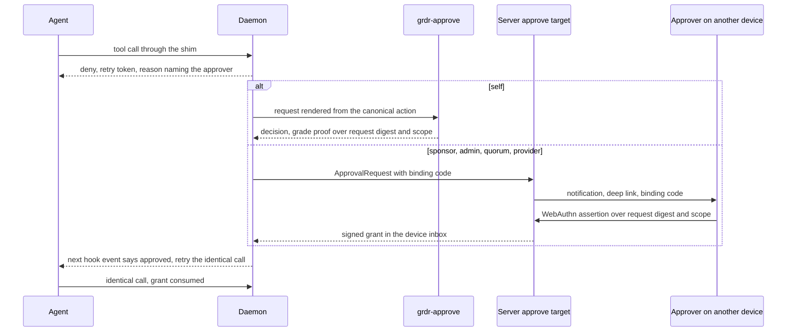

# 18. Response, approvals and SOC operations

_Status: draft 4 (rulings pass, `_review/01-document-rulings.md`; owner answers, `_review/02-owner-answers.md`) against spine version 4. Revised 2026-11-11 for principles P15 to P17 and the owner's kit instructions (`_review/04-owner-kit-instructions.md`). Owning squad: `server` (response, approval routing, SOC workflow), with `endpoint` for on-device actuators and `security` for `grdr-approve` (`team/01` section 2); the trust-core parts (actuators, `grdr-approve`, roster verification) need two independent passing evaluators on different models (D-63). Specifies D-30, D-31 (flow and grades), D-54 (workflow), the operational half of D-44 and the approval mechanic of D-07. Read with: `00-decisions.md`; 02 (SR-18 to SR-32); 04 (finding, incident, receipt, `response.*`, `audit.*`); 07 (control-point verbs); 12 (grant model, rule classes); 13 (detections); 15 (leases); 16 (capture); 17 (MCP broker); 19 (review stage); 20 (lake, step journal); 21 (keys, roster custody); 22 (push channel); 23 (API); 25 (destinations); 27 and 28 (screens); 29 (privacy)._

## Summary

This part covers what happens once a decision or finding exists: response actions, the kill switch, the path from a denied tool call to a signed grant, and the workflow a SOC or MSP runs on findings and incidents. Key choices:

1. **One signed `ResponseAction` contract.** Actuators declare per OS and assurance whether a verb is `exact`, `gated`, `cooperative` or `delegated`; the console previews the effective action per device before confirmation (D-30).
2. **Response runs in the privileged core and our policy never blocks it.** Actuator calls bypass `decide`; brief 21 (item 24, single source) records Auto Mode blocking an agent's own cleanup `kill`.
3. **The kill switch is a device-side state machine.** Commands above device scope carry WebAuthn assertions from device-bound approver credentials, verified on the endpoint against a quorum-chained roster. The device enforces freeze, isolate, capture, revoke whatever order commands arrive in, because a wiper has been reported firing on token revocation (brief 21, item 104 and verification row 4; one vendor's report).
4. **STEP_UP never uses the agent's native ask.** D-07 says so in terms, so this document rejects 07's Deviation 3 (native ask for G0 rules): a native ask is rendered by the agent (Lies-in-the-Loop, brief 36) and mints no grant the OS control point can honour. Resolved by R-01: 07 deletes its native-ask row, row (a) of its degradation table and the `pending-ask` expectation; the agent's own prompt is never an approval at any grade and may only point the person to `grdr-approve` (spine section 3).
5. **Grades are a per-OS table with a proof object** whose signed payload includes the scope the person chose. In the User profile every local approval is G0 (SR-07).
6. **Approvals are routed and deduplicated.** Self only for Ask rules, never for Exceptions; sponsor, admin and quorum go through the server with a timer and deny on timeout.
7. **Prompt health is a budget reported per rule and per group of five or more**, never per person. An over-approved rule yields a narrowing draft, not a number.
8. **Incidents group by lineage, then merge keys within 24 hours**, and sync both ways with ticketing under field ownership. There is no case object.
9. **The review queue buckets sessions** with a deterministic score, a 0.2% random sample and seeded recall canaries, all inside the 2% worth-a-look budget; the review stage (19) may only escalate.
10. **Playbooks are signed pack data over the closed action catalogue**, run through the step journal, simulated first and capped by blast radius. SOAR proposes through the same contract with no more authority than its key.

## Requirements

| # | Requirement | Trace |
|---|---|---|
| R1 | Each actuator declares, per OS and assurance, its effective action and fallback; shown before confirmation | D-30; 36 verification row 10; l03 F7 |
| R2 | Automatic response only deny, hold, end session, disable by digest, time-limited; wider needs a person unless opted in per rule; blast-radius cap; simulate first | D-30; c8 F4 |
| R3 | Scopes session to provider; four actuators: process, network, inference route, provider admin API | D-30; h06 |
| R4 | Above device scope: approver hardware-key signatures, scope, counter, expiry, verified on device against a quorum-changed roster | D-30; SR-29 |
| R5 | One approver: 60-minute freeze; two: re-freeze by the same key within 24 h, and kill, revoke or extension at organisation scope or wider | D-30; SR-31 |
| R6 | Rate-limited destructive commands; kill state survives reboot; pending commands applied before the next tool call on reconnect; order freeze, isolate, capture, revoke | D-30; SR-32; brief 21 |
| R7 | STEP_UP is deny, grant, retry; holds only within D-07's limits | D-07; 12 section 6 |
| R8 | Grade recorded per grant; minimum unavailable means Ask becomes Block; three unanswered or denied in a row freezes the session; every widening is a step-up; local surfaces only propose | D-31; SR-20, SR-23; S-17 |
| R9 | Prompt rendered from the canonical action with length and hidden-character warnings | SR-18; brief 36 |
| R10 | Prompts median 3, p95 8 per developer-day (targets), reported per rule and group of five or more | Spine section 6; D-51 |
| R11 | OCSF finding states; owned, expiring suppressions that never change policy; blocked attempts always create findings; only threat and tamper page | D-54; 04 section 8 |
| R12 | Incidents by lineage then merge keys; two-way ticket sync | Spine section 3; l03 F10 |
| R13 | Session-based queue, three buckets, worth-a-look under 2% | D-44; spine section 6 |
| R14 | SQL, pipe front end, Sigma hunts; observable index; retro-hunts marked `retro` | D-54; l03 F5 |
| R15 | Signed evidence bundles; forensic pull obeys capture level and reports expiry as a gap | D-52; D-39 |
| R16 | Provider workbench: routing with timer and deny on timeout, saved dispositions, reports, "acting as" banner | D-44; l05 F8 |
| R17 | Block messages name component, rule and Exception route within 1 s; agent gets an actionable reason; no dead end | D-44; h08 |
| R18 | Agent-, tool- and model-written text is inert everywhere | SR-36 |

## Design

### 1. Response action contract

A `ResponseAction` carries a verb from a closed enum, a scope selector, an issuer (rule, playbook, person, provider technician, SOAR account), `mode` (`simulate` or `enforce`), validity, `reversible`, `undo_ref` and a blast-radius block. Device-originated actions are signed by the device key. Server actions travel as the `action` of 22's `CommandEnvelope` (22 section 5), which carries the fleet signature, approver assertions above device scope (section 3), the `(server_epoch, counter)` pair and `not_after`. Per-device states: `applied`, `applied-with-fallback`, `refused` (signature, counter, expiry, rate limit), `failed`, `pending-offline`, then `expired`, `released` or `undone`; each transition is a `response.action` event (04).

The core calls actuators directly and denies a frozen or ended session in the daemon's first step (03, flow 1), before the engine. `PreviewResponse` computes effective verb, form and fallback from a roll-up per (group, OS, `ActuatorCaps` digest) that changes only when a device's caps digest changes, reading at most about 10,000 rows (estimate) at any scope and paging device lists on demand: "freeze 41 devices: suspended on 30 Linux, gated on 11 Windows; 3 offline, applies on reconnect until 14:20". *Applying: Prioritize Intent; the effect is shown before commitment.*

| Verb | Automatic | Person-issued |
|---|---|---|
| deny, hold | Yes (verdicts) | n/a |
| freeze, end session with restart block | Yes, default limit 4 h. Freeze is narrower than D-30's automatic "end", and D-31's three-in-a-row rule requires it | Device: owner or responder at G0 outside agent lineage; server: one responder at G3 |
| disable MCP server, tool or skill by digest | Yes, default limit 24 h | One responder |
| cut session egress, quarantine artefact, revoke leases, restore files | Only if opted in per rule | One responder; two at organisation scope |
| capture evidence | Yes, within the capture level: the D-52 look-back around a finding | Investigator; content beyond it needs a content grant (16, 29) |
| isolate device (delegated), revoke identity | Never | Two responders at G3 |
| release | Never | Widening step-up with the same approver count as the issue |

Opting a rule into a person-required verb needs a policy approver other than the author (D-55) and seven days of `simulate` with "would have acted N times". Every automated rule and playbook declares `max_scope`, `max_devices` and `max_share_bp` (default 500, 5% of active devices per hour); the server's tenant limiter sums across rules and, on breach, drops further actions to `simulate` and opens a tamper finding. A pack change to a rule's verbs or caps is widening (12 section 7).

### 2. Action catalogue and actuator matrix

D-30's ten first actions, in `c8`'s order. Redaction is the `redact-secrets` transform owned by 12 and 16.

| # | Action | Requires | Undo |
|---|---|---|---|
| 1 | Deny with reason and safe alternative | Daemon | n/a |
| 2 | Hold for grant | Daemon; `grdr-approve` or the `approve` target | n/a |
| 3 | Freeze session | Daemon | Release |
| 4 | End session with expiring restart block | Daemon | Release clears the block |
| 5 | Cut session egress | Proxy, sandbox or an OS sensor egress control | Release |
| 6 | Quarantine config artefact to last known good | Daemon; D-49 baseline | Restore quarantined copy |
| 7 | Disable MCP server, tool or skill by digest | Hook for config entries; MCP broker (17) for brokered servers | Re-enable |
| 8 | Revoke brokered leases | Leases (15) | New lease after release |
| 9 | Capture evidence | Daemon for local capture; server for pull (section 14) | n/a |
| 10 | Restore files from workspace baseline | D-28 copy-on-first-write baseline | Pre-restore copy kept |

**Control points** (verbs from 07 section 1, brief 36 matrix):

| Action | `hook` | `mcp-broker` | `proxy` | `sandbox` | `gateway` |
|---|---|---|---|---|---|
| Deny | Reason plus steer | `isError` result for `tools/call`, JSON-RPC error otherwise (17 section 7.7) | 403, machine-readable body | Static profile | Fail-closed deny |
| Hold | Never | Up to 80% of client timeout, max 30 s | No | No | No |
| Freeze | Deny every `tool.pre`, `session-frozen` (`gated`) | Reject calls | 403 for session flows | Profile update, else at relaunch | Block session routes |
| End session | Claude Code `continue:false` (`cooperative`) | Close connections | Close flows | Tear down | Revoke route |
| Cut egress / inference route | n/a | n/a | Exact on the listener | Exact by profile | Exact per session, instance, agent type or organisation |
| Disable by digest | Deny `mcp.call` and skill loads; D-12 native entry where sound | Drop from tool lists | n/a | n/a | Reject server or tool |

The `browser` point executes deny and freeze only (it refuses `ui.act` and agent-initiated requests for the session); it cannot end a session or cut egress, so those fall back to the OS sensor. The `connector` point adds IdP disable; CAEP `session-revoked` on containment is emitted by the `identity` target, which requires the server (15 section 10); incoming SETs without a signature are rejected by our own policy, because SSF 1.0 does not require signing (brief 36, verification row 9).

**Block messages.** Every deny, and every STEP_UP executed as a deny, reaches the person and the agent within 1 s (target, measured from the decision). The person-facing text travels by 28 section 1's block-message path: the agent dialect's user-message field, the local console's Home route (`grdr console serve`), `grdr why` and the tray notification (R-60). The agent gets the hook reason. The person-facing text names the component that blocked (a Guardrails rule by id; the agent's own permission system or classifier; another product, named by the slot broker), the rule's `@message`, and one route: the approver who will be asked (Ask), "Request exception" pre-filled (non-final Block), or the mode-change proposal (final Block), as 34 section 7's `person_route`. The agent-facing text is 28 section 11's `agent.*` message for the decision's next-step kind. Our engine never denies on model output (P2; 12 section 7, step 5); when the agent's own classifier denied, the message says so and points to that agent's setting rather than to a Guardrails route, which is the only honest route for a denial we do not own (D-44). *Applying: Prioritize Intent; the next step is in the message, not in a manual.*

**OS sensors** (brief 36 verification row 10 unless marked):

| Action | Linux | macOS | Windows |
|---|---|---|---|
| Freeze | `cgroup.freeze` on the session scope, racing forks included (`exact`) | Endpoint Security has no kill or pause call and may terminate a client that misses an event deadline, so the launcher or D-18 supervisor sends SIGSTOP to a process group it owns (`exact` once SP-18e passes, reported `gated` until then); sessions we did not launch are `gated` | No documented job-wide suspend: `gated` (all points deny; WFP blocks contained sessions' egress). The unofficial freeze class is not used |
| End session | Deny-all, then `cgroup.kill`; SIGKILL alone does not undo an in-flight syscall (Tetragon) | Supervisor kill-subtree, else SIGKILL to the group | `TerminateJobObject`; WMI-created or breakaway children escape, so the sensor sweeps lineage and ends stragglers by handle, reporting `escaped` |
| Restart block | Exec deny of the program identity with TTL at BPF LSM tier; lower tiers: hook denies `session.start`, sensor ends on sight | Exec deny at tier 3, else as Linux lower tiers | Hook plus end on sight; veto only with the optional Windows driver (D-17; requires an EV certificate and Microsoft's hardware programme through a sponsor or partner) or a partner product |
| Cut egress | cgroup BPF connect deny (`exact`) | Tier 2 content filter per flow; tier 1 proxy and broker only | WFP keys on application path and user, not tree: `exact` only for sessions under a sandbox SID or AppContainer; otherwise proxy-level, and a per-application filter only with a collateral warning |
| Quarantine, restore | Core moves the artefact and writes last known good from the D-49 baseline, atomically and journalled; files restore from the D-28 copy-on-first-write baseline, never from agent checkpoints, which miss Bash-made changes (brief 36) | Same | Same, ACL preserved |
| Isolate device | Delegated to the host EDR's containment API with containment-only credentials (SR-33); not offered without one. Building and testing an adapter requires an EDR licence through a design partner or a free vendor programme. Falcon's API has a device-actions endpoint (`PerformActionV2`), shown by SDK coverage only; licensing and scope are unverified (brief 26, verification row 10) | Same | Same |

### 3. Kill switch

**Scopes:** session, agent instance, device, principal (pseudonym), group, agent type or version, artefact digest (MCP server, tool, skill, model endpoint), organisation, organisation set, provider. There is no operator scope: a hosted operator can halt rollouts (D-37) but not stop tenants' agents, the abuse case in 02. **Actuators:** process, network, inference route, and provider admin API behind a `ProviderAdmin` port (SP-18g; no brief verifies a key-disable API). Each is tested alone (h06).

**Roster (requires the server).** `Roster {organisation, version, prev_digest, approvers[], thresholds, signatures}`; each approver has a pseudonym, a role from 21 section 10 (responders and provider responders sign response commands) and WebAuthn credentials for the console origin. D-30 requires hardware-backed keys, so registration refuses two kinds of credential: those with the backup-eligible flag set (WebAuthn Level 3 fixes that flag at creation, https://www.w3.org/TR/webauthn-3/, so synced passkeys never count), and those whose attestation does not name an authenticator model listed with hardware key protection in the authenticator metadata the server holds: by default the curated authenticator list that ships in every release and in the air-gap bundle, built from redistributable sources and signed by the project `content` role (21); optionally the FIDO Metadata Service BLOB, imported with `grdr server airgap import --fido-mds <file>` or fetched from a configured URL where the server has a route (FIDO's terms appear to forbid our redistributing it, to confirm, so no bundle carries it). A BLOB's signature is verified offline against the FIDO root pinned in the release, and a BLOB past `nextUpdate` keeps working with a `status` warning; checks that need the BLOB itself stay `not configured` until one is imported. An organisation may instead admit models by AAGUID with a recorded attestation sample, a widening change at its class's grade (D-31). On macOS this is expected to mean a security key, because Apple platform passkeys sync (to confirm, see Sources). The organisation owner creates the genesis roster at enrolment and devices show its fingerprint; each later version needs two distinct approvers of the previous one. Roster setup is a checklist that opens with the owner's credential already ticked and "Add a second approver" next; until that step is done, commands needing two signatures are unavailable and the kill-switch screen says so. *Applying: Goal Gradient; the list never starts empty.* Rosters ride the policy bundle; a version that does not chain is refused. Custody and recovery: 21.

**Verification on the device** follows 22 section 5 (fleet signature, trusted-time expiry, epoch and counter, scope against signature count, WebAuthn assertions over the command body). Two keys of one approver count once. A server restore mints a new epoch (D-57) that the device accepts only with a deployment-root epoch statement (22).

| Command | Required signatures |
|---|---|
| Session or device scope, automatic verbs, expiry up to 24 h | Deployment key (SR-30) |
| Freeze at any scope, up to 60 min | One approver |
| Re-freeze of a scope by the same key within 24 h | Two |
| End, cut egress or quarantine at group scope or narrower | One |
| Kill, revoke or extension at organisation scope or wider | Two |
| Any provider scope | Two provider approvers; beyond reversible containment (freeze, cut egress), also a co-signature from the roster of each claimed organisation in scope (R-25). Capped at 5 organisations per hour and written to each organisation's audit log (l05 F4) |
| Release | As for the command released |

**Issuing.** The kill-switch screen (27, 4.17) opens from a session, incident or finding with the scope set to that root session, the reason taken from the finding, the verb set to Freeze and the expiry to 60 minutes; widening the scope is an explicit edit, and the preview of section 1 is shown before the confirm control arms. *Applying: Smart Defaults; the narrowest reversible action is the pre-filled one. Ethical Friction for scope changes.*

**Delivery.** Push with long-poll fallback (22); targets p95 under 10 s online, 60 s in every S-18 topology. When the uplink regains the server after an offline gap over 60 s, the first verified response carries the command head (22 section 5); only if it says a command is pending for this device is D-30's "apply pending commands before the next tool call" enforced in `decide`: a call that arrives before those commands are applied is denied at once with reason `syncing` and a retry hint (R-26), and otherwise the device decides from cached state at once, so `decide` never holds a call past the shim's 250 ms fallback (D-14). A device that has not reached the server continues on cached state (D-56). Kill state, restart blocks and the counter live in the core's protected store and survive reboot; a command that expired offline is recorded `expired-unapplied`. **Rate limits (R-26).** The device limit is 22's (22 section 5): 3 destructive commands (end, quarantine, revoke, restore) per 10 minutes per scope unless two approvers signed, then freeze only plus a tamper finding, so a compromised server can send only expiring, reversible containment. This document owns the server-side automation cap per hour (section 1, `max_share_bp`).

**Ordering** is enforced by the device:

```mermaid
stateDiagram-v2
  [*] --> Frozen: freeze, or any stronger command
  Frozen --> Isolated: egress cut (inserted automatically before revoke)
  Isolated --> Captured: flight-recorder look-back pinned and queued
  Captured --> Revoked: leases revoked, local token caches quarantined
  Frozen --> Released: signed release
  Isolated --> Released
  Captured --> Released
  Revoked --> Released: restart block cleared; credentials only by new lease
```

On the server, identity or forge revocation waits until the `Isolated` tally for the command reaches the online count in scope or 120 s pass, after the console states "N devices in scope are offline and not isolated". The reason: Socket reports that a Shai-Hulud descendant polls the stolen GitHub token every 45 s for 48 hours and wipes the home directory on HTTP 401 or 403 (brief 21, verification row 4; the wiper is documented by that one vendor only). Every command applied to a device is listed in the tray and Home with issuer role, reason and expiry (D-51).

### 4. Approval flow

1. On `STEP_UP` (12 section 4, row 5) the daemon creates or joins a request keyed by session lineage, rule ids and digest or offered pattern; a repeat raises `dedup_count` without a new prompt. Routed requests sharing rule ids, offered pattern and approver kind group into one approval card with a count and a paged device list; one decision answers every member, and each grant stays bound to its own digest.
2. The person-facing reason names the approver ("your team's sponsor will be asked"). The agent-facing reason says approval was requested, to retry the identical call once told, and not to try another route.
3. Approver kind comes from `@approver`, raised (never lowered) by organisation settings. Kinds resolve to accounts as 21 section 10 specifies; in standalone *self* is the device owner. The requester never approves an Exception. Where a delegation grants approvals to a provider, sponsor and admin requests go to its queue (section 13).
4. The surface renders the canonical action, never agent text (SR-18), and returns a decision with a grade proof.
5. The privileged service (local) or the `approve` target (remote) mints the grant (12 section 6) under 21's keys; the signed payload covers request id, digest or pattern, rule ids, chosen scope, uses and expiry.
6. The agent learns the outcome at its next hook event through `additionalContext` where supported (Claude Code and Codex, brief 36) and the person through `grdr-approve` and the block-message path (section 2), the tray included; SP-18b measures auto-resume.
7. Hold replaces retry only at the MCP broker or an SDK, for a self approver, within 80% of the caller's timeout and 30 s (D-07). Hooks never hold.

**Timeouts deny** and count toward the three-in-a-row freeze: self at retry-token expiry (10 min, 12); sponsor, admin and quorum after 4 h (brief 33's oldest-pending target); provider at the organisation's timer. A routed request outlives the 10-minute retry token: each retry of the identical call while it is pending returns the same request id with a fresh token and does not count as unanswered, and the request counts toward the streak only when its route timer expires; self-approvals count as unanswered at token expiry (R-09, which 12 section 6 adopts).

**Offline (D-56).** Self requests use the local authenticator as usual. A request routed to sponsor, admin, quorum or provider that cannot reach the server denies at once with reason `approver-unreachable`, says so in the block message, and does not count toward the streak. Grants already on the device keep working until they expire.

**Grades by OS** (targets until S-16 passes; a failing tier is relabelled before release, SR-21):

| Grade | Linux | macOS | Windows |
|---|---|---|---|
| G0 | Click in `grdr-approve`; `grdr approvals approve` outside any agent session; all User-profile approvals. The agent's own permission prompt is not an approval at any grade (spine section 3) | Same | Same |
| G1 | FIDO2 key (touch plus PIN, libfido2) signing the request digest; polkit through the privileged helper on Wayland. X11 is presumed injectable (XTest) and stays G0 until S-16 says otherwise | Touch ID with a user-presence key held by `grdr-approve`, or FIDO2 | Windows Hello, or FIDO2 |
| G2 | A separate principal (second person via server, or another OS account); no local secure surface claimed | Same as Linux: accessibility control on macOS is a per-app TCC grant, and an agent host that already holds it can drive any same-user window, ours included (brief 29, further statements) | Protected profile: the service launches the helper under SYSTEM on a separate desktop it creates and switches to, as the UAC prompt does, with the answer pipe restricted to that process, plus G1. A helper that is merely at high integrity does not qualify: an agent in an elevated terminal or a UIAccess process can reach high-integrity UI (brief 29, verification row 10). If the separate desktop fails S-16, Windows G2 is relabelled and G2 there means a separate principal only |
| G3 | WebAuthn in the console on another device over the server-rendered action, with a 6-character binding code also shown in the requesting device's tray (SR-22). Alternative channels: CIBA via the organisation's IdP with `binding_message`; MCP URL-mode elicitation for broker sessions | Same | Same |

G1 proves a person over the digest while the surrounding window can still be overlaid; G2 adds a surface the agent cannot draw over; G3 moves display and proof off the device. The first Protected install offers authenticator enrolment with the detected platform authenticator pre-selected. *Applying: Smart Defaults.*

**Prompt content**, the `ApprovalPrompt` value every approval surface renders (28 section 7): who (agent, session task summary, repository); what, in plain words with the literal canonical call one click away, length shown, hidden and bidirectional characters flagged; why (rule, one-line reason, which component asked); what is new (first host contact, outside workspace, irreversible). Choices: **Deny** (default focus), **Allow once**, **Allow for this session**, **Allow for one hour**. "Always" links to the rule builder and is absent for `irreversible`, `secret` and `config-tamper`. Buttons arm after 1 s, 2 s for `irreversible`. *Applying: Ethical Friction where stakes are high.*

| Choice | `match` | Uses | Expires |
|---|---|---|---|
| Allow once | Action digest | 1 | 10 min |
| Allow for this session | Pattern over the canonical fields shown | Unlimited | Session end or 8 h |
| Allow for one hour | Same pattern | Unlimited | 60 min |
| Exception (Block rules, never self) | Pattern bound to the agent instance | Unlimited | Default 7 days, max 30; renewal is a new request |

A pattern choice first shows "this would have lifted N requests in the last 7 days" from local history. Every grant, self-approved included, is revocable centrally and from the tray; revocation reaches devices in 60 s at p99 (D-56).

**Widening operations** (mode down, pause, Exception, pack or sensor removal, capture up, provider or exclusion registration, kill-switch release) create a `widening` request whose digest is the canonical diff, at the class minimum (`config-tamper` is G2). CLI, tray, desktop, deep links, local console and our MCP server only propose, and from an agent session container they refuse and write `audit.admin` (S-17). Where the minimum grade is unavailable, Ask becomes Block for actions; for the user's own local policy in the User profile, the disclosed time lock of D-31 may stand in for G1 (Deviation 1, resolved by R-11).

**Prompt budget.** An interruptive prompt is a G0 to G2 prompt shown synchronously to the session's own person; queued items and other people's approvals do not count. The device counts per rule and uploads per-rule counts and per-group distributions for groups of five or more; a person's own figure appears only in their My activity panel (D-51). Controls: one prompt per rule, pattern and session; "decide later" queues the request in the tray; snooze (max 60 min) denies new requests back to the agent with reason `snoozed`. A Watch rule cannot be promoted while replay projects it over budget (12 section 11).

**Over-approved-rule report.** With 20 or more prompts in 14 days, a rule is flagged when its approval rate is above 90% or below 20%, or its median decision time is under 2 s, always per rule and group (targets). Brief 33 gives both "above 90%" and "outside 20% to 80%"; 90% is chosen because Claude Code users accept 93% of prompts overall (brief 33, verification row 1), so an 80% line would flag almost every rule. Brief 33's per-approver decision-time flag is replaced by the per-rule one (this document's Deviations, item 3). A high-approval rule gets three proposals: a narrowing draft adding an `unless` from the most-approved patterns, in Watch with replay attached; a cap at Watch (a mode-down, so a widening step-up); or keep with a justification that expires in 90 days. A low-approval rule proposes Block. It appears in the weekly digest and as a tile.

### 5. Findings and incidents

Findings use 04's schema. `dedup_key = rule id + root session + primary observable`; repeats raise `count`. `new` moves to `in-progress` on assignment and to `resolved` only with a verdict; `suppressed` is set and cleared only by a suppression. Analyst verdicts feed detection precision (13). A stable detection under 50% precision over 20 verdicts is demoted to experimental automatically, which stops paging and bucket weight; detections never block (D-09), so this is not a policy widening.

**Grouping** (server `detect`; daemon in standalone): (1) findings sharing a root session join one incident; (2) threat and tamper findings merge into an open incident sharing an artefact digest, credential id, device or principal pseudonym within the window (default 24 h, tunable 1 h to 7 days); principal merging is limited to these classes so no per-person record forms (P8); (3) above 500 sessions, merging continues on artefact only, so one malicious artefact is one incident (l03 F10).

| Priority | Condition | Pages |
|---|---|---|
| P1 | Threat or tamper, outcome `allowed` or `unknown`, severity high or critical. An allowed `secret-read` reaching a sink is raised by its detection as a threat-class exfiltration finding, so it lands here | Yes |
| P2 | Threat or tamper `blocked`, high or above | Yes |
| P3 | Policy violation or overeager, medium or above, including an allowed `irreversible` violation | No |
| P4 | Informational, coverage gap, `test` | No |

Only threat and tamper findings page (D-54); 04 derives `pages` from the class, and priority only orders the queue. Priority can be overridden only with a reason. Incident states are 04's (`new`, `in-progress`, `on-hold`, `resolved`, `closed`). A `true-positive` incident closes only with a linked response action or an "accepted risk" note naming a policy approver.

**Two-way ticket sync (adapters in 25).** `TicketLink {integration_instance, external_id, external_url (display only), synced_revision, external_version, field_owners}`. Guardrails owns findings, ratings, evidence references and priority; the ticket system owns assignee and due date; state maps through a per-manifest table. Outbound updates carry `sync_origin = grdr` and idempotency key `(incident_id, revision)`; inbound arrives by webhook or cursor poll, and changes with our own origin are dropped. A shared-field conflict goes to the later `external_version`, with the loser in the audit log. Outbound text is a metadata summary plus a console link; inbound comments are inert (SR-36). Jira and ServiceNow (brief 26 ranks them P0 and P1), and ConnectWise and HaloPSA for providers (section 13); all four APIs are unverified in brief 26, hence SP-18c.

### 6. Review queue

The unit is a session lineage (Origin, brief 33). The deterministic score sums: 100 per threat or tamper finding; 20 per blocked attempt; 40 for a denial followed by a pivot detection (`c8` number 14); 15 per artefact first seen in the organisation; the D-09 risk integer; minus 50 when every finding is suppressed or `test`.

| Bucket | Rule |
|---|---|
| Worth a look | Score at or above threshold (default 60), any threat or tamper finding, a 0.2% random sample of the other sessions (tagged `sampled`), or a canary |
| Noise | Only coverage-gap, duplicate, suppressed or test findings |
| Routine | Everything else |

The sample and canaries take about 0.4 points of the 2% budget (targets); the threshold self-tunes so the whole bucket stays under 2% and reports when it cannot, which happens only when threat and tamper findings alone exceed the budget. Canaries are synthetic malicious sessions, about one per 500 sessions or one per 50 cards shown, whichever is fewer (target), hidden among Worth a look until dispositioned, then revealed and excluded from export; they measure live recall (brief 39). Dispositions: confirm (opens or joins an incident), benign, false positive (naming the rule), duplicate. The review stage (19) may annotate and move a session up, never down (P2). At fleet scale the worth-a-look budget is the smaller of 2% of sessions and the queue's capacity (analysts on the queue times 100 items per analyst-day by default); sessions sharing rule ids, primary observable digest and agent type cluster into one card with a count, never by principal, and sessions over threshold but not shown are reported as a count (P9).

### 7. Investigation views

Layouts, the exponential spacing scale and optical corrections for every screen and prompt in this document belong to 27 and 28; this document fixes content and behaviour only.

- **Session timeline:** tool calls, verdicts including Watch `would_be`, processes, files, network and labels, blocked attempts included, with like actions collapsed into phases (brief 33). Each row shows provenance (claimed or observed, P3) and any grant consumed; gaps appear as "could not look" with reason. Targets: under 2 s (spine section 6); any 30-day-old session rebuilt in under 1 min (h08).
- **Session graph:** D-25 lineage with edge kind and grade, `undetermined` shown as such, always with a table equivalent. *Applying: Safety; no drag-only views.*
- **Evidence:** redacted spans inline; content behind a content grant, each view writing `audit.access`, which the developer sees in "who looked" (D-51).
- **Who else:** every observable pivots through the index (section 8).

Standalone shows all of it from local history with no account (D-48). *Applying: Reciprocity; value before sign-up.*

### 8. Hunting

- **Query surface:** SQL over the lake through DataFusion (20) with the tenant context injected and content columns masked by role. A pipe-style front end lowers to the same SQL; the candidate is PRQL, licence and dialect fit unconfirmed (SP-18d), else the server offers SQL only. Sigma rules run as hunts through the detection-engine trait (13) in batch mode.
- **Observable index** built at ingest (D-54): executable hash, destination, MCP server digest, tool-manifest hash, skill digest, package, credential id, mapped to first and last seen, device count and sessions. Target: pivot under 2 s.
- **Saved hunts:** `{id, owner, query, schedule, output (findings with origin hunt, or report), last_run, cost}`; promotion to a detection needs 12's tests and replay, and enters Watch.
- **Retro-hunt:** new or changed detections and every new indicator (14) replay over retention through the same core; indicators by index lookup, rules by newest-first scans under a per-organisation daily budget (32). Results carry `retro: true` and page only if threat-class with session activity in the last 24 h.
- **Standalone:** `grdr hunt run --sql` and `grdr hunt run --sigma` over local SQLite.

### 9. Playbooks and SOAR

A playbook is a signed pack entry of type `playbook` (P7): a trigger (finding class, rule or tag, incident state change, approval timeout), conditions as a match table (D-09), and steps from a closed catalogue: section 2's verbs, `notify`, `open-ticket`, `wait-for-approval`, `capture`, `enrich` (index lookup), `set-incident-state`. Steps name integration instance ids, never URLs or commands, and declare scope, blast radius and mode. CACAO playbooks (CoSAI ships them, brief 36) import with unmapped steps becoming `manual`; the CACAO version is pinned in the adapter and unverified here.

**Step journal.** A playbook run is a job on 20's step journal (20 section 8), one `job_step` per playbook step; a `wait-for-approval` step parks the job until the approval or its timer, and compensation steps are recorded as further steps. At-least-once over idempotent actions, resumable, under the `playbook-step` retry policy (03 section 10); on abort, `undo_ref` compensation in reverse order. A playbook halts with a finding after three failed runs in an hour or 20% of its actions undone in 24 h. New versions run seven days in `simulate` ("would have acted N times on M devices") and are promoted by someone other than the author (D-55).

**SOAR hand-off.** Outbound: Standard Webhooks-signed `finding.*`, `incident.*`, `approval.*`, `response.*` under D-54's export contract (25). Inbound: `ResponseService.Propose` with a SOAR service account whose key counts as a deployment-key issuer, so alone it reaches session and device scope and automatic verbs only (SR-30). Our MCP server issues no response actions (D-38). Tracecat templates and a Shuffle `api.yaml` are provided (the Shuffle app catalogue is MIT, the platform AGPL; brief 26).

### 10. Notifications

Classes (`page`, `approval.request`, `incident.update`, `health`, `digest`, `block`, `promotion`), their channels, budget rules, deduplication, quiet-hours behaviour and token ids are rows of `interface/notifications.toml`; this table is its server-channel view (28 section 8 is the device view), generated from it.

| Class | Default channels | Rule |
|---|---|---|
| Page | Signed webhook, Alertmanager or PagerDuty; email fallback through the configured `Mailer` adapter (25; an SMTP relay by default) | P1 and P2 threat or tamper only; quiet hours never delay it; a page not delivered on any configured route within 5 minutes raises `notify-undeliverable` (critical), which the synthetic sensor's independent alarm path also reports |
| Approval request | Tray (self); console, email, Slack, Teams, or Mattermost through the Slack renderer (25 section 9) | Canonical summary, approver kind, binding code, expiry; at most one message per recipient, rule and channel per 5 minutes, carrying a count; email off by default above 1,000 endpoints |
| Incident update | Ticket sync, email digest | Per revision, deduplicated per 15 min |
| Health | Console tile, daily digest | Blind spots, `configured-not-effective`, stale devices, limiter trips |
| Digest | Weekly email | Prompt health, over-approved rules, expiring Exceptions and suppressions |

Routing rules are per-organisation manifest data. Every channel renders one `NotificationVm` (class, title, facts, one action, console link). Email templates are the notification kit's askama templates, styled only by the emitted email constants and filled at send time with language tokens in the recipient's `ui.locale` and time zone, with UTC beside it; they load no remote image (the logo is an inline attachment from the brand manifest), so they render air-gapped and carry no tracking. Chat cards map the same fields to each vendor's format in the integration instance's locale. Incident free text stays as written inside a localised frame, and the compiler rejects a template argument of data class `content`. Payloads carry metadata and a console link, never content; agent text is quoted, capped and inert (SR-36). Email and chat cards state class and state as text labels, with no emoji. Chat buttons may decide only rules with minimum grade G0 and a non-self approver, recorded as G0 channel `chat`, off by default. Adapters and their (unverified, brief 26) APIs are 25's.

### 11. Suppressions and Exceptions

| Object | Effect | Expiry | Who |
|---|---|---|---|
| Tunable override | A declared rule parameter; survives pack updates; shown as a diff | Versioned | Policy author; a widening one approved by another person |
| Suppression | Hides matching findings; never changes policy or recording | Required: default 30 days, max 180 | Responder; threat or tamper scope needs a second person |
| Exception | A grant lifting a non-final Block rule for a pattern (12) | Default 7 days, max 30 | Anyone requests; someone other than the requester approves at the rule's minimum grade and never below G1. Standalone has one person, so an Exception there is a widening step-up by the device owner at the rule's minimum grade; in the User profile the D-31 time lock may stand in for G1 |

A suppression created from a finding opens pre-filled with the narrowest scope (rule plus primary observable, plus agent type); widening it is an explicit edit, and the justification is required. *Applying: Smart Defaults; the safe scope is the default.* An Exception requested from a block message is pre-filled on the device with rule, pattern and session task summary, which stays on the device unless the requester keeps it. Reminders go out 7 days before expiry; an expired suppression restores the earlier finding state (04).

### 12. Operating metrics and oversight quality

The finest grain is rule, group of five or more, or organisation (P8). Every figure below is a target until measured in dogfooding and S-14.

| Metric | Target |
|---|---|
| Interruptive prompts per developer-day (median, p95, per group) | 3 and 8 |
| Rule approval rate, at least 20 prompts in 14 days | Flag above 90% or below 20% (section 4) |
| Median decision time, per rule and group | Flag under 2 s |
| Approval timeouts per route | Under 10% |
| Oldest pending; median answer | Under 4 h; 15 min (brief 33) |
| Blocks overturned by Exception | 5% or fewer; rule flagged above 20% (h08) |
| Worth-a-look share of sessions | Under 2% |
| Stable detection precision on analyst verdicts | 90%; demoted below 50% over 20 |
| Canary recall | 100%; a miss raises a health finding |
| Kill delivery, p95 online | Under 10 s; 60 s in every S-18 topology |
| Revokes executed with scope isolated on all online devices | 100% |
| Response fallback rate per verb and OS | Reported |
| Sessions ended by policy without resumable state, kill switch excepted | Zero (h08) |

Tiles are sentences with a number, a comparison and one action (D-44): "3 sessions are worth a look today, 2 more than yesterday. Review." "Ask rules interrupted developers a median of 1.4 times a day this week; the budget is 3. See rules." *Applying: Meaningful Highlights.* An incident's response checklist opens with "Detected" and "Evidence pinned" ticked. *Applying: Goal Gradient.* Modes, verbs and states use Lucide icons with labels, never colour alone.

### 13. MSP and managed detection

- **Workbench:** one cross-organisation queue (approvals, worth-a-look sessions, unhealthy sensors, unknown agents) filtered by organisation set, organisation always visible, through the set-valued tenant context (D-35). Each cross-organisation action is written to both audit logs under the named technician with an "acting as" banner. Target: cross-tenant approval in 2 clicks (c7).
- **Routing:** each organisation chooses which approver kinds go to the provider, writes per-organisation instructions shown on the card, and sets a timer after which the request denies. Load is reported per queue and technician team, not per technician (P8 applies to technicians, replacing `l05` F8's metric).
- **Saved dispositions** (agent approve or block, Exception and suppression templates) live in the provider library and roll out to an organisation set with the organisation as ring unit (D-11).
- **Scheduled branded reports** per organisation (inventory, coverage by assurance level, blocks, Exceptions, incidents) with no technician input.
- **Managed detection partner:** a provider with the responder role whose approvers enter an organisation's roster only through a customer-approved, customer-revocable delegation naming response rights. Organisation-scope kill then needs two of its approvers, a co-signature from the organisation's own roster once it is claimed (R-25), the per-hour cap and an entry in the customer's audit log. Technicians see metadata unless the organisation grants per-organisation content access (D-51, D-55).
- **Provider fields in shared objects:** `provider_id` on `ApprovalRequest`, `Incident`, `Suppression`, `ResponseAction`; route kind `provider_queue`; roster role `provider-responder`.

### 14. Evidence bundles and forensic pull

`grdr-evidence-v1` is a tar archive: `manifest.json` (scope, requester role and pseudonym, purpose, incident, capture level, member SHA-256s, lane chain heads, latest checkpoint), `events.pb`, `receipts.pb` as signed with `boot_key_cert`, `grants.pb`, `responses.pb`, `inclusion/` Merkle proofs from flight-recorder events to roll-ups (D-52), `content/` encrypted to the incident key and present only under a content grant, and a generated `ocsf.jsonl`. The manifest is signed in a DSSE envelope (a serialisation OCSF 1.9 lists, brief 23) by the server, or the device key for local export. `grdr evidence verify` checks digests, receipt and batch-head signatures and inclusion proofs offline. Attaching a bundle places a hold (D-57); every read writes `audit.access`.

**Forensic pull.** A signed `EvidenceRequest {scope, window, classes, purpose, incident_id, requester, content_grant_id?}` reaches the device, which applies its own capture level to every field and releases more only with a content grant carrying the organisation's signature (SR-26). It pins the matching recorder range and reports expired data as `health.gap` reason `recorder-expired`. Device-side findings upload their look-back automatically (D-52); the pull serves late findings such as retro-hunts. The developer sees every pull. Standalone: `grdr evidence export --session <id> --preview` shows exactly what is written, redacted on the device.

## Interfaces and contracts

| Interface | Shape | Other side |
|---|---|---|
| `grdr.response.v1alpha1.ResponseAction` | `action_id`, `organisation`, `provider_id?`, `verb`, `scope`, `targets[]`, `reason_code`, `incident_id?`, `finding_ids[]`, `issuer`, `mode`, `not_before`, `expires`, `reversible`, `undo_ref`, `blast_radius`. Signatures, counter and epoch are fields of 22's `CommandEnvelope`, not of this message | Daemon, server `control`; 22 (envelope); 04 events |
| `ActuatorCaps` | Per actuator: control point, OS, tier, `verbs[] {verb, scope_kinds, form, fallback, reversible, latency_target_ms}` | Heartbeat (22); preview; `HostProfile` (D-60) |
| `Roster` | Section 3 | Policy bundle (12, 22); custody (21) |
| `grdr.approval.v1alpha1.ApprovalRequest` | `request_id`, `kind` (action, widening), `provider_id?`, `session`, `rule_ids[]`, `digest`, `canonical_action`, `approver_kind`, `min_grade`, `offered_scopes[]`, `route`, `binding_code`, `created`, `expires` (route timer), `dedup_count`, `state` | `grdr-approve`, `approve` target, 27, 28 |
| `ApprovalDecision` | `request_id`, `decision`, `scope_choice`, `grade`, `channel`, `time_locked`, `proof {kind: click, fido2, platform, secure-surface, webauthn-oob, ciba; payload}`, approver pseudonym | Grant minting (12) |
| `Incident`, `Suppression`, `TicketLink`, `SavedHunt`, `Playbook`, `EvidenceRequest` | Sections 5, 8, 9, 11, 14; finding and incident fields are 04's | 20, 25, 13 |
| Services | `ResponseService {Preview, Issue, Propose, Release, List}`, `ApprovalService {List, Decide, Revoke}`, `IncidentService`, `SuppressionService`, `HuntService`, `PlaybookService`, `EvidenceService` | 23 |
| CLI | `grdr response freeze\|end\|kill\|release <scope>`, `grdr approvals list\|show\|approve\|deny`, `grdr exceptions list\|show\|request\|revoke`, `grdr evidence export\|verify`, `grdr hunt run --sql\|--sigma`; from agent lineage every mutating verb is refused with exit 4, except `grdr exceptions request` and `grdr policy apply`, which propose and exit 3 (23 section 11) | 23, 28 |
| Webhooks | Standard Webhooks; `finding.*`, `incident.*`, `approval.*`, `response.*` | 25 |

## Behaviour by deployment shape

| Aspect | Standalone | Platform (self-hosted; hosted requires revenue, sponsorship or donated cloud credits) | Embedded |
|---|---|---|---|
| Approvers | Device owner, self only; Exceptions and other widening as step-ups at the class minimum, with the D-31 time lock standing in for G1 in the User profile | Self, sponsor, admin, quorum, provider | Host's surface via the provider interface (07), at grades the host proves |
| Grades | G0 to G2 by OS; User profile G0 | Adds G3 | As declared in `HostProfile` |
| Kill switch | Session and device from tray or CLI | All scopes, with the roster; hosted has no operator scope | Host actuators declared in `HostProfile` |
| Incidents, queue | Local incidents; unbucketed review list | Full workflow, buckets, ticket sync | Findings and response events exported (L1, L4) |
| Hunting | SQLite | Lake, index, retro-hunt | Partner's lake (L4) |

## Extension points

- **Actuator** trait in `grdr-ports` with a conformance kit that runs each declared verb against a scripted session and checks form and fallback; community actuators at Tier 2 in contrib.
- **Approval channel** trait (CIBA, mobile push), returning a proof the `approve` target verifies over the request digest.
- **Ticketing, chat and paging destinations** as declarative manifests with a state-mapping table and golden fixtures (25).
- **Playbooks, saved hunts, suppression and Exception templates** as content (evaluator passes with evidence; for community content from two evaluators on different models, D-61).
- **`ProviderAdmin`** port for model-provider key actuators.
- New response verbs are code plus an RFC, because they define what runs on devices (P7).

## Security and privacy

- A compromised server or SOAR key reaches only session or device scope, automatic verbs and 24 h expiry, under rate limits; nothing it sends deletes data or raises capture (SR-30, SR-32). Command replay fails on counter and epoch; roster substitution fails on the chain; synced passkeys are refused.
- The scope choice is inside the signed approval payload; the digest is re-checked at hook and OS control point, and label escalation voids grants (12).
- Rune never draws an approval (D-43); local surfaces only propose (S-17).
- Actuators are exempt from our policy but run in the trust-core daemon (D-63), reviewed as trust core by `eval-security` and `eval-adversarial` on different models, and every invocation is a signed `response.action` event.
- Evidence pulls obey the device's capture level; content needs an organisation-signed grant; every access is visible to the subject. No approval or prompt metric resolves to a person.

## Test and evaluation strategy

| Property | Oracle and method | Pass |
|---|---|---|
| No same-user grant at G1 or G2 | S-16 harness: UI Automation, AT-SPI, XTest, synthetic input, `--script`, CLI, local API, overlays, an agent in an elevated terminal, a UIAccess process, a host holding the macOS accessibility grant; 1,000 attempts per vector per platform | Zero, or the tier is relabelled |
| No widening via local surfaces | S-17: agent-lineage calls to every mutating verb | Zero completions |
| Device rejects bad commands | Signed golden vectors: wrong roster, one person twice, replayed counter, expired, synced credential, broken chain; three OS builds | All refused |
| Ordering | Deterministic simulation of revoke-first, reordered and duplicated commands | Revoke never precedes `Isolated` |
| Freeze and kill cover the tree | OS process listing independent of our sensor; SP-18a: 50 devices (virtual machines on free hosted CI runners, D-64's tier B machines or a design partner's fleet), 5 offline, one restored, during `terraform apply` and a rebase | p95 under 10 s; applied before the first tool call on reconnect; no replay accepted |
| Windows escapees reported | SP-18e with WMI and breakaway spawns | Every escapee `escaped` and ended within 2 s |
| Preview is true | Applied results across the test matrix (free hosted CI runners for Linux, Windows and macOS on x64 and arm64, plus D-64's tier B machines as self-hosted runners; cases needing hardware nobody has are marked requires hardware) | Zero mismatches |
| Prompt budget | S-14 replay over fleet history and SWE-chat | Median 3, p95 8 |
| Ticket sync converges | SP-18c: 1,000 concurrent edits in free vendor developer instances, or a provider design partner's instance where none is free | Equal states, zero echoes |
| Incident grouping | Labelled efficacy-harness scenarios (spine D-45 and D-64; the detailed harness document is pending) | Stable across replays; one artefact over 100 sessions is one incident |
| Recall canaries | Seeded sessions | All in Worth a look |
| Evidence integrity | `grdr evidence verify` on mutated bundles | Any byte change detected |
| Paging and approver registration with no route out | Air-gap conformance run S-31, steps 4 and 8, with Alertmanager stopped and an expired FIDO BLOB imported | `notify-undeliverable` within 5 minutes; a `status` warning for the BLOB while a backup-eligible credential is still refused |

## Work breakdown

**E1 Actuators.** E1.1 Contract, caps and core path for deny, hold, freeze, end with restart block, quarantine, local capture on Linux and macOS. Accept: agent lineage cannot block or delay an actuator; events carry form and fallback. E1.2 Windows gated freeze, job termination with sweep, WFP cut for contained sessions. Requires: S-04 (Windows in Tier 1, D-50). Accept: SP-18e. E1.3 Egress cut at proxy, sandbox, cgroup; disable by digest at the broker; file restore. Accept: conformance kit on three OS. E1.4 Preview, server issue, limiter. Accept: preview equals outcome; limiter trips and opens a finding. E1.5 Delegated isolation through one EDR (CAEP emission is 15-11). Requires: an EDR licence through a design partner or a free vendor programme. Accept: the containment credential cannot run a script (SR-33).

**E2 Kill switch.** E2.1 Local stop with persisted state. Accept: survives reboot; CLI, local console and tray list it. E2.2 Roster with attestation and backup-eligible checks, on-device WebAuthn verification, counters, epochs, rate limits, ordering machine. Accept: golden vectors; 02's TM-14 drill; a synced or unattested credential is refused at registration. E2.3 Push delivery and reconnect sync. Requires: SP-18a. Accept: S-18 and SP-18a; a pending kill fetched on reconnect lands before the next tool call is allowed. E2.4 Provider scope, gateway route actuator, `ProviderAdmin`. Requires: SP-18g for `ProviderAdmin`. Accept: cap and dual audit verified; a provider command beyond reversible containment without the claimed organisation's co-signature is refused on the device (R-25); each actuator tested alone.

**E3 Device approvals.** E3.1 `grdr-approve` G0 and G1 per OS, prompt content, arming delay, scope-to-grant mapping. Accept: S-16; a changed scope byte fails verification. E3.2 Windows G2 helper on a service-created separate desktop. Accept: S-16 with Defender active, including an agent in an elevated terminal and a UIAccess process; on failure the tier is relabelled before release. Requires: S-04. E3.3 Dedup, decide later, snooze, outcome via `additionalContext`, block messages. Accept: SP-18b; one prompt per rule, pattern, session; a block message naming component, rule and route reaches the person by the block-message path (user-message field, console Home route, `grdr why`, tray) within 1 s in the harness (R-60). E3.4 Widening requests from every surface; User-profile time lock (default 10 minutes, D-31). Accept: S-17; a time-locked grant never satisfies a G2 check, or any check outside the User profile's own local policy, in golden vectors.

**E4 Server approvals.** E4.1 `approve` target in tier 0; routing, timers, deny on timeout, token renewal for routed requests, `approver-unreachable` offline, G3 with binding code. Accept: no database on the request path (D-33); grant at device within 30 s (target); a routed request pending for 4 h does not trip the streak until its timer expires. E4.2 Central revocation. Accept: within the propagation target. E4.3 Provider routing, CIBA adapter. Accept: 2-click cross-tenant approval in both audit logs.

**E5 Oversight.** E5.1 Device prompt accounting, local report. Accept: upload-schema test proves no per-person figure leaves. E5.2 Group aggregation, narrowing-draft generator, section 12 metrics. Accept: drafts pass `grdr policy check` with replay attached.

**E6 Findings and incidents.** E6.1 Local lifecycle, dedup, local incidents. Accept: every blocked attempt has a finding. E6.2 Grouping, priority, paging. Accept: grouping tests. E6.3 Jira, ServiceNow, ConnectWise and HaloPSA sync. Requires: SP-18c. Accept: convergence, zero echoes.

**E7 Review queue.** E7.1 Score, buckets, sample, canaries, dispositions, threshold tuning. Accept: canary recall 100%; on a replayed month of dogfooding sessions the worth-a-look bucket, sample and canaries included, stays under 2%. E7.2 Escalate-only hook. Accept: no model annotation lowers a bucket.

**E8 Investigation and evidence.** E8.1 Local timeline, graph, evidence; `evidence export --preview`, `verify`. Accept: timeline under 2 s; tampering detected. E8.2 Server views, evidence requests, holds, `audit.access`. Accept: a pull beyond capture without a grant returns permitted fields only and is logged.

**E9 Hunting.** E9.1 `grdr hunt run --sql` and `--sigma` over local SQLite. Accept: the 20 `l03` hunts that need no server run locally and return the same rows as a reference query. E9.2 Lake SQL, index, saved hunts, retro-hunt, Sigma. Accept: pivot under 2 s at both S-02 volumes; a query without tenant context fails closed; a retro-hunt hit carries `retro: true` and pages only under section 8's rule. The pipe front end requires SP-18d.

**E10 Playbooks and SOAR.** E10.1 Pack type, journal, simulate-first, compensation, halt rules. Accept: a killed worker resumes without re-running a non-idempotent step; the verifier rejects a playbook naming a URL; a playbook breaching its blast-radius cap drops to `simulate` and opens a finding. E10.2 Propose API, CACAO import, Tracecat and Shuffle packages. Accept: a proposal signed only by a SOAR key is refused above device scope and for non-automatic verbs on the device; a CACAO playbook with an unmapped step imports with that step as `manual`.

**E11 Notifications.** E11.1 OS notifications, the block-message path and the tray. Accept: approval requests and block messages appear with no agent text rendered as a link. E11.2 Routing, digests, paging, chat. Accept: schema test finds no content field; agent text inert; only threat and tamper findings reach the page channel.

**E12 Suppressions and Exceptions.** E12.1 Local Exceptions with pre-fill and expiry. Accept: an Exception without expiry or above 30 days is rejected; a self-approved Exception is impossible outside standalone. E12.2 Suppressions with second-person rule, reminders. Accept: property test against 12's engine shows no suppression changes a verdict; an expired suppression restores the earlier finding state.

**E13 Provider workbench.** Queue, dispositions with staged rollout, reports, managed-detection delegation. Accept: `l05` onboarding targets; a customer's revocation removes provider responders at the next roster version.

## Risks, open questions and spikes

| Item | Settled by |
|---|---|
| SP-18a Freeze drill under real workloads, offline and restored devices | c8 S4 design; a prerequisite of E2.3 |
| SP-18b Does deny, grant, retry resume agents? | C7-4 on its four agents; under three of four resuming makes "decide later" the self default |
| SP-18c Jira, ServiceNow, ConnectWise, HaloPSA APIs unverified (brief 26) | Sandbox build of the sync manifests; a prerequisite of E6.3 |
| SP-18d PRQL licence and DataFusion fit | Compile 20 l03 hunts; any failure means SQL only |
| SP-18e Windows job escapes and macOS process-group stop | 50-task corpus with injected WMI spawns; supervised macOS sessions |
| SP-18f Touch ID, Windows Hello and libfido2 signing our digest; polkit on Wayland | Part of S-16 |
| SP-18g No verified model-provider key-disable API | A research brief; a prerequisite of `ProviderAdmin` in E2.4 |
| Our prompts outside the terminal add context switches versus native ask | S-14 and dogfooding; native ask stays rejected |
| A lone responder can only freeze for 60 min | Accepted by the spine (D-30); a small organisation with one approver cannot kill at organisation scope until a second approver enrols, and the console says so |
| 12 counts a request as unanswered at retry-token expiry; routed requests here live up to 4 h | Resolved by R-09: 12 renews retry tokens for routed approvals until the route timer expires |

Open questions for the chief architect:

1. Resolved by R-11: the time lock is accepted for the user's own local policy in the User profile only (spine D-31).
2. Ship G0 chat-button approvals at all, given they make a chat token an approval credential?
3. Keep `self` as the Ask default in managed organisations (12's default, raisable per organisation), or default those to sponsor?

## Deviations from the spine and objections

1. **Widening where the minimum grade is unavailable (D-31, D-44).** Resolved by R-11 and spine v3 D-31: the time lock applies to the user's own local policy in the User profile only, default 10 minutes, standing in for G1; in the Protected profile the class minimum applies, and G2 there means a separate principal such as another OS account (section 4). The original proposal follows for the record. Standalone macOS and Linux have no local G2 surface (nor Windows in the User profile, or if its separate-desktop helper fails S-16), so under D-31 a user could never lower Essentials' `config-tamper` rules from inside the product, the dead end D-44 forbids, while OS uninstall stays possible. For standalone widening only, this document adds a time-locked step-up: proof at the highest available grade, the pending change shown in tray and notifications for 15 minutes (5 in the User profile) and cancellable from any surface, then a second confirmation. The grant records the achieved grade and `time_locked: true` and never satisfies a G2 requirement elsewhere. Action approvals are unchanged: Ask still becomes Block.
2. Open. **Automatic demotion (spine section 6)** applies to detections only. Demoting a policy rule is a mode-down, a widening step-up under D-31, so over-approved policy rules get proposals instead.
3. Open (clarification). Per-person metrics proposed in `l05` F8 and brief 33 (per technician, per approver) are replaced by queue and group measures under P8; not an objection to the spine.

## Sources

Research briefs: `36-response-operations.md` (hook verbs, kill switch, CIBA, CAEP, OCSF incident fields, cgroup and Tetragon; verification rows 1, 2, 4, 6, 7, 9, 10); `33-ux-personas.md` (prompt anatomy, fatigue controls, targets; rows 1, 3, 4, 6); `21-threats-incidents.md` (items 24, 103, 104; verification row 4); `26-integrations.md` (catalogue priorities, Standard Webhooks, Falcon device actions; row 10, Shuffle correction); `39-ai-ml-strategy.md` (canaries, verdicts as suppressions, review units); `01-origin.md` (buckets, triage); `02-beyondtrust.md` (policy-wide approvals; row 7); `23-schemas-transport.md` (DSSE in OCSF 1.9); `29-rune.md` (approval integrity, TCC); `h06-standards-regulation-sweep.md` (NCSC shutdown); `h08-practitioner-voice.md` (lost-work, overturn, revocation targets). Reviews: `c8`, `l03`, `c7`, `l05`, `00-resolution.md`.

Primary URLs: https://code.claude.com/docs/en/hooks ; https://code.claude.com/docs/en/permission-modes ; https://docs.kernel.org/admin-guide/cgroup-v2.html ; https://tetragon.io/docs/concepts/enforcement/ ; https://learn.microsoft.com/en-us/windows/win32/procthread/job-objects ; https://learn.microsoft.com/en-us/windows/win32/fwp/application-layer-enforcement--ale- ; https://developer.apple.com/documentation/endpointsecurity/es_message_t/deadline ; https://openid.net/specs/openid-client-initiated-backchannel-authentication-core-1_0.html ; https://openid.net/specs/openid-caep-1_0-final.html ; https://modelcontextprotocol.io/specification/2026-07-28/client/elicitation ; https://schema.ocsf.io/classes/incident_finding ; https://checkmarx.com/zero-post/bypassing-ai-agent-defenses-with-lies-in-the-loop/ ; https://api.osv.dev/v1/vulns/MAL-2026-19054 ; https://www.w3.org/TR/webauthn-3/ (backup-eligible flag, read 2026-11-10) ; https://github.com/cosai-oasis/ws2-defenders .

Not in the briefs, to confirm before E2.2 and E3.2: the FIDO Metadata Service key-protection field and which platform authenticators report it; whether Apple platform passkeys can ever be registered without the backup-eligible flag; and the Windows separate-desktop pattern for the G2 helper (S-16 decides).
