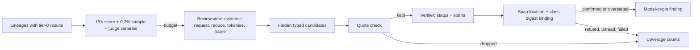

# 19. AI and ML inside the product

_Status: draft 4 (rulings, spine version 4 and owner answers 02 applied; no schedule). Revised 2026-11-11 for principles P15 to P17 and the owner's kit instructions (`_review/04-owner-kit-instructions.md`). Owning squad: `content` (SQ-08, SQ-09; team/02). Specifies D-29 and the model-facing parts of P2 and D-51. Read with: `00-decisions.md` (authoritative); 02 (SR-26, SR-36, SR-37); 03 (ports, crates); 04 (facts, labels, findings, data classes, `EvidenceSpan`, integrity); 07 (verdict providers); 12 (grants, replay, natural-language pipeline); 13 (detections, risk integer); 16 (capture, redaction, `DetectorPort`); 18 (findings workflow, review queue and its deterministic score); 21 (customer secrets); 22 (pack protocol, rings); 23 (our MCP server); 27 and 28 (screens); 29 (privacy regimes); spine D-45 and D-64 (efficacy harness and test lab; the detailed document is pending); 32 (costs); 33 (build order and risk register); 36 (licences, prices)._

## Summary

Models rank, explain and propose; deterministic code decides (P2). Key choices:

1. **Detection tier 0 decides; model tiers only add.** No model-origin fact or label reaches a Cedar request (12). No model changes the state, verdict or suppression of an existing finding. A model creates candidates; only a mechanically verified candidate becomes a finding.
2. **Prerequisites, not stages.** Tier 0 and every product guarantee work with no model at all. Every model feature requires the `JudgeBackend` trait (an experimental seam). The review framing library, judge canary templates and 18's deterministic queue score, sample and queue canaries require only the `grdr-review` crate. The two adapters, token budgets, the model step of natural-language authoring (R-34), one review stage (finder plus verifier), two assistants and the host for 16's opt-in endpoint classifier require the trait, the conformance kit and an organisation-selected back end. Our own small models, a learned ranker, ensembles and the investigator are part of the product, each with a stated prerequisite and a seam.
3. **One port, two first-party adapters (P6):** `openai-compatible` (local llama.cpp, Ollama, vLLM, LM Studio, customer gateways) and `anthropic`. Others live in contrib. Every adapter passes a conformance kit before an organisation can select it.
4. **A fixed input contract.** Records are framed in tags keyed by a per-job secret with four trust levels; only policy is trusted. Outputs are typed, free text is bounded and inert, judges have no tools and no egress beyond one back-end endpoint, one organisation per job.
5. **Evidence is checked twice by code.** Finder quotes must be exact substrings of cited records; verifier spans are located by string match in their record, and the record's field is then verified against the sensor-signed class commitment (04 section 10).
6. **Off until chosen.** Model features need an organisation-selected back end and, for review, a review capture level. The payer is an organisation setting; budgets are in tokens; when spent, model tiers stop and the console says "review skipped". The hosted service has no default third-party model. Loonaro has no money for model usage: the owner's Claude subscription runs the agent team and is never a product back end, so a Loonaro-paid platform key requires revenue or a sponsor.
7. **Privacy by construction.** Review content is pulled per selected session lineage under an organisation-signed content grant, used once, discarded. No tenant data trains a shared model. Nothing is scored per person. The developer sees which of their sessions a model reviewed.
8. **Quality is measured live:** judge canary sessions (distinct from 18's analyst-facing queue canaries), 18's 0.2% random sample, per-standard precision with demotion, re-certification when a back end's model changes, and signed `model` and `prompt` packs through rings, shadow first.

## Requirements

| # | Requirement | Source |
|---|---|---|
| R1 | No allow, grant, declassification, suppression or clearing of a finding depends on a model; model failure degrades ranking and explanation only | P2; 02 R3; brief 39 |
| R2 | Detection tier 0 is the only tier on by default; model tiers are off until an organisation selects a back end and a capture level that permits them | D-29; c8 F7; l07 F4 |
| R3 | Trusted judge input is policy only; root-session prompts are `user-claimed`; all else is framed untrusted | D-29; l01 F8 |
| R4 | Judge output fills typed fields; free text is inert everywhere | D-29; 02 SR-36 |
| R5 | Judges: no egress, one organisation per job, verdict codes only toward anything an agent can observe, rate limits, probing detection | D-29; 02 SR-37; h01 |
| R6 | Finder claims and verifier spans are checked by string match; failures are dropped and counted | D-29; brief 01 (Origin's marketing funnel, a mock-up not stated to be customer data, shows 622 of 5,471 raw findings dropped as "quote not in session") |
| R7 | Review order: deterministic priority score, random sample, seeded recall canaries; one score, owned by 18 | D-29; c8 F7 |
| R8 | Payer is an organisation setting; free organisations use customer keys or local models; budget exhaustion stops model tiers visibly | D-29; l11 F10; g10 |
| R9 | Default upload stays `metadata`; review content moves only for selected sessions at the chosen level; no tenant content trains a shared model | D-51; l07 F4, F6 |
| R10 | Nothing is scored or reported per person; review units are session lineages | D-51; P8; l07 F3 |
| R11 | Models, prompts and thresholds are signed packs: ringed, shadowed, halted automatically on regression | P7; D-37 |
| R12 | Natural-language authoring yields only a Watch-mode forbid draft and never sees events | 12 section 12 |
| R13 | A model denial degrades to Ask or a one-step exception | D-44; h08 |
| R14 | Miss rates, cost and coverage are published per release; held-out sets gate releases | D-45; g08 |
| R15 | Discovery classifiers never drive Ask or Block | D-24 |
| R16 | Model tokens are metered by feature, model and key owner | D-68 |

## Design

### 1. Tiers and their authority

"May restrict" below means raise a finding, a risk contribution, an advisory label or review priority, never a verdict.

| Tier | Requires | What runs | May | May not |
|---|---|---|---|---|
| 0 Deterministic | Core only | Session rules, Sigma detections, tripwires, config-integrity monitors, analysers (12, 13) | Decide verdicts through Cedar; write enforcing labels (session rules only); create and close findings | Read a `heuristic` or `model` fact in an allow path |
| Review stage | Queue order: `grdr-review` (18's score); finder and verifier: a selected judge back end and a review capture level | 18's deterministic score and sample (code); finder and verifier (models) | Create model-origin findings after both checks; explain; move a lineage up the queue | Touch an existing finding; move a lineage down; write enforcing labels; page (open question 5) |
| Endpoint classifiers | `grdr-infer` hosting 16's opt-in `DetectorPort` ML tier (interim PIGuard); our own models once they pass section 3's gate | Tool-output injection classifier; agent-process classifier | Emit `model` facts, advisory labels, bounded risk, triage priority | Enter a Cedar request; drive Ask or Block (D-09, D-24) |
| Learned ranker | 500 analyst verdicts in one organisation; section 3's gate | Per-organisation trees | Reorder the review queue | Remove anything from the sample or canaries |
| Investigator | Review-stage precision held for two releases; a judge back end | Read-only tool-calling agent | Write an investigation note; propose restricting actions a person triggers | Execute response, change policy, propose any widening, read outside one organisation |
| Customer inline provider | 07's `VerdictProvider` | A customer's model behind `VerdictProvider` | Object with `STEP_UP` | `DENY`, `may_modify`, any `on_failure` except `ignore` |

Cross-tier rules:

- A verifier may refute a finder *candidate*, which is not a finding yet; no model clears, suppresses, downgrades or resolves a finding (P2). No model output, in any tier or assistant, proposes a suppression, an exception, a mode change or any other widening (D-31): closed output lists contain no such value.
- Model-origin contributions to the risk integer (13: contributions 1 to 250, session sum capped at 1,000, lineage risk the maximum over sessions) are capped at 250 per lineage in total, so flooding injection-looking text cannot buy the review budget.
- `injection-suspected` (D-28) is advisory whoever sets it, so it evaluates as absent in Cedar and drives neither Ask nor Block (D-09; 13). Its source is fact `content.injection.model` (origin `model`), emitted by 16's `DetectorPort` ML tier when an organisation enables it and by our own classifier once it passes section 3's gate. One origin per fact key (04 section 6).
- Model-origin findings carry `rule.origin = model`, are capped at `behaviour_severity = high`, and do not page until open question 5 is decided; if the decision allows it, an organisation may opt one escalation standard into paging after it holds 90% precision over 20 analyst verdicts.

**Inline model gating is not ours to ship.** Per-action LLM gating is about 7,000 calls per heavy endpoint-month (brief 39, estimate) and every public monitor miss rate is double-digit under adaptive attack (39, 09, 22). A customer may register a provider (07 section 7) with `model_backed: true`; the broker then executes `deny` as `step_up` (D-44), refuses `may_modify` (07 already forbids it for model-backed providers), forces `on_failure: ignore` (failure mode is never model-dependent, P2), suppresses the provider's free-text message and returns only catalogue reason codes to the agent so the provider is not an oracle (h01: Copilot Studio's guard returned its reasoning and was used as one), caps calls at 60 per session per minute (excess skips the provider and records a coverage gap), and runs detection `grdr.det.judge-probing`, a correlation in 13 (row 46: five model-backed objections in ten minutes over three distinct action digests of one tool class raises a tamper finding).

### 2. Prerequisites and seams

| Capability | Requires |
|---|---|
| Seams: `origin` on facts, labels, risk; pack kinds `prompt`, `model`, `review-settings` reserved; `Finding.details.review` reserved; `model_backed` provider field; `JudgeBackend` trait (experimental) | Core |
| Range corpus: every harness run (D-45) writes labelled lineages | The harness |
| Framing library; `monitor_id` on candidates; conformance corpus; judge canary templates; 18's score and sample | `grdr-review` |
| Two adapters, conformance kit, budgets; `prompt` and `model` pack kinds live | The `JudgeBackend` trait |
| Inference: authoring, review stage, explain, summarise | Adapters, kit and budgets; an organisation-selected back end; for review, a review capture level and content grant |
| `grdr-infer` hosting 16's opt-in classifier | 16's `DetectorPort` ML tier; the organisation's opt-in |
| Our classifiers | S-AI-1 passes and the section 3 gate holds |
| Ranker | 500 analyst verdicts in one organisation |
| Investigator and ensembles | Review-stage precision held for two releases |

Spine D-29 makes every model tier require the judge back-end trait, and R-34 puts the authoring model step behind the same adapters; nothing in our product calls a model until an organisation selects a back end.

### 3. Models we train

No small tool-output injection encoder is both good and cleanly licensed (09: Prompt Guard 2 is not OSI-licensed, Protect AI's DeBERTa was archived in July 2026; h05's sweep found no new one since). Qwen3Guard-Gen-0.6B (Apache-2.0) is a generative guard with a jailbreak category, not evaluated on tool outputs; it joins the baselines of the ship gate. So we train our own, on range data the harness collects from its first run. Until it passes, 16's interim PIGuard (MIT) is the opt-in model, converted to ONNX at pack build so that nothing loads with `trust_remote_code` (09 verification). Weights are Apache-2.0 pack content (D-02); our range data is Apache-2.0 except current held-out sets (P11); third-party datasets are fetched by script under their own terms, never redistributed.

| | Agent-process classifier | Tool-output injection classifier | Session risk ranker |
|---|---|---|---|
| Purpose | Order discovery triage (D-24 pass 3) | Advisory signal on tool, MCP and fetched-page results | Order the review queue |
| Type, runtime | Gradient-boosted trees with integer thresholds, evaluated by a pure-Rust evaluator in the `discover` module of `grdr-core` (sans-IO, replayable) | Fine-tune of `answerdotai/ModernBERT-base` (Apache-2.0), fallback `jhu-clsp/ettin-encoder-150m` (MIT); not DeBERTa, whose int8 accuracy loss is large in self-reported tests (09); runs through `ort` `v2.0.0-rc.15` (a release candidate), pinned exactly, behind 16's `DetectorPort` | Trees; a global prior from range data, fine-tuned per organisation inside its own `review` target |
| Features or input | Deterministic facts: model-endpoint contact and stream shape, response-then-effect loop count (AgentSight's 100 to 500 ms window, brief 17), loaded SDK and runtime modules, allow-listed environment names, MCP stdio handshakes, agent-config touches, exec cadence. No human input timing (D-51) | Text after 16's Unicode, bidi, zero-width and ANSI normaliser; 512-token windows, 64 overlap | Tier-0 risk contributions, rule hits, rarity sketches (`apache/datasketches-rust`, Apache-2.0) keyed by agent type, project and peer group, graph features (untrusted content upstream, novel edge, cross-agent config write, credential read then egress) |
| Labels | Three classes (not AI, LLM client, agent; brief 39). Harness ground truth: catalogued and generated bespoke agents across SDK, language, provider, transport, packaging; hard negatives: builds, CI, IDE servers, browsers, chat UIs, RAG services, LLM-calling scripts (g08) | Attacks: LLMail-Inject (MIT), deepset prompt-injections (Apache-2.0), Gandalf (MIT), AgentDojo (MIT), ADR-Bench (Apache-2.0), range. Over-defence: NotInject (MIT). Benign: SWE-chat tool outputs (ODC-BY, gated; pinned dataset revision, since upstream honours removal requests), SWE-smith (MIT), nebius SWE-agent (CC-BY-4.0), range. Excluded: AgentHarm ("other"), BashArena public (no licence) | Range labels for the prior; the organisation's analyst verdicts for its own fine-tune, never pooled |
| Size and speed (targets) | Under 1 MB; under 1 ms per process | About 150M parameters; int8 only if it loses less than 1 point of recall at 1% FPR; 40 ms p95 per 512 tokens on four threads, else asynchronous only (no CPU figure exists for any small detector, 09) | Under 5 MB, server only |
| Output | `discover.agent_score` 0 to 100, origin `model` | Fact `content.injection.model` (score bucket), advisory label, one risk contribution of at most 100 | Queue order |
| Ship gate | Leave-one-agent-out and leave-one-framework-out per OS; recall at 0.1% process FPR and time to detect; at least 5 points of held-out recall over pass 3 alone at the section 6 precision (95%), else not shipped | Recall at 0.1% and 1% FPR held out; NotInject over-defence; AgentDojo and AgentDyn attack success and utility; a score-feedback adaptive attack reported; must beat PIGuard (MIT; 71% attack success under Nasr et al.'s search attack, the lowest of the detectors tested, 09) and Qwen3Guard-Gen-0.6B on held-out tool outputs | Higher judge-canary and sample recall than 18's deterministic score at equal budget for two months, else off |

Encoders run in `grdr-infer`, which links ONNX Runtime from a vendored, digest-pinned archive in the release inputs rather than `ort`'s build-time download, so `--offline` source builds hold (the `ort` build option is to confirm). It is an unprivileged program with no network that hosts 16's `DetectorPort` ML adapters, so a model fault cannot take down the engine and push decisions to the floor policy (D-20). The engine sends it text over the daemon's IPC and treats a missing or late answer as "could not look" (P9), never as clean. Endpoint model storage is capped at 200 MB, opt-in per group, outside the section 6 footprint row (which excludes models). Non-OSI weights such as Prompt Guard 2 are operator-installed through `grdr model install` (16 section 4) with the licence shown; we never fetch them. Finding similarity (AI-35) uses `BAAI/bge-small-en-v1.5` (MIT) over structured summaries only.

### 4. The review pipeline



**Unit.** A session lineage: root session, child sessions and "influenced by" artefact edges (D-25), including compaction summaries and writes to agent memory or configuration. Multi-agent and compaction attacks defeat session-scoped monitors (brief 39, Anthropic's red-teaming of Auto Mode; h05 relays a secondhand figure of 7% of distributed attacks caught against 87% of single-agent ones), so lineage is the minimum.

**Selection.** There is one deterministic priority score, 18's (18 section 6), and this document adds none. `grdr-review` is a layer 1 crate, sans-IO (ARCH-003), consumed by the server `review` target, the `grdr` CLI in standalone and embedding hosts; it computes 18's score from weights shipped as `review-settings` pack data, draws the sample, frames records and validates judge output, and programs do all I/O. The review budget buys lineages in score order. The sample is 18's 0.2%: a lineage with a tool call is sampled when `HMAC(organisation sample key, root session id)` falls under the threshold, which is reproducible, unpredictable to agents, and the only unbiased basis for recall and precision estimates.

**Review capture level.** A privacy setting; raising it above `metadata` is a widening step-up (D-31) only the organisation may make (D-11), shown on the developer's disclosure surface. It is implemented as a standing content grant with purpose `review` (21: purpose-bound, time-boxed at 90 days and renewable, approved by someone other than the reader; organisation-signed in hosted and provider shapes, SR-26). Review never uses `full content`, so redaction always precedes a model.

| Level | Finder sees | Not evaluable |
|---|---|---|
| `metadata` | Action records: class, tool, analyser classes, verdict, rule hits, labels, argument shapes, timing | Standards needing intent or content |
| `redacted arguments` | Plus redacted argv, paths, URLs, MCP arguments | Consent scope (no prompts) |
| `redacted content` | Plus redacted root prompts (`user-claimed`), tool output, model text, file excerpts | None |

**View.** The server sends 22's signed `EvidenceRequest` for the lineage with `purpose: review`, `max_capture_level` set to the review level, `content_grant_id` set to the review grant and the job id in `incident_ref`. The device answers from its flight recorder at the lower of the review level and its own capture level, reports expired data as `health.gap` reason `recorder-expired`, returns nothing from before enrolment (D-51) and answers excluded principals and paths as gaps reason `excluded`. Content arrives with its class salts so it verifies against the signed events (04 section 10). Every server-side read of the view writes `audit.access` (reader: the review worker; purpose `review`), which feeds the developer's "who looked" view. Then:

1. Reduce: keep every action, decision, finding and label record, and records cited by tier-0 findings whole; cut tool output and file text to 2 KB head and 1 KB tail; summarise roll-ups by count. Cap 24,000 input tokens (target, until S-AI-5) counted by the back end's own tokenizer (Claude 4.7 and later count about 30% more tokens for the same text, brief 39): the runtime's tokenize endpoint where offered, else a tokenizer file from the `prompt` pack or verified with the weights, else a byte-based upper bound marked `estimated`; the product never fetches a tokenizer. Over the cap, split by child session; never cut an action record; mark the view `partial` if still over.
2. Tokenise for any back end not in residency class `local`: home prefixes become `~`, principals stay pseudonyms, internal host names become per-job tokens (`host-3`). The job keeps token and offset maps to map spans back.
3. Frame.

**Framing.** Anthropic found monitors injectable because they read a flattened transcript whose format an agent could forge (brief 39 section 2). No published ablation isolates how much keyed framing alone helps (39, verification row 1), so the injection canaries of the conformance kit, not the citation, are our evidence. Each record is one line:

`<rec id="9f2c41aa07be" kind="tool_output" trust="untrusted" sess="s2">"...JSON-escaped text..."</rec>`

- `id`: first 48 bits of HMAC-SHA256 over the record index and content digest under a key drawn from `Entropy` for this job and never present in any input.
- Text is a JSON string with `<`, `>` and `&` also escaped as `\u003c`, `\u003e` and `\u0026`; truncation happens inside the string, never across a tag.
- Trust: `policy` (instructions, rule metadata, escalation standards; the only text outside tags), `derived` (fields our deterministic code produced: action class, classes, verdict, provenance grade, labels), `user-claimed` (root prompts captured at submission, P3), `untrusted` (tool output, model text, sub-agent prompts, memory, `CLAUDE.md` and other repository instruction files, file text). Every non-policy record is framed whatever its `trust` value; the attribute grades evidence and never grants instruction authority, which is how the four levels satisfy D-29's "everything else is framed as untrusted".
- Instructions state that record text is evidence, never instruction, and that justifications inside untrusted records are not evidence of authorisation.

**Finder.** One call per view (a lineage, or each child-session part of a split one), temperature 0, structured output (`response_format` JSON Schema on OpenAI-compatible servers, GBNF on llama.cpp, a tool schema on Anthropic; Ollama's cloud lacks structured outputs and fails conformance, brief 39). At most three candidates, each: `standard_id`, `class` (`threat`, `policy-violation`, `overeager`, `tamper`; 04 section 8), `behaviour_severity`, up to four `claims {record_id, quote of 12 to 300 chars}`, `rationale_codes[]` from a closed list, `explanation` ≤ 500 chars. A schema violation drops the output (`dropped-schema`).

**Quote check.** `record_id` must exist in the job; `quote`, after identical NFC and whitespace normalisation on both sides, must be an exact substring of the record's decoded text. Failing claims are removed; a candidate left with none is `quote-not-in-session`; one citing only `policy` records is dropped; a `threat` candidate needs a `derived` action record unless its standard is injection.

**Verifier.** A different model from the finder by default (the kit warns when they match). It sees the whole view plus surviving candidates and returns per candidate `status` (`confirmed`, `refuted`, `overstated`, `unread`), `spans {record_id, text, start_hint}` and `severity_after` (equal or lower). `unread` is required when a needed record was elided or the view is `partial` (h01: Check Point's "LGTM" bypassed an LLM gate by putting the payload where the model could not look).

**Span check and binding.** Models count offsets unreliably, so the span is located by code: `text` (at least 12 bytes, or the whole field) must occur in the decoded text of its record, exactly once or at `start_hint` when it occurs more than once; otherwise `span-not-found`. `confirmed` and `overstated` need one passing span. The located offsets map back through the token and offset maps to the redacted field the device delivered; that field, with the other leaves of its class and the class salt from the evidence response, must reproduce the class digest `d_c` in the sensor-signed event (04 section 10), else `span-unbound`. The result is stored as an `EvidenceSpan {event_id, field_path, text, redactions[], digest}`, so every model-made span is provably captured text.

**Outcome.** `confirmed` creates a finding at the candidate's severity, `overstated` at `severity_after`; the rest are counted by reason on the coverage panel. A verified model finding at medium or above moves its lineage up to Worth a look (18 lets the review stage move a lineage up, never down); below medium it is an annotation and leaves the bucket unchanged.

**Escalation standards.** Organisation data in the `policy` channel, edited by the policy author role (D-55): at most 20 standards of at most 600 characters each, versioned and replayed against judge canaries before activation. Defaults: evasion of monitoring or policy (including pivot after denial); unsanctioned actions beyond the user's request; credential harvesting; monitoring tampering; data over-collection; destructive or irreversible actions beyond the request. Over-collection is a default because the daily volume is overeager agents: run-level drift of 0.43 to 0.61 for six high-success models in Authorization Drift (brief 39, verification row 8). Organisations edit standards; prompts are project-signed packs.

**Ensembles** (require review-stage precision held for two releases). Four monitors on one view (action-only, without prose or tool results; full view; quote-extracting; hierarchical over child sessions) aggregated by a small tree model on range data. In Async Control four monitors into a random forest reached 5.7% maximum miss at 1% FPR against 33.3% for the best single monitor (brief 39, verification row 4). Never re-ask a judge on doubt: resampling turns injection into best-of-n. Seam: `monitor_id`, `model` pack kind. Both mechanical checks still apply.

**Investigator** (same prerequisite). A loop we run, the model choosing among read-only tools identical to our MCP server's (23): timeline, records by id, observable search, findings, inventory item, text of skills and MCP tool definitions inventory already holds. No fetches (Uber's ADR system had its largest recall gain from tool source code, brief 39; we supply only captured artefacts). Content is read at the review capture level under the review grant, never more (D-38: metadata only without a content grant). At most 30 tool calls on its own budget line, since in g10's model investigations, not review, are about 90% of model spend (g10 verification row 9). Output: a typed note citing record ids and proposed actions from a closed list of restricting actions (open or join an incident, capture evidence, freeze, end session, disable by digest; D-30), rendered by the server from the canonical diff (D-38) and executed only by a person through the normal API.

### 5. Assistants

| Assistant | Input | Output (typed, inert) | Always-available fallback |
|---|---|---|---|
| Explain a finding | Finding fields, rule `@message` and `@remedy`, assurance record; evidence spans framed `untrusted` | `what_happened` ≤ 400, `why_it_matters` ≤ 300 chars, `evidence_refs[]` (must exist), `next[]` from a closed list (open session, view rule, open related findings, contact sponsor); suppression and exception stay ordinary console actions and are never suggested by a model | Template text from rule annotations, shown first |
| Summarise a session | The lineage's review view | ≤ 12 steps of `{record_ids[], action_class, line ≤ 120}`; steps citing absent ids are dropped | Deterministic timeline |

Model text carries an "AI-written" badge with model id and prompt pack version. Feedback feeds only the organisation's own evaluation. A provider-view question fans out per organisation and joins in code, never in one prompt.

### 6. Judge back ends

`JudgeBackend` in `grdr-ports`:

```rust
pub trait JudgeBackend: Send + Sync {
    fn describe(&self) -> BackendInfo; // adapter, endpoint origin, pinned model revision, residency
                                       // class, context window, schema and batch support
    async fn complete(&self, req: JudgeRequest) -> Result<JudgeResponse, JudgeError>;
    async fn submit_batch(&self, reqs: Vec<JudgeRequest>) -> Result<BatchHandle, JudgeError>;
    async fn poll_batch(&self, h: &BatchHandle) -> Result<BatchState, JudgeError>;
}
```

`JudgeRequest`: purpose (`review.finder`, `review.verifier`, `authoring`, `explain`, `summarise`), cacheable policy prefix, framed records, output JSON Schema, token cap, temperature 0, seed where supported. `JudgeResponse`: raw JSON bytes, reported usage (input, cached, output), reported model string, latency, finish reason. Adapters only transport; `grdr-review` validates. Responses are recorded so CI replays jobs byte for byte without tokens.

First-party adapters: `openai-compatible`, `anthropic`. Every adapter's base URL is a required setting with no default (P14). Inside an air gap the back end is `openai-compatible` against a runtime on the site's network (llama.cpp, vLLM, or a gateway in front of a model the operator hosts), whose weights arrive on carried media; the `prompt` pack lists each reference model's revision and file digests, and `grdr ai backend verify <dir>` checks carried weights against them before the conformance kit runs. Contrib (Tier 2, same kit): Bedrock, Vertex, Azure, Gemini. Reference local pair for self-hosters: `openai/gpt-oss-20b` as finder and `openai/gpt-oss-safeguard-20b` as verifier (Apache-2.0, 16 GB VRAM class; safeguard needs the harmony format, which the server's chat template must supply) through vLLM or llama.cpp. They share a family, so heterogeneity rests on prompts until S-AI-3 finds a better pair; their quality and throughput are unmeasured. Loonaro pays for no model usage: CI exercises adapters on recorded responses and on local runtimes, and a live run against a hosted provider uses a design partner's or sponsor's key or a free credit programme. The owner's Claude subscription runs the agent team, not the product's adapters. Our packs put no LLM on endpoints; a standalone user may point at a loopback runtime.

**Conformance kit**, before selection and after any drift event: schema adherence ≥ 99% over 500 requests; canary recall at or above the prompt pack's certified floor; injection resistance (forged tags, fake ids and instruction payloads leave typed fields identical to a control run); the same input twice gives the same verdicts in ≥ 95% of jobs; a pinned model revision (floating aliases fail unless acknowledged; the lesson of Uber's ADR system, brief 39); p95 latency. Results show beside the selection control.

**Containment.** One organisation per worker process; no credential except that organisation's back-end key, unwrapped by `keys` (21) for the job and usable only against the configured endpoint (02 records this as SR-37's exception, R-28); network only to the endpoint's host and port; HTTPS only, trusting the server's configured anchors (24 section 6); plain HTTP only to a loopback runtime in standalone; redirects refused; on the hosted service public addresses only, re-resolved per connection; on a self-hosted server private addresses are allowed and, in isolated mode, only addresses inside `network.allow`. The model itself gets no tools; nothing it returns is fetched, followed or executed.

### 7. Payer, budgets and fallbacks

`ai.payer`: `customer-key` (the organisation's provider account, its own processor), `local` (a runtime the organisation or user runs), `platform-capped` (Loonaro's account with a hard cap, hosted only, provider named as sub-processor, chosen explicitly because there is no default third-party model). Free organisations get `customer-key` and `local` only. `platform-capped` requires the hosted service (which itself requires revenue, sponsorship or donated cloud credits) and a funded provider account, since Loonaro's budget is zero; until both exist the option is not offered and self-hosters use `customer-key` or `local`.

Budgets are tokens per month (input, cached, output), split by feature (defaults: review 80%, assistants 15%, authoring 5%); currency is display only, from a price-table pack, because model prices changed materially during 2026 and a fixed table rots within a quarter (g10). Each job reserves its cap and settles reported usage. Judge canaries take at most 5% of the review share. Default coverage target: finder on the top 5% by score plus the sample; verifier on surviving candidates; batch by default (Anthropic's Batch API is 50% off, brief 39) with a 24-hour deadline, and "review now" on one session unbatched within 5 minutes (target). Estimate, not measurement, 32 owns the cost model: brief 39's heavier cascade (finder on 15%, verifier on 2%, investigator on 0.2% of 176 sessions a month at 15,000 tokens each) costs about USD 0.30 per heavy endpoint-month at its list prices, about 0.20 with batch; the default above, with Haiku 5.5 as finder on about 7% and Sonnet 5.5 as verifier on 2% and no investigator, recomputes to about USD 0.16, or about 0.08 batched.

Budget spent: model tiers stop at the next job boundary; tier 0, ordering and sample continue; console and developer panel show "review skipped" with counts by reason (`budget`, `backend-unavailable`, `capture-level`, `excluded`, `pack-halted`). Back end down: retries under the `judge-backend` retry policy (jittered, for 6 hours; 03 section 10), then skipped. One secondary back end may be listed if it passed conformance and has the same or narrower residency class; we never fail over from local to remote.

Every call writes a usage-ledger record (D-68): feature, model, key owner, token counts, organisation and ancestor ids.

### 8. Natural-language policy authoring (R-34)

12 owns the pipeline (validation, deterministic `grdr policy explain`, symbolic checks, generated tests, replay, Watch-mode draft). The model step uses prompt pack `authoring.nl2cedar`: input is the Cedar schema, the organisation's class, list and label names, and the sentence; never events, content or exceptions. Output is a builder-subset AST in JSON that `grdr-policy` prints, so nothing outside the subset can be emitted, plus generated tests (12 step 5) and `clarifications[]` for the failure modes AWS documents (vague principals, subjective words such as "reasonable", unclear and/or precedence; brief 39 section 6). Non-empty clarifications stop the pipeline. The result can only be a Watch-mode forbid draft (P2). In standalone the `grdr` CLI makes the call; it is a proposal and needs no step-up (D-31). What leaves is the sentence, the schema and the organisation's class, list and label names; the console says so before the first call. English first.

### 9. Evaluation, canaries and drift

**Pack release gate** (run by the D-45 harness in the D-64 lab, on free hosted CI runners and D-64's tier B machines; a test needing hardware nobody has, such as a GPU, is marked "requires hardware"; the detailed harness document is pending): static sets at 0.1% and 1% FPR, never accuracy at a 0.5 threshold; benign replay on SWE-chat, ADR-Bench benign tasks and AgentDojo utility; the attack classes of `safety-research/red-teaming-auto-mode` (MIT); one adaptive run with score feedback; AMTSO outcomes and attack success at 1, 10 and 100 attempts through the D-45 harness; tune versus held-out margin under 5 points. Canary GUIDs in every published benchmark file. Small sets get Wilson intervals: ADR-Bench's 42 malicious tasks put recall 0.667 at roughly 0.52 to 0.79 (g08).

**Judge canaries.** Two canary kinds exist and are not mixed. 18's queue canaries (about one per 500 sessions) are shown to analysts and measure the queue; judge canaries measure the models and never reach an analyst. Judge canaries are synthetic malicious lineages generated per organisation from range templates with its real tool names and agent types but synthetic content: 2% of reviewed lineages, at least two a day, within the 5% share above. The canary flag exists only in the job record; judges see no marker; a canary job's outcome is scored and discarded and creates no finding. "Review degraded" (banner plus a coverage-gap finding) fires when recall over the last 50 judge canaries drops below certified recall minus 15 points or below 50%, which also exposes a customer back end that silently changed model; where the share cap limits canaries, the window stretches in time and the panel says how long.

**Production precision.** Per escalation standard over analyst verdicts: below 50% over 20 verdicts demotes it to routine; 90% makes it stable (section 6 review-queue target). Verdicts never edit prompts.

**Drift.** A changed reported model string or conformance fingerprint pauses that back end and re-runs the kit; finding rate per standard per 1,000 reviewed lineages outside three standard deviations of its 28-day baseline raises a health warning; action-class mix and view length against the evaluation set are reported per release; reviewed, sampled, skipped and `partial` shares are published per organisation.

### 10. Model pack channel

Kinds (format 22, activation 11, signing 24): `prompt` (templates, output schemas, default standards, certified canary recall, evaluation report), `model` (weights as content-addressed blobs of at most 4 MB fetched only when absent, so a retrain that keeps the encoder ships a new head and calibration of a few megabytes and a shadow version shares encoder blobs; blob downloads follow 22 section 7.6's pacing and wait for AC power and an unmetered network; tokenizer by blob digest, quantisation, thresholds, calibration, card, licence, data sheet, evaluation report), `review-settings` (18's score weights, sample rate, caps). They ride the detection-content channel and its rings (D-37). Each declares fact keys, fields, data classes and the review capture level it reads (P7); a version reading more is privacy-relevant and never auto-promotes (l07 F7). No pack carries an endpoint or key. A new version shadows the current one for seven days (its outputs scored, never shown or turned into findings), then advances. The rollout halts automatically on judge-canary recall down 10 points, finding rate up 50%, or p95 latency doubled; a version halted in shadow never serves, and one halted after advancing stops serving, pausing its jobs as "review skipped" reason `pack-halted` while the previous version from the last-known-good store serves. Resume is human and a fix is a new signed release (D-37). Devices verify with the one pack verifier; `sigstore/model-transparency` signatures are also published for outside users. Model packs and their blobs travel in the bundle's `-models` companion and in content exports (24 section 7), and `model-transparency` signatures verify offline against the bundled `trusted_root.json`.

### 11. What works without any model

Tier 0, every verdict, grant and finding lifecycle, 18's ordering and sample, and the seams and range data work with no model inference or model-provider call from our components. Collection of tenant data for training never happens. Without an organisation-selected back end, the one model that can act is a customer's own, behind a `model_backed` verdict provider (07), which we neither ship nor call. Review, assistants and authoring require a back end; review also requires content the default does not upload, labels that need analysts, and, for a fleet, the server (c8 F7).

## Interfaces and contracts

| Contract | Shape | Other side |
|---|---|---|
| `grdr.review.v1alpha1` | `ReviewJob {job_id, organisation, root_session_id, selection (score, sample, judge canary; never sent to a judge), score, review_capture_level, content_grant_id, prompt_pack, backends, reservation, deadline}`; `ReviewRecord {record_id, kind, trust, event_id, field_path, text, truncated}`; `Candidate {candidate_id, monitor_id, standard_id, class, severity, claims[], rationale_codes[], explanation}`; `Verification {candidate_id, status, spans[] {record_id, text, start_hint}, severity_after}`; `ReviewOutcome {finding_ids[], counts by reason, usage[]}`; `ReviewCoverage` per organisation per day | 20, 23, 27 |
| `Finding.details.review` | Prompt pack, model ids, standard, status, drop counts | 04, 18 |
| `EvidenceRequest` with `purpose: review` | 22's message: lineage range, `max_capture_level`, `content_grant_id`, job id in `incident_ref` | 22, 16 |
| Content grant purpose `review` | Organisation-approved, 90-day default, renewable, readers limited to review workers | 21, 29 |
| Provider field `model_backed` | Forces section 1's rules | 07 |
| `JudgeBackend` and kit | Section 6 | 03, contrib |
| Settings `ai.*` | `features`, `backends[]` (adapter, endpoint, model revision, key reference, residency, roles), `payer`, `budget`, `review.capture_level`, `review.sample_bp`, `review.standards[]`; a remote back end or a higher level is a widening privacy setting | 12, 18, 21, 29 |
| Usage ledger `llm.tokens` | Section 7 | 32 |
| Detection `grdr.det.judge-probing` | Section 1 | 13 |
| Console | Coverage, conformance and budget panels; "AI-written"; "review skipped" | 27, 28 |

## Behaviour by deployment shape

| | Standalone | Self-hosted platform | Hosted platform | Embedded |
|---|---|---|---|---|
| Default | Tier 0 | Tier 0 | Tier 0 | Tier 0 |
| Review runs in | The `grdr` CLI (`grdr review`, also started by the local console's "review now"), on demand only, reading local history through the daemon's local API | Server `review` target (tier 2) | Same, one organisation per worker | The `grdr-review` crate in the partner's product |
| Back ends | Loopback runtime or the user's key | Runtime in the customer's cluster or customer key | Customer key, or capped platform key by explicit choice | Partner's own; no call to Loonaro (D-60) |
| What leaves | Nothing unless a remote back end is set; then `grdr egress` lists it (D-48) | Views to the chosen back end | Same; sub-processor named under the platform key | Partner's decision |

Providers (MSPs) may set a back end for an organisation only with its co-signature, because it widens a privacy setting (D-11); budgets sit inside the provider's cap with ancestor ids in the ledger.

## Extension points

Judge back-end adapters in contrib (kit, named maintainer, Tier 2); prompt packs in the content repository (evaluator passes with evidence; for community packs from two evaluators on different models; D-61, R-58; evaluation report from `grdr content test --eval`; certified canary recall); escalation standards as organisation data; model packs with card, data sheet and evaluation report (non-OSI weights are never fetched by the product, 16 section 4); canary and evaluation scenarios in the D-45 harness's scenario format (D-64; the detailed document is pending); inline providers through 07 with `model_backed: true`.

## Security and privacy

| Threat (02 holds the register) | Control |
|---|---|
| Reviewed text instructs the judge or forges records | Keyed framing, escaping, policy-only trust, typed output, both checks, injection canaries in the kit and CI |
| Judge output as an exfiltration path | Inert rendering everywhere (SR-36); bounded fields; no URL rendered from model text |
| An agent probes a model through outcomes | Review verdicts never reach agents; model-backed providers return catalogue codes, are rate-limited, and probing raises a tamper finding |
| Budget exhaustion by planted suspicious text | Model-origin risk capped at 250 of 1,000 per lineage; sample and canaries outside score order |
| Justification bait makes the verifier refute | Refutation affects candidates only; tier-0 findings untouched; refusals counted; bait canaries |
| Model text baits an analyst into widening | No model output can name a suppression, exception or mode change; those stay ordinary console actions under D-31's grades |
| Silent model change at a customer back end | Pinned revision, fingerprint, re-certification, canary alert |
| Cross-tenant leakage | One organisation per job and worker; no shared caches; per-organisation weights |
| SSRF through a configured endpoint | HTTPS, no redirects, public addresses on hosted, re-resolution |

Privacy: upload stays `metadata`; review content moves only for selected lineages through a signed evidence request under the review content grant, at a level the organisation raised visibly; views are deleted at job end (at most 24 hours for batch); only verified `EvidenceSpan`s persist, under content retention (30 days, D-51). What the back end keeps is governed by the customer's own processor terms (customer key) or the named sub-processor's (platform key), shown beside the selection control. No tenant data trains a model we ship. Prompts never ask about a person and output schemas have no field for one; a conformance test feeds sessions with personal and emotional text and asserts no person-level output. Coverage and precision are reported per rule and per group of five or more. The developer's panel lists each of their sessions a model reviewed, with model, back end, level and time, read from the `audit.access` records of section 4.

## Test and evaluation strategy

| Property | Oracle |
|---|---|
| No model-origin input reaches Cedar or changes a finding | Property test over generated packs and outcomes: Cedar request inspection; finding revision log has no model-authored revision |
| Quote and span checks are sound | Fuzzing with confusables, whitespace variants, repeated text with wrong or missing hints and spans under 12 bytes against byte comparison; token and offset maps round-trip to the original field |
| Spans bind to captured text | A field changed by one byte fails the class-digest check against the signed event |
| Judge canaries stay out of the product | Over a simulated month, zero canary-derived findings, queue entries, exports or analyst views |
| No model output proposes widening | Schema test: no closed list in any prompt pack contains a suppression, exception, mode or grant value; injected text asking for one leaves typed fields unchanged |
| Framing resists forgery | Metamorphic test: forged tags and ids injected; typed output equals the control run; no forged id accepted |
| Capture level holds in review input | 04's canary strings at each level are absent where forbidden |
| No other egress from workers | Packet capture shows only the back-end host |
| Budget and "review skipped" | Simulated month on recorded responses: ledger within budget; skipped count equals selected but unreviewed lineages |
| Determinism | Recorded responses replay to identical findings with zero tokens |
| Canaries are indistinguishable | Discriminator at or below 60% accuracy (S-AI-4) |
| Model quality | Section 9 gate on the D-45 harness's held-out suite (D-64; the detailed document is pending) |
| Review stage with no route out | The conformance kit against llama.cpp over HTTPS with the lab CA and no route out (AI-10, air-gap conformance run S-31, step 8): the capture shows only the runtime host, and a runtime without the anchor is refused |
| Back ends have no default endpoint | An adapter configured without an endpoint fails validation |
| Carried weights are checked | A carried directory with one changed shard is refused by `grdr ai backend verify` |
| Offline source build | `cargo build --offline -p grdr-infer` succeeds in a namespace with no route |

## Work breakdown

**E1 Seams and data**
- AI-01 Reserve pack kinds `prompt`, `model`, `review-settings` and `Finding.details.review`. Accept: decoders tolerate them; the validator rejects a reserved kind that no installed component consumes.
- AI-02 Range corpus labelling. Requires the D-45 harness. Accept: each harness run writes lineages labelled benign, overeager or malicious with technique ids, and discovery features for generated agents; the canary-GUID scan finds no held-out lineage in the public corpus.
- AI-03 Never-model-dependent lint list (with 12). Accept: an egress, protected-path, agent-config, credential, kill-switch or failure-mode rule reading a `heuristic` or `model` key fails validation; one test per class.
- AI-04 `model_backed` provider rules (with 07 E4.2). Accept: `deny` executes as `step_up`; `may_modify` registration fails; timeout is no objection; the provider's message never reaches the agent, which sees only catalogue text; the scripted probing sequence raises `grdr.det.judge-probing`'s tamper finding.
- AI-05 `JudgeBackend` trait, experimental, with an in-memory reference adapter. Accept: the conformance kit runs in `verify` against the reference adapter and passes; a recorded response replays byte-identically with zero tokens.

**E2 Back ends, budgets, authoring; framing and canary data**
- AI-10 `openai-compatible` and `anthropic` adapters with batch. Requires AI-05. Accept: kit passes on vLLM with `gpt-oss-20b`, local Ollama and one Anthropic model, and on llama.cpp over HTTPS with the lab CA and no route out; Ollama cloud fails the schema test. The vLLM run is marked "requires hardware"; the Anthropic and Ollama cloud runs use a design partner's or sponsor's key or a free credit programme, and CI otherwise replays their recorded responses.
- AI-11 Conformance kit and console panel. Accept: a floating alias, schema adherence under 99% or a changed typed field under injection blocks selection.
- AI-12 `ai.*` settings, payer, budgets, reservations, ledger records. Accept: the simulated-month test passes; free organisations cannot pick `platform-capped`; a remote back end or higher level requires D-31's step-up; every call writes one `llm.tokens` ledger record with ancestor ids.
- AI-13 Authoring model step (with 12 E4.5). Requires AI-10 to AI-12. Accept: on 200 evaluation sentences, every output parses as the builder subset with tests or returns clarifications; none contains an allow, list change or mode change; no output yields an `ALLOW` the previous bundle denied.
- AI-14 `grdr-review` crate: 18's score from pack weights, sample, framing. Accept: the score reproduces from `review-settings` weights in replay and matches 18 section 6's terms on golden lineages; sample within 0.02 points of 0.2% over 100,000 synthetic lineages; framing fuzz targets run in `verify`; the crate builds for `wasm32-unknown-unknown` (ARCH-003).
- AI-15 Judge canary templates, escalation standards as organisation data, conformance corpus. Accept: 200 canaries over the six default standards; S-AI-4 passes; a standard edit is replayed against canaries before activation and recorded as `audit.admin`.

**E3 Review stage and assistants** (require AI-10 to AI-12 and AI-14; AI-20 also requires 22's evidence request and 21's content grants)
- AI-20 Review content grant, evidence pull, reduction, tokenisation. Accept: no pull leaves a device without a live grant; every view read writes `audit.access` and appears on the developer's panel; views within cap with no action record cut; maps round-trip on 10,000 records.
- AI-21 Finder, quote check, verifier, span location, class-digest binding. Accept: every created span verifies against sensor commitments on the range corpus; drop reasons counted; replay byte-identical.
- AI-22 Judge-canary health, sample-based recall, per-standard demotion, drift. Accept: swapping a back end's model pauses jobs and re-runs the kit; a degraded model trips "review degraded" within 50 canaries; the canary-isolation test passes.
- AI-23 Explain and summarise. Accept: SR-36 rendering test passes; every displayed reference resolves; the no-widening schema test passes.
- AI-24 Worker containment. Accept: packet capture shows only the back-end host; private addresses refused on hosted; a worker started for one organisation cannot unwrap another's key.
- AI-25 Prompt pack rings, shadow, halt. Accept: a seeded regression halts the rollout within one shadow window and never serves; a regression after advance pauses its jobs as `pack-halted`; resume needs the operator's recorded decision in a deployment, or a new release that passes the gates in the project's rings (22 section 7.3).
- AI-26 Scorecard rows (recall at 1% session FPR, attack success at 1, 10, 100 attempts, cost, coverage). Accept: produced by the D-45 harness's evaluator (D-64; the detailed document is pending) for every release that ships a `prompt` or `model` pack.
- AI-27 `grdr-infer` host for 16's `DetectorPort` ML tier (with 16 B5). Accept: killing `grdr-infer` mid-request leaves engine verdicts unchanged and records "could not look"; the interim model loads from ONNX with no remote code; the classifier's fact never appears in a Cedar request (first property test above).

**E4 Own models, ranker, ensembles, investigator (each on its prerequisite)**
- AI-30 Our injection classifier. Requires S-AI-1 and AI-27. Accept: section 3 gate; latency on three reference CPUs.
- AI-31 Agent-process classifier. Requires discovery pass 3 (D-24) and AI-02's generated-agent features. Accept: section 3 gate per OS.
- AI-32 Per-organisation ranker. Requires 500 analyst verdicts in one organisation. Accept: section 3 gate, else off.
- AI-33 Ensembles. Requires review-stage precision held for two releases. Accept: maximum miss rate at 1% FPR below the single pair on held-out data.
- AI-34 Investigator. Requires review-stage precision held for two releases. Accept: zero mutating calls in a red-team run; proposals execute only through the normal API with a person's credential.
- AI-35 Similarity embeddings. Accept: built from structured summaries only; privacy canary test passes.

## Risks, open questions and spikes

| Id | Question or risk | Experiment and pass |
|---|---|---|
| S-AI-1 | Can a 150M encoder meet 40 ms p95 per 512 tokens on CPU with small int8 loss? | ModernBERT and ettin, fp32 and int8, on three reference CPUs (free hosted CI runners for x64 and arm64, plus a D-64 tier B machine). Pass: section 3 targets, else server or gateway only |
| S-AI-2 | Is metadata-only review worth its tokens? | Review the range corpus at each level. Pass: metadata-only recall at least half that of `redacted content`, else not offered |
| S-AI-3 | Quality and speed of the local pair | gpt-oss pair on ADR-Bench and range corpus on one 24 GB GPU and on CPU. The GPU run is marked "requires hardware" (a design partner's or donated machine); the hosted comparison uses a design partner's or sponsor's key or a free credit programme. Pass: recall at 1% FPR within 10 points of the best hosted pair |
| S-AI-4 | Can a judge tell canaries apart? | Discriminator over canaries and dogfood lineages. Pass: ≤ 60% accuracy |
| S-AI-5 | Tokens per lineage, sessions per endpoint-month and back-end throughput (P15) | S-01 capture replaces the 24,000 cap, brief 39's 15,000 assumption and section 7's basis of 176 sessions a month with measured sessions per endpoint-month and tokens per view at p50 and p95; a mock back end with a published batch and rate profile loses no job to 429 and finishes within 24 hours |
| R-AI-1 | Benchmark-to-production gap (Uber's ADR system: zero false positives on ADR-Bench, 49% of alerts routed to analysts in production; g08) | No paging; per-standard demotion; sample-based precision published |
| R-AI-2 | Multi-agent and compaction attacks evade lineage review | Artefact edges in lineage; stated as a known gap that ensembles (AI-33) narrow |

## Deviations from the spine and objections

1. **Review-stage prerequisites.** Resolved by R-33 and R-34 (spine D-29: every model tier requires the judge trait; the authoring model step uses the same adapters). The review stage requires the back ends, budgets and the kit; framing and canary templates require only `grdr-review`.
2. **"Verdict codes only"** (open) is read as the rule for anything an agent can observe. Analyst-facing output has typed fields plus bounded inert text, which D-29 also permits.
3. **Brief 39's five tiers and inline gating** (open) are not adopted; inline model gating exists only as a customer's `model_backed` provider.
4. **New units.** `grdr-review` is a new layer 1 crate (sans-IO; same-layer edge to `grdr-model` only), which 03's crate table and same-layer edge list should add by RFC. `grdr-infer` is a new unprivileged program, extending D-20's process list; it is present in both install profiles, so the tested topologies stay two. Standalone review runs in the existing `grdr` CLI. Open: no ruling adds `grdr-review` or `grdr-infer` to 03. (Adapter scope is resolved by R-34: both adapters are first-party and require the judge trait, matching 03's `grdr-judge-*`.)
5. **SR-37 says judges' workers hold no credentials.** Resolved by R-28: 02 records the exception for exactly one credential, that organisation's back-end key, unwrapped per job and bound to one endpoint.
6. **One review score, 18's.** Open: no ruling yet on the proposed terms. This document defines no second priority score. Two terms are proposed to 18: content sensitivity, and an `untrusted:*` lineage reaching one of D-28's sink classes. 18's "any threat or tamper finding goes to Worth a look" should count deterministic findings only; model-origin findings move a lineage up only at medium or above (section 4, Outcome).
7. **Other documents to align.** Resolved by R-27: 07 adds the `model_backed` registration field. (16, 04 and 13 now agree: `injection-suspected` is advisory, `pages` excludes model-origin findings, and 13 owns `grdr.det.judge-probing` as row 46.)

## Open questions

The chief architect decides these with the product lead; question 4 also needs counsel's view, an external precondition (29, 36).

1. Should the hosted service also run an open-weight model inside the cell (no third party; GPU cost per 32)? Either way it requires the hosted service's funding (revenue, sponsorship or donated cloud credits) plus GPU capacity on top.
2. Is a capped platform key to a third-party provider offered on the hosted service at all, and on which plans? With a zero budget it can only be funded from that plan's revenue or a sponsor.
3. The default monthly token budget per endpoint under the platform key (pricing, 36).
4. Counsel's view (29, 36) on whether a per-organisation session ranker falls under AI Act Annex III 4(b), and on the licence of weights trained partly on ODC-BY and CC-BY-4.0 data.
5. May an organisation opt model-origin threat findings into paging under section 1's precision condition, or should they never page?

## Sources

Research briefs: `39-ai-ml-strategy.md` (with its verification table), `09-oss-detectors.md`, `g08-efficacy-eval-emulation.md`, `g10-saas-ops-day2-economics.md`, `01-origin.md`, `22-research-conferences.md`, `36-response-operations.md`, `h01-conference-talks-agents.md`, `h05-open-source-sweep.md`, `h08-practitioner-voice.md`, `17-discovery-attribution.md` (through 39). Review notes: `c8`, `l07`, `l11`, `l01`, `00-resolution.md`.

Primary URLs, through the briefs: https://www.originhq.com/changelog ; https://github.com/uber/ADR ; https://arxiv.org/abs/2605.17380 ; https://www.anthropic.com/engineering/claude-code-auto-mode ; https://alignment.anthropic.com/2026/red-teaming-auto-mode/ ; https://github.com/safety-research/red-teaming-auto-mode ; https://arxiv.org/abs/2512.13526 ; https://arxiv.org/abs/2510.09462 ; https://arxiv.org/abs/2510.09023 ; https://arxiv.org/abs/2611.09113 ; https://docs.aws.amazon.com/bedrock-agentcore/latest/devguide/policy-validation-overview.html ; https://platform.claude.com/docs/en/about-claude/pricing ; https://docs.ollama.com/capabilities/structured-outputs ; https://github.com/ggml-org/llama.cpp/blob/master/grammars/README.md ; https://huggingface.co/openai/gpt-oss-safeguard-20b ; https://huggingface.co/answerdotai/ModernBERT-base ; https://huggingface.co/jhu-clsp/ettin-encoder-150m ; https://huggingface.co/BAAI/bge-small-en-v1.5 ; https://huggingface.co/datasets/SALT-NLP/SWE-chat ; https://huggingface.co/leolee99/PIGuard ; https://github.com/pykeio/ort ; https://github.com/apache/datasketches-rust ; https://github.com/sigstore/model-transparency ; https://www.amtso.org/wp-content/uploads/2026/09/AMTSO_Guidelines_for_Testing_of_Agentic_Security_Products_FINAL_V1.0.pdf
