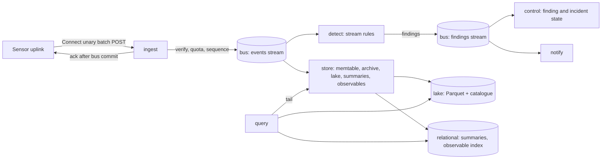

# 20. Server platform and storage

_Status: draft 5 against spine version 4 as amended by the owner's instructions of 2026-11-11 (`_review/04-owner-kit-instructions.md`: P14 to P17, D-70, D-71), the rulings R-16, R-19, R-21, R-38, R-64 and R-65, and the owner answers in `_review/02-owner-answers.md`. Owning squad: Platform (server targets, port adapters, lake, operator plane); trust-core paths under D-63 are marked, and a change to one lands only after `eval-security`, `eval-adversarial` and cross-model review, with two independent passing evaluators on different models (D-63). Read with: `00-decisions.md` (P14, P15, P16, P17, D-33, D-34, D-35, D-36, D-51, D-52, D-56, D-57, D-58, D-67, D-68, D-70, D-71), 03 (targets, ports, profiles, configuration, lint), 04 (envelope, lanes, integrity, flattening rule), 12 (verdicts, grants, AuthZEN), 13 (detections), 18 (approvals and incident workflow), 21 (tenant and device keys, identity vault, operator realm), 22 (uplink protocol, schedule, trust roots, rings), 23 (API, operator API and our MCP server), 24 (listeners, Ingress, air-gap bundle, upgrade path), 25 (export destinations), 27 (operator UI), 32 (costs), 33 (build order and risk register), 34 (support and lifecycle)._

## Summary

This document specifies `grdr-server`: what each target does, how the two process shapes realise the three profiles, the five storage ports and their adapters, and the event lake from ingest to deletion. It also fixes the relational outline, bus streams, detection checkpoints, backup and restore, migrations, cells, self-observability and the bill of materials. The server requires the core, the wire format, the port traits and the results of the storage spike S-02 and the bus spike S-03 (spine section 7). Key choices:

1. **Two process shapes**, `--target=all` and `--target=<one>`. `embedded` is one `all` process; `ha` is N identical `all` replicas; `distributed` is one target per process (D-33).
2. **The bus is the only write-ahead log** (D-34). Ingest acknowledges after the bus commit; `store` checkpoints its bus offset only after the lake commit. On `embedded` and `ha` the bus is a partitioned log table on the relational port, so an `ha` install needs PostgreSQL 18 and object storage and nothing else.
3. **The lake is Parquet with a SQL catalogue on the relational port**, written and queried in process by DataFusion. DuckLake's catalogue layout is the first candidate, Iceberg the second, and a bespoke catalogue the fallback (D-34). The same sidecar tables (holds, key ids, archive segments, content keys, fencing, manifests) sit beside whichever catalogue wins.
4. **Three physical tables per organisation**, one per retention class: `decision` (13 months), `activity` (184 days) and `content` (30 days). The categories of 04 are views over them. After compaction a small organisation holds at most 9 data objects per day (lake files, the `observable` table and archive segments) and spends at most 200 PUTs per day (targets, S-02).
5. **One writer per bus partition, fenced.** A `store` instance holds a lease on each bus partition it consumes. Every catalogue commit carries the lease's fencing token, so two writers can never commit for the same partition.
6. **Two layers of keys from 21's hierarchy.** Content values are sealed per root session, at the application level, under a content key wrapped by the organisation KEK. Every Parquet file is also encrypted, through Parquet modular encryption, under the data key of its organisation, class and day. Destroying a session key erases that session's content even after compaction has mixed sessions in one file (D-57). The byte-exact archive cannot be sealed per value, so subject erasure reduces it (section 5.7).
7. **A typed query IR in the port**, compiled to DataFusion plans. User SQL is a restricted dialect that lowers to the same IR. A ClickHouse adapter would implement this IR if S-02 fails at both volumes (D-34 revisit).
8. **Restore is a signed state transition.** It mints a new server epoch. Monotonic state (revocations, kill states, consumed token ids, destroyed content keys) is replayed from a versioned `state-log/` prefix in object storage. Sensors re-send from a durable watermark that advances only behind backup health (D-57).
9. **Quota samples raw fidelity; overload delays it.** Ingest never samples or drops `decision` or `spine`; under cell overload it delays every lane but `decision` with a spread `retry_after_ms`, lowest priority first (section 4 step 3). Over quota its flow-control reply tells the sensor to sample `bulk` and defer evidence and backfill, and the sensor records each degradation as a coverage gap (D-52, D-68; 21 section 15, 22 section 2.7).
10. **A cell is one `distributed` instance** sized by a measured capacity vector; an organisation larger than a cell's free capacity spans cells as device shards with a home shard (section 11). The `router` holds only the directory and runs in any installation of more than one cell (D-35).
11. **Designed for ten million endpoints** (P15). Section 15 states the fleet arithmetic. The server directs each device's schedule, spreads every `retry_after_ms` and every periodic job by phase, admits load by priority without ever shedding commands or `decision`, and serves console reads from roll-ups and sketches.
12. **Two tiers of configuration and an operator plane** (D-70). Boot configuration holds only what a process needs before the database is reachable; everything else is a versioned runtime setting, applied without a restart and rolled back automatically when a target fails its health check. A separate `operator` target, with its own listener, origin and account realm, administers and health-checks the deployment and has no route to tenant content (section 16).
13. **Air-gapped is first class** (P16). Every outbound connection goes through the `Dialer` to a configured destination, any S3-compatible store that passes the conformance probe can hold the lake, and backups can be written to removable media and restored on a host with no network.

## Requirements

| # | Requirement | Trace |
|---|---|---|
| R1 | One binary; exactly three profiles; any other adapter combination stops the start | D-33, P6; c1 F8; brief 24 |
| R2 | Tier 0 (`decide`, `approve`, and `gateway` by deviation 5) has no database, bus or lake on its request path, and lower tiers never block higher ones | D-33, D-56; l11 F1 |
| R3 | At-least-once pipeline, idempotent on `(device, epoch, lane, seq)`, ordered per session, with stated lateness windows | D-33, D-36; 04 section 2 |
| R4 | `ha` needs only PostgreSQL and object storage; `embedded` needs a disk | D-34; c1 F4; brief 24 (PostHog, Sentry anti-patterns) |
| R5 | Lake columns are the canonical model flattened, with field ids, additive within a major; OCSF is a view | D-06; c1 F5; 04 section 13 |
| R6 | Freshness 60 s; session timeline under 2 s; 30-day aggregation under 10 s at 5,000 and under 60 s at 100,000 events per endpoint per day; under $0.05 per endpoint-month excluding models | Spine section 6; D-52; c1 F2 |
| R7 | Partition by organisation, data class and day; erasure by key destruction, and by reduction in the byte-exact archive; holds checked by every delete path; physical deletion lags logical deletion by the point-in-time window | D-57; c1 F3; brief 34 |
| R8 | Backup and verified restore in every profile; RPO and RTO of 5 min and 1 h (relational) and 15 min and 4 h (events); the audit log is never restored backwards | D-57; SR-50; l11 F4; g10 section 5 |
| R9 | No read without a tenant context; RLS forced; per-organisation prefixes and keys; the operator cannot read content | D-35, D-55; SR-42, SR-43 (02) |
| R10 | Per-organisation limits on ingest, bus and query; verdicts, findings and audit are never dropped | D-68; l11 F3; SR-44 |
| R11 | Pipeline lag shows as "could not look"; a synthetic sensor runs every five minutes with its own alarm path | D-56, P9; l11 F2 |
| R12 | Expand-and-contract migrations; lake readers accept every schema revision inside the longest retention | D-58; l11 F6 |
| R13 | An organisation can export everything and move between hosted and self-hosted | D-67 |
| R14 | Byte-exact batch archive, changed only by reduction | D-39; 04 section 10 |
| R15 | Every linked, vendored or redistributed dependency is permissively licensed; an external service reached only over a standard protocol (S3, PostgreSQL wire, OIDC, SAML, SMTP, a KMS API) may carry a weak-copyleft licence, and the air-gap bundle carries it as an image built from source with its complete corresponding source (24 section 7); NATS's unused listeners are off; 7-day patch target | D-02, D-62; briefs 11, h05 |
| R16 | Every outbound connection goes through the `Dialer` to a destination named in configuration, trusting the site's anchors; nothing requires a public CA, a public revocation endpoint or a route out | P16; P14 |
| R17 | At 10 million endpoints, after any common event (connection drop, outage, release, nudge, reboot wave), no request class exceeds twice its steady rate per cell, new TLS connections stay under 2,000 a second per cell, and no request calls a key service | P15; spine section 6; S-23, S-24 |
| R18 | Boot configuration holds only what is needed before the database is reachable; every other setting is a validated, versioned runtime revision applied without a restart and rolled back on a failed health check; the deployment is administered through an isolated operator plane with no route to tenant content | D-70; D-55 |

## Design

Every bound, interval, timeout, size and threshold in this document is a default in `limits.toml`, and every host, port, address and name is a `grdr.config` key whose default is data in the schema or the brand manifest; code reads them and holds none (P14).

### 1. Targets and tiers

Targets are modules of `grdr-server` behind the `Target` trait of 03. They call one another only through ports and `grdr.internal.v1alpha1` (ARCH-010). `router` runs in any installation of more than one cell: the hosted service, where it also requires the hosted service's preconditions (D-63), or a self-hosted `distributed` site, air-gapped included.

| Target | Tier | Responsibility | State it owns | Scales by | Effect of loss |
|---|---|---|---|---|---|
| `decide` | 0 | AuthZEN and verdict-provider adapters (12 section 15, 07 section 8), `POST /v1/guard`, evaluated by `grdr-core` from bundles held in memory; an evaluation error denies (SR-46) | None durable; bundles reloaded from the blob store | Replicas | Vendor-side hooks use their own fail mode, which is reported as a request (D-40); devices are unaffected (P4) |
| `approve` | 0 | Approval relay for G3 approvals and kill or freeze command dispatch to connected devices (18, D-30; 22 section 5) | Pending approvals and commands in memory; the tier 1 outbox drain copies them to versioned object storage (22 section 5) | Replicas; devices assigned by rendezvous hashing, so a scale event moves 1/N of streams, closed with `RECONNECT` offsets over at least five minutes (22 section 3) | Step-up falls back to the local authenticator (D-56) |
| `gateway` | 0 | Our proxy in server mode (D-40) | Per-session state in memory | Replicas | Model and MCP routes fail closed |
| `ingest` | 1 | The data plane, `IngestService.PushBatch` (22 section 2): device verification, quota, sequence check, bus append, acknowledgement; OTLP ingest | Watermark rows | Replicas, stateless | Sensors spool; freshness degrades |
| `control` | 1 | Fleet service (check-in, `Subscribe` nudges, enrolment, roster delivery; 22 sections 3 and 4); organisation tree, packs and layers, rollouts, findings and incident state, suppressions, symbolic diff (12) | Relational | Replicas; rollout timers by lease | Policy propagation and enrolment stop; cached policy keeps enforcing |
| `content` | 1 | Bundle assembly, multi-engine validation, signing through the Keys port, update repository (22) | Blob store, served from a per-replica cache of verified immutable bytes keyed by digest (1 GB of memory and 20 GB of disk by default) that reads the store only on a miss; `timestamp.json` and rollout state from memory | Replicas; signing by lease | No new content; last-known-good stays |
| `detect` | 1 | Stream detections over the bus (section 7) | Checkpoints in the blob store | Bus partitions | Findings are late, and per-organisation lag shows as "could not look" |
| `store` | 1 | Bus to lake: memtable, flush, archive, compaction, retention, erasure, manifests, session summaries, observable index | Lake, catalogue | Bus partitions | Freshness degrades; the bus holds 24 h |
| `notify` | 1 | Outbox to webhooks, sinks and tickets (25) | Export cursors | Replicas | Delivery is late, never lost (at-least-once) |
| `identity` | 1 | Identity vault calls and the token service (21, D-27) | Vault tables | Replicas | Re-identification is unavailable |
| `keys` | 1 | Key wrap and unwrap through operator KMS or customer key (21) | None | Replicas | Writes of new files stall; cached KEKs serve to the hard TTL of the organisation's key mode (21 section 11); a mode 2 organisation enters 21's `key-unavailable` state after 60 minutes |
| `audit` | 1 | Per-organisation checkpoint chain and export to the customer's sink (D-39) | Relational and blob | Lease | Checkpoints are late; the chain resumes |
| `operator` | 1 | The operator plane (section 16): runtime settings with staged apply and rollback, health and history of every target and port, diagnostics and support bundles, upgrade preflight and status, organisation lifecycle, key rotation, backup and restore drills, the operator audit log; on its own listener, origin and account realm | Settings revisions and operator tables (relational) | Replicas | Settings changes and operator views are unavailable; every target keeps its last applied revision |
| `query` | 2 | Typed query IR, hunts, timelines, replay of metadata rules (section 5.8) | Caches only | Replicas | Console reads fail; ingest is unaffected |
| `review` | 2 | Review stage and retro runs (D-29, D-54) | Step journal | Replicas | "Review skipped" |
| `intel` | 2 | Mirrored intelligence packs and the reputation service, whose prevalence requires data from many organisations (D-32) | Blob | Replicas | Stale indicators |
| `api` | 2 | Connect, gRPC, gRPC-Web, console BFF, our MCP server (23) | None | Replicas | Console is down |
| `router` | Global in the hosted service; per installation in a self-hosted one of more than one cell, air-gapped included | Directory of organisation shards to cell and region, verified domains and custom domains; a lookup service, never a proxy, whose signed routes are cacheable by any CDN or cache (21 section 3) | Directory | Replicas per region | Sign-in by email and join codes fail; cached routes serve stale; enrolment from console-generated files and enrolled devices are unaffected |

Tier isolation in the `all` shape: each tier has its own Tokio runtime with a fixed worker count, plus a memory budget from `limits.toml`. Tier 0 runtimes never await a relational, bus or lake call. Their writes (approval outcomes, command acknowledgements) go to a bounded on-disk outbox that a tier 1 task drains. Inbound work reaches tier 0 the same way in reverse: a background task, outside every request handler, consumes the `control` stream (section 7) into `approve`'s in-memory dispatch table, so a bus outage delays new commands and never blocks a request. ARCH-010 plus ARCH-014 `tier0-no-port` (no port handle is reachable from a tier 0 request handler; number assigned in 03's register, R-21) enforce this.

**Stability.** No target has a panic path (03 section 10). Every external call this document names (relational store, bus, object store, Keys back end, IdP, SMTP) has a timeout, a named retry policy (`[retry.<name>]` in `limits.toml`, 03 section 10) and a circuit breaker whose open state shows in health and on the operator plane; this document owns the policies `relational-call`, `bus-append`, `object-store-call` and `keys-unwrap`, which gives up after 5 minutes (section 4 step 7). Every queue, cache, buffer and spill area here has a `limits.toml` bound and pushes back instead of growing: a spread `retry_after_ms`, a refused append or a queued request. A restarted target resumes from the bus offset, lease, step journal or settings revision it last committed, so a restart repeats no side effect.

### 2. Process shapes and profiles

| Profile | Process shape | Relational | Events | Bus | Blobs | Jobs | Organisations | Self-hosted contract |
|---|---|---|---|---|---|---|---|---|
| `embedded` | One `all` process | SQLite | Lake, local disk | Log on SQLite | Filesystem | Journal on SQLite | Exactly one | Supported |
| `ha` | N ≥ 2 `all` replicas behind a load balancer | PostgreSQL 18 | Lake, object storage | Log on PostgreSQL | Object storage | Journal on PostgreSQL | Many | Supported |
| `distributed` | One target per process | PostgreSQL 18 | Lake, object storage | NATS JetStream | Object storage | Journal on PostgreSQL | Many | Hosted; supported for self-hosters above the `ha` ceiling once the `distributed` load test (S-24) passes (the ceiling is whatever S-03 proves; it targets 50,000 endpoints at 5,000 events a day and 10,000 at 100,000, R-65) with a published reference architecture, and above one cell's capacity vector as several cells behind the installation's own `router` (section 11; D-33, D-58, R-38) |

`server.profile`, a boot key (section 16), selects the whole row (03 section 6). In `ha` every replica runs every target. Partitioned work (bus partitions for `store` and `detect`) and singletons (retention scheduler, compaction scheduler, rollout timers, content signing, manifest writer, synthetic sensor, audit checkpointer, and the `migrate` lease under which one replica applies schema migrations, 24 section 6) are held by leases on the Jobs port. A lease is `(name, holder, fencing_token, expiry)`, renewed every 5 s with a 15 s expiry (target); `expiry` is computed from the relational port's clock inside the claiming statement, so skew between replicas never decides who holds a lease. The fencing token is checked inside every commit it guards.

`grdr server migrate --to ha` moves an `embedded` install: it copies the SQLite catalogue and relational tables into PostgreSQL, uploads lake files and the archive to the bucket under the same keys, and replays the SQLite bus tail. It refuses if the bucket is not empty.

### 3. Ports and adapters

Port traits live in `grdr-ports` (layer 2), with reference in-memory adapters and the conformance kit in `grdr-ports-testkit`. Every method takes 21's `TenantCtx`: `Single(OrgId)`, or `Set(Vec<OrgId>, ReadOnly)` computed from live delegations (D-35), which has no write methods. It can be built only by the authentication middleware of `api` and `ingest` and by the job runner (trust core).

| Port | Trait (abridged) | Adapters | Crate |
|---|---|---|---|
| Relational | Typed repositories per module (`DeviceRepo`, `FindingRepo`, `CatalogueRepo`, ...), each method one SQL text per dialect; `tx(ctx, mode)` | SQLite (`rusqlite` 0.41.1, WAL), PostgreSQL 18 | `grdr-rel-sqlite`, `grdr-rel-postgres` |
| Events | `append(LakeBatch)`, `plan(scope, QueryIr, QueryLimits)`, `execute(plan) -> RecordBatchStream`, `tail(scope, …)`, `retain`, `erase`, `hold`, `manifest` | Lake on local disk, lake on object storage (one engine, two `object_store` back ends) | `grdr-lake` |
| Bus | `append(stream, key, msgs) -> offsets`, `subscribe(group, stream, partitions)`, `commit(group, partition, offset, fence)`, `lag()` | Log on the relational port; NATS JetStream | `grdr-bus-log`, `grdr-bus-nats` |
| Blobs | `put`, `put_versioned`, `get`, `get_range`, `list`, `delete`, all on a `TenantPath` | Filesystem; S3-compatible, GCS and Azure through `object_store` 0.14.2 | `grdr-blob` |
| Jobs | `enqueue(kind, idempotency_key)`, `claim(kinds, lease)`, `step(job, n, name, f)`, `complete`, `lease(name)` | Step journal on the relational port | `grdr-jobs` |
| Keys | Owned by 21 | `local`; `kms` (AWS KMS, GCP Cloud KMS, OpenBao Transit, PKCS#11); key modes operator KMS and customer-managed key | 21 |

`QueryIr` is part of the Events port, so a ClickHouse adapter could implement the port without touching feature code. It has six node types. `Timeline` gives the events of one root session in order. `Scan` takes a table view, predicates over registered columns and a projection. `Aggregate` takes group keys and `count`, `sum`, `min`, `max` and `approx_distinct`. `Lookup` reads the observable index. `Hunt` is a restricted SQL plan (section 5.8). `Export` is a full-fidelity scan with a cursor. Feature code never writes SQL against the lake; ARCH-005 bans `datafusion` and the catalogue crates outside `grdr-lake`.

Object stores fall in two classes. *Tested* stores run in CI for every release: AWS S3, Google Cloud Storage and Azure Blob, and on premises SeaweedFS (Apache-2.0, 4.53; brief 11) and Ceph RGW, an external service reached over S3 and never linked, which the air-gap bundle carries as an image built from source (24 section 7). *Conformant* stores are any other S3-compatible product a site runs. `grdr server preflight` runs the conformance probe on every store: read-after-write, list-after-write, multipart, range read, versioning, versioned delete, noncurrent-version listing, path-style addressing, a custom region string, a server `Date` within 2 seconds of the host, and TLS against the configured anchors. A conformant store that passes runs as Tier 2 (D-50), labelled `conformant` in `status` and the support matrix. Conditional put and lifecycle rules are probed and used when present, never required: where a store lacks a noncurrent-version lifecycle rule, `blobs.lifecycle = "server"` makes `store` delete noncurrent versions older than retention plus the point-in-time window as a fenced retention job. MinIO is archived (brief 11) and Garage is on 03's do-not-use list; neither is tested, named or bundled, and a customer-run instance is judged by the probe alone. S-02 checks versioning and noncurrent-version expiry on SeaweedFS and Ceph RGW; air-gapped `ha` is supported on whichever passes.

### 4. Ingest path, server side of D-36

Document 22 owns the messages (`PushBatchRequest` with one `EventBatch` per lane, `PushBatchResponse` with a `LaneAck` per lane and `FlowControl`), signing and client behaviour. For each `EventBatch`, `ingest` runs these steps:

1. **Authenticate.** It verifies the request signature by the transport key that the device key certifies (22, reading 1), then the batch-head signature by the per-boot key certified by the device key (D-36, D-39). The organisation comes from the device credential only; an `organisation_id` in the payload that differs is refused and raises a tamper finding.
2. **Sequence.** It reads the watermark row `(organisation, device, epoch, lane) -> (acked_through, chain_head, durable_through, durable_chain)`, about 100 bytes, from a per-replica cache (the edge routes by a consistent hash of `grdr-device` where it can). A batch with `last_seq ≤ acked_through` is `DUPLICATE` and is acknowledged without an append; the bus header `chain` lets `store` and `detect`, which de-duplicate anyway, raise `CHAIN_CONFLICT` when a duplicate's chain differs. A batch whose `first_seq = acked_through + 1`, or whose hole is exactly covered by a `health.gap` already accepted from any lane of the same device and epoch, is appended. A batch that overlaps (`first_seq ≤ acked_through < last_seq`) is appended whole, and consumers drop the repeated events. Any other start is `GAP` with `expected_seq`. A `prev_chain` that does not match `chain_head` is `CHAIN_CONFLICT`: it raises a tamper finding and the batch is still stored, flagged `chain_conflict` (P9: record, do not discard). A new epoch must carry `prev_epoch_final_chain` (04 section 10). A clone (22 section 4.5) moves both streams into a quarantine watermark keyed by transport-key fingerprint, so nothing is lost or merged.
3. **Admission** (section 10, 22 section 2.7). The organisation limit samples `bulk` and defers `evidence` and backlog; it never samples `decision` or `spine`. The cell limit is an adaptive concurrency limit per replica, from bus append latency and queue depth (`limits.toml`), shared between organisations by deficit round robin weighted by active endpoints and applied by admission class (AC0 commands and `decision`, 20% reserved; AC1 live `spine`, check-in, `Wait`; AC2 enrolment, renewal, full state; AC3 `evidence` and content fetches; AC4 `bulk` and backlog), lowest class delayed first with a spread `retry_after_ms`; each delay is counted per lane and organisation. Over the organisation's ingest limit, `FlowControl` sets `bulk_sample_permille` below 1,000 and `backfill_credit_bytes` to zero: the sensor samples raw `bulk` data, keeps evidence in its flight recorder, and records each degradation as `health.coverage` with reason `quota` (21 section 15). Above the hard ceiling every lane gets a spread `retry_after_ms`; the sensor spools and the server discards nothing.
4. **Append.** One bus message per batch: the `EventBatch` bytes as received once the request's content encoding is removed, recompressed with plain zstd level 3 and no dictionary, so the archive never depends on a dictionary (22 section 2.6). Headers: `org`, `device`, `epoch`, `lane`, `first_seq`, `count`, `schema_rev`, `received_at`. The partition key is a virtual bucket: keys hash to 4,096 virtual buckets mapped to physical partitions by a versioned map on the relational port, keyed by `org` for organisations below 2,000 endpoints and by `(org, bucket(device_id))` above (section 11), so one device, and therefore every session on it, stays in one partition. Changing an organisation's key (crossing 2,000, or the quota move of section 10) is a re-partition: `ingest` appends a `repartition` marker to the old partition, then routes by the new key, and consumers of the new partitions hold that organisation's messages until the old partition's consumer has passed the marker. Per-device order therefore survives the move.
5. **Acknowledge** after the bus commit, with `acked_through`, `durable_through` (section 9) and `FlowControl` (`retry_after_ms`, `backfill_credit_bytes`, `bulk_sample_permille`, and the device's `Schedule` when its revision changed, 22 section 2.7). `ingest` sets `Schedule.spine_interval_ms` from cell load, between 2 and 30 s: the default below 50% of the cell limit, rising to 20 and then 30 s while load stays above 70% for 1 minute, and back after 10 minutes below 50% (`limits.toml`), so freshness stays within 60 s. `decision` and the last 10 minutes of `spine` always go; older backlog drains within `backfill_credit_bytes`, drawn from a cell pool equal to measured spare capacity (cell limit minus live load) and divided by the same weighted round robin, with no organisation taking more than 25% of the pool while others wait (22 section 2.7; l11 F5).
6. **Update the watermark.** On `embedded` and `ha` it is updated in the same transaction as the append. On `distributed` it is written behind the NATS append as one multi-row upsert per replica per 10 ms, and each append carries `Nats-Msg-Id = device/epoch/lane/last_seq`, so a retry that reaches another replica inside the duplicate window is dropped by the bus; consumers still de-duplicate on `(device, epoch, lane, seq)` from their own checkpointed high-water marks, so a race only ever costs a duplicate. Rows of an epoch whose final chain is durable are deleted after 35 days, with that epoch's `KeyCertificate`s, which move into the archive beside the batches they verify.
7. **Rewind.** Every acknowledged batch above a device's `durable_through` is still in its spool (22 section 2.3), so the server may rewind a device lane: it sets the watermark to `(durable_through, durable_chain)` and answers the lane's next batch `GAP` with `expected_seq = durable_through + 1`. When an organisation's key cannot be unwrapped within the `keys-unwrap` retry policy (5 minutes, `limits.toml`), `ingest` defers that organisation with a spread `retry_after_ms` and `store` skips its messages, recording the skipped device ranges, so the shared partition keeps advancing; when the key returns, `ingest` rewinds those lanes. The same rule recovers lost bus ranges and replaces a bus mirror in disaster recovery.

Flow control (l11 F5): sensors follow 22 section 2.7 (server-directed `Schedule`, the `uplink-reconnect` retry policy with full jitter, retry-after as a floor). Every `retry_after_ms` `ingest` sends is drawn per device over the expected recovery window: the number of deferred devices divided by the admission rate the cell sustains. `ingest` drains connections over a jittered window of at least five minutes on deploy. A cold start of a full cell, where every sensor holds a 24-hour spool, is a release gate (22's SP-22-4, l11 S2): live-lane findings within 2 minutes, no out-of-memory, backfill only from spare capacity, complete within 6 hours at 5,000 events per endpoint-day and within 24 hours at 100,000 (targets; S-24).

Enrolment, key renewal and revocation, and the signed command channel are specified in 22 sections 4 and 5 and served by `control` and `approve`; this document stores their state (section 6).

OTLP ingest for third-party agents (04 section 14) enters through `ingest` as a second front door. It maps to the canonical model in the core mapper, gets `provenance: claimed`, and is appended to a synthetic device lane per source.

### 5. The event lake

Requires: the S-02 verdict, which selects the catalogue.

#### 5.1 Tables, columns and partitions

| Physical table | Holds | Retention default (D-51) | Partition path |
|---|---|---|---|
| `decision` | Every event of the `decision` lane (receipts, grants, findings, incidents, response, audit, gaps) | 13 months | `org=<id>/class=decision/day=<yyyy-mm-dd>/` |
| `activity` | `spine`, `bulk` and the non-content part of `evidence` | 184 days | `org=<id>/class=activity/day=…/` |
| `content` | Every content-class field split from any event, plus `EvidenceSpan` text, keyed by `event_id` and field path | 30 days | `org=<id>/class=content/day=…/` |
| `observable` | Per-session occurrences of identifier-class observables, written by compaction and sorted by `(type, value)` (section 5.5) | 184 days | `org=<id>/class=observable/day=…/` |
| `agg_daily` | Roll-ups closed daily from `store`'s per-minute counters: counts and bytes by device, agent type, action class, verdict, mode and rule id, plus HyperLogLog sketches of distinct sessions and agent instances | 13 months | `org=<id>/class=agg_daily/month=…/` |
| Archive (not a table) | Received batches, byte-exact (section 5.2) | `decision` lane 13 months; other lanes 184 days; content fields reduced at 30 days | `org=<id>/class=archive/lane=<l>/day=…/` |

Object paths follow 21's `org=<id>/class=<class>/day=<date>/` rule and are built only inside the adapter from the `TenantCtx`. The retention class is the "data class" axis of D-57. Identifier, structural and derived fields share the 184-day class, and content is apart. The 04 categories (`session`, `tool`, `action`, `decision`, `expectation`, `process`, `inventory`, `hook`, `assurance`, `health`, `finding`, `response`, `audit`, `identity`) are DataFusion views over `decision` and `activity`, filtered by a `category` column. Their columns follow 04's flattening rule: field path joined by `_`, with Parquet field ids derived from the protobuf field-number path. The lake omits `integrity` (chain values, event digests, class digests and salts); verification reads the byte-exact archive through `lake_archive_segment` from `(device, epoch, lane, seq)`. The column manifest is generated from the field registry, and the drift test covers it (04 section 13). Shared envelope columns come first: `organisation_id`, `device_id`, `epoch`, `lane`, `seq`, `event_id`, `class`, `observed_time`, `monotonic_ns`, `received_at`, `root_session_id`, `session_id`, `tool_call_id`, `schema_rev`. The receive time and skew sit beside the event, never inside it (04).

The partition day is the UTC date of `observed_time`, clamped to `[received_at − 30 days, received_at + 1 day]`. A clamped row carries `clock_clamped = true`. Retention runs on the partition day.

#### 5.2 Write path: memtable, flush, archive

`store` holds a lease per bus partition. For each message it decodes the batch with the generated codec, replaces each device-side pseudonym with the server pseudonym derived under the organisation's ingest pseudonym key, which no device holds (D-51's second layer; key and mapping are 21's). Server pseudonyms are cached per process by `(organisation, device pseudonym)` and keyed by the organisation's vault revision, which `identity` increments and broadcasts on every mapping change, subject erasure included; misses are single-flight and batched 1,000 per query. The ingest pseudonym key sits in 21's key hierarchy, wrapped by the organisation key, and is included in backups and in the organisation bundle (R-64). `store` then splits content-class fields into `content` rows, seals each content value, and appends Arrow rows to the organisation's memtable for the target table. Each content value longer than 256 bytes is compressed with zstd level 3, then sealed; every value is sealed with AES-256-GCM under the root session's content key, with the event id and field path as associated data.

- The memtable has a per-process budget of 1 GiB (target, `limits.toml`). Beyond that it spills to local Arrow IPC staging files. Neither the memtable nor staging is durable: the bus is.
- A flush is per organisation and table, at 32 MB of encoded Parquet or 60 minutes, whichever comes first, and always before the partition's bus retention minus 6 hours. A flush writes one Parquet object per table, named `<uuidv7>.parquet`. It then commits the files, their statistics and data key ids to the catalogue in one transaction guarded by the partition's fencing token. Only then does it commit the bus offset: `min(first unflushed offset)` across the organisations on that partition.
- The archive: the same flush, before the lake files, writes the received batch bytes, unchanged, to `org=<id>/class=archive/lane=<l>/day=<d>/<uuidv7>.seg`, and records the segment in `lake_archive_segment` in the same catalogue transaction. A segment is a length-prefixed sequence of batches with an index footer, encrypted in 64 KiB AES-256-GCM chunks under the data key of `(org, archive, day)` so range reads still work. This is the byte-exact archive of D-39, so it keeps the device-side pseudonyms the batch was signed with. The lake can be rebuilt from it, after a restore or an import, by re-deriving server pseudonyms under the ingest pseudonym key (R-64), and reduction (04 section 10) is the only rewrite it ever undergoes.
- Tail reads: `query` asks the partition owner over `grdr.internal.v1alpha1.StoreTail` for memtable and staging rows that match the plan's organisation, time and session bounds. It then unions them with the lake scan, de-duplicating on `(device, epoch, lane, seq)`. Freshness is therefore bus-commit latency plus decode, not flush interval.

DuckLake's data inlining is switched off explicitly: brief 11's verification found it on by default with a 10-row limit. It would put trickle data into the relational catalogue, and memtable tail reads already meet the 60 s freshness target without loading PostgreSQL.

**Scheduling (P15).** Per-organisation periodic work starts at phase `hash(organisation_id, kind) mod period`: flushes and manifests over 60 minutes, compaction from day end plus 2 hours spread over 6 hours, retention and reduction over 24 hours, and scheduled hunts and reports (18) over 30 minutes for daily jobs and 2 hours for weekly ones. Every TTL cache, key material included, expires at a uniformly jittered age between 75% and 100% of its stated maximum, refreshes ahead of expiry and coalesces concurrent misses into one call.

#### 5.3 Segment format and sort order

Parquet, zstd level 3, row groups of 128k rows, with page indexes and column statistics on. Bloom filters, sized from the file's row count (NDV no more than rows, false-positive rate 1%) and omitted below 10,000 rows, go on `root_session_id`, `session_id`, `tool_call_id`, `event_id` and the observable columns (executable digest, destination host, MCP server digest, tool-manifest hash, skill digest). The sort order within a file is `(device_id, root_session_id, epoch, monotonic_ns, lane, seq)`, so a session timeline reads contiguous row ranges and device views prune by statistics. Session ids are UUIDv7, so per-file minimum and maximum session ids also prune by time. Each file's key-value metadata records `schema_rev`, the column manifest version, `grdr.lake.format = 1` and the producing build.

#### 5.4 Catalogue

The catalogue lives on the relational port, in the same database as everything else, so it is backed up and restored with it. Candidate 1 uses DuckLake's catalogue tables and commit protocol (snapshots, tables, columns, data files, delete files, per-file column statistics) through `datafusion-ducklake` (Apache-2.0, 0.9, alpha; c1). Candidate 2 uses Iceberg through `iceberg-rust` 0.11.0 with a SQL catalogue. Whichever S-02 selects, these sidecar tables are ours and identical across candidates:

| Table | Key | Content |
|---|---|---|
| `lake_org_head` | `organisation_id` | Current snapshot per organisation, schema version, write fence; row-locked by each commit, so commits serialise per organisation |
| `lake_file_ext` | `organisation_id, file_id` | Table, day, `device_bucket` (section 5.6), min and max `device_id`, `root_session_id`, `observed_time`; row count; bytes; data key id (the wrapped key itself sits in the file's Parquet key metadata, 21's "object header"); `logical_deleted_at`; `physical_deleted_at`; producing fence |
| `lake_archive_segment` | `organisation_id, object_key` | Lane, day, `(device, epoch, first_seq, last_seq)` ranges from the index footer, root-session ids present, digest, `reduced_at`, `logical_deleted_at`, `physical_deleted_at` |
| `lake_hold` | `organisation_id, hold_id` | Scope (table, day range, devices, root sessions), reason, incident reference, creator, expiry (optional), state |
| `content_key` | `organisation_id, root_session_id` | Wrapped session key, key id, created, `destroy_after`, state (`active`, `destroyed`), destruction record id |
| `lake_manifest` | `organisation_id, manifest_seq` | Object key, digest and signature of the signed manifest (section 5.7) |
| `lake_quarantine` | `organisation_id, object_key` | Objects found unreferenced after a restore, with the reason and a delete-after time |

Two layouts are possible for candidate 1: one catalogue per organisation (a PostgreSQL schema each) or one shared catalogue with per-organisation tables. A shared catalogue has one snapshot sequence for the whole lake, which risks commit contention. S-02 measures both, including schema-per-organisation at 10,000 organisations and every layout at 50,000 organisations per catalogue, and confirms that `datafusion-ducklake` supports the layout it picks. The catalogue records column statistics only for envelope and observable columns; Parquet footers hold the rest. If both fail, the bespoke catalogue is the sidecar tables plus a `lake_file` table, with the commit being the `lake_org_head` row update.

#### 5.5 Indexes and summaries on the relational port

The lake keeps only Parquet statistics, page indexes and bloom filters. List views and indicator matching never scan `activity`; they read these tables, which `store` writes from the bus in the same consumer group, and the `observable` lake table that compaction writes:

- `session_summary`: one row per root session, written at session start, at most once a minute while it is active, and at session end; between writes `StoreTail` serves its live counters. Device, agent instance, agent type, principal pseudonym (used only by subject erasure and the subject's own view, never for grouping; P8), start, end, counts by action class, verdicts, findings, maximum ratings, lake time bounds. A session timeline first reads its time bounds here, then plans a `Timeline` over at most the files whose session-id range covers it.
- `observable_first_seen` `(org, type, value, first_seen, last_seen, device_hll, session_hll)`, written at most once per key per flush, with counts merged as HyperLogLog sketches (exact below 64). Per-session occurrences are the lake table `observable` per `(org, day)`, written by compaction and sorted by `(type, value)` with page indexes, plus one binary fuse filter per `(org, month)` over `value ‖ day` (about 9 bits per entry). This is the observable index of D-54. Values are the identifier-class digests of 04, never content. A new indicator is tested against the filters, then looked up in the days they name, without a scan of `activity`.
- `agg_hour` (48 hours) and `agg_day_group` (13 months): the keys of `agg_daily` without `device_id`, by group, with HyperLogLog sketches of distinct devices, sessions and agent instances, fed from `store`'s per-minute counters; and `assurance_rollup (organisation, group, os, agent_type, action_class, control, visibility, level) → count`, updated on each `assurance.record` change. Console tiles, mode-control counts, coverage rings, provider overviews and replay prompt estimates read only these and `agg_daily`; every row carries a revision that the API exposes as its ETag.
- `inventory_*` (owned by 05) and the provenance edge tables of D-25 (`session_edge`: from, to, kind, grade), walked with recursive CTEs. There is no graph database (brief 11).

Entity search uses PostgreSQL full-text with `pg_trgm`, or SQLite FTS5, over names of agents, MCP servers, skills, devices and rules. Event search is lake scans. Free-text search over captured content is a Tantivy index per organisation, rebuilt from `content` and reached through the `Hunt` node. Without it, substring hunts over 30 days of content must stay under 60 s at the median organisation size; where S-02 or field reports show otherwise, the index is on by default for organisations that capture content.

#### 5.6 Compaction and roll-ups

Compaction is a job per `(org, table, day)`, scheduled by the compaction singleton and run by the partition owner. It runs at day end plus 2 hours at the organisation's phase (section 5.2), and late files then fold in at most at 1, 7 and 31 days after the day closes, each pass writing one late file per `(org, table, day)`; base files are rewritten only when late bytes exceed 10% of the base. For organisations keyed by `(org, device)`, files carry a hidden `device_bucket` (the top 6 bits of `bucket(device_id)`, section 11) in `lake_file_ext`, compaction runs one job per bucket group, and `Timeline` and device scans prune to one bucket. Target file size is 256 MB, so after compaction an `(org, table, day)` holds `ceil(bytes / 256 MB)` files. Compaction rewrites rows into the current `schema_rev` (new columns null; nothing removed), re-sorts, writes new files under the same day data key, and commits a snapshot that marks the inputs `logical_deleted_at`. It rewrites the day's archive segments per lane into segments of at most 1 GiB grouped by device bucket, each a sequence of independently decodable zstd frames of about 1 MiB (level 9, no dictionary) with the batch index in the footer; decompressed batch bytes are unchanged. Where the object store has storage classes, archive segments move to an infrequent-access class after the 30-day reduction, and `preflight` reports the rule. It also writes the day's `observable` rows and `agg_daily` rows as one file each, and the month's daily `agg_daily` files are merged into one at month close. A small organisation (under 256 MB a day per table) therefore holds at most 9 data objects per day: 3 lake files, 1 `observable` file, 1 `agg_daily` file and 4 archive segments. Thirty-day aggregations in the console and the replay prompt counts of 12 read `agg_day_group` and `agg_daily`, plus `agg_hour` for the open days, never raw `activity`. This is the roll-up the spine allows for the 100,000-event target.

PUT budget per small organisation-day (target): 24 hourly flushes × 3 tables (72), archive segments 4 lanes × 24 (96), compaction outputs (3 lake, 1 `observable`, 1 `agg_daily`, 4 archive), and up to 24 manifests, about 200 PUTs. At the default `metadata` capture level the `content` table is usually empty, which leaves about 24 PUTs of headroom. Manifests are counted apart from the 9 data objects; those older than the PITR window are thinned to one per day. S-02 measures the budget; if it is exceeded, the flush interval moves to 2 hours for organisations under 1 MB a day.

#### 5.7 Retention, deletion, holds, crypto-shredding

- **Retention.** A daily singleton marks every file and archive segment of a `(org, table or lane, day)` past its retention (section 5.1) as logically deleted, unless a hold covers it. Physical deletion runs after the point-in-time window, 7 days by default and never less than the relational PITR window. The bucket's lifecycle rule expires noncurrent object versions after the same window; without it versioning would keep every deleted object, so `preflight` refuses a bucket that lacks the rule unless `blobs.lifecycle = "server"` (section 3). Every delete path calls `Holds::check(org, scope)` inside the deleting transaction: retention, compaction cleanup, erasure, reduction, quarantine purge and organisation deletion. A test enumerates the delete paths from the call graph.
- **Content keys.** Each root session gets a 256-bit key at its first content row, wrapped in process under the organisation KEK by the Keys port's local `wrap` (21 section 11), never by a KMS call per session. Wrapped keys are cached unwrapped in `store` and `query` for at most 10 minutes. Content retention destroys keys whose `destroy_after` has passed (30 days after the session's last content row), then deletes the `content` files after the PITR window. Destruction writes a record to `state-log/` before the catalogue row is deleted (section 9).
- **Subject erasure.** The `identity` target deletes the pseudonym mapping (21). In one job, `store` finds the subject's root sessions through `session_summary`, destroys their content keys, and reduces their events in every archive segment that `lake_archive_segment` lists for those sessions, as below. Metadata rows keep a pseudonym nobody can resolve (D-51, D-57). No free-text rewrite is needed because no metadata column holds a name (P8); `EvidenceSpan` text lives in `content`. Target: one subject erased in under 1 hour at the 10,000-endpoint organisation (S-02 measures it).
- **Archive reduction.** At 30 days, and at once for an erased subject's sessions, a job rewrites only segments whose footer marks a batch as carrying content-class fields or their salts (at `metadata`, the `evidence` lane and `finding.state` evidence spans in `decision`) and strips those fields and salts. It keeps `d_c`, writes the reduced segment, deletes the old one through the hold check, sets `reduced_at`, and records `audit.admin` (04 section 10). The reduced batch still verifies.
- **Data keys.** Each Parquet file uses Parquet modular encryption under 21's data key for its `(org, class, day)`, with the AAD prefix `org_id ‖ class ‖ day ‖ key_id`, so a read across prefixes fails authentication (21 section 2). DataFusion supports modular encryption behind its `parquet_encryption` feature, with a pluggable `EncryptionFactory` for key retrieval (read by the author on docs.rs for 52.1.0, not in the briefs; S-02 confirms it on 55.2.0). Object-store server-side encryption is added beneath it, not relied on.
- **`state-log/`** records are kept while any restorable backup predates them (35 days), then folded into relational state and pruned.
- **Organisation deletion** (D-67) destroys the organisation KEK, which renders every data key and content key unreadable, then purges the prefix after the PITR window.

Which stores each key mode covers (c1 F3):

| Store | Under the organisation key | Removed by subject erasure |
|---|---|---|
| Lake `decision`, `activity`, `observable`, `agg_daily` | Yes (data keys) | Pseudonym becomes unresolvable |
| Lake `content` | Yes (data keys, and session keys per value) | Yes, by key destruction |
| Archive | Yes (data keys); content fields are not sealed per session | Yes, by immediate reduction of the subject's sessions |
| Relational rows | No: database and disk encryption only; rows hold pseudonyms and digests | Pseudonym becomes unresolvable |
| Bus (24 h) | No: payloads at the received capture level | Ages out in 24 h |
| Backups and noncurrent object versions | As their sources; backups retained at most 35 days, noncurrent versions for the PITR window, both below the erasure deadline | By age, plus replay of key destructions and reductions on restore |

#### 5.8 Caches and the query layer

Caches: Parquet footer and page-index cache (per process, 256 MB); a file-list cache per `(org, table, day)`, invalidated by catalogue commit notifications; and a local disk object cache (LRU, 20 GB default) that holds encrypted bytes only. Aggregates have a result cache: entries are keyed by organisation, the canonical digest of the `QueryIr`, scope, window and the highest roll-up revision or catalogue snapshot the plan read, computed once under single-flight, held in `query` memory only, and never holding `content` columns or rows outside the caller's tenant context; a tile may be served stale up to its declared `freshness_s` (27). Row reads (timelines, lists, hunts) are not cached, and decrypted pages live only in query memory. `StoreTail` runs on a bounded pool with a per-request budget of rows, bytes and 2 s, returning `partial` past it, shown as "could not look".

Each query runs with the caller's `TenantCtx`. Only views of organisations in scope are registered in its DataFusion session, so a cross-organisation reference does not resolve. Limits per organisation come from section 10: concurrency, memory (a DataFusion fair spill pool with spill to local disk), scanned bytes and wall time. `Hunt` accepts a SQL subset parsed by DataFusion's parser. It allows `SELECT` only, with an allow-list of functions, no DDL, DML, `COPY` or external tables, a maximum time range of the organisation's retention, and mandatory `LIMIT` ≤ 100,000 rows. The pipe-style front end and Sigma-as-hunt (D-54) lower to the same IR. Provider lists, queues, tiles and reports are single relational statements under the set-valued context (section 6) over relational tables and roll-ups (`agg_day_group`); the lake fans out per organisation only for provider hunts, which run as background hunts with at most 16 organisations in parallel (D-35). The planner classes each hunt: interactive when its estimated scan after statistics, bloom-filter and observable-index pruning is 50 GB or less, otherwise background, run as an Operation queued per organisation against a daily scan budget of 50 GB plus 1 GB per 1,000 active endpoints (target), newest first, streaming partial results, with the estimated cost shown before it starts. Every read of a `content` column requires a content grant (D-38, D-55), unwraps through `keys` and writes `audit.access` (04).

### 6. Relational schema outline

Every tenant table follows 21 section 2: `organisation_id` is the first column of the primary key and of every unique index (a constant in `embedded`); `ENABLE` and `FORCE ROW LEVEL SECURITY` with the policy `organisation_id = ANY(string_to_array(current_setting('grdr.orgs', true), ',')::text[])` for a `Single` context and, for a `Set` context, `organisation_id IN (SELECT organisation_id FROM delegation_snapshot WHERE snapshot_id = current_setting('grdr.orgset', true)::uuid)`, whose rows are written at token exchange from live delegations (21 section 5), each set by `SET LOCAL` from the `TenantCtx` at the start of every transaction, so no setting means no rows (trust core). The application role owns no table and lacks `BYPASSRLS`; migrations run as a separate owner role. SQLite has no RLS; `embedded` admits one organisation and the repository layer still requires a `TenantCtx`.

Deployment tables (runtime settings and the operator realm) carry no `organisation_id` and sit outside RLS. The application role has no privilege on them, and the `operator` target connects as its own role, granted only these tables and `control`'s organisation lifecycle functions (section 16.2).

| Module (owner) | Tables | Partitioning and retention |
|---|---|---|
| Tenancy (21) | `organisation`, `provider`, `delegation`, `delegation_snapshot`, `organisation_set`, `group`, `directory_alias` | None |
| Identity vault and keys (21) | Vault mappings and wrapped KEKs, schema owned by 21 | Mapping deleted on subject erasure |
| Devices and fleet (22, 21) | `device`, `device_key`, `enrolment_token`, `deployment_key`, `ingest_watermark`, `device_health`, `rollout_target` | Watermark per `(device, epoch, lane)`, about 100 bytes; `rollout_target` holds per scope, channel and step the digest, open time, ramp and salt, and a device's desired state is computed at check-in from organisation, group and bucket, cached per `(organisation, group, channel, bucket range, revision)`, so nothing per device is written when a step opens |
| Policy (12) | `pack`, `pack_version`, `layer_document`, `draft`, `replay_result`, `rollout`, `rollout_ring`, `rollout_gate_rollup` | 15-minute rows 7 days, daily rows 90 days |
| Grants and approvals (12, 18) | `grant`, `grant_revocation`, `approval_request`, `retry_token`, `consumed_token` | Monthly; 13 months |
| Findings and incidents (13, 18) | `finding`, `finding_revision`, `incident`, `incident_member`, `suppression`, `ticket_link` | Monthly; revisions 13 months |
| Response (18) | `response_command`, `command_signature`, `command_delivery` (rows only for refused, failed and pending-offline past 24 hours), `command_tally` (counts per command, state and cell, flushed every 5 s), `kill_state` | 13 months; per-device transitions stay `response.action` events |
| Inventory (05) | `inventory_agent`, `inventory_mcp_server`, `inventory_mcp_tool`, `inventory_skill`, `inventory_model_endpoint`, `inventory_credential`, `triage_item` | Current state, one presence row per (organisation, entity, device) written only on change, plus a change-history row per change; never a periodic copy |
| Lake index and roll-ups (this) | `session_summary`, `session_edge`, `observable_first_seen`, `agg_hour`, `agg_day_group`, `assurance_rollup` | Monthly; `agg_hour` 48 hours, `agg_day_group` 13 months, the rest the retention of `activity` |
| Lake catalogue (this) | Catalogue tables of section 5.4 | Lifetime of the files |
| Bus (this) | `bus_partition`, `bus_message`, `bus_consumer`, `bus_bucket_map` (the versioned virtual-bucket map of section 4) | Hourly partitions; 24 h; every map version kept |
| Jobs (this) | `job`, `job_step`, `lease` | Completed jobs 30 days |
| Usage (D-68) | `usage_event` (append-only, ancestor ids `parent_provider_id`, `provider_id`, `organisation_id`), `usage_rollup_daily`, `usage_statement` | Monthly; 25 months |
| Audit (D-39) | `audit_checkpoint`, `server_epoch`, `server_outage_window` | Never deleted while the organisation exists |
| Access and roles (23, D-55) | `principal_binding`, `role_binding`, `support_grant`, `content_grant`, `api_token` | Grants keep history 13 months |
| Export (25) | `export_destination`, `export_cursor`, `outbox` | Outbox 7 days after commit |
| Runtime settings (this; D-70) | `setting_revision`, `setting_apply` (one row per target replica and revision), `setting_lock` (source locks) | Deployment table; every revision kept |
| Operator realm (21) | Operator accounts, passkeys, sessions, roles and audit records, schema owned by 21 | Deployment tables; audit never deleted while the deployment exists |

### 7. Bus streams, detection state and checkpoints

| Stream | Messages | Partitions | Retention | Consumers |
|---|---|---|---|---|
| `events` | One per accepted batch | 1 (`embedded`), 16 (`ha`), 64 (`distributed`, in 8 streams) | 24 h, bounded below by the oldest unflushed offset; appends are refused with a spread `retry_after_ms` at 18 h of unflushed age or 80% of `max_bytes` | `store`, `detect` |
| `detect-keyed` | Stage-1 keyed partials and join keys (13 section 4) | 16 (`ha`), 64 (`distributed`) | 24 h | `detect` stage 2 in the home shard |
| `findings` | `finding.state` and `incident.state` from `detect`, and device findings, which `detect` forwards unchanged from `events` | 16 | 7 days | `control`, `notify`, `review` |
| `control` | Rollout ticks, desired-state changes, response commands for dispatch | 4 | 7 days | `approve` (background task, section 1), `control` (push nudges) |
| `usage` | Usage records from every target | 4 | 35 days | `store` (into `usage_event`) |

**Log on the relational port.** `bus_message(stream, partition, offset, organisation_id, key, headers, payload, appended_at)`, partitioned by hour. An append runs one transaction: `UPDATE bus_partition SET next_offset = next_offset + n … RETURNING`, which row-locks the partition so offset order equals commit order (a plain sequence would let a reader skip a late-committing row), then the insert; a debounced notifier outside the append transaction sends `NOTIFY grdr_bus` at most once per partition per 50 ms. Consumers poll every 250 ms as a fallback. `bus.database` may name a separate PostgreSQL instance without WAL archiving, with the watermark table beside it, because the bus is never restored (section 4 step 7); the log has `max_bytes` (default twice the measured 24-hour volume) with section 4's priority refusal. Ingest coalesces batches into group commits of up to 10 ms. `bus_consumer(group, stream, partition, committed_offset, holder, fence, expiry)` holds the offsets. Retention drops hourly partitions. SQLite uses the same tables in WAL mode.

**NATS JetStream** (`distributed`; 2.15.2, `async-nats` 0.52.0; brief 11). One internal account per cell for the service; tenants never connect, and isolation is enforced by ingest and the consumers, not by NATS accounts. Events use 8 streams `GRDR_EVENTS_<g>` (g = partition mod 8, `limits.toml`), each its own Raft group with leaders spread across nodes; `decision` batches go to `GRDR_DECISION` with its own `max_bytes`, so a full events stream never refuses `decision`; the others are `GRDR_DETECT_KEYED`, `GRDR_FINDINGS`, `GRDR_CONTROL` and `GRDR_USAGE`. Each uses file storage at R3 with limits retention, `max_age` 72 h as a safety bound only, `max_bytes` set and `discard new`, so a full stream returns an error that `ingest` turns into a spread `retry_after_ms`; the default unlimited stream fills the disk (g10). Consumers are pull consumers with `AckNone`; each group's offsets live in `bus_consumer`, committed with the fence as in the log adapter, and a purger advances each partition subject by sequence purge to the minimum committed offset across groups. Leafnode, MQTT and WebSocket listeners are off (h05). DR keeps no bus mirror: a recovered cell starts the bus empty, mints a new server epoch and lets sensors re-send above `durable_through` (section 4 step 7).

**Detection state.** `detect` holds a lease per `events` partition and runs the detection engine trait (rsigma parser and evaluator behind it, D-09) over decoded events. It runs fleet-level correlations that a device cannot see: cross-device, cross-principal, heartbeat gaps outside recorded outage windows (D-22), and the synthetic sensor's sequence. Rule details are owned by 13.

- Ordering: a per-device reorder buffer of 5 s (target) orders by `(epoch, monotonic_ns)` across lanes. The lateness window is 15 minutes: an event older than the partition watermark minus 15 minutes is evaluated on a late path whose findings carry `retro: true`. Events older still are left to retro hunts in `review`.
- Checkpoint: every 5 minutes or 100,000 messages, whichever comes first, and never while state is unchanged, `detect` writes a state snapshot (correlation windows keyed by rule id and version, de-duplication high-water marks per `(device, epoch, lane)`, bundle digest), one section per organisation encrypted under that organisation's `activity` data key for the day, to `blobs: ephemeral/detect/<partition>/<offset>.snap`, a prefix whose noncurrent versions expire after 1 day; recovery replays at most 5 minutes, inside the 15-minute lateness window. It then commits the bus offset with the snapshot key in the same consumer-row update. Recovery loads the snapshot and replays from the offset. Finding ids are a hash of organisation, rule, group key and window start (04), so replay is idempotent.
- On a bundle change, state for unchanged `(rule id, version)` pairs carries over and changed rules start empty. The changed rules are queued for a retro run over the last 24 hours in `review`, with `not_before = now + hash(organisation) mod 2 h`, under tier 2 admission, skipping organisations whose `agg_daily` shows none of the changed rules' action classes; one scan per (cell, table, day) serves every changed rule of the bundle change (13 section 7).
- Lag per organisation is the oldest unprocessed `received_at` per partition, attributed to the organisations on it. Lag above 2 minutes shows as "could not look" on that organisation's console and API (D-56, P9).

### 8. Step journal

Durable jobs (retention, compaction, erasure, export, retro runs, rollout steps, response fan-out, restore drills) use `job(id, organisation_id, kind, idempotency_key unique, state, input, not_before, attempts, holder, fence, expiry)` and `job_step(job_id, n, name, state, output_digest, output, started, finished)`. A step's side effect must be idempotent on `(job_id, n)`. Its output is recorded before the next step starts. A claim takes a lease with a fencing token that every write checks. Claims use `SELECT … FOR UPDATE SKIP LOCKED` on PostgreSQL and the single writer on SQLite. Brief 11's verification names `apalis` 1.0.0 (MIT) and `duroxide` (MIT, preview) as alternatives. Issue J-1 evaluates `apalis-workflow` against the Jobs port test kit, including tenant context and fencing. If it passes, it becomes the adapter; otherwise we build the journal (target under 2,000 lines).

### 9. Backup, restore and disaster recovery

**Backup.**

| Store | Mechanism | RPO, RTO |
|---|---|---|
| PostgreSQL (`ha`) | Managed PITR (RDS, Cloud SQL); CloudNativePG 1.30.1 (Apache-2.0) with its Barman Cloud plugin archiving WAL to a second bucket; or, on VMs, pgBackRest (MIT) to a second bucket or a filesystem; base backup daily; `preflight` reads archive lag from `pg_stat_archiver`, so any archiver works | 5 min, 1 h (D-57) |
| SQLite (`embedded`) | Online backup API every 5 minutes into `backup/`, plus the lake directory copied by hard link where the filesystem allows. `backup/` must be on another volume or host; `preflight` warns when it shares a device with the data directory | 5 min, 1 h |
| Lake and archive objects | Bucket versioning on; objects are immutable and uniquely named; physical deletes and noncurrent versions lag by the PITR window | 15 min, 4 h |
| `state-log/` | Versioned object prefix: every revocation, kill-state change, consumed token id (retry tokens and enrolment tokens, 22 section 4.2), content-key destruction, subject-erasure reduction and server epoch is written here before the operation is acknowledged, group-committed per process in 50 ms windows as one object; a command of any scope is one record, and per-device kill state is derived, never written per device | Zero for these records while the object store survives; in `embedded` the filesystem prefix is copied with `backup/`, so a lost disk loses them up to the backup interval |
| Signed manifest | Each hour with a commit, per organisation, a delta manifest (objects added and removed, with digest, table or lane, day, schema revision and data key id) chained by the previous manifest's digest, and a full manifest once a day; each hour the cell signs one Merkle root over all organisations' manifest digests with the server key under the deployment root (21, 22), and each manifest carries its inclusion proof, so an organisation bundle still verifies alone | Rebuild without the database |

**Durable watermark.** Each `LaneAck` carries `durable_through` (22 section 2.3). It covers only events whose lake commit, and therefore whose archive segment, is older than 15 minutes, and only while the last backup check is green (WAL archive lag under 5 minutes, or the SQLite backup is younger than 10 minutes). Sensors keep acknowledged batches until `durable_through` passes them. While backup health is red, `durable_through` stops, sensors keep spooling within their caps, and the server shows Degraded. At 100,000 events a day the extra spool is about 1 MB per endpoint (target).

`grdr server backup` writes a consistent marker: server epoch, relational LSN or SQLite backup id, catalogue snapshot per organisation, bus offsets, manifest sequence. It then verifies that the bucket is versioned and that noncurrent versions expire, by the bucket's lifecycle rule or by `blobs.lifecycle = "server"` (section 3). Backup retention is 35 days at most (erasure deadline, c1 F7).

**Offline copy.** `grdr server backup --to <dir>` writes the marker, the relational backup, `state-log/`, the signed manifests and the lake and archive objects changed since the previous copy to a directory for removable media. `grdr server restore --from <dir> [--verify]` runs the steps below on a host with no network, then replays any newer `state-log/` it is given, so erased content stays erased; it refuses a copy whose newest `state-log/` is older than the 35-day ceiling. The second failure domain is a second store, a second site or such media; none needs a cloud account.

**Restore** (`grdr server restore --to <time> [--verify]`), a signed state transition (D-57; l11 F4):

1. Stop `ingest` and every tier 1 writer. Tier 0 keeps serving from memory.
2. Restore relational state to time T.
3. Mint server epoch `e+1`, signed by the deployment root through the Keys port, and write it to `state-log/`. Counters become `(epoch, n)`, so commands issued after restore are never mistaken for replays.
4. Replay `state-log/` records after T: revocations, kill states, consumed token ids, content-key destructions and subject-erasure reductions. A revoked grant stays revoked, and erased content stays erased.
5. Reconcile the catalogue with the bucket. Files referenced but missing cannot occur while physical deletion lags the PITR window; if one does, restore fails `--verify`. Archive segments present but unreferenced (written after T) are replayed through `store`, de-duplicated on `(device, epoch, lane, seq)`, which rebuilds their lake rows and advances the watermarks, and step 4's reductions are applied to them again; event data that survived in the bucket is never discarded by a relational restore. Unreferenced lake files are then moved to `lake_quarantine` and deleted after 7 days, because their rows have been rebuilt from the archive.
6. Start `ingest`. Each sensor sees the new `server_epoch` and re-sends everything above its `durable_through` (22 section 2.3). Because `durable_through` only ever covered archived events, the replayed watermarks are at or above it, and no sensor is asked for a batch it has already deleted. Consumers de-duplicate.
7. Freeze the audit checkpoint chain with a final checkpoint at the old epoch and start a new shard. The audit log is never rewound.
8. `--verify` checks every catalogue file and archive segment exists and its digest matches the latest manifest. It verifies manifest signatures, row counts per `(org, table, day)` against the manifests, and the hash chains of a 1% sample of archived batches with the independent verifier of 04.

**Lake rebuild** (`grdr server lake rebuild --org <id>`) recreates catalogue and sidecar rows from the newest valid manifest, or from the archive if the manifest is lost.

**Disaster recovery, hosted.** This requires the hosted service and its preconditions, including infrastructure funded by revenue, sponsorship or donated cloud credits (D-63). Each organisation is pinned to a region (D-35). Its cell has a cross-region PostgreSQL replica and bucket replication to a second region in the same jurisdiction. Evacuation, in order: freeze deploys; promote PostgreSQL; repoint the cell's ingest DNS; start the bus empty and let sensors re-send above `durable_through` (section 4 step 7); throttle reconnects with jitter. Live lanes drain before backfill (g10). A quarterly automated restore into a scratch cell and an annual region game day produce availability evidence for the control library, and for SOC 2 once a sponsor or revenue pays for that certification (D-46).

### 10. Quotas and fairness

Defaults and their effects are 21 section 15's; this section fixes where each is enforced. Self-hosted installs keep only the safety ceilings by default (21).

| Limit (per organisation) | Default | Enforced by | Over the limit |
|---|---|---|---|
| Ingest | 100,000 events per active endpoint per day averaged over the organisation, burst 3× for 15 minutes (21) | Token buckets in `ingest`; each replica enforces per-device buckets locally (the per-endpoint limit, burst 3× for 15 minutes), lends unused organisation headroom from a local share and reconciles organisation totals once a minute in one multi-row upsert per replica; only organisations above 50% of their bucket in the last 10 minutes rebalance through the counter row (target) | `FlowControl` lowers `bulk_sample_permille` and sets `backfill_credit_bytes` to zero; evidence stays in the flight recorder; `decision` and `spine` are always accepted; the sensor records `health.coverage` reason `quota` |
| Hard ingest ceiling | 10× the ingest limit (21) | Same | A spread `retry_after_ms` on all lanes; the sensor spools; the server discards nothing |
| Bus bytes | 2% of stream `max_bytes` in a shared partition (this document) | `ingest` | The organisation's virtual buckets move to their own partitions by a map change under section 4's re-partition marker |
| Query | 4 concurrent and 50 GB scanned per query (21); 4 GiB memory and 120 s wall time (this document) | `query` | Queued fairly, then `RESOURCE_EXHAUSTED` (HTTP 429 with retry-after) with the `ErrorDetail` that names the limit (03 section 10) |
| Review tokens | Organisation budget (D-29) | `review` | "Review skipped" |
| Detection cost | 50 rule-µs per event (target, 13 section 7) | `control` at compile, `detect` at run time | Refused for live placement; over-budget rules run as hunts; priority shedding |
| Cell admission | Adaptive concurrency per replica and priority class (section 4 step 3) | `ingest`, `control`, `content`, `api` | Lowest class delayed first with a spread `retry_after_ms`; P0 never shed |

In the `all` shape, `query` and `review` run in the tier 2 runtime with a fixed memory pool. S-02's hostile-query arm (l11 S1) decides whether that is enough; the trigger for moving tier 2 into a supervised child process under a cgroup or job-object cap is any process killed in that arm.

### 11. Cells and regions

Requires: the `distributed` profile and its load test (S-24); organisation shards also require S-28. A hosted cell also requires the hosted service's preconditions (D-63), including infrastructure funded by revenue, sponsorship or donated cloud credits.

A cell is one `distributed` instance with its own PostgreSQL, NATS cluster and bucket. Its cap is a capacity vector measured by S-24, each dimension at 70% of its first failing point: sensor connections, `PushBatch` requests a second, events a second, wire bytes a second, compressed lake and archive bytes a day, organisations, catalogue commits a second and relational row writes a second. Until S-24 runs the targets are 50,000 endpoints (60,000 connections), 25,000 requests a second, 231,000 events a second at peak, 100 MB/s of wire bytes, 250 GB of lake and 1 TB of archive a day, and 5,000 organisations (estimates; c1 F9; AWS cell guidance, brief 24). Placement stops filling a cell when any dimension reaches 70%, and `placement.toml` (data, whose values an operator can override as runtime settings, section 16) spreads a provider's organisations over at most two cells per region.

**Organisation shards.** Every device has `bucket(device_id)` = the first 16 bits of SHA-256(device_id) mod 4,096, the function the bus's virtual buckets and the lake's `device_bucket` also use. An organisation is placed as one or more shards, each owning a contiguous bucket range; one that fits in half a cell's free capacity has one shard owning all 4,096, and a shard splits by halving its range. The directory maps `(organisation_id, bucket range)` to a cell in the organisation's region. The home shard holds the organisation's relational control plane (tree, policy and layers, roles and roster, grants, findings, incidents, approvals, command counter, integrations, outbox, audit chain) and publishes what devices and `detect` need (bundles, roster, revocations, suppressions, rollout targets) to the other shards as signed, revision-numbered snapshots in the blob store; each shard holds the events, archive, lake, session summaries, observables and inventory of its devices and runs its own bus partitions and stage-1 `detect`. `scope: organisation` rules finish in the home shard's stage 2 (13 section 4). `query` scatter-gathers per shard and merges partial aggregates (counts, sums, minimum and maximum, HyperLogLog sketches, top-k); session and device reads go to one shard. The home shard issues commands and each shard's `approve` dispatches them. The organisation KEK is wrapped once per cell key, and every cell of a region verifies under one deployment root (22 section 6.2). A shard moves by the organisation-bundle procedure applied to its bucket range. With one shard nothing changes (S-28).

The `router` target holds only `directory(organisation_id, bucket range, cell_id, region, provider ids, state)` and answers lookups (21 section 3); it runs in any installation of more than one cell, self-hosted included. Enrolled devices and API clients receive the cell URL and talk to the cell directly, so `router` is never on the data path. Global services: the intelligence service, the content repository, and billing roll-ups built from signed per-cell usage statements (D-68); project releases come from the origins in `updates.sources` (22 section 6.1), never from a cell's egress. A self-hosted multi-cell site, air-gapped included, runs `router` on its own PostgreSQL, and its global services are local: imported bundles served by each cell's `content`, imported intel, and the per-cell statements of 21 section 15. Nothing in it calls Loonaro. Provider views fan out per cell and merge on `organisation_id`, and an organisation's own views merge across its shards (above); there is no other cross-cell join. An organisation moves cells, or between hosted and self-hosted (D-67), through 21's organisation bundle (21 section 14): export the bundle, whose `lake/` and `audit/` members this document supplies (lake files with the column manifest and the signed store manifest; archived batches byte-exact); import and verify it against the manifest; then send devices the signed redirect. Invariant for every profile: no stored key, path or id contains a cell id.

### 12. Schema migration rules

1. Relational migrations are expand and contract across two releases. Release N adds columns, tables or indexes nullable or with defaults, and writes both forms. N+1 reads the new form. N+2 drops the old. The previous binary always runs on the new schema, so rollback needs no restore (D-58).
2. A long migration runs as a background job behind a completion gate. The next release's `preflight` refuses to start until the gate is met.
3. The upgrade-path manifest lists required stops. `grdr server preflight` refuses unsafe jumps, any component combination outside the declared contract ranges (through the compatibility resolver, D-71), a backup older than 24 hours, an unversioned bucket or one whose noncurrent versions do not expire, untested PostgreSQL or NATS versions, and an object store that fails the conformance probe; a store outside the tested set that passes is a warning and runs as Tier 2 (section 3; D-58).
4. Lake: columns are added only. A type change or rename is a new column. Readers resolve columns by Parquet field id, and register every `schema_rev` present within the longest retention (13 months). Compaction upgrades files to the current revision. Breaking the lake format (`grdr.lake.format`) needs an RFC and a one-shot rewrite job.
5. Catalogue schema upgrades (DuckLake or Iceberg versions) are trust-core changes. They are tested by upgrading a 30-day S-02 dataset and running `restore --verify`.
6. CI upgrades from every supported version to the candidate and rolls back one release, in both `embedded` and `ha`.

### 13. Self-observability

- Metrics, exported as OTLP only when `telemetry.otlp.endpoint` is set (no default) and always pullable on `/metrics`, follow 03's naming: `grdr_server_ingest_ack_seconds`, `grdr_server_bus_lag_seconds{stream,partition}`, `grdr_server_org_pipeline_lag_seconds` (bucketed, never labelled by organisation in shared monitoring), `grdr_server_store_flush_bytes`, `grdr_server_lake_org_day_objects` (histogram), `grdr_server_compaction_backlog_jobs`, `grdr_server_quota_degradations_total{lane}`, `grdr_server_epoch_count`, plus a loss counter on every queue (P9). Organisation ids appear as labels only on per-organisation quota series, exported for the 100 largest organisations per cell, with the usage ledger holding the rest (21 section 2).
- Synthetic sensor: a singleton enrols a dedicated device in a reserved organisation per cell or install. Every five minutes it sends a signed known-bad sequence and checks that a finding and a notification arrive within 2 minutes. The alarm goes through an independent path (a separate webhook and email relay inside the operator's network, configured at install; never a vendor-hosted service by default), not through `notify` (D-56).
- Burn-rate paging at 14.4 and 6, for tier 0 and tier 1 objectives only (g10).
- `server_outage_window` rows are written by the `audit` singleton when ingest availability drops below 50% for 1 minute. `detect` suppresses heartbeat-gap findings inside them (D-22).
- The server sends no crash report anywhere: a crash writes a `LogSafe` crash record to its state directory, which only `grdr server support-bundle` collects.
- Our own telemetry never enters a tenant lake. In `embedded`, `grdr server status` and `grdr doctor --server` read it locally. `grdr server support-bundle --preview` redacts on the host (D-59).

### 14. Sizing and performance targets [targets until S-01 and S-02]

Assumptions: 500 raw bytes per shipped event (04 section 12 range: 180 to 1,200); Parquet plus zstd at 10× on metadata (brief 24 assumes 10 to 15×, and its verification marks the whole volume basis unverified, ±3×); steady state dominated by the 184-day class; peak at 4× average (g10); object storage at about $0.023 per GB-month (brief 24, a recalled list price, not re-verified). Of the 500 bytes, 208 to 272 are the hashes and salts of 04 section 10 that no codec compresses; 04's wire form leaves about 64 of them (estimate, S-25). The lake omits integrity (section 5.1) and compresses the rest at 10×, about 26 bytes an event; the archive keeps the wire form in 1 MiB frames, about 116 bytes an event plus about 150 bytes per batch head (estimates). At 10 million endpoints that is about 2 PB at 5,000 events a day and about 28 PB at 100,000, USD 0.002 and USD 0.027 per endpoint-month with archive objects older than 30 days in an infrequent-access class (estimates; recalled prices). The table below keeps the earlier equal-archive basis until S-02 replaces it. S-24 reports events a second per application vCPU; the 50,000-endpoint row at 100,000 events implies about 1,000 at peak. Every row below is a target.

| Endpoints | Events per endpoint-day | Events per second, average and peak | Compressed per day | Lake plus archive, steady state | Object storage per endpoint-month | Profile and shape |
|---|---|---|---|---|---|---|
| 10 | 5,000 | 0.6 and 2.3 | 2.5 MB | 0.9 GB | under $0.01 | `embedded`: 2 vCPU, 4 GB RAM, 50 GB disk |
| 10 | 100,000 | 12 and 46 | 50 MB | 18 GB | $0.04 | `embedded`: 2 vCPU, 4 GB, 100 GB |
| 1,000 | 5,000 | 58 and 230 | 250 MB | 90 GB | under $0.01 | `ha`: 2 × (4 vCPU, 8 GB); PostgreSQL 4 vCPU, 16 GB, 100 GB |
| 1,000 | 100,000 | 1,160 and 4,600 | 5 GB | 1.8 TB | $0.04 | `ha`: 3 × (8 vCPU, 16 GB); PostgreSQL 8 vCPU, 32 GB, 500 GB (bus about 25 GB at 24 h) |
| 50,000 | 5,000 | 2,900 and 11,600 | 12.5 GB | 4.5 TB | under $0.01 | One cell, `distributed`: ingest 3, store 3, detect 3, query 3, decide 2, approve 2, others 1 to 2, each 2 vCPU and 4 GB; NATS 3 × (4 vCPU, 16 GB, 500 GB); PostgreSQL 8 vCPU, 64 GB |
| 50,000 | 100,000 | 58,000 and 231,000 | 250 GB | 90 TB | $0.04 | One cell at its cap: ingest 12, store 10, detect 8, query 6, decide 3, approve 2, each 4 vCPU and 8 GB; NATS 3 × (8 vCPU, 32 GB, 4 TB); PostgreSQL 16 vCPU, 128 GB, 2 TB plus 2 replicas |

Storage stays under the $0.05 target at both volumes, though only just at 100,000 with the archive included. The cell floor of $1,500 to $3,000 a month (g10) dominates at 1,000 endpoints; cost owners are 32 and 36. Self-hosters pay for their own infrastructure. Loonaro has no budget for it, so a hosted cell runs only on revenue, sponsorship or donated cloud credits (D-63). The targets that S-02 and S-03 measure come from spine sections 6 and 8: ingest acknowledgement p99 under 200 ms and detection lag p99 under 5 s (S-03); freshness within 60 s; session timeline under 2 s; 30-day aggregation under 10 s and 60 s at the two volumes; restore leaving no dangling files.

### 15. Fleet capacity at ten million endpoints [estimates until S-23, S-24 and S-25]

P15 asks every design to state its arithmetic at 10 million endpoints. The same figures cover the hosted fleet across its cells and one self-hosted installation of that size. Labels: [P] a figure from the plan; [E] an estimate that the named spike replaces; [R] a recalled price, not re-verified; [V] an external fact checked on 2026-11-11. "Without P15" is the plan before the mechanisms of P15; "With P15" is this design.

Inputs:
- 10 million endpoints.
- 5,000, a base of 15,000, and 100,000 events per endpoint-day [P; D-52, 32 A1].
- 500 raw bytes per event, 10× lake compression, peak at 4× average [P; section 14].
- Cell cap of 50,000 endpoints; a region stops placing at 70% fill [P; section 11, 32 section 4].
- Check-in every 15 minutes and heartbeat every 25 s [P; 22]; `spine` flushed every 2 s without P15, and by default every 10 s within 2 to 30 s with it (22 section 2.7).

| Quantity | Without P15 | With P15 |
|---|---|---|
| Cells | 200 at the cap; 286 at 70% fill, plus one canary cell per region [P] | Same until S-24 measures the capacity vector; if connections or requests bind before events at 5,000, it could be about 57 [E, unproven] |
| Events a second, fleet, average and peak | 5,000: 578,704 and 2.31 million; 15,000: 1.74 and 6.94 million; 100,000: 11.57 and 46.3 million [P] | Same |
| Events a second per cell, average and peak | 2,894 and 11,574; 8,681 and 34,722; 57,870 and 231,481 [P] | Same |
| `PushBatch` requests a second, fleet average | 5,000: 174,000 to 428,000; 100,000: 1.46 to 2.08 million, set by the flush timer [E] | 5,000: 69,000 to 211,000; 100,000: 139,000 to 417,000, with `spine` at 10 to 30 s and lanes coalesced [E; S-25] |
| `PushBatch` per cell at peak | 3,500 to 6,400; 15,900 to 25,000 [E] | 1,400 to 3,200; 1,700 to 4,900 [E] |
| Check-ins | 11,111 a second fleet-wide, 56 per cell; about 50,000 in one second per cell after a nudge or a phase lock | Same mean, flat by phase; nudged check-ins paced at or below the admitted rate (about 2,000 a second per cell [E]); unchanged check-ins answered from memory |
| Long-poll | 40,000 to 60,000 full check-ins a second from the 20 to 30% of devices behind buffering proxies [E] | Same arrivals, as `Wait` requests under 256 bytes with no relational read |
| Heartbeats | 320,000 to 400,000 frames a second at 25 s | 145,000 to 182,000 at a learned 55 s |
| Connections | 10 to 12 million, 50,000 to 60,000 per cell, about 3 GB per cell at 50 KB each [E] | Same, held by at least two edge replicas per cell |
| New TLS connections | About 1,157 a second steady (10 per device-day [E]); after a drop, 60,000 in one second per cell, or 6 million in one second across a 100-cell region | At most 2,000 a second per cell over a 30 s spread, 200,000 a second per region, resumed through shared ticket keys |
| Bytes in a day | 43 to 60 TB at 5,000; 405 to 487 TB at 100,000, of which framing is 37 to 51% [E] | 12 to 22 TB; 148 to 176 TB [E] |
| Bytes out a day, responses and control | 17 to 57 TB [E] | 9 to 20 TB [E] |
| Update egress | 295 to 406 TB a day (intel snapshots 175 to 250 TB, monolithic metadata 60 TB, full binaries); opening hosted ring 3 sends 300 TB in 900 s, 2.67 Tbit/s [E] | 17 to 24 TB a day, about 2 MB per endpoint-day; ring 3 on a 48-hour ramp with deltas, 5.6 Gbit/s [E] |
| Lake plus archive, steady state | Section 14's basis: 0.95 PB (5,000) and 18.8 PB (100,000); with integrity bytes counted, 6.8 PB and 117 PB, USD 0.016 and 0.27 per endpoint-month [E] | About 2.0 PB and 28 PB, USD 0.002 and 0.027 per endpoint-month, with archive objects older than 30 days in an infrequent-access class [E; R prices] |
| Relational writes per cell at its cap, 100,000 events | About 65,000 a second and 45 MB/s of WAL; per-session observable rows reach 9.2 billion per cell [E] | About 19,000 rows a second in about 2,500 statements and 3 MB/s of WAL; observables in the lake (section 5.5) [E] |
| Object-store operations | About 200 PUTs per small organisation-day, 80 to 400 million a day across 0.4 to 2 million organisations, in hourly bursts of about 70,000 a minute per cell; `detect` checkpoints 36.9 million a day; about 1.8 billion uncached origin GETs a month [E] | Same data PUTs, spread by phase; checkpoints 3.7 million a day or fewer; about 3.3 million origin GETs a month through the project origins' CDN (22 section 6.1); cell `content` store reads fall from 3.6 million a day per cell to hundreds [E] |
| Key-service calls | A fleet-key signature per response, if held in KMS: 225,000 to 2.1 million a second, about USD 0.3 to 2.7 million a day [R], against an ECC quota of 1,000 a second per account [V]; KEK unwraps up to 75,000 an hour per cell, all at once on a cold start | About 8,600 response-key certificates a day (286 cells × about 30 replicas [E]); about 625 KEK unwraps an hour per cell; a cold start makes at most 50 calls a second over 5 minutes |
| Fan-out | Project release: 10 million; hosted ring 3: 7.5 million; organisation policy or kill: at most 50,000 hosted, 10 million in the largest self-hosted installation; provider: up to 5,000 organisations; mirror syncs: 1,000 to 10,000 [E] | Same sizes; each shard (one per cell) serves at most about 35,000 to 50,000 devices of any organisation |

Storage by retention class with P15, at 5,000 and 100,000 events [E]: `decision` lake (13 months) 10 TB and 205 TB; `activity` lake (184 days) 234 TB and 4.7 PB; `agg_daily` 12 TB; archive `decision` lane (13 months) 46 TB and 0.92 PB; other archive lanes (184 days) 1.05 PB and 20.9 PB; batch heads 0.6 PB and 0.93 PB; `content` (30 days) 0 to 126 TB at the `metadata` default with look-back credit.

Worst bursts, per cell unless stated:

| Event | Without P15 | With P15 |
|---|---|---|
| Connection drop (balancer, edge, `control`) | 60,000 handshakes plus `Subscribe` opens within one second | At most 2,000 a second over a 30 s spread |
| Overload answered with one `retry_after_ms` | The cohort returns together: about 159,000 requests within about 100 ms at 100,000 events [E] | No second above 2× the mean arrival rate |
| Organisation-wide policy change, 50,000 devices | 50,000 check-ins in about one second; 2.5 to 25 GB of bundles | Check-ins over a spread of 25 s or less; about 1 GB of layer documents |
| Organisation-scope kill, 50,000 devices | 50,000 database-backed check-ins within 10 s | 50,000 stream writes of 2 to 4 KB each; zero relational reads |
| Cold start at 100,000 events | 231,000 events a second of backfill, the whole peak, on top of live traffic | Spare capacity only; done within 24 hours |
| Anonymous rollout step from 50% to 100% | 111 to 167 Gbit/s for 4 hours | 2.1 Gbit/s on a 7-day ramp |
| Intel snapshot at check-in | 1.56 Tbit/s | Segments only, about 0.4 TB a day |
| Self-hosted installations reaching "+48 h" | About 10 TB within minutes | Spread over 24 hours |
| Compaction and flush boundaries | About 80,000 jobs at 02:00 UTC; 70,000 PUTs a minute | Spread over 6 hours and 60 minutes (section 5.2) |
| VDI or MDM enrolment wave | 30× over the enrolment limit; 100 hours with retry storms | Slots from the credential's own budget; about 15 minutes |
| Correlated false-positive finding | 391 GiB per cell, 76 TiB fleet-wide | 20 look-backs per organisation and rule an hour, about 160 MiB |

**Cell sizing.** 286 cells at 70% fill, each sized as section 14 (5,000 events: 62 application vCPU; 100,000 events: 224 vCPU, NATS 3 × 8 vCPU, PostgreSQL 16 vCPU) [P, E]. Each cell needs an edge layer of at least two replicas holding about 3 GB of connection state [E], 8 NATS event streams, 64 partitions and 4,096 virtual buckets. A 10-million-endpoint self-hosted organisation becomes about 286 device shards of about 14 buckets each, across as many cells, behind its own `router` and one deployment root (section 11). The 250 GB a day lake figure stops binding: at 100,000 events a cell writes about 130 GB of lake and 0.6 to 0.75 TB of archive a day [E], so the binding dimension is events a second, 231,000 at peak. S-23 drives the real uplink scheduler for 10 million simulated devices against this model, S-24 measures one cell's capacity vector, and S-25 measures wire bytes per lane; their results replace the [E] figures.

### 16. Server configuration and the operator plane (D-70)

#### 16.1 Boot configuration and runtime settings

Server configuration has two tiers. Both are keys of the one `grdr.config` schema (03 section 9), and each key's tier is an option in the schema.

- **Boot configuration** is what a process needs before the relational store is reachable: `server.profile`, the listen addresses (among them `server.operator.listen` and `server.management.listen`), the references to the relational store, the object store and the Keys back end, and `server.settings.seed`. It comes from the install file, the environment (`env_ok` keys), flags or Helm values (24), and a change needs a restart.
- **Runtime settings** are everything else: sign-on providers, SMTP, storage and retention defaults, quotas, cells and placement, which modules and adapters are on, telemetry export and maintenance mode. They live in the relational store as versioned revisions and take effect without a restart.

A runtime key in the boot file, or a boot key in a revision, stops the start or the apply with a message naming the key's tier. `server.settings.seed` names a file applied as the first revision when the store is empty and never read again. On a server, `grdr config explain <key>` prints the schema default, the brand manifest's value, the boot layer or runtime revision that set the key, and any source lock (03 section 9 gains this runtime layer).

A revision is the full set of runtime values with its parent, author, diff and digest, validated against the schema with each key's `security` and `stability` options applied. Its state is explicit:

| State | Exits |
|---|---|
| `draft` | `validated` when the schema check and the `preflight` checks for the changed keys pass; `discarded` |
| `validated` | `applying` when an operator applies it, after passkey step-up if it widens a `security` key; `discarded` |
| `applying` | `applied` when every affected target reports it healthy; `rolled_back` when one fails its health check or does not report within the apply timeout |
| `applied` | `superseded` when a later revision is applied |
| `rolled_back`, `superseded`, `discarded` | None; terminal |

**Apply.** Targets learn of a new revision from a notice on the `control` stream (section 7), with a poll as the fallback. Apply is staged: one replica of each affected target loads the revision and reports health, then the rest. When a target fails or does not report, every target returns to the parent revision, and the revision records the failing target and its reason. Each process keeps its last applied revision on local disk, so a restart while the relational store is unreachable starts on it and tier 0 keeps serving (D-56). In a multi-cell installation the `router`'s operator plane applies an installation-wide revision one cell at a time and stops at the first cell that rolls back.

**Configuration as code.** `grdr operator config export` writes the current revision as TOML and `grdr operator config apply <file>` stages one; Terraform resources (23) do the same. A source lock, as for policy (D-11), makes git authoritative for the keys it names: the operator plane shows them read-only, and only an apply from the locked source changes them.

Admission limits, the device `Schedule` and the cell's adaptive concurrency stay automatic (section 4). Runtime settings hold the operator's choices, not incident tuning.

#### 16.2 The `operator` target

`operator` is a tier 1 target (section 1) with its own listener and origin. `server.operator.listen` defaults to `127.0.0.1:44444` in `embedded`; in `ha` and `distributed` the plane is served under its own hostname through its own Ingress (24), with an optional IP allow-list and mutual TLS. It shares no cookie, session or account with the console and API. Operator accounts are a separate realm (21): passkeys, or the operator's own IdP through OIDC or SAML. On first start the server prints a bootstrap token once; it can only register the first operator passkey. Authorisation is the Cedar namespace `Grdr::Operator`. The API is `grdr.operator.v1alpha1`, separate from `grdr.api` (23), and the screens are 27's.

The plane provides:
- runtime settings with diff, validation, staged apply and rollback (section 16.1);
- health of every target and port (relational store, bus lag, lake commits, Keys back end, backup health, certificate expiry, open circuit breakers), with history kept for the period `limits.toml` sets;
- diagnostics and support bundles (`grdr server support-bundle`, D-59);
- upgrade preflight, the upgrade path, migration status (section 12) and the upgrade itself as 24 section 11 describes, with every combination checked by the compatibility resolver (D-71);
- organisation lifecycle (create, suspend, move between cells as section 11 describes, provider tier) through `control`'s lifecycle functions;
- key rotation (21 section 11);
- backup and restore drills (section 9);
- the operator audit log, on its own checkpoint chain kept by `audit` beside the organisation chains; its records are 21's.

**Isolation.** The operator plane has no route to tenant content. `operator` calls no content API and holds no handle to the lake's `content` reads or to content-key unwrap; a graph rule in 03's register forbids both (ARCH-026 `operator-no-content`), and the cross-route test of the test strategy checks every method. Its database role is granted only the deployment tables and the lifecycle functions (section 6). The operator still cannot read content (D-55, R9), and support grants and two-person break-glass work as 21 section 8 says. Widening a `security` setting needs passkey step-up. Orchestrators' unauthenticated `/livez` and `/readyz` are on the management port (`server.management.listen`) and return status only.

The same plane runs Loonaro's hosted service, one per cell and one for the `router`, reachable only from Loonaro's private network.

### 17. Technology bill of materials

Every row is re-verified before the spikes run and before each server release. At bootstrap every row moves to the newest stable release that passes the supply-chain checks (not yanked, no open advisory, licence on the allow-list, provenance where the ecosystem offers it); the versions below are the ones the briefs verified.

Versions and licences come from the briefs (11, 23, 25, h05 and their verification sections, 2026-11-09 and 2026-11-10) unless marked; `datafusion-ducklake` comes from review c1. Rows that also appear in 03's table must match it, and 03 is authoritative for them.

| Component | Version | Licence | Use | Note |
|---|---|---|---|---|
| PostgreSQL | 18 | PostgreSQL | Relational, catalogue and bus in `ha`; relational in `distributed` | External; 19 was at RC1 on 2026-10-15 and is not yet tested (brief 11) |
| `rusqlite` (bundled SQLite) | 0.41.1 | MIT; SQLite public domain | `embedded` relational, catalogue and bus | Linked |
| DataFusion | 55.2.0 | Apache-2.0 | Lake engine; `parquet_encryption` feature on | Linked; 54 authors in 90 days (h05) |
| Arrow and Parquet crates | The versions DataFusion 55.2.0 pins | Apache-2.0 | Memtable, files | Linked; never pinned apart from DataFusion |
| `datafusion-ducklake` | 0.9 | Apache-2.0 | Catalogue candidate 1 | Alpha (c1); S-02 decides |
| `iceberg-rust` | 0.11.0 | Apache-2.0 | Catalogue candidate 2 | S-02 decides |
| `object_store` | 0.14.2 | Confirm in `cargo deny` | Blob and lake I/O for S3, GCS, Azure, filesystem | Linked |
| NATS server, `async-nats` | 2.15.2, 0.52.0 | Apache-2.0 | `distributed` bus | Server is external (Go); CNCF Graduated; leafnode, MQTT and WebSocket off; 7-day patch target |
| `rsigma-parser`, `rsigma-eval` | 0.26.0 | MIT | `detect` behind the detection trait | Vendored at a pinned commit; daemon, MCP and runtime crates banned |
| Cedar | 4.14.1 | Apache-2.0 | `decide`, console authorisation | Shared with 12 |
| `cedar-policy-symcc`, cvc5 | 0.8.1, 1.3.1 | Per 12 | Symbolic diff in `control` only | cvc5 is an external binary (12) |
| `connectrpc`, `tonic` | 0.9.1, 0.14 | Apache-2.0, MIT | `ingest` and `api` serving | Pre-1.0; `tonic` second binding in CI (03) |
| rustls with aws-lc-rs | 0.23.46 or later | Confirm in `cargo deny` | TLS 1.3, hybrid key exchange | Earlier 0.23 releases carry advisories (brief 23) |
| `apalis` | 1.0.0 | MIT | Step journal candidate (J-1) | Evaluate before building ours |
| Tantivy | 0.27.0 | MIT | Free-text search over captured content (section 5.5) | Built from the `content` table |
| CloudNativePG, Barman Cloud plugin | 1.30.1; plugin pinned by the dependency review | Apache-2.0 | Reference PostgreSQL operator in the Helm guide; WAL archiving (section 9) | Integrated, never linked; carried in the air-gap bundle (24 section 7) |
| pgBackRest | Pinned by the dependency review | MIT | WAL archiving on VMs (section 9) | Integrated, never linked; carried in the air-gap bundle |
| SeaweedFS | 4.53 | Apache-2.0 | Tested on-premises object store | Versioning unverified |
| Ceph RGW | Pinned by the dependency review | LGPL-2.1 and LGPL-3.0 | Tested on-premises object store over S3 | External service, never linked; carried in the air-gap bundle as an image built from source, with its complete corresponding source (24 section 7); versioning checked by S-02 |
| OpenBao | Minor pinned by the dependency review | MPL-2.0 | `kms` back end over Transit; 15's `SecretStore` | Integrated, never linked; carried in the air-gap bundle with its source; 7-day patch target |
| `cryptoki` | Pinned by the dependency review | To confirm in `cargo deny` | PKCS#11 calls | Linked only into `grdr-keys-pkcs11` |
| SoftHSM2 | 2.x | BSD-2-Clause | PKCS#11 token in CI | Test only, never shipped |
| DuckDB | 2.0.0 LTS | MIT | External reader of exports only | Never linked (03 do-not-use list) |
| ClickHouse | 26.10.2 | Apache-2.0 | S-02 baseline arm only | Not a dependency |
| Kubernetes, Helm | 1.35 to 1.37, Helm 4.3.1 (3.22.1 still released) | Apache-2.0 | Reference deployment (24, 25) | 1.34 reached end of life 2026-10-27 (brief 25) |
| PostgreSQL driver | Chosen by the dependency review that precedes S-03 | Confirm | `grdr-rel-postgres`, `grdr-bus-log` | Not verified in the briefs |

## Interfaces and contracts

| Contract | Form | With |
|---|---|---|
| Port traits and `QueryIr` | Rust in `grdr-ports`; kit in `grdr-ports-testkit` | 03; contrib adapters |
| `PushBatchRequest`, `PushBatchResponse` (`LaneAck`: `acked_through`, `durable_through`, `status`, `expected_seq`; `FlowControl`: `retry_after_ms`, `backfill_credit_bytes`, `bulk_sample_permille`, and `Schedule` when its revision changed; `server_epoch`) | `grdr.ingest.v1alpha1`, owned by 22; this document fixes the server rules of section 4 | 22 |
| `grdr.internal.v1alpha1.StoreTail`, `LakeCommitNotice`, `TierOutbox`, `SettingsNotice`, `TargetHealth` | Protobuf; function calls in `embedded` and `ha` | Server targets |
| Runtime settings revisions | Keys of `grdr.config.v1alpha1.Config` whose tier is runtime, as versioned revisions; TOML through `grdr operator config export` and `apply`; Terraform resources | 03, 23, 24 |
| `grdr.operator.v1alpha1` | The operator plane's API, owned by 23, separate from `grdr.api`; authorised in `Grdr::Operator` | 21, 23, 27 |
| Lake column manifest | Generated from 04's field registry; field ids from field paths | 04; external readers |
| Signed organisation manifest | JSON lines, one file per manifest sequence, detached signature | `restore`, `lake rebuild`, D-67 export |
| `lake/` and `audit/` members of the organisation bundle (D-67) | Parquet lake files with the column manifest, a catalogue snapshot in the format S-02 selected, the signed store manifest; archived batches byte-exact. Content values stay sealed; their content keys and the wrapped ingest pseudonym key (R-64) travel in the bundle's `keys/` member. The bundle itself, its encryption and the other members are 21 section 14's | 21, 23, 25 |
| `ExportRecord` cursor source | `findings` stream and the `decision` table | 25 |
| Usage records and statements | `usage_event` rows; signed monthly statement | 32, 36 |
| Server commands | `grdr server preflight`, `egress`, `backup`, `backup --to <dir>`, `restore --verify`, `restore --from <dir>`, `migrate --to ha`, `lake rebuild`, `support-bundle --preview`; `grdr operator config export` and `apply` | 34 |

## Behaviour by deployment shape

| Aspect | Standalone | Platform, self-hosted | Platform, hosted | Embedded |
|---|---|---|---|---|
| Server | None. History is SQLite in `grdr-store-local` (03; D-34) | `embedded` (one organisation) or `ha`; `distributed` above the `ha` ceiling once its load test passes (S-24, R-38), and several cells behind the installation's own `router` above one cell's capacity vector (section 11) | `distributed` per cell behind `router`; requires revenue, sponsorship or donated cloud credits (D-63) | L4 (requires an embedding partner): our core over the partner's lake through an Events port adapter the partner builds against the kit; L5 and L6 as platform |
| Bus | None | Log on SQLite or PostgreSQL; NATS JetStream in `distributed` | NATS JetStream | Partner's |
| Keys | Local | Operator KMS or customer key; the organisation key off the server is recommended and `preflight` warns otherwise (02) | Operator KMS per cell; customer-managed key option | Host-supplied |
| Backups | `grdr` local backup of history only | `grdr server backup` and operator PITR; `backup --to <dir>` for removable media | Operator-run, with drills | Partner's |
| Configuration and operator plane | Install file only; no operator plane | Boot file or Helm values plus runtime settings; `operator` on loopback in `embedded`, on its own hostname and Ingress in `ha` and `distributed` (section 16) | Per cell and for `router`, reachable only from Loonaro's private network | As platform for L5 and L6; the partner's own for L4 |
| Sizing ceiling | One device | `ha`: what S-03 proves; target 50,000 endpoints at 5,000 events a day or 10,000 at 100,000 (R-65); `distributed`: one cell's capacity vector, and 10 million endpoints across cells (section 15) | Cell cap | n/a |

## Extension points

1. **Storage adapters** (Tier 2, contrib): implement a port trait, pass `grdr-ports-testkit` (semantics, crash points, tenant-context enforcement, differential runs against the reference adapter), and ship through `dist.toml` (03). They are never part of a named profile.
2. **An Events adapter on another engine** implements `QueryIr`. ClickHouse is the named revisit (D-34). A partner's data lake for L4 is the other example, and requires an embedding partner. Seam: `QueryIr` in layer 2. Condition: S-02 fails at both volumes, or an L4 pilot needs it.
3. **Lake views**: mapping files (04 section 14) define extra read-only views, such as OCSF 1.9 or ECS shapes over `activity`, registered per organisation. They are data, not code.
4. **External readers**: DuckDB 2.0 reads the decrypted Parquet files of a D-67 export, and its catalogue snapshot if S-02 selects the DuckLake layout. It is never linked into the server (03 do-not-use list).
5. **Export sinks** read the outbox and cursors (25).

## Security and privacy

- **Tenant context is a type.** `TenantCtx` is created only at authenticated entry points, and its `Set` form cannot write. RLS is forced. Lake views are registered per organisation in the context. Blob paths are `TenantPath` values built from the context, and every object's AEAD additional data binds the organisation, so a path bug fails authentication instead of leaking (21 section 2). A test runs every repository and query method with a context for organisation A against data of B, and expects zero rows or an error (trust core: tenant context and RLS code).
- **The operator cannot read content.** Content keys unwrap only for a session holding a content grant (D-38, D-55). A support grant gives metadata only. Break-glass needs two people and writes `audit.access` visible to the tenant (D-55).
- **The operator plane is a separate realm.** Its own listener, origin, accounts, Cedar namespace and database role; no route to tenant content; step-up before any `security` widening (section 16.2).
- **No route out by default.** Every outbound connection goes through the `Dialer` to a configured destination; OTLP export has no default endpoint, and crash records stay on the host (R16, section 13).
- **Integrity.** Ingest verifies chains and signatures and flags rather than drops. The archive is byte-exact. Manifests are signed. `state-log/` is versioned and append-only through `put_versioned`.
- **Untrusted query input.** The `Hunt` subset, function allow-list and limits stop an analyst, or an injected analyst agent through our MCP server (23), from reaching DDL, files or other organisations. The `Hunt` parser and planner are fuzzed.
- **Dependencies.** NATS has had 27 advisories in 2026, 12 high, several pre-auth in leafnode, MQTT and WebSocket handling (h05), so those listeners are off and NATS is reachable only from the cell network. The rsigma daemon, MCP and runtime crates are banned (03). `cargo deny` licence allow-list applies.
- **Privacy.** The lake stores the capture level the device applied. Default upload is `metadata`, so `content` is empty unless the organisation raised the level or a finding attached evidence (D-51). Baselines and aggregates key on agent type, project and group, never principal (P8). `agg_daily` has no principal column.

## Test and evaluation strategy

| Property | Test | Oracle |
|---|---|---|
| No acknowledged loss | `kill -9` of each target and of PostgreSQL, NATS and object store during load | Every acknowledged `(device, epoch, lane, seq)` is in the lake or archive after recovery; the generator's own ledger is the oracle |
| Idempotency and order | Duplicate, overlapping, reordered and replayed batches; double `store` lease holders forced by clock skew; an organisation re-partitioned mid-load | Exactly one row per key; fencing rejects the stale writer; per-session order equals generator order across the re-partition |
| Tier isolation | Saturate tier 2 with hostile hunts; stall PostgreSQL | Tier 0 p99 within 150 ms and no tier 0 handler touches a port (`tier0-no-port` lint plus runtime trace) |
| Tenant isolation | Cross-context matrix above; fuzzed `Hunt` texts | Zero cross-organisation rows |
| Erasure | Erase one subject, then restore to before the erasure | Content of their sessions undecryptable after restore (key destruction replayed); no archived batch of their sessions still holds a content field (reduction replayed); metadata rows hold only the pseudonym |
| Holds | Every delete path against a held scope | No held object deleted; the call-graph enumeration finds no unguarded delete |
| Restore | l11 S3: restore 15 minutes and 6 hours back with 100 sensors, one revoked grant, one kill, one consumed grant (SR-50) | No acknowledged event missing after archive replay and sensor re-send; grant stays revoked and consumed; new command accepted, old refused; audit log length never decreases; `--verify` green |
| Migrations | Upgrade from every supported release, roll back one | Previous binary runs on the new schema; lake reads every `schema_rev` |
| Retention and PUT budget | 30 simulated days | Objects and PUTs per organisation-day within section 5.6; nothing older than retention is readable |
| Equivalence of adapters | Same workload through SQLite and PostgreSQL buses, log and NATS buses | Same lake contents and findings |
| Rewind | Drop a bus range; block one organisation's KEK past the `keys-unwrap` policy | Every affected lane is answered `GAP` at `durable_through + 1` and re-sent; nothing acknowledged is lost; other organisations on the partition keep advancing |
| Fleet herds | S-23 against the uplink scheduler, admission and pacing; S-24 against one cell | Spine section 6's fleet-scale row; `decision` acknowledgement p99 under 2 s and none refused |
| Organisation shards | S-28: two cells and a router, an organisation of 4 shards, a split from 2 to 4 | Findings equal a single-process reference; zero acknowledged loss and per-device order kept across the split |
| Object-store conformance | `preflight` on SeaweedFS and single-node Ceph RGW; an unversioned bucket; lifecycle rules off with `blobs.lifecycle = "server"` for 30 simulated days; path-style-only addressing (S-31 step 3) | Both stores pass; the unversioned bucket is refused; no noncurrent version older than retention plus the PITR window remains; path-style works |
| Lease clock skew | Replicas skewed by ±10 s for an hour (S-31 step 12) | No double lease holder |
| Offline restore | `backup --to <dir>`, wipe, `restore --from <dir> --verify` on a host with no network; a grant revoked and an organisation erased after the copy; a copy older than 35 days with no newer `state-log/`; a VM with pgBackRest to a filesystem (S-31 step 13) | Revocation and erasure hold after replay; the stale copy is refused; `restore --verify` is green |
| Air-gapped multi-cell (AGR) | Two minimal cells and `router` with no route out; an enrolment for cell 2 | The enrolment is redirected to cell 2, per-cell statements verify offline, zero packets leave; the full-size run requires hardware |
| Runtime settings | A revision one target cannot load; a boot key in a revision; a locked key edited in the operator plane | Every target is back on the parent revision within the apply timeout and the revision is `rolled_back` naming the target; the boot key is refused; the locked key is read-only |
| Operator isolation | Every `grdr.operator.v1alpha1` method and the `operator` role's grants; a console cookie on the operator origin and the reverse; the bootstrap token used twice; a `security` widening without step-up | No method reaches a content API or a tenant content table; both cookies are refused; the second use and the widening are refused |

## Work breakdown

The Requires column is filled only where ordering matters.

| ID | Issue | Acceptance | Requires |
|---|---|---|---|
| **P** | **Ports and spike** | | |
| P-1 | Port traits, `TenantCtx`, `QueryIr`, reference adapters, test kit | Kit green on references; a context-less call does not compile | |
| P-2 | Event generator calibrated from S-01 (both volumes; 10,000-endpoint organisation plus 2,000 five-endpoint organisations; 30 days) with its own ledger | Generator reproduces S-01 p50 and p95 per class within 10% | S-01 |
| P-3 | S-02 storage spike, all arms (section "Risks") | Written verdict naming the arm, with every measure of the list measured at both volumes and compared with its pass value | P-1, P-2 |
| P-4 | S-03 bus spike on PostgreSQL: three `all` replicas, 50,000 endpoints at 5,000 events a day and 10,000 at 100,000 (R-65), at four times peak, primary failed mid-run | Ack p99 under 200 ms; detection lag p99 under 5 s; zero acknowledged batches lost across the failover; WAL at most 1.5 KB per event and archive lag p99 under 2 minutes at 4× peak; the largest passing size is published as the `ha` ceiling | P-2; sizes beyond the available machines are "requires hardware" (D-64) |
| **S** | **Server skeleton** | | |
| S-1 | `Target` trait, profile resolver, leases with fencing, tier runtimes, `tier0-no-port` lint | Only three profiles start; a tier 0 handler with a port handle fails lint | P-1 |
| S-2 | Relational adapters and migrations framework | Kit green on both; expand-and-contract test passes | P-1 |
| S-3 | Bus log adapter and consumer groups | S-03 numbers in CI on a reduced dataset | S-2, P-4 |
| **I** | **Ingest** | | |
| I-1 | Batch verification, sequence rules, watermarks, re-partition, flow control | Each case of section 4 step 2 returns its 22 status (`DUPLICATE`, `GAP` with `expected_seq`, `CHAIN_CONFLICT`); a re-partitioned organisation keeps per-device order | S-3 |
| I-2 | Quota buckets and lane rules | Over quota, zero `decision` or `spine` batches refused; `bulk_sample_permille` drops below 1,000 and the simulated sensor writes `health.coverage` reason `quota`; above the hard ceiling nothing is discarded server-side | I-1 |
| I-3 | Cold-start gate | SP-22-4 (l11 S2) passes at 50,000 simulated sensors, with backfill drawn only from spare capacity | X-1 |
| I-4 | Admission, server-directed `Schedule`, spread `retry_after_ms`, backfill pool and rewind (section 4 steps 3, 5 and 7) | After 60 s of overload no second exceeds 2× the mean arrival rate and no `decision` batch is refused; each delay is counted per lane and organisation; a rewound lane re-sends from `durable_through + 1` | I-2 |
| **L** | **Lake** | | |
| L-1 | Memtable, flush, archive segments, tail reads | Freshness p99 under 60 s at both volumes | S-3 |
| L-2 | Catalogue (S-02 winner) plus sidecar tables, fenced commits | Two writers forced on one partition: one commit refused | P-3 |
| L-3 | Parquet modular encryption under day data keys, archive chunk encryption, session-key sealing | A file is unreadable without its data key; a file copied under another organisation's prefix fails authentication; destroying a session key leaves other sessions in the same file readable | L-1; 21's key hierarchy |
| L-4 | Compaction, late-file folding, archive rewrite into frames, `observable` and `agg_daily` files, PUT budget | At most 9 data objects and 200 PUTs per small organisation-day over 30 simulated days | L-2 |
| L-5 | Retention, holds, erasure, reduction, noncurrent-version lifecycle, including `blobs.lifecycle = "server"` | Holds and erasure tests pass; reduced archive verifies; no object or noncurrent version older than retention plus the PITR window remains, with and without bucket lifecycle rules | L-2, L-3 |
| L-6 | Query layer, `Hunt` subset, limits, provider statements, background hunts, aggregate result cache | Storage row of spine section 6 met; fuzzed `Hunt` finds no escape; a hunt estimated above 50 GB runs as a background Operation; no cached entry holds a `content` column | L-2 |
| L-7 | Session summaries, observable index (`observable` table, fuse filters, sketches), roll-ups (`agg_hour`, `agg_day_group`, `assurance_rollup`), edge tables, entity search | Timeline under 2 s for sessions aged 1 minute to 30 days; indicator retro-match never scans `activity`; no console tile plan touches `activity`; entity search p95 under 1 s at 10,000 endpoints (target) | L-1 |
| L-8 | Free-text search over captured content (section 5.5) | Substring hunts over 30 days of content under 60 s at the median organisation size; the index is rebuilt from `content` and honours content grants and key destruction | L-6 |
| **D** | **Detection** | | |
| D-1 | `detect` consumer, reorder buffer, checkpoints, late path | Kill during load: no duplicate finding ids; late events yield `retro` findings | S-3 |
| **R** | **Durability** | | |
| R-1 | `state-log/`, server epoch, durable watermark | Watermark stops when backup health is red | L-2 |
| R-2 | `backup`, `backup --to <dir>`, `restore --verify`, `restore --from <dir>`, `lake rebuild`, `migrate --to ha` | l11 S3 passes in `embedded` and `ha`; S-31 step 13 passes, pgBackRest on a VM included | R-1, R-3 |
| R-3 | Signed manifests | Lake rebuilt from manifests matches the catalogue byte for byte | L-2 |
| J-1 | Step journal (after the `apalis` evaluation) | Kit green; crash at each step resumes without repeating a side effect | S-2 |
| **O** | **Operations** | | |
| O-1 | Metrics, synthetic sensor, outage windows, burn-rate rules | Stopping `detect` raises the independent alarm within 10 minutes | D-1 |
| O-2 | `preflight` conformance probes for PostgreSQL, NATS and object stores | An unversioned bucket, a bucket whose noncurrent versions do not expire, a `backup/` on the data device (warning) and untested versions are each refused or reported; the probe passes on SeaweedFS and Ceph RGW and with path-style addressing | |
| O-3 | Runtime settings store: two configuration tiers, revisions and their states, staged apply, rollback, seed file, source locks, the runtime layer of `config explain` | The runtime-settings tests above pass; a restart with the relational store down starts on the last applied revision | S-2 |
| O-4 | `operator` target: listener and management port, realm and `Grdr::Operator` (with 21), health and history, upgrade and migration views, organisation lifecycle, drills, operator audit chain | The operator-isolation tests above pass; `operator-no-content` holds in the lint | O-3; 21's operator realm |
| **X** | **Scale-out** | | |
| X-1 | NATS adapter, `distributed` profile, self-hosted reference architecture | Equivalence test against the log adapter; listener scan shows only client and cluster ports; S-03's `distributed` arm (8 streams, purge-based retention, one partition stalled 24 hours) keeps every stream at or below 50% of its measured ceiling at 4× peak; the reference architecture passes the `distributed` load test (S-24), which self-hosted `distributed` and the hosted service require | S-3; load-test hardware or donated cloud credits (D-64) |
| X-2 | Hosted cell, `router` with one directory entry, DR replica, drills | A scripted restore into a scratch cell passes `restore --verify`; a region evacuation drill completes inside the 4-hour event RTO | X-1, I-3; the hosted service's preconditions, including revenue, sponsorship or donated cloud credits (D-63) |
| X-3 | Organisation move between cells, more cells | An organisation moves cells with zero acknowledged loss | X-2, X-4 |
| X-4 | `lake/` and `audit/` members of 21's organisation bundle, and their import (with 21 L4) | An organisation owner exports, imports into a fresh `ha`, `restore --verify` passes on the imported organisation, and devices follow a signed redirect | R-3; 21 L4 |
| X-5 | Organisation shards and self-hosted multi-cell: bucket function, home shard, signed snapshots to shards, scatter-gather `query`, shard split, the installation's own `router` | S-28 passes; the air-gapped multi-cell test (AGR) passes | X-1, X-4 |

## Risks, open questions and spikes

**S-02 storage spike.** Arms: (a) DuckLake layout through `datafusion-ducklake` 0.9, with schema-per-organisation and shared variants; (b) Iceberg through `iceberg-rust` 0.11.0; (c) bespoke catalogue on the sidecar tables; (d) ClickHouse 26.10 single node as a baseline only. The dataset is P-2's, at both volumes, run on `ha` with three replicas plus PostgreSQL 18 and an S3-compatible store, and on `embedded` on Windows x64 and ARM64 with Defender on, and on Linux. There is no money for lab hardware or cloud accounts (D-64): the arms run on free hosted CI runners and the owner's machine, with SeaweedFS and Ceph RGW as the object stores. A run against AWS S3, GCS or Azure Blob requires donated cloud credits or a design partner's account. Sizes no available machine can hold are marked "requires hardware" and run when one is available; until then the verdict states the largest size measured.

Measures:
- acknowledgement p99 and loss on `kill -9`;
- freshness p99;
- timeline p95 for sessions aged 1 minute to 30 days;
- 30-day aggregation, and a substring scan over `activity`;
- objects and PUTs per organisation-day, with archive frames, the `observable` table and its filters;
- catalogue commit conflicts, and commit p99 and catalogue rows per file at 50,000 organisations per catalogue;
- late-file write amplification;
- versioning and noncurrent-version expiry on SeaweedFS and Ceph RGW;
- one-subject erasure time;
- restore to one hour earlier with `--verify`;
- Parquet modular encryption overhead;
- cost per endpoint-month;
- the hostile-query arm (20 concurrent 30-day hunts in one organisation during compaction).

Pass: zero acknowledged loss; the latency targets above; at most 9 objects and 200 PUTs for a small organisation-day; at 50,000 organisations per catalogue, commit p99 under 100 ms at three times the jittered peak and at most 20 catalogue rows per file; late-file write amplification at most 2.5× retained bytes; no dangling reference after restore; under $0.05; no process killed. Decision rule: the first of (a), (b), (c) that passes is adopted. If the data path passes but every catalogue fails, (c) is built. If the data path fails at both volumes, the ClickHouse adapter is built behind `QueryIr` (D-34 revisit), and ClickHouse becomes an `ha` dependency only after a spine change.

| Item | Risk or question | Settled by |
|---|---|---|
| Volume | Every sizing figure assumes a volume S-01 has not measured; brief 24's numbers are ±3× | S-01 before P-2 |
| `datafusion-ducklake` is alpha | It may lack compaction or snapshot expiry, or be abandoned | S-02 arm (a); fork risk weighed against (c) |
| PostgreSQL driver | The briefs verify no Rust PostgreSQL driver; `tokio-postgres` and `sqlx` are candidates | The dependency review that precedes S-03, recorded in 03's bill of materials |
| SeaweedFS and Ceph RGW versioning | `state-log/` and deletion lag need versioning, and noncurrent-version expiry may need `blobs.lifecycle = "server"` | `preflight` probe in S-02; air-gapped `ha` is supported on whichever store passes |
| Archive cost | The byte-exact archive at least doubles object bytes, and per-batch compression may make it larger than the lake | S-02 measures; if over the storage cost target, the proposal is to archive only the `decision` and `spine` lanes, which narrows D-39 and needs a spine change |
| Observable index size | At 50,000 endpoints per-session occurrences reach billions of rows over 184 days (estimate, not measured), so they live in the lake `observable` table with fuse filters and the relational port keeps only `observable_first_seen` (section 5.5) | S-02 measures the table's objects and the filters' size and false-positive rate |
| Cell capacity vector | Which dimension binds first is unmeasured; section 15's figures are estimates | S-24; until it runs on donated capacity the cap stays at 50,000 endpoints and self-hosted `distributed` and multi-cell installations stay gated (D-64) |
| Organisation shards | Detection, commands, roll-ups and moves across cells are unproven | S-28 on a free runner at 1/100 rate |
| DataFusion memory accounting | Not every operator reserves from the pool (l11, recalled) | Hostile-query arm |
| `ha` ceiling | The PostgreSQL bus limit is unknown | S-03 at four times peak |

## Deviations from the spine and objections

1. **Objection to D-58 (self-hosting only as `embedded` and `ha`).** Resolved by R-38: `distributed` is supported for self-hosters above the `ha` ceiling once its load test passes (spine D-33, D-58).
2. **Reading of D-57's "data class" partition axis:** implemented as three retention classes (`decision`, `activity`, `content`). Identifier, structural and derived fields share one class because they share retention. Resolved by R-16 (three physical retention tables); the structural default is 184 days by R-19.
3. **Difference from 04 to settle:** 04 says "one table per category". Resolved by R-16: categories are views over three physical tables per organisation.
4. **D-34 says the bus is the only write-ahead log; D-39 requires a byte-exact archive.** No conflict: the archive is written from the bus at flush and is not a log.
5. **Tiers for targets D-33 does not tier.** D-33 tiers only `decide`, `approve`, `ingest`, `control`, `content`, `query`, `review` and `intel`. Here `gateway` is tier 0 because it is inline; `detect`, `store`, `notify`, `identity`, `keys`, `audit` and `operator` are tier 1, `operator` so that a saturated tier 2 never takes the operator's view away during an incident; `api` is tier 2. D-33 does not list `operator` (D-70 adds it).
6. **Lint number to settle with 03 and 28.** Resolved by R-21: ARCH-014 `tier0-no-port`, ARCH-015 `tenant-path`, ARCH-016 `rune-leaf`.
7. **Archive and the second pseudonym layer (D-51).** `store` replaces device-side pseudonyms with server pseudonyms in lake and relational rows, but the byte-exact archive keeps the device-side values. Rebuilding the lake from the archive therefore needs the ingest pseudonym key. Resolved by R-64: the key is in 21's hierarchy, wrapped by the organisation key, and included in backups and the organisation bundle. Owner question 9 can still remove the device layer.
8. **The `ha` ceiling figure.** D-58 puts the `ha` ceiling at about 50,000 endpoints; this document's earlier target was 10,000 endpoints at 5,000 events a day or 2,000 at 100,000. Resolved by R-65: the ceiling is what the load test proves, and S-03 targets 50,000 endpoints at 5,000 events a day and 10,000 at 100,000.

## Sources

Research briefs: `11-oss-platform-blocks.md`, `24-platform-architecture.md`, `g10-saas-ops-day2-economics.md`, `23-schemas-transport.md`, `25-deployment.md`, `h05-open-source-sweep.md`. Review notes: `c1-storage-platform.md`, `l11-sre-operator.md`, `l10-simplicity-auditor.md`, `00-resolution.md`. Owner instructions of 2026-11-11 and the scale, air-gap and cohesion reviews they called for (`_review/04-owner-kit-instructions.md`). Design documents 02, 03, 04, 07, 12, 13, 21, 22, 24.

Primary URLs, through the briefs: https://ducklake.select/docs/stable/duckdb/advanced_features/data_inlining ; https://ducklake.select/docs/stable/duckdb/usage/choosing_a_catalog_database ; https://duckdb.org/release_calendar ; https://github.com/nats-io/nats-server/blob/main/server/jetstream.go ; https://docs.nats.io/running-a-nats-service/nats_admin/jetstream_admin/disaster_recovery ; https://docs.nats.io/nats-concepts/jetstream/streams ; https://github.com/nats-io/nats-server/security/advisories ; https://openobserve.ai/docs/architecture/ ; https://grafana.com/docs/loki/latest/get-started/deployment-modes/ ; https://docs.aws.amazon.com/wellarchitected/latest/reducing-scope-of-impact-with-cell-based-architecture/cell-sizing.html ; https://sre.google/workbook/alerting-on-slos/ ; https://github.com/apalis-dev/apalis ; https://github.com/microsoft/duroxide .

Added for this document (search on 2026-11-10): DataFusion Parquet modular encryption behind the `parquet_encryption` feature with an `EncryptionFactory` for key retrieval, https://docs.rs/crate/datafusion-common/52.1.0/source/src/encryption.rs and https://apache.googlesource.com/datafusion/+/refs/heads/add-iter-method-to-extensions/datafusion-examples/examples/data_io/parquet_encrypted_with_kms.rs (version-dependent; confirmed on 55.2.0 in S-02).
