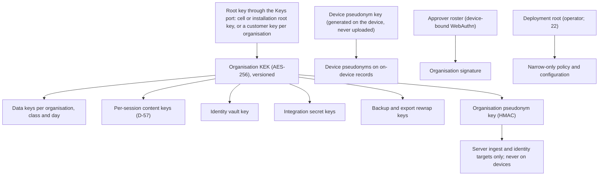
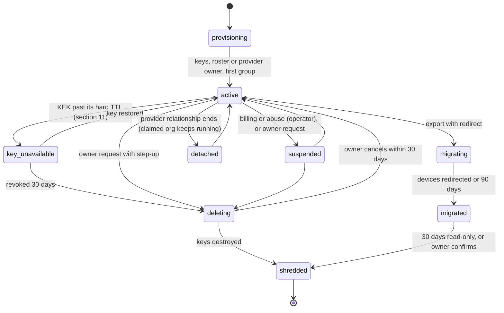

# 21. Tenancy, keys and access

_Status: draft for implementation against spine version 4, rulings R-01 to R-71, the owner answers in `_review/02-owner-answers.md` and the owner's kit instructions in `_review/04-owner-kit-instructions.md`. Date: 2026-11-11. Owning squad: platform (tenancy, keys and access); the tenant context, row-level-security code, `grdr-crypto` composition and the approver roster are trust core under D-63. Specifies D-35, D-55, D-67, D-68, the organisation side of D-31, the access part of D-38 and the operator realm of D-70. Read with: `00-decisions.md`; 02 (threat model, SR-26, SR-29 to 31, SR-42, SR-43); 03 (ports, flows); 04 (envelope, `audit.*` classes, sealed seam); 12 (layers, grants, narrow-only check); 15 (credentials released to agents); 18 (approval flow and grades); 20 (lake, retention, erasure, cells, the `operator` target); 22 (transport, enrolment, trust roots); 23 (API mechanics, our MCP server, the operator API); 25 (export destinations, the `Mailer` port); 27 and 28 (screens); 29 (privacy regimes); 32 (costs); 36 (prices)._

## Summary

This document fixes who can see and change what in every shape: the tenancy hierarchy, how isolation is enforced at each layer of the server, how providers (MSPs) and operators get access, the console role model, sign-on, the keys that protect tenant data and policy, the administrative audit log, how an organisation is created, moved and destroyed, and how its usage is metered and capped.

Key choices:

1. **The organisation is the only isolation unit.** Everything above it (operator, parent provider, provider, organisation set) is access and policy; everything below (group, device, agent instance, session) is grouping. A provider's own data (library, staff accounts, audit log, provider-scoped integrations) lives in its **home organisation**, so there is no second kind of tenant storage.
2. **No code path reads without a tenant context**, enforced five times: token audience at the edge, a `TenantCtx` value required by every repository and store call, PostgreSQL row-level security with `FORCE`, per-organisation object prefixes whose AEAD additional data binds the organisation id, and single-organisation workers.
3. **Provider views are computed, never privileged.** A set-valued context is a delegation snapshot written from live delegations at token exchange; relational queries join it under the same row-level security; provider reports read daily roll-ups, and a lake scan fans out per organisation and merges on `organisation_id`. Writes always need a single-organisation token.
4. **Delegation is GDAP-shaped with two origination modes.** Provider-originated organisations belong to the provider until claimed; customer-originated ones grant role-scoped, time-bound (at most 24 months), revocable delegations. Technicians sign in at the provider's IdP and receive per-organisation tokens by RFC 8693 exchange. Cross-organisation actions are written to both audit logs.
5. **A fixed permission catalogue, evaluated by Cedar in the `Grdr::Console` namespace.** Metadata and content are separate permissions; content is read only under a purpose-bound, time-boxed content grant approved by someone other than the reader. D-55's invariants are base `forbid` policies proven by the symbolic analyser.
6. **One key hierarchy, four key modes.** A KMS root wraps an organisation key-encryption key, which wraps per-class, per-day data keys and per-session content keys. Operator KMS and customer-managed key cover the server (customer-managed key in the hosted service requires the hosted service); endpoint-sealed fields and third-party proof of policy integrity use the reserved fields of 04, so they need no schema change. Sealed fields require a customer-run key broker; the proof requires a witness outside the operator's control (D-39).
7. **The organisation signature is a roster quorum.** Widening artefacts in hosted and provider deployments carry WebAuthn assertions by members of the organisation's approver roster over the artefact digest, verified on the device against the roster pinned at enrolment. The operator never holds an organisation signing key.
8. **Residency is cell placement.** A region is a set of cells; an organisation is pinned at creation; the global `router` holds only the directory; intelligence, the content repository and billing roll-ups are global and carry no tenant content.
9. **Exit needs no operator.** The organisation owner exports a signed portable bundle (lake, documented relational dump, policy as git, audit chain with verification material) and imports it elsewhere; devices move by a redirect signed by both the old deployment root and the organisation roster.
10. **Quota degrades fidelity, never decisions.** The usage ledger carries every ancestor id and signs statements; rating and invoicing are adapters.
11. **Operators administer in a realm of their own.** Operator accounts, the `Grdr::Operator` roles and the operator audit chain are separate from every organisation's, and reach tenant metadata only through a support grant (section 17, D-70).

## Requirements

| # | Requirement | Trace |
|---|---|---|
| R1 | The organisation is the hard boundary for keys, storage prefix, region and quotas | D-35; section 3 of the spine; brief 24 |
| R2 | No server read or write executes without a tenant context; a missing context fails closed | D-35; SR-42; brief 24 weak points |
| R3 | More than one organisation requires PostgreSQL; SQLite refuses a second | D-34; l05 F5 |
| R4 | Providers manage organisations through templates, inheritance with visible drift, per-organisation views and cross-organisation reports | Owner request (MSP); D-35; D-44; l05 F4, F8 |
| R5 | Delegated access is customer-approved or provider-originated, role-scoped, time-bound and revocable | D-35; brief g07 (GDAP); l05 F2 |
| R6 | A parent provider holds provisioning and billing rights only, never data access | Section 3 of the spine; l05 F1 |
| R7 | Roles and the D-55 invariants are enforced in Cedar and tested | D-55, D-38; l02 F9 |
| R8 | Content access is separate from metadata access, purpose-bound, time-boxed and visible to the subject | D-51, D-38; brief g07; l07 F6 |
| R9 | Operator access to tenant data needs a tenant-visible, time-boxed grant; break-glass needs two people | D-55; SR-43 |
| R10 | OIDC and SAML sign-on, SCIM, workload identity federation before static tokens | D-38; brief g07 |
| R11 | Just-in-time elevation with dual approval for sensitive roles, in the open build | Owner request; P11; brief g07 verification row 10 |
| R12 | Widening in hosted and provider deployments needs the organisation's own signature; operator-signed artefacts only narrow | D-31; SR-26; resolution `l10` F9 entry |
| R13 | Operator KMS and customer-managed key modes; endpoint-sealed fields and third-party proof of policy integrity on the reserved fields of 04 | D-35; 04 section 11 |
| R14 | Data residency by region with no tenant content in global services | D-35; brief 34 matrix (DORA, GDPR Ch. V); c1 F9 |
| R15 | A tamper-evident administrative audit log, exportable, with cross-organisation actions in both logs | D-35, D-39; SOC 2 CC6 and CC8 (brief 34) |
| R16 | A defined lifecycle; a suspended organisation's sensors keep enforcing cached policy | D-35; P4; l05 F2 |
| R17 | Export and delete everything without operator help; move between hosted and self-hosted | D-67; l12, l05 |
| R18 | Usage ledger with ancestor ids, signed statements; rating outside core | D-68; brief g10 |
| R19 | Per-organisation limits; at quota, verdicts, findings and audit are never dropped | D-68, D-52 |
| R20 | Provider branding is configuration; a rebuilt white-label needs no core change | D-41 L6, D-66; brief 27 |
| R21 | Mutating calls from inside an agent session are refused on every surface | D-31, D-38 |
| R22 | Tenancy, SSO, roles, audit, JIT and the provider tier are in the open build | P11; brief 24 anti-pattern table |
| R23 | Operators administer through a separate realm: their own accounts, Cedar namespace and audit chain, with no route to tenant content | D-70; owner instruction 10 |
| R24 | Email invitations and verification, verified domains and hosted sign-up, with no passwords, SMS codes or magic links | Owner instruction 11 |

## Design

### 1. Hierarchy and identifiers

| Node | Prefix | Holds | Rules |
|---|---|---|---|
| Operator | `opr_` | Cells, deployment root custody, operator accounts (a separate realm, section 17) | One per installation; never a data owner |
| Parent provider | `prv_` with `kind: parent` | Provisioning and billing rights over its providers | At most one level; no delegation to organisations exists for it to use |
| Provider | `prv_` with `kind: provider` | Library, delegations, branding profile, organisation sets | Has exactly one home organisation; may have one parent provider |
| Organisation set | `ost_` | Named list of a provider's organisations | Unit for baseline assignment, rollout rings, queue filters and reports. Delegations stay per organisation. Provider-side only; organisations do not see it |
| Organisation | `org_` | All tenant data | The isolation unit. `owner_of_record: provider \| customer` |
| Group | `grp_` | Devices | Flat. A device is in exactly one group, so layer resolution has one path (12 section 7). Device tags are free-form attributes for search, not layers |
| Device, agent instance, session | 04 | Events | Unchanged from 04 |

Console identities are **accounts** (`acc_`, a human or a service account) belonging to one organisation or a provider's home organisation; operator accounts are a separate realm (section 17) and never console accounts. An account is not a principal on events. When an account signs in through the organisation's IdP, the server computes the pseudonym that the IdP subject would have on server-side records (HMAC under the organisation pseudonym key, the second pseudonym layer of D-51 and R-18, section 11). That one link gives the account its own "My activity" view, routes sponsor approvals, and lets the subject see who looked (D-51) without the vault revealing a name. The link is held by the `identity` target and never returned by the API, so the account list cannot be used to re-identify pseudonyms.

Every organisation record carries `operator_id`, `provider_id`, `parent_provider_id`, `cell`, `region` (D-68 ancestor ids). Standalone keeps its one random `org_` id; on `grdr join` it becomes an alias (D-48).

### 2. Isolation at each layer

| Layer | Mechanism | Fails how |
|---|---|---|
| Edge | Every token has an organisation audience (`aud = org_…`) or, for provider workbench reads only, `prv` with `purpose: workbench` and the id of a delegation snapshot (section 5). Device credentials name the organisation, and ingest takes it from there, never from the payload (D-35, 03 flow 5.2). A request for another organisation's resource returns 403, never 404 (brief g07) | Missing or mismatched audience: 401 |
| Service framework | `TenantCtx` is a non-constructible type (`Single(OrgId)` or `Set(DelegationSnapshotId, purpose: ReadOnly)`) minted only by the auth middleware and the job runner from a verified token or a job's recorded organisation. Every method of the relational, lake, bus, blob and cache ports takes it; a `Set` context has no write methods (enforced by type). Architecture lint ARCH-015 `tenant-path` (03's register, R-21) fails any SQL string or object path built outside the port adapters | Compile error |
| Relational (PostgreSQL 18) | Every tenant table has `organisation_id` as the first column of its primary key, every unique index and every foreign key, so integrity checks cannot act as a cross-tenant covert channel (PostgreSQL documents that unique and foreign-key checks bypass row security). `ENABLE` and `FORCE ROW LEVEL SECURITY` on all tenant tables; the application role owns no table and lacks `BYPASSRLS`; migrations run as a separate owner role that the server process never holds at runtime. Policy: `organisation_id = ANY(string_to_array(current_setting('grdr.orgs', true), ',')::text[])` for a `Single` context, and for a `Set` context `organisation_id IN (SELECT organisation_id FROM delegation_snapshot WHERE snapshot_id = current_setting('grdr.orgset', true)::uuid)`, whose rows are written at token exchange from live delegations, so a set of any size costs one indexed join; each is set by `SET LOCAL` at the start of each transaction from `TenantCtx`. With no setting no row is visible (default deny) | Empty result plus an error from the port when a query returns zero rows on a path that requires one; a CI check asserts every tenant table has `FORCE` and the policy |
| Relational (SQLite, `embedded`) | Single organisation only; the adapter refuses a second organisation at creation and at start (D-34). `TenantCtx` is still required | Start refused with `GRDR-CFG-0011` |
| Lake and blobs | Object keys are `org=<id>/class=<class>/day=<date>/…` built only inside the adapter from `TenantCtx`. Every object is AES-256-GCM encrypted under a per-organisation, per-class, per-day data key with additional data `org_id ‖ class ‖ day ‖ key_id`. A read that crosses prefixes therefore fails authentication even if a path bug occurs. Lake files use Parquet modular encryption with this binding as the AAD prefix, and archive segments use chunked AES-256-GCM under the same data key (20 section 5.7); external readers such as DuckDB read the decrypted files of an export (20, extension point 4). Query plans are built per organisation; a `Set` report reads `agg_day_group` (20 section 5.5) under the set context, and a cross-organisation lake scan is N per-organisation plans merged on `organisation_id`, at most 16 in parallel | AEAD failure is an alarm, not a retry |
| Bus | Streams, subjects and partitioning are 20 section 7's: tenants never connect to the bus; every message carries the `org` header that `ingest` set from the device credential, and consumers attribute work by it. Log on the relational port (`embedded`, `ha`): rows carry `organisation_id` under the same row-level security | A message without an `org` header is rejected |
| Workers | `detect`, `store`, `review` and export jobs process one organisation per batch and drop all state between batches (SR-42; ADV-8). Caches key on `(org_id, …)` through a typed key | A batch with two organisation ids is rejected |
| Logs and metrics | Server logs carry `organisation_id` and request id only; content-class fields are not loggable (`LogSafe`, 03). Metric labels carry organisation id only on per-organisation quota series, exported for the 100 largest organisations per cell; the usage ledger holds the rest | Lint |

The relational policy has the same shape for single and set contexts, so a provider workbench is not a role that bypasses anything; it is a token naming a delegation snapshot of the organisations its live delegations cover (section 5).

### 3. Hosted cells, router and residency

Requires the `distributed` profile and the hosted service's preconditions (spine section 7), among them the `distributed` load test (S-24) and infrastructure funded by revenue, sponsorship or donated cloud credits. Until those exist, self-hosting is the way to run the platform; the cell design below is unchanged by that.

- A **cell** is one identical `distributed` installation with its own PostgreSQL, object storage, NATS and root key. Its cap is a capacity vector (devices, connections, requests and events a second, wire and stored bytes, organisations), each dimension at 70% of the first failing point of S-24; initial targets are 20 section 11's. Cells are deployed in waves, one at a time (brief 24, AWS cell guidance).
- A **region** is a named set of cells in one jurisdiction (`eu` and `us` assumed, brief 34; open question below). An organisation's region is fixed at creation and changes only by export and import (section 14). Backups stay inside the region's jurisdiction.
- The **`router`** holds the directory and nothing else: organisation shard (bucket range) to cell and region, provider membership, custom domain to provider or organisation, enrolment-token prefix to cell. It is a lookup service, never a proxy: `GET /v1/route/org/{id}` returns a signed `Route {cell_origin, region, directory_rev, ttl_s}` with `Cache-Control: public, max-age=300, stale-if-error=604800`, cacheable by a CDN or any cache in front of the router; domain lookups are `no-store`, rate-limited per client network, answer unknown domains in the same shape, and are served only by replicas in the region the sign-in host names. Clients cache for `ttl_s`, re-resolve on `WRONG_CELL` (HTTP 421 with the current route) and never follow a cross-origin redirect with credentials; enrolment files and MDM profiles carry `server_origins = [cell origin, regional enrolment origin]`, so enrolment does not need the router (brief 24, Sentry control silo). It never carries events, queries or content.
- **Global services** are intelligence (receives only opt-in digests of publicly distributed artefacts and k-tenant prevalence counts, D-32), the content repository (project packs, no tenant data), and billing roll-ups (usage counts with ancestor ids, no content). Nothing else is global.
- **Placement:** a provider's organisations in one region are placed by `placement.toml` (data): the cell in the region with the lowest projected capacity vector after placement, with a provider's organisations spread over at most two cells per region, and an organisation larger than a cell's free capacity placed as device shards (20 section 11); where a provider spans cells its views fan out per cell and merge on `organisation_id`. There are no cross-cell joins. A region holds one cell until that cell reaches its cap; a second cell in the region relies on per-cell fan-out of provider views (C3), and the directory always carries the cell column. The hosted service requires the `distributed` load test (spine section 7, R-36), which also gives the first measured capacity vector (S-24, C2).
- **Model routes:** review back ends obey the organisation's region (D-29: no default third-party model in the hosted service; the organisation chooses the judge and its region). A judge back end outside the region is refused at configuration.
- **Outbound traffic:** notifications, webhooks and export sinks are sent from the organisation's cell, never from a global service.
- **Operator staff** carry a `region` attribute; a support grant (section 8) is evaluable only by staff permitted in that region.

A self-hosted installation of one cell has no router and no regions; one of more than one cell runs its own `router` with one region unless the operator defines more, and one deployment root (22 section 6.2). Residency is wherever the operator runs it, and nothing phones home (D-58).

### 4. Provider tier

The provider tier requires this tenancy model and the server (D-35), and PostgreSQL (R3).

**Seams in the tenancy model:** the `provider` layer slot in layer documents (12 section 7); `provider_id`, `parent_provider_id` on organisations and usage records; `Provider`, `OrganisationSet` and `Delegation` entity types in the console Cedar schema; `TenantCtx::Set`; the provider kind on accounts. These exist in every installation, so an organisation never needs migrating to gain a provider.

**Library and templates.** A provider's library lives in its home organisation and holds versioned **baselines**. A baseline is: a provider-layer document (packs pinned by digest, modes, lists, each `default` or `locked`); integration templates (PSA mapping, export destinations as references, D-40); enrolment defaults (deployment-key expiry, admission rule); per-organisation approval instructions; a branding profile reference (section 16); a report schedule. A baseline is assigned to an organisation set with a pin: an exact version, or `follow` (receive new versions through rings).

**Rollouts.** A baseline change is a rollout whose ring unit is the organisation (D-11): the home organisation, then a canary organisation set chosen by the provider (default: the three organisations with the most endpoints that opted in), then the rest, with the D-37 gates evaluated per organisation and automatic halt on a per-organisation deny-rate or prompt-rate anomaly. A widening baseline change additionally needs each claimed organisation's signature (section 10); unclaimed organisations are signed by the provider's roster. An organisation that has not signed stays on the previous baseline version and shows `pinned-behind`.

**Inheritance with visible drift.** The effective-policy compiler (12) already resolves layers. For each organisation it emits a drift record per setting against the assigned baseline:

| State | Meaning | Shown as |
|---|---|---|
| `inherited` | Organisation uses the baseline value | Nothing |
| `narrowed` | Organisation is stricter than a locked or default baseline value | Info |
| `overridden` | Organisation loosened a `default` value (a widening operation under D-31) | Diff, with who and when |
| `pinned-behind` | Organisation is pinned to an older baseline version | Version gap |
| `rejected` | A lower setting tried to widen a locked value; dropped (`policy.layer-violation`, 12) | Warning and a policy-violation finding in that organisation |
| `local` | A device or user layer differs (standalone layers, D-48) | Count per organisation |

The cross-organisation drift matrix (organisations by settings, filtered by organisation set) is a read model rebuilt on every compile. "Reconcile" proposes per-organisation changes as ordinary drafts; it never writes directly.

**Per-organisation views and cross-organisation reporting.** Every provider view shows the organisation column and, when focused on one organisation, the "acting as" banner (D-44). Reports are computed per organisation (inventory counts, coverage by assurance level, blocks, exceptions, prompt health per rule and per group of five or more, D-51) and then merged. Cross-organisation comparisons use organisation-level aggregates only; there is no row-level join across organisations. The workbench queue (approvals, sessions worth a look, unhealthy sensors, unknown agents, D-44) is a `Set` query over metadata only; content never appears in it.

**Provider-scoped integration instances** (D-40) live in the home organisation and receive forwarded records only from organisations whose delegation has `forward_integrations` set, metadata only. Content never forwards through a delegation; it needs a content grant (section 8).

### 5. Delegated access

**Origination.**

- *Provider-originated:* a technician with `organisation.create` creates the organisation from a baseline (target: 10 minutes of technician time, spine section 6). The provider is owner of record. The organisation's console states "managed by <provider>; the provider can change policy", and so does the developer disclosure surface (D-51). The customer may **claim** it: an invited customer owner verifies a domain by DNS TXT or accepts an invitation, registers an approver roster (section 10), and the provider's access becomes a delegation with the roles it had, auto-extend on unless the claiming owner turns it off.
- *Customer-originated:* the customer's owner approves a delegation request from a provider. Unapproved requests expire after 30 days (GDAP uses 90; a stale request is phishing material).

**Delegation object.** `{delegation_id, provider_id, organisation_id, bindings: [(provider group, role)], forward_integrations, start, end, auto_extend, state (requested, active, expiring, expired, revoked), approved_by, epoch}`. Bindings use only the provider roles TP, TR and PR (section 7). End is at most 24 months after start, matching GDAP's two-year maximum; auto-extend adds six months at expiry until disabled, as GDAP does (Microsoft GDAP FAQ, updated 2026-10-28, read 2026-11-10). GDAP lets the partner enable auto-extend without customer consent; here enabling it, adding a binding or setting `forward_integrations` is a change the organisation owner approves, and either side can disable auto-extend. The organisation owner is warned 30 days before expiry. Revocation by the organisation owner is immediate: it increments `epoch`, which every API replica checks on each request against an in-memory table refreshed by bus notification (target: effective within 5 seconds). Delegations never include `session.content.read`, `reidentify.approve`, `keys.manage` or `role.assign` in the organisation; content needs a content grant issued by the organisation (section 8).

**Technician tokens.** Technicians are accounts in the provider's home organisation, signed in through the provider's IdP and provisioned by the provider's SCIM. The console session holds a provider-audience token. For work on one organisation the backend exchanges it (RFC 8693) for a token with `aud = org_x`, `act = {sub: acc_technician, prv: prv_y}`, `delegation_id`, `roles`, `epoch`, lifetime 15 minutes. For workbench reads it exchanges for a read-only token with `prv` and `purpose: workbench`, lifetime 5 minutes, that names no organisation; the exchange writes a `delegation_snapshot` of live delegations in the cell and the token carries its id, so the token stays under 2 KB at any provider size and revocation needs no new token. Across cells the single-organisation exchange runs in the organisation's cell, which verifies the provider token against the home cell's key set cached by revision, and the console's backend caches each exchanged token per (session, organisation) until 60 seconds before expiry. A mutation always needs a single-organisation token, so there is no ambient cross-organisation write. Operator staff use the same exchange from their operator-realm session: the token carries `act = {sub: opa_staff, opr: opr_z}` and `via = support grant id`, and is minted only while that grant is active (sections 8 and 17).

**Both logs.** Each action by a delegated token writes one `audit.admin` record in the organisation and one in the provider's home organisation, sharing `cross_ref`.

**Provider-scope response.** Provider-scope commands follow D-30 and 18 (two provider approvers, the provider-scope budget of 18 section 3, an entry in each organisation's log). Per 02 section 3.11 a provider action is reversible containment unless the organisation co-approves: in a claimed organisation, a freeze within D-30's 60-minute limit needs no co-approval; kill, revoke or extension needs a co-signature by a member of that organisation's roster, and organisations that have not co-signed are skipped and listed. In an unclaimed organisation the provider's roster is the organisation's (section 10).

**Parent provider.** Holds `provider.create`, `organisation.provision`, `quota.write`, `branding.write`, `usage.read` over its providers through the provisioning API. It has no delegation and its tokens carry no organisation audience, so no data read is expressible.

### 6. Accounts, sign-on, SCIM and tokens

| Mechanism | Decision |
|---|---|
| OIDC | Authorization code with PKCE; the API server is the backend-for-frontend (D-42); `iss` checked; one or more IdPs per organisation, reached over the site's network with the configured trust anchors (on premises Keycloak, AD FS, PingFederate or any conformant IdP; Keycloak gates releases in 24-28); home-realm discovery by verified email domain (verified domains row) |
| SAML 2.0 | SP-initiated and IdP-initiated with signed assertions, audience and recipient checks, replay cache; encrypted assertions optional; IdP metadata by URL or by file, so SAML sign-on needs no connection from the server to the IdP |
| Local accounts | Passkeys (`webauthn-rs`, brief g07) with a verified email and no password: small self-hosted teams, and hosted sign-up (next row) |
| Hosted sign-up | Individuals and small teams create an organisation in the hosted service with a passkey account and a verified email, or sign in with Google through OIDC or with GitHub through its OAuth 2.0 app flow and its verified primary email (GitHub offers no OpenID Connect sign-in for people; prior knowledge, checked in A9). Which external sign-in providers are offered is a runtime setting (D-70), so a self-hosted operator offers its own list or none. An organisation can later require its own IdP and disable every other method |
| Invitations | An account holding `role.assign` invites by email: single-use, expiring after 7 days (target), bound to the invited address, sent through the `Mailer` port (25 section 9) and written to `audit.admin`. Accepting needs a sign-in whose verified email equals the invited address; the role binding is created on acceptance. An address in a domain whose organisation requires its own IdP is sent to that IdP instead |
| Email verification | Every hosted account proves its address with a single-use code sent through the `Mailer` and entered in the session that asked for it, expiring after 15 minutes (target); the code verifies the address and never signs anyone in. An unverified account holds no role binding and approves nothing. Self-hosted, the same where a `Mailer` is configured; otherwise the platform operator attests the address |
| Verified domains | An organisation verifies each email domain it claims by a TXT record looked up at the configured resolver, never through a public resolver, or, self-hosted, by the platform operator's attestation, written to the operator audit log and the organisation's `audit.admin` (section 17). A domain is verified for one organisation at a time. Verified domains drive home-realm discovery, SCIM matching and the claim of a provider-originated organisation (section 5) |
| Second factors | Passkeys are the phishing-resistant factor. SSO users rely on their IdP's MFA, and the server asks for passkey step-up (WebAuthn user verification) before any widening (D-31). There are no passwords, SMS codes or magic links, because each is phishable. TOTP exists only as the second factor of an operator account that cannot use a passkey (section 17), and never satisfies an approval or a widening |
| Recovery | Every platform deployment, hosted included: two sealed recovery passkeys per organisation, registered at creation or claim to two named custodians, for IdP loss. Using them is the break-glass of section 9 and needs both |
| Console session | Cookie bound to the BFF; 12 hours absolute, 1 hour idle; step-up by WebAuthn user verification (or IdP `max_age=0` re-authentication) before any widening operation |
| SCIM 2.0 | RFC 7643 and 7644 with RFC 9865 cursors; Users and Groups; group-to-role bindings configured in the console; writes enter a per-organisation SCIM queue on the Jobs port: `POST` answers 201 with the id at once, a worker applies bindings in arrival order, deprovisioning (`active: false`, `DELETE`, removal from a role-bound group) jumps the queue, above 20 requests in flight per organisation the endpoint answers 429 with `Retry-After`, and one group's membership changes coalesce per 5 seconds into one binding recompute; accounts are also created at first OIDC or SAML sign-in and matched by `externalId`, and by email only within the organisation's verified domains; deprovisioning bumps a per-account binding epoch held in memory by every API replica and revokes within 60 seconds (target); authorisation rechecked per page (brief g07). Where the IdP has no SCIM client, the organisation runs in `claims-only` directory mode: role bindings are recomputed from group claims at every sign-in and refresh, OIDC back-channel logout is honoured where sent, and deprovisioning takes effect within the 1-hour idle timeout, which `status` states |
| Automation | Caller methods, token lifetimes and the API-key format (prefix `grdr_sk_`, expiry at most 90 days) are 23 section 5's. Service accounts belong to the organisation and survive their creator |
| Standalone | No accounts. The local console (`grdr console serve`, D-42) uses the OS user plus a one-time launch token on loopback (D-43); widening uses the approval helper, or in the user profile the disclosed time lock for the user's own local policy (D-31) |

**Agent-session callers (R21).** Tokens minted for our MCP server (23) or any client registered as an agent client carry `actor_kind: agent` and are bound to one organisation and to metadata. The API refuses every mutating method for such tokens with `PERMISSION_DENIED` and reason `AGENT_SESSION_PROPOSE_ONLY`; proposals are a separate non-mutating resource that a human approves. A token bound to a governed session also cannot read policy, detection content or that session's exception state (D-38, SR-47; 23 enforces the tool list). The daemon's local API applies the same rules using session membership of the calling process (D-31).

### 7. Roles, permissions and console authorisation

**Permission catalogue.** Permissions are named after resources (brief g07, AWS guidance), fixed in code, and added only by RFC. Abbreviated catalogue: `inventory.read`, `session.metadata.read`, `session.content.read`, `finding.read`, `finding.update`, `suppression.write`, `policy.draft.write`, `policy.change.approve`, `policy.rollout.manage`, `exception.approve`, `response.execute`, `response.execute.wide` (above device scope), `detection.write`, `device.enrol`, `device.manage`, `integration.write`, `export.manage`, `privacy.settings.write`, `content.grant.approve`, `reidentify.approve`, `role.assign`, `idp.manage`, `keys.manage`, `roster.manage`, `delegation.approve`, `audit.read`, `usage.read`, `branding.write`, `organisation.export`, `organisation.delete`. Provider scope, held in a provider's home organisation: `organisation.create`, `delegation.request`, `baseline.write`, `baseline.assign`, `organisation_set.write`, `report.read`. Parent-provider scope: `provider.create`, `organisation.provision`, `quota.write`. Integration secrets are write-only: no permission reads one back; the integrations runtime resolves them by reference (SR-48), and each resolution is logged.

**Role catalogue (D-55, which includes the organisation owner).** Provider technician roles are split in two so that D-55's separation of response and policy holds for providers too. Columns: Ow owner, Au policy author, Ap policy approver, Re responder, In investigator, CR content reader, Ad auditor, PO privacy officer, TP provider policy technician, TR provider response technician, PR provider reader, Op platform operator. `Y` allowed; `G` only under an active content grant; `S` only under a support grant; `-` never. Provider columns apply only inside a live delegation.

| Permission group | Ow | Au | Ap | Re | In | CR | Ad | PO | TP | TR | PR | Op |
|---|---|---|---|---|---|---|---|---|---|---|---|---|
| Inventory, session metadata, findings read | Y | Y | Y | Y | Y | Y | Y | Y | Y | Y | Y | S |
| Session and evidence content | - | - | - | - | G | G | - | - | - | G | - | - |
| Finding update, suppression | - | - | - | Y | Y | - | - | - | - | Y | - | - |
| Policy draft, detection write | - | Y | - | - | - | - | - | - | Y | - | - | - |
| Approve policy change, Exception | - | - | Y | - | - | - | - | - | Y | - | - | - |
| Response execute (device or session scope) | - | - | - | Y | - | - | - | - | - | Y | - | - |
| Response above device scope | - | - | - | Y (roster) | - | - | - | - | - | - | - | - |
| Devices, enrolment, integrations | Y | - | - | - | - | - | - | - | Y | - | - | - |
| Privacy settings, content-grant and re-identification approval | - | - | - | - | - | - | - | Y | - | - | - | - |
| Roles, IdP, keys, roster, delegations | Y | - | - | - | - | - | - | - | - | - | - | - |
| Audit log | Y | - | - | - | - | - | Y | Y | - | - | - | S |
| Export, delete organisation | Y | - | - | - | - | - | - | - | - | - | - | - |
| Usage | Y | - | - | - | - | - | Y | - | - | - | Y | Y |

A provider policy technician who drafts a change cannot approve it (invariant 1); a second technician or the organisation's policy approver does. In a claimed organisation in hosted and provider deployments, a technician's approval of a widening change or Exception is not enough to activate it: it also needs a roster assertion by a member of that organisation (section 10). In a provider's home organisation the owner also holds the provider-scope permissions and may bind them to custom roles.

The auditor is read-only and normally held through JIT elevation with a time box. The platform operator's own rights (settings, health, cells, quotas, lifecycle, keys) are roles in the operator realm's `Grdr::Operator` namespace (section 17); inside an organisation they reach metadata only through a support grant, as the Op column shows. Organisations may define **custom roles** as sets of catalogue permissions; the base forbids below still apply to them.

**Cedar.** Console authorisation is Cedar in the `Grdr::Console` namespace with its own schema file and its own policy store, never shared with the runtime `Grdr` schema (D-38; brief g07). Entities: `Account`, `ServiceAccount`, `AgentSession` (our MCP server's tokens and lineage-attested calls, 23 section 5), `Role`, `Organisation`, `Provider`, `OrganisationSet`, `Delegation`, plus resource types per permission group. Roles are principal groups scoped by organisation ancestry; content grants, support grants, delegations and elevations are template-linked policies with `not_before` and `expires` in context. Listing applies the SQL scope predicate of 23 section 6, with Cedar as the per-item check (Cedar's partial-evaluation queries are experimental, brief g07 verification). The base policy set is signed and immutable per release and contains the D-55 invariants as forbids:

1. `forbid` approving a widening change or a promotion to Ask or Block when `resource.author == principal`.
2. `forbid` approving an Exception or grant when `resource.requester == principal`.
3. `forbid` `session.content.read` for the platform operator, in any context.
4. `forbid` holding policy write and `response.execute` in one activated session (separate roles; one account may be eligible for both but activates one).
5. `forbid` operator access to organisation resources without an active support grant whose organisation matches (operator break-glass is a support grant of kind `break-glass`, section 8).
6. `forbid` break-glass activation with fewer than two distinct approvers.
7. `forbid` any mutating action when `principal is AgentSession`.
8. `forbid` a content grant's approver using that grant.

### 8. Content access, re-identification and operator access

These are console resources, distinct from the runtime `grdr.policy.Grant` of 12.

- **ContentGrant** `{id, organisation, reader (account), purpose (incident-response, detection-tuning, legal-hold, subject-request), incident_id, scope (session ids, finding ids or an incident), not_before, expires (default 4 hours, maximum 72), approver, state}`. Requested by a content reader, investigator or provider technician; approved by a privacy officer who is not the reader. Every read under it writes `audit.access` (04), which the subject's "who looked" view returns (D-51). A provider technician's content grant also needs the delegation to be active. In hosted and provider deployments the approval is a roster assertion over the grant's canonical bytes (so privacy officers who approve grants hold roster credentials), which lets a device verify the grant before it answers an evidence request beyond its capture level (SR-26, D-52).
- **Re-identification** needs purpose, incident reference and two approvers (D-51): a privacy officer and the owner, or two privacy officers. An organisation may add a named group (for example a works-council delegate) as a required co-approver. The result is shown to the subject.
- **SupportGrant** (operator access): requested from the operator plane by operator staff with a ticket reference (section 17); approved by the organisation owner after step-up; default 24 hours, maximum 72; metadata only; a banner shows in the organisation console while active. Content is never reachable by operator staff: if support needs content, the organisation issues a ContentGrant to its own investigator.
- **Operator break-glass** exists only for service restoration when no owner can approve (owner locked out, organisation suspended for abuse). It is a SupportGrant of kind `break-glass` approved by two distinct operator staff instead of the owner, one of them on the operator's security on-call rota; metadata only, 4 hours, the owner notified at once and the record visible in the organisation's log. There is no content break-glass. An organisation may disable operator break-glass by contract (open question below).

### 9. Just-in-time elevation

Bindings are **standing** or **eligible**. An eligible account requests activation with a reason and a duration (default 1 hour, maximum 8). Approvers are accounts holding `role.assign` in the organisation (for provider roles, in the provider's home organisation). Ordinary roles need one approver; sensitive roles (owner, privacy officer, content reader, auditor, and any custom role containing `session.content.read`, `keys.manage`, `roster.manage` or `role.assign`) need two distinct approvers, neither the requester. With one owner and no second approver, a sensitive role can only be standing. Activation is a time-boxed template-linked policy; expiry needs no action. The console lints an organisation with more than two standing owners. Break-glass is both sealed recovery passkeys of section 6, asserted by their two custodians within 10 minutes; it activates owner for 4 hours and alerts every owner and auditor. Brief g07's verifier found open-source JIT tools with approval exist, so the claim we make is narrower: dual-approval JIT inside an open-source security console.

### 10. Approvers, roster and the organisation signature (D-31)

18 owns the approval flow and the grades; 12 owns the grant model. This section owns who the approvers are and how their authority reaches a device.

- **Approver kinds** of a rule's `@approver` (12) resolve to accounts: `self` is the account linked to the session's principal pseudonym (section 1); `sponsor` is the account linked to the instance's sponsor; `admin` is any account holding `exception.approve`; `quorum` is two distinct policy approvers (18), each a roster member wherever the organisation signature applies.
- **The roster** is a per-organisation signed list of approver credentials: WebAuthn credentials registered as device-bound (platform authenticator or security key with attestation; synced passkeys are accepted for sign-in, never for the roster). Attestation is checked against the authenticator list the server holds: a curated list the project builds only from redistributable sources, shipped as a signed content target in every release and in the air-gap bundle, plus a FIDO Metadata Service BLOB where the operator imports one (`grdr server airgap import --fido-mds <file>`) or the server has a route to a configured URL. FIDO's terms appear to forbid our redistributing the BLOB (to confirm), so it is never bundled and never required; a check that needs it reports `not configured` until one is imported. An organisation may also admit an authenticator model by AAGUID with a recorded attestation sample, a widening change (D-31). A roster change is signed by a quorum of the previous roster (D-30). The first roster is signed at organisation creation (customer-originated) or at claim (provider-originated); until claim the provider's roster stands in, which the disclosure surface states.
- **The organisation signature** on an artefact is a set of WebAuthn assertions by roster members whose `clientDataJSON.challenge` is the SHA-256 of the artefact's canonical bytes or of the root of a `SignedSet`, a Merkle tree over the canonical digests of up to 10,000 artefacts with a display summary (kind, id, version, count); the device verifies the assertion, its own artefact's inclusion proof and the summary, so one touch signs a baseline for every organisation whose roster holds the signer. Assertions are ES256 or EdDSA, checked against the roster pinned at enrolment and advanced only by quorum-signed roster updates. Required count: one for a widening policy change (the approver, never the author, invariant 1); two for capture-level increases, provider or exclusion registration and kill-switch release at organisation scope; D-30's counts for commands.
- **Where it is required:** in hosted and provider deployments (a self-hosted server with any provider counts), every widening layer document, capture increase, content grant (section 8) and Exception, and every other D-31 widening operation the server issues (SR-26). A single-use grant from an ordinary Ask approval is not a widening; it carries the approval grade 18 assigns. In self-hosted deployments where operator and organisation are one party the signature is optional; `grdr server preflight` warns when the roster is absent, because then the deployment root alone can widen (02).
- **Routine pack updates** (12's open item): an organisation may sign a **channel subscription** that accepts project-signed pack versions for named pack ids for 12 months, revocable; versions that remove a rule or a protective pattern, or read a new field or data class (l07 F7), still need a fresh signature. Channel subscriptions require 12's confirming RFC.

### 11. Key hierarchy and key modes

| Key | Holder | Algorithm | Protects | Rotation | Destruction means |
|---|---|---|---|---|---|
| Cell or installation root key (mode 1) | The Keys port: the `local` root key, or a `kms` back end (cloud KMS, OpenBao Transit, PKCS#11 HSM) | AES-256 | Wraps organisation KEKs | Yearly, by the back end's rotation or `grdr server keys rotate-root` | Installation or cell unrecoverable |
| Customer key (mode 2) | The customer's `kms` back end (cloud KMS, OpenBao Transit or an HSM) | Same | Wraps that organisation's KEK | Customer's choice | Organisation crypto-shred |
| Organisation KEK | Relational store, wrapped; unwrapped in memory under the key mode's soft and hard TTLs (below) | AES-256-GCM | All keys below | Yearly; old versions kept while referenced | Erasure of the organisation |
| Data keys | Lake object headers, wrapped | AES-256-GCM, AAD as section 2 | One class, one day | Never rewritten | Retention by class (20) |
| Per-session content keys | Wrapped beside content | AES-256-GCM | One session's content | None | Content erasure (D-57) |
| Identity vault key | Wrapped | AES-256-GCM | Name mappings | Yearly | Person or organisation erasure |
| Organisation pseudonym key | Server `identity` target, KEK-wrapped, used by `ingest`; never sent to devices | HMAC-SHA-256 | Second layer (D-51, R-18): at ingest the server pseudonym is the HMAC over kind and the stable identity the vault links to the device pseudonym (the IdP subject when known), so it is stable across a person's devices; lake, query, findings and exports use it (04 section 3) | Only on exposure: new `pseudonym_epoch`, vault links old to new; every epoch is kept wrapped by the KEK and included in backups and the portable bundle (section 14), so the lake can be rebuilt from the byte-exact archive (R-64) | Pseudonyms become unlinkable |
| Device pseudonym key | Device privileged service, generated on the device, never uploaded | HMAC-SHA-256 | First layer: device pseudonyms on on-device records and inside signed batches, so standalone works offline (04 section 3) | Per enrolment, or on exposure | Device pseudonyms of that device become unlinkable |
| Integration secret keys | Wrapped | AES-256-GCM | PSA, SIEM, EDR credentials; write-only through the API, resolved only by the integrations runtime, every resolution logged | On credential rotation | Integration stops |
| Device key, per-boot key | Device (22, 04) | P-256 in hardware, else Ed25519 | Device authentication, batch heads | 22 | Re-enrolment |
| Local artefact key | Device privileged service, certified by the device key | Ed25519 | Device-compiled floor, fail-safe and fast-path tables (spine D-14, R-05) | Per enrolment | Tables recompiled |
| Grant-signing key | Device privileged service (12, 18) | Ed25519 | Local grants and Exceptions | Per enrolment, or on exposure (a per-boot key would void standing Exceptions at every reboot) | Outstanding grants and Exceptions void |
| Usage statement key | Cell or installation | Ed25519 | Monthly statements (section 15) | Yearly | Old statements still verify by published key |
| Webhook keys | Per destination | Ed25519 (Standard Webhooks `v1a`) | Outbound webhooks (25) | Multi-signature rotation | Destination re-keyed |
| Token-service signing key, per organisation | `identity`; generated in process, KEK-wrapped in the relational store, unwrapped in memory | ES256 (RS256 per relying party) | `grdr-access` and `grdr-federation` (15 section 6) | 30 days with 7 days' overlap, on day `hash(organisation) mod 30` | Outstanding tokens unverifiable |
| Fleet key and online deployment keys | `control` and `content`, through the Keys port: wrapped by the operator KEK, or held in a `kms` back end where `grdr server keys init --ceremony` placed them; certified by the deployment root (22 section 6.2) | Ed25519 | Enrolment responses, commands, response-key certificates, epoch statements, deployment TUF roles | 90 days, the next key published 30 days ahead | Re-pin through the deployment root chain |
| Response keys | Each `ingest`, `control` and `approve` replica, in memory only | Ed25519 (P-256 in FIPS) | Per-request responses (22 section 4.4) | At most 24 hours | Lost at restart; a new one is certified |

Rule (P15): no key that signs per request is a KMS asymmetric key. KMS holds only the symmetric cell or customer key that wraps KEKs, and no root key signs online: the project's roots are held as 24 section 10 states, and each deployment root wherever its operator keeps it offline (22 section 6.2). At 10 million endpoints per-request signing in KMS would be hundreds of thousands of calls a second, above the ECC quota of 1,000 a second per account and region and about USD 0.3 million or more a day (AWS documentation read 2026-11-11; price recalled).

Standalone generates the device key, local deployment root, local artefact key, device pseudonym key and grant-signing key at install; nothing else exists there.

**The four key modes.**

| Mode | Requires | What it protects against | What it does not |
|---|---|---|---|
| 1. Operator KMS | The server and the Keys port (`local` or `kms`) | Theft of disks, object storage, backups or a single object; cross-organisation mis-reads (AAD binding); a database dump without KMS access | An operator with KMS access and a running server |
| 2. Customer-managed key | Mode 1; in the hosted service, the hosted service | Operator retention after exit (the customer revokes and the data is unreadable); unwraps invisible to the customer (each unwrap appears in the customer's KMS log); compelled access without the customer's knowledge, while revocation is possible | A running server that holds unwrapped keys for up to an hour |
| 3. Endpoint-sealed fields | The reserved `Sealed` fields of 04 and the `SealKeyBroker` port; a customer-run key broker or analysts' devices holding the recipient key | Operator and provider reading identity mappings and content even with KMS access: sensors seal `sealable` fields with HPKE (RFC 9180) to an organisation recipient key whose private half lives in a customer-run key broker or analysts' devices; the server stores ciphertext and keyed blind-index tokens for equality search | Server-side content detection, full-text search and server-side content review, which stop for sealed fields (brief 24 weak points) |
| 4. Third-party proof of policy integrity | The server checkpoint chain (D-39); a witness outside the operator's control: a C2SP tlog-witness implementation at a configured origin, which may run inside the customer's network (prior knowledge), or an offline witness countersigning checkpoint files carried to it | An operator or provider showing the console one policy and devices another (split view), or silently rolling back: effective hashes, layer digests and audit checkpoints are logged to a tile log with an external witness, and devices require an inclusion proof before activating a widening | A compromised project root (02 residual) |

Mode 2 mechanics: hosted customers grant our cell role use of an AWS KMS key or our service account use of a GCP Cloud KMS key; self-hosters point at their own key in any `kms` back end, an OpenBao Transit key or an HSM through PKCS#11 inside an air gap included. If the KEK cannot be unwrapped for 60 minutes the organisation enters `key-unavailable`: ingest answers retry-after (devices spool and keep enforcing, P4), the console shows "could not look", detection pauses and says so. If the customer revokes permanently, the organisation moves to `deleting` after 30 days without restoration.

KMS is called only to wrap or unwrap organisation KEK versions. The Keys port has two levels: `root_wrap` and `root_unwrap` call KMS for KEK versions only, and `wrap` and `unwrap` run in process under an unwrapped KEK for data keys, content keys, the pseudonym key, signing keys and integration secrets. A process unwraps a KEK version on first use through a single-flight per (organisation, version) and holds KEKs only for organisations its partitions or requests serve (rendezvous hashing of organisation to `store`, `query` and `review` replicas). The cache has a soft TTL, after which it refreshes in the background at a jittered time (mode 1: 24 hours; mode 2: 50 to 60 minutes), and a hard TTL after which it stops (mode 1: 7 days, since mode 1 does not protect against an operator with KMS access and a running server; mode 2: 60 minutes); a failed refresh keeps the KEK to the hard TTL, so a regional KMS outage puts only mode 2 organisations into `key-unavailable`, and an `organisation.shredded` or `kek.revoked` bus event drops the entry at once. Each process's KMS client has a token bucket of 50% of the account's regional quota divided by the process count, `store` and `ingest` first, and start-up unwraps spread over 5 minutes. The `keys` singleton creates day D+1's data keys during day D at a time spread by `hash(organisation)` with `INSERT … ON CONFLICT DO NOTHING`, so concurrent creators converge. Each KEK version is also stored wrapped by a DR key in the paired region of the same jurisdiction (about USD 1 a month per cell); a mode 2 organisation supplies its own DR key or is `key-unavailable` during a region loss, which the console states. Every scheduled renewal of a per-device, per-organisation or per-cell key or certificate falls at a jittered point between 50% and 75% of its lifetime (c1 F3 on per-key cost). Every TTL, bucket share and spread here is a `limits.toml` entry.

Seams for modes 3 and 4 are already reserved by 04: `Sealed {recipient_key_id, enc, ciphertext, inner_class}`, `sealable` twins in field numbers 900 to 999, `Integrity.checkpoint_ref`, `Integrity.inclusion_proof`, `Receipt.transparency`. This document adds a reserved `SealKeyBroker` port in `grdr-ports` and a reserved `transparency` member in the pack manifest. Mode 3 serves organisations that require that the operator cannot read identity mappings or content (04); mode 4 serves contracts and regulations that name third-party verifiability. Both are organisation settings on top of mode 1 or 2.

### 12. Administrative audit log

The record classes are 04's `audit.admin` and `audit.access`; this section fixes their content and handling.

- **What is recorded:** sign-in, failure, step-up; role bindings, eligibility, elevation request, approval and expiry; delegations; content grants, reads and re-identification; support grants and break-glass; key operations (rotation, mode change, unwrap failures; successful unwraps as hourly counts); roster changes; policy drafts, approvals and rollouts (12 writes them); Exceptions; response commands; exports, imports and deletion; quotas; branding; integration credentials created, read and rotated; SCIM changes (batched per sync); token creation and first use; lifecycle transitions.
- **Fields:** `realm` (`organisation` or `operator`, section 17), actor (account id, kind human, service or agent client), `via` (delegation id or support grant id), operation, resource, before and after digests, widening flag, approval grade, request id (returned on every API response), `cross_ref` for cross-organisation pairs. Source address is an identifier-class field that 04's reduction pass removes after 30 days. The provider-side copy of a cross-organisation record holds actor, operation, resource id and digests only, never before and after values.
- **Write rule:** the record is written in the same transaction as the change through the outbox, so no change exists without its record. Records are server-authored events in the `decision` lane chained into the per-organisation checkpoint chain (04, D-39), and export to a customer-controlled sink.
- **Who appears where:** an action by a delegated technician appears in both logs; an operator action on an organisation appears in the organisation's log and in the operator audit log (section 17); parent-provider provisioning appears in the provider's and the organisation's logs.
- **Retention:** 13 months by default, up to 7 years by organisation setting. No role can delete individual records; erasure applies only through 04's reduction pass on personal fields, and the whole log goes only when the organisation is shredded (section 13), after the owner has had the chance to export it (section 14).
- **Standalone:** the daemon writes `audit.admin` for every widening proposal and its approval (SR-23), verifiable with `grdr audit verify`.

### 13. Lifecycle

- `suspended`: sensors keep enforcing cached policy and grants (P4); ingest accepts the `decision` and `spine` lanes only; the console is read-only for owner and auditor; no enrolment; exports remain possible.
- `detached`: a claimed organisation whose last delegation ended; it continues as a direct customer, its provider layer and provider branding are dropped, and usage records carry no provider id from then on. It returns to `active` when a new delegation is approved. An unclaimed provider-originated organisation cannot be detached; the provider must transfer it to a customer or delete it.
- `migrated`: the source keeps a read-only copy for 30 days so the owner can check the import, then shreds.
- `shredded`: KEK versions and the vault key destroyed in KMS and the relational store; objects deleted after the point-in-time window (D-57); a tombstone with organisation id and shred date stays in the directory so ids are never reused.

### 14. Portable organisation bundle

`grdr-org-bundle` is a directory (or tar) produced by the `ExportOrganisation` Operation (23), initiated by the owner with step-up and no operator involvement.

| Member | Content |
|---|---|
| `manifest.json` | `format_version`, organisation id, source operator and server epoch, created time, member digests, the organisation's pseudonym key id and roster head; signed by the source server and, where a roster exists, by a roster member |
| `lake/` | The stored objects in 20's lake format, byte for byte, with the column manifest and the signed per-organisation store manifest (D-57). `grdr org-bundle open` decrypts them with the keys in `keys/` to plain Parquet for any external reader |
| `relational/` | One ProtoJSON lines file per API resource type (accounts, bindings, groups, devices with public keys, agent catalogue decisions, findings, incidents, suppressions, Exceptions, integrations without secrets, usage ledger). Documented, versioned with the API packages; not a database dump |
| `policy/` | A `git bundle` of layer documents and packs with their signatures |
| `audit/` | Archived batches byte-exact, the checkpoint chain, device and server verification keys |
| `keys/` | KEK-wrapped material rewrapped to the recipient: data keys, content keys, vault key, organisation pseudonym key with every `pseudonym_epoch` (R-64). Integration secrets are excluded; the importer re-enters them |

`manifest.json` and `keys/` are encrypted to an HPKE recipient key the owner supplies; `lake/`, `audit/` and the other members are listed in the manifest by digest and fetched by the importer through presigned, resumable URLs or a server-side copy, in parallel, staying under their data keys, and a member the destination already holds by digest is skipped, so a repeated export moves only the delta. Import (`grdr server org import --verify` or the hosted import Operation) verifies signatures and the audit chain, migrates resource versions forward, rewraps keys under the destination KEK, mints a new server epoch (D-57), and writes a link record so the imported chain continues as a prior chain.

**Device move.** The source issues a redirect command signed by its deployment root and by a roster quorum, naming the destination URL and destination deployment-root fingerprint. The device verifies both, pins the new root, and re-enrols with its existing device key, which the destination knows from the bundle; `epoch` increments and the device id survives (04). Kill and freeze states move with the bundle and are re-applied; outstanding retry tokens lapse. In a self-hosted source without a roster the deployment-root signature alone suffices, as it already authorises that deployment's policy. If the source cannot sign at all (an operator that has stopped), devices move by `grdr join` to the destination with the local step-up of D-48, or by MDM, and the bundle still supplies history. Target: a 1,000-endpoint organisation with 180 days of metadata exports in under 4 hours.

### 15. Quotas and usage ledger

**Usage ledger.** Append-only table on the relational port, partitioned by month, under row-level security, copied daily to the lake. Record: CloudEvents-shaped `{id (idempotency key), meter, quantity, unit, window_start, window_end, organisation_id, provider_id, parent_provider_id, operator_id, cell, key_owner, dimensions}`. Meters: `endpoints.active` (daily distinct, billed on monthly average), `users.active` (distinct human principal pseudonyms, a count per organisation only, never per person), `agents.observed`, `events.ingested`, `bytes.ingested`, `retention.gb_month` by class, `llm.tokens` by model and key owner (organisation, provider, operator; D-29), `gateway.requests`. Roll-ups per level; usage API; daily CSV and Parquet export; monthly statements signed by the usage statement key, including on self-hosted and air-gapped installs (`grdr server usage statement --period 2026-11`) so revenue share works offline. Rating, invoicing and tax are adapters (Stripe, OpenMeter, Kill Bill, PSA posting; brief g10); none are in core.

**Limits.** Hosted defaults are targets until S-01 and S-02 measure real load. Every bound, lifetime and timeout in this document is a `limits.toml` entry or a default in the `grdr.config` schema, never a literal in code, and a self-hosted operator sets them as runtime settings (D-70):

| Limit | Default (hosted) | At limit |
|---|---|---|
| Ingest | 100,000 events per active endpoint per day averaged across the organisation (D-52 design point), burst 3x for 15 minutes | Bulk lane sampled and roll-ups coarsened; evidence uploads deferred and stay in the flight recorder; `decision` and `spine` always accepted; each degradation is a `health.coverage` gap with reason `quota` |
| Hard ingest ceiling (abuse defence, ADV-8) | 10x the ingest limit | Retry-after for all lanes; devices spool and keep enforcing; nothing is discarded server-side; server-authored findings and audit records do not pass through ingest and are unaffected |
| Query | 4 concurrent, 50 GB scanned per query | Queued fairly per organisation, then 429 with retry-after |
| API | 23 section 12's rate classes; per-organisation limits are the larger of the class default and the default × active endpoints ÷ 5,000 (target) | 429 |
| Export Operations | 2 concurrent | Queued |
| Model tokens | Organisation budget (D-29) | Model tiers stop; console says "review skipped" |

Providers may assign sub-limits to organisations within their own cap. Notifications at 50, 80 and 100%. Self-hosted installations keep the ledger and only safety ceilings by default.

### 16. White-label hooks

Co-branding requires the provider tier. The rebuilt white-label requires the brand manifest (D-66) and an embedding partner.

**Co-brand (L6, configuration only).** A branding profile on a parent provider, provider or organisation, inherited downward with `default` or `locked` per field: display name, logo, DTCG theme tokens other than 27 section 10's locked tokens, console custom domain and enrolment hostname (in the hosted service a CNAME to the organisation's `<opaque label>.o.<domain>` name, which points at the cell, with an ACME certificate on the cell's ingress issued through a queue under the CA's order limit and renewed by ACME Renewal Information; self-hosted, the operator's ingress with a certificate from the site's own CA or internal ACME directory), email sender on a verified domain with DKIM (sent through the `Mailer` port, 25 section 9), support contact, per-organisation approval instructions, report templates. `<domain>` is the hosted service's configured domain, never a constant. Binaries keep the project's signatures. Not brandable: the disclosure surface (D-51), the "acting as" banner, the name of the component that blocked in a block message (D-44; the brand name may replace ours but a component is always named), and audit records.

**Provisioning API (for parent providers and OEMs).** `CreateProvider`, `CreateOrganisation` (provider-originated), `SetQuota`, `SetBranding`, `GetUsage`, `SuspendOrganisation`, scoped `provisioning`, no data scopes.

**Rebuilt white-label.** The partner builds from source with its own brand manifest in place of Loonaro's whole manifest and with its own signing identities (D-41, D-66; 26 section 9) and operates its own deployment root and cells. Tenancy, keys and roles are unchanged; the partner's KMS plugs in through the Keys port. Embedded builds carry no Loonaro trust root (D-60).

### 17. Operator realm (D-70)

The operator plane is the `operator` server target on its own listener and origin (20, 24). Its accounts, sessions, authorisation and audit form a realm of their own: nothing in it is a console account, session or permission, and neither realm accepts the other's tokens. Its API is `grdr.operator.v1alpha1` (23 section 15).

- **Accounts.** Operator accounts (`opa_`) belong to the operator node of section 1 and to nothing else. They sign in with a passkey, or through the operator's own IdP by OIDC or SAML, configured apart from every organisation's IdP. At first start the `operator` target prints a bootstrap token once; it can only register the first operator passkey and is void after that. An account that cannot use a passkey signs in through the operator's IdP and may add TOTP as its second factor; such an account can neither widen a `security` setting nor approve anything (section 6).
- **Roles.** Authorisation is Cedar in the `Grdr::Operator` namespace, with its own schema and policy store, separate from `Grdr::Console` and the runtime `Grdr` (section 7). The schema declares no entity for tenant content, content grants or re-identification, so no operator policy can name one.

| Role | May |
|---|---|
| Operator owner | Operator accounts, role bindings and the operator IdP |
| Settings administrator | Runtime settings: diff, validate, staged apply, rollback, and the source lock of chosen keys |
| Lifecycle administrator | Organisations: create, suspend, move, provider tier; quotas |
| Key custodian | Root-key and KEK rotation, `grdr server keys` operations, backup and restore drills |
| Upgrade administrator | Bundle import with acceptance of its terms, preflight, server upgrade, sensor rollout offers |
| Observer | Health and its history, diagnostics, support bundles, migration status, the operator audit log |
| Support staff | Support-grant requests (section 8); carries the `region` attribute of section 3 |
| Security on-call | Second approver of operator break-glass (section 8) |

- **Base forbids**, signed per release and proved by the symbolic analyser as in section 7: `forbid` applying a change that widens a `security` setting without passkey step-up in the last five minutes; `forbid` every action by a bootstrap-token principal except registering the first operator passkey; `forbid` an approval or a `security` widening by a principal whose second factor is TOTP; `forbid` changing one's own role bindings.
- **Reaching an organisation.** The operator plane calls no content API and has no route to tenant content (D-55, R9). Organisation-scoped work is either an operator-plane action on the organisation's record (lifecycle, quotas, key rotation), written to both logs, or a metadata read under a support grant through the exchange of section 5, which mints a console session on the console origin that ends with the grant.
- **Audit.** Every operator-plane action, sign-in, failure and step-up is an `audit.admin` record with `realm: operator`, chained into the operator's own checkpoint chain (one per installation; in the hosted service, one per cell and one for the router) and never into an organisation's chain. An action on an organisation also writes the section 12 copy into that organisation's log, sharing `cross_ref` and holding actor, operation, resource id and digests only. A bundle import records the accepted terms with the operator's identity, the bundle digest and the time (24 section 7). The log exports to a sink the operator configures and verifies with `grdr audit verify`.
- **Hosted.** Loonaro's hosted service runs the same plane per cell and for the router, reachable only from Loonaro's private network (32).

## Interfaces and contracts

| Contract | Form | With |
|---|---|---|
| `grdr.api.tenancy.v1alpha1` | Organisation, Provider, OrganisationSet, Group, Delegation, lifecycle and `ExportOrganisation`/`ImportOrganisation` Operations | 23 (API mechanics), 27 and 28 (screens) |
| `grdr.api.access.v1alpha1` | Account, ServiceAccount, RoleBinding, Eligibility, ElevationRequest, ContentGrant, SupportGrant, IdentityProvider, ScimEndpoint, FederatedIdentity, Token exchange | 23; 18 (approvals routed to accounts) |
| `grdr.api.keys.v1alpha1` | KeyMode, KmsConnection, Roster, RosterUpdate, ChannelSubscription | 12 (narrow-only check), 22 (enrolment pins the roster head), 18 |
| `grdr.api.usage.v1alpha1` | UsageRecord, Statement, Quota | 25 (export), 32, 36 |
| `grdr.brand.v1alpha1` | BrandingProfile (the brand-manifest schema of 36, reused by the API) | 27, 28; D-66 brand manifest |
| `Grdr::Console` Cedar schema and base policy set | `grdr-schema/console/v1alpha1.cedarschema` and `grdr-schema/console/base/*.cedar`, signed per release; 23 builds the requests (23 section 6) | 12 (separate from `Grdr`), 23 |
| `TenantCtx` and port signatures | `grdr-ports` | 03, 20 |
| `KeyPort`, reserved `SealKeyBroker` | `grdr-ports` traits: wrap, unwrap, generate data key, sign (Ed25519, or ECDSA P-256 where the back end lacks Ed25519, 22 section 11), public key, rotate; adapters `local` and `kms` in every profile, with AWS KMS, GCP Cloud KMS, OpenBao Transit and PKCS#11 (through `grdr-keys-pkcs11`) as back ends of `kms` (R-66, 03 section 6) | 03, 20, 22 |
| `Grdr::Operator` Cedar schema and base policy set | `grdr-schema/operator/v1alpha1.cedarschema` and `grdr-schema/operator/base/*.cedar`, signed per release (section 17) | 20 (`operator` target), 23 section 15 |
| Operator audit chain | `audit.admin` with `realm: operator` on its own checkpoint chain (section 17) | 04, 20, 24 (bundle import) |
| `Mailer` port | 25 section 9; used for invitations and email verification (section 6) | 25 |
| Authenticator list | Signed content target built from redistributable sources; optional imported FIDO Metadata Service BLOB (section 10) | 22 (content target), 24 section 7 (air-gap bundle) |
| `audit.admin`, `audit.access` content | Field list in section 12 | 04 (classes), 25 (export) |
| Device-side signature verification | Roster format, WebAuthn assertion verification, channel subscription | 12, 22, 11 |
| `grdr-org-bundle` | Section 14, versioned format with a spec in `spec/org-bundle/` | 20, 22 |

## Behaviour by deployment shape

| Aspect | Standalone | Platform, self-hosted | Platform, hosted | Embedded |
|---|---|---|---|---|
| Organisations | One random id | One on `embedded`; many on PostgreSQL (`ha`, or `distributed` above the `ha` ceiling, D-33) | Many, in cells | Host maps its tenant to an organisation id |
| Providers | None | Available on PostgreSQL (an MSP can self-host) | Available | Partner is a parent provider (L5, L6) |
| Sign-on | OS user and launch token | Passkeys, OIDC, SAML, SCIM; external sign-in providers as the operator configures | Passkey sign-up, Google and GitHub sign-in, OIDC, SAML, SCIM | Partner IdP |
| Operator realm | None | Passkeys or the operator's IdP on the `operator` listener | Per cell and for the router, reachable only from Loonaro's private network | Partner's |
| Keys | Device-generated | Mode 1 with `local` or any `kms` back end, none of which needs a route out; mode 2 trivially (operator is the customer) | Modes 1 and 2 | Host KMS through the Keys port |
| Organisation signature | Local approval helper | Optional when operator and organisation are one party (preflight warns if absent); required once a provider exists | Required for widening | Host's choice |
| Residency | The machine | Operator's choice | Region pinned at creation | Partner's |
| Audit | Local chain | Per organisation | Per organisation, both logs for providers | Partner sink |

The hosted column requires the hosted service's preconditions (section 3); the embedded column requires an embedding partner.

## Extension points

- **Keys port back ends** in contrib: Azure Key Vault, KMIP. Each passes the port test kit (wrap, unwrap, data key, sign, rotate, revoke, unavailability, AAD binding) and is Tier 2. OpenBao Transit and PKCS#11 are first-party back ends of `kms` (03 section 6).
- **External sign-in providers** for hosted sign-up and self-hosted accounts, as runtime settings (section 6).
- **Custom roles** from the permission catalogue, per organisation, through the API or Terraform.
- **SCIM attribute mappings** (group and attribute to role binding) as configuration.
- **Provider baselines** shared between providers as signed packs plus a baseline manifest in the content repository.
- **Rating and billing adapters** over the usage export, in the integrations tier (D-40).
- **Branding profiles** and report templates as configuration.
- **Bundle readers**: the bundle format is a published specification, so a third party can write an importer or an auditor tool without our code.

New permissions, roles in the base set and changes to the base forbids are core changes and go through the RFC of D-61.

## Security and privacy

- **Tenant context is trust core** (D-63): `TenantCtx`, the row-level-security migrations with the set-context policy (section 2), the lake path builder, the token exchange, the KEK soft and hard TTLs (section 11) and `SignedSet` (section 10) each need two independent passing evaluators on different models (`eval-security` and `eval-adversarial`), cross-model review, a reference model and differential tests (D-63 as owner instruction 7 amends it).
- **Operator realm** (section 17): no operator role can be granted content because the schema cannot name it; widening a `security` setting needs passkey step-up; the bootstrap token registers only the first passkey; and the operator chain records every operator action apart from organisations' chains.
- **A compromised server or deployment root** can only narrow and send expiring session or device containment (02 SR-30); widening needs the roster, which the operator never holds in hosted deployments.
- **A compromised provider console** can act on delegated organisations within the delegated roles, never read content without the organisation's content grant, never widen a claimed organisation without its signature, and each act appears in the organisation's log.
- **Pseudonym key exposure** (04 R2): devices hold only their own device pseudonym key; the organisation pseudonym key stays in the `identity` target (D-51, R-18). A device administrator can therefore link only that device's records, not server-side pseudonyms. Rotation on exposure with a new `pseudonym_epoch` remains. The spine's open question 9 may move issuance entirely to the server.
- **Unclaimed provider-originated organisations** are fully controlled by the provider; this is stated on the organisation console and on the developer disclosure surface.
- **Privacy floor:** delegations exclude content and re-identification; operator staff never reach content; quotas never drop audit; usage counts users per organisation only (P8).

## Test and evaluation strategy

| Property | Test | Oracle |
|---|---|---|
| No cross-organisation read | Two-organisation fixture with canary rows and objects; every API method called with organisation A's token for B's resources, generated from the API descriptors | 403 for every call; zero canary bytes in any response or log |
| Row-level security complete | CI query over `pg_class` and `pg_policies` for every tenant table | `relrowsecurity` and `relforcerowsecurity` true, policy present; the application role has no `BYPASSRLS` and owns no table |
| Fails closed without context | Run each repository method with no `grdr.orgs` or `grdr.orgset` setting | Zero rows or error, never data |
| Lake AAD binding | Decrypt organisation A's object with B's data key and with A's key under B's path | Authentication failure in both cases |
| Many small tenants (l05 S1) | 1,000 organisations of 20 endpoints for 30 days; 80 on single-node PostgreSQL | Workbench queue p95 under 1 s at 100 organisations and 3 s at 1,000 (target) |
| D-55 invariants | Each invariant's violating requests written as a permit policy; `cedar-policy-symcc` `check_disjoint` against the base set plus generated custom roles, per request environment (invariants 3 and 7 by `check_always_denies` over their environment); scenario tests per invariant | Every check holds with no counterexample; scenario denies |
| Delegation revocation | Revoke during a scripted technician session | Next request denied within 5 s (target); token reuse denied |
| Both logs | Every delegated mutation in the API test suite | Two records sharing `cross_ref` |
| Organisation signature | Device fixture receives widening artefacts (layer document, Exception, content-grant evidence request) signed by: nobody, the operator, the author alone, a non-roster key, a synced passkey, a quorum | Only the valid roster signature by a non-author activates |
| Provider co-approval (TM-20) | Provider-scope kill across three claimed organisations, one of which co-signs | Lands only in the co-signing organisation; the other two are listed as skipped; a freeze lands in all three |
| Residency | Configure a judge back end and an export sink outside the organisation's region; capture router traffic | Both refused; the router carries no event bytes |
| Customer-managed key revoke | Revoke the KMS grant on a test organisation | `key-unavailable` within 60 minutes; devices keep enforcing; no data readable after cache expiry |
| Bundle round trip | A `distributed` test cell configured as the hosted service would be, to self-hosted `embedded` and back, on free CI runners | Byte-identical Parquet; `grdr audit verify` passes; `effective_hash` identical; a fixed query set returns identical results; a redirected device's next batch is accepted |
| Quota | Drive an organisation to 5x quota | No loss in `decision` or `spine`; coverage gaps reported with reason `quota` |
| Agent-session refusal | Mutations through our MCP server and agent-client tokens | All refused with `AGENT_SESSION_PROPOSE_ONLY` |
| Realm separation | Every console and API route with operator-realm tokens; every operator route with console, API and MCP tokens; the bootstrap token after the first passkey | Every cross-realm call refused; no operator route returns a content-class field; the used bootstrap token is refused |
| Invitations and verification | Accept an invitation from a different verified address, twice, and after expiry; bind a role to and approve with an unverified hosted account; sign up with each external provider | Each refused; no password, SMS or magic-link path exists in the route table |
| Authenticator list | Register a roster with only the curated list, then with an imported BLOB | Registration works with the curated list alone; checks that need the BLOB report `not configured` until it is imported |

A1, A2 and K4 also run in the air-gap conformance lab of 24-28 (S-31): Keycloak OIDC, SAML with a metadata file while the server's route to the IdP is blocked, a `claims-only` group removal ending the role at refresh and the session within the idle timeout, and a roster of two approvers registered against the curated authenticator list with a synced passkey refused.

## Work breakdown

The Requires column is filled only where ordering matters. Tests that need a commercial IdP use its free developer tenant; everything else runs on free hosted CI runners.

| ID | Issue | Acceptance | Requires |
|---|---|---|---|
| **T** | **Tenant context** | | |
| T1 | `TenantCtx` type, port signatures, ARCH-015 `tenant-path` lint (03) | A fixture building SQL outside an adapter fails the lint; a `Set` context calling a write method does not compile | Every other server item in this table |
| T2 | PostgreSQL schema conventions, row-level-security migrations, owner and application roles | Row-level-security CI check green; fail-closed test green | T1 |
| T3 | Lake path builder and AAD binding | AAD test green | T1, K2 |
| T4 | SQLite single-organisation refusal | Second organisation refused with `GRDR-CFG-0011` | T1 |
| T5 | Cross-organisation API fuzz suite | Zero canary bytes across all methods | T2, T3 |
| **A** | **Access** | | |
| A1 | OIDC and SAML BFF sign-on, step-up, recovery passkeys | OIDC and SAML each pass against one commercial IdP's free developer tenant and Keycloak in CI; a widening call without step-up is refused; one recovery passkey alone activates nothing | |
| A2 | SCIM 2.0 with RFC 9865 cursors | Deprovision revokes sessions within 60 s (target) | A1 |
| A3 | Workload identity federation, OAuth clients, prefixed static tokens | Static token without expiry rejected; federated CI job applies a draft | |
| A4 | Permission catalogue, `Grdr::Console` schema, base forbids, custom roles | The D-55 invariant checks pass for all eight invariants; no API method reads an integration secret back | |
| A5 | ContentGrant, re-identification quorum, `audit.access` | A read without a grant is denied; the subject's view lists the reader | A4 |
| A6 | SupportGrant and operator break-glass | Operator content read impossible in every path; break-glass with one approver refused | A4 |
| A7 | JIT eligibility and dual approval | Sensitive role with one approver refused; expiry revokes without action | A4 |
| A8 | Agent-client refusal and policy secrecy | All mutations refused through our MCP server with `AGENT_SESSION_PROPOSE_ONLY`; a governed-session token reads no policy, detection content or exception state (TM-17) | A4 |
| A9 | Invitations, email verification, verified domains, hosted sign-up and second factors (section 6) | The invitations-and-verification test green; a domain verified at the configured resolver drives home-realm discovery; Google OIDC and GitHub sign-in work against their free developer apps; GitHub's sign-in protocol is confirmed and recorded | A1; 25's `Mailer` (NTF-5) |
| **K** | **Keys** | | |
| K1 | Device-side keys for standalone, local artefact key | Tables verify only under the local artefact key | |
| K2 | Keys port, `local` and `kms` (AWS, GCP, OpenBao Transit and PKCS#11 back ends), `grdr-keys-pkcs11`, KEK and DEK hierarchy | Port kit green, inside 24-28's lab with no route out, on `local` with a key file, `local` with a TPM-sealed systemd credential (requires hardware where no TPM is available), `kms`/openbao against the OpenBao dev server and `kms`/pkcs11 against SoftHSM2 through the helper, and on each cloud back end against free-tier KMS accounts; with each back end, `grdr server keys init --ceremony` places the online deployment keys, a policy bundle and a freshness statement are signed and verified on a device, and `restore` mints an epoch through it; a killed helper takes the organisation to `key-unavailable` and back with no data loss | |
| K3 | Customer-managed key and `key-unavailable` state | Revocation drill passes | K2 |
| K4 | Roster, WebAuthn assertion verification on devices, channel subscription | Organisation-signature matrix test green on three operating systems; a subscribed pack version that removes a rule is refused without a fresh signature | 12's RFC on channel subscriptions |
| K5 | Reserved `SealKeyBroker` port and manifest `transparency` member | Decoders tolerate both; lint finds no producer | |
| K6 | Endpoint-sealed fields | Operator with KMS access cannot read sealed fields; blind-index equality search works | K5 |
| K7 | Third-party proof of policy integrity | A split-view artefact is refused on the device with an internal witness, and separately with file countersigning by an offline witness | K5, L2; a witness outside the operator's control (an internal service, or an offline witness by file, inside an air gap) |
| **L** | **Audit, lifecycle, portability, usage** | | |
| L1 | Local `audit.admin` for widening proposals | `grdr audit verify` covers them | |
| L2 | Server `audit.admin` through the outbox, checkpoint chain export | No change commits without its record (fault injection) | T2 |
| L3 | Lifecycle state machine | Every transition has a test; a suspended organisation's devices keep enforcing | |
| L4 | `grdr-org-bundle` export and import, device redirect | Round-trip oracle green | K2, K4, L2 |
| L5 | Usage ledger, meters, signed statements, air-gapped statements | Statements verify offline; ancestor ids on every row | T2 |
| L6 | Quotas and degradation order | Quota test green | L5 |
| **C** | **Cells and hosted service** | | |
| C1 | Router directory, one cell per region, region pinning | Residency test green: router carries no event bytes, out-of-region judge and sink refused | The `distributed` profile |
| C2 | S-24 sets the cell's capacity vector | The measured vector replaces 20 section 11's initial targets | C1; S-24 (the `distributed` load test) |
| C3 | Multi-cell placement and per-cell fan-out of provider views | A provider spanning two cells sees one merged workbench queue; no query joins across cells | C1, P5 |
| **P** | **Provider tier** | | |
| P1 | Provider, home organisation, organisation sets, provider roles | Provider data only in the home organisation | T2, A4 |
| P2 | Origination modes, claim, delegations, token exchange, provider-scope co-approval | Revocation, both-logs and provider co-approval tests green; enabling auto-extend without the owner's approval is refused | P1, K4 |
| P3 | Baselines, assignment, organisation-unit rollouts | l05 S3: 80 organisations, a canary anomaly halts the rollout | P1 |
| P4 | Drift records and matrix | Every drift state produced by a fixture | P3 |
| P5 | Workbench read models and cross-organisation reports | Many-small-tenants test meets its targets; the workbench queue returns no content-class field | P2 |
| P6 | Branding profiles, custom domains, provisioning API | Co-branded tray, block message, email and report from configuration only | P1 |
| P7 | Rebuilt white-label tenancy check | A partner build with its own roots runs the tenancy suite | P6; an embedding partner |
| **O** | **Operator realm** | | |
| O1 | Operator accounts, bootstrap token, TOTP second factor, `Grdr::Operator` schema, roles and base forbids (section 17) | Realm-separation test green; the operator forbids hold under `cedar-policy-symcc` with no counterexample | T1; 20's `operator` target |
| O2 | Operator audit chain and organisation copies | Every operator-plane action is on the operator chain and, when it touches an organisation, in that organisation's log with a shared `cross_ref`; `grdr audit verify` passes on both | O1, L2 |
| O3 | Support grants and break-glass from the operator plane | A support grant mints a metadata-only console session that ends with the grant; break-glass needs the security on-call second approver | O1, A6 |

Operating C1 to C3 as a hosted service additionally requires the hosted service's preconditions (section 3); the items themselves run on test cells.

## Risks, open questions and spikes

| Item | Risk or question | Settled by |
|---|---|---|
| Lake encryption against external readers | DuckDB cannot read encrypted lake files in place | Settled in 20 section 5.7 (Parquet modular encryption); external readers go through `grdr org-bundle open` or the query API; S-02 confirms DataFusion's support on the pinned version |
| RLS cost with set contexts | A set context of any size is one indexed join on `delegation_snapshot` (section 2) | SP-Q4 (shared with 23): 5,000 organisations and 200,000 endpoints, queue page under 1 s at p95 using the `organisation_id` index |
| SP-21-3 Provider scale | Do snapshot tokens, cross-cell exchange and `SignedSet` hold for a large provider? | 20,000 organisations across 4 cells on one host: workbench p95 under 1 s; tokens under 2 KB; delegation revocation under 5 s; cross-cell technician deprovision under 60 s; one `SignedSet` assertion activates a baseline in all 20,000 |
| SP-21-4 SCIM storm | Does the SCIM queue keep deprovisioning fast under bulk load? | 1,000,000 operations at 200 a second plus a 100,000-member removal: zero 5xx; every deprovision revoked within 60 s at p99 while creates queue; just-in-time sign-in works |
| SP-21-5 Rotation echo | Do jittered renewals stay flat over the fleet's lifetime? | Shared with 22. 1,000,000 identities enrolled in 10 minutes, run over 400 simulated days: peak renewals per minute at most 2× the mean; zero devices learn a fleet key from a failed verification |
| Synced passkeys | Many users only have synced passkeys, which cannot join the roster | Count roster-eligible authenticators at design partners; fallback: the organisation registers its own FIDO2 security keys with attestation (Loonaro ships no hardware) |
| Pseudonym key on devices (04 R2) | A device administrator can recompute pseudonyms for known identities | Settled by R-18 (spine D-51): two layers, device pseudonym key on the device, organisation pseudonym key only on the server (section 11). The spine's open question 9 can reverse it |
| KMS outage | A regional KMS outage puts mode 2 organisations into `key-unavailable` after their 60-minute hard TTL, and mode 1 organisations only after 7 days | S-29, then a game day on a test cell, a prerequisite of the hosted service; the soft and hard TTLs are the tunables |
| FIDO Metadata Service terms | Whether FIDO's terms allow the BLOB to be redistributed | Read and recorded before the first release; the curated authenticator list stands either way, and the BLOB stays an optional import unless the terms allow bundling (owner instruction 20) |
| GitHub sign-in | GitHub is believed to offer OAuth 2.0 but not OpenID Connect for people (prior knowledge) | Checked in A9; the provider is configuration either way |
| Delegation epoch freshness | Bus notification lag could extend a revoked token's life | Measure in P2; the 15-minute token lifetime is the upper bound |
| Bundle size | Large organisations may exceed the 4-hour export target | L4 measurement; streaming export per class if missed |
| Open: hosted regions | `eu` and `us` assumed; region names are configuration | Chief architect, with 36 |
| Open: operator metadata break-glass | Some customers will reject any operator path | Chief architect; can be disabled per organisation contract |
| Signer of compiled tables | This document has the device sign its own floor and fail-safe tables with the local artefact key (12's proposal); 07 still says the deployment root signs the fail-safe table | Settled by R-05 (spine D-14): the privileged service compiles and signs the table on the device with the local artefact key |

## Deviations from the spine and objections

1. **Objection to P6 for the Keys port, followed as far as possible.** D-59 names AWS and GCP reference deployments and every profile needs a local option, so the Keys port has three release-gating adapters (`local`, `aws-kms`, `gcp-kms`). KMS choice is configuration inside a profile, not a fourth profile. Proposal: P6 counts per external dependency family, or KMS adapters are exempt. Resolved by R-66: P6 counts per profile. Keys has `local` and `kms` in every profile, with AWS, GCP, OpenBao Transit and PKCS#11 as `kms` back ends, each tested by the port test kit, so every profile runs inside an air gap (P16; supersedes R-66's adapter list).
2. **Reading of D-55.** The role list has no organisation owner, but D-67 names one; this document adds the owner role with no content access. Resolved in spine v3: D-55 now lists the organisation owner.
3. **Reading of D-31 for unclaimed organisations.** Until a customer claims a provider-originated organisation, the provider's roster signs as the organisation, so the provider can widen. This is stated on the disclosure surface rather than blocked, because the provider is owner of record (D-35). Open.
4. **Reading of D-35 "four key modes".** The organisation signature for widening is not a key mode; it applies in hosted and provider deployments regardless of mode. Open.
5. **Reading of D-35 and spine section 7 on cells.** D-35 describes hosted scale as cells behind a router, and section 7 makes cells and router require the `distributed` profile and the hosted service's preconditions. This document builds one cell per region with the router directory (C1) and multi-cell placement with per-cell fan-out (C3) for a region that outgrows one cell; the hosted service requires the `distributed` load test, which this reading follows. Open.
6. **Provider-scope co-approval.** 02 section 3.11 and TM-20 require the organisation's co-approval for provider actions wider than reversible containment; 18's command table currently requires only two provider approvers. Section 5 follows 02; 18 should add the co-signature. Resolved by R-25: 18 adds the co-signature from the claimed organisation's roster.

## Sources

Research briefs: `24-platform-architecture.md`, `g07-control-plane-api-access.md`, `34-compliance.md`, `33-ux-personas.md`, `g10-saas-ops-day2-economics.md`, `27-embed-oem.md`.

Review notes: `l05-msp-operator.md`, `l07-privacy-works-council.md`, `l02-enterprise-buyer.md`, `c1-storage-platform.md`, `00-resolution.md`.

Foundation documents: `00-decisions.md`, `02-threat-model.md`, `03-system-architecture-and-modularity.md`, `04-event-model-and-schemas.md`, `07-control-points-and-hook-broker.md`, `12-policy-engine.md`.

Primary sources checked for this document:

- https://www.postgresql.org/docs/current/ddl-rowsecurity.html (read 2026-11-10): superusers and `BYPASSRLS` roles always bypass; owners bypass unless `FORCE ROW LEVEL SECURITY`; no policy means default deny; integrity checks bypass row security.
- https://learn.microsoft.com/en-us/partner-center/customers/gdap-faq (updated 2026-10-28, read 2026-11-10): requests expire after 90 days; maximum relationship two years; auto-extend by six months.
- RFC 8693 (token exchange), RFC 9180 (HPKE), RFC 7643, 7644 and 9865 (SCIM), as cited in briefs g07 and 24 and the spine.
