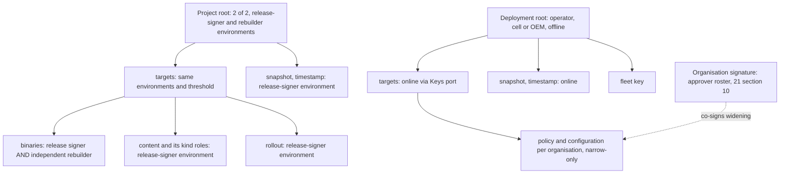

# 22. Transport, fleet management and updates

_Status: draft 5 against spine version 4, rulings R-20, R-26 and R-43, the owner's answers (`_review/02-owner-answers.md`) and the owner's kit instructions (`_review/04-owner-kit-instructions.md`), with principles P14 to P17 and decisions D-69 to D-71. Owning squad: Fleet and updates (`lead-fleet`); `grdr-uplink`'s signing path, `grdr-update`, `grdr-updater`, `grdr-crypto` and the command verifier are trust core (D-63). Read with: `00-decisions.md` (P14 to P17, D-30, D-33, D-36, D-37, D-39, D-49, D-52, D-56 to D-59, D-70, D-71), 02 (SR-16, SR-23 to SR-32, SR-41, SR-50), 03 (processes, crates, pack flow, section 7 contracts and the compatibility resolver, section 10 retry policies), 04 (envelope, lanes, integrity), 07 (installer and agent health states), 11 (on-device update mechanics: slots, last-known-good, crash-loop ladder), 12 (bundle members, narrowing check), 20 (bus, lake, durable watermark, restore, edge and admission, the fleet capacity model), 21 (tenant, organisation and device key custody), 24 (build, signing pipeline, packaging, air-gap bundle, upgrade paths), 26 (`dist.toml` endpoints), 32 (hosted operations), 33 (prerequisites and risk register)._

## Summary

This document specifies sensor-to-server transport and identity (D-36), updates and rollouts (D-37), native agent configuration as a release channel (D-49) and the wire side of the fidelity contract (D-52). Key choices:

1. **One HTTPS origin, unary first.** `IngestService/PushBatch` and `FleetService` share one origin and credential over Connect unary (HTTP/1.1 or HTTP/2). The only stream is `Subscribe`, which carries nudges and command envelopes that the daemon verifies as it does any other, never authority of its own, and falls back to the long-poll `Wait`.
2. **Idempotency `(device, epoch, lane, seq)` and two watermarks**: `acked_through` (on the bus) and `durable_through` (in the lake and catalogue backup). Spool segments are deleted only below the second (D-57).
3. **Application-layer authentication both ways.** Requests carry RFC 9421 signatures chained to the device key; responses are signed by a response key that the deployment's fleet key certifies for at most a day, and bound to the request. Inspection can read but not forge. Mutual TLS is extra; its absence is a fact.
4. **Compression is transport-only** (zstd level 3). Signatures and the archive cover uncompressed bytes, so a dictionary, adopted per lane only if S-25 shows over 30% saving, never becomes evidence.
5. **OpAMP semantics, our wire**, with a field mapping; an OpAMP adapter requires a named consumer. No Rust OpAMP client is a dependency.
6. **Two TUF roots.** The project root alone authorises binaries; the deployment root authorises policy and configuration and may vouch for a mirror's freshness, never a binary. Every pack also carries a DSSE envelope.
7. **Commands are not packs.** A `CommandEnvelope` carries approvers' WebAuthn assertions, checked in the daemon by WebAuthn's limited verification algorithm, so no JSON parser enters the privileged core.
8. **Rings everywhere, even anonymous**: standalone devices bucket themselves from a private salt, and every offer is admitted on a paced per-device ramp. Gates are numbers; halt is automatic; resume is the operator's recorded decision in a deployment and a new release that passes the gates for the project's own rings; rollback is a new release.
9. **A frozen `grdr.bootstrap.v1` service** lets a sensor of any age find and fetch its upgrade.
10. **Crypto profile**: TLS 1.3 with hybrid `X25519MLKEM768` preferred, P-256 device keys, Ed25519 software keys, SHA-256; FIPS variant on Linux and Windows; post-quantum signatures behind a seam that a stated trigger activates (section 11).
11. **One server-directed schedule** (P15). Every periodic and reactive send runs at a per-device phase plus jitter under a `Schedule` the server sets as data; retries use full-jitter backoff with the server's hint as a floor; admission sheds lowest priority first and never sheds commands or `decision`; everything sent to many devices is content-addressed and cacheable behind any CDN, cache or mirror.
12. **Air-gapped is first-class** (P16). Every update source is an `updates.sources` entry with no compiled default, an enrolled device's first source is its server, and deployment-signed freshness statements keep a site without internet current without ever authorising a binary.
13. **Compatibility is declared against contract ranges** (D-71). A deployment upgrades from one tested product bundle to another, transfers only the components whose digests changed, and one resolver refuses any combination outside the declared ranges before anything activates.

## Requirements

| # | Requirement | Trace |
|---|---|---|
| R1 | Acknowledged, idempotent, per-lane ordered delivery; every loss is a `health.gap`; decision and spine lanes never sampled or shed by quota | D-36, D-33, D-52, D-68, P9; brief 23 (OTLP accepts duplicates, no ordering) |
| R2 | Works through explicit, PAC and authenticating proxies and TLS inspection; each downgrade reported; kill command lands within 60 s in every topology | D-36, S-18; c5 F4, l04 F2; brief g05 section 3 |
| R3 | Enrolment by single-use token, deployment key (Watch until admitted), attestation, workload federation; key protection reported; clones are findings, never deduplicated | D-36, SR-41; c5 F7, l04 F4; briefs 24, 25 |
| R4 | Server controls flow; live data before backfill; no synchronised send after any common event; cell cold start is a release gate | D-36, P15; l11 F5; brief g10 section 5 |
| R5 | Commands above device scope carry approver hardware-key signatures checked against a quorum-changed roster | D-30; SR-29 to SR-32 |
| R6 | One pack type, verifier and last-known-good store; four channels with own rings; project root alone authorises binaries; TUF attacks fail | D-37, P7, SR-24, SR-25; brief 24 (CrowdStrike RCA finding 6) |
| R7 | Named gates, automatic halt, resume never automatic (an operator's recorded decision, or a new release for the project's rings), rollback by new release; ladder never relaxes fail-closed classes or passes the security floor | D-37, SR-16; l11 F8 |
| R8 | Expiry marks Stale and never stops enforcement or renewal; update authority `self`, `managed`, `image` | D-37, D-56; l04 F3, l11 F1 |
| R9 | Same wire major is always ingested and updatable; server sets the sensor ceiling; no combination outside declared contract ranges activates | D-58, D-71; c5 F6 |
| R10 | Native agent configuration ringed, halting on agent-start failure | D-49; l04 F1 |
| R11 | Look-back around findings; signed evidence requests; expired data is a gap | D-52 |
| R12 | Standalone sends only anonymous, mirrorable, disableable update fetches; mirrors and air gap verify against the project root; every function works with no route to the internet | D-48, D-59, P16; brief 25 implication 11 |
| R13 | TLS 1.3, rustls with aws-lc-rs, hybrid key exchange preferred; FIPS variant | D-36; brief 23 verification rows 8, 9, B |

## Design

### 1. Components

On the device, `grdr-daemon` owns spool, chain state, the per-boot key and the device key handle, signs batch heads, certifies the transport key and verifies commands; `grdr-uplink`, the only network process, posts batches, runs check-in, signs requests with the transport key and stages downloads; `grdr-updater` verifies them with `grdr-update` (TUF behind `UpdateTrust`; 11 owns activation). On the server, `ingest` serves the data plane, `control` the fleet, enrolment, rollouts and roster, `content` the deployment repository and project mirror, and tier-0 `approve` dispatches commands from memory (D-33). Device egress is the server plus the `updates.sources` entries (sections 6.1 and 6.4): standalone devices default to the project origins that the distribution's `dist.toml` `endpoints` name (26), self-hosted devices to the server's `content` target alone, which serves every project target from an imported bundle or as a pull-through cache with one upstream fetch per installation per file, and hosted devices fetch project targets from the project origins and organisation targets from the cell; `grdr egress` prints the effective list and CI asserts it (D-48).

Every number, host and path in this document is a target or a default, never a literal in code (P14, owner instruction 26): bounds, intervals, timeouts, retry budgets and thresholds live in `limits.toml`, `rollout-gates.toml` and the defaults of the `grdr.config` schema, hosts, ports and origins in configuration, `dist.toml` and the brand manifest, and platform paths in per-OS configuration tables.

### 2. Data plane

The data plane requires the server's `ingest` target; the spool, outbox and local fidelity work on the device without it.

#### 2.1 Messages

```proto
// grdr/ingest/v1alpha1/ingest.proto
service IngestService { rpc PushBatch(PushBatchRequest) returns (PushBatchResponse); }
message PushBatchRequest { repeated EventBatch batches = 1; uint32 server_epoch_seen = 2; repeated KeyCertificate key_certs = 3; } // one batch per ready lane, priority order; key_certs on an epoch's first request
message EventBatch { BatchHead head = 1; repeated bytes events = 2; }  // events as first encoded (04 rule 8)
message BatchHead {
  string device_id = 1; uint32 epoch = 2; Lane lane = 3; uint64 first_seq = 4; uint64 last_seq = 5;
  bytes prev_chain = 6; bytes chain = 7; bytes prev_epoch_final_chain = 8;  // 04 section 10
  uint32 schema_rev = 9; string boot_key_id = 10;
  bytes signature = 11;               // per-boot key over 1 to 10, domain tag "grdr-batch-head-v1"
  reserved 900 to 999;
}
message PushBatchResponse { repeated LaneAck acks = 1; FlowControl flow = 2; uint32 server_epoch = 3; bool checkin_requested = 4; CommandHead command_head = 5; ResponseKeyCertificate response_key = 6; } // response_key on a connection's first response
message LaneAck {
  Lane lane = 1; uint32 epoch = 2; uint64 acked_through = 3; uint64 durable_through = 4;
  AckStatus status = 5;   // ACCEPTED, DUPLICATE, GAP, CHAIN_CONFLICT, REJECTED_SIGNATURE, REJECTED_SCHEMA, REENROL_REQUIRED
  uint64 expected_seq = 6;
}
message FlowControl { uint32 retry_after_ms = 1; uint64 backfill_credit_bytes = 2; uint32 bulk_sample_permille = 3; Schedule schedule = 4; } // schedule only when its revision changed
message Schedule {                        // section 2.7; an absent field keeps the limits.toml default
  uint32 revision = 1; google.protobuf.Timestamp valid_until = 2;
  uint32 spine_interval_ms = 3;           // default 10,000; 2,000 to 30,000
  uint32 bulk_interval_ms = 4;            // default 60,000; 30,000 to 900,000
  uint32 checkin_interval_ms = 5;         // default 900,000; 300,000 to 3,600,000
  uint32 checkin_phase_ms = 6;            // default SHA-256(device_id || schedule_salt) mod interval
  uint32 jitter_ms = 7;                   // default 30,000: each periodic send adds U(0, jitter_ms)
  uint32 heartbeat_max_ms = 8;            // default 55,000; set below the balancer's idle timeout
  uint32 wait_ms = 9;                     // long-poll hold; default 50,000; 20,000 to 110,000
  uint32 reconnect_spread_ms = 10;        // after an unplanned remote close; 1,000 to 30,000
  uint32 control_backoff_cap_ms = 11;     // CheckIn, Wait, Subscribe, PendingCommands; default 120,000
  uint32 data_backoff_cap_ms = 12;        // PushBatch backlog; default 900,000
  uint32 max_request_bytes = 13;          // default 1 MiB compressed
  uint64 evidence_credit_bytes = 14;
}
message CommandHead { uint32 server_epoch = 1; uint64 counter = 2; bool pending_for_device = 3; } // from approve's memory
message ResponseKeyCertificate {          // section 4.4
  string key_id = 1; bytes public_key = 2; string algorithm = 3; string deployment_id = 4; string replica_class = 5;
  google.protobuf.Timestamp not_before = 6; google.protobuf.Timestamp not_after = 7; bytes fleet_signature = 8;
}
message KeyCertificate {               // sent in an epoch's first PushBatchRequest and in CheckInRequest.key_certs; cached by ingest, stored by control
  string key_id = 1; KeyUse use = 2;   // TRANSPORT, PER_BOOT, NEXT_DEVICE_KEY
  string algorithm = 3; bytes public_key = 4; uint32 epoch = 5; google.protobuf.Timestamp not_after = 6;
  bytes device_signature = 7;          // device key over 1 to 6, domain tag "grdr-key-cert-v1"
}
```

Limits (targets, in `limits.toml`): request at most `Schedule.max_request_bytes` (1 MiB) compressed, 4 MiB decompressed, decompression ratio at most 64; event 256 KiB; evidence content chunked at 512 KiB. The uplink sizes each request to occupy the measured uplink for at most 250 ms (at least 64 KiB), keeps at most 16 KiB unsent in the socket (`TCP_NOTSENT_LOWAT` where available), and sends `decision` ahead of any queued lower-lane bytes.

Streaming for gateways and node sensors is a client stream carrying the same `EventBatch` and `LaneAck` messages, so idempotency and the spool are unchanged. A gateway or node sensor uses it where SP-22-3 or S-03 shows the unary request rate is the bottleneck for it.

#### 2.2 Lanes and scheduling

Lane membership is 04's function of class; `local` never travels. A lower lane never delays a higher one.

| Lane | Flush (AC power) | Battery saver | Priority |
|---|---|---|---|
| `decision` | 250 ms after the first record | Same | 1 |
| `spine` | `Schedule.spine_interval_ms` after the first record (10 s by default, 2 to 30 s), 256 KiB, at once for a class marked `urgent` in 04's lane table, or with any `decision` flush | 30 s, or the schedule's interval if longer | 2 |
| `evidence` | On a finding or evidence request, within `evidence_credit_bytes` (section 2.5) | Same; 5 MB a day unless a request names more | 3 |
| `bulk` | With any other lane's flush; on its own at `Schedule.bulk_interval_ms` (60 s) or 512 KiB | Deferred until AC, at most 6 hours | 4 |

Every request carries the ready batch of every lane in priority order, so a `decision` flush also takes the open `spine` and `bulk` batches; a lane's own timer fires a request only when no higher-lane request left within its interval. The server tunes every interval through `Schedule` and can never delay `decision`.

#### 2.3 Acknowledgement and idempotency

1. The daemon writes head-signed batches to an outbox the uplink account can read, not write.
2. `ingest` verifies the request signature, the head signature against the per-boot `KeyCertificate`, device and organisation against the credential (never the payload; brief 24), the chain link from the stored head, and `schema_rev`. The first `PushBatchRequest` of an epoch carries that epoch's transport and per-boot `KeyCertificate`s; `ingest` verifies them against the device key it caches from enrolment, uses them at once and appends them to the bus `control` stream, from which `control` stores them. A request whose certificates `ingest` cannot find is refused `unauthenticated`, and the uplink resends with `key_certs` under section 2.7's backoff. The uplink checks in at its scheduled phase; a daemon that started three epochs within 10 minutes checks in at most once a minute until stable (11's crash-loop ladder).
3. The server's sequence rules (per batch against the watermark and its recent heads: `DUPLICATE`, append, overlap, `GAP` with `expected_seq`, `CHAIN_CONFLICT`) are 20 section 4 step 2's; clones are section 4.5.
4. On `GAP` the sensor resends from the spool or sends the `health.gap` it already wrote. A gap the sensor cannot explain is a tamper finding, suppressed inside the server's recorded outages (D-22). A `GAP` whose `expected_seq` is `durable_through + 1` and inside the sensor's retained range is a server rewind (20 section 4 step 7), never a tamper signal.
5. `acked_through` stops resending. Segments are deleted only below `durable_through`, advanced after lake commit and catalogue backup (20). A changed `server_epoch` (restore, D-57) makes the sensor resend everything above `durable_through`: `decision` at once, the rest as backlog within `backfill_credit_bytes`.

Delivery is at-least-once and exactly-once per key after de-duplication (D-33).

#### 2.4 Spool and gaps

Append-only 4 MiB segments per lane, framed as length, CRC32C, event bytes; default cap 512 MB inside the 1 GB disk cap (brief 37). At cap the shed order is 04's: `bulk` oldest first, then `evidence`, then `spine` oldest first, then `decision` oldest first, never blocking a writer (brief 37). Within the 512 MB, 64 MB is reserved for `decision`, so it is shed only when that reserve is itself full. Each shed range emits a `health.gap` (reason `spool-full`) with the chain value on both sides and sets Degraded (04).

#### 2.5 Fidelity on the wire (D-52)

- Always-shipped classes ride `decision` and `spine`, unsampled at any quota; roll-ups ride `bulk` with their Merkle root and `local` range.
- **Look-back.** A device finding queues its session's flight-recorder range, from 15 minutes before the first contributing event to 5 minutes after the last (pack-tunable defaults), into `evidence` at the evidence-span capture level (D-51), with RFC 6962 inclusion proofs against shipped roll-up roots. The finding ships at once on `decision` with `lookback_bytes`; the range uploads only within `Schedule.evidence_credit_bytes`, which `ingest` grants per (organisation, rule id) from a token bucket (default: full look-back for the first 20 devices per rule per hour, then on request), so a rule that fires across a fleet uploads a bounded number of look-backs while every finding still arrives. Above device scope a response capture (18 section 3) likewise pins the look-back on each device until the command's expiry plus 7 days and uploads it only for devices named by an evidence request or a `capture_sample_permille` sample (default 10). Uncredited look-back stays in the flight recorder for an `EvidenceRequest` until retention ends.
- **Evidence request.** `EvidenceRequest { id, range, max_capture_level, content_grant_id, purpose, incident_ref, expires }`, signed by the fleet key, arrives at check-in. A level above the organisation default needs a content grant, which carries the organisation signature in hosted and provider shapes (SR-26). Expired data answers with `health.gap` reason `recorder-expired`.
- **CI.** At job end the sensor drains every lane (60 s bound, target), ships look-back for open findings and discards the recorder as `recorder-expired`.

#### 2.6 Compression and dictionaries (plain zstd; dictionaries only on S-25's result)

`Content-Encoding: zstd`, level 3, over the request; gzip only for inbound OTLP. Our protocol is justified by acknowledgement, ordering and idempotency, not size (brief 23 verification row 6 and A). If S-25 shows a trained dictionary saves over 30% of a lane's fleet-weighted compressed bytes, measured at the batch sizes that lane produces under the default and loaded schedules, dictionaries ship for that lane only, as pack kind `zstd-dictionary` on the detection-content channel, one per `(lane, schema_rev family)`, named by the zstd frame's dictionary id and a `Grdr-Dict` header; the server keeps accepted dictionaries 13 months to decode stragglers. A dictionary embeds sample bytes, so it is trained by the project only, from the lab fleet and synthetic sessions at capture level `metadata`, never from tenant uploads, and must pass 04's privacy canary test before signing. The sensor uses a dictionary only if the last check-in `Handshake.capabilities` listed its id; otherwise it sends plain zstd. Signatures and archive cover decompressed bytes, so no dictionary is evidence.

#### 2.7 Flow control

**Schedule.** Every periodic or reactive transmission follows one server-directed `Schedule` (section 2.1): the mechanism is code, the numbers are data. `CheckInResponse` carries it, and `FlowControl`, `WaitResponse` and `Nudge` carry it when its revision changes; `limits.toml` holds the defaults and the device clamps, a clamped value is reported as `schedule-clamped`, and the device persists the newest verified schedule and returns to defaults at `valid_until`. `ingest` raises `spine_interval_ms` under load (20 section 4 step 5). No timer is aligned to wall-clock time; all run on the boot-time clock (`CLOCK_BOOTTIME`, `mach_continuous_time`, `QueryInterruptTime`), and ticks missed during sleep collapse into one.

**Retry.** A failed request or dropped connection is retried under the `uplink-reconnect` retry policy (03 section 10), one instance per origin and operation class: full-jitter exponential backoff seeded by device id, boot id and attempt, where attempt n waits `U(0, min(cap, 1 s × 2^n))`, with `control_backoff_cap_ms` (120 s) for `CheckIn`, `Wait`, `Subscribe` and `PendingCommands`, and `data_backoff_cap_ms` (15 minutes) for backlog. The attempt counter lives in the daemon's state directory, so an uplink restart continues it; only a verified response resets it. A connection the device closed on an OS network change reconnects at once; any other unplanned close (reset, TLS close, timeout, 5xx) first waits `U(0, reconnect_spread_ms)`, which the server sets to its connection count divided by 2,000 a second, between 1 and 30 s; a planned close is a `RECONNECT` nudge (section 3). `retry_after_ms`, a Connect `RetryInfo` or an HTTP `Retry-After` from any hop is a floor, never an instant: the device waits `retry_after × (1 + U(0, 1))`, and the server draws each value per device over its expected recovery window. Retries are budgeted at 10% of the uplink's requests in any minute plus one every 10 s; every request carries `connect-timeout-ms`, and the server drops work past it. Each origin has a circuit breaker that opens after the consecutive-failure count in `limits.toml` and closes on a successful probe at the backoff time, so a failing origin costs one probe per backoff while update fetches move to the next `updates.sources` entry.

**Admission.** `ingest`, `control`, `approve` and `content` admit through an adaptive concurrency limit per admission class (AC0 to AC4), highest first: AC0 commands (`PendingCommands`, `COMMAND` nudges, command acknowledgements) and `decision`, with 20% of each limit reserved and never shed; AC1 live `spine` (observed within 10 minutes), `CheckIn`, `Wait`, `Subscribe`; AC2 enrolment, renewal, full-state reports; AC3 `evidence` and content fetches; AC4 `bulk` and backlog. Each request names its lanes in a signed `grdr-lanes` header, so the edge can refuse a low class before reading the body. Backfill credit comes from measured spare capacity or the organisation's token bucket, whichever is smaller; backlog drains newest day first and in sequence order within a day, so `store` closes one late day at a time.

`decision` and the last 10 minutes of `spine` always go; older backlog only within `backfill_credit_bytes`. At quota, `bulk_sample_permille` samples raw bulk and the sensor records each unsent range as a `health.gap` with reason `quota` (04). Gateways, `ingest` and `control` drain over at least five minutes by `RECONNECT` offsets drawn per device (l11 F5). A cold start of a full cell is a hosted release gate (SP-22-4); cells require the hosted service's preconditions (D-63).

#### 2.8 Network ladder and requirements (validated by S-18; rungs 1 to 4 also carry standalone update fetches)

The uplink records the rung it reached as `health.sensor` facts (`transport.http_version`, `.proxy`, `.tls_inspected`, `.mtls`, `.kex`, `.push`):

1. **Proxy resolution** behind a `ProxyResolver` port: explicit `uplink.proxy` (MDM-settable), else WinHTTP settings and PAC on Windows, SystemConfiguration and PAC on macOS, `HTTPS_PROXY`/`NO_PROXY` on Linux; WPAD only when configured. API names are prior knowledge, confirmed by S-18.
2. **Proxy authentication**: Basic; Negotiate through SSPI (Windows) or GSSAPI; NTLM on Windows. The protected service uses the machine account.
3. **HTTP/2, then HTTP/1.1**; Connect unary works on both (brief g07).
4. **TLS 1.3 hybrid, then classical** after a handshake failure consistent with a dropped large ClientHello (brief 23 weak points). TLS 1.2 (ECDHE, AEAD) only when rung 5 has classed the path as inspected, as a downgrade; a TLS 1.2 chain that matches the server's pins is refused.
5. **Inspection**: trust is the OS store plus configured anchors. The fleet-signed `EnrolResponse` and each `ConnectionOffer` carry `tls_pins`, the SPKI hashes of the server's issuing CAs. A valid chain matching no pin sets `tls_inspected`, and mTLS becomes `absent`. Application-layer signatures still hold. Update fetches need no pins, because TUF verifies the bytes. No rung fetches revocation data from the network: the uplink verifies against the OS store, the configured anchors (`enrol.toml`'s `server_tls_anchors` among them) and CRLs from `uplink.crl_files` or a fleet-signed `ConnectionOffer`; the server's identity is withdrawn by new `tls_pins` and by `fleet` key rotation (section 4.4).
6. **Push**: `Subscribe` with a 25 s heartbeat, learned per network up to `Schedule.heartbeat_max_ms` (the operator sets it below its balancer's idle timeout; 55 s by default) and remembered like a rung; two missed heartbeats (a buffering proxy) drop to long-poll `Wait(desired_revision, command_counter, wait_ms)`, a signed request under 256 bytes that `control` answers from an in-memory map of desired revisions and command heads with no relational read: at once on a pending command, at the first change, or empty at `wait_ms` (lowered per network when a hop cuts it early). A full `CheckIn` still runs only at section 3's cadence.

Customer requirements: outbound HTTPS (TCP 443 unless the server's configuration names another port) from devices to the server origin and to each update source `grdr egress` lists, all of which may be inside the site, with no route to the internet needed on any rung (a connected standalone device defaults to the project origins in Loonaro's `dist.toml`, section 6.1; a site that cannot allow those uses the self-hosted default, the server alone); a time source the devices reach (internal NTP or the domain's time service); no UDP or QUIC (frequently blocked on corporate networks, an inference in brief 23); no inbound ports; inspection tolerated, bypass recommended; proxy idle timeout of at least 60 s recommended. `grdr egress` prints the destinations from effective configuration; the coexistence pack's host list names only the defaults for connected sites (D-23).

**Edge.** Each device holds one TLS connection (two on HTTP/1.1). In `embedded` and `ha` every replica serves every target, so any TCP or HTTP balancer works. In `distributed`, the cell's TLS-terminating edge (the reference architecture names one; mutual TLS is verified there) routes `IngestService/*` to `ingest` and `FleetService/*` and `EnrolService/*` to `control` and `approve`, holds the streams on at least two replicas so one deploy or crash drops at most half, keeps each replica within 10% of the mean connection count by sending `RECONNECT` to the excess, and allows at most 8 concurrent streams per connection, with HTTP/2 reset-flood limits. Target per 50,000-endpoint cell: 60,000 connections at about 50 KB each (estimate, S-24).

### 3. Control plane: the fleet service

Requires the server's `control` target. The OpAMP adapter requires a named consumer (below).

```proto
service FleetService {
  rpc CheckIn(CheckInRequest) returns (CheckInResponse);    // unary; long-poll is Wait
  rpc Subscribe(SubscribeRequest) returns (stream Nudge);   // nudges only, never authority
  rpc ReportUpdate(UpdateReport) returns (UpdateReportAck);
  rpc Wait(WaitRequest) returns (WaitResponse);                                  // long-poll, answered from memory
  rpc PendingCommands(PendingCommandsRequest) returns (PendingCommandsResponse); // AC0, from approve's memory
}
message CheckInRequest {
  string instance_uid = 1; uint64 sequence_num = 2;         // OpAMP: UUIDv7, gap triggers full state
  Handshake handshake = 3; repeated ChannelState applied = 4; // digest, APPLIED/APPLYING/FAILED, error
  Health health = 5; bytes full_state_digest = 6; reserved 7; repeated string acked_command_ids = 8; // 7 was wait_ms; long-poll moved to Wait
  repeated KeyCertificate key_certs = 9;                    // transport and per-boot keys of this epoch; device-key rotation
  uint64 desired_revision = 10; uint64 health_revision = 11; repeated uint64 tuf_timestamp_versions = 12; // project, deployment
}
message CheckInResponse {
  Handshake handshake = 1; repeated DesiredState desired = 2;  // per channel: digest, ring, not_before
  repeated PackageOffer offers = 3;                             // TUF target paths; bytes from the repository
  repeated CommandEnvelope commands = 4; repeated EvidenceRequest evidence = 5;
  RosterUpdate roster = 6; ConnectionOffer connection = 7;      // new origin, mTLS renewal, signed redirect
  bool report_full_state = 8; google.protobuf.Timestamp server_time = 9;
  Schedule schedule = 10; uint64 desired_revision = 11; CommandHead command_head = 12;
  repeated bytes tuf_timestamps = 13;                            // signed timestamp.json newer than the device reported
  ResponseKeyCertificate response_key = 14;
}
```

**Taken from OpAMP v0.20.0 (Beta):** UUIDv7 instance id, sequence numbers with full-state recovery, capabilities, health, effective configuration by hash, APPLIED/APPLYING/FAILED, package offers by hash, connection-settings offers, stream-or-poll duality (brief 23 row 7, brief 24 row 9). **Added:** signed commands, evidence requests, roster, flow control, the server-directed schedule, memory-served long-poll, skew handshake, rings and `not_before`, server epoch, signed responses. **Not used:** OpAMP package bytes and its Development-status CSR flow; TUF and our renewal replace them (c5 F3).

```proto
message WaitRequest { string instance_uid = 1; uint64 desired_revision = 2; uint32 server_epoch = 3; uint64 command_counter = 4; uint32 wait_ms = 5; }
message WaitResponse { uint64 desired_revision = 1; uint32 spread_ms = 2; CommandHead command_head = 3; repeated CommandEnvelope commands = 4;
  Schedule schedule = 5; repeated bytes tuf_timestamps = 6; google.protobuf.Timestamp server_time = 7; }
message PendingCommandsRequest { uint32 server_epoch = 1; uint64 since_counter = 2; }
message PendingCommandsResponse { repeated CommandEnvelope commands = 1; CommandHead command_head = 2; } // empty: a signed none-since
message SubscribeRequest { string instance_uid = 1; uint64 desired_revision = 2; uint32 schedule_revision = 3; }
message Nudge {
  NudgeKind kind = 1;            // HEARTBEAT, CHANGED, COMMAND, RECONNECT
  uint64 desired_revision = 2;   // CHANGED: act only if it differs from the device's
  uint32 spread_ms = 3;          // CHANGED: check in at U(0, spread_ms)
  uint32 reconnect_at_ms = 4;    // RECONNECT: keep this connection until this per-device offset, then reconnect
  bytes command_envelope = 5;    // COMMAND: CommandEnvelope bytes (section 5), at most 8 KiB
  Schedule schedule = 6;         // when its revision changed
}
```

`control` keeps per device, in memory for the cell, the `desired_revision`: the bus `control` stream offset of the last change that selects the device (desired state, pending command, evidence request, inbox entry, roster, schedule). A `CheckIn` whose `desired_revision` matches gets no `desired`, `offers` or `roster` and costs no relational read; desired state is computed from cached rollout targets per (organisation, group, channel, bucket range) (20 section 6). `Health`, `ChannelState` and `ActuatorCaps` travel as changes since the acknowledged `health_revision`; the full set goes only on `report_full_state`, which the server grants to at most 2% of a cell's devices per interval, or once a day at the device's phase. Grants, grant and Exception revocations, evidence requests and device-scope commands sit in a per-device inbox returned by `CheckIn`, `Wait` and `PendingCommands`, never in a layer document. A change nudges the selected devices with `CHANGED` and `spread_ms = clamp(selected devices ÷ admitted check-ins a second × 1,000, 1,000, 30,000)`, which keeps D-56's 60 s; a deploy, drain or rebalance sends `RECONNECT` with offsets drawn uniformly over at least five minutes; project releases are never nudged.

**Rust client question.** New Relic's client is proprietary; open ones (`otel-opamp-rs` 0.0.14, the extension in `otel-arrow`'s dataflow engine, `classis`'s `opamp` crate from 2026-10-19, `oxtel-opamp` 0.0.1) are immature (brief 10 row 10). `FleetService` needs none of them; `spec/fleet-opamp-mapping.md` maps every field. **Requires:** a design partner or provider that manages agents through an OpAMP server. For that consumer we build a sensor-side client for `FleetService` semantics only (never commands or packages), evaluating `otel-arrow`'s extension and `classis` first.

Cadence: at `Schedule.checkin_phase_ms` in every `checkin_interval_ms` (15 minutes) plus `U(0, jitter_ms)`, never on a timer a common event started; after boot or wake, after `U(0, 30 s)` (the kill path does not wait for it: section 5), with deferred work (backlog, downloads, inventory, look-back) a further `U(0, 10 minutes)` later unless the server credits it sooner; on a `CHANGED` nudge, after `U(0, spread_ms)`. A device is Offline after three missed intervals with no open stream and no signed `going-down` record; sleep and shutdown send one with the expected resume (l04 F3).

### 4. Enrolment and device identity

Requires the server's `control` target; attestation also requires 22-11's device keys.

#### 4.1 Methods

| Method | Credential | Admission | Use |
|---|---|---|---|
| Single-use token | 256-bit random, prefix `grdr_et_`, 7-day default expiry | Admitted | `grdr join` by a person |
| Deployment key | Per organisation or group, multi-use, expiring, revocable | `pending`: organisation packs run in Watch until an admin or rule admits | RMM, MDM, images, VDI |
| Attestation | Device key attested by the TPM, or by Apple managed device attestation (prior knowledge, not in a brief; verified by 22-15) | A rule may auto-admit | Zero-touch fleets |
| Workload federation | Kubernetes projected service-account token, CI OIDC token, cloud instance identity | Federation rule: issuer, audience, subject pattern, group, lifetime | Containers, CI, cloud VMs |

**Without internet.** Token, deployment-key and enrolment-file methods need only the server and whatever places `enrol.toml` (Configuration Manager, Group Policy, Ansible, an on-premises MDM or a person). TPM attestation verifies the EK certificate read from the TPM's NV storage against manufacturer CA certificates imported with the bundle, never fetched through an AIA URL. A firmware TPM whose EK certificate is published only by its manufacturer's online service (prior knowledge; 22-15 confirms) is admitted through an EK public-key list the operator imports, or enrols by deployment key into `pending` with reason `attestation-offline`. Apple managed device attestation needs the Mac to reach Apple and is `not-available` there. Workload issuers take a key source of `jwks-file`, an internal `jwks-url` or internal discovery; a public issuer's federation rules are reported inactive, not failing.

Credentials never appear on a command line (D-59). An enrolment file (`enrol.toml`: server origin, deployment-root fingerprint, credential, and optional `server_tls_anchors`, the PEM of the CA that issues the server certificate, which join rung 5's configured anchors) is placed root-owned 0600 by MDM or read once with `--token-file`; MSI properties are masked (brief 25). Essentials and the local floor always apply; only organisation packs wait for admission, so a leaked deployment key can pollute data but cannot block developers.

#### 4.2 Flow

```mermaid
sequenceDiagram
  participant U as grdr join or installer
  participant D as grdr-daemon
  participant L as grdr-uplink
  participant S as control
  U->>D: enrolment file; step-up shows origin, root fingerprint, capture level, readers, locked rules
  D->>D: create device key in best store; record key_protection
  D->>L: EnrolRequest signed by device key (credential, public key, protection, attestation, facts, nonce)
  L->>S: EnrolService/Enrol
  S->>S: consume credential atomically; record id in versioned object storage (D-57)
  S-->>L: EnrolResponse signed by fleet key (device id, organisation, deployment root, roster, epoch, sealed pseudonym key, admission)
  L->>D: daemon verifies against the pinned fingerprint, certifies transport and per-boot keys, first CheckIn
```

`device_id` is SHA-256 of the device public key (04), or of issuer, subject and instance id for workloads. The pseudonym key (custody 21) is D-51's device-side layer only; the server re-pseudonymises at ingest with a key the device never holds. It is sealed with HPKE (RFC 9180, DHKEM P-256) to the device key. That needs ECDH inside each hardware store; SP-22-1 confirms it per platform, and where it fails the server seals to a separate P-256 key held in the OS keystore and the device reports `key_protection` for that key too.

#### 4.3 Device keys by platform

| Platform | Protected profile | User profile | Status |
|---|---|---|---|
| Windows x64, ARM64 | P-256 in the TPM via CNG's platform provider, owned by LocalSystem (`hardware`) | CNG software key (`os-keystore`) | Service use unproven: SP-22-1 |
| macOS | Secure Enclave P-256 from the system daemon (`hardware`), else System keychain (`os-keystore`) | Login keychain | Secure Enclave is P-256 only and unproven from a daemon (c5 F7). Keychain and Secure Enclave keys for a daemon need a signed binary with a keychain access group, which requires Apple's Developer Program (prior knowledge, confirmed by SP-22-1); a macOS build without a Developer ID signature (D-18) uses a `file` key |
| Linux | TPM 2.0 via `/dev/tpmrm0` (`hardware`), else 0600 file in the root-owned state directory (`file`) | File key | TPM library chosen by SP-22-1 |
| Kubernetes node sensor | The node is the device: its TPM through a host-mounted `/dev/tpmrm0` where present (`hardware`), else a file key on the host | n/a | Same code path as Linux |
| Pods, CI jobs | In-memory P-256 key per instance, never written; federated 1-hour session renewed by presenting a fresh platform token; no rotation, the instance ends first (`file`, the lowest grade, with `identity_mode = workload-federated`) | Same | |

Policy may require a minimum `key_protection` (for example, credential release only from `hardware`).

#### 4.4 Rotation, renewal, revocation

- **Transport key** (Ed25519; P-256 in FIPS) per epoch and at most 24 hours, certified by the device key, held by the uplink: a compromised uplink impersonates transport for a day at most and cannot sign batch heads or commands.
- **Per-boot key** (same algorithms) per epoch, held by the daemon, signs batch heads (D-39).
- **mTLS certificate** 30 days, renewed by proof of possession via `ConnectionOffer`. An expired certificate drops the connection to application-layer authentication, from which renewal proceeds.
- **Device key** yearly or on demand; the old key signs a `NEXT_DEVICE_KEY` certificate for the new one and the epoch increments (04).
- **Response keys.** The fleet key never signs a per-request response. Each `ingest`, `control` and `approve` replica generates an Ed25519 key in memory at start (P-256 in FIPS) and obtains a `ResponseKeyCertificate` of at most 24 hours signed by the fleet key, one Keys-port call per replica per day; the certificate rides the first response on each connection and every `CheckInResponse`. The device verifies it once against the current fleet key, caches it by `key_id` until `not_after`, and refuses one that has expired or names another deployment. Enrolment responses, commands, rosters, epoch statements, revocations and `EvidenceRequest`s stay signed by the fleet key itself.
- **Renewal timing.** Every renewal (transport key, mTLS certificate, device key, publication of the next fleet key) is attempted at a point drawn afresh from `U(50%, 80%)` of the credential's lifetime, so a mass enrolment never renews in one wave (21's SP-21-5 measures it).
- **Fleet key** 90 days, listed in the deployment root's TUF metadata. A device that missed rotations walks the deployment root chain (TUF client workflow) from the deployment repository and learns the current key, so it never has to trust an expired one.
- **Long absence:** renewal is never refused for age (D-37); after 180 days offline the device renews into `pending` admission (l04 F3's limit, applied as admission rather than refusal).
- **Revocation:** calls get `REENROL_REQUIRED`; a fleet-signed revocation shows that the organisation revoked the device (a language token, D-69); cached policy keeps enforcing (P4) until a step-up `grdr leave` or re-enrolment. Revocations live in versioned object storage and replay after restore (D-57).

#### 4.5 Clones, images, VDI

`grdr image prepare` strips keys, epoch counter and enrolment before capture. A clone is two chains under one `(device, epoch)`, an epoch reappearing with a different chain, or two transport keys of one epoch both posting. The server raises a `tamper` finding, sets `identity-conflict`, ingests both streams into a quarantine partition keyed by transport-key fingerprint (nothing lost or merged), withholds commands and policy, and answers both with `REENROL_REQUIRED`; target: within one batch. Non-persistent VDI enrols at each boot after the final hostname with a deployment key and a `vdi-pool` tag; each boot is a new device id, grouped for display only (brief 25: Defender VDI guidance), and enrols under the pool key's budget (32 section 4); `vdi-pool` and workload device records expire with their watermarks and certificates 7 days after their last check-in or at job end. `grdr image prepare` keeps the pack store and intel base, so a boot fetches only segments published since the image was built; a CI sensor restores its package, pack store and intel base from the runner cache by digest (10 section 11), and a sidecar mounts the node sensor's pack store read-only where one exists. `control` caches each workload issuer's keys per replica for the earlier of their `Cache-Control` lifetime and 1 hour, refreshing at most once a minute on an unknown `kid`. Multi-session hosts require per-logon-session policy and listeners (D-59); an installer without that support refuses them.

### 5. Signed command channel

Local session actions need only the daemon; fleet commands require the server's `approve` and `control` targets and an approver roster.

```proto
message CommandEnvelope { bytes body = 1; repeated ApproverSignature approvals = 2; bytes fleet_signature = 3; }
message CommandBody {
  string command_id = 1; string organisation_id = 2;
  Scope scope = 3;          // session, device, group, organisation, organisation-set, provider
  Selector target = 4;      // ids or tag selector, evaluated on the device
  ResponseAction action = 5; uint32 server_epoch = 6; uint64 counter = 7;   // (epoch, n) per organisation
  google.protobuf.Timestamp issued_at = 8; google.protobuf.Timestamp not_after = 9;
  uint64 roster_version = 10; bool reversible = 11;
}
message ApproverSignature { bytes credential_id = 1; bytes authenticator_data = 2; bytes client_data_json = 3; bytes signature = 4; }
```

The daemon verifies in order; a failure refuses the command and records `response.command` with the reason:

1. Fleet signature under the deployment root's current fleet key.
2. `not_after` against **trusted time**: last authenticated `server_time` plus monotonic elapsed, so a wound-back clock revives nothing.
3. `(server_epoch, counter)` above the highest seen; a new epoch only with a deployment-root epoch statement (D-57).
4. Scope (SR-30, SR-31). The device first checks that `target` fits `scope`: device scope names this device id, session scope names sessions on it, group scope names one group id; any tag selector counts as organisation scope. Then: no approver allows only session or device scope, D-30's automatic actions, expiry at most 24 hours. One approver: a reversible freeze of at most 60 minutes at any scope (a repeat on the same scope with the same key within 24 hours needs a second), and any other action at group scope. Kill, revoke or extension at organisation scope or wider: two distinct approvers with the required roles. A provider-scope command other than a reversible freeze also needs one assertion by a member of this organisation's own roster when the organisation is claimed (21 section 5, 02 section 3.11); without it the device skips the command and reports it.
5. Each assertion by WebAuthn Level 3's limited verification algorithm (5.8.1.2): rebuild the expected prefix from type `webauthn.get`, the base64url SHA-256 of `body`, the console origin pinned in the roster and `crossOrigin`; compare bytes; require the next byte to be `}` or `,`; check that `authenticator_data`'s RP id hash equals SHA-256 of the roster's RP id and that the user-verified flag is set; verify ES256 or EdDSA over `authenticator_data || SHA-256(client_data_json)`. The member order is fixed by the specification (5.8.1.1), so no JSON parser enters the daemon (ARCH-004).
6. Rate limit: three destructive commands per scope per 10 minutes unless two approvers signed (R-26). This is the device's check; the server-side automation cap per hour is 18's.

**Roster.** Version 1 (approver credentials, roles, console origin) is signed at organisation creation or claim (21 section 10) and pinned at enrolment beside the deployment root; version n+1 needs a quorum (default two) of version n. The server delivers rosters but cannot forge one.

**Delivery.** `approve` holds pending commands in memory and versioned object storage and keeps, per organisation, a command head `(server_epoch, counter)` and the devices and scopes with pending commands. Every authenticated response (`PushBatchResponse`, `CheckInResponse`, `WaitResponse`, a shed response) carries `CommandHead`, read from that memory with no database access. A `COMMAND` nudge carries the `CommandEnvelope` itself, which the daemon verifies exactly as at check-in, so an organisation-scope kill reaches 50,000 connected devices with one stream write each (2 to 4 KB, estimate) and no check-in; a held `Wait` returns it at once, and `PendingCommands(since)` (AC0, never shed while `approve` runs) returns pending envelopes or a signed `none-since`. `approve` pushes a command to the devices its view puts in scope plus those whose tag digest changed in 24 hours, in device-hash order; the daemon's evaluation of `target` stays authoritative. After a reconnect, if the first verified response says `pending_for_device`, the daemon holds new tool-call decisions for at most 1 s after `DecideAck` (inside D-14's 2 s) and then denies with reason `syncing` until those commands are applied (R-26, D-30); otherwise it decides from cached state at once, and with no verified response it is offline (D-56). The deny returns at once, so D-14's bound holds. Kill state survives reboot; order is freeze, isolate, capture, revoke (SR-32).

### 6. Update trust

The project root, pack format and standalone fetch need no server; the deployment root, mirrors and air-gap import require the server's `content` and `keys` targets; the operator plane's upgrade flow (section 6.7) requires the `operator` target (D-70).

#### 6.1 Roots and roles



| Role | Signs | Expiry (target) |
|---|---|---|
| Project root, `targets` | Root metadata; delegations | 2 years, re-signed at each annual rotation, so a site that imports at least once a year never holds an expired root |
| `binaries` | Binary targets and product bundles (section 6.7); threshold 2: the release signer's key, used only for artefacts with verified SLSA Build L3 provenance (24), and the independent rebuilder's key, which signs only an artefact it has reproduced bit for bit from the tagged source in its own environment | 90 days |
| `content`, delegating by kind to `content-detection`, `content-policy`, `content-adapters`, `content-dictionary`, `intel-base` (bases and daily segments) and `intel-rapid` (hourly segments of the current day, pruned at each daily roll-up) | Loonaro packs in every shape: detection, intel, adapters, dictionaries, Essentials; a change in one kind re-downloads only that role's metadata | 30 days; `intel-rapid` 2 days |
| `rollout` | `rollout.json`: ring schedules (open time, ramp, `max_share_per_window`), `rate_scale` and halt flags for every client (section 7.6) | 7 days |
| Project snapshot, timestamp | Freshness | 7 days, 1 day |
| Deployment root, `targets` | Policy bundles, layer documents, native configuration parameters | 1 year, 30 days |
| `fleet` | Enrolment responses, commands, response-key certificates (section 4.4), epoch and freshness statements | 90 days |
| Local deployment root (standalone) | Local layer documents and configuration | Daemon key store |

Every project key is generated by the ceremony (section 6.2) and stored only as a secret of its GitHub Actions environment, written from stdin and never printed, logged or kept anywhere else (owner instruction 23, `_review/04-owner-kit-instructions.md`). The release-signer environment holds the release signer's `binaries` key, the `content` roles, `rollout`, snapshot, timestamp and one root and `targets` key; the rebuilder environment holds the rebuilder's `binaries` key and the second root and `targets` key, so the root and `targets` threshold is two across the two environments, as for `binaries` (24 section 10). Each environment admits only runs of its own workflow on `main`, so a secret taken from one environment can neither authorise a binary nor change the root. A KMS or hardware module can later hold any of these keys through the Keys port by configuration, with no change to the roles.

The repository is served from origins classed by object, all free for an open-source project, none needing an account beyond the project's GitHub repository, and all untrusted, because TUF verifies every byte. Loonaro's distribution lists them in `dist.toml` `endpoints` (26) as `updates.sources` entries (section 6.4): GitHub Releases for binary packs, deltas, bundles and air-gap parts (no limit on total release size or bandwidth, files under 2 GiB, 1,000 assets a release; GitHub documentation read 2026-11-11); GitHub Pages for TUF metadata and the small targets it names, both behind GitHub's own CDN, with the site kept under Pages' 1 GB limit by carrying only current metadata and those targets; and jsDelivr's GitHub mirror, which serves public repositories, as a second origin for every immutable file under 20 MB, which needs no account (no bandwidth limit; files at a tag or commit are cached permanently, branches for 12 hours; jsDelivr's documentation read 2026-11-11). The publishing job tags each published snapshot, so every jsDelivr URL names a tag and never changes. All three serve devices from the first public release; the repository is public from its first push (owner instruction 28), so its releases need no authentication and its Pages site no paid plan. GitHub Pages has a soft bandwidth limit of 100 GB a month, which `timestamp.json` polling alone reaches at about 250,000 anonymous devices (estimate). Enrolled devices therefore take `timestamp.json` in the check-in (section 3) and self-hosted devices fetch through `content`, so only standalone devices poll the project origins, and S-26 records when that fleet needs another origin; one is added as an `updates.sources` entry by configuration, never by a release. The release workflow re-signs `timestamp.json` every 6 hours and on each publish, a missed run alerts at 12 hours, and an expired project timestamp opens an `upstream-expired` window in which the server suppresses per-device Stale findings; Stale never shortens a fetch cadence.

This settles 03's open question: Loonaro detection content is signed by the project `content` role in every shape; the standalone local root signs only the device's own layers, and a user-written detection runs only while a signed local layer pins its digest (12).

#### 6.2 Key ceremonies

The project ceremony is scripted in `release/ceremony/` and runs without a person: it is a dispatched run of the ceremony workflow in both environments, started only when a protected change to `release/ceremony/` lands on `main` (owner instruction 7). Each job generates its environment's keys in memory, stores them as that environment's secrets from stdin, publishes only public keys and signed metadata, and commits a transcript of key ids and output hashes. No person and no machine outside the two environments holds a project key. Loonaro owns the project root, and its keys transfer under D-03. Root rotation is annual and on suspicion, through the same workflow, signed by the old and new thresholds.

The deployment root is made by `grdr server keys init --ceremony`, run by the operator on an offline machine: it creates the root on two hardware tokens (threshold 1 of 2 by default, 2 of 3 recommended), signs the online `targets`, snapshot, timestamp and `fleet` keys that the Keys port holds (21), and prints the fingerprint that enrolment files pin. A multi-cell installation runs the command once per region (a self-hosted installation once): the ceremony also signs delegations for the cells in the inventory and up to 10 reserved cell ids whose online keys already exist, so every cell of a region verifies under one deployment root and fleet key, and an in-region cell move or organisation shard needs no re-pin. The organisation signature is made by the approver roster's device-bound WebAuthn credentials (21 section 10), enrolled into roster version 1. Agents never handle a key value: project keys exist only inside the ceremony and release jobs, and deployment root, `targets`, approver and organisation keys belong to the operator and the organisation (D-63; brief g10 section 8).

#### 6.3 Pack format

A `.grdrpack` is a deterministic tar (sorted, zero timestamps, manifest first) compressed once with zstd level 19 and a window of at most 8 MiB, since it is downloaded up to 10 million times; decompression enforces a ratio limit of 64, with the manifest's declared size as a hard cap. Size budgets (targets, `limits.toml`, enforced by the verifier and CI): binary pack 60 MB, binary delta 40% of the full pack, intel base 24 MB, intel segment 4 MB, detection or schema-policy pack 2 MB, layer document 256 KB, bundle manifest 64 KB, agent adapter 1 MB, dictionary 112 KB. **Deltas.** For each binary pack the release job also publishes `binary-delta` targets from the previous two patch versions of the line and the last version of the previous minor (per-file `zstd --patch-from` against the installed slot's files, published only if at most 40% of the full size), and `content` does the same for the last three versions of each bundle and pack. TUF custom metadata names the `base` and `result` hashes; the updater reconstructs into the inactive slot or pack store and verifies every file against the full target's manifest, so a delta is transport only, and any mismatch falls back to the full target. A rollback whose files equal the device's other slot downloads nothing.

`grdr.pack.v1alpha1.Manifest`:

| Field | Meaning |
|---|---|
| `kind` | One of the kinds below; reserved `wasm-component` (03) |
| `channel` | `binaries`, `schema-policy`, `detection-content`, `native-agent-config` (D-37); fixed by `kind` |
| `id`, `version`, `generation` | Monotonic; a lower generation is refused (12) |
| `format_version`, `min_engine`, `requires_capabilities` | 03 section 7 |
| `signer_class` | `project-binaries`, `project-content`, `deployment`, `organisation`, `local`; must match `kind` |
| `narrow_only`, `org_signatures` | Operator-signed artefacts must narrow, checked on the device with a timeout counted as widening; widening needs organisation signatures in hosted and provider shapes (SR-26) |
| `reads`, `members`, `security_floor`, `lane` | Declared field paths and classes (P7); member hashes; lowest version the ladder may fall back to; `standard` or `rapid` |
| `as_of` | When the pack's data was read from its sources (the source commit's `SOURCE_DATE_EPOCH` where there is no upstream, so builds stay reproducible); per-source times for `intel` (14 section 7); shown as data age in every shape |

| `kind` | Channel | Accepted `signer_class` |
|---|---|---|
| `binary` | binaries | `project-binaries` |
| `schema-policy` (Cedar schema releases, Loonaro policy packs including Essentials) | schema-policy | `project-content` |
| `layer-document` (layer settings, and 12's section 10 bundle that pins packs by digest) | schema-policy | `deployment`, `organisation` (widening), `local` (standalone) |
| `detection` | detection-content | `project-content`; an unsigned rule runs only while a signed layer pins its digest (12) |
| `intel` (a base and daily segments on the `standard` lane, hourly segments on the `rapid` lane; R-20) | detection-content | `project-content`; churn in its restrict-only lists is not a widening change (D-08) |
| `integration` (a manifest plus fixtures, reserved for 25) | detection-content | `project-content` |
| `zstd-dictionary` | detection-content | `project-content` |
| `agent-adapter` | native-agent-config | `project-content` |
| `agent-config` | native-agent-config | `deployment`, `local` |
| `catalogue`, `building-blocks` (05) | detection-content | `project-content` |
| `org-catalogue` (05: fingerprints, `registry_aliases`, learned-endpoint lists) | detection-content | `deployment`, `local` (standalone) |
| `detection`-adjacent `detector`, `tripwire`, `l0` (13) | detection-content; `detector` is schema-policy where an enforced rule reads its facts (13 section 1) | `project-content` |
| `analyser-vocab` (13) | schema-policy | `project-content` |
| `prompt`, `review-settings` (19) | detection-content | `project-content` |
| `model` (16, 19) | detection-content | `project-content`; `deployment` or `local` for operator-installed weights (16 section 4) |
| `org-intel` (14: an organisation's own indicator lists, narrow-only) | detection-content | `deployment`, `organisation` |
| `attribution-hops` (06: broker match data only) | detection-content | `project-content` |
| `tile`, `report` (27) | detection-content | `project-content` |
| `authenticator-list` (21 section 10: the curated list of approver authenticators, published every release and carried in the air-gap bundle) | detection-content | `project-content` |

Each kind has a closed schema with no field that could hold a command, executable path, URL to fetch, environment variable to set or MCP server to start (SR-25). Host patterns, environment variable names and path templates are allowed as typed match fields (P7). Every pack carries a DSSE envelope over the manifest (payload type `application/vnd.grdr.pack-manifest+protobuf`), so it verifies through TUF, a content relay (D-60), a git pin or an air-gap import alike; TUF adds freshness, rollback and mix-and-match protection.

#### 6.4 Repository layout

```
<repo>/project/metadata/{N.root, timestamp, V.snapshot, V.targets, V.binaries, V.content, V.rollout}.json
<repo>/project/targets/binaries/<os>/<arch>/<component>/<version>/<sha256>.<file>
<repo>/project/targets/content/<kind>/<id>/<sha256>.<version>.grdrpack
<repo>/deployment/<deployment_id>/r/<repo_id>/{metadata,targets/<channel>}/...   # one TUF repository per (organisation, group)
<repo>/deployment/<deployment_id>/o/<sha256>                                 # content-addressed organisation targets
```

Consistent snapshots make files immutable and CDN-cacheable on any static host. A CDN in front of the repository (P15) is one value of `updates.sources`: the client uses no CDN feature (signed URLs, tokens, edge logic), so its offline equivalent is the same tree on any static file server, HTTP cache or mounted directory. `updates.sources` is an ordered list; each entry is `server`, an `https://` or `http://` URL template, or `dir:<path>`, optionally limited to target classes (metadata, small targets, binaries), so GitHub Releases' flat asset names map onto this layout by template. Its default comes from the distribution's `dist.toml` `endpoints` (26) and is written into the default `install.toml`, never compiled into a binary; MDM and a fleet-signed `ConnectionOffer` override it, so moving an origin is configuration, not a release, and a source can only withhold or delay a file. Every path a device fetches (package offers, the target `Hello` names in `UPGRADE_REQUIRED`, `rollout.json`, freshness statements) is relative to its effective source; no response, pack or statement carries an absolute URL. An enrolled device's first source is `server`, which `content` serves from the imported or mirrored repository. A fleet-signed `ConnectionOffer` may add mirror origins (`update_sources`), tried in a per-device jittered order and failed over in turn, which spreads a large fleet over an internal CDN or several static servers. TUF verifies bytes, so mirrors are untrusted. `grdr server mirror sync --from <origin or directory>` lets mirrors feed mirrors, so a large site runs one central mirror and regional ones.

Each (organisation, group) pair is its own TUF repository with an opaque random `repo_id` under the deployment root, with its own timestamp and snapshot, so a change in one group invalidates only that repository's metadata and no device sees another organisation's target names, hashes or sizes; its timestamp rides the check-in (section 3), and it is served only to that repository's authenticated devices, through `content` or the operator's private cache.

`binaries` delegates by stream (`nightly`, `beta`, `stable`, `lts`), then by `os` and `arch`, so a device reads only its triple's role; LTS follows D-58: the first LTS is the first minor at least 90 days after 1.0, then every twelfth minor (R-43). Metadata budgets (targets): `timestamp.json` 2 KiB, snapshot 16 KiB, `intel-rapid` 16 KiB, any other role 256 KiB; CI refuses a publication over them.

**HTTP caching contract.** Every file except `timestamp.json` has a content-derived name and is served with `Cache-Control: public, max-age=31536000, immutable`, with the path alone as cache key and `Vary: Accept-Encoding` on metadata only. `timestamp.json` is served with `Cache-Control: public, max-age=60, s-maxage=300, stale-if-error=86400` and request collapsing. A 404 or 5xx carries `no-store`. `content`, `grdr server mirror` and any cache or CDN added by configuration apply this contract; GitHub Pages, GitHub Releases and jsDelivr set their own headers, which S-26 records, and TUF's checks make either safe. Publication order is targets, delegated metadata, snapshot, timestamp, each confirmed readable at the origin before the next, and targets are fetched once through the CDN before the timestamp naming them is published. Targets support `Range`. A validly signed, unexpired `timestamp.json` older than the trusted one is CDN lag, not an attack by itself: the client keeps its trusted state, counts `grdr_updater_cdn_lag_total` (03 section 10's metric naming) and retries next cycle, raising a possible-rollback `tamper` finding only if this persists for 24 hours or the file fails its signature or expiry check (S-26).

#### 6.5 Freshness, mirrors, air gap

- **Online:** the project timestamp (1 day) and the deployment timestamp are checked.
- **Mirror and freshness without internet:** `grdr server mirror sync` copies the project repository unchanged. On a site without internet, project metadata outlives its online roles (timestamp 1 day, snapshot and `rollout` 7 days, `content` 30 days, `binaries` 90 days), so the deployment vouches for the newest project snapshot it imported. A **freshness statement** `{deployment_id, project_root_version, project_snapshot_version, project_snapshot_sha256, imported_at, issued_at, expires}` is signed by the deployment's `fleet` key through the Keys port. `content` issues one at each import and re-signs it daily while that snapshot is the newest imported; each expires 7 days after issue (target). A device accepts a statement only if it verifies under the pinned deployment root, names the snapshot the device holds, and has not expired, judged against trusted time (section 5 step 2) when the device is enrolled. For that snapshot alone, the device then treats the expiry of the timestamp, the snapshot, `targets` and every delegated role as satisfied. A statement never covers project root expiry, and never replaces a signature, a threshold, a version or rollback check, a target's hash or length, `security_floor`, or the rule that only `binaries` authorises a binary. It does not change the data age of what the snapshot carries (14 section 7). When the newest imported snapshot is older than `content.max_age` (default 30 days), the server raises the finding `content-stale`; devices are not marked Stale for it.
- **Standalone on an internal mirror:** a device that pins a deployment root in `install.toml` (`updates.freshness_root`, a fingerprint) accepts that deployment's statements from `<repo>/deployment/<deployment_id>/freshness.json` under the same rules, without enrolling, verifying the `fleet` key through that deployment's root metadata in the mirror. Where no server exists, `grdr server mirror vouch` re-signs them on a timer. The pin authorises nothing else: no policy, configuration or binary.
- **Air gap:** the operator carries in one complete bundle (D-59, 24 section 7) and nothing is fetched on a connected host: it holds our artefacts and every third-party component every profile needs, and the delta bundle carries only changed digests, third-party ones included. `grdr server airgap import <bundle>`, or the operator plane's resumable import (an operator account with passkey step-up, D-70), verifies it against the pinned project root and loads nothing until the operator has accepted the bundle's combined terms screen, recorded in the operator audit log (24 section 7; `--accept-terms <file>` for an unattended install); only then does `content` serve it. For Kubernetes sites, Zarf (1.0.0 on 2026-11-10, brief 25; Apache-2.0 per brief g10) wraps the same contents.
- **Standalone with removable media:** `grdr update import <bundle, export or directory>` (step-up, `audit.admin`) verifies a bundle or export (24 section 7) as `grdr server airgap import` does and stages it as if downloaded; the local deployment root signs a local freshness statement for its snapshot, which holds until a newer import replaces it.
- **Halts across the gap:** a `metadata` export (24 section 7) imports like any other form. A halt flag or yank in it stops the matching offers at once and is recorded in `audit.admin`, and a bundle whose release a newer imported `rollout.json` halts is refused. Local gates (section 7.3) halt the site's own rings regardless.
- **Device:** expired metadata that no valid freshness statement covers marks Stale (`stale-metadata`, reason `freshness-expired` or `root-expired`), keeps the installed version and refuses new installs from it, except through an operator-approved `grdr update import`. Bundles and mirrors carry every project root version, so a device of any supported age walks the root chain offline.
- **Client:** `tough` 0.24.0 or later behind `UpdateTrust` (three medium CVEs fixed in 0.22.0, no commits since 2026-07-10; brief h05). SP-22-2 decides, before the updater depends on a client, between `tough` and a minimal client passing the same vectors; either must load expired metadata for reporting without trusting it, and must verify signatures on expired non-root metadata while leaving expiry to `UpdateTrust`, which applies root expiry strictly and other roles' expiry through freshness statements.

#### 6.6 Update authority (a device setting standalone; a group setting with the server)

| Setting | Binaries | Default for |
|---|---|---|
| `self` | Updater installs into A/B slots (11) | MSI, pkg |
| `managed` | Updater writes no binary; it checks installed binaries against project targets and raises a finding on mismatch; the server reports skew | deb and rpm repositories (generated from the same targets), Intune, Jamf, Configuration Manager |
| `image` | No binary writes; image digest reported; redeploy is the update | Containers, DaemonSets, CI |

Content, policy and configuration flow under all three. macOS extension replacement waits for reboot, wake or idle (l04 F3; 11).

#### 6.7 What a deployment upgrades (D-58, D-71)

The unit of upgrade is the product bundle; the unit of transfer is the changed component. A deployment always moves from one tested bundle version to another, because section 8's compatibility holds only for combinations tested together. A bundle lists every component by digest, so the updater, `grdr server mirror sync` and the air-gap delta bundle carry only the artefacts whose digests changed, as section 6.3's deltas where they are published. A patch release that fixes one component is a new bundle whose other entries keep their digests: a device fetches one artefact and upgrades through the normal path.

Some things move on their own channels without a bundle upgrade: content packs, detection rules, intelligence snapshots, adapter manifests and policy, each ringed and signed and each checked against the engine line by `min_engine` and the resolver (section 8); and, within their declared interface ranges, the eBPF object and the optional Windows driver. Public crates and SDKs are for developers and embedders; a deployment never upgrades them on their own.

The operator plane (D-70) drives a self-hosted upgrade. It shows the available bundle (from the project repository through the site's mirror or `content`, or from an imported air-gap bundle), its changelog, the upgrade path and the preflight result; applies the server upgrade (24 section 11: rolling for one minor, recreate for two, expand-and-contract migrations so N and N+1 run together during a rolling update, automatic binary rollback when a health check fails); then offers the new sensor packages to the fleet through section 7's rings, bake times and automatic halt: server first, gateways next, endpoints last. The update policy is the operator's runtime setting `updates.policy`: `manual`, `patch` (automatic patch releases only), `minor-in-window` (automatic minor releases inside a maintenance window) or `lts` (LTS releases only). Where Kubernetes operators run `helm upgrade`, or MDM owns endpoint packages (`managed` authority), the operator plane shows skew and preflight instead of applying.

### 7. Channels, rings, gates, rollback

Anonymous rings are time-staged and need no server; health gates require the server's fleet reports.

#### 7.1 Ring assignment

- **Anonymous:** the device fetches `timestamp.json` every 4 hours (jittered) and again immediately before installing, and installs when its admission time under section 7.6, computed from `install_salt` and the ring schedule in `rollout.json`, has passed, so a percentage step is a ramp (10 million anonymous devices on a 7-day ramp arrive at about 17 a second, target); each fetch time is drawn afresh from `U(3 h, 5 h)`, never from a stable phase (P8); the salt never leaves the device. Anonymous devices report nothing, so the project opens percentages on the evidence of ring 0 and the lab fleet (D-64), by time bake.
- **Hosted** (requires the hosted service, D-63): ring 0 project dogfood (the development fleet, D-47), ring 1 opted-in organisations, ring 2 25%, ring 3 all, each opened as a ramp under section 7.6 (binaries: ring 2 over 24 hours, ring 3 over 48 hours, targets), with its bake starting when the ramp completes.
- **Self-hosted:** the default stream follows the project's broad ring by 48 hours plus `SHA-256(deployment_id) mod 24 hours` (l11 F8), so self-hosted installations do not switch together: hosted ring 3 where the hosted service runs, otherwise the anonymous 100% point. On a site without internet the reference point is the import time: an imported `rollout.json` still applies its halt flags and percentages as of its signing, its expiry is covered by section 6.5, and local rings and bake times (section 7.2) run from import. Local rings by tag or percentage; under 50 devices, a one-device canary plus time bake.
- **Provider** (requires the provider tier, D-35): the ring unit for provider-layer changes is the organisation (D-11).

Pinning is N or N-1 per channel.

#### 7.2 Bake times (targets)

| Channel | Ring 0 | Ring 1 | Ring 2 |
|---|---|---|---|
| Binaries | 24 h | 24 h, including a business-hours peak | 48 h |
| Schema and policy (organisation) | 15 min canary group | 1 h | 4 h |
| Detection content | 2 h | 4 h | 12 h |
| Rapid lane (indicators, reputation verdicts only) | 30 min | 30 min | none |
| Native agent configuration | 1 h | 4 h | 24 h |

Nothing skips ring 0, Sev 1 fixes included (brief 24, Azure safe deployment).

#### 7.3 Gates and halt

Gates compare the ring with its baseline and with not-yet-updated devices per cohort (OS, architecture, profile, agent version), over at least 30 devices or the whole ring. Devices report gate metrics in check-ins as mergeable sketches (counts; DDSketch for percentiles; under 1 KB a day, estimate); `control` merges them into one row per (rollout, step, cohort, 15-minute bucket), and for project-wide rollouts each cell publishes a signed roll-up every 5 minutes to the global rollout coordinator, which evaluates fleet-wide gates and halts through `rollout.json` (`rate_scale = 0`), read by every cell each minute, so a halt reaches every cell within 2 minutes (target). Rate gates use a sequential test against the cohort baseline with a minimum count and effect. Thresholds are targets in `rollout-gates.toml`.

| Gate | Halts when |
|---|---|
| Crash-free rate | Below 99.9%, or 0.05 points below baseline |
| Check-in loss | Over 1% of updated devices silent within 2 hours |
| CPU, memory | p95 25% (CPU) or 20% (memory) above baseline, or above spine section 6 |
| Deny-rate change | A rule above 2x baseline, or a rule new to Block over 10 denials per device-day |
| Prompt-rate change | Above 1.5x baseline or outside the section 6 budget |
| Hook latency | p99 above section 6 or 20% above baseline |
| Agent-start probe | One failure while the ring holds under 1,000 devices, above that a rate 0.1 points above the not-updated cohort (native configuration); three failures, or that rate, for other channels |
| Configured, not effective | 2 points above baseline (native configuration) |
| Shipped volume | A class group's shipped events per endpoint-hour above 2× its ring baseline or above its `volume-budget.toml` budget (04 section 12) |
| Finding and evidence rate | Findings or evidence bytes per device-day above 3× baseline |

Halt stops offers, and an offer already delivered is dropped at the device's pre-activation re-read of its latest `DesiredState`. Resume is never automatic. In a deployment the operator resumes the site's own rings by an explicit decision recorded in `audit.admin`; the project's own rings resume only through a new release that passes the gates again, so no person and no single agent's judgement reopens them (owner instruction 7).

#### 7.4 Rollback

Rollback publishes the previous artefact as a new, higher version, so TUF rollback protection never switches off. The device ladder (11) disables the last content pack, then the previous one, rolls the binary slot back only to a version at or above `security_floor`, drops to observe-only collectors, then stops and reports; the shim's fail-closed table is never relaxed. A version the ladder left is not retried until a higher one is offered. Each step is an `UpdateReport` and a `health.sensor` event (SR-16).

#### 7.5 Native agent configuration (D-49)

`agent-adapter` packs (project `content`) carry manifests: version ranges, template ids, managed-source probes, housekeeping profile. `agent-config` packs (deployment) carry the organisation's template parameters. 07 section 6's installer applies them and reports 07's health states in `ChannelState`. A failed agent-start probe restores that device's journal at once, reports `FAILED` and halts the ring; `control` then publishes the previous parameters as a new `agent-config` version to every device in the ring that applied the failing one, which restore from their journals (07 E3.5). Adapter releases pass the 24-hour canary of each catalogued agent's new release (D-49; lab in spine D-45 and D-64, detailed document pending). On a site without internet adapter packs arrive only by export, so an agent upgraded past the installed adapter's tested range runs in Watch (07) with reason `adapter-range`, shown with the pack's data age, until a covering export is imported; `grdr content ranges --json` prints every installed range, so the site's own agent mirror can hold agent releases until they are covered.

#### 7.6 Admission and pacing

Every offer is paced by a schedule, not by the check-in that carries it. For each channel, release and ring the rollout plan holds `open_at`, `ramp` and `max_share_per_window` in `rollout-gates.toml` and, for project releases, signed in `rollout.json`. A device's admission time is `open_at + ramp × (SHA-256(device_id || release_id) mod 10000) / 10000` (`install_salt` for standalone devices); `control` sets `DesiredState.not_before` to it, so the fleet-wide admission rate is ring size divided by `ramp`, whatever the number of cells. Default ramps (targets): binaries 24 hours in ring 2 and 48 hours in ring 3, detection content 1 hour, rapid lane 30 minutes, a rollback of a pack under 1 MB 15 minutes. Exposure before a gate can react is admission rate × observation window: ring 3 at 7.5 million devices over 48 hours with 2 hours of check-in-loss observation exposes about 312,000 devices (estimate), which `max_share_per_window` caps lower where a channel needs it. `rate_scale` (0 to 1) in `rollout.json` stretches every open ramp, and 0 halts. Origins and `content` answer overload with 429 or 503 and `Retry-After`; the downloader backs off under the `update-download` retry policy (full jitter, base 30 s, cap 1 hour; 03 section 10) and serves policy bundle, rapid intel, detection content, intel base and binaries in that order; on a connection the OS reports as metered, binaries and intel bases wait up to 72 hours (target). `Hello`'s response (section 8) carries `not_before` and `retry_after_ms` from its first release, so the oldest sensors are paced too.

### 8. Version skew and the handshake

**Compatibility is declared against contracts, not component versions (D-71).** Every component declares in its build manifest the contract ranges it provides and requires: wire major (`grdr.*` packages), the local IPC packages, the C ABI version, pack `format_version` and engine line, Cedar `schema_version`, the driver interface, the eBPF object interface and the API package, for example `requires = { wire = "1", pack_format = ">=3, <4", driver_interface = "2" }`. The ranges are data (P14). The release manifest's `compat` block is generated from them, and the product bundle version pins the exact component versions and digests tested together (24). The bundle and its `compat` block are a `binaries` target, so a device, an air-gapped import and the operator plane read the same facts. One resolver, `grdr-compat` (03 section 7), refuses any combination outside the declared ranges before anything is activated, with a message naming the component and the contract that does not match; the updater, `grdr server preflight`, the operator plane and the release job all use it.

`Handshake { wire_major, version, bundle_version, contracts, accepted_wire_majors, engine_lines, schema_rev, capabilities, sensor_ceiling, support, required_capabilities }` rides an epoch's first check-in and any check-in after its digest changes; other check-ins carry only `handshake_digest`. `contracts` carries the sender's provided and required ranges, so both sides run the resolver on the same facts.

1. Upgrade order is server, gateways, sensors (D-58); the server offers sensor components only from bundles whose `compat` block the resolver accepts against its own contracts, and none from a bundle above `sensor_ceiling`, its own bundle version.
2. Any sensor of the same wire major is ingested and updated. Sensors outside the support window (current minor, two before it, live LTS) also renew and upgrade, with a health finding (c5 F6, l04 F3). Offers hop at most two minors at a time, through the required stops in the upgrade-path manifest (D-58, R-43).
3. A hand-installed sensor newer than the server works; missing server features are off by capability negotiation, never by version comparison. At run time a mismatch degrades instead of failing: a missing capability makes the rule that needs it not evaluable, and that is reported (P9).
4. Packs ship for every supported engine line; the device re-checks `min_engine` and `requires_capabilities` through the resolver.
5. **Bootstrap:** `grdr.bootstrap.v1.BootstrapService/Hello`, frozen from the server's first release for the life of the project, takes a version and returns `UPGRADE_REQUIRED` with a project target path and a `not_before` and `retry_after_ms` paced under section 7.6, fields present from the first release because one added after the freeze would never reach the oldest sensors. A sensor whose wire major is no longer accepted upgrades through it by the normal verified path.
6. Shim and daemon tolerate one release of skew (03).
7. **Proved by a matrix.** `support.toml` generates the compatibility matrix that CI runs (team/05): every supported sensor line against the server (N-2, N-1, N, N+1), every pack against every supported engine line, the driver and eBPF interface ranges, and the upgrade path's hops. `buf breaking`, `cargo semver-checks` and the C header diff gate every contract change, and a change that breaks a declared range fails verify unless it also bumps the contract's major and adds the overlap its stability class requires (03 section 7).

### 9. Fleet features (require the server; provider views require the provider tier)

- **Groups:** one policy group per device (the D-11 layer), by tag rule or by hand; conflicting rules are shown as an error, not resolved silently.
- **Tags:** key-value from installer, MDM, administrator and probes (`os`, `arch`, `profile`, `key_protection`, `update_authority`, `vdi-pool`, `incumbent-edr`); they select rings, rollouts and command targets.
- **Rollouts:** one state machine (`draft`, `ring-n baking`, `halted`, `complete`, `superseded`) with an exit from every non-terminal state, recording digest, plan, gates and the operator decision that resumed it or the release that superseded it.
- **Health:** Healthy, Degraded, Stale, Offline, Out-of-support, Pending admission, Identity-conflict, Revoked; tiles follow D-44; `grdr doctor` shows the same locally, with the network rung.
- **Version view:** share of fleet on target per channel, a published objective (brief 24), kept as counts per (organisation, group, channel, digest) updated when a check-in changes an applied digest; Offline is found by a one-minute timing wheel of expected check-ins, never by a scan.

### 10. Bandwidth and battery (targets; S-01 and S-25 measure them)

Upload under 3 MB a day for a heavy endpoint and 0.5 MB for a light one, compressed and including request framing and signatures (04 estimates 4 to 13 MB raw), plus about 0.35 MB of control traffic (96 check-ins of about 600 bytes and keep-alives at the learned interval). At a 2 s `spine` interval framing was an estimated 40 to 50% of upload; the schedule, lane coalescing, 04's wire form and per-lane dictionaries are the levers, and S-25 measures them (04 states about 300 bytes an event, 20 states 500). Download under 2 MB a day per endpoint on average: about 0.2 MB of segments and metadata and about 1.6 MB of binaries with deltas, averaged over a month; a release day is at most the full binary pack plus 1 MB (targets). The fleet-wide arithmetic at 10 million endpoints is 20's fleet capacity model (P15). No periodic scans (brief 37); timers coalesce to the lane schedule; battery saver, read from the OS, widens `spine` and `bulk` and lengthens heartbeats. `decision`, push and command fetch are never deferred: they carry the kill path. On wake: one check-in after section 3's wake delay, then backlog under credit.

### 11. Cryptographic profile

All primitives come from `grdr-crypto` (ARCH-006).

| Use | Standard build | FIPS build |
|---|---|---|
| TLS | 1.3, rustls 0.23.46 or later with aws-lc-rs; `X25519MLKEM768` (RFC 10024; rustls default since 0.23.27), X25519, P-256; default AEAD suites | P-256, P-384; `SecP256r1MLKEM768` only if the module's security policy covers ML-KEM (unverified) |
| Device key; HPKE sealing | ECDSA P-256; DHKEM(P-256, HKDF-SHA256), AES-128-GCM | Same |
| Transport and per-boot keys, receipts | Ed25519 | ECDSA P-256 (module coverage of Ed25519 unverified) |
| Request and response signatures | RFC 9421 over `@method`, `@target-uri`, `content-digest` (RFC 9530, SHA-256), `grdr-device`, `created`, `expires` (+300 s), `nonce` on check-in; `tag="grdr-uplink-v1"`; responses `tag="grdr-fleet-v1"` under a response key the fleet key certifies (section 4.4), bound with the `req` parameter | Algorithms as above |
| TUF, DSSE | Ed25519; ECDSA P-256 where a KMS lacks Ed25519 | ECDSA P-256 |
| Approvers | WebAuthn ES256 or EdDSA | ES256 |
| Hash | SHA-256 | SHA-256 |

Server certificates are ECDSA P-256 chains (an RSA-2048 signature costs several times more per handshake, estimate, SP-22-5), with RFC 8879 certificate compression where rustls offers it (to verify). Resumption uses TLS 1.3 tickets with `psk_dhe_ke` only, and 0-RTT is refused. Every replica that terminates device TLS in one cell or installation shares the ticket-encryption key, issued by the Keys port and rotated every 6 hours with the previous key still accepted, so a reconnect to another replica resumes; the uplink keeps tickets in memory only and never resumes an anonymous update fetch across cycles (P8).

rustls below 0.23.46 carries advisories, one of which makes later ClientHellos carry only a classical share (brief 23 row 8); `cargo deny` pins the floor. The server allows 5 minutes of skew on `created` and returns signed `server_time` in every response, a rejection included; on a skew rejection the device sets its offset from that time and retries once at once, then follows section 2.7. It keeps a 10-minute nonce cache per device on the replica that a consistent hash of `grdr-device` selects. When enrolled, the device judges every expiry it checks (TUF metadata, freshness statements, command `not_after`) against trusted time (section 5). A wall clock more than 5 minutes from trusted time raises `clock-skew` in the heartbeat and never revives expired metadata. TLS certificate validity is checked against the wall clock, so a site without internet needs a time source the devices reach (section 2.8).

**FIPS variant (Linux, the server and Windows; artefacts are 24 section 13's):** the `fips` feature links the AWS-LC FIPS module, static or shared on Linux, shared on Windows. macOS builds and is tested but carries no claim, because AWS-LC lists only Linux and Windows (brief 23 row B). On 2026-11-09 certificate #5314 covered AWS-LC 3 static, so it supports no claim for the shared build Windows needs; AWS-LC 4 was in comment resolution and AWS-LC 5 in review (row 9), and aws-lc-rs's own documents disagree on which major the crate binds (row B). The SBOM names the bound module version; "uses a validated module" is said only while that version holds an active certificate for the environment (03). Where the module lacks hybrid groups the fact reads `transport.kex = classical`.

**Post-quantum:** key exchange is hybrid, because recorded traffic is the long-lived risk. Seams the code keeps: an algorithm identifier on every signature field, several signatures per DSSE envelope and TUF role, key types resolved through `UpdateTrust`, certificate parsing that accepts ML-DSA (on by default since rustls 0.23.44). Design: the first project-root rotation after the trigger adds an ML-DSA-65 key set (RFC 9964 covers ML-DSA in JOSE and COSE; brief 18) and requires one classical and one post-quantum signature per role. Trigger: a contract or regulation requiring post-quantum signatures, or ML-DSA support in Tier 1 hardware key stores (absent today, brief 23 inference). Devices stay on P-256 until then.

## Interfaces and contracts

| Contract | With |
|---|---|
| `grdr.ingest.v1alpha1` | 20 (bus append, durable watermark), 04 (events, heads) |
| `grdr.fleet.v1alpha1` (`FleetService`, `EnrolService`), `Handshake`, `Schedule`, `Wait`, `PendingCommands`, `ResponseKeyCertificate` | 21 (keys, admission, organisation, Keys port), 18 (commands), 12 (bundles), 20 (edge, admission, memory-served check-ins) |
| `grdr.bootstrap.v1` (frozen) | Every sensor |
| `compat` block, `Handshake.contracts`, the compatibility resolver (D-71) | 03 section 7 (contract ranges, resolver), 24 (release manifest, preflight, upgrade path), 20 and 23 (operator plane, D-70), team/05 (matrix gate) |
| `updates.sources`, `updates.freshness_root`, `updates.policy`, freshness statements | 11 and 24 (`install.toml`, configuration), 26 (`dist.toml` `endpoints`), 24 section 7 (bundle and exports), 20 (runtime settings) |
| `grdr.pack.v1alpha1.Manifest`, DSSE, `.grdrpack`, repository layout | 11 (activation), 12 (bundle members), 13 and 14 (content kinds), 24 (signing, publishing), 26 (content relay), 32 (repository service) |
| `CommandEnvelope`, roster | 18 (flow, roles), 21 (roster custody), 27 (console signing) |
| `EvidenceRequest` | 16 (capture), 18 (investigation), 29 (content grants) |
| `UpdateReport`, `ChannelState` | 11, 07 (agent health states) |
| Spool and outbox format | 03, 11 |
| `rollout-gates.toml`, `rollout.json`, `spec/fleet-opamp-mapping.md` | Lab fleet (spine D-45 and D-64; detailed document pending), 32, 33; the OpAMP adapter |

## Behaviour by deployment shape

| Aspect | Standalone | Self-hosted (the default way to run the platform, D-58) | Hosted (requires revenue, sponsorship or donated cloud credits, D-63) | Embedded (requires an embedding partner, D-41) |
|---|---|---|---|---|
| Data and control plane | None; no remote commands (02) | Operator's server | Cell, reached by a signed redirect from the global enrolment origin (brief 24, Sentry pattern) | Host's own; L1 feeds; L4 over the partner's lake |
| Roots | Project; local deployment root | Project; operator's | Project; per-cell; organisation key for widening | Host-supplied, none embedded (D-60) |
| Updates | Anonymous fetch from project or mirror, or `grdr update import`; local bucket; can be off | Mirror, 48 h behind the project's broad ring; air-gap import and delta, content and metadata exports (24 section 7); bundle upgrades driven by the operator plane (section 6.7) | Project rings across organisations | Content relay; L6 uses the partner's own project-class root |
| Phone-home | None | None (D-58) | n/a | None |

Moving between hosted and self-hosted follows 21 section 14 (D-67): a `ConnectionOffer` redirect signed by the old fleet key and, where a roster exists, a roster quorum, naming the new deployment-root fingerprint; the device then re-enrols with its existing device key.

## Extension points

- `ProxyResolver` and `KeyStore` adapters (for example a PKCS#11 token on a device): contrib, Tier 2, `grdr-ports-testkit`. Server-side PKCS#11 is a first-party back end of the Keys port's `kms` (21).
- Workload issuers as server data (issuer, key source, audience, claim mapping, group rule): a new CI system needs no code.
- Gates as data over existing `Meter` metrics.
- Update sources as `updates.sources` entries: any CDN, static host, mirror or mounted directory serving the layout unchanged, added by configuration (P14, P16). Caches: any HTTP cache (nginx `proxy_cache`, Varnish, Squid, a corporate proxy) in front of the server or the origins needs only section 6.4's caching contract, and `ConnectionOffer.update_sources` steers devices to their site's cache by tag, with the server and the origins as fallbacks. Peer-to-peer distribution is rejected, because it needs an inbound port on endpoints (section 2.8).
- The partner content relay (D-60); the OpAMP adapter (requires a named consumer, section 3).
- Disconnected upload: `grdr uplink export` writes signed batch files and `grdr server import-batches` ingests them under the same idempotency key.

## Security and privacy

- One verifier per direction: a command takes effect only after the daemon's section 5 checks, whether its bytes arrived in a check-in, a `Wait`, `PendingCommands` or a `COMMAND` nudge, and only a check-in acknowledges it; packs only through the updater; the stream carries no other authority.
- The uplink is untrusted: it cannot activate downloads (03), sign heads or commands, or write the outbox, and holds only a day-long key.
- Inspection sees metadata-level uploads by default (D-51); the console recommends bypass when `tls_inspected` is set.
- Hostile join (SR-23): the enrolment file pins the root fingerprint and `grdr join` shows it under step-up.
- A compromised server cannot ship binaries, widen hosted policy, issue roster-free wide commands, or replay commands across a restore.
- Anonymous fetches carry no identifier, cookie or device-specific path, draw their timing afresh each cycle and never resume a TLS session across cycles, because a stable phase or a session ticket would link one device's fetches. Fleet health is per device and group, never per person (P8).
- No project key leaves its GitHub Actions environment, and no single environment can authorise a binary or change the root (section 6.1).
- Transport, updater and command verifier are trust core (D-63) and in D-62's independent review scope. A change to them lands only after `eval-security` and `eval-adversarial` pass it in clean contexts, cross-model review by the model that did not write it passes, and the full verify and the matrix cells its paths need are green, with at least two passing evaluators on different models (owner instruction 7). Command delivery through nudges, `Wait` and `PendingCommands`, response keys and the TUF client's CDN-lag handling are such changes; if command envelopes in nudges do not pass, the nudge carries only command ids. They take a free external audit when one arrives.

## Test and evaluation strategy

| Property | Test | Oracle |
|---|---|---|
| Exactly once per key | Kill the uplink mid-request, drop acks, duplicate requests, restart `ingest` between append and ack | The sensor's spool journal and the bus agree per key: none twice, none missing |
| Honest gaps | Fill the spool, corrupt a segment, expire the recorder | Every hole has a `health.gap`; 04's independent verifier passes across it |
| Restore (l11 S3) | Restore Postgres 15 minutes back with 100 sensors, a revoked grant, an issued kill | Nothing acknowledged is lost; old command refused, new one accepted |
| Hostile networks (S-18) | Squid with Kerberos and PAC; TLS-inspecting proxy with HTTP/1.1 downgrade; ClientHello-dropping middlebox; stream-buffering proxy; 30 days offline with a clock jump | Enrol, deliver, policy update and kill within 60 s each; reported rung matches; no loss or duplicates |
| Device keys (SP-22-1) | Service-held non-exportable key on Windows TPM, Secure Enclave, Linux TPM, container, CI runner, using the free hosted runners and tier B machines; a platform nobody has is marked "requires hardware" (D-64) | Unattended operation or a recorded downgrade |
| Offline enrolment (AGN1) | Each section 4.1 offline method inside a lab zone with no route out | Enrols with zero DNS queries outside the zone; Apple attestation reports `not-available` |
| Offline revocation (AGR1) | Server certificate revoked in `uplink.crl_files`; capture of the uplink's traffic | The revoked certificate is refused; the uplink never queries a CRL or OCSP name |
| Clones | Copy the state directory to a second VM | Clone finding within one batch; both streams kept |
| Update trust | TUF attack suite (rollback, freeze, mix-and-match, deployment-signed binary, endless data, slow retrieval, sub-threshold); forbidden-field pack corpus | Installed and last-known-good unchanged; expected verifier error |
| Commands | Forged, replayed, expired by trusted time, single-approver kill at organisation scope, a tag selector under a declared device scope, an assertion for another RP id, quorum-less roster change, wound-back clock, a fourth destructive command in 10 minutes on one scope; a tool call after reconnect before pending commands apply | No actuator action; reason in `response.command`; the tool call is denied with `syncing` |
| Limited WebAuthn check | Assertions from three browsers and two security keys, plus mutations | Agreement with a reference verifier that parses JSON |
| Gates | Lab fleet (200 simulated, plus the real devices available under D-64: free hosted runners and tier B machines) given a CPU-hog pack, a crashing pack, an agent-breaking template | Halt before the next ring; a deployment ring resumes only on the operator's recorded decision, a project ring only through a new release that passes the gates |
| Skew and compatibility | N-2, N-1, N+1 sensors on an N server; a sensor two majors old; a bundle whose `compat` block excludes the server's contracts; a pack requiring a capability the engine lacks | Ingest within the major; the old sensor upgrades through `Hello`; the excluded bundle is never offered and preflight names the component and contract; the rule is not evaluable and reported |
| Bundle upgrades (section 6.7) | A patch bundle that changes one component; each `updates.policy` value; `managed` and `image` authority | One artefact transferred; each policy applies or waits as stated; the operator plane shows skew and preflight without applying |
| Load (SP-22-3, -4) | 10,000 simulated sensors for 72 hours at each D-52 volume (5,000 and 100,000 events per endpoint per day), on a tier B machine or donated capacity, since hosted CI jobs are too short for the soak ("requires hardware" until one is available, D-64); cell cold start with 50,000 24-hour spools, which requires the hosted service's infrastructure or donated capacity (D-63, D-64; S-24) | Flat memory; live findings within 2 minutes; backfill only from spare capacity, within 6 hours at 5,000 and 24 hours at 100,000 events per endpoint-day |
| Fleet scale (P15) | S-23 (fleet herd simulation), S-24 (cell load), S-25 (wire bytes), S-26 (free origins and TUF through caches) and S-27 (deltas) in spine section 8 | Their pass criteria; measured figures replace this document's estimates |
| Mirrors at scale (P16) | 10,000 simulated devices against two-tier nginx mirrors with no route out ("requires hardware", D-64) | All reach the newest snapshot within one 4-hour interval |
| Air-gap conformance (S-31, release gate 24-28) | Steps 5 (endpoints), 10 (update) and 12 (freshness and time) of the conformance run | Each step's oracle; zero frames or DNS queries outside the lab |
| Egress, bandwidth, crypto | Standalone in a network namespace; tier B laptops for a week; TLS scan | Only the configured update sources; section 10 targets; offered groups match section 11 |

## Work breakdown

**T. Data plane**
- 22-1 Draft `grdr.ingest`, `grdr.fleet` and the spool format. Accept: `buf lint` passes; a batch with unknown fields round-trips byte-identically.
- 22-2 S-18 against a stub server. Accept: S-18's pass criterion in every topology, or the failing rung named with a fix.
- 22-3 Spool, outbox, shedding. Accept: the honest-gaps test; at cap the shed order is 04's and `decision` loses nothing while its 64 MB reserve has room.
- 22-4 `ingest` verification, de-duplication, both watermarks, chain conflicts. Requires 22-1 and the server's bus (20). Accept: exactly-once and restore tests.
- 22-5 Lane scheduler, `Schedule`, the `uplink-reconnect` retry policy, admission classes, flow control, backfill credit. Accept: `decision` p99 under 2 s on a saturated link; S-23's pass criteria at 1 million simulated devices on a free runner; SP-22-4 where a cell exists to run it.
- 22-6 Look-back, evidence credit and `EvidenceRequest`. Accept: inclusion proofs verify; a request above the default level without a grant is refused on the device; a rule firing on every device uploads no more look-backs than its credit.
- 22-7 Dictionary decision from S-25. Accept: saving recorded per lane; the pack kind exists only for a lane over 30%; a shipped dictionary passes the privacy canary test.

**F. Control plane**
- 22-8 `FleetService`, `Wait`, `PendingCommands`, memory-served check-ins, response keys, `KeyCertificate` handling and the OpAMP mapping. Accept: every OpAMP Beta field used has a row; full-state recovery after a sequence gap; a response that is unsigned or bound to another request is refused; a check-in with a matching `desired_revision` makes no relational read; a response key past `not_after` or naming another deployment is refused.
- 22-9 `Subscribe`, heartbeat learning, long-poll, TLS pins and the rest of the network ladder. Accept: behind a buffering proxy, long-poll within 60 s and a kill still lands within 60 s; the reported rung matches the topology in every S-18 topology.
- 22-10 Groups, tags, health states, version view. Accept: a rule conflict shows as an error; each state has a fixture.

**E. Enrolment and identity**
- 22-11 SP-22-1. Accept: the device-keys test row; results in `support.toml`.
- 22-12 Token and deployment-key enrolment, admission, `grdr image prepare`, VDI. Accept: a token reused after restore is refused; a deployment-key device runs organisation packs in Watch until admitted.
- 22-13 Transport and per-boot keys, renewal, revocation, clones. Accept: the clone test; a 200-day-offline device renews into `pending`.
- 22-14 Federation for Kubernetes, GitHub Actions, GitLab, AWS and GCP. Accept: an ephemeral runner enrols with no stored secret; its record expires after the job.
- 22-15 TPM and Apple attestation. Requires 22-11; Apple attestation also requires an MDM-managed Mac. Accept: an attested device auto-admits by rule; a software key claiming `hardware` is refused.

**C. Commands**
- 22-16 Local session actions through `CommandBody`. Accept: kill survives reboot; order freeze, isolate, capture, revoke.
- 22-17 Envelope, roster, limited WebAuthn verifier, trusted time, rate limit, and delivery by `COMMAND` nudge, `Wait` and `PendingCommands`. Requires 22-16. Accept: command and WebAuthn tests; `archlint` finds no JSON parser under `grdr-daemon`; an organisation-scope kill reaches every connected device by nudge with no relational read; no `syncing` denial without a pending command.

**U. Update trust**
- 22-18 Pack format, manifest, DSSE, forbidden-field validator, size budgets and deltas. Accept: corpus rejected; a pack verifies identically via TUF and a git pin; a pack over its budget fails CI; a delta that reconstructs a wrong file falls back to the full target.
- 22-19 Project root ceremony in the two GitHub Actions environments, repository service, `binaries`, `content` and its kind roles, `rollout`, and the default origins in Loonaro's `dist.toml` `endpoints`. Requires 22-18 and 22-20. Accept: transcript committed and no key value in any log; a standalone device installs a nightly; a deployment-signed binary is refused, and so is one signed only by the release signer; S-26's pass criteria.
- 22-20 SP-22-2 TUF client. Accept: attack suite passes; expired metadata loads only for Stale reporting; a lagging CDN raises no `tamper` finding within 24 hours.
- 22-21 Anonymous bucket, `rollout.json`, admission ramps (section 7.6), and proxy resolution and authentication (rungs 1 to 4) for update fetches. Accept: capture shows no identifier and no fetch at a stable phase; a halt flag stops installs within one 4-hour fetch interval; a standalone device updates through an authenticating proxy with PAC on each OS.
- 22-22 Deployment-root ceremony, mirror sync, freshness statements, air-gap import and its terms acceptance. Requires 22-19. Accept: `grdr server keys init --ceremony` produces a pinned fingerprint and online keys in the Keys port; an air-gapped site installs from the bundle alone, nothing fetched on a connected host, and only after the terms acceptance is recorded; a statement naming the wrong snapshot is refused; a device that missed two fleet-key rotations recovers through the root chain. With no route out: an enrolled device whose imported timestamp, snapshot, `content` and `rollout` metadata are all expired by day 45 installs a pack imported on day 40 and is not Stale; with the server stopped for 8 days it turns Stale with reason `freshness-expired` and its denials are unchanged; a statement cannot revive an expired root, admit a target absent from project targets or signed only by the deployment root, or lower a `binaries` version; an enrolled device with its clock 2 years ahead stays fresh and raises `clock-skew`, and one wound back 60 days revives no expired metadata or command; an unenrolled device with `updates.freshness_root` installs from a static nginx mirror 60 days after the project timestamp expired and ignores a statement signed by any other key; a standalone device with only a `dir:` source upgrades through `grdr update import`; after a `metadata` export that halts release N, no device is offered N and N's bundle is refused; a device whose first mirror is down, or serves a byte-flipped blob, updates from the second; a CI check fails when a pack kind named in any design interface table is missing from section 6.3.
- 22-23 `self`, `managed`, `image`. Accept: `managed` writes no binary and flags a tampered one.

**R. Rollouts**
- 22-24 Rollout state machine, cohort gates from merged sketches, the global rollout coordinator, halt, resume, rollback. Accept: the gates test; SP-22-7's pass criteria.
- 22-25 Native configuration channel. Requires 22-24. Accept: an agent-breaking template halts after one device and restores its journal; every other device in the ring that applied it is restored by the follow-up version.
- 22-26 Provider rings by organisation. Requires 22-24 and the provider tier (D-35). Accept: a provider-layer change reaches one organisation, bakes, then the rest.

**V and K. Skew and crypto**
- 22-27 Handshake with `contracts`, the resolver at offer time, ceiling, frozen bootstrap. Accept: the skew and compatibility test.
- 22-28 Crypto profile, the shared ticket key and the rustls floor in `cargo deny`. Accept: the TLS scan matches section 11; SP-22-5's pass criteria.
- 22-29 FIPS variant on Linux and Windows (24-19). Accept: module self-test at start; SBOM names the module; macOS carries no claim.
- 22-30 Post-quantum signature roles. Requires the trigger in section 11. Accept: dual-signed root and pack verify; one signature alone is refused.
- 22-31 Battery and bandwidth behaviour (section 10). Accept: on tier B laptops for a week (D-64), section 10's targets hold or measured figures replace them in this document; on battery saver `decision` latency and kill delivery are unchanged.
- 22-32 Bundle upgrades driven by the operator plane and `updates.policy` (section 6.7). Requires 22-27 and the operator plane (D-70, 20). Accept: the bundle upgrades test.

## Risks, open questions and spikes

| Id | Item | Experiment or response |
|---|---|---|
| SP-22-1 | Hardware keys usable unattended from a service everywhere? | 22-11; a failing platform uses `os-keystore`, reported, and `hardware` requirements are unmet there |
| SP-22-2 | `tough` maintenance and expired-metadata handling | 22-20; fallback is a minimal trust-core client under the trust-core evaluator rule (Security and privacy) and a free external audit when one arrives (D-62) |
| SP-22-3 | 72-hour soak of 10,000 sensors through `connectrpc` 0.x | Flat memory; on failure `tonic` serves the same package (c5 F9). Requires a machine that can run a 72-hour soak (D-64) |
| SP-22-4 | Cell cold start with full spools | l11 S2 criteria; failure lowers the cell size cap. Requires the hosted service's infrastructure (D-63) |
| SP-22-5 | TLS cost and resumption: rustls 0.23.46 with aws-lc-rs and X25519MLKEM768, ECDSA P-256 against RSA-2048 chains, a shared ticket key across three replicas behind a TCP balancer, on a free runner | Resumption on at least 95% of reconnects to another replica; a resumed handshake at most 60% of a full one in CPU; measured figures replace the estimates |
| SP-22-6 | Balancer and proxy timeouts: `Subscribe` and `Wait` through Envoy, HAProxy and nginx (free), and AWS, GCP and Azure balancers (donated credits only) | A published table of `heartbeat_max_ms` and `wait_ms` per balancer; no stream cut below the learned heartbeat; `grdr server preflight` warns when settings exceed a known timeout |
| SP-22-7 | Gate statistics on synthetic cohorts of 1,000 to 10 million devices | A 0.5-point crash regression halts within one 15-minute bucket for rings of at least 10,000; under 1 false halt per 100 rollouts at a 0.01% background agent-start failure rate |
| Risk | GitHub Pages' soft bandwidth limit and jsDelivr's caching are outside the project's control | Enrolled and self-hosted devices never poll the project origins; S-26 measures each origin; another origin is one `updates.sources` entry in `dist.toml` |
| Risk | Inspecting proxies that break streaming or Connect content types | HTTP/1.1 and long-poll rungs; add commercial inspection products to S-18 when a design partner or free vendor programme provides licences |
| Risk | Limited WebAuthn verification fails on an unusual client | CI comparison with a reference verifier; checked at roster enrolment, not mid-incident |
| Risk | Gate thresholds are guesses | Calibrated on the lab fleet (D-64) before health gates halt real rollouts; data, tuned per channel |
| Answered | Where the project-root keys live and who runs the ceremony | Loonaro owns the root; its keys live in the release-signer and rebuilder GitHub Actions environments, threshold two, and the ceremony runs without a person (section 6.2; owner instructions 7 and 23) |
| Open | GitHub never returns a secret's value, so a root key deleted from one environment leaves the 2-of-2 root unable to rotate | Secrets change only through the ceremony, itself a protected change; the chief architect decides whether a third key in a separate environment, with threshold two of three, should make the loss of one key recoverable as the earlier hardware-token design did |
| Decided | Should attested MDM enrolments auto-admit by default? | Manual everywhere; reversible |
| Answered | Which domain serves the project repository, given D-03's transfer of update endpoints | Origins are data: Loonaro's `dist.toml` `endpoints` (26) name GitHub Pages and GitHub Releases, plus jsDelivr, and the project domain in the brand manifest replaces them by configuration once its DNS exists (owner instructions 25 and 26). Packages install that default configuration and binaries carry no update URL, so a move or a D-03 transfer is a configuration change |

## Deviations from the spine and objections

No objections. Six readings, recorded so they can be overruled; readings 1 to 4 stay open:

1. **D-36 and SR-41: "an HTTP message signature by the device key".** Requests are signed by a transport key the device key certifies for at most 24 hours, because a hardware signature per request costs latency and battery and the uplink must not hold the device key (D-20). The device key signs enrolment, renewal and every certificate.
2. **D-36 names TLS 1.3.** TLS 1.2 is accepted only toward a path classed as inspected, as a reported downgrade; refusing it would strand the fleets D-36 requires us to reach.
3. **D-37: the deployment root "never" authorises binaries.** Its freshness statement satisfies only the expiry of project metadata other than the root, for the exact project snapshot it names; binaries still need project-root signatures.
4. **D-36: deployment-key devices "start in Watch until admitted".** Read as organisation packs in Watch; Essentials and the local floor keep enforcing (D-53), so a pending device is never less protected than a standalone one.
5. **D-30: pending commands apply "before the next tool call" on reconnect.** Resolved by R-26: after the 1 s hold the device denies with `syncing` until pending commands are applied (section 5).
6. **D-37: "resume is human".** Resolved: spine D-37 now says resume is never automatic, as read here: the operator resumes a deployment's own rings by a recorded decision, and the project's own rings resume only through a new release that passes the gates again, because owner instruction 7 takes every person out of releasing (section 7.3; 03 section 5).

## Sources

Research briefs: `23-schemas-transport.md` (verification rows 5 to 9, A, B), `24-platform-architecture.md` (rows 9, 10, A, B), `25-deployment.md`, `g10-saas-ops-day2-economics.md`, `37-sensor-engineering.md`, `g05-edr-coexistence-testlab.md`, `10-oss-sensor-blocks.md` (row 10), `18-identity-ietf.md` (post-quantum RFCs), `g07-control-plane-api-access.md` (Connect), `h05-open-source-sweep.md` (`tough`, `connectrpc`).

Review notes: `c5-transport-schema-audit-api.md`, `l04-it-endpoint-engineer.md`, `l11-sre-operator.md`, `00-resolution.md`, `04-owner-kit-instructions.md` (instructions 7, 12, 13, 16, 17, 19, 20, 23, 25 and 26, and the ten-million-endpoint, air-gap and cohesion reviews they name).

Primary URLs, through the briefs: https://github.com/open-telemetry/opamp-spec/blob/v0.20.0/specification.md ; https://opentelemetry.io/docs/specs/otlp/ ; https://github.com/theupdateframework/specification/releases ; https://github.com/awslabs/tough ; https://github.com/rustls/rustls/releases/tag/v%2F0.23.46 ; https://github.com/aws/aws-lc-rs/blob/main/book/src/platform_support.md ; https://csrc.nist.gov/projects/cryptographic-module-validation-program/certificate/5314 ; https://www.rfc-editor.org/rfc/rfc9421 ; https://www.rfc-editor.org/rfc/rfc10024 ; https://www.rfc-editor.org/rfc/rfc9964 ; https://fleetdm.com/guides/enroll-hosts ; https://github.com/wazuh/wazuh/blob/v5.0.0-rc2/CHANGELOG.md ; https://goteleport.com/docs/reference/deployment/managed-updates-v2/ ; https://www.crowdstrike.com/wp-content/uploads/2024/08/Channel-File-291-Incident-Root-Cause-Analysis-08.06.2024.pdf ; https://learn.microsoft.com/en-us/defender-endpoint/configure-endpoints-vdi ; https://github.com/zarf-dev/zarf ; https://github.com/newrelic/newrelic-opamp-rs/blob/main/LICENSE.md ; https://github.com/neteye-platform/classis .

Added and read on 2026-11-10: https://www.w3.org/TR/webauthn-3/#clientdatajson-verification (sections 5.8.1.1 and 5.8.1.2: fixed member order and limited verification). Added and read on 2026-11-11: https://docs.github.com/en/pages/getting-started-with-github-pages/github-pages-limits (100 GB a month soft bandwidth limit, 1 GB site, rate limiting with 429) ; https://docs.github.com/en/pages/getting-started-with-github-pages/about-github-pages (Pages on public repositories with GitHub Free, private ones only on paid plans) ; https://docs.github.com/en/repositories/releasing-projects-on-github/about-releases (release asset limits, read by the scale review) ; https://github.com/jsdelivr/jsdelivr (GitHub endpoint: files under 20 MB, packages under 150 MB, tag and commit files cached permanently, branches 12 hours, purge only after an email request). Unverified and settled by named work: GitHub Releases and jsDelivr behaviour at 10^4 to 10^5 requests a second (S-26); OS proxy API names (S-18); FIPS module coverage of Ed25519, X25519 and ML-KEM (22-29); ECDH inside each hardware key store (SP-22-1); Apple managed device attestation (22-15); RFC 9530 and RFC 9180 are cited from the standards themselves, not from a brief.
