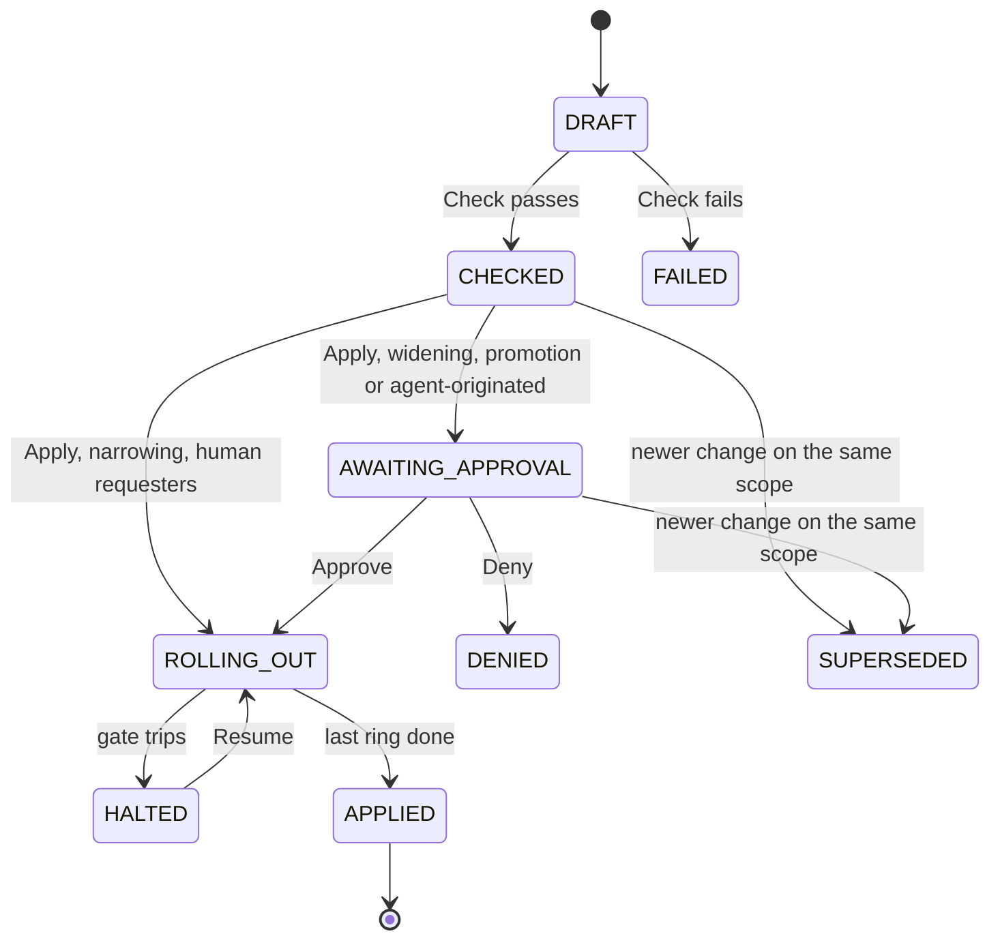

# 23. API, policy as code and the MCP server

_Status: draft 4 for implementation, against spine version 4, the rulings in `_review/01-document-rulings.md` (R-23 applied) the owner answers in `_review/02-owner-answers.md` and the owner's kit instructions in `_review/04-owner-kit-instructions.md`. Date: 2026-11-11. Owning squad: server (API, MCP server, SDKs, Terraform provider); the core engine squad co-owns `grdr policy` and the change checks. Specifies D-38, the policy-as-code part of D-11, the API side of D-55 (21 owns the roles and invariants) and the operator API of D-70. Read with: `00-decisions.md`; 03 (topology, `grdr.local`, versioning table); 04 (messages, `audit.*` classes, data classes); 07 (verdict interface); 12 (packs, layers, compiler, grants, replay, AuthZEN mapping); 15 (agent instance, credential, lease and outward receipt resources); 17 (MCP broker); 18 (approval flow and grades); 20 (Jobs port, lake, hunting engine); 21 (tenant context, delegations, keys); 22 (rings, gates, fleet service); 25 (export destinations); 27 (console screens); 34 (documentation site)._

## Summary

This document fixes the public control-plane contract of Guardrails ADR: how people, scripts, CI, Terraform and AI agents read state and change policy, and how every such call is authorised, limited and audited. Everything here requires the server, except the local `grdr` commands and the pack repository layout, which work in standalone against the daemon.

Key choices:

1. **The contract is the protobuf package set `grdr.api.<area>.v1alpha1`**, renamed `v1` when the contract is declared stable (section 4), served from one Tower stack as Connect, gRPC and gRPC-Web. Connect's POST-JSON is the REST surface; there is no second HTTP mapping. OpenAPI 3.1, SDKs, the Terraform provider, the MCP tool schemas and the reference docs are generated from it.
2. **Google AIP mechanics without exceptions**: resource names, standard methods, `google.longrunning.Operation`, opaque bound page tokens, AIP-160 filters over declared fields, `etag`, `request_id` mirrored by `Idempotency-Key`, `validate_only`.
3. **Every token is bound to one organisation** (provider tokens to one provider). Federation first, then private-key JWT, then expiring prefixed API keys. Effective permission is role ∩ token scope.
4. **Console authorisation is Cedar in namespace `Grdr::Console`**, a separate schema and policy store from the runtime `Grdr` namespace. Roles, permissions and the D-55 invariants are 21 section 7's; this document builds the requests (section 6).
5. **Policy as code has one write path, the `PolicyChange`**: git, Terraform, console and MCP all create one; it is checked, diffed semantically, replayed, approved where widening and applied as a staged rollout. A source lock (the GitOps lock) makes one source authoritative per scope, with an audited two-person "edit anyway".
6. **Approvals and widening need proof of a person on the server**: a WebAuthn assertion over the change digest. No token alone, CLI included, can approve.
7. **Our MCP server is stateless (MCP 2026-07-28), read-only by default, and never serves policy text, detection logic or grant state to any caller.** Writes are proposals of structured operations; the server renders the diff from them. Agent-, tool- and model-written fields arrive in a typed untrusted envelope.
8. **Webhooks follow Standard Webhooks 1.0.0 with Ed25519**, fed by the same delivery path as the cursor change feed.
9. **Every mutating call writes `audit.admin`; every content read, re-identification, session view and export writes `audit.access`**; both sit on the organisation's checkpoint chain (D-39).
10. **The operator plane has its own API**, `grdr.operator.v1alpha1`, served only by the `operator` target and never part of `grdr.api` (section 15, D-70).

## Requirements

| # | Requirement | Source |
|---|---|---|
| R1 | One protobuf contract served as Connect, gRPC and gRPC-Web; generated OpenAPI, SDKs and Terraform provider; AIP mechanics | D-38; g07 |
| R2 | OIDC and SAML sign-on, SCIM, workload identity federation before static tokens | D-38; g07 |
| R3 | Every API method checked by Cedar against 21's roles and D-55 invariants | D-55; l02 F9; 21 section 7 |
| R4 | Policy layers with default and locked settings; semantic diff with timeout as widening; narrowing staged, widening approved; GitOps lock; replay before leaving Watch | D-11; l05 F4 |
| R5 | Widening from any surface, the MCP server included, is a proposal; mutating calls from inside an agent session are refused | D-31; SR-04 |
| R6 | MCP server: stateless, read-only default, organisation-bound tokens, metadata without a content grant, no code execution, no response actions, server-rendered proposals, governed sessions cannot read policy, detection content or exception state | D-38; c5 F8; SR-47 |
| R7 | Attacker-controlled text is rendered inert wherever it leaves the API | SR-36; ADV-11; g07 weak points |
| R8 | Cross-organisation access impossible without a tenant context; operator access needs a tenant-visible grant | D-35; SR-42, SR-43 |
| R9 | Signed webhooks and an at-least-once change feed with stable ids | D-54; g07; 26 |
| R10 | Rate limits per token and organisation; verdicts, findings and audit never dropped at quota | D-68; SR-44 |
| R11 | Every API use auditable, joinable by request id; the monitored developer sees who looked | D-39; D-51; P8 |
| R12 | Portability: policy exportable as git, organisation export through the API | D-67 |
| R13 | Provider technicians reach organisations only through delegations, with per-organisation tokens | D-35; l05 F2 |
| R14 | Standalone has no remote API (the local console is `grdr console serve`, loopback-only, reading through the daemon's local API; D-42, D-43); the CLI behaves the same locally and against a server | D-48; P12 |
| R15 | Operator administration through a separate API and realm, with configuration as code for runtime settings | D-70; owner instruction 10 |

## Design

### 1. Contract and serving

Sources live in `proto/grdr/api/<area>/v1alpha1/`. Areas: `tenancy`, `access`, `keys`, `usage`, `fleet`, `inventory`, `activity`, `policy`, `detection`, `response`, `integration`, `audit`, `operations`. `BrandingProfile` reuses `grdr.brand.v1alpha1`, the brand-manifest schema of 36 (21 section 16). Resource messages reuse the `grdr.entity`, `grdr.finding` and `grdr.policy` messages of 04 and 12 rather than redefining them; every field keeps its `data_class` option, which drives filtering, redaction and docs. The operator plane's API is a separate package set (section 15).

The `api` target serves all three protocols from one handler set built on `connect-rust` (Apache-2.0, 0.9.1, passes the Connect conformance suite; brief g07, verified). Because it is pre-1.0, a `tonic` binding of the same services runs in CI on the golden vectors until `connect-rust` reaches 1.0 (c5 F9). Methods marked `NO_SIDE_EFFECTS` are also served as Connect GET for caching: every Get and List returns `ETag` (the resource revision; for a list, the digest of filter, order and the collection's high-water mark) and answers `If-None-Match` with 304 from an in-memory revision table per `(organisation, collection)` fed by the bus, without a database read; tenant data is `Cache-Control: private, no-cache`, and content-addressed artefacts (hashed console assets, tile and report packs, OpenAPI and schema documents by release) are `public, max-age=31536000, immutable`. The console uses the same API through the OIDC backend-for-frontend of D-42 (RFC 10017), with a `__Host-` cookie, CSRF header and Fetch-Metadata checks; no token reaches the browser.

**Why no JSON transcoding.** A `google.api.http` mapping would be a second router to secure, test and document. Connect unary calls are plain HTTP POST with JSON (brief g07), so curl, browsers and partners already have a REST-shaped surface.

Lint: `buf lint` (STANDARD plus COMMENTS), Google `api-linter` for AIP rules, `buf breaking` against the last release. A method without `(grdr.api.scope)`, `(grdr.api.audit)` and `(grdr.api.rate_class)` options fails the build, so authorisation, audit and limits cannot be forgotten.

### 2. Resource model

Names follow AIP-122. Every organisation-scoped resource sits under `organisations/{organisation}`; collection ids use the spine's spelling. "Std" means Get, List, Create, Update (field mask), Delete as applicable.

| Resource | Name | Methods | Semantics owner |
|---|---|---|---|
| Provider | `providers/{p}` | Get, List, Update | 21 |
| Organisation set | `providers/{p}/organisationSets/{s}` | Std | 21 |
| Organisation | `organisations/{o}` | Get, List, Create (provider; the operator creates through section 15), Update; `Suspend`, `Export` (LRO, D-67), `Delete` (LRO, crypto-shred) | 21 |
| Delegation | `organisations/{o}/delegations/{d}` | Create, Get, List; `Approve`, `Revoke`, `Extend` | 21 |
| Group | `.../groups/{g}` | Std; `Move` | 21 |
| User (console account) | `.../users/{u}` | Get, List; written by SCIM or sign-on | this |
| Service account, key | `.../serviceAccounts/{sa}`, `.../keys/{k}` | Std; `RotateKey` | this |
| Federated identity | `.../federatedIdentities/{f}` | Std | this |
| Identity provider | `.../identityProviders/{i}` | Std; `Test` | this |
| Role | `roles/{r}` (built-in, read-only), `.../roles/{r}` (custom) | Get, List; Std for custom roles | 21 |
| Role binding, eligibility | `.../roleBindings/{b}` | Std (scope, expiry, standing or eligible) | 21 |
| Elevation request | `.../elevationRequests/{e}` | Create, Get, List; `Approve`, `Deny`, `Cancel` | 21 |
| Support grant | `.../supportGrants/{s}` | Create (operator staff), Get, List; `Approve`, `Revoke` | 21 |
| Content grant | `.../contentGrants/{c}` | Create, Get, List; `Approve`, `Revoke` | 21, 29 |
| Re-identification | `.../reidentifications/{r}` | Create, Get, List; `Approve` | 29, 21 |
| Device | `.../devices/{d}` | Get, List, Update; `Admit`, `Retire` | 22 |
| Enrolment token, deployment key | `.../enrolmentTokens/{t}`, `.../deploymentKeys/{k}` | Create, List, `Revoke`; `Rotate` | 22 |
| Rollout | `.../rollouts/{r}` | Get, List; `Halt`, `Resume`, `Promote` | 22 |
| Agent, agent instance | `.../agents/{a}`, `.../agentInstances/{i}` | Get, List; instance Update (sponsor), `TransferSponsor`, `AcceptSponsor`, `Suspend`, `Retire` (lifecycle of 15 section 3) | 05, 15 |
| Credential | `.../credentials/{c}` (id is the `crd_` pseudonym; never secret bytes) | Get, List; `Adopt` (`grdr cred adopt`) | 15 |
| Lease | `.../leases/{l}` | Get, List; `Revoke` (dispatched as D-30's revoke-leases action; leases live only on the device or a customer-run gateway, so the server holds only `lease_id` and `crd_`) | 15, 18 |
| Outward receipt | `.../outwardReceipts/{r}` | Get, List (filter on `external_id`) | 15 |
| MCP server, skill, plugin | `.../mcpServers/{m}`, `.../skills/{s}`, `.../plugins/{p}` | Get, List | 05 |
| Triage item | `.../triageItems/{t}` | Get, List; `Decide` | 05 |
| Agent declaration | `.../agentDeclarations/{d}` | Std | 05 |
| Session | `.../sessions/{s}` | Get, List; `GetTimeline`, `GetTree`, `ReadContent` (content grant) | 04, 06 |
| Event | `.../events/{e}` | Get; `SearchEvents`; `TailEvents` (server stream) | 04, 20 |
| Hunt | `.../hunts/{h}` | Create (LRO), Get, List, `Cancel` | 20, 13 |
| Pack, pack version | `packs/{p}/versions/{v}` (catalogue), `.../packs/{p}/versions/{v}` | Get, List; versions created only by a policy change | 12 |
| Layer | `.../layers/{l}` (`organisation`, `groups-{g}`; provider layer under `providers/{p}`) | Get; written only by a policy change | 12 |
| Policy change | `.../policyChanges/{c}` | Create, Get, List; `Check`, `Simulate`, `Apply` (LROs), `Approve`, `Deny`, `Cancel` | this |
| Effective policy | `.../groups/{g}/effectivePolicy` | Get; `ExplainRule` | 12 |
| GitOps binding | `.../gitopsBindings/{b}` | Std; `EditAnyway` | this |
| Approval request, grant | `.../approvalRequests/{r}`, `.../grants/{g}` | Get, List; requests `Approve`, `Deny`; grants `Revoke` | 18, 12 |
| Suppression | `.../suppressions/{s}` | Std (expiry required) | 18 |
| Detection override | `.../detectionOverrides/{rule}` | Get, List, Update | 13 |
| Finding, incident | `.../findings/{f}`, `.../incidents/{i}` | Get, List, Update; `AddNote`; incident `Merge`, `Split` | 18 |
| Response action | `.../responseActions/{a}` | Create (proposal), Get, List, `Cancel`, `AttachSignature` | 18 |
| Integration | `.../integrations/{i}` | Std; `Test` | 25 |
| Export destination | `.../exportDestinations/{d}` | Std; `Replay` (LRO) | 25 |
| Webhook endpoint | `.../webhookEndpoints/{w}` | Std; `RotateKey`, `SendTest` | this |
| Change feed | `.../changeFeed` | `Read` (cursor) | this, 04 |
| Signal stream | `.../signalStreams/{s}` | Std; SSF transmitter | 15 |
| Audit event | `.../auditEvents/{e}` | Get, List; `Export` (LRO); `GetCheckpoint` | 04 |
| Usage | `.../usage`, `providers/{p}/usage` | Get; `ListRecords` (cursor); `ExportStatement` (LRO) | 32 |
| Operation | `.../operations/{op}` | Get, List, `Cancel`, `Wait` | this |

Custom methods use one verb per meaning across resources (`Approve` and `Deny` for anything a person decides, `Revoke`, `RotateKey`, `Cancel`), listed in `proto/grdr/api/verbs.txt`; `xtask api verbs` rejects an unlisted verb.

**Console users are not monitored principals.** A `User` is a named sign-in account. Monitored humans appear only as pseudonyms in activity resources (P8). A user's link to their own pseudonym, used for "My activity", lives in the identity vault (21) and is never returned by the API.

The API never creates a pack version, layer or grant directly: the first two come only from an applied policy change, grants only from the approval flow of 18. Response actions above device scope are executed only after `AttachSignature` supplies the approvers' hardware-key signatures over the command (D-30); the API never signs on an approver's behalf.

### 3. Request mechanics

| Concern | Rule |
|---|---|
| Pagination | AIP-158. `page_size` default 50, maximum 1,000. `page_token` is AEAD-sealed by the `api` target and binds principal, organisation, filter, `order_by`, the last row's `(order key, id)`, a high-water mark (the collection's revision for relational reads, the catalogue snapshot id for lake reads) and expiry (72 hours, or the snapshot's remaining retention if shorter); paging is keyset only, never offset, `order_by` accepts only fields declared `(grdr.api.sortable)` with a migration-checked index, and lists return `total_size_estimate` from roll-ups or planner statistics, exact totals being an Operation; authorisation is re-checked on every page. A tampered or expired token is `INVALID_ARGUMENT` with reason `PAGE_TOKEN_INVALID` |
| Filtering | AIP-160 subset: comparisons, `:` has, `AND`, `OR`, `NOT` and `-`, RFC 3339 timestamps, durations. Only fields marked `(grdr.api.filterable)` traverse; content-class fields are never filterable; bare literals are disabled; at most 16 terms. Unknown fields or type mismatches are `INVALID_ARGUMENT` (AIP-160, verified). Hunting (SQL, pipe syntax, Sigma) is the `Hunt` resource, not `filter` |
| Ordering | `order_by` over fields declared `(grdr.api.sortable)` (pagination row) |
| Concurrency | AIP-154 `etag` on every mutable resource; mismatch is `ABORTED`, reason `ETAG_MISMATCH` |
| Idempotency | AIP-155 `request_id` (UUID) on every mutating request, mirrored by the `Idempotency-Key` header (Internet-Draft 08, brief g07). Kept 24 hours per organisation. A missing key is `INVALID_ARGUMENT` `IDEMPOTENCY_KEY_MISSING`; same key and payload returns the first response; same key, different payload is `INVALID_ARGUMENT` `IDEMPOTENCY_KEY_REUSED`; original still running is `ABORTED` `REQUEST_IN_FLIGHT` (the draft's 400, 422 and 409 semantics) |
| Dry run | `validate_only` on every mutation (AIP-163) |
| Confirmation | Every mutating `grdr.api` and `grdr.local` method carries `(grdr.api.confirm)` = `none`, `consequence`, `typed`, `propose` or `quorum`, derived from 12's diff class, 18 and 21; the console's `useAction`, the CLI and the MCP server take their confirmation from it |
| Long-running work | Anything that can exceed 10 seconds returns `google.longrunning.Operation` with declared response and metadata types (AIP-151): policy check, simulate, apply, hunts, exports, organisation delete, destination replay. Operations are step-journalled on the Jobs port (20), survive restarts, and are kept 30 days |
| Errors | Connect code plus `google.rpc.ErrorInfo` with `domain: "grdr.api"`, `reason` the registry's UPPER_SNAKE reason (`ETAG_MISMATCH`), `metadata.code` the registry code (`GRDR-API-0003`, 03 section 10) and a `grdr.common.v1alpha1.ErrorDetail` detail; every contextual value goes in `ErrorInfo.metadata`; a `google.rpc.LocalizedMessage` is rendered from the code's language token in the negotiated locale (`Accept-Language`, else `ui.locale`, else `en`; AIP-193; D-69). `Status.message` is English; resource fields are never localised. Clients branch on `reason`, never on message text |
| Tenant probes | A name outside the token's organisation returns `PERMISSION_DENIED` whether or not it exists (brief g07, AWS guidance) |
| Correlation | Every response carries `grdr-request-id`; the same id is in the audit record and server logs |

### 4. Versioning and deprecation

Packages are `v1alpha1` until the contract is declared stable, then renamed `v1` and changed additively only; until D-60's embed pilot completes they are labelled beta under that additive rule (03 section 7). A breaking change is a new package; the server serves N and N-1 for at least 12 months. A deprecated method or field returns `Deprecation` (RFC 9745) and `Sunset` (RFC 8594) headers with a `Link: rel="deprecation"` to the changelog entry, and its use is counted per client so the operator can see who will break. First-party clients tolerate unknown fields and enum values. The changelog is generated from the `buf breaking` and descriptor diff.

### 5. Authentication

Our authorisation server for console and API callers is a module of the `identity` target; it is separate from D-27's agent token service, which shares the target but not the keys or audiences. It issues JWT access tokens (RFC 9068) with `aud` set to the API origin and a `grdr_org` claim (or `grdr_provider`). Lifetime 15 minutes by default, 60 at most.

| Caller | Method, in order of preference |
|---|---|
| Console user | OIDC or SAML sign-on through the BFF; passkeys (`webauthn-rs`) for local and hosted sign-up accounts, and the external sign-in providers the runtime settings offer; the two sealed recovery passkeys per organisation (21 section 6) |
| CLI user | OAuth device authorisation grant (RFC 8628) against the same sign-on; refresh token in the OS keystore; DPoP-bound (RFC 9449) where the OS keystore holds a non-exportable key |
| CI, cloud workloads, Terraform | Workload identity federation: the caller's OIDC token (an issuer the organisation configures, with keys from its JWKS URL or a file: on premises the Kubernetes service-account issuer or a self-managed GitLab, Forgejo or Jenkins; connected also GitHub Actions, AWS, GCP and Azure) exchanged by RFC 8693 for a token of a service account, matched on issuer, subject pattern and claim rules (Tailscale's model, brief g07) |
| Partner and server-to-server | Client credentials with private-key JWT (RFC 7523) |
| Fallback | API keys: prefix `grdr_sk_` (from the brand manifest, D-66) so secret scanners find them, mandatory expiry (maximum 90 days), owner, last use, scopes. Keys belong to the service account, so they survive their creator leaving (Cloudflare's model) and cannot carry scopes their creator lacks |
| Provider technician | Sign-on at the provider's IdP; a provider token exchanged once per (session, organisation) in the organisation's cell for an organisation token through a live delegation, and reused until 60 s before expiry (l05 F2) |
| MCP client | OAuth authorisation code with PKCE; clients identified by Client ID Metadata Documents, fetched once at allow-listing or imported as a file and pinned by digest, so the server never needs the client's origin; no dynamic registration (deprecated in MCP 2026-07-28); ID-JAG accepted, which requires D-27's ID-JAG work in the token service (spine section 7; brief g07) |

SCIM 2.0 (RFC 7643, 7644) with cursor pagination (RFC 9865) provisions users and groups; IdP groups map to role bindings. Deprovisioning revokes tokens within the propagation target.

**Proof of a person.** `Approve` on a policy change, access request, content grant, re-identification or approval request, and every widening operation in D-31's list, require a WebAuthn assertion with user verification whose challenge is the canonical digest of the thing approved, made within the last five minutes. No token type can satisfy this, so a CLI or an agent holding a user's token can request but never approve (D-31, S-17). Document 18 assigns the resulting approval grade. In hosted and provider deployments a widening approval, a capture-level increase and a content grant also carry the organisation's signature over the artefact (D-31, SR-26; custody in 21).

**Lineage attestation.** On an enrolled device, the daemon attaches to CLI and broker-relayed MCP requests a short-lived statement signed by the device key: whether the calling process is in agent lineage, and its session id. A request attested as agent lineage is evaluated as principal type `AgentSession`, which can only read and propose (D-31).

**Scopes.** Named after resources, not methods (brief g07). Token scopes cap; Cedar roles decide.

| Scope | Covers |
|---|---|
| `inventory:read`, `activity:read`, `findings:read` | Metadata reads |
| `findings:write` | Finding and incident state, notes, suppressions |
| `content:read` | Content reads, still requiring a live content grant |
| `policy:read`, `policy:propose`, `policy:approve` | Packs, layers, changes; approve also needs proof of a person |
| `response:propose` | Response action proposals |
| `fleet:write` | Devices, tokens, keys, rollouts |
| `access:admin` | Users, service accounts, roles, IdPs |
| `integrations:write` | Integrations, destinations, webhooks |
| `audit:read` | Audit events and checkpoints |
| `org:admin`, `provider:admin` | Organisation and provider lifecycle |
| `mcp:read`, `mcp:propose`, `mcp:api-read` | The MCP server's ceilings (section 10) |

### 6. Console authorisation requests

The role catalogue, permission catalogue, custom roles, the `Grdr::Console` schema and the D-55 invariants (eight base `forbid` policies proved with `cedar-policy-symcc`) are 21 section 7's; content grants, support grants (operator access, break-glass) and JIT elevation are 21 sections 8 and 9. This section fixes how the API builds each check.

Each request becomes a Cedar request in namespace `Grdr::Console`: principal `Account`, `ServiceAccount` or `AgentSession` (21 section 7); action named after resource and verb (`policyChange.approve`); resource the target with its organisation and group ancestry; `context.roles` the set of roles the principal holds at that scope, computed by the tenant framework from live role bindings, elevations and delegations (21); `context.token_scopes`; `context.person_proof_age_s`; `context.lineage`. Effective permission is role ∩ token scope. Listing applies a SQL scope predicate derived from the principal's live role bindings at token exchange (the readable groups and resource kinds), with Cedar as the per-item check that still fails closed, because Cedar's permission queries are experimental (brief g07, verified); a row the predicate admitted and Cedar denied is dropped and logged as a defect, and a page examines at most ten times its size before returning a short page with a next token. The schema and policies are trust core under D-63's tenancy entry.

### 7. Policy as code

**Repository layout.** One repository per organisation (or per provider); in standalone, one per device. `grdr policy init` writes it; `grdr policy pull` exports the live state into it (D-67).

| Path | Content |
|---|---|
| `grdr.toml` | Organisation id, server URL (absent in standalone), schema version pin, the scopes this repository owns |
| `layers/organisation.settings.toml`, `layers/groups/<group>.settings.toml`; in standalone `layers/local.settings.toml` and `layers/user.settings.toml` | Layer settings of 12 section 7: packs pinned by digest, modes, lists, loss-of-sensor behaviour, privacy settings, each `default` or `locked`. An enrolled device's `local` and `user` layers are never in the organisation repository; they sit below its locked settings on the device. A provider-layer file that loosens a privacy setting fails the check (D-11) |
| `packs/<pack-id>/` | `pack.toml`, `rules/*.cedar`, `lists/*`, `session-rules.yaml`, `tests/*.yaml`, `messages/<locale>.mf2.toml` (12 section 10, D-69) |
| `detections/overrides.toml` | Declared tunables of D-54 |
| `.grdr/` | Generated: lock file of resolved project pack digests, last applied `effective_hash` |

Grants, suppressions and response automation are not in git: they are expiring operational objects with their own approval paths.

**Checks on pull request.** A first-party GitHub Action and GitLab CI component run `grdr policy check --ci` with workload identity federation and scope `policy:propose`:

1. `fmt --check`, schema validation and lint (12 section 7 steps 1 to 7).
2. Unit tests under the production interpreter.
3. `Check` LRO on the server: compile against the live layers above, structural diff and semantic diff against the live effective policy.
4. `Simulate` LRO: replay over seven days (12 section 11); content-reading rules return device counts.
5. A pull request comment: per changed rule the diff class (equivalent, narrower, wider, incomparable, with a counterexample request for wider), the four replay buckets of 12 section 11, estimated prompts per developer-day (per group of five or more, D-51), and the approvers required.

**Semantic diff.** The `control` target runs `cedar-policy-symcc` with cvc5 1.3.1 (a non-GPL build) per request environment, with grants and labels free, 60 seconds per environment; a timeout or unknown counts as widening (D-11; 12). Cedar's `analyze compare` CLI is the oracle in tests (brief g07 verification). A change is widening if either the structural check of 12 or the analyser says so.

**Approval and staged apply.** On merge the action calls `Apply`. A narrowing change starts its rollout at once; a widening change, a promotion to Ask or Block, or any change whose requesters include an `AgentSession` principal (an MCP or agent-lineage CLI proposal, which could otherwise block a fleet by "narrowing" it) waits in `AWAITING_APPROVAL` until a `policy-approver` outside its requesters approves in the console with proof of a person. Rollout ring units are groups for the organisation layer and organisations for the provider layer, with document 22's rings and named gates; halt is automatic, resume human (D-11, D-37).

Each change binds the commit SHA, the bundle input hash and the requester set. A change superseded while rolling out halts at the current ring and the newer change continues from there.

**The GitOps lock.** A `GitopsBinding` per scope names its source: `git` (repository URL, branch, the federated identity allowed to apply) or `terraform`. While bound, policy writes to that scope from any other source fail with `FAILED_PRECONDITION` `GITOPS_LOCKED`, and the console's Simple and Advanced views are read-only (12 section 12). Removing the binding is a widening operation.

**Emergency override.** `EditAnyway` needs two people (D-55): the editor and a `policy-approver` who is not the editor, a reason, and proof of a person from both. It creates an ordinary policy change, whose approval, if it is widening, is the second person's proof, staged on the shortest ring schedule document 22 allows for policy, and marks the binding `DRIFTED`. `grdr policy pull --drift` writes the override as a patch. The binding returns to `IN_SYNC` when an applied commit yields the same `effective_hash`; after seven days drifted, a policy-violation finding is raised. A commit that reverts the override is just another change, approved if widening. Urgent containment does not need this path: response actions (disable an MCP server by digest, freeze) are not policy and are not locked.

**Hosted pack updates.** A project pack version bump in `.grdr/lock` is classed like any change: an edited rule is widening, so it needs approval in hosted deployments (12 open question on standing subscriptions).

### 8. Events, webhooks and the change feed

Externally visible resource changes go through one transactional outbox in `notify`; the `decision` and `audit` streams are read from the bus and the lake instead (25 section 7). Event types are the resource name plus past-tense verb, generated from the protos: `finding.created`, `finding.updated`, `incident.updated`, `decision.denied` (non-default verdicts, metadata only), `approval.requested`, `policy_change.state_changed`, `rollout.halted`, `device.health_changed`, `inventory.agent_discovered`, `triage.item_created`, `response_action.updated`, `audit.admin`.

**Webhooks** follow Standard Webhooks 1.0.0 (brief g07, verified): headers `webhook-id` (the event id, for de-duplication), `webhook-timestamp`, `webhook-signature`; Ed25519 `v1a` by default, HMAC-SHA256 `v1` on request; during rotation both old and new signatures are sent. Payload `{type, timestamp, data}`, at most 20 KB per event: `data` is the metadata record for immutable streams (`decision`, `audit`) and a thin reference (resource name, revision, organisation) for revisioned resources, which `BatchGet` methods resolve. A destination may opt into `grdr.batch.v1` (up to 500 records or 1 MiB, signed once, `webhook-id` the batch id, each record keeping its dedup key), the default for `decision` and `events`. Delivery follows the `webhook-delivery` retry policy (03 section 10), whose values this section sets: concurrency per destination is adaptive (start 2, plus 1 per clean window, halved on 429, 5xx or timeout, at most 64) and honours `Retry-After`; after five consecutive failures the destination is `failing` and gets one probe at a time under full-jitter backoff (base 1 s, cap 5 minutes), then a drain from its cursor at the adaptive rate, with no per-message retry schedule; once lag exceeds 60 s, revisioned streams send only the highest revision per `record_id` (on by default for chat, ticket and paging destinations, off for SIEM); `410 Gone` disables the endpoint; redirects are not followed; hosted delivery refuses private and link-local addresses. Signing keys live behind the Keys port (21).

**Change feed.** `changeFeed.Read(cursor, types, page_size, wait_ms ≤ 30,000)` returns the same events ordered per `record_id` within P partitions (16 by default, 1 in `embedded`), with a cursor that is the vector of partition offsets and `next_poll_after_ms` in every response, at least once. It is the pull form of D-54's export contract; export destinations (25) and Terraform drift checks consume it.

### 9. SDKs and the Terraform provider

Generated by `buf generate` from the release's descriptors, with generator versions pinned in the repository. Each SDK and the Terraform provider has its own version line and changelog, kept by release-please (owner instruction 3; 24 section 10); the Terraform registry requires the provider to publish from its own `terraform-provider-<name>` repository, created under the same GitHub profile when 23-20 starts:

| SDK | Stack | Notes |
|---|---|---|
| Rust `grdr-api-client` (layer 3) | `connect-rust` client | Used by the CLI |
| TypeScript | protobuf-es with connect-es | Browser and Node |
| Go | connect-go | Used by the Terraform provider |
| Python | gRPC stubs (`grpcio`) | Connect servers serve gRPC; a Connect binding replaces it if spike SP-23-2 finds one mature |
| OpenAPI 3.1 | `protoc-gen-connect-openapi` (Apache-2.0, emits 3.1; checked 2026-11-10) | For partners, generated clients and SOAR templates |

These are API SDKs, distinct from the agent instrumentation SDKs of 07 section 12, which hold the names `grdr` (PyPI) and `@grdr/sdk` (npm). The API SDKs are `grdr-api` (PyPI), `@grdr/api` (npm), `grdr-api-client` (crates.io) and a Go module under the project's organisation, all subject to the brand manifest (D-66).

The Terraform provider is Go on `terraform-plugin-framework`, with hand-written resources over the generated Go SDK, because HashiCorp's OpenAPI code generator is still tech preview (brief g07). Resources: `grdr_group`, `grdr_role_binding`, `grdr_service_account`, `grdr_federated_identity`, `grdr_identity_provider`, `grdr_integration`, `grdr_export_destination`, `grdr_webhook_endpoint`, `grdr_deployment_key`, `grdr_gitops_binding`, and `grdr_policy_source` (a directory in the repository layout of section 7). Data sources: `grdr_effective_policy`, `grdr_devices`, `grdr_roles`. Provider tier: `grdr_organisation`, `grdr_organisation_set`, `grdr_delegation`, `grdr_branding_profile`. `grdr_policy_source` creates a policy change on apply: narrowing returns once the rollout starts; widening fails the apply with a diagnostic naming the pending change, or, when `approval_timeout` is set, waits up to that long for approval; the next apply converges once approved. Terraform never bypasses approval. Runtime settings are `grdr_operator_setting` resources under a separate provider configuration that points at the operator origin and uses the operator API (section 15).

### 10. Our MCP server

The `api` target serves `/mcp` as stateless Streamable HTTP against MCP 2026-07-28 using `rmcp` (3.9.0 implements that revision; brief g07): no sessions, mandatory `server/discover`, protected resource metadata (RFC 9728), audience validation (RFC 8707), no token passthrough, `insufficient_scope` challenges. `grdr mcp serve` offers the same tools over stdio for standalone, reading local history through the daemon with kernel peer identity; MCP authorisation does not apply to stdio.

**Read-only default and authorisation.** The authorisation server issues MCP tokens with `mcp:read` only. `mcp:propose` is issued only for a client id the organisation admin has enabled for proposals, and only to a user whose roles include `policy:propose` or `findings:write`. Each tool call is the corresponding API method under the same `Grdr::Console` check, with principal `AgentSession` acting for the token's user, so effective permission is the user's roles ∩ token scopes ∩ the `mcp:*` ceiling, and `audit.admin` and `audit.access` record the agent and the user apart.

**Tools.** Registered per token scope (Okta's pattern), each with an output schema and `readOnlyHint` where true:

| Tool | Scope | Returns |
|---|---|---|
| `search_findings`, `get_finding`, `get_incident` | `mcp:read` | Metadata, rule id and title, evidence references |
| `list_sessions`, `get_session_timeline`, `get_session_tree` | `mcp:read` | Metadata; content only via `content:read` plus a live grant |
| `search_inventory` | `mcp:read` | Agents, instances, MCP servers, skills, plugins |
| `get_coverage` | `mcp:read` | Assurance records and levels, degraded devices |
| `run_saved_hunt` | `mcp:read` | Results of hunts saved by people, within limits |
| `propose_policy_change`, `propose_suppression`, `propose_triage_decision` | `mcp:propose` | A proposal id and its server-rendered diff |
| `get_proposal` | `mcp:propose` | State of the caller's proposals |
| `call_read_method` | `mcp:api-read` | The response of one API method marked `NO_SIDE_EFFECTS` and `(grdr.api.mcp_exposed)`, under the same output envelope and limits |

No tool returns pack text, rule logic, lists, layer settings, grants or exception state, to any caller; the `policy`, `access` and grant methods never carry `(grdr.api.mcp_exposed)`, and a descriptor test asserts it. Every MCP caller is treated as a possibly governed agent, which is the only enforceable reading of D-38 when the server cannot always tell. A caller attested as a governed session also never sees findings or sessions of its own lineage. No response action, no code execution, no free-form query: `run_saved_hunt` takes only the id of a hunt a person saved, and `call_read_method` takes only a typed request message, never SQL, pipe or Sigma text.

**Proposals.** Input is a list of typed operations referencing ids the caller can already see: `set_rule_mode(rule_id, mode)`, `add_list_entry(list, value)`, `remove_list_entry`, `suppress(finding_id, scope, expiry)`, `decide_triage(item, decision)`. The server builds a policy change (or suppression) from them and renders the diff from the canonical representation; the agent's `justification` is stored as inert text labelled "written by an agent" and never used to render anything. Proposals land in `DRAFT`; the server runs `Check` and `Simulate` itself, and the change then waits in `AWAITING_APPROVAL` for a human approver outside its requesters whatever its diff class (section 7, D-31). A suppression or triage decision proposal waits for a person with `findings:write` in the same way.

**Untrusted data.** Every string written by an agent, tool, model, harness or MCP server (command lines, paths, agent and tool names, tool descriptions, prompts) is returned as `{"untrusted": {"source": "agent|tool|model|harness|mcp", "data_class": "...", "text": "..."}}`, length-capped, control and bidirectional characters escaped. Tool descriptions say these values are data. This is a request-grade control (P1), stated as such in the docs; the boundary is that nothing the client does can produce a write without a human.

**Limits per call** (hosted defaults, targets to be tuned with section 12): 200 rows, a 30-day window, 1 GB of lake scan, 10 seconds; per token 60 calls a minute and 10 proposals an hour. Organisation admins allow-list MCP clients by CIMD client id; none are allowed by default. Our server is a catalogue entry in our own inventory with a pinned tool-manifest hash, so the broker (17) on an analyst's device pins it.

### 11. The `grdr` command line

Grammar is `grdr <noun> <verb>`, declared once in `interface/cli.toml`, which generates the parser, help, completions, man pages and the docs reference. Nouns are the plural API collection names of section 2 or registered areas (`policy`, `mode`, `privacy`, `console`, `response`, `server`, `operator` and the like); verbs come from the registry's closed list (`list`, never `ls`); the registry also lists the few top-level verbs (`init`, `scan`, `protect`, `join`, `leave`, `uninstall`, `status`, `why`, `run`, `doctor`, `egress`, `support-bundle`, `login`, `logout`); there are no aliases, and ARCH-023 fails any other shape. Every command has `--json`, which writes one proto3 JSON message `{"apiVersion":"grdr.cli.v1alpha1","type":"<noun>.<verb>","data":{...},"meta":{"context","profile","agentCaller","daemonVersion"}}` whose `data` reuses the `grdr.api` messages; on failure `data` is absent and `error` is a `grdr.common.v1alpha1.ErrorDetail` (`code` `GRDR-<AREA>-<NNNN>`, `reason`, `class`, `message`, `messageId`, `fix`, `docsUrl`, `requestId`), with append-only codes (the Astryx pattern, brief 30). `--json`, codes and exit codes never depend on the locale. `--context` selects the local daemon or a server. Exit codes, `doctor` included: 0 success or a positive answer; 1 a negative answer (a check or test failed, health other than Protected, a verdict other than ALLOW; `data` says which); 2 usage; 3 proposal created, not applied; 4 refused (agent caller, step-up declined, permission denied); 5 daemon or server unreachable. Human output goes through the terminal kit `term`: language tokens (D-69), presentation-registry words, colour only as a second signal (off under `NO_COLOR`, `--plain` or a non-terminal) and key-value lines within 80 columns. Local calls go to `grdr.local.v1alpha1` (03), which reuses the `grdr.api` resource messages, so output is identical in both shapes.

| Command group | Main verbs | Requires |
|---|---|---|
| `grdr scan`, `protect`, `join`, `leave`, `uninstall` | First-run scan, profile choice, enrolment (D-48) | Daemon; `join` and `leave` require a server |
| `grdr status`, `doctor`, `egress`, `support-bundle --preview` | Health and diagnostics (D-59) | Daemon |
| `grdr run -- <agent>` | Launch into a session container (D-17, D-21) | Launcher |
| `grdr console serve`, `grdr console open` | Local web console on loopback (`open` starts it on demand and opens the browser with a one-time launch token), unprivileged, per logon session, started on demand (D-42, D-43) | Daemon local API |
| `grdr policy` | `init`, `fmt`, `check`, `test`, `replay`, `diff`, `explain`, `apply`, `pull`, `status` | Daemon locally; server for a server context |
| `grdr approvals`, `grdr exceptions` | `list`, `show`, `request`; `approve` hands off to `grdr-approve` locally or opens the console | Daemon; server approvals through the console |
| `grdr sessions`, `findings`, `inventory`, `triage` | `list`, `show`, `tree`, `timeline`, `update`, `decide` | Daemon locally; server for a server context |
| `grdr hunt` | `run --sql`, `--pipe`, `--sigma` | Server hunting engine (20); `--sql` and `--sigma` also run over local SQLite (18 section 8) |
| `grdr audit verify` | Chain verification (D-39) | Local audit chain; server checkpoint chain for a server context |
| `grdr login`, `logout`, `context`, `auth status` | Device flow, contexts; tokens are never printed | Server authorisation server |
| `grdr api call <Service/Method>` | Raw call with `--data @file.json` | Server |
| `grdr mcp serve` | Stdio MCP server | Daemon |
| `grdr server` | `preflight`, `backup`, `restore --verify` (20, 24) | Server |
| `grdr operator` | `config export`, `config apply`, `status` | The `operator` target (section 15) |

From agent lineage (D-31, SR-04), the daemon refuses every mutating command with exit 4, except `grdr policy apply` and `grdr exceptions request`, which create a proposal and exit 3 (12's CLI contract); against a server the same calls carry the lineage attestation and are evaluated as `AgentSession`, so the server enforces the same rule if the CLI is bypassed. There are no CLI plugins: a credential-holding CLI that executes arbitrary binaries from PATH is a token-theft path; extension is through the SDKs.

### 12. Rate limits

Token buckets per token and per organisation, by the method's `rate_class`:

| Class | Per token | Per organisation |
|---|---|---|
| `read` | 20/s | 100/s |
| `write` | 2/s | 10/s |
| `operation` (LRO create) | 10/min | 30/min, hunts at most 2 concurrent |
| `mcp` | 60/min | 600/min |
| `authzen` (tier 0, `decide`) | Per gateway client, set by the operator | Not shared with the rest |

These are hosted defaults (targets, to be tuned against D-56 and D-68), each a `limits.toml` entry; self-hosters set them as runtime settings (D-70). The organisation read limit is the larger of 100/s and 1/s per 100 active endpoints; console traffic through the backend-for-frontend is limited per signed-in session (20/s), not per organisation token. Each method declares `(grdr.api.priority)`: `critical` (approval decisions, step-up confirmation, kill-switch preview and issue, sign-in), `interactive`, `standard` (SDK, MCP, change feed) or `bulk` (exports, Operation creation, Terraform refresh); an adaptive concurrency limiter per `api` replica sheds `bulk`, then `standard`, with `UNAVAILABLE` and a `Retry-After` drawn from one to two times the base, and sheds `critical` only after tier 0 objectives fail. Each replica holds 1/N of every bucket and rebalances every 10 s (20 section 10). Responses carry `RateLimit-Policy` and `RateLimit` (draft-ietf-httpapi-ratelimit-headers-11, May 2026, an Internet-Draft; checked 2026-11-10) and `Retry-After`; exhaustion is `RESOURCE_EXHAUSTED`. Limits throttle callers, never ingest of verdicts, findings or audit (D-68). AuthZEN endpoints (12 section 15) are served by `decide` with private-key JWT or mutual TLS client authentication and their own budget, so console load never slows tier 0 (D-33).

### 13. Audit of API use

| Call | Record (04) | Content |
|---|---|---|
| Every mutating method, sign-in, token issue, failed authentication | `audit.admin` | Actor (user, service account, or agent session acting for a user), client id, token id, operation, widening flag, approval grade, before and after digest, request id, source network prefix |
| Content read, re-identification, session timeline or tree view, export, hunt | `audit.access` | Reader role and pseudonym, what (resource, or query digest and row count), purpose, incident reference, content grant id |
| Provider action in an organisation | Both, in the provider's and the organisation's logs (D-35) | As above with the delegation id |
| Every `grdr.operator` method (section 15) | `audit.admin` with `realm: operator` on the operator chain, plus the organisation's copy when it acts on one (21 section 17) | As the first row, with the operator account |

The method's `(grdr.api.audit)` option decides the class; a test enumerates every method in the descriptor set. Records are on the organisation's checkpoint chain (D-39) and exported as OCSF API Activity (04). Session-scoped reads carry the subject's pseudonym, so the monitored developer's "who looked" view lists them (D-51).

### 14. Documentation generation

From the release descriptors: API reference per service with each field's data class and filterability, the operator API's included; the OpenAPI document; the scope and role catalogue with the invariants; the error reason registry; the webhook event catalogue with JSON Schemas; the MCP tool reference from the tool definitions; CLI reference from the argument parser; Terraform docs via `tfplugindocs`; changelog from the descriptor diff. `verify` regenerates them and fails on drift. Publishing belongs to 34.

### 15. The operator API (D-70)

The operator plane has its own contract, `grdr.operator.v1alpha1` in `proto/grdr/operator/v1alpha1/`, separate from `grdr.api`: no `grdr.api` service is served on the operator listener, no `grdr.operator` service on the `api` target, and neither accepts the other's tokens (21 section 17). It uses this document's mechanics unchanged (sections 1, 3 and 4: Connect, gRPC and gRPC-Web, AIP names and methods, Operations, bound page tokens, `etag`, `request_id`, `validate_only`, the error model, versioning), requires `(grdr.api.scope)`, `(grdr.api.audit)` and `(grdr.api.rate_class)` on every method as section 1 does, and is authorised by the operator realm's `Grdr::Operator` namespace instead of `Grdr::Console`.

| Resource | Name | Methods |
|---|---|---|
| Settings revision | `settings/revisions/{r}` | Get, List; `Diff`, `Validate`, `Apply` (LRO: staged per target, health-checked, rolled back when a target fails), `Rollback` |
| Source lock | `settings/sourceLocks/{key}` | Std |
| Target and port health | `targets/{t}`, `targets/{t}/healthHistory` | Get, List |
| Support bundle | `supportBundles/{b}` | Create (LRO), Get, List |
| Bundle and upgrade | `bundles/{b}`, `upgrades/{u}` | `Import` (LRO, with acceptance of the bundle's terms, 24 section 7), Get, List; `Preflight`, `Apply` (LRO), `Halt` |
| Migration | `migrations/{m}` | Get, List |
| Organisation lifecycle | `organisations/{o}` | Create, Get, List; `Suspend`, `Resume`, `Move` (LRO), `SetProviderTier`, `SetQuota` |
| Key operation | `keyOperations/{k}` | Create (LRO: root-key or KEK rotation), Get, List |
| Backup and restore drill | `backups/{b}`, `restoreDrills/{d}` | Create (LRO), Get, List |
| Operator account, role binding, IdP | `accounts/{a}`, `roleBindings/{b}`, `identityProviders/{i}` | Std |
| Operator audit event | `auditEvents/{e}` | Get, List; `Export` (LRO); `GetCheckpoint` |

Organisations appear here as lifecycle records only. No method reads or returns tenant content, and the descriptor test of section 10 also asserts that no `grdr.operator` message carries a content-class field. Applying a revision that widens a `security`-class setting needs passkey step-up within the last five minutes, checked like section 5's proof of a person.

**Configuration as code.** `grdr operator config export` writes the current revision as TOML validated against `grdr.config`; `grdr operator config apply` submits a revision through `Validate` and `Apply`; Terraform's `grdr_operator_setting` resources call the same methods (section 9). A source lock makes git or Terraform authoritative for chosen keys, which the operator plane then shows read-only, as the GitOps lock does for policy (section 7). Unauthenticated `/livez` and `/readyz` stay on the management port and return status only (20).

## Interfaces and contracts

| Interface | Shape | Other side |
|---|---|---|
| `grdr.api.*.v1alpha1` services | Section 2, served as Connect, gRPC, gRPC-Web | Console (27), CLI, SDKs, Terraform, partners (26) |
| `grdr.local.v1alpha1` | Same resource messages over a socket or pipe | Daemon (03), local console (`grdr console serve`), desktop (28) |
| `grdr.operator.v1alpha1` | Section 15, served by the `operator` target only | Operator console (27), `grdr operator`, Terraform, 20, 21 section 17 |
| Policy change | `Check` and `Simulate` call 12's `compile` and replay; `Apply` opens a 22 rollout | 12, 22 |
| Tenant context, keys; approvals | Set-valued context and signing keys; `ApprovalRequest`, `Grant`, WebAuthn proof and grade | 21; 18 |
| Change feed, AuthZEN, MCP | Section 8; `/access/v1/evaluation(s)` on `decide`; `/mcp` | 25, 04; 12, D-40; 17 |
| Lineage attestation | Device-key-signed statement on local and relayed calls | 03, 17 |

## Behaviour by deployment shape

| Shape | Difference |
|---|---|
| Standalone | No remote API and no operator API. CLI and local console use `grdr.local`; `grdr policy` works on a local repository with structural diff unless cvc5 is installed; `grdr mcp serve` stdio only; approvals through `grdr-approve`, or D-31's disclosed time lock for the user's own local policy in the user profile |
| Platform, self-hosted | Full API in `embedded` or `ha`, and in `distributed` above the `ha` ceiling (D-33, D-58); operator sets rate limits as runtime settings through the operator API on its own listener; operator and organisation usually share a key; webhooks may reach private addresses if the operator allows |
| Platform, hosted | Requires the `distributed` profile and its load test, and revenue, sponsorship or donated cloud credits for infrastructure (spine section 7; self-hosting is the default way to run the platform); `distributed` profile; widening needs the organisation's signature; operator access only through tenant-visible support grants (21 section 8); the operator API reachable only from Loonaro's private network; private-address webhooks refused; provider tier included |
| Embedded | The partner uses the API of a platform it runs (L4, L5) or none (L0 to L3). Co-branded deployments take names, token prefix and docs strings from the branding profile; the API surface does not change |

## Extension points

- New integrations, destinations and webhook consumers through 25's manifests, using the public API and change feed.
- Authoring front ends that lower to the repository layout and pass `grdr policy check` (12).
- SDK-based tools, SOAR templates and other MCP servers built on the SDKs; no third-party tools inside our MCP server.
- CI systems beyond GitHub and GitLab: any runner that can present an OIDC token or private-key JWT and call `Check`, `Simulate` and `Apply`.
- Custom roles from 21's permission catalogue (21 section 7).
- New API resources only by RFC (D-61).

## Security and privacy

Threats and where this document answers them: injection through our own data (ADV-11, SR-36) in sections 10 and 13; the policy evasion oracle (SR-47) in section 10 and 12's AuthZEN rules; token theft in section 5, where approval needs WebAuthn whatever token is held; cross-tenant reads (ADV-8, SR-42) through 21's tenant context plus bound page tokens and foreign-name denial; operator and provider insiders (ADV-10, SR-43) through 21's invariants 3 and 5, organisation signatures, dual audit and the operator API's separate realm with no content method (section 15); SSRF through webhooks in section 8. Content-class fields are never filterable, never in webhooks and never in MCP output without a content grant, and every content read is visible to its subject.

## Test and evaluation strategy

| Property | Oracle | Method |
|---|---|---|
| Protocol conformance | Connect conformance suite | Run against the `api` target; tonic binding against the same golden vectors |
| Tenant isolation | Expected `PERMISSION_DENIED` | Generated probes: every method with every foreign resource name, page token and filter |
| D-55 invariants | 21's test (symbolic proofs and scenarios) | Every API method in the descriptor set maps to one `Grdr::Console` action, so the proofs cover the whole API |
| No approval without a person | S-17 harness | Same-user agent with the user's tokens attempts every approve and widening method; pass is zero successes |
| Semantic diff | Cedar `analyze compare`; 12's `grdr-policy-ref` for structural diff | Differential over a corpus of layered changes |
| GitOps lock | State machine model | Model-based test of binding, drift, edit anyway and reconcile |
| Idempotency and etags | Recorded first response | Replay with same and changed payloads, concurrent writers |
| Webhook signatures | Standard Webhooks reference libraries | Third-party verification of every delivered event, rotation included |
| MCP injection | Deterministic rendering check | Seeded attacker strings in agent names, commands and tool descriptions; pass is zero seeded bytes in any rendered diff or approval screen, and zero writes without approval, across an LLM-client harness run at 1, 10 and 100 attempts (D-45), driven by a Claude model through the owner's subscription within its usage limits |
| Audit completeness | Descriptor enumeration | Every mutating method yields exactly one `audit.admin`; every content method one `audit.access` |
| Terraform | Embedded server | Acceptance tests; widening apply fails until approved |
| Realm separation | Expected `UNAUTHENTICATED` | Every `grdr.api` method with operator-realm tokens and every `grdr.operator` method with console, API and MCP tokens; the descriptor test finds no content-class field in `grdr.operator` |
| Air gap | The air-gap conformance run of 24-28 (S-31), steps 4 and 5 | An allow-listed CIMD client imported by file authenticates with zero outbound fetches; a `jwks-file` issuer enrols a CI job |
| Docs | Generator | Drift fails `verify` |

## Work breakdown

**E1 Contract and serving**
- 23-1 `proto/grdr/api` skeleton with the method options and lint configuration. Accept: `buf lint`, `api-linter` and `buf breaking` run in `verify`; a method missing an option fails the build.
- 23-2 `api` target on one Tower stack with tonic CI binding. Requires 23-1. Accept: Connect conformance suite green; golden vectors identical across bindings.
- 23-3 Request mechanics library (section 3). Accept: property tests for page tokens (tamper, expiry, re-check), filter parser against AIP-160 examples, idempotency and etag semantics; a method marked deprecated returns `Deprecation`, `Sunset` and the `Link` header and its use appears in the per-client count.
- 23-4 Operations on the Jobs port. Accept: an LRO survives a server kill and completes; `Cancel` stops it.

**E2 Identity and authorisation**
- 23-5 Authorisation server: BFF sign-on, passkeys, device flow, federation, private-key JWT, API keys. Accept: each caller row of section 5 obtains a token; keys without expiry are rejected; a token for one organisation fails on another.
- 23-6 SCIM with RFC 9865 cursors. Accept: deprovisioning revokes tokens within 60 seconds.
- 23-7 Cedar request construction of section 6 over 21's `Grdr::Console` schema and base set (21 A4). Accept: the descriptor test finds no method without a console action; 21's invariant checks pass through the API; activating `responder` and a policy role in one session is refused; a re-identification with one approver is refused.
- 23-8 Proof of a person and lineage attestation. Accept: S-17 harness zero; an attested agent-lineage call is evaluated as `AgentSession`.
- 23-9 API resources for 21's support grants, elevation requests and break-glass (21 A6, A7). Accept: the organisation sees each request; break-glass with one person fails.

**E3 Resources**
- 23-10 Section 2 resources other than those of 23-11, each with filters, audit and rate class. Accept: generated probe suite and audit enumeration green.
- 23-11 Provider, organisation set and delegation resources with per-organisation token exchange. Requires 23-5 and 21's tenancy model. Accept: a technician's action appears in both audit logs; an expired delegation denies.

**E4 Policy as code**
- 23-12 Repository layout, `grdr policy init` and `pull` locally. Accept: `pull` then `apply` of an unchanged repository yields the same `effective_hash`.
- 23-13 `PolicyChange` state machine with `Check`, `Simulate`, `Apply`. Requires 23-4 and 23-14. Accept: a widening change cannot reach `ROLLING_OUT` without an approver outside its requesters; a superseded change halts.
- 23-14 Semantic diff service. Accept: agrees with `analyze compare` on the corpus; a timeout is reported as widening.
- 23-15 GitHub Action and GitLab component (with 23-16, delivers 12 E4.6; one implementation, not two). Accept: a pull request receives the diff comment; a failing check, test or replay fails the job; no stored secret is needed.
- 23-16 GitOps binding, lock, edit anyway, drift. Accept: model-based test green; a second-source write returns `GITOPS_LOCKED`; `EditAnyway` with one person, or with the editor as approver, fails.
- 23-17 Provider-layer changes rolled out by organisation. Requires 23-11 and 23-13. Accept: halts at the canary organisation set on an injected gate breach.

**E5 Events, SDKs, Terraform, docs**
- 23-18 Outbox, webhooks, change feed. Accept: reference libraries verify every delivery; a `410` disables the endpoint; a redirect is not followed and a private or link-local target is refused in hosted mode (SSRF suite, SR-48); feed replay from a cursor returns no gaps; a destination capped at 500 requests a second converges under adaptive concurrency within 60 s with zero loss (SP-N1, 25).
- 23-19 Rust, TypeScript, Go and Python SDKs and OpenAPI. Accept: each SDK passes the same scripted scenario against the embedded server.
- 23-20 Terraform provider core and provider-tier resources. Requires 23-19. Accept: acceptance tests; widening apply fails with the pending change named.
- 23-21 Documentation generators. Accept: drift fails `verify`.

**E6 MCP server, CLI, limits**
- 23-22 MCP server, tools, untrusted envelope, proposals, client allow-list. Requires 23-5 and 23-13. Accept: the injection test passes; no tool output contains pack text or grant state (asserted by schema); a token for a client id not enabled for proposals carries `mcp:read` only; a narrowing proposal from an `AgentSession` does not reach `ROLLING_OUT` without a human approval.
- 23-23 `call_read_method` behind `mcp:api-read`; ID-JAG acceptance (requires D-27's ID-JAG work in the token service). Accept: the descriptor test finds no `policy`, `access` or grant method marked `mcp_exposed`; a mutating method is refused; an Okta-issued ID-JAG yields an organisation-bound token.
- 23-24 CLI grammar, JSON envelope, contexts, refusal from agent lineage. Accept: golden JSON for every command; from agent lineage `grdr policy apply` exits 3 with a proposal and every other mutating command exits 4.
- 23-25 Rate limiting with headers and priority shedding. Accept: under a 10x burst from one organisation, another organisation's read p99 stays within 10% of its unloaded baseline (target); verdict, finding and audit ingest drop nothing at quota; every throttled response carries `RateLimit`, `RateLimit-Policy` and `Retry-After`; under overload `bulk` sheds before `standard` and `critical` is not shed while tier 0 meets its objectives.

**E7 Operator API**
- 23-26 `grdr.operator.v1alpha1` services of section 15 on the `operator` target. Requires 23-1, 23-4, 20's `operator` target and 21 O1. Accept: the realm-separation test passes; a revision that fails one target's health check rolls back on every target; a `security` widening without passkey step-up is refused.
- 23-27 `grdr operator config export` and `apply`, `grdr_operator_setting` resources and source locks. Requires 23-26 and 23-20. Accept: export then apply of an unchanged revision is a no-op; a locked key edited in the operator plane is refused.

## Risks, open questions and spikes

| Item | Risk or question | Settled by |
|---|---|---|
| Requester identity in git | CI `actor` is verified; PR and commit authorship are claims, so invariant 1 can be evaded by a colluding pair | Spike SP-23-1: map forge accounts to users through the IdP and test against a scripted collusion; if weak, require approval for every change from a git source with two forge identities |
| Python SDK binding | Connect for Python may not be mature | SP-23-2: pick the binding that passes the Connect conformance client suite |
| SymCC cost on real sets | 60 s per environment may be slow over many environments | Shared with 12 E3.5 |
| Pack updates as widening | Hosted organisations approve every project content release | 12 open question; settled by RFC (D-61) |
| Provider set context | Does the delegation-snapshot join keep provider queues fast? | SP-Q4 (shared with 21): 5,000 organisations and 200,000 endpoints, queue page under 1 s at p95 using the `organisation_id` index |
| MCP client allow-list default | Off by default slows adoption | Measure with design partners |
| Hosted rate limits | Defaults are targets | Load test against D-56; prices and plans in 32 and 36, and no paid plan exists until counsel's opinion (spine section 7) |
| `connect-rust` 0.x | API churn | Pinned; tonic binding in CI |

## Deviations from the spine and objections

Roles, the separation of response and policy duties and custom roles are 21's (21 sections 7 and 9, deviation 2 there): the organisation owner holds identity, role, fleet and integration administration, and response and policy roles may both be eligible for one account but are never active in one session, which lets a two-person team staff them. Resolved in spine v3: D-55 now names the organisation owner role. No objection remains here.

## Sources

Research briefs: `g07-control-plane-api-access.md` (Connect, AIPs, Idempotency-Key, Standard Webhooks, SSF, Tailscale GitOps, MCP 2026-07-28, falcon-mcp and Okta MCP, Cedar console patterns; verification rows 1 to 10), `20-policy-languages.md` (Cedar 4.14.1, SymCC 0.8.1, cvc5 licence, AuthZEN), `24-platform-architecture.md` (API and MCP on the authorisation path, tenancy), `26-integrations.md` (webhook and SOAR consumers, Terraform scope), `30-web-stack.md` (BFF, RFC 10017, CLI JSON envelope). Review notes: `c5-transport-schema-audit-api.md` (F8, F9), `l02-enterprise-buyer.md` (F9), `l05-msp-operator.md` (F2, F4), `00-resolution.md`.

Primary URLs: https://connectrpc.com/docs/protocol/ ; https://github.com/connectrpc/connect-rust ; https://google.aip.dev/151 ; https://google.aip.dev/158 ; https://google.aip.dev/160 (read 2026-11-10) ; https://datatracker.ietf.org/doc/draft-ietf-httpapi-idempotency-key-header/ ; https://datatracker.ietf.org/doc/draft-ietf-httpapi-ratelimit-headers/ (revision 11, read 2026-11-10) ; https://www.rfc-editor.org/rfc/rfc9745.html ; https://www.rfc-editor.org/rfc/rfc9865.html ; https://www.rfc-editor.org/info/rfc10017 ; https://github.com/standard-webhooks/standard-webhooks/blob/main/spec/standard-webhooks.md ; https://modelcontextprotocol.io/specification/2026-07-28/changelog ; https://modelcontextprotocol.io/specification/2026-07-28/basic/authorization ; https://modelcontextprotocol.io/extensions/auth/enterprise-managed-authorization.md ; https://github.com/modelcontextprotocol/rust-sdk ; https://github.com/cedar-policy/cedar/tree/main/cedar-policy-symcc ; https://github.com/cedar-policy/cedar-spec/tree/main/cedar-lean-cli ; https://tailscale.com/kb/1306/gitops-acls-github ; https://tailscale.com/kb/1581/workload-identity-federation ; https://github.com/okta/okta-mcp-server ; https://github.com/hashicorp/terraform-plugin-codegen-openapi ; https://github.com/sudorandom/protoc-gen-connect-openapi (read 2026-11-10) ; https://www.rfc-editor.org/rfc/rfc9449.html ; https://www.rfc-editor.org/rfc/rfc8628.html.
