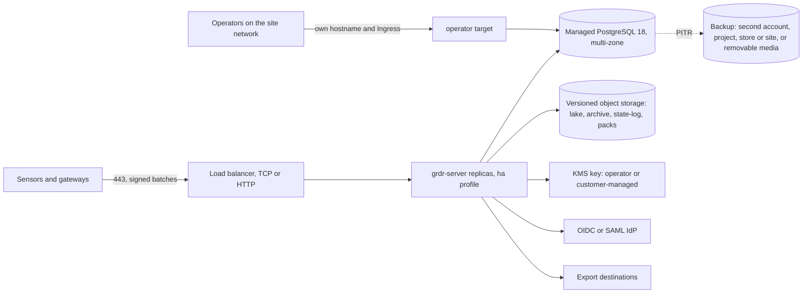
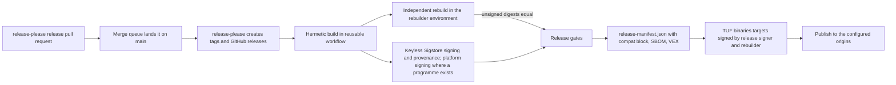

# 24. Deployment models, packaging and release engineering

_Status: draft 1 against spine version 2, revised by a second reader, then revised against spine version 3 and rulings R-30, R-31, R-38, R-43, R-44 and R-45, then revised against spine version 4 and the owner's answers (`_review/02-owner-answers.md`): no milestones or schedule, zero budget, the owner's Claude subscription, Loonaro as the legal entity. Revised again against the owner's instructions of 2026-11-11 (`_review/04-owner-kit-instructions.md`: release-please with decoupled versions, no human gates, the operator plane, compatibility by contract ranges, the upgrade model, the complete air-gap bundle, latest versions at bootstrap, defaults that need no new account, the one-line commit form, the name Guardrails ADR, nothing hard-coded, the repository public from the first push) and principles P14 to P17. Owning squad: Release (pipeline, signing, packages, charts, modules); signing configuration, the release workflow and the updater payload format are trust core under D-63. Specifies D-59, D-58, D-48, the build and signing side of D-37, the packaging side of D-70 and the release-manifest side of D-71. Read with: `00-decisions.md` (authoritative); 03 (build profiles, processes, configuration layers, contract versions, bill of materials); 07 (installing into agent configuration, install journal, `grdr doctor hooks`); 09 (macOS payloads and notarisation); 10 (Linux sensor and probes); 11 (on-device update mechanics); 20 (server targets including `operator`, runtime settings, profiles, backup, migration rules, sizing); 21 (organisation bundle, device move, keys, operator realm); 22 (protocol, trust roots, rings, skew); 23 (operator API); 25 (export destinations); 26 (brand manifest, `dist.toml`); 32 (costs, hosted operations); 34 (support and lifecycle); 35 (security programme); 36 (prices and legal terms)._

## Summary

This document says what we build, how it is signed and proven, how it reaches every place Guardrails ADR runs, and how it is upgraded and moved. It owns artefacts and their release; it does not own on-device update mechanics (11), the update protocol, trust roots and rings (22), or the server internals that the artefacts carry (20).

Key choices:

1. **One product bundle, separately versioned components, one manifest.** Each component has its own SemVer line, tag `<component>-v<version>` and changelog: the public crates of spine section 5, the SDKs, the endpoint programs (one line, because 03 section 7 makes local processes same-release), the server (binary, image, chart), the node sensor, the embedded kit, the Terraform modules, the eBPF object and the Windows driver. The product bundle version (`release/VERSION`, tag `grdr-v<version>`) names the exact component versions and digests tested together in a signed `release-manifest.json`, whose `compat` block states the contract ranges each component provides and requires (D-71). release-please opens the release pull request and, once the merge queue lands it, creates the tags and GitHub releases (section 10). `xtask dist` is the only build entry point; a partner rebuild (D-41 L6) runs the same workflow with its own `dist.toml`.
2. **The OS package is the update payload.** A binary pack (D-37) wraps the platform-signed MSI, pkg, deb, rpm or user archive. Under `managed` authority the MDM or package manager installs that package; under `self` the updater extracts the same platform-signed files into the inactive A/B slot (11 §8) without running the OS installer. Either way the device runs identical, doubly signed files.
3. **Two install profiles from two artefact families.** System packages (per-machine MSI for x64 and ARM64, one notarised universal pkg, deb and rpm in signed repositories) give Protected with the one elevation D-48 allows. Signed user archives with a verifying install script give User without elevation. First run changes nothing in either.
4. **Server: one static binary, one image, one chart.** `grdr-server` ships as a static Linux binary (amd64, arm64), as Windows and macOS binaries for `embedded`, and as one multi-arch image with no base distribution. One Helm chart is written to the strictest marketplace rule set (no hooks, no `lookup`, images by digest in `values.yaml`, secrets by name), works on Helm 3.19+ and Helm 4, and needs no CRDs. The `operator` target (D-70) has its own listener, Service and Ingress. The node sensor has its own chart.
5. **Terraform modules that also run on OpenTofu.** AWS, GCP and Azure, each mapping to managed PostgreSQL, versioned object storage and a KMS key, with workload identity instead of static keys.
6. **Provenance by construction.** SLSA Build L3 provenance through a reusable workflow, keyless cosign bundles with their transparency-log inclusion proofs on every file, CycloneDX SBOM cross-checked against the binary, OpenVEX per release, and attestations stored as OCI referrers (AWS Marketplace rejects attestation layers). Linux artefacts are bit-for-bit reproducible; Windows and macOS artefacts are reproducible before signing.
7. **No person holds a signing key.** Every artefact is signed keylessly with Sigstore cosign through GitHub's OIDC identity, with SLSA provenance and SBOMs. The TUF `binaries` role (22 §6.1) has a threshold of two across two GitHub Actions environments: the release signer, which signs only artefacts with verified SLSA Build L3 provenance, and the independent rebuilder, which signs only digests it reproduced. Platform signing that needs a vendor programme (Authenticode through a free open-source signing programme, Apple's Developer ID and notarisation) is an external precondition: without it the artefact ships with its Sigstore signature and provenance and is marked not platform-signed in the release manifest, and nothing waits for it (D-18, D-59). No agent job can reach a signing credential (D-47, D-63).
8. **Air gap is a first-class artefact (P16).** A signed OCI-layout bundle carries everything every profile needs, verified offline: our artefacts, every third-party image, chart, binary and package of the dependency lock (built by us from source, with complete corresponding source for copyleft components in `sources/` and a generated `THIRD-PARTY-NOTICES`), models, content, a TUF snapshot, the offline docs and the upgrade-path manifest. The operator accepts the bundled terms at import. Delta, content and metadata exports carry change between releases, and every shape runs in isolated mode with no route out. A Zarf package of the same contents requires Zarf 1.x to clear the dependency policy of section 12.
9. **Upgrades are refused, not gambled.** The unit of upgrade is the product bundle; the unit of transfer is the changed component. Minor releases, an LTS line every twelfth minor with 24 months of public fixes, expand-and-contract migrations, a machine-readable upgrade-path manifest, and `grdr server preflight`, which runs the one compatibility resolver before anything is activated (D-58, D-71). The operator plane shows the available bundle, its preflight and its path, and applies it (D-70). Hosted to self-hosted and back uses 21's organisation bundle with stated version rules.
10. **The support and compatibility matrices are generated.** `support.toml` (03) produces the per-release matrix of OS, architecture, kernel, Kubernetes, PostgreSQL, NATS and object store, the release-blocking job list, and the compatibility matrix: for each bundle version the component versions, the contract versions (wire major, Cedar `schema_version`, pack `format_version`, C ABI, driver and eBPF interfaces) and the sensor lines, engine lines and SDK releases tested against it.
11. **Every origin is configuration (P14, P15).** Loonaro's distribution publishes binaries and bundles as GitHub Releases assets and TUF metadata and small targets on GitHub Pages, both behind GitHub's own CDN, with jsDelivr's GitHub mirror as a second origin; none needs a new account. Every published file except the TUF and repository entry points is content-addressed and immutable, so any CDN, cache or mirror can serve it, and each origin is an `updates.sources` entry. Self-hosted devices fetch from their own server's `content`, and an air-gapped site from its own mirror (P16).

## Requirements

| # | Requirement | Trace |
|---|---|---|
| R1 | Per-machine MSI (x64, ARM64), one notarised universal pkg, signed deb and rpm repositories; silent, idempotent, offline-installable, no secret on the command line | D-59; brief 25 implications 5, 6, 12; l04 F10 |
| R2 | First run changes nothing; Protected needs one elevation; User needs none; `grdr join`, `leave`, `uninstall` restore state | D-48; l06, l01 |
| R3 | Standalone sends nothing by default; the only outbound traffic is anonymous, mirrorable update fetches that can be turned off; `grdr egress` lists every destination and CI asserts it | D-48, P8 |
| R4 | MDM delivery per product with a profile generator; we never own a file another owner holds | D-59, D-49; brief 25 §2; l02 F1 |
| R5 | `grdr doctor` and `grdr support-bundle --preview` with on-device redaction | D-59; g10 §7 |
| R6 | Installer refuses multi-session hosts unless per-logon-session policy and listeners are present | D-59; l04 F4; g04 §5 |
| R7 | One server image (amd64, arm64), one Helm chart to the strictest marketplace rules, node sensor chart separate | D-59; brief 25 §3 and verification row 9 |
| R8 | Terraform modules for AWS, GCP and Azure, mapping to managed PostgreSQL and object storage | D-59; brief 25 §3 |
| R9 | Air-gap bundle with a mirrorable update repository | D-59; brief 25 §3; g10 §6 |
| R10 | Minor releases, an LTS every twelfth minor with 24 months of public fixes, expand-and-contract migrations, upgrade-path manifest, `preflight`, published tested dependency versions, no phone-home | D-58; l11 F6, F9 |
| R11 | Every behaviour-changing artefact is one signed pack type; binaries are authorised only by the project root, policy and configuration by the deployment root; rollback is a new signed release | D-37; P7; brief 24 (CrowdStrike RCA) |
| R12 | SLSA Build L3, SBOM and VEX from the first release; reproducible releases | D-46, D-03; brief 34; brief 25 §5 |
| R13 | FIPS variant using a validated module where one holds a certificate for the environment | 03 §8; brief 23 verification 9; brief 25 |
| R14 | No exclusive slots, signed native binaries in default paths, no encoded scripts, zero incumbent alerts on install, run, uninstall | D-23; g05 §1; release gate |
| R15 | Organisation moves between hosted and self-hosted without operator help | D-67; 21 §14 |
| R16 | Signing account loss does not stop releases | Spine §9 risk register; brief 12 (April 2026 Partner Center suspensions) |
| R17 | Embedded builds carry no trust root and make no network call to Loonaro | D-60 |
| R18 | Every shape installs, enrols, updates, detects, responds, upgrades and is supported with no route out; every destination is configuration listed by `grdr egress` or `grdr server egress`; isolated mode dials nothing outside the allow-list | P16; D-58; D-59 |
| R19 | The server's administration, configuration and health run on a separate operator plane with its own listener, origin and realm; boot configuration holds only what is needed before the database is reachable | D-70 |
| R20 | Components version independently; a bundle names the exact versions tested together, and nothing activates a combination outside the declared contract ranges | D-71; D-58 |
| R21 | Every artefact a fleet fetches is content-addressed and immutable behind configured origins; the default origins need no new third-party account | P15; P14 |

## Design

### 1. Deployment model catalogue

| Model | What runs where | Server profile | Requires |
|---|---|---|---|
| Standalone, User | On the device, in the user's session: daemon, engine, uplink (update fetch only), shim, CLI, local console (`grdr console serve`, started on demand; D-42). No elevation | None | Core, daemon, shim |
| Standalone, Protected | Same processes; daemon as root or LocalSystem, engine under a dedicated account, uplink and updater as in 03 §4 | None | Core, daemon, shim; a system package |
| Single-node team | Enrolled sensors; one `grdr-server` process (binary under systemd or Windows service, or Compose) with SQLite and local disk, console served by the server | `embedded` | Server (S-02, S-03) |
| HA enterprise, self-hosted | N≥2 `grdr-server` replicas on Kubernetes or VMs behind a load balancer; PostgreSQL 18; versioned object storage; KMS | `ha` | Server (S-02, S-03) |
| Hosted multi-tenant | Cells of one target per process (20 §11), global `router`, operated by Loonaro through the operator plane of each cell and of the router, reachable only from Loonaro's private network (D-70, 32) | `distributed` | `distributed` profile and its load test (S-24); the hosted service's preconditions (D-63), including infrastructure funded by revenue, sponsorship or donated cloud credits |
| MSP | Hosted provider tier; self-hosted MSPs run `ha` with providers in the organisation tree | `distributed` or `ha` | Provider tier (D-35); the hosted form also needs the hosted service |
| Air-gapped | Any profile from the air-gap bundle alone (section 7), with `network.mode = "isolated"`; the server's `content` or any static file server as the update mirror; documentation served from the bundle; `router` only for more than one cell (20 section 11); no model tiers unless a local model is configured | `embedded`, `ha`, `distributed` (once its load test passes) | Server; air-gap bundle; 24-28 green for the release |
| CI | Ephemeral Linux sensor on the runner, identity from the CI OIDC token, flush on job end (D-19, D-36) | Any | Linux sensor; CI OIDC enrolment (22) |
| Cluster workloads | Node sensor DaemonSet on runc nodes; unprivileged sidecar with hooks and forced gateway egress on gVisor, Kata, Fargate and Autopilot; coverage ledger per workload (D-19; g04 matrix) | Any | Linux sensor; node sensor chart |
| Embedded | L0 content, L1 feed emitter, L2 broker library, L3 fast path plus sidecar, L4 connector, L6 rebuild (D-41) | Partner's | L0, L1: sensor and content. L3, L4: fast path (S-21), host contract and an EDR or MDR design partner. L6: brand manifest and an embedding partner. L2 for third parties: a third-party host vendor, and only if native hook merging proves insufficient (D-41) |

Self-hosting is the default way to run the platform. It is supported as `embedded` and `ha`, and as `distributed` above the `ha` ceiling with a published reference architecture once the `distributed` load test has passed (D-33, D-58, R-38), including several cells behind the installation's own `router` (20 section 11). The chart accepts `profile: distributed` because the hosted service uses the same chart; until that load test passes, the value is documented as unsupported for self-hosters.

### 2. Artefact set per release

Names below use the technical namespace `grdr`, which stays (D-66); every user-visible name comes from the brand manifest. `<v>` is the version of the artefact's own component line; the bundle version and the component map are in the release manifest (section 10). An unchanged component keeps its artefact and digest from one bundle to the next.

| Artefact | Targets | Signature | Channel |
|---|---|---|---|
| `grdr-<v>-windows-<x64\|arm64>.msi` | Windows 11, Server 2022, 2025 | Authenticode on every PE and the MSI through the free open-source signing programme once it accepts Loonaro, otherwise marked not platform-signed; cosign bundle | Binary pack, winget |
| `grdr-<v>-macos-universal.pkg` | macOS 15, 26, 27 | Developer ID Application and Installer, notarised, stapled, which requires Apple's Developer Program; without it the pkg is marked not platform-signed and carries tier 1 only (D-18); cosign bundle in both cases | Binary pack, Homebrew cask |
| `grdr_<v>_<amd64\|arm64>.deb`, `grdr-<v>-1.<x86_64\|aarch64>.rpm` | Section 9 | Repository metadata and rpm signatures (OpenPGP); cosign bundle | apt and dnf repositories, binary pack |
| `grdr-<v>-<triple>-user.<tar.zst\|zip>`; on macOS `grdr-<v>-macos-user.dmg`, notarised and stapled, holding one app bundle with the command-line programs inside, because a tar or zip cannot carry a ticket | All endpoint triples | Per-file platform signatures inside (Authenticode, Developer ID); cosign bundle | User profile, binary pack |
| `grdr-server-<v>-<triple>` | Linux amd64, arm64 (static); Windows x64, arm64 and macOS arm64 for `embedded` | Platform signature where one exists; cosign bundle | Release page, server packages |
| `grdr-keys-pkcs11-<v>-linux-<amd64\|arm64>` | Linux glibc, dynamically linked so vendor PKCS#11 modules load (21) | cosign bundle | Server packages and the air-gap bundle; on Kubernetes the operator builds the helper image from its HSM vendor's base with `deploy/keys-pkcs11/Dockerfile` and sets its digest in `values.yaml` |
| `grdr-server` image | `linux/amd64`, `linux/arm64` index | cosign keyless; SLSA provenance and SBOM as OCI referrers | ghcr.io; further registries are `dist.toml` entries, same digests |
| `grdr-node-sensor` image | `linux/amd64`, `linux/arm64` index; the Linux sensor programs, also usable as the unprivileged sidecar | Same as the server image | Same registries |
| Helm charts `grdr-server`, `grdr-node-sensor` | OCI artefacts | cosign | Same registries |
| Terraform modules | AWS, GCP, Azure | Tag created by release-please (section 10); cosign bundle on the archive | Public registries for both tools |
| `grdr-airgap-<v>.tar` and its companions `-server` and `-verify`, per-platform subsets and deltas | Section 7 | `airgap-manifest.json`, a `binaries` target | Release page, in parts of at most 2 GiB |
| Embedded kit (L0 and L1; L3 requires the fast path, S-21) | `grdr-ffi` static and shared libs per triple plus header, `grdr-wasm` component, sidecar engine image | cosign; no trust root inside (D-60) | Release page |
| eBPF objects | Per kernel ABI set | Digest in the release manifest; kernel-signed loader where supported (10) | Inside Linux packages |

System packages are split so that optional components never ride along by default: deb and rpm `grdr` (core), `grdr-desktop` (Rune app), `grdr-server`; MSI features `Core`, `Proxy`, `Tray`, `Desktop`; pkg choices for the same plus the macOS extensions (09). The targeted build of D-23 (discovery and enforcement beside any EDR) is component selection plus configuration, not a separate artefact. The deb and rpm `grdr` packages declare `bubblewrap` and `socat` as weak dependencies (deb `Recommends`, rpm `Recommends`), because Claude Code's Linux sandbox uses both and Codex's uses bubblewrap (brief 14); where they are absent or blocked, Claude Code falls back to our own launcher through the hook rewrite (10 section 7, D-21).

**Package managers and registries we publish to.** First-party, each fed from the release manifest by digest: apt and dnf repositories (zypper reads the rpm repository); Homebrew cask; winget; ghcr.io for images and OCI charts; the Terraform and OpenTofu registries; crates.io for the public crates of spine section 5 (layers 0 to 2, `grdr-ffi`, `grdr-wasm`) from their first stable release; npm (through `pnpm publish` with provenance) and PyPI for the TypeScript and Python SDKs. All of these are free for an open-source project. Those that need an account in Loonaro's name beyond GitHub (Docker Hub as a second image registry, crates.io, npm, PyPI, the Terraform registry) are publication targets in `dist.toml` that start once the account exists; nothing in development, testing or release waits for them.

apt and dnf indexes are content-addressed (`Acquire-By-Hash: yes` in the apt `Release` file; unique metadata file names under `repomd.xml` for dnf), so only `InRelease` and `repomd.xml` are mutable and every index and package is immutable and cacheable. Indexes are small and live on GitHub Pages; package files are GitHub Releases assets, never files of the Pages site, whose 1 GB limit one release would exhaust. S-26 settles how each index reaches the assets with no account-gated CDN in front (for example dnf's `xml:base` location, or an apt layout whose files are all release assets) and confirms that apt and dnf follow GitHub's redirect to the asset host; a mirror is listed in configuration.

Every package-manager artefact also works from a site's own repository. The apt and dnf trees are published and bundled as complete signed repositories whose Release files carry no `Valid-Until`, because freshness is TUF's job, so a copied repository never expires. A site may serve them unchanged, or merge and re-sign them in its own repository manager (Pulp, Satellite, Artifactory, Nexus, aptly), since `managed` authority checks installed files against project targets either way (22 section 6.6). winget and Homebrew are internet channels: in an air gap the MSI goes through Configuration Manager, Group Policy or the site's RMM, and the pkg through its Mac management. Every artefact URL that `grdr mdm render` writes (winget manifest, cask, repository files, browser policy) comes from `--base-url`, never from a compiled host.

Marketplace registries (AWS ECR, Google Artifact Registry, Azure Container Registry) receive copies only for a listing (section 8). Chocolatey, Scoop, Nix and Arch are community manifests (Extension points). We do not publish the endpoint through npm, PyPI or `cargo install`, because those routes cannot carry the platform signatures or the privileged service.

### 3. Install profiles and the standalone contract (D-48)

**What each artefact family installs.**

| | System package (Protected-capable) | User archive (User only) |
|---|---|---|
| Elevation | The package install is the one elevation | None |
| Binaries | Windows `%ProgramFiles%\<brand>\`; macOS `/Applications/<brand>.app` plus `/Library/Application Support/grdr/`; Linux `/usr/bin/grdr`, `/usr/libexec/grdr/`. Under `self` authority the programs live in A/B slots below these (11 §7) | `%LOCALAPPDATA%\grdr\`, `~/Library/Application Support/grdr/`, `~/.local/share/grdr/` with `grdr` linked into the user's bin directory |
| Services | The OS starts only `grdr-daemon` (LocalSystem service, LaunchDaemon, systemd system unit with socket units for its listeners), which spawns the rest (11 §1). The package creates their accounts: `grdr-engine` and `grdr-uplink` system users on Linux, `_grdr-engine` and `_grdr-uplink` role accounts on macOS; on Windows, demand-start services under `NT SERVICE\grdr-engine`, `NT SERVICE\grdr-uplink` and `NT SERVICE\grdr-proxy` virtual accounts that the daemon starts (08, R-30) | Windows logon-triggered Scheduled Task for the current user, with the engine as an AppContainer child of the user-profile daemon (R-30); launchd LaunchAgent; `systemd --user` unit |
| State | `C:\ProgramData\grdr\`, `/Library/Application Support/grdr/state/`, `/var/lib/grdr/`, owned by the service account, not user-writable | Under the user's data directory |
| Tamper grade reported | `admin` (D-22) | `user` |

These paths, account names and the `<brand>` directory are values of the per-OS path table in configuration and of the brand manifest, which the packages render at build time; no program compiles them in.

**First run.** Both families start the daemon in `scan-only` state: a read-only, unelevated scan of agents, MCP configuration and existing transcripts (D-24 passes 1 and 4 over local declared sources; pass 2 waits for `llm-client` classification, R-31), shown in the CLI and the local console. Nothing is written outside our own state directory: no agent configuration, no hook, no proxy setting. The install journal (07) opens empty. The user then chooses.

- **Protected** from a system package: the service is already privileged, so choosing Protected writes managed hooks and settings through 07's owner-aware installer with no further prompt.
- **Protected** from a user archive: `grdr protect` fetches the matching system package from the update repository (or takes `--from <bundle or mirror directory>` offline, which supplies the binary pack with its DSSE envelope and TUF metadata; a bare package file cannot be verified under the project root), verifies it under the project root, and starts the OS installer, which raises the single elevation prompt. User-scope state migrates into the system state directory; user-scope hook entries are removed through the journal.
- **User** from a system package: the system services stop and are set to manual; the user services take over. Every control is reported as a request.

**Managed installs** skip the choice: an MDM-delivered `install.toml` (section 4) sets `profile = "protected"` and `first_run = "protect"`, and may set an enrolment file. Devices enrolled with a deployment key start in Watch until admitted (D-36).

Installer screens (MSI dialogs, pkg panes, the archive script's output) are surfaces like any other: their words, states and confirmations come from the interface system and its language tokens, and the locale data they need is baked into the package, so no installer fetches anything to render (P17, D-69).

**Silent install switches.** No secret is ever an argument; the installer reads files.

| Setting | MSI property | pkg | deb, rpm | Archive script |
|---|---|---|---|---|
| Install file | `GRDR_INSTALL_FILE=<path>` | `/Library/Managed Preferences` payload or file at a fixed path | `/etc/grdr/install.toml` placed before install | `--install-file` |
| Components | `ADDLOCAL=Core,Proxy` | `installer -applyChoiceChangesXML` | Separate packages | n/a |
| Update authority | `GRDR_UPDATE_AUTHORITY=self\|managed\|image`; default `self`; the Intune and Configuration Manager artefacts of section 4 set `managed` | Key in `install.toml`; default `self`; MDM artefacts of section 4 set `managed` | Key in `install.toml`; default `managed` (22 §6.6) | Always `self` |

The installer moves an enrolment file into the protected configuration directory with an ACL for the uplink account only, the uplink exchanges it for a device credential (22), and the file is then deleted. MSI logging never contains file contents. Re-running any package with the same version is a no-op; a different version is an upgrade (section 10).

**Egress contract, every shape.** Every outbound connection a product process makes goes through the `Dialer` in `grdr-wire` (layer 2). The `Dialer` takes a typed purpose (`update`, `uplink`, `idp`, `relational`, `object-store`, `keys`, `bus`, `notify`, `export-sink`, `judge`, `mirror-upstream`, `alarm-path`, `witness`, `telemetry`), refuses any destination outside the effective egress list, and raises `egress-unlisted` naming the purpose and configuration key. `xtask archlint` fails any socket or HTTP client built outside it. Agent traffic relayed by `grdr-proxy` and `gateway` is governed by policy, not product egress (17 section 8).

Every destination is a configuration value, and no host, port or address is compiled into a program (P14). `dist.toml`'s `endpoints` (26), whose hosts are values of the distribution's brand manifest (`brand/brand.toml` for Loonaro's own), are written into the default configuration that packages install; a self-hosted deployment sets its own. `grdr egress` (devices) and `grdr server egress` (server, gateway, node sensor) print `{destination, port, purpose, config_key, component}` from effective configuration, and the chart renders its NetworkPolicy from the same list.

Standalone opens no connection except fetches to `updates.sources`, which carry no identifier beyond what HTTP requires (no device id, no organisation id, no cookie); `updates.enabled = false` stops even those. An enrolled device dials only the server origin it enrolled to and the sources in the server's signed configuration.

`network.mode = "isolated"` with `network.allow` (CIDR ranges and DNS suffixes) is the air-gap setting for every shape. The air-gap templates of `grdr mdm render --site offline` and the chart's air-gap values set it. In isolated mode:
- every default destination is dropped;
- a configured destination outside the allow-list stops the start with `GRDR-CFG-0020` and fails `preflight`;
- each resolved address is checked against the list at connect time, re-resolved per connection;
- no name outside the allowed suffixes is resolved.

The CI oracles of the Test section capture every socket in harness runs of each shape and fail if any destination is absent from the printed list.

**Join, leave, uninstall.** `grdr join <server> [--enrol-file]` shows capture level, readers and locked rules before it proceeds (D-48); the local organisation id becomes an alias and back-fill is opt-in. `grdr leave` returns to standalone and keeps local history. `grdr uninstall` restores every journalled file byte for byte, removes services, profiles we installed and our state, and then removes the package through the OS installer. On an enrolled Protected device, removal is a widening operation (D-31): the package's uninstall path requires an uninstall authorisation file signed for that device (issued by the console at the class's minimum approval grade) or an MDM context, and emits a signed `going-down: uninstall` state first. An administrator can still force removal; the server then raises a tamper finding from the final state and the heartbeat gap (D-22: detect against administrators).

**Multi-session hosts.** The installer detects Windows multi-session editions and hosts with the Remote Desktop Session Host role, and Linux or macOS hosts where the read-only scan sees more than one human UID with an interactive session or `host.kind = "shared"` is set. It refuses Protected and User installs there with the reason and the tracking issue. Non-persistent VDI is supported: `grdr image prepare` strips device identity from a golden image, enrolment runs at boot after the final hostname, and divergent chains under one device id are a clone finding (D-36). Multi-session hosts are supported once per-logon-session policy, broker, proxy and console bound to the user SID are present, and the installer then stops refusing them. Requires: a design partner with a VDI estate to test against.

### 4. MDM and fleet delivery

`grdr mdm render --product 
 --format <f> [--org-config <file>]` emits ready-to-import artefacts from code-defined templates. Output is schema-validated in CI against each vendor's published schema (apple/device-management for profiles). 24 packages them; the payload content is owned by the documents named.

| Product | Windows | macOS | Linux | Content owner |
|---|---|---|---|---|
| Guardrails install and update | Intune Win32 (`.intunewin` with detection rule on product code and version), Configuration Manager application, GPO software install, winget manifest | pkg plus macOS 26+ declarative `package` configuration; Jamf, Kandji (Iru), Mosyle, Workspace ONE, Fleet import formats | apt and dnf repository files with the signing key; Ansible role and cloud-init snippet | 24 |
| Guardrails configuration (`install.toml` keys, 03 §9) | ADMX and ADML templates; Intune custom OMA-URI | `.mobileconfig` with our preference domain | `/etc/grdr/config.d/*.toml` | 03 |
| Enrolment | Deployment-key file placed by Win32 app or script | File payload in the profile or MDM-delivered file | File | 22 |
| macOS system extensions, TCC, content filter, service management | n/a | `com.apple.system-extension-policy`, `com.apple.TCC.configuration-profile-policy`, `com.apple.webcontent-filter`, `com.apple.servicemanagement` | n/a | 09 |
| Claude Code managed settings | `HKLM\SOFTWARE\Policies\ClaudeCode` value `Settings`, Intune or GPO | `com.anthropic.claudecode` payload | `/etc/claude-code/managed-settings.d/` fragment | 07 |
| Codex requirements | `%ProgramData%\OpenAI\Codex\requirements.toml` | `com.openai.codex` `requirements_toml_base64` | `/etc/codex/requirements.toml` | 07 |
| Provider RMM deployment | Scripts for the RMM tools named by D-40's provider integrations, signed PowerShell with no encoding | Shell for macOS RMM | Shell | 25 |

When an MDM owns an agent's configuration the device writes nothing there (D-49); `grdr hook render` (07) and `grdr mdm render` share the template code so the fragment a device would write and the fragment an MDM delivers are byte-identical. The macOS system-extension payload is device-channel and user-approved MDM only, and cannot be installed by hand (brief 25 verification 1), so a Mac without MDM stays at tier 1 plus whatever the user approves. System-extension payloads also require the Developer ID signature, so without Apple's Developer Program a Mac stays at tier 1 under MDM too. On a site without internet:
- Windows: Configuration Manager, Group Policy with the ADMX templates, or a script.
- Linux: the internal apt or dnf mirror with Ansible or cloud-init.
- macOS: an on-premises MDM only where the site can reach Apple's push service, which Apple MDM requires (prior knowledge). Otherwise 09's manual path applies: a local administrator installs the pkg, approves the system extensions and grants Full Disk Access once per Mac, reported as `approval: local-admin`.

Cloud-only MDMs (Intune, Kandji, Mosyle, Jamf Cloud) are unavailable there, and `grdr mdm render --site offline` emits only on-premises formats.

### 5. Diagnostics (D-59)

`grdr doctor` exits non-zero when any Tier 1 cell on the device is below its stated assurance and prints, per section: capability probes and the chosen tier per action class (10, 09, Windows); slot owners found by the slot broker (D-23); per agent, the 07 health state and last canary; network path (direct, PAC, authenticated proxy, inspection detected) and the uplink rung (22); overhead by process and by path over the last hour against the section 6 targets of the spine; update authority, installed version, last-known-good pack digests and skew against the server. `--json` gives the same as one schema-versioned document that the server stores as a device health record.

`grdr support-bundle --preview` collects doctor output, effective configuration with `security` and secret-typed keys removed, the install journal (paths, digests, owners), `LogSafe` logs (03 §10), metrics, version and probe results, and crash reports from our own processes without memory contents. It never collects memory dumps (R-44), content-class fields, the pseudonym mapping, keys, enrolment files or transcripts. Redactors run on the device before the preview: credential patterns, home-directory user names replaced by `~`, repository names and hostnames replaced by salted hashes whose mapping stays local. The user sees the full preview, the bundle is signed by the device key, and it is written to a file (`--out`), or sent by `--submit --to <origin>` only to an origin the user names; nothing has a default destination (34 section 6). `grdr server support-bundle --preview` does the same for the server (20 §13).

### 6. Server packaging

**Binary.** `grdr-server` is one executable containing every release-gating adapter (03 §8). The Linux build is static against musl with the mimalloc allocator, because musl's default allocator serialises multithreaded allocation (an expectation, not measured here). S-02 runs this exact build and once with the musl default allocator; if the difference is under 10% (target), the default stays and one dependency goes. `grdr-server` packages add a systemd unit or Windows service, a `grdr-server` system account and `/etc/grdr-server/server.toml`, which holds boot configuration only (below).

**Image.** Built from `scratch` plus a pinned CA bundle, `/usr/libexec/grdr/cvc5` (12), the engine components of every supported engine line under `/usr/lib/grdr/engines/` (which `content` validates against, each listed in the release manifest by digest) and an `/etc/passwd` entry for UID 65532; read-only root filesystem; writable paths only at `/var/lib/grdr` (a volume, used in `embedded`) and `/tmp` (emptyDir); no shell. One index for amd64 and arm64. Provenance and SBOM are OCI referrers, never layers. Tags `<v>` and `<major>.<minor>` exist for humans; every manifest we publish references digests. The pinned CA bundle is a default, not a limit:
- `tls.trust.anchors` (files or a directory; in the chart `tls.trustBundle.configMap`, which trust-manager can fill) adds the site's CAs;
- `tls.trust.crl_files` adds revocation lists;
- `tls.trust.include_bundled = false` drops the public roots.

Every outbound TLS client the `Dialer` builds (section 3) uses this one setting: PostgreSQL (`sslmode=verify-full` only), object storage, the Keys back end, the IdP, SMTP, webhooks, export sinks, judge back ends and the alarm path. rustls fetches no OCSP or CRL, so nothing needs a public revocation endpoint. No key disables verification, and a dependency whose certificate chains to no anchor fails `preflight` by name.

**Compose.** `deploy/compose/embedded.yaml` runs one container with a volume and the server terminating TLS from a mounted certificate, reloaded when the file changes without dropping connections, or one issued by its own private CA (`grdr server init --tls private-ca`, the CA key held through the Keys port), whose anchor every enrolment file it renders carries, so enrolment needs no manual fingerprint step. `ha-eval.yaml` adds PostgreSQL 18 and SeaweedFS for evaluation and upgrade drills only; it is not a supported production HA shape because it has a single host.

**Boot configuration and the operator plane (D-70).** Boot configuration (the file above, environment variables or Helm values) holds only what the server needs before the database is reachable: the profile, listen addresses, references to the relational store, the object store and the Keys back end, and the operator listener. Every other setting is a runtime setting in the relational store, changed through the operator plane with validation, staged apply and automatic rollback (20). The `operator` target listens on its own address and origin and shares no cookie, session or account with the console and API:
- In `embedded` the schema's default for `server.operator.listen` is a loopback address (20 section 16.2), so the plane is reachable only from the host itself or through a tunnel the administrator opens.
- In `ha` and `distributed` the chart renders the target's own Service and its own Ingress or Gateway API route on `operator.host`, which has no default and must name a hostname of the site's own (`operator.<domain>` in the reference architecture), with an optional allow-list (`operator.allowCidrs`) and mutual TLS (`operator.clientCA.existingSecret`). The console's Ingress never routes to it.
- The first operator passkey is registered with a first-start bootstrap token, which can do nothing else. While no operator exists, `grdr server operator bootstrap`, run on the host or through `kubectl exec`, prints a token once to the terminal of the person running it; the server keeps only its hash and never logs it. The token expires after `operator.bootstrap_ttl` from `limits.toml`, is consumed by the first registration, and cannot be issued once an operator exists.
- Orchestrators use unauthenticated `/livez` and `/readyz` on the management port (`server.management.listen`), which return status only; the chart's probes point at it. `server.settings.seed` names a file applied as the first runtime revision on a fresh store (20 section 16.1).

`grdr operator config export` and `apply`, and the Terraform resources for runtime settings, keep configuration as code; keys under a source lock show read-only in the operator plane (D-11).

**Helm chart `grdr-server`.** Rules, enforced by a chart lint job:

1. Images only in `values.yaml`, as `repository` plus `digest`; nothing downloaded at runtime.
2. `values.schema.json` covers every value; unknown values fail.
3. No Helm hooks, no `lookup`, only `Release.Name` and `Release.Namespace` from the release object (EKS add-on rules, brief 25).
4. No field accepts a secret value: PostgreSQL DSN, object-store credentials, OIDC client secret and alarm-path credentials are `existingSecret` names; cloud credentials come from IRSA or EKS Pod Identity, GKE Workload Identity, or Entra Workload ID.
5. Runs under Pod Security `restricted`: non-root, no privilege escalation, all capabilities dropped, seccomp `RuntimeDefault`.
6. Renders identically on Helm 3.19+ and Helm 4.3: AWS validates with Helm 3.19+ (brief 25), while Helm 3 receives security fixes only until 2026-11-11 (helm.sh, "Helm 4 Released"). No Helm-4-only template features.
7. No CRDs. Configuration is boot values plus runtime settings through the operator plane. A Kubernetes operator, if one is built, is a separate chart.
8. Only beta or GA Kubernetes APIs (Google Cloud Marketplace rule, fetched 2026-11-10).
9. One value, `global.imageRegistry`, re-points every image to a site registry; digests are unchanged.

Shape by profile: `embedded` is a one-replica StatefulSet with a PVC; `ha` is a Deployment with `replicas >= 2`, a PodDisruptionBudget of `minAvailable: 1`, topology spread across zones and an HPA on CPU. Every `ha` replica runs every target, `gateway` included (20 §2); the chart offers no partial target sets, because P6 allows only the three named profiles. A NetworkPolicy allows ingress only on the service port, on the operator port from the operator Ingress and `operator.allowCidrs`, and on the management port from the kubelet, and egress only to the destinations `grdr server egress` prints for the rendered configuration, plus cluster DNS. Ingress, Gateway API and cert-manager are optional templates; the operator plane's Ingress is always separate from the console's.

Migrations need no hook: an init container runs `grdr server preflight --mode kubernetes`, including the compatibility resolver over the target bundle (section 11), and the replica holding the `migrate` lease (20 §2) applies the migrations while the others report not-ready. 20 §12 guarantees only that release N−1 runs on release N's schema. So a one-minor step is a rolling update, old and new replicas serve together, and `helm rollback` to N−1 needs no restore. A two-minor hop (the most one hop may span, D-58) needs `upgrade.strategy: recreate`, which renders `strategy: Recreate`; `preflight` refuses the jump while any replica older than the target's predecessor still holds a lease, naming that value. The whole `ha` server is down for the migration, which sensors ride out on cached policy and spool (P4). After such a jump, rollback without restore goes only to the target's predecessor minor; going further back means restoring the pre-upgrade backup that `preflight` required.

**Node sensor chart `grdr-node-sensor`.** Separate chart and namespace. DaemonSet of the Linux sensor with `hostPID`, mounts for `/sys/fs/bpf`, `/sys/kernel/btf`, `/sys/kernel/security`, `/proc` and the CRI socket, capability-scoped (`BPF`, `PERFMON`, `SYS_RESOURCE`, `SYS_PTRACE`, `SYS_ADMIN` fallback) with `privileged` only where the probe needs it, tolerate-all, `system-node-critical`. A `mode: sidecar` value produces an injectable unprivileged container spec plus a ValidatingAdmissionPolicy (GA in 1.30, brief g04 verification B) for placement. Injection is opt-in: a MutatingAdmissionPolicy on 1.36 and later (stable since 1.36, brief 25 verification), and on 1.35 a mutating webhook with `failurePolicy: Ignore`, so a failed injector never blocks a customer's pods; an uninjected pod shows as a gap in the coverage ledger. Overlays for `SandboxTemplate` open the sidecar port, because agent-sandbox's managed NetworkPolicy blocks sidecar ports by default (g04). Each node reports its enforcement tier; each workload gets a coverage ledger by RuntimeClass.

### 7. Air-gap bundle and mirrors

`grdr-airgap-<v>.tar`, where `<v>` is the bundle version, is an OCI image layout that carries everything every profile needs, so the operator only carries the bundle in:
- the static `grdr-server` binaries, so the import runs before anything is deployed;
- every image of section 2 (server, `-fips`, the node sensor and the L3 sidecar engine) and both charts, with their OCI referrers;
- every endpoint package, the signed apt and dnf repository trees as published, the self-hosted browser extension packages (17 section 10) and the macOS user dmg;
- every third-party component of `dependencies.lock.json`, with its source where copyleft (below);
- the blobs of every `model` pack the release lists (16, 19);
- the `grdr-docs` site (34 section 6);
- the Terraform provider and modules in `terraform providers mirror` layout, and the SDK package files;
- the content packs and intelligence snapshot current at release;
- the project TUF repository as published, with every project root version from 1 to the current one, targets, delegated roles, snapshot and timestamp metadata;
- the Sigstore `trusted_root.json`, with every Sigstore bundle carrying its inclusion proof and signed timestamp (section 10);
- SBOMs (per artefact and one CycloneDX SBOM of the whole bundle), `THIRD-PARTY-NOTICES`, VEX, CSAF and provenance;
- the release metadata: `upgrade-path.json`, `dependencies.lock.json`, `lifecycle.toml`, `known-issues.toml`, `deprecations.toml`, `support-matrix.json`, the ceiling matrix, `scorecard.json`, the OSCAL component definition and the vendored OSCAL schemas;
- `airgap-manifest.json`, listing every blob digest, a target of the `binaries` role.

It is published as its OCI blobs in parts of at most 2 GiB, the release host's per-file limit, and in per-platform subsets (`--platforms`), each complete for the platforms it names. Companions share the format and signature:
- `grdr-airgap-server-<v>.tar`: server binaries, images, chart, migrations, the server's third-party components and release metadata, published for every minor so a site can carry an upgrade's intermediate stops (section 11);
- `grdr-airgap-<v>-from-<u>.tar`: a delta holding only the blobs absent from bundle u, third-party ones included, published from every supported u;
- `grdr-airgap-verify-<v>.tar`: the public benign corpus, the public scenario set, the replay model endpoint and 24-28's lab definitions, so a site or its accreditor can rerun the scorecard's public rows and its own air-gap run. The held-out suite never ships (P11);
- `grdr-content-<date>.tar`, published daily: packs, the intel base and segments, and TUF metadata (about 25 MB, an estimate), so air-gapped intelligence does not wait for a release.

**Third-party components.** The bundle carries every third-party image, chart, binary and package that `dependencies.lock.json` lists for any profile: PostgreSQL 18 (images, and packages for VMs, 20 section 9), the CloudNativePG operator with its Barman Cloud plugin, cert-manager, NATS, SeaweedFS and Ceph RGW, OpenBao, and the optional site services the conformance run uses (an OCI registry to host the images inside the network, step-ca, and an IdP for sites without one). We build each image ourselves from source on a minimal base (static or distroless where possible), reproducibly, signed and with SBOM and provenance like our own, so its contents and licences are known. For every copyleft component the bundle carries its complete corresponding source and our patches under `sources/`, so the binaries are accompanied by their source and no written offer is needed. The generated `THIRD-PARTY-NOTICES` and the CycloneDX SBOM list every component, its licence and its source. The licence policy of section 12 decides what may enter: a component whose terms forbid redistribution is replaced by a redistributable equivalent or made optional, and no such component is ever required for install, enrolment, update, detection, response or operation. The FIDO Metadata Service BLOB is the one known case (its current terms to be confirmed): the bundle carries a Loonaro-curated authenticator list built from redistributable sources, and attestation checks that need the BLOB stay `not configured` until the operator imports one (21).

**Between releases.** `grdr server mirror sync` keeps a connected mirror current for sites that allow one-way pulls, polling `timestamp.json` on a jittered schedule (every 15 minutes by default, from `limits.toml`) with `If-None-Match`, fetching each immutable target it lacks once, and by default mirroring only the channels and triples its enrolled fleet reports (`--all` mirrors everything). `grdr server mirror export --kind delta|content|metadata --base <manifest digest> [--split <size>]` runs on any connected host after a sync and writes one of three smaller forms in the same layout, from any base the site holds:
- `delta`: the blobs of a newer release that the base lacks, third-party ones included;
- `content`: current project metadata, every content target added since the base (detection, intel snapshots and later deltas, adapters, catalogue, model packs), yank records, VEX and CSAF published as content targets, and changed release metadata;
- `metadata`: the root chain, timestamp, snapshot, `rollout.json` and yank records alone, a few kilobytes, for halts across a one-way link.

Each form is cumulative from its base, so a lost or skipped transfer is harmless and the newest supersedes earlier ones. With `--entitlement-file` (the subscriber's private key), the export also carries the live-feed packs, decrypted on the connected host (14 section 17); the key stays on that host and no pack names the customer. Export sends no identifier and needs no account.

**Import.** Every form, a plain copy of a mirror directory, and a part set written by `--split` (with a digest per part, so FAT32 media works) import the same way. Trust comes from TUF and each pack's DSSE envelope (22 section 6.3), never from the transport. A file is accepted only if it is one of:
- TUF metadata that verifies under the installed project root, walking root versions in order;
- a target;
- a blob that a verified target lists by digest (images and charts through `release-manifest.json`).

One altered byte refuses the whole import, an older export is refused as rollback, and import makes no outbound request. Import has two halves that verify the same way:
- **Workstation half.** `grdr server airgap import --registry <host>`, or `--image-archives <dir>` for k3s and RKE2 image directories where the site has no registry, pushes images and charts with their referrers, through the OCI 1.1 referrers API or the tag-schema fallback.
- **Server half.** TUF metadata, packs, packages and docs go into `content`'s blob store through the operator plane's resumable import (`grdr.operator.v1alpha1`, 23), which needs an operator account with passkey step-up and writes the operator audit log (D-70). In `embedded` the CLI writes the blob store directly and records the same audit entry. `content` then serves the repository to devices and to any static file server, and issues the freshness statement of 22 section 6.5.

**Terms at import.** Before anything is loaded, `grdr server airgap import` shows one combined screen, in the operator plane or the CLI: the Apache-2.0 terms of Guardrails ADR, the licences of every bundled third-party component grouped by licence, and any component terms that require acceptance. Open-source licences need no acceptance to use, so for them the screen is an acknowledgement; it is a real acceptance only where a component's terms ask for one. Import proceeds only after explicit acceptance, recorded in the operator audit log with the operator's identity, the bundle digest and the time. An unattended install passes `--accept-terms <file>`, which names the bundle digest it accepts and is refused for any other bundle.

**First import.** There is no installed root yet, so `grdr server airgap import --print-root` prints the project-root fingerprint the bundle's binary was built with (from `dist.toml`, so a partner rebuild carries its own). The operator compares it with the fingerprint in the release notes and on the docs site. Every later import must chain from the installed root.

**Outbound.** Nothing leaves except files a person writes and carries:
- support bundles (34 section 6);
- evidence packages (29 section 2);
- checkpoint files for an offline witness (D-39);
- backup copies (20 section 9);
- disconnected uplink batches, written by `grdr uplink export` and read by `grdr server import-batches` (22), for enclaves that cannot reach the server.

Sensors and mirrors are pointed at the repository by configuration. There is no licence server and no call-home in any shape.

A Zarf package of the same contents is also published. It requires Zarf 1.x to clear our dependency policy (section 12), which keeps a newly released tool off the release path (Zarf 1.0.0 was published on 2026-11-10, brief 25 verification); the plain OCI layout serves every site that has a registry or a filesystem regardless.

**What cannot work offline, and what the product shows instead.** Nothing below stops install, enrolment, update, detection, response or operation. Each item is reported `requires internet`, `not configured` or `not-available` in `status`, `doctor`, the console, the operator plane and the support matrix, never as a gap, a failure or "nothing found" (P9). A vendor's sovereign region that is reachable inside the network counts as reachable.

| Area | What is unavailable | What the product shows or uses instead |
|---|---|---|
| Services whose function is the public network | Loonaro prefix lookups and the live feed's minute-level freshness; reciprocal sharing and sightings; own-reputation prevalence across organisations beyond the bundle; contribution to the public scorecard's precision; the hosted service and its router | Full snapshots at their transfer age, with `lookups: unavailable (no route out)` in status; rule pages show the organisation's own precision beside the bundled figure |
| Vendor clouds | Purview `processContent`, Drive labels, provider posture, tenant-restriction headers, cloud-validated canaries and Hugging Face scan status; the Anthropic and OpenAI compliance connectors; vendor-called verdict providers (07 §8); SaaS paging, chat, ticketing and GRC (PagerDuty, incident.io, Slack, Teams, Vanta, Drata); cloud MDMs (Intune, Kandji, Mosyle, Jamf Cloud); cloud KMS; public CI issuers | An equivalent inside the network where one exists (Alertmanager, Mattermost, on-premises MDM, OpenBao or an HSM, a site issuer), otherwise shown as unavailable |
| Apple and TPM vendor services | Apple managed device attestation; MDM system-extension payloads without Apple's push service; EK certificates of firmware TPMs that exist only online | Enrolment by deployment key or file; tier 2 or 3 through one local-admin approval per Mac (`approval: local-admin`); an imported EK list, or enrolment as `pending` with reason `attestation-offline` |
| Browser stores | Store-hosted installs and updates | Off-store force-install on managed Chromium; elsewhere the extension is reported absent, and Firefox or Safari is the route |
| Freshness beyond the last carry-in | New intelligence, withdrawals, halts, yanks and adapter ranges between transfers | Data age everywhere and `content-stale` after `content.max_age`; exceptions lift a disputed Block locally and local gates still halt the site's own rings; after more than a year without an import the root may expire, devices show Stale with `root-expired` and keep enforcing, and the next import clears it |
| Revocation learned after the bundle was cut | A Sigstore key revoked after the bundle was made | The TUF path is unaffected, and nothing consults public OCSP or CRL endpoints |
| Model tiers without a local runtime | Every tier above Tier 0 | Tier 0 runs; reference weights are carried in by the operator and checked with `grdr ai backend verify` |
| Paid support and the paid live-feed subscription | Reaching either from inside the network | Both are reached from a connected machine, outside the product; support bundles are carried out as files and the live feed arrives by content export; no product feature depends on payment state (D-04, D-58) |
| Agents' own clouds | Agents' logins and public model APIs, which are the agent vendor's dependency | Discovery and enforcement cover agents pointed at internal endpoints (05 §7, 17 §8); agents' own update channels go behind the site's mirror, with Watch reason `adapter-range` until a covering export arrives |

### 8. Reference architectures and service mapping

| Need | AWS | GCP | Azure | On-premises |
|---|---|---|---|---|
| Compute | EKS (managed node groups); one EC2 instance for `embedded` | GKE Standard or Autopilot (server is unprivileged); one Compute Engine VM | AKS; one VM | Kubernetes 1.35 to 1.37 (k3s, RKE2 or upstream) or VMs |
| Relational | RDS for PostgreSQL Multi-AZ | Cloud SQL for PostgreSQL, HA | Azure Database for PostgreSQL Flexible Server, zone-redundant | CloudNativePG 1.30.1 with its Barman Cloud plugin, or PostgreSQL 18 from the bundle's packages with pgBackRest on VMs (20) |
| Object storage | S3, versioning on; Object Lock optional for the archive | Cloud Storage, versioning on | Blob Storage, versioning on | SeaweedFS 4.53 or Ceph RGW (tested; versioning checked by S-02), or the site's own S3-compatible store passing `preflight` (Tier 2; 20) |
| Keys | KMS customer-managed key | Cloud KMS | Key Vault or Managed HSM | `kms` through OpenBao Transit or an HSM by PKCS#11, else `local` with a TPM-sealed or Secret-held root key (21) |
| Workload identity | EKS Pod Identity or IRSA | Workload Identity Federation for GKE | Entra Workload ID | Kubernetes service account tokens |
| Load balancing and TLS | NLB (TCP) or ALB; ACM | Cloud Load Balancing; Certificate Manager | Azure Load Balancer or Application Gateway | MetalLB or existing balancer; certificates from the site's CA or an internal ACME directory (cert-manager with step-ca, OpenBao PKI or EJBCA); the server runs no ACME client |
| Secrets | Secrets Manager through an `existingSecret` | Secret Manager | Key Vault | Kubernetes Secrets or OpenBao |
| DNS | Route 53 | Cloud DNS | Azure DNS | Existing |
| Time | Provider time service | Provider time service | Provider time service | The site's own NTP or PTP sources; the server ships no time client and names no public time server |
| Operator plane (D-70) | Internal NLB or ALB on its own hostname | Internal load balancer | Internal load balancer | Its own Ingress or VM listener on an internal hostname |

Device authentication is application-layer (D-36), so an HTTP load balancer that terminates TLS does not weaken it; mutual TLS is an extra binding only where TCP passthrough is used. PostgreSQL 18 availability on each managed service has not been verified against the providers' version lists; the module's `postgres_version` input defaults to 18 and `preflight` refuses an untested major (20 §12). If a provider lacks 18, that provider's module is held, not downgraded, until the provider offers it.

**Terraform and OpenTofu modules.** `deploy/terraform/<cloud>/` with submodules `network` (optional, bring-your-own VPC), `database`, `storage` (two buckets: data, versioned; backup, in a second account or project with object lock where available), `kms`, `cluster` (optional), `identity` and `release` (the Helm release with digests from the release manifest). Inputs name the bundle version, never an image tag, and the operator hostname. Outputs: server URL, operator URL, enrolment endpoint, bucket names, KMS key id. CI runs `tofu test` on OpenTofu 1.13 and `terraform test` on Terraform 1.17 (both current, brief 25) for every module with mocked providers, which costs nothing. A nightly apply and destroy in sandbox accounts per cloud requires cloud accounts paid for by donated cloud credits or a sponsor (there is no budget for them); without them that test is marked "requires cloud credits" and the module ships with plan-level tests only, labelled as such in the support matrix.

**Marketplace listings (preconditions in 24-23).** The chart rules of section 6 are the union of these rule sets, so a listing is repackaging, not a fork.

| Listing | What is listed | Rules that bind us (source) | What we add |
|---|---|---|---|
| AWS Marketplace container product | `grdr-server` chart and image | Images and charts only in Marketplace-owned ECR; non-root; no secret-accepting fields; image references only in `values.yaml`; no in-toto attestation layers in images (brief 25 §3, verification 9) | A copy job into the Marketplace ECR by digest; attestations stay OCI referrers in our registry |
| AWS EKS add-on | `grdr-node-sensor` chart | amd64 and arm64; no Helm hooks, no `lookup`, only `Release.Name` and `Release.Namespace`; custom resources not in the add-on that installs their CRDs; a Deployment or DaemonSet; no BYOL; IRSA or Pod Identity; 45 days to certify a new Kubernetes minor (brief 25 §3, verification 9) | Nothing beyond the chart rules; the 45-day certification window applies to each new Kubernetes minor |
| Google Cloud Marketplace Kubernetes app | `grdr-server` | Deployer image in a `deployer` folder with `/data/schema.yaml`; an Application custom resource; deployable with client-side Helm (`--client-only`); x86 nodes; only beta or GA Kubernetes APIs; images in Artifact Registry tagged with release track and version; one parameterised namespace (Google page fetched 2026-11-10) | A deployer image and an Application resource template enabled only by a marketplace values file. The Application CRD belongs to the cluster, so rule 7 (no CRDs shipped) still holds |
| Azure Kubernetes app | `grdr-server` | CNAB bundle in Microsoft's registry; Linux AMD64 only; AKS or Arc, one per offer; delivered as a cluster extension; nothing downloaded at runtime; tags or digests both accepted (brief 25 §3 and verification) | A CNAB build step; digests stay our choice |

Images are multi-arch everywhere; a listing that accepts only amd64 or x86 declares only that platform. Paid listings follow 36 and require counsel's opinion first (D-04); until then listings are free.

### 9. Support matrix

Generated from `support.toml` per release. Tier 1 cells are release-blocking (D-50).

| Area | Supported | Tier 1 | Notes |
|---|---|---|---|
| Windows | 11 (releases in Microsoft servicing at our release date), Server 2022 and 2025; x64 and ARM64 | x64 and ARM64 once spike S-04 passes (D-50) | Multi-session refused unless per-logon-session support is present (section 3); Windows 10 not supported |
| macOS | Current major and the two before it (27, 26, 15); universal | macOS arm64 | Signed, notarised packages and tier 2 require Apple's Developer Program, without which macOS ships with Sigstore signatures and provenance, marked not platform-signed and not notarised, at tier 1 (D-59); tier 3 Endpoint Security also needs the entitlement (D-18) |
| Linux | Kernel 5.10+ with BTF for the sensor; below that, hooks only and reported. Packages for Debian 12 and 13, Ubuntu 22.04, 24.04, 26.04, RHEL 9 and 10 and rebuilds, Amazon Linux 2023; x64 and arm64 | Linux x64 | Enforcement tier by probe, never by distribution name (brief 14 verification) |
| WSL2 | Linux sensor inside the distribution, linked to the Windows device | Linux x64 inside WSL2 | |
| Kubernetes | The upstream-maintained minors at our release date: 1.35, 1.36, 1.37 on 2026-11-10 (1.34 reached end of life 2026-10-27) | Server and node sensor | Helm 3.19+ and 4.3 |
| Server host | `grdr-server` on Linux amd64 and arm64 | Linux amd64 and arm64 | Windows x64 and arm64 and macOS arm64 binaries run `embedded` only; they are built and smoke-tested each release but are not release-blocking |
| PostgreSQL | 18 | 18 | |
| NATS | 2.15 | `distributed` only | Hosted, and self-hosted `distributed` once its load test passes |
| Object storage | S3, GCS, Azure Blob, SeaweedFS, Ceph RGW; any store passing the probe as Tier 2 | The five tested stores | `preflight` conformance probe; lifecycle may be server-managed (20 section 3) |
| Agents | Per `support.toml`; Claude Code and Codex Tier 1 | | Tested version ranges per adapter (D-49) |

A cell outside the matrix runs if its probes pass, is labelled unsupported in `grdr doctor` and in the console, and never claims an assurance level its probes did not prove (P9).

**Compatibility matrix (D-71).** The same generator writes the compatibility matrix from the components' declared contract ranges: every supported sensor line against the server (N-2, N-1, N, N+1), every pack against every supported engine line, the driver and eBPF interface ranges, and every hop of the upgrade path. Each cell is a CI job; a combination outside the declared ranges must be refused by the resolver, and one inside them must pass. The matrix is published with the support matrix and carried in the air-gap bundle as `support-matrix.json`.

### 10. Release engineering

**Versions and channels.** SemVer on every component line. The bundle is `0.x` until the protobuf packages freeze for the server's first release (D-06); `1.0` is that release. Minors carry new behaviour (D-58); patches as needed. Channels, which are 22 §6.4's delegated binary streams: `nightly` (every green merge-queue head, without platform signatures; a device takes it only when its configuration names that stream, so no default install ever sees it), `beta` (release candidates, one week before a minor), `stable`, `lts`. Self-hosted installs default to a channel 48 hours behind hosted broad (l11 F8); rings within a channel are 22's.

**Components and the product bundle.** Each component of summary item 1 has its own line: a tag `<component>-v<version>` (`sdk/go/v<version>` for the Go SDK, as Go module tags require), a changelog in its directory, and, in its build manifest, the contract ranges it provides and requires, for example `requires = { wire = "1", pack_format = ">=3, <4", driver_interface = "2" }` (D-71; the ranges are data, P14). The product bundle has its version in `release/VERSION` and the tag `grdr-v<version>`. Its `release-manifest.json` names each component's exact version and the digest of every artefact tested together, with a `compat` block that `cargo xtask dist` generates from the declarations. The manifest and its `compat` block are a TUF target, so a device, an air-gapped import and the operator plane read the same facts, and one resolver, `grdr-compat` (03 section 7), checks them in each. A component that did not change keeps its previous artefacts and digests in the next bundle, so a patch release that fixes one component changes one digest (section 11). D-58's lines, LTS, hop rules and `upgrade-path.json` are per bundle version. Contract versions (wire packages, Cedar `schema_version`, pack `format_version`, the C ABI, the driver and eBPF interfaces) keep their own carriers and gates (03 section 7): `buf breaking`, `cargo semver-checks` and the C header diff fail a change to a contract unless it bumps the contract's major and adds the overlap its stability class requires.

**release-please.** release-please (`release-please-config.json`, `.release-please-manifest.json`, the action pinned by commit SHA) proposes every version and changelog from the Conventional Commit subjects on `main`. Those are the merge queue's squash commits: one line, the pull request title plus ` (#<pr>)`, never the pull request body, which carries `Closes #<issue>` and the metadata block (team/01 section 4). For the bundle, a `feat` makes a minor and a `fix` a patch; for a public crate before 1.0, a breaking change makes a minor and a `feat` a patch, as Cargo reads `0.x`. Commits carry no trailers, so a version jump such as `1.0.0` is a protected change that sets the package's `release-as` in the configuration for one release; release-please's schema marks that key deprecated, so each release-please upgrade re-checks it. release-please keeps one release pull request open, combining every package so the single `Cargo.lock` edit passes `--locked`, and the merge queue lands it like any other pull request (team/05 section 15). It runs in Actions with the workflow's own `GITHUB_TOKEN`, so it needs no App and no person. When the landed commit is a release commit, the same run creates the tags and GitHub releases and then calls the reusable release workflow below for the bundle and each released component. The chain stays inside that run, because tags and pull requests created with `GITHUB_TOKEN` start no other workflow; for the same reason no tag push starts a release, and the release workflow first checks that every tag points at the landed release commit. `guard-command` denies creating or pushing tags in agent sessions. From 1.0, `release/X.Y` is cut from its `grdr-v*` tag once `main` has released X.(Y+1); the bundle and the components a deployment runs (endpoint, server, node sensor, embedded kit, eBPF object, driver) release from such branches, and the public crates and SDKs only from `main`.

**LTS.** LTS lines with public security fixes for 24 months, for every user. The first LTS is the first minor at least 90 days after 1.0 with no open high-severity defect; after that, every twelfth minor. Supported lines, which receive patches, are the current minor, the two before it and the live LTS (D-58, R-43). Content packs are validated against every patched engine line (D-37). Longer support is set with counsel before any paid offer (D-58, D-46; owner 36).

**Pipeline.** A GitHub Actions reusable workflow (`.github/workflows/release.yml`) is the only path to a release; brief 25 records GitHub artifact attestations at SLSA Build L2, L3 via reusable workflows. Published releases run on the free hosted runners GitHub gives a public repository (Linux, macOS and Windows), and the attestations need a public repository too; this one is public from its first push (owner instruction 28). In a private fork or copy the same workflow runs on Linux runners only and publishes no candidate, and the macOS and Windows matrix runs on a tier B machine (D-64; self-hosted runners execute merge-queue commits only). No agent runs in the release workflow: release-please writes versions and changelogs, `xtask release-notes` (34) writes the product notes from them, and any drafting by an agent happens in ordinary work items through the local dispatcher, so a usage limit never touches a release (D-47). Steps:

1. Check with `cargo xtask release verify-tags` that every tag points at the landed release commit on `main`; then resolve the toolchain from `rust-toolchain.toml` and every build tool from `supply-chain/build-tools.toml` (version, digest, licence), installed and never linked (03 §13).
2. Build with `--locked`, vendored sources, `SOURCE_DATE_EPOCH` from the commit, `--remap-path-prefix`, `cargo-auditable` embedding the dependency list, and `codegen-units = 1` for release.
3. Rebuild in the rebuilder environment on a second runner image; unsigned artefact digests must match for every Linux artefact and image, and for Windows and macOS artefacts before signing.
4. Sign every file keylessly with cosign through the workflow's OIDC identity, and per platform where a programme exists (below); verify each with the platform's own tool. An artefact with no platform signature is recorded as not platform-signed in the manifest.
5. Generate the CycloneDX SBOM from Cargo and pnpm metadata and cross-check it against a syft scan of each artefact and the `cargo-auditable` section; any difference fails. The SBOM records the AWS-LC module version in FIPS artefacts (03 §8).
6. Generate SLSA provenance with `actions/attest-build-provenance` and attach provenance, SBOM and cosign bundles, each carrying its inclusion proof and signed timestamp; images get them as OCI referrers.
7. Run release gates: Tier 1 matrix, the compatibility matrix (section 9), conformance suites, the air-gap conformance run (24-28), the fleet herd simulation at 10 million devices (S-23), efficacy scorecard with the held-out suite (D-45), coexistence interference test against Defender, and against Falcon and one more incumbent where licences exist through design partners or free vendor programmes, with cells lacking a licence marked untested in the ceiling matrix (D-23, D-64), upgrade drills (section 11), install and uninstall journal checks, `grdr egress` oracle.
8. Write `release-manifest.json` with its `components` map and `compat` block, and the generated coexistence pack (signer identities, Team ID, paths, service names, ports, eBPF program names, exclusion snippets; g05 implication 5).
9. The release-signer environment signs the `binaries` targets for the release manifest, and only after `gh attestation verify` has passed on every artefact. The rebuilder environment signs the same targets only for digests its own rebuild reproduced (Linux artefacts and images directly, Windows and macOS artefacts after signature removal). The two signatures meet the role's threshold of two (22 §6.1). Only then are packs, repositories and registry tags published to the configured origins.

**Keys.** Each signing environment is a GitHub Actions environment that only runs of the release workflow on `main` can use. Its key is generated inside a job of that environment and written to the environment's secrets from stdin, never printed or logged. The release signer and the rebuilder hold different keys in different environments, so one compromised environment cannot meet a threshold. The project root's keys are held the same way, threshold two across the two environments, and a root rotation is a dispatched run of the ceremony workflow in both (22 section 6.1). No person holds or approves a key.

**Code signing per platform.**

| Platform | Mechanism | Key custody | Notes |
|---|---|---|---|
| Windows user mode | Authenticode through a free open-source signing programme (for example SignPath Foundation), RFC 3161 timestamp, every `.exe`, `.dll`, `.msi` | Key held in the programme's HSM; the CI identity is scoped to Loonaro's signing policy, and requests come only from the release-signer environment under a policy that needs no manual approval | Acceptance into the programme is an external precondition, verified at setup, including that it covers MSI files and the reusable workflow of this section; until then Windows artefacts ship marked not platform-signed. Paid routes (Azure Artifact Signing, an OV certificate on a hardware token) require a sponsor. Timestamps are mandatory whatever the route. Offline: our programs never decide trust from Authenticode (TUF and digests do); every `WinVerifyTrust` call we make disables revocation checks and uses cache-only retrieval, and an untrusted chain is the health code `authenticode-chain-untrusted`; the air-gap bundle carries the full signing and timestamp chains as certificate files with a Group Policy template, so publisher rules (WDAC, AppLocker, the coexistence pack's signer exclusions) hold on a machine that never fetches roots |
| Windows kernel | WHCP through Partner Center; attestation is for testing only | EV certificate in an HSM the sponsor or partner provides, reached only from the release-signer environment | Own release train (D-17); requires an EV certificate and Microsoft's hardware programme paid for by a sponsor or partner; Server needs WHCP (brief 25 verification 7) |
| macOS | Developer ID Application and Installer, hardened runtime, provisioning profiles for restricted entitlements, `notarytool`, staple every container we ship (09 section 10), `stapler validate`, then `spctl` and `pkgutil --check-signature` with the network blocked | Apple certificates as secrets of the release-signer environment, used only by the release job | Requires Apple's Developer Program for Loonaro (annual fee, owner question 8); without it macOS artefacts carry only cosign bundles, are marked not platform-signed, are not notarised and run tier 1 only (D-18); 09 §9 |
| Linux packages | OpenPGP signatures on rpm files and apt `InRelease`; key published with fingerprint in the docs and in `install.toml` templates | Signing subkey as a release-signer environment secret; the primary key in a separate environment, used only to certify and rotate subkeys | Rotation announced one release ahead with both keys valid |
| All files, images, charts | cosign 3 keyless (GitHub OIDC, Sigstore public good, transparency log); every bundle we publish, cosign's and GitHub's attestation bundles alike, carries its inclusion proof and signed timestamp, and verification takes time from that timestamp, never from the local clock; the release job fetches `trusted_root.json` through Sigstore's TUF root and lists it in `release-manifest.json`, so the project root authenticates it | No long-lived key | Bundle format default in cosign 3 (brief 25). Devices and the server never consult Sigstore; their trust is TUF and DSSE (22 section 6). Offline verification cannot learn of a Sigstore key revoked after the bundle was made; the TUF path is unaffected |
| Updates | TUF `binaries` role delegated by the project root (D-37; 22 §6.1) | Two keys in two GitHub Actions environments, the release signer and the independent rebuilder (threshold 2); the project root's keys likewise, threshold 2 across the same two environments | Binaries only under the project root |

**Account loss (R16).** Every signing account is held by Loonaro from its creation (35). Losing one never stops a release: Sigstore signing needs only the repository's GitHub identity, the artefacts the lost account would have signed ship marked not platform-signed, and a replacement identity is one configuration change in `dist.toml`. `docs/release/resign.md` documents re-signing a release under a replacement identity; because the TUF signature, not the platform signature, authorises updates, a replaced Authenticode or Developer ID identity is a new release with a published identity change, and the coexistence pack carries both identities for two releases.

**VEX.** An OpenVEX document per release states, for every CVE in its SBOM, `not_affected` with a justification, `affected` with the fixed version, or `under_investigation`. VEX is updated after release as new advisories arrive, signed and published as a content target, so content exports carry it into an air gap; advisories themselves are CSAF, owned by 35. The seven-day patch target for bundled dependencies (D-62) runs from the advisory to a patched release on every patched line.

### 11. Upgrade and migration paths

**The unit of upgrade is the bundle; the unit of transfer is the changed component.** A deployment always moves from one tested bundle version to another, because compatibility is guaranteed only for the combinations tested together (D-71). A bundle lists every component by digest, so the updater, the mirror and the air-gap delta carry only the artefacts whose digests changed, as deltas where 22 provides them. A patch release that fixes one component is a new bundle whose other entries are unchanged digests: the operator fetches or carries one artefact and upgrades through the normal path.

**What moves without a bundle upgrade.** Content packs, detection rules, intelligence snapshots, adapter manifests and policy move on their own ringed, signed channels, each checked against the engine line by `min_engine` and the resolver; so do the eBPF object and the optional Windows driver within their declared interface ranges. Public crates and SDKs are for developers and embedders; a deployment never upgrades them on their own.

**The resolver.** The updater, `grdr server preflight`, the operator plane and the dispatcher's release job use one library that reads the target bundle's `compat` block and the installed components' declarations, and refuses any combination outside the declared ranges before anything is activated, naming the component and the contract that does not match. At run time the existing handshakes (`Hello` capability bits, the frozen bootstrap service, `grdr_abi_version()`, `min_engine` and `requires_capabilities` on packs) degrade instead of failing: a missing capability makes a rule not evaluable, and that is reported (P9).

**The operator plane drives it (D-70).** It shows the available bundle (from the project's TUF repository through the operator's mirror or a configured origin, or from an imported air-gap bundle), its changelog, the upgrade path and the preflight result. It applies the server upgrade as the rules below say (rolling for one minor, recreate for two, expand-and-contract migrations so N and N+1 run together during a rolling update, automatic binary rollback when a health check fails), then offers the new sensor packages to the fleet through 22's rings with bake times and automatic halt: server first, gateways next, endpoints last. The update policy is the operator's runtime setting `updates.policy` (D-70): `manual`, `patch` (automatic patch releases only), `minor-in-window` (automatic minor releases inside a maintenance window) or `lts` (LTS releases only) (22 section 6.7). Where `helm upgrade` or an MDM package channel applies the change instead, the operator plane shows skew and preflight and applies nothing.

**Endpoints.** Update authority is a group setting (D-37), with the defaults of 22 §6.6: `self` (the updater extracts the binary pack's platform-signed files into the inactive A/B slot; 11 owns the swap and socket handover), `managed` (MDM or the package manager installs the package; the updater writes no binary, checks installed files against the project targets and the server reports skew), `image` (no binary writes). MSI uses a fixed `UpgradeCode` and major-upgrade semantics so Intune and Configuration Manager see one product; deb and rpm maintainer scripts call `grdr-daemon --prepare-handover` before stop, and the systemd socket unit holds the listeners across the restart (11 §8); pkg postinstall defers system-extension replacement to reboot, wake or idle because Network Extension activation drops connections (l04 F3). Package scripts are signed native helpers, never encoded scripts (D-23).

**Skew.** Upgrade order is server, gateways, sensors (D-58). The server ingests any sensor of the same wire major and offers sensor packages only from its own bundle or an older one, inside the ranges the resolver accepts. A managed push of a newer sensor still works within the wire major and appears as skew in fleet views. Out-of-window sensors keep enforcing cached policy and are never refused renewal or upgrade (D-37).

**Server.** `upgrade-path.json` ships in every release: supported source versions, required stops, the minimum backup age and the tested dependency versions. Rules: an upgrade hops at most two minors and never past a required stop (D-58, R-43), as a rolling update for one minor and a recreate upgrade for two (section 6); required stops are placed only at LTS minors; a longer jump, LTS to the next LTS included, is a sequence of hops that `grdr server upgrade --to <version>` runs in one maintenance window from imported bundles, never from a network, with `preflight` before each hop and a backup before the first, stopping at the first refusal on the last completed hop; `grdr server upgrade plan --to <version> --offline` lists the bundles to carry in (each intermediate minor's `grdr-airgap-server-<v>` and the target's full bundle) and refuses while one is absent, naming it; a major upgrade starts from the last minor of the previous major. `grdr server preflight` refuses a combination the resolver rejects, a jump the manifest forbids, a backup older than 24 hours, an unversioned bucket, an untested PostgreSQL, NATS or object-store version, or an incomplete background migration (20 §12). CI upgrades from every supported version to the candidate and rolls back one release, in `embedded` and `ha`, and runs the LTS-to-LTS sequence from imported bundles with no route out (24-28).

**Profile moves.** `embedded` to `ha` is `grdr server migrate --to ha` (20 §2). `ha` to `embedded` is an organisation export and import, since `embedded` holds one organisation.

**Hosted to self-hosted and back (D-67).** The mechanism is 21's `grdr-org-bundle` and signed device redirect. A real hosted side exists only once the hosted service's preconditions are met (D-63); the mechanism and its gate are built and tested against a hosted-shaped cell regardless, and the same bundle moves organisations between self-hosted installs. Version rules from this document:

1. The importer must run a version at or above the exporter's. The hosted service runs the latest minor, so a self-hoster on an LTS line imports either onto the current stable or after their next upgrade; the export records its `schema_rev` and the importer refuses older targets with that reason.
2. Self-hosted to hosted always works for any version inside the hosted wire major, because the hosted importer migrates resource versions forward.
3. Devices follow the redirect without a binary change if their version is inside the destination's skew window; otherwise the destination offers a package first, under the device's update authority.
4. The round trip is a release gate for every server release (Test section).

### 12. Supply-chain policy for dependencies

| Rule | Mechanism |
|---|---|
| Sources | crates.io and the npm registry, plus PyPI for the Python SDK only; no git or path dependencies outside the workspace; `cargo deny` `sources` and pnpm `blockExoticSubdeps` (brief 32) |
| Licences | Allow-list: Apache-2.0, MIT, BSD-2-Clause, BSD-3-Clause, ISC, Zlib, Unicode-3.0, and the eBPF dual licence of D-02. MPL-2.0 only by a named exception added through a protected change (team/05 section 5). Everything on 03's do-not-use list is banned by name |
| Redistribution | A third-party component enters the air-gap bundle only if its licence allows redistribution, with its complete corresponding source in `sources/` where it is copyleft; every bundled component appears in `THIRD-PARTY-NOTICES` and the bundle's CycloneDX SBOM (section 7) |
| Bootstrap | The seed pins the newest stable version (never prerelease, canary or lab) of every dependency, tool, action, toolchain, plugin and container base when it is written; the cooldown does not apply to the seed, but every pin passes the checks below: not yanked, no open advisory, licence on the allow-list, provenance or signature where the ecosystem offers it |
| Cooldown | Dependabot `cooldown` in `.github/dependabot.yml`: 3 days for minor and patch updates and 7 days for majors (Renovate would need an app account or a token, which owner instruction 23 rules out); the pnpm workspace joins as an `npm` ecosystem entry that reads `pnpm-lock.yaml`, with pnpm's own `minimumReleaseAge` of 3 days as a second layer; Cargo `registry.global-min-publish-age = "3 days"` once the toolchain reaches Rust 1.100, where it is stabilised (brief 32 verification 4); a security update skips both once `eval-security` has read its diff, and lands in the lane its diff earns |
| Review | `cargo vet` with imported audits; a new direct dependency of layers 0 to 2 or of a privileged program's closure is a trust-core change (D-63) |
| Pinning | `Cargo.lock` and `pnpm-lock.yaml` committed; GitHub Actions pinned by release SHA; build tools by version and digest in `supply-chain/build-tools.toml`; third-party bundle components by digest in `dependencies.lock.json` |
| Vendored code | `third_party/` with upstream URL, commit and licence per directory (03); `rsigma` crates at a pinned commit |
| Scanning | osv-scanner and `cargo deny advisories` on every merge-queue run and nightly on every patched line; osv-scanner and Grype on SBOMs, images and every bundled third-party component; zizmor on workflows; gitleaks; OpenSSF Scorecard weekly, its score ratcheted (35 owns the code scanners) |
| Patching | Seven days from advisory to a patched release on every patched line for a bundled dependency (D-62), third-party bundle components included; KEV and EPSS order the work, a KEV-listed reachable advisory first; `garden-deps` keeps the tree at the newest versions and prepares each change through the dispatcher within its usage cap (D-47); a trust-core change lands only after two passing evaluators on different models (D-63) |

### 13. FIPS builds

The `fips` variant links `grdr-crypto` to the AWS-LC FIPS module (03 §8): deb and rpm `grdr-fips`, `grdr-server-fips`, the image tag `<v>-fips`, and a Windows MSI with the shared module, since static FIPS builds are Linux-only (brief 23 verification 9). macOS gets no FIPS artefact: aws-lc-rs builds there, but AWS-LC's FIPS platform list names only Linux and Windows (brief 23 verification B). In a FIPS build the process runs the module's power-on self-test before any key use and refuses to start if it fails; TLS offers only suites and groups the bound module's security policy approves, so the hybrid ML-KEM group is used only if that policy lists it; `grdr doctor` reports FIPS mode and the module version. On 2026-11-09 certificate #5314 (validated 2026-06-05) covered AWS-LC 3 static, version 4 was in comment resolution at CMVP and version 5 in review (brief 23 verification 9); aws-lc-rs's documents disagree on whether `aws-lc-fips-sys` binds version 3 or 4 (brief 23 verification B), so SP-24-2 also records which module the pinned crate actually builds. We rely on AWS's validation of the module and seek no certification of our own, which would cost money. Documentation says "uses a FIPS 140-3 validated module" only for a module version that holds an active certificate for that operating environment at release time, and the release manifest records `fips_module`.

### 14. Sizing guide [targets until S-01 and S-02]

Figures extend 20 §14, which owns the arithmetic (500 bytes per event, 10× compression, peak at 4× average). Every number is a target and is replaced by S-01 and S-02 measurements.

| Shape | Endpoints, at 5,000 or 100,000 events per endpoint-day | Server | Database | Storage |
|---|---|---|---|---|
| Standalone | 1 | Within spine §6, excluding the on-demand Rune window: under 1% of a core idle, 250 MB resident, 1 GB disk | Local SQLite | Flight recorder inside the 1 GB cap |
| Single node, `embedded` | Up to 500 or 50 (extrapolated from 20's 10-endpoint rows) | 4 vCPU, 8 GB, SSD | SQLite on the same disk | 200 GB |
| `ha`, small | 1,000 at 5,000 | 2 × (4 vCPU, 8 GB) | PostgreSQL 4 vCPU, 16 GB, 100 GB | About 90 GB lake and archive |
| `ha`, large | Up to 10,000 at 5,000 or 2,000 at 100,000 (20's ceiling) | 3 or more × (8 vCPU, 16 GB) | PostgreSQL 8 vCPU, 32 GB, 500 GB | Up to about 3.6 TB |
| Hosted cell, `distributed` | 50,000 cap | 20 §14 | 20 §14 | 20 §14 |

Above the `ha` ceiling a self-hoster runs `distributed` once its load test (S-24) has passed (D-58, R-38), and above one cell's tested capacity vector several cells behind the installation's own `router`, where one organisation may span cells as device shards (20 section 11). The arithmetic for one installation of 10 million endpoints is 20's capacity model (P15). The spine puts that ceiling at about 50,000 endpoints, to be load-tested; the `ha`, large row above follows 20 §14's 10,000 until that load test settles the figure. The load test needs machines at that scale; with no budget for them it requires donated cloud credits or a sponsor. Sensor spool during a server outage is bounded by the 1 GB disk cap; at 100,000 events a day the durable-watermark retention adds about 1 MB per endpoint (20 §9).

## Interfaces and contracts

| Contract | Form | Counterparty |
|---|---|---|
| `release-manifest.json` | `{bundle_version, commit, channel, components{<component>: {version, tag}}, artefacts[{path, kind, component, triple, sha256, size, platform_signature (or none: not platform-signed), sigstore_bundle, sbom, provenance}], compat{<component>: {provides, requires}}, wire_major, schema_rev, fips_module, trusted_root}`; JSON Schema in `schema/release-manifest`; a TUF target | 22 (TUF target), 11 (updater), the resolver (D-71), 20 (operator plane), 33 |
| Component contract ranges | `provides` and `requires` in each component's build manifest, for example `requires = { wire = "1", pack_format = ">=3, <4", driver_interface = "2" }` | The resolver; 03 §7 (contract versions) |
| release-please configuration | `release-please-config.json`, `.release-please-manifest.json`, `release/VERSION`; protected paths | Merge queue (team/05), release workflow |
| Binary pack | Pack `kind = binary` whose payload is one OS package or user archive for one triple; manifest fields per 22 | 11, 22 |
| `upgrade-path.json` | `{version, from[{range, direct_to}], required_stops[], stop_bundles[], min_backup_age_h, tested{kubernetes[], postgresql[], nats[], object_stores[]}}`, per bundle version | 20 (`preflight`), operator plane |
| Boot configuration | `server.toml`, environment or Helm values: `profile`, listen addresses, relational store, object store and Keys references, `operator.*` (listener, `host`, `allowCidrs`, `clientCA`); everything else is a runtime setting (20) | 20, 03 §9 |
| Operator plane | `grdr.operator.v1alpha1` on the `operator` listener, separate from `grdr.api`; management port `/livez`, `/readyz` | 23 (API), 21 (realm), 27 (screens) |
| `install.toml` | Keys of `grdr.config.v1alpha1` with `install` section: `profile`, `first_run`, `update_authority`, `components`, `enrol_file`, `updates.enabled`, `updates.sources`, `updates.freshness_root`, `network.mode`, `network.allow`, `docs.base_url` | 03 §9, 22 |
| Install journal | Owned by 07; this document reads it at uninstall | 07 |
| `grdr egress`, `grdr server egress`, `grdr doctor --json`, `support-bundle` | Schema-versioned JSON | 34 (support), 22 (health record) |
| Helm values | `values.schema.json`, including `operator.*` and `global.imageRegistry` | Operators, marketplaces |
| Terraform module inputs and outputs | Section 8 | Operators |
| `airgap-manifest.json`, `dependencies.lock.json` | Blob list with digests, a `binaries` target; third-party digests per profile, listed in the release manifest | `grdr server airgap import`, `mirror sync`, `mirror export` (22) |
| `THIRD-PARTY-NOTICES`, `sources/`, terms acceptance record | Generated per bundle; acceptance `{operator, bundle_digest, time}` in the operator audit log | Section 7; 21 (operator audit) |
| `dist.toml` | Adapter crates, brand manifest, signing identities, registries, `endpoints` (03 §6, 26) | Partners (D-41 L6) |
| Coexistence pack | Generated per release | D-23, 35 |
| `support.toml` | 03 §12 | Support matrix, release jobs |

## Behaviour by deployment shape

| | Standalone | Platform, self-hosted | Platform, hosted | Embedded |
|---|---|---|---|---|
| Endpoint artefacts | System package or user archive | Same, usually through MDM with `install.toml` | Same | Partner's sensor; our kit |
| Update source | `updates.sources`: the distribution's origins or a mirror; can be off | Server's content service, serving the imported or mirrored project repository; devices use only the sources in the server's signed configuration | Cell `content` over the project origins | Partner's content relay (D-60) |
| Administration | CLI and local console | Operator plane on its own listener (D-70) | Operator plane per cell and for the router, from Loonaro's private network | Partner's |
| Trust roots on device | Project root, local deployment root | Project root, operator deployment root | Project root, cell deployment root | None embedded |
| Server artefacts | None | Binary, Compose, chart, modules, air-gap bundle | Same chart, `distributed` | n/a |
| Channel default | `stable` | `stable` 48 h behind hosted broad, or `lts` | Rings across organisations (22) | Partner's |
| Uninstall | `grdr uninstall` after local step-up | Authorisation file or MDM; forced removal is a tamper finding | Same | Partner's |
| Diagnostics | Local only | Device health records on the server | Same, with support grants (D-55) | Partner's |

## Extension points

- **Community packaging** (Nix, Arch, Chocolatey, Scoop) lives in the contrib repository as manifests that fetch our signed artefacts by digest; a source rebuild must match our reproducible Linux digests or be labelled a rebuild. None is Tier 1.
- **Partner rebuild (L6)**: the release workflow takes `dist.toml`, so a partner signs with its own identities and publishes under its brand without forking the pipeline.
- **MDM formats**: a new target is a template module in the renderer with a schema test and golden output.
- **Origins and registries**: any CDN, cache, mirror or static file server becomes an origin by adding an `updates.sources` entry, and any registry a publication target by adding it to `dist.toml`; no code changes (P14, P15).
- **Modules and chart**: every module takes bring-your-own network, database and bucket; the chart accepts `extraEnv` only for `env_ok` keys (03 §9), never extra containers. New object stores and databases arrive through P6's contrib route and enter `upgrade-path.json`'s tested list only at Tier 1.

## Security and privacy

- **Keys and gates.** No signing credential is reachable from a job that runs unreviewed agent-written code: release jobs run only on `main` commits the merge queue landed, in the release-signer and rebuilder environments, whose secrets no other workflow or branch can read, and the two hold different keys. release-please, not an agent, writes release pull requests and tags. Agents never sign, never promote past canary, and change signing configuration only through a protected change (D-47, D-63).
- **Operator plane isolation** (D-70). The `operator` target has its own listener, origin, realm and Cedar namespace (`Grdr::Operator`), shares no cookie or session with the console, and has no route to tenant content (21). The bootstrap token can register one passkey and nothing else, and is never logged. The management port returns status only.
- **Build injection** (02 §3.10, SD-03, SD-06, SD-10, SD-12). Workflows pinned by SHA and checked by zizmor; no `pull_request_target`; no network after dependency fetch; the independent rebuild exposes a tampered runner.
- **No secrets in artefacts.** Charts take Secret names, images and packages hold no credentials or enrolment material, MSI logs mask properties, enrolment files are deleted after exchange. Server pods run `restricted`; only the node sensor chart is privileged, in its own namespace.
- **Privacy.** No telemetry in any artefact (D-48, D-58); update fetches carry no identifier; support bundles redact on the device and are never sent automatically; `grdr egress` and `grdr server egress` let the user check the network contract; the terms acceptance record holds the operator's identity, the bundle digest and the time, and nothing else.

## Test and evaluation strategy

| Property | Test | Oracle |
|---|---|---|
| Uninstall restores the machine | Install, choose each profile, run the harness, uninstall, on each Tier 1 cell | File-tree, registry and launchd or systemd snapshot taken before install, compared byte for byte after uninstall |
| First run changes nothing | Install, run the scan, stop | Same snapshot, excluding our own state directory |
| Egress, every shape | Harness run with packet capture and a logging resolver for standalone, an enrolled device on each Tier 1 OS, the server in `embedded` and `ha` (and `distributed` once its load test passes), the gateway and the node sensor chart, with every integration family pointed at a lab receiver | Every observed destination appears in `grdr egress` or `grdr server egress` with its purpose; with updates off, a standalone device sends zero packets; in isolated mode, zero packets and zero DNS queries leave the allow-list |
| Signatures | Every artefact | `signtool verify /pa`, `spctl -a`, `pkgutil --check-signature`, `rpm -K`, `apt` with the published key, `cosign verify-blob`, `gh attestation verify`; an artefact marked not platform-signed carries no platform signature and its Sigstore bundle and provenance verify |
| Release automation | A release pull request landed by the queue on a scratch fork | Tags and GitHub releases exist for exactly the components whose versions changed, and the release workflow ran in the same run; a tag pushed by any other identity publishes nothing; a component left unchanged keeps its digest in the new bundle |
| Compatibility | The compatibility matrix of section 9, plus seeded out-of-range combinations | Every tested combination passes; every out-of-range one is refused by the resolver before activation, naming the component and the contract |
| Operator plane | `embedded`, and the chart in kind with the operator Ingress | The plane answers only on its own listener and hostname; a console cookie is refused there and an operator session on the console; the bootstrap token registers one passkey and is refused afterwards, and never appears in logs; `/livez` and `/readyz` return status only; a runtime setting whose target fails its health check rolls back |
| Reproducibility | Second runner image rebuild | Digest equality (Linux, images); equality after signature removal (Windows, macOS) |
| SBOM completeness | Every artefact | Three-way agreement of Cargo and pnpm metadata, syft scan and `cargo-auditable` section |
| Incumbent coexistence | Install, run, uninstall with Defender active (tier A) and Falcon plus one more (tier B, where licences exist through design partners or free vendor programmes; otherwise marked untested) | Zero alerts and zero blocks in the incumbent's own console or log (release gate) |
| Chart rules | Lint job: `helm template` under Helm 3.19 and 4.3 with schema, kubeconform against 1.35 to 1.37, rule checks of section 6 | Zero violations; identical render under both Helm versions |
| Chart behaviour | kind clusters 1.35 to 1.37, PSS `restricted` enforced; install, upgrade from N-1, rollback | Pods ready; synthetic sensor finding within 2 minutes after each step (D-56) |
| Modules | `tofu test`, `terraform test` with mocked providers; nightly apply and destroy per cloud where donated credits or a sponsor provide sandbox accounts ("requires cloud credits" otherwise) | Plan succeeds on both tools; post-apply smoke test enrols a sensor and receives a finding |
| Air gap | The air-gap conformance run (24-28) for `embedded` and `ha`, and `distributed` once its load test passes | Its pass criteria: every step's oracle, zero frames outside the lab, zero DNS queries outside its zone, zero firewall-log entries for our processes, a product-only differential against the baseline |
| Upgrade paths | Every supported source to candidate, both profiles; one-release rollback; a multi-minor jump attempted as a rolling update | `preflight` refuses every forbidden jump in a generated table, and the rolling multi-minor attempt with the reason; no acknowledged `(device, epoch, lane, seq)` lost (20's ledger oracle) |
| Hosted round trip | Export a 30-day organisation from a hosted-shaped cell, import self-hosted, redirect 100 simulated devices, export back | Manifests and audit chain verify on both sides; per-organisation row counts equal; no device left unredirected after 90 days of simulated time |
| Multi-session refusal | Install on RDSH and multi-session images | Refusal with the documented message; nothing written |
| Upgrade-induced denials | Self-update under load on each OS | Zero table denials attributable to the update (D-15) |

**Air-gap conformance run (24-28).** Spike S-31 passes when the run is green for `embedded` and `ha` in tier A. After that, 24-28 gates every server release and any release that changes the uplink, updater, importer, `Dialer`, Keys, notify or backup.

*Lab, tier A (free hosted Linux runners).*
- **Network.** A bridge `airgap0` with no default route, lab prefixes `10.77.0.0/16` and `fd77::/48`, and `tcpdump -i airgap0` capturing every frame for the whole run.
- **Two variants.** In one, outside names get NXDOMAIN. In the other, outside routes are silently dropped.
- **DNS and time.** CoreDNS is authoritative only for `airgap.test` and logs every query; chrony serves time.
- **Site services from the bundle.** The bundle's optional site services provide the OCI registry (Zot), the private CA and ACME directory (step-ca) and the IdP (Keycloak), so the run proves them too. A second, `distribution` registry without the referrers API and two nginx static mirrors stand beside them.
- **Server dependencies,** all from the bundle: kind with CloudNativePG, its Barman Cloud plugin and cert-manager; SeaweedFS and single-node Ceph RGW (S-02 chooses the install method); NATS; OpenBao. SoftHSM2 stands in for an HSM.
- **Notification receivers.** Mailpit as a STARTTLS relay with the internal CA and as a no-auth port-25 relay; a webhook receiver; Alertmanager; Mattermost.
- **Models.** llama.cpp with a small model behind the lab CA, the D-45 replay model endpoint under an internal name, and an Ollama on a second host.
- **Endpoints.** Linux endpoints with pinned Claude Code and Codex configured for the internal gateway and Ollama, plus Chrome and Firefox.
- **Windows and macOS runners.** These run the `embedded` server plus an enrolled endpoint. WFP rules for our service SIDs and binaries, and pf `block log` for our role-account UIDs, block and log every non-loopback destination outside the lab.

*Lab, tier B.* The same steps on a three-OS VM lab on a tier B machine with the physical uplink disconnected, marked "requires hardware" until one is available (D-64).

*Steps, each with its own oracle.*

1. **Carry in.**
   - Input: the v-2 full bundle in 2 GiB parts on a read-only FAT32 image, and nothing else.
   - `--print-root` equals the published fingerprint, and import verifies.
   - Import refuses until the terms screen is accepted; `--accept-terms` naming another bundle digest is refused; the acceptance is in the operator audit log with identity, digest and time.
   - A copy with one altered byte is refused whole.
   - An import through the operator plane resumes after interruption, and no console session can reach it.
2. **Ceremony.** `grdr server keys init --ceremony` on a host with networking disabled. Online keys go on `kms`/pkcs11 (SoftHSM2) in `ha`, `local` in `embedded`, and `kms`/openbao in a variant.
3. **Install.**
   - `embedded` and `ha` (SeaweedFS, then Ceph RGW), with `network.mode = "isolated"` and `global.imageRegistry`.
   - Certificates come from step-ca over ACME and rotate every 24 h with zero failed device batches.
   - The first operator passkey registers with the bootstrap token; `preflight` is green on every check: egress, anchors, clock, Keys, object-store probe, alarm path, compatibility.
   - Kubelet pulls only from the lab registry, with digests equal to the lock.
4. **Identity.**
   - Keycloak OIDC passes, and SAML passes with a metadata file while the server's route to the IdP is blocked.
   - In claims-only mode, removing a user from a group drops the role at refresh.
   - A CIMD client allow-listed by file authenticates with zero fetches.
   - A roster of two approvers registers against the bundled authenticator list (in tier A, virtual authenticators admitted by AAGUID), and a synced passkey is refused; attestation checks that need the FIDO BLOB show `not configured`.
5. **Endpoints.**
   - `grdr mdm render --site offline --base-url`.
   - Install from the bundled apt and dnf trees on nginx and from `content`.
   - Enrol by token file and by deployment-key file; a container with an empty OS trust store enrols through `server_tls_anchors`.
   - A kind node enrols by projected token, and a self-managed GitLab-shaped issuer through `jwks-file`.
   - `grdr egress` lists only the server.
6. **Policy.** An organisation Block rule is staged, replayed and ringed, and devices enforce it within 60 s.
7. **Content.**
   - Import a content export, then a `metadata` export carrying a halt and a yank.
   - Rings bake from import, the halt stops offers, and the yanked digest shows `withdrawn`.
   - Importing every second of ten exports converges to the same state.
8. **Detect.**
   - The replay endpoint drives D-45's scripted attack, and a finding appears within 2 minutes.
   - The page arrives through Alertmanager and both Mailpit relays, with zero MX queries.
   - The approval card reaches Mattermost, and a ticket reaches the webhook receiver.
   - The review stage runs on llama.cpp over HTTPS with the lab CA.
   - The undeclared Ollama is learned by `env-base-url` and by `fleet-runtime-listener`.
   - Steering to a 10.x LiteLLM and to an `http://` Ollama works, and 169.254.169.254 is refused.
   - The proxy does not stand down on enterprise-CA endpoints.
   - Images pulled through a Harbor-style path match by digest.
9. **Respond.** STEP_UP is approved at G3 with WebAuthn; freeze; an organisation-scope kill with two approvers is delivered within 60 s.
10. **Update.**
    - Endpoints go from N-1 to N from `content` and from nginx, with mirror 1 down, and a byte-flipped blob on mirror 1 is rejected.
    - A bundle that changes only the server component carries the endpoint artefacts with unchanged digests, and devices fetch nothing.
    - The browser extension is force-installed from the mirror on Chrome and Firefox and updates to N+1.
11. **Upgrade.**
    - The server goes from v-2 to v with `upgrade plan --offline`, the carried stop bundles and `upgrade --to`, driven from the operator plane.
    - Removing one stop bundle makes it refuse and name the bundle.
    - Sensors ride the upgrade out.
12. **Freshness and time.**
    - The lab NTP advances 45 days. With statements, devices are not Stale; intel shows its data age and turns `stale` after 7 days; the server raises `content-stale` after 30 days.
    - With the server stopped for 8 days, devices turn Stale with reason `freshness-expired` and denials are unchanged.
    - A 10-minute step on one `ha` replica fails the clock check. Replicas skewed by ±10 s produce no double lease holder for an hour.
13. **Backup.**
    - `backup`, `restore-drill`, then `backup --to <dir>`, wipe, and `restore --from <dir> --verify`.
    - A grant revoked and an organisation erased after the copy stay so after replay.
    - A copy older than 35 days without a newer `state-log/` is refused.
14. **Carry out.**
    - Write device and server support bundles with `--out`, a 30-day evidence package, a checkpoint for an offline witness, and `grdr uplink export` batches.
    - Outside the lab with no network, `support-bundle inspect`, `comply verify` and `audit verify` (with the countersigned checkpoint re-imported) pass.
    - One altered byte fails each, and a marked bundle routes to a person.
15. **Surfaces.**
    - Crawl `/docs/<v>/`, every console route, every operator-plane route and the local console.
    - Every code link resolves to a lab-served page, search returns results, and there are zero requests to another origin.
16. **Long offline.** The clock is set 25 months after release, with no import and no subscription. Steps 6 to 9 pass. The only differences are Out-of-support health, preflight warnings and Stale with reasons.
17. **Uninstall.** Endpoints are restored byte for byte.

*Pass criteria for the whole run.*
- Every step's oracle passes.
- **Packet-capture proof.** Zero frames from any lab host to a unicast address outside the lab prefixes, and zero multicast beyond link-local scope.
- **DNS proof.** Zero queries for names outside `airgap.test`. The capture shows no DNS, DoT or DoH traffic to anything except the lab resolver.
- **Windows and macOS.** Zero firewall-log entries for our SIDs, binaries or UIDs.
- **Differential baseline.** The same images are run without the product. A destination counts against the operating system only if it also appears in the baseline. Any frame or query that appears only with the product installed fails the run.
- **Both variants.** The NXDOMAIN and blackhole variants both pass, with every step inside its time bound. This proves no step waits on an outside host.
- **Published evidence.** The capture files, the DNS log and a destination summary per host and per process are published as release artefacts.

## Work breakdown

**E1 Release pipeline and supply chain**
- 24-1 Reusable release workflow, release-please configuration (`release-please-config.json`, `.release-please-manifest.json`, `release/VERSION`), the release-signer and rebuilder environments, pinned toolchain and build tools, `xtask dist`. Accept: on a scratch fork, a landed release pull request produces tags and GitHub releases for exactly the changed components and runs the pipeline in the same run with no person; every artefact carries a keyless cosign bundle with its inclusion proof, SLSA provenance and an SBOM; Linux packages carry OpenPGP signatures; Windows and macOS artefacts carry platform signatures where the programmes have accepted Loonaro and are marked not platform-signed otherwise; the `binaries` targets carry both environments' signatures; a tag pushed by hand publishes nothing.
- 24-2 Dependency policy in CI: `cargo deny` (advisories, bans, licences, sources), `cargo vet` with imported audits, Cargo `min-publish-age` of 3 days once on Rust 1.100, Dependabot cooldown (3 days minor and patch, 7 days major; owner instructions 22 and 23) with security updates skipping it after `eval-security`, zizmor, osv-scanner and Grype, and the bootstrap check that every seed pin is the newest stable version. Accept: a seeded GPL crate, a git source and an unvetted crate each fail the build; a seed pin older than the newest stable release fails the bootstrap check.
- 24-3 SBOM, provenance (`actions/attest-build-provenance`), cosign bundles, OCI referrers. Accept: `gh attestation verify` and `cosign verify` pass on every artefact, offline too; an image with an attestation layer fails the gate.
- 24-4 Linux reproducibility; Windows and macOS before-signing reproducibility. Accept: independent rebuild digests equal for three consecutive releases.
- 24-5 OpenVEX per release and post-release VEX updates. Accept: every SBOM CVE has a VEX statement within seven days.
- 24-26 Support matrix, compatibility matrix and release-blocking job list generated from `support.toml` (with 03). Accept: adding a Tier 1 cell without a CI job fails `verify`; the published matrices are byte-identical to the generator's output.
- 24-27 Signing-account loss drill (R16). Accept: a release re-signed under a replacement Authenticode and Developer ID identity installs as an update on a device of the previous release, and the coexistence pack lists both identities. Requires: a second signing identity on each platform; the Developer ID half requires Apple's Developer Program.

**E2 Endpoint packages and repositories**
- 24-6 macOS universal pkg and Linux deb and rpm with signed, content-addressed apt and dnf repositories; user archives for all triples. Accept: silent install, idempotent re-run and offline install pass on each Tier 1 cell. Requires: Apple's Developer Program for a signed, notarised pkg; without it the pkg ships marked not platform-signed at tier 1.
- 24-7 MSI x64 and ARM64 with features and properties of section 3; winget manifest. Requires: S-04 for Windows as a Tier 1 cell; the Authenticode signature requires the free signing programme. Accept: Intune Win32 deployment installs, upgrades and uninstalls with zero Defender alerts.
- 24-8 Homebrew cask pointing at the notarised pkg. Requires: Apple's Developer Program. Accept: passes `brew audit` and Gatekeeper without bypass (brief 25).
- 24-34 Project origins: GitHub Releases for binaries, bundles and package files, GitHub Pages for TUF metadata, small targets and repository indexes, jsDelivr's GitHub mirror as the second origin, each an `updates.sources` entry. Requires: S-26. Accept: S-26's pass criteria; replacing an origin is a configuration change with no release; a grep of every release binary finds no origin host.

**E3 Install profiles and standalone contract**
- 24-9 `scan-only` first run, `grdr protect`, profile switch, `grdr join`, `leave`, `uninstall`. Accept: the snapshot oracles of the Test section.
- 24-10 `grdr egress`, `grdr server egress`, the `Dialer`, `network.mode = "isolated"` and the per-shape CI oracles (with 03 C4). Accept: an injected extra destination fails CI in every shape; a socket opened outside the `Dialer` fails archlint; in isolated mode a configured public origin stops the start with `GRDR-CFG-0020`, and a seeded notify destination outside the allow-list fails `preflight` and is never dialled; with a logging resolver, install, enrol, update, import, detect, respond and kill send zero DNS queries for any name absent from the printed lists.
- 24-11 Multi-session detection and refusal; `grdr image prepare`. Accept: refusal test; cloned image produces a clone finding, not lost events.

**E4 MDM rendering**
- 24-12 `grdr mdm render` for Guardrails install and configuration on Intune and Jamf, schema-validated, and the full table of section 4. Accept: profiles import into a free, self-hostable lab MDM (for example Fleet or NanoMDM) and install on tier B machines; Intune and Jamf imports are checked against their published schemas, and in a live tenant only where a design partner or free trial provides one.

**E5 Diagnostics**
- 24-13 `grdr doctor` with `--json`; `support-bundle --preview` with redactors. Accept: a seeded token, home path and repository name never appear in a bundle; a missing hook makes doctor exit non-zero.

**E6 Server packaging**
- 24-14 Static server binary, image, Compose files. Requires: S-02. Accept: image runs with read-only root as UID 65532; S-02 numbers reproduce on the released image.
- 24-15 Helm chart with lint rules and lease-based migrations. Accept: Test section chart rows.
- 24-16 `upgrade-path.json` and its use in `preflight` (with 20). Accept: generated forbidden-jump table refused in full.
- 24-31 Operator plane packaging (D-70, with 20 and 21): boot configuration limited to the keys of section 6, the `operator` listener, its Service and Ingress, `operator.*` Helm values, the bootstrap token and the management port. Accept: the Test section's operator-plane row in `embedded` and in kind; a boot configuration that carries a runtime-setting key fails validation, naming the key.

**E7 Cloud modules and reference architectures**
- 24-17 AWS, GCP and Azure modules. Accept: `tofu test` and `terraform test` with mocked providers green for every module; where donated credits or a sponsor provide sandbox accounts, nightly apply, smoke and destroy green for 14 consecutive nights per cloud.

**E8 Air gap**
- 24-18 OCI-layout bundle, its companions, per-platform subsets, deltas and the daily content bundle, `grdr server airgap import`, `mirror sync` and `mirror export` (with 22). Accept:
  - a delta from N to N+1 imports onto N and is refused onto N-1, naming the missing base;
  - importing every second content export of a sequence of ten converges to the state of importing all ten;
  - an older export is refused as rollback and changes nothing;
  - one altered byte in any file refuses the whole import;
  - a yank in a content export marks devices `withdrawn` without a release bundle;
  - a bundle split into 2 GiB parts imports from FAT32 media;
  - a packet capture during import shows zero outbound packets;
  - an offline scanner reading the bundled OpenVEX suppresses a `not_affected` CVE;
  - in kind with no route, an operator imports through the operator plane, an interrupted upload resumes, no console session can reach the import, and the import appears in the operator audit log;
  - a bundle whose binary carries a different, self-consistent root is refused on an existing install, and its `--print-root` output differs from the published fingerprint;
  - the full bundle moved by file into an empty site installs `ha`, including its registry from the bundle's site services, with kubelet pulls only from that registry and every digest equal to the lock.

  Zarf package. Requires: Zarf 1.x past the dependency policy of section 12. Accept: same test through Zarf.
- 24-33 Third-party components in the bundle (section 7, with 35 and 30): images built from source on a minimal base, `sources/`, `THIRD-PARTY-NOTICES`, the bundle's CycloneDX SBOM, and the terms screen at import. Accept: every component of `dependencies.lock.json` rebuilds reproducibly and verifies like our own artefacts; for every copyleft component in the SBOM, `sources/` holds its complete corresponding source and our patches; a component whose licence forbids redistribution fails the supply-chain gate; import refuses without acceptance, and `--accept-terms` naming another digest is refused.
- 24-28 Air-gap conformance run (S-31; P16), a release gate for every server release and for any release that changes the uplink, updater, importer, `Dialer`, Keys, notify or backup. Requires: 24-10, 24-18, 24-33, K2's `kms` back ends, and an on-premises object store passing S-02. Accept: the run of the Test section passes in tier A; tier B requires hardware (D-64).
- 24-29 Site repositories (section 2). Accept, in a VM with no route out:
  - apt and dnf install from the bundled trees served by nginx without re-signing;
  - after re-signing with a site key, `managed` reports no mismatch and flags a tampered file;
  - apt with the clock 2 years ahead raises no expiry error;
  - `helm install` with only `global.imageRegistry` set pulls every image from Zot and from a registry without the referrers API, and `cosign verify` passes against both;
  - the k3s image-archive directory starts the server with no registry;
  - `tofu init` succeeds from the filesystem mirror;
  - `grdr protect --from <bundle>` succeeds, and a validly Authenticode-signed MSI absent from targets is refused;
  - a grep oracle finds no host outside `--base-url` in `grdr mdm render` output.
- 24-30 Platform signatures with no route out.
  - (a) Requires Apple's Developer Program. On macOS 15, 26 and 27, with pf blocking all egress and the quarantine attribute set, `spctl -a -t install` reports a notarised Developer ID source for the pkg and the user dmg; the app launches; the Network Extension activates; a `self` update that replaces the system extension activates.
  - (b) Requires the free Windows signing programme. On Windows 11 and Server 2025, with automatic root update off and all egress blocked: after the Group Policy template, every PE and the MSI report Valid; the MSI installs through Group Policy; no `WinVerifyTrust` call of ours exceeds 100 ms; the WSL plug-in and the AMSI DLL load; Defender with cloud protection unreachable and the ASR prevalence rule in block mode raises zero blocks with the coexistence pack applied; before the template is applied, `grdr doctor` reports `authenticode-chain-untrusted` while enforcement runs.
  - (c) In a namespace with failing DNS and the clock 3 years ahead, these pass for every artefact: `grdr verify-artefact`, `cosign verify-blob` with the bundle and trusted root, `cosign verify` against the internal registry, and `gh attestation verify --bundle --custom-trusted-root`. 35's forgery cases are rejected, and a bundle without an inclusion proof is rejected, not looked up.

**E9 FIPS**
- 24-19 `fips` variant for Linux packages, the server image (`<v>-fips`) and the Windows MSI. Requires: SP-24-2. Accept: the SBOM names the bound module and the docs claim validation only when that version holds an active certificate for the environment (03 §8); macOS ships no FIPS claim.

**E10 Lifecycle and portability**
- 24-20 LTS branch tooling, patch backports, channel publication. Accept: a security fix lands on all patched lines within seven days in a drill.
- 24-21 Hosted-to-self-hosted round trip gate (with 21). Requires: 21's organisation bundle and device redirect. Accept: Test section row.
- 24-32 The `compat` block, the components map and the resolver in `preflight`, the updater, the operator plane and the dispatcher's release job (D-71, with 03 and 22). Accept: the Test section's compatibility row; a patch bundle that changes one component leaves every other artefact digest unchanged, and the updater and `mirror export --kind delta` transfer only that artefact.

**E11 Work with component or partner prerequisites**
- 24-22 Node sensor chart and sidecar mode; GitHub Action, GitLab component, Buildkite plugin for CI ephemeral mode. Requires: the Linux sensor, the server, and the Linux sensor's `ephemeral` configuration key and CI OIDC enrolment method in `install.toml` and 22. Accept: on kind 1.35 to 1.37 the DaemonSet reports its enforcement tier per node and a sidecar-injected pod on a gVisor RuntimeClass appears in the coverage ledger; the CI action enrols with the runner's OIDC token on hosted and self-hosted runners, and every event of the job is acknowledged by the server before the job step ends.
- 24-23 The four marketplace listings of section 8. Requires: chart rules 1 to 9; Loonaro as the listing entity (met); the 1.0 release; a customer that buys through a marketplace; counsel's opinion before any paid listing (D-04); and cloud accounts for the fresh-account deployment test, from donated credits, a sponsor or the customer. Accept: each listing passes the marketplace's own validation, and a fresh account deploys it and enrols a sensor that receives a finding.
- 24-24 L0 content and L1 feed packaging; embedded kit artefacts for L3. Requires: for L3, the fast path (S-21) and an embedding partner (D-41). The `embedded` build profile has no trust root or network crate (03 §8). Accept: closure and symbol scans of the kit find no trust root, network crate or Loonaro host name (D-60); a partner-shaped consumer links the static library from the release page and verifies its cosign bundle.
- 24-25 Windows driver release train with WHCP signing. Requires: D-17's preconditions (an EV certificate and Microsoft's hardware programme paid for by a sponsor or partner, and the trust-core review of D-63: two passing evaluators on different models plus the review route D-62 names for a kernel component) and the tier C lab from that sponsor or partner (D-64). Accept: an HLK-tested, dashboard-signed driver loads on Windows 11 and Server 2025 in the tier C lab, and the user-mode release train ships unchanged when the driver train is held.

## Risks, open questions and spikes

| Item | Kind | Response or experiment |
|---|---|---|
| Acceptance of Loonaro into a free open-source signing programme for Windows user-mode binaries (for example SignPath Foundation) | External precondition | Loonaro applies; at setup verify that the programme covers every PE and MSI file and accepts the reusable workflow of section 10 with a signing policy that needs no manual approval. Paid routes (Azure Artifact Signing, whose public trust depends on the entity's country, brief 25 verification 8; an OV certificate on a hardware token) require a sponsor. Without any route, Windows artefacts ship with Sigstore signatures and provenance, marked not platform-signed, `grdr doctor` reports it, and the coexistence cells for Windows are marked untested; adding the programme later is one configuration change |
| Apple's Developer Program fee | Owner question 8 | The one unavoidable cost. Without it macOS artefacts carry cosign bundles only, marked not platform-signed: no Developer ID, notarisation, Homebrew cask, system-extension MDM payloads, tier 2 or tier 3; macOS runs tier 1 |
| Signing keys held as GitHub Actions environment secrets | Risk, with 22 | The release signer and the rebuilder are separate environments that only `main` runs of the release workflow can use, holding different keys, so one compromised environment cannot meet the `binaries` or root threshold; keys are generated inside the environment's job and written from stdin, never printed; rotation is a workflow run (section 10, 22 section 6.1) |
| Agent work bound to the owner's subscription | Risk (spine §9) | No release step runs an agent, so a usage limit pauses drafting in work items and never blocks signing or publication; agent work runs through the local dispatcher on the owner's existing Claude Code login, and hosted agent runs stay optional |
| Free origins at ten million endpoints | Spike S-26 | GitHub Pages publishes limits (1 GB per site, a soft 100 GB of transfer a month) below what standalone polling at fleet scale would need, and jsDelivr serves only small files from a repository (20 MB per file in a secondary source, unverified). S-26 keeps a terms record per origin and tests TUF through the caches; self-hosted devices fetch from their own server, so the project origins serve about one fetch per installation per file, and a failing origin is replaced in `updates.sources` by configuration |
| Bundle size with every third-party component and its source | Risk | Parts of 2 GiB, per-platform subsets and deltas that carry only changed digests keep each transfer to what the site needs (section 7) |
| FIDO Metadata Service terms | Unverified | Confirm the current terms; until they allow redistribution the BLOB is never bundled and the curated authenticator list stands in (section 7, 21) |
| release-please `release-as` | Risk | Version jumps use a configuration key that release-please's schema marks deprecated, because commits carry no trailers; each release-please upgrade re-checks it on a scratch fork before it lands |
| MSI authoring tool licence | Open | SP-24-1: list candidate tools (WiX and the MSI path in cargo-dist v0.34.0, brief 25) with their current licences and terms for binary releases; pick one that our build-tool rule allows; neither licence was verified in the briefs |
| Static FIPS under musl, and which module is bound | Open | SP-24-2: build aws-lc-rs `fips` statically for `x86_64-unknown-linux-musl` and `aarch64`, and read the bound AWS-LC version from the built artefact; if musl is unsupported, the FIPS image uses a glibc build on a minimal base with the same read-only rules; if the bound version has no active certificate, the artefact ships without the validation claim |
| PostgreSQL 18 on RDS, Cloud SQL and Azure Flexible Server | Unverified | Check each provider's version list before that provider's module is released; hold the module if absent (section 8) |
| Windows ARM64 runner coverage and ASR prevalence rule blocking fresh release binaries (l04) | Risk | Tier A Defender runs on ARM64 runners; publisher-based exclusions in the coexistence pack; measure in S-04 |
| Helm 3 security support ends 2026-11-11 while AWS validates on Helm 3.19+ | Risk | Dual-render rule; drop Helm 3 from tests when AWS's validator moves |
| SeaweedFS versioning | Unverified (20) | S-02 probe; without it SeaweedFS is untested for `ha` |
| Lab MDM server choice | Open | Pick a free, self-hostable MDM (for example Fleet or NanoMDM) run on a tier B machine; it needs Apple user-approved MDM for system-extension payloads, which requires an Apple push certificate for the MDM server: verify it can be obtained without a paid account |
| Whether to list on marketplaces before a hosted offer | External precondition | Each listing needs a marketplace account in Loonaro's name; recommendation: free listings only once 24-23's preconditions hold |

## Deviations from the spine and objections

1. **Objection to D-59's multi-session refusal on Linux and macOS.** On those systems every local API is peer-checked per UID and the local console is per logon session (03 §4), so shared Linux development hosts could be supported earlier than Windows session hosts. The body follows the spine and refuses them; proposal: lift the refusal for Linux and macOS once S-17 passes with two UIDs on one host, without waiting for the Windows per-logon-session work. Open: no ruling or spine change settles it.
2. **Reading of D-59's "one image".** One server image per release, plus a `-fips` variant of the same image built from the same commit. The node sensor image and the L3 sidecar engine image carry different programs and are not server variants. Open: awaits confirmation of this reading.
3. **Concurrence with 20's objection to D-58** (no supported `distributed` profile for self-hosters above the `ha` ceiling). The chart already renders `distributed` for the hosted service, so supporting it is a documentation and test change, not a packaging one. Resolved by R-38: `distributed` is supported for self-hosters above the `ha` ceiling once its load test passes (spine D-33, D-58).

## Sources

Research briefs: `25-deployment.md` (and its independent verification), `g04-server-k8s-ci-runtimes.md`, `24-platform-architecture.md`, `g10-saas-ops-day2-economics.md`, `g05-edr-coexistence-testlab.md`, `12-windows.md`, `13-macos.md`, `14-linux.md`, `28-oss-sustainability.md`, with supporting facts from `23-schemas-transport.md` (FIPS status), `32-agentdev-quality.md` (dependency tooling) and `34-compliance.md`. Review notes: `l04-it-endpoint-engineer.md`, `l02-enterprise-buyer.md`, `l11-sre-operator.md`, `c9-delivery-team.md`, `00-resolution.md`. Design documents 03, 07, 09, 20, 21, 02.

Primary URLs checked for this document: https://docs.cloud.google.com/marketplace/docs/partners/kubernetes/create-app-package (Google Cloud Marketplace Kubernetes app requirements, fetched 2026-11-10); https://helm.sh/blog/helm-4-released/ (Helm 3 security fixes until 2026-11-11, fetched 2026-11-10); https://docs.github.com/en/actions/concepts/security/github_token (events triggered by `GITHUB_TOKEN` start no new workflow run, except `workflow_dispatch` and `repository_dispatch`; fetched 2026-11-11); https://github.com/googleapis/release-please-action (outputs, default `GITHUB_TOKEN`, release creation; fetched 2026-11-11). The release-please configuration rules come from the release-please research of 2026-11-11 (release-please at `712fcf01`, the action at `45996ed1`). jsDelivr's 20 MB file limit for GitHub files is from a secondary copy of its README and is unverified. Through the briefs: https://docs.aws.amazon.com/marketplace/latest/userguide/container-product-policies.html ; https://learn.microsoft.com/en-us/partner-center/marketplace-offers/azure-container-technical-assets-kubernetes ; https://learn.microsoft.com/en-us/azure/artifact-signing/faq ; https://learn.microsoft.com/en-us/windows-hardware/drivers/dashboard/driver-signing-offerings ; https://github.com/apple/device-management ; https://code.claude.com/docs/en/managed-settings ; https://kubernetes.io/releases/ ; https://github.com/sigstore/cosign/releases ; https://docs.github.com/en/actions/concepts/security/artifact-attestations ; https://github.com/zarf-dev/zarf ; https://github.com/aws/aws-lc/blob/main/crypto/fipsmodule/FIPS.md ; https://docs.renovatebot.com/key-concepts/minimum-release-age/ ; https://learn.microsoft.com/en-us/defender-endpoint/configure-endpoints-vdi .
