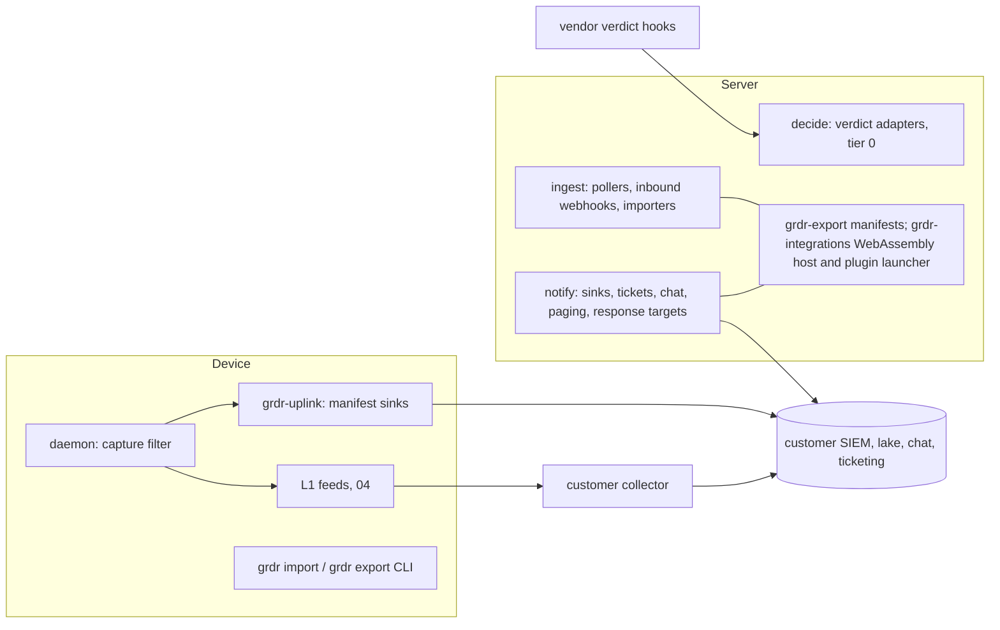

# 25. Integrations, imports and exports

_Status: draft 4 against spine version 4, rulings R-21 and R-39 (`_review/01-document-rulings.md`), the owner's answers (`_review/02-owner-answers.md`) and the owner's kit instructions (`_review/04-owner-kit-instructions.md`). Date: 2026-11-11. Owning squad: `ecosystem` (SQ-15, `team/02` section 4). Specifies D-40, the export half of D-54 and the integration half of D-41 (enhancer packs); contributes the integration members of D-67, which 21 specifies. Read with: `00-decisions.md`; 02 (TB-10, TB-15, SR-25, SR-33, SR-36, SR-48, SR-49); 03 (crates `grdr-export` and `grdr-integrations`, extension points); 04 (mappings, local feeds, `ExportRecord`); 05 (declared sources, device aliases); 07 (decision protocol, verdict interface); 12 (stateless marking, `CompileTarget`); 13 (L0 build); 14 (intelligence exchange); 15 (`SecretStore`, SSF, SCIM); 16 (classification connectors); 17 (gateway adapters); 18 (ticket sync, notification routing, playbooks); 20 (outbox, cursors, lake `Export` scan); 21 (organisation bundle, provider scope, integration secret keys); 22 (pack kinds, device redirect); 23 (API, Terraform, our MCP server); 26 (embedding options, L0 delivery, host contract)._

## Summary

This document fixes how Guardrails ADR talks to other systems: the integration host and its three runtime tiers, the export contract, destinations and their formats, importers, verdict-provider adapters, the per-incumbent enhancer packs, data portability, and how an outside contributor adds and supports an integration. Key choices:

1. **Three runtime tiers in two crates.** Declarative manifests over a closed set of built-in primitives run everywhere, sensors included (in `grdr-export`), and need no server. WebAssembly components with explicit grants run on the server only (in `grdr-integrations`). Out-of-process plugins run on the server only and, like components, never hold a long-lived secret. Nothing third-party is ever native code in a sensor (SR-48).
2. **Destinations are configuration, never pack data.** A manifest holds relative paths, host constraints as match keys and the configuration keys an operator must supply; the pack verifier rejects URLs to contact, commands and environment variables to set, while host patterns and environment variable names are allowed as typed match fields (P7, SR-25).
3. **One export contract** (D-54): named streams, stable ids with revisions, a dedup key on every record, at-least-once delivery, a cursor per destination, replay from the outbox and then from the lake, and a stated delivery guarantee per sink.
4. **Without a server, the recommended route into a SIEM is the L1 feed read by the customer's existing collector.** Device-side manifest sinks in `grdr-uplink` serve estates without one.
5. **Down-conversion uses 04's mappings at send time**, chosen per destination. Where a SIEM normalises on its own side (Splunk CIM), our package ships the knowledge objects instead of a server mapping.
6. **Verdict-provider adapters are thin translators onto `decide`**, evaluate stateless rules only, report the vendor's failure mode in the assurance record and never lift an instance above AL1 (D-13).
7. **Enhancer packs per incumbent** (CrowdStrike, Microsoft, Elastic, SentinelOne) bundle L0 content, L1 collector configuration, ingest, content deployment, an inventory importer and containment-only response (SR-33).
8. **Importers produce draft packs in Watch with an import report.** Approximations are labelled; nothing is silently converted.
9. **Portability is an owner action** (D-67, specified in 21): this document adds integration instances and per-destination high-water marks to 21's organisation bundle so destinations resume without duplicates after a move; standalone exports its local history.
10. **"Supported" means support tier plus stability class plus fixtures plus a named owner**, with the vendor API version range and sunset date in the manifest.
11. **Mail is a port** (P14): the `Mailer` port with an SMTP adapter first-party and HTTP-API adapters in contrib; templates are language tokens (D-69); delivery status and bounces are recorded (section 9).

## Requirements

| # | Requirement | Trace |
|---|---|---|
| R1 | Integrations, imports, exports, SIEM, SOAR, identity, EDR, MDM, secrets, clouds, AI vendors, gateways, developer platforms, GRC, intelligence, classification and MSP tools are all covered by one framework | Owner request; D-40 |
| R2 | Sensors run declarative manifests only; server code extensions are WebAssembly with explicit grants or out-of-process, with an egress allow-list and secrets by reference | D-40; SR-48; c6 F9 |
| R3 | No integration content introduces a command, executable path, URL to contact, environment variable to set or MCP server; host patterns and environment variable names are allowed only as typed match fields | P7; SR-25 |
| R4 | Each adapter family ships two first-party members when it first appears | D-40 |
| R5 | Export: findings, incidents, decisions and response actions with stable ids and update events, at-least-once, per-destination cursor and replay; down-converters are versioned data with golden tests | D-54; l03 F6 |
| R6 | Generic sinks (signed webhook, syslog, OTLP, OCSF JSON to object storage, HEC) and the local event feed work without the server | D-54; D-41 L1; l02 F10 |
| R7 | Security Lake receives OCSF 1.3 Parquet only | Brief 26 verification row 4 |
| R8 | Verdict adapters evaluate stateless policies only and report vendor fail mode; connector control points never exceed AL1 | D-40; D-13; brief 26 rows 1, 2 |
| R9 | Gateways are adapters that declare verbs and fail mode; a host that can fail open is a request | D-40; brief h05 via c6 F6 |
| R10 | Provider-scoped integration instances serve MSPs (PSA ticket sync, usage posting, RMM deploy scripts) | D-40; l05 F7 |
| R11 | Importers for incumbent inventories that work without the server; ingest from and export policy to OpenShell, DefenseClaw, Numbat and Prempti | Spine section 7; D-65; c6 F5 |
| R12 | Incumbent-EDR credentials hold containment scopes only, never script execution | SR-33 |
| R13 | Text from agents, tools or models is inert in tickets, chat and exports | SR-36 |
| R14 | Exports default to metadata; content needs a content grant per destination; registering a destination is a widening operation | D-51; D-31; P8 |
| R15 | An owner can export and delete everything and move between hosted and self-hosted | D-67; l12 |
| R16 | Every integration has a support tier and a stability class | D-50; D-60 |

## Design

### 1. Placement and tiers

Two layer-3 crates from 03's table hold the code. `grdr-export` contains the manifest interpreter, the built-in primitives, the export envelope, cursors and the egress guard; it links into `grdr-uplink`, `grdr-proxy` (call-out providers, section 11), `grdr` and `grdr-server`. `grdr-integrations` contains the WebAssembly host and the plugin launcher and links into `grdr-server` only. Layer-3 crates do not depend on each other (03), so the components' `send` and `sign` host functions are a host-effects trait in `grdr-ports` that `grdr-server` wires to `grdr-export`'s implementation. Mapping is in neither crate: records arrive already converted by 04's mapper in the core, so the sensor, the server and an embedding host convert identically.



| Tier | Runs in | Code | Isolation | Who may author | Requires |
|---|---|---|---|---|---|
| Manifest | `grdr-uplink`, `grdr-proxy`, `grdr` CLI, `ingest`, `notify` | None; selects and parameterises built-in primitives | The interpreter is the boundary | Anyone, through the content repository; organisations in their own layer | The pack verifier; no server |
| WebAssembly component | `ingest`, `notify` only | Component-model WebAssembly, world `grdr:integration` | wasmtime with fuel, memory cap, no WASI filesystem, sockets or environment; every effect is a host call checked against grants | First party and Tier 2 community; organisation-signed only on self-hosted | The server |
| Out-of-process plugin | Separate process or container launched by the server | Any language | Network namespace whose only route is the host's egress proxy; seccomp and no new privileges; short-lived credentials only (section 5); Linux servers only | First party in hosted cells; anyone on self-hosted | The server on Linux; the egress guard (INT-8) |

Verdict-provider adapters (section 11) and gateway adapters (17) are not tiers: they are compiled translators on `decide` and `gateway`, because tier 0 runs no interpreter and awaits no port (20; lint ARCH-014 `tier0-no-port`, numbered by 03 under R-21).

Server placement uses existing targets (D-33): pull connectors, inbound webhooks and importers run in `ingest`; sinks, ticketing, chat, paging and external response actions run in `notify`, whose durable work uses the Jobs port step journal. Lower tiers never block higher ones: a failing destination backs up only its own outbox.

### 2. The manifest

Two pack kinds carry integrations (22's pack format): `integration` (a manifest plus fixtures), on the `detection-content` channel with `signer_class: project-content`, and the `wasm-component` kind that 22 already reserves (a WebAssembly component plus its manifest), server only. 22's kind table does not yet list `integration`; INT-1 reserves it. The manifest is YAML, like 04's mapping files, validated against `schema/integration/v1alpha1`.

```yaml
integration: splunk-hec              # unique within publisher
publisher: com.example               # reverse-DNS of the publisher's domain; first-party packs take it from the brand manifest (D-66)
version: 1.3.0
kind: sink                           # sink | source | ticket | notify | action | reconciler | callout
family: siem-http
direction: out                       # out | in | both | act | deploy | restrict
support_tier: 3                      # D-50; Tier 1 is the target once vendor_api.verified is true
stability: { deliver: beta, replay: experimental }   # D-60 classes per capability
owners: [squad/integrations]
vendor_api: { name: splunk-hec, tested: ">=9.1 <11", verified: false, sunset: null }
config:                              # operator-supplied; the only place a destination lives
  - { key: base_url, type: https_url, required: true, host_constraint: [] }
  - { key: token, type: secret_ref, required: true }
  - { key: index, type: string, default: grdr }
auth: { scheme: header-token, header: Authorization, template: "Splunk {token}" }
streams: [finding, incident, decision, response]
filter: { match: { finding.class: [threat, tamper, policy-violation] } }   # match table, D-09
data_classes_read: [identifier, structural, derived]                         # P7
capture_max: metadata
mapping: { dialect: ocsf, version: 1.9.0 }          # a 04 mapping file
codec: hec-event
request: { method: POST, path: /services/collector/event, dedup_field: grdr_dedup_key }
response: { success: [200], retry: [429, 500, 502, 503, 504], retry_after: header }
limits: { batch_bytes: 1048576, batch_records: 500, rate_per_s: 50, timeout_ms: 10000 }
required_scopes: ["HEC token limited to one index"]
tests: { fixtures: fixtures/, golden: golden/ }
```

Rules the verifier enforces: `path` is relative and contains no scheme or host; `host_constraint` entries are DNS suffix match keys (for example `.crowdstrike.com`) that an operator's `base_url` must satisfy, never a destination; secrets appear only as `secret_ref` keys; a `capture_max` above `metadata` requires `content` in `data_classes_read` (04 section 11); `support_tier` below 3 requires `vendor_api.verified: true`; a `kind: action` manifest lists its verbs from the closed catalogue of 18 and its scopes, and the validator rejects any scope named in `deny_scopes.toml` (script execution, remote shell, file put; SR-33). An unknown construct makes the integration not evaluable and paused with a reason; it never fails the pack load (03).

### 3. Built-in primitives

Primitives are host code, reviewed as trust core where they touch secrets. A manifest may only combine them. The first column is the set the generic sinks, device-side delivery and the incumbent importers use; the second serves the server-side destinations, engines and connectors.

| Family | Generic sinks and importers | Server-side destinations and engines |
|---|---|---|
| Auth | none, header-token, basic, mutual TLS, `hmac-standard-webhooks` (sign and verify), AWS SigV4 with role credentials | OAuth 2.0 client credentials, JWT bearer (Google service account), Entra client credential, Entra and AWS workload identity federation (no stored secret), GCP workload identity |
| Codec | JSON, NDJSON, JSON array, HEC event, syslog RFC 5424 with JSON, CEF or LEEF body, OTLP protobuf and JSON, NDJSON.zst objects | Parquet (with class-per-object partitioning), CSV (usage) |
| Transport | HTTPS, syslog over TLS (RFC 5425, octet counting per RFC 6587), S3 API | GCS, Azure Blob, OTLP/gRPC |
| Pagination | cursor token, offset and limit, time window | link header, window splitting when an offset cap is reached (Falcon's offset cap of 1,000) |
| Engine | sink delivery, poller, importer | inbound webhook receiver, ticket sync (18's `TicketLink` semantics), notify, action, reconciler plan and apply |

Adding a primitive is a core change under the RFC rule of D-61; the trigger is two integrations that need it.

### 4. WebAssembly host and grants

The host embeds wasmtime with the component model (version pinned when INT-6 starts; not verified in the briefs). The world `grdr:integration@0.1.0` exports one of `deliver(batch)`, `poll(cursor)`, `transform(record) -> list<record>`, `plan(desired) -> plan` and `apply(plan)`, and imports only host functions:

| Host function | Grant | Rule |
|---|---|---|
| `send(request, auth: option<secret-ref>)` | `egress` | Host resolves DNS, pins the address, refuses private, link-local and metadata ranges unless the instance allows private ranges (self-hosted only), follows no cross-host redirect, caps the response at 16 MiB. The host attaches credentials; the component never sees secret bytes |
| `sign(secret-ref, algorithm, bytes)` | `sign` | HMAC-SHA256 and Ed25519 only; returns the MAC or signature |
| `kv-get`, `kv-put` | `state` | Instance-scoped, 1 MiB total |
| `emit(records)` | `emit` | Records enter as `provenance: reported`, `control_point: connector` |
| `now`, `random`, `log` | always | Injected clock and entropy; log lines capped and redacted |

Limits (targets): 64 MiB memory, fuel calibrated to one CPU-second per invocation, 30 s wall time, 100 `send` calls and 10,000 emitted records per invocation. A trap, an undeclared host or an undeclared secret aborts the invocation; three consecutive aborts move the instance to `failing` and raise a coverage-gap finding. Grants are declared in the component manifest and become effective only when an operator creates an instance, which shows each grant and the hosts derived from configuration; adding a grant in a new version pauses the instance until approved (a widening operation, D-31).

The first-party members are the two reconcilers that keep our content inside a SIEM in step with the pack (list objects tagged as ours, diff, create, update, delete only ours): CrowdStrike NG-SIEM (parsers, lookup files, dashboards, correlation rules; APIs verified in brief 04) and Microsoft Sentinel (data collection rule, `_CL` table, ASIM parsers, analytics; Azure Resource Manager calls unverified, spike SP25-4). R-22 places `grdr-integrations` and WebAssembly components on the server in 03 (spine D-40, SR-48).

### 5. Out-of-process plugins

`grdr.plugin.v1alpha1.Plugin` is a gRPC service over a Unix socket: `Describe` (manifest, grants, versions), `Configure` (instance configuration), `Credential` (below), `Deliver`, `Poll`, `Act`, `Health`. The server configuration lists each plugin by image or binary digest and signing identity; plugins are never delivered as packs (P7). A plugin does its own I/O, so the host cannot attach credentials to its requests as it does for components. To keep SR-48's secrets by reference, the stored secret never leaves the host: `Credential` returns a short-lived token the host mints from it for that instance (an OAuth or Entra access token, AWS STS session credentials, a SASL OAUTHBEARER token), expiring within 15 minutes (target) and re-requested by the plugin. A vendor that accepts only a static secret cannot be reached through a plugin. Hosted cells run only first-party plugins. The first two members are a Kafka-protocol sink (covers Kafka, MSK, Redpanda, for brokers that accept OAUTHBEARER or IAM authentication) and an Azure Event Hubs consumer for the Defender streaming API (L4, section 12). Which token mechanisms these brokers accept is prior knowledge, checked in INT-7.

### 6. Instances, secrets and provider scope

An **integration instance** binds an integration version to an organisation: `IntegrationInstance {id, organisation_id, provider_id, parent_provider_id, integration_ref (publisher/id@version and digest), config, secret_refs, streams, filter, capture_max, content_grant_id, region, state, created_by, approved_by}`. `provider_id` and `parent_provider_id` are present on every server instance and populated only where the provider tier is in use.

- **Secrets.** On the server, integration secrets are wrapped under the organisation's integration key (AES-256-GCM, every read logged; 21) or held as references to the customer's store through `SecretStore` (15). On a device, a sink credential sits in the OS keystore through the `KeyStore` port. Federation primitives are preferred where the vendor offers them, so no secret is stored.
- **Approval.** Creating an instance, adding a stream, raising `capture_max`, attaching a content grant, adding an action manifest or enabling private-range egress are widening operations: a step-up at the rule class's minimum grade, approved by someone other than the author (D-31, D-55).
- **Health.** `healthy`, `degraded` (retrying), `lagging` (backlog over threshold), `failing` (circuit open), `paused`, `misconfigured`. Anything but `healthy` shows as "could not deliver" with a count and range (P9), and health records are themselves an export stream for other destinations.
- **Provider scope (requires the provider tier, D-35).** A provider-scoped instance lives in the provider's home organisation (21) and receives forwarded records only from organisations whose delegation has `forward_integrations` set (21), metadata only; content never forwards through a delegation and needs a content grant (21 section 8). It carries an organisation-to-external-company map, so one PSA connection serves all of a provider's organisations. Every forwarded record is written to both audit logs. Provider baselines reference integration templates, never secrets.

### 7. The export contract (D-54)

**Streams.** D-54's four streams are mandatory; the rest are optional per destination.

| Stream | Record | Identity and update rule |
|---|---|---|
| `finding` | `finding.state` (04 section 8) | `finding_id`; each change is `revision + 1` |
| `incident` | `incident.state` | `incident_id`, revision |
| `decision` | Non-default verdicts and their receipts (metadata) | `decision_id`; immutable |
| `response` | `response.action` | `action_id`, revision (pending, executed, failed, undone) |
| `approval` | Grant issued, consumed, revoked, expired | `grant_id`, revision |
| `inventory` | `inventory.*` changes and `AgentBom` snapshots | entity id, revision |
| `health` | `assurance.record`, `hook.state`, coverage gaps, destination health | entity id, revision |
| `audit` | `audit.admin`, `audit.access` | immutable |
| `events` | Full event stream by lane, capture-filtered | `event_id`; immutable |

**Envelope.** Every delivered record, whatever the codec, carries these fields (as JSON members, HEC fields, OTLP attributes or syslog structured data):

```json
{ "grdr_export": "1", "stream": "finding", "record_id": "fnd_01J...", "revision": 4,
  "dedup_key": "finding:fnd_01J...:4", "emitted_at": "2026-11-10T09:12:03.120Z",
  "organisation": "org_...", "replay": false,
  "schema": { "dialect": "ocsf", "version": "1.9.0", "mapping_rev": "ocsf-1.9.0@r7" },
  "record": { } }
```

**Semantics.**

1. At-least-once. The cursor `(destination, stream, partition) -> offset` advances only after the sink's acknowledgement. Records are partitioned by `record_id`, so revisions of one record arrive in order at an ordered sink; nothing is ordered across records. Consumers upsert on `record_id` and keep the highest revision; our SIEM packages do this.
2. The dedup key is stable across retries and replays: it is the Standard Webhooks `webhook-id`, the HEC `grdr_dedup_key` field and the OTLP attribute `grdr.dedup_key`; object keys are deterministic per cursor range, so a retried object overwrites itself.
3. Retry follows the `export-delivery` retry policy (03 section 10), which applies 23 section 8's mechanism: adaptive concurrency per destination, honouring `Retry-After`, a `failing` state probed under full-jitter backoff (base 1 s, cap 5 minutes), and a drain from the cursor, with no per-message retry schedule. Non-retryable rejections (4xx other than 408 and 429, OTLP partial-success rejections, which the OTLP specification forbids retrying; brief 23) go to a dead-letter list kept 30 days, visible and retryable after a fix.
4. Outbox and lake. The `notify` outbox keeps records 7 days after commit (20); `events`, `decision` and `audit` are read from the bus and the lake instead (item 7). A destination whose backlog exceeds 7 days or its byte quota drops its oldest undelivered records and raises a coverage-gap finding naming the range; replay from the lake's `Export` scan (20) covers the whole retention window.
5. Replay is `Replay {destination, streams, from, to | from_cursor, reason}`, a job that re-sends with the original dedup keys and `replay: true`. Records are re-filtered at the destination's current capture level, not the level in force when first sent. Replay needs the responder or platform operator role and is audited.
6. Targets: commit to acknowledgement p99 under 60 s at a healthy sink; 5,000 records per second per destination per replica.
7. The relational outbox carries only revisioned resource changes and the `finding`, `incident`, `response` and `approval` streams. `events`, `decision` and `audit` streams are read from the bus by a durable consumer per destination while within bus retention, and from lake and archive objects beyond it. Object-storage destinations receive objects built once per (organisation, stream, format, hour) and copied server-side to each destination using that format. Delivery is compressed wherever the receiver accepts it (gzip for HEC and OTLP, zstd for objects). Device HEC and webhook sinks flush at most every 60 s, offset by a delay seeded from the device id; the validator warns above 10,000 devices per destination and recommends the L1 feed or the server route.

**Per-sink guarantee.** Webhook, HEC, OTLP, Logs Ingestion and object storage acknowledge at the application layer. Syslog over TLS has no application acknowledgement: a record counts as delivered when written and flushed, and a receiver crash can lose it; the destination page says so and recommends an acknowledged sink when loss matters.

**Device-side sinks.** Without a server, `grdr-uplink` runs manifest sinks from the device for the `decision`, `finding`, `response`, `inventory` and `health` streams of that device. The daemon applies the capture filter first, so the uplink only ever holds metadata-filtered records. Device-side records carry the device-side pseudonym (D-51's first layer); server-delivered records carry the server's re-pseudonymised value, so the two do not join on principal. Cursors and the undelivered backlog live in local SQLite; the backlog per destination is capped at 256 MiB or 7 days (targets, inside the 1 GB endpoint disk cap of spine section 6), after which the oldest records are dropped and a coverage-gap finding names the range. `grdr egress` lists each destination (D-48); configuration comes from the admin-owned file or MDM, and the credential must be write-only and scoped to one destination (an HEC token for one index, for example). Recommended instead, wherever the customer has a collector: the L1 feed (04 section 15) read by that collector, which needs no credential on our side. When a device enrols, device-side sinks to a destination that the server also serves are turned off by policy (`export.device_side`), so records are not sent twice.

### 8. Destinations, formats and down-conversion

| Destination | Wire | Schema | Conversion (04) | Constraints that shape batching | Runs from |
|---|---|---|---|---|---|
| Webhook | Standard Webhooks-signed JSON: `webhook-id` (our dedup key), `webhook-timestamp`, `webhook-signature` over `id.timestamp.body`; `v1a` Ed25519 by default and `v1` HMAC-SHA256 on request (23 section 8); space-separated signatures allow rotation | native or OCSF 1.9 | none or OCSF | 1 MiB body (our default) | Device or server |
| Syslog | RFC 5424 over TLS | JSON, CEF, LEEF | CEF and LEEF header table below | 64 KiB message (our cap) | Device or server |
| OTLP | Logs, HTTP or gRPC | OTel GenAI names at a pinned commit plus `grdr.*` | OTel export mapping | Receivers need only gzip or none (OTLP 1.11.1, brief 23) | Device or server |
| Object storage | NDJSON.zst or Parquet | OCSF 1.9 or native | none | Server-side objects close at 15 min or 128 MiB, device-side objects at 60 min or 64 MiB under a two-hex `hash(device_id)` key prefix (our defaults) | Device or server (S3-compatible); server (GCS, Azure Blob) |
| HEC (Splunk, NG-SIEM) | HEC JSON events | native or OCSF 1.9 | none; CIM aliases ship in the Splunk app | NG-SIEM ingest host per cloud, gov on `.mil` (brief 04); Splunk limits unverified | Device or server |
| Microsoft Sentinel | Logs Ingestion API, DCR, `_CL` tables | ASIM `AgentEvent` and native | ASIM mapping | TLS 1.2 or later enforced since 2026-03-01 (brief 26) | Server |
| Amazon Security Lake | Parquet | OCSF 1.3 | 1.3 down-converter; one class per Parquet object | Partition `ext/{source}/region=/accountId=/eventDay=`; 50 custom sources per account; class enum stops at 1.3 (brief 26 row 4) | Server |
| Google SecOps | Chronicle API | UDM | UDM mapping | Never the legacy Ingestion API, discontinued 2027-07-20 (brief 26 row 5) | Server |
| Elastic | `_bulk` | ECS 9.5 | ECS mapping | Per-item errors become dead letters | Server |
| Agent 365 | OTLP/HTTP JSON | Four `gen_ai.operation.name` values; `gen_ai.agent.id` equals the token's app id | Agent 365 profile | 1 MB body; `200` can reject every span, so `partialSuccess` is parsed and the eligibility endpoint called first (brief 03 row 3) | Server; an Entra app with a permission granted through Microsoft's onboarding team |

**CEF and LEEF.** Header `CEF:0|<vendor>|<product>|<version>|<class wire_name>|<summary>|<severity>|`, vendor and product from the brand manifest (D-66). Severity: informational 1, low 3, medium 5, high 8, critical 10. Extension: `rt` emitted time, `act` verdict, `suser` principal pseudonym, `deviceExternalId` device id, `cs1` rule id, `cs2` session id, `cs3` agent type, `cs4` record id, `cn1` revision, each with its `csNLabel`. LEEF 2.0 uses the same keys. Field names follow the CEF and LEEF specifications as remembered, not verified in the briefs; golden tests against two open parsers are part of EXP-2's acceptance. Syslog structured data uses `[grdr@<PEN>]` only when the brand manifest carries an IANA Private Enterprise Number (`iana_pen`); without one the envelope travels in the message body and no structured-data element is sent, so nothing waits on the number (INT-11; IANA charges nothing for one).

### 9. Notify, ticketing, chat and SOAR

These adapters run in the server's `notify` target; the MSP ticketing members also require the provider tier.

18 owns routing, ticket semantics (`TicketLink`, field ownership, echo suppression, conflict rule) and approval grades. This document owns the adapters, all of them manifests over the `notify`, `ticket` and `action` engines except mail, which is the `Mailer` port.

- **Paging:** PagerDuty Events API v2 and Alertmanager's alert API (`POST /api/v2/alerts`) as the family's two first-party members, plus the signed webhook; incident.io is Tier 2. Alertmanager runs inside the customer's network, so a site without internet pages through its own routing. Only threat and tamper findings page (D-54).
- **Chat:** Slack and Microsoft Teams, vendor-hosted and reached only where the network allows; Mattermost and Rocket.Chat on premises through the Slack renderer and a Slack-compatible incoming webhook (unverified; SP25-2 verifies). Messages carry metadata and a console link. Buttons are off by default and, when enabled, decide only rules whose minimum grade is G0 and whose approver is not self (18). Inbound interaction callbacks are verified with the vendor's request signing; chat user ids map to principals only through the organisation's sign-on.
- **Mail:** the `Mailer` port in `notify` sends every email the server writes: notifications, approval requests, digests, invitations and verification codes (21 section 6). Its first-party adapter is SMTP to a configured smart host; it never looks up MX records or delivers directly. `tls = starttls | implicit | none`, where `none` is allowed only with `allow_plaintext = true`, is reported as a downgrade fact and is listed by `grdr server egress`. Authentication none, PLAIN or LOGIN, with the secret by reference; trust from the server's anchors (24 section 6); DKIM signing optional and off by default, because the enterprise relay signs. HTTP-API adapters (Amazon SES, Postmark and others) live in contrib, pass the port test kit and never gate a release (P6). Templates are content: `email.*` language tokens (D-69) rendered in the recipient's locale with `lang` and `dir` set and a text part, loading no remote image (the logo is an inline attachment from the brand manifest or the co-brand profile); the compiler rejects a content-class argument. The adapter records delivery status per message (accepted by the relay, deferred, bounced, and complaints where the adapter reports them); a bounce or complaint stops mail to that address until it is verified again, and failures show in destination health (section 6). Sender address and domain are configuration: Loonaro's hosted service sends from the mail domain in its brand manifest with SPF, DKIM and DMARC in place, a co-branded provider from its verified domain (21 section 16), and a self-hosted deployment from whatever its operator configures.
- **Ticketing:** Jira and ServiceNow; ConnectWise PSA and HaloPSA, which require the provider tier. A manifest supplies the state map, field map and webhook verification; the engine applies 18's rules.
- **SOAR (webhook and API route; packages):** outbound signed webhooks under this contract; inbound `ResponseService.Propose` with a SOAR service account (18). Generated from our OpenAPI: a Shuffle app (the app catalogue is MIT; brief 26 verification) and Tracecat action templates (our own content; Tracecat itself is AGPL-3.0 and never vendored). Tines, Torq, XSOAR, Splunk SOAR and Swimlane use the webhook, the REST API and our MCP server (23).
- **Inertness (SR-36):** every agent-, tool- or model-written string is length-capped, stripped of control and bidirectional characters, and placed in the target's literal or code formatting with auto-linking off; Markdown, HTML and mentions are escaped per target. A fixture per adapter proves it.

All chat, paging, ticketing and MSP APIs are prior knowledge in brief 26, not verified. SP25-2 records and verifies each against a vendor sandbox (a free developer tier or a design partner's test instance) before its adapter leaves Tier 3.

### 10. Importers

An importer turns another system's truth into ours. Inventory imports become declared-source records (05) with `provenance: reported`; policy and rule imports become a draft pack in the organisation's (or the standalone user's) layer, in Watch, with an import report listing each source item as `exact`, `approximate` (enters with a replay requirement before promotion) or `unconverted` (with the reason). Nothing removes or edits the source system's own rule.

| Source | Imports | Into | Exactness | Requires |
|---|---|---|---|---|
| Defender advanced hunting `AgentsInfo` (`Platform == "LocalAgents"`, `localMcps`, `autoApprove`, `trustedProcess`), `ExposureGraphNodes/Edges`; alerts via `AlertInfo` and `AlertEvidence` | Agent instances, MCP servers, edges, runtime-protection alerts | Declared source (05); polled, since `AgentsInfo` is not streamed; column name checked against a live tenant (`Name` against `AgentName`). Needs Defender for Endpoint Plan 2 and Defender Antivirus in active mode on the devices (briefs 03 row 1, 27 row 1); Windows and macOS only | exact | No server (`grdr import run` or `ingest`); the customer's Defender licence |
| Falcon Guardian `/aidr/*` (scope AIDR read, limit 500, offset cap 1,000, all GET) | Agents, sessions, tools, skills, MCP server names, detections | Declared source; window splitting beats the offset cap; the Guardian graph is session-grained but its session-to-agent edge is empty (brief 04 row 6), so sessions join to our agent instances on AID and process tag | exact | No server; the customer's Falcon tenant |
| MCP Registry API v0.1 (`GET /v0.1/servers`, cursor pagination) | Server identities and versions | Catalogue and reputation input (05, 14) | exact | No server |
| Claude Code managed settings; Codex `requirements.toml` | Path and host deny entries, MCP allow and deny lists, sandbox and approval constraints, hook registrations of other vendors | Draft pack; constraints as facts | path, host and MCP identity exact; command patterns approximate | No server |
| Copilot `managed-settings.json` and `policy.d` | MCP lists, tool limits, foreign hooks | Draft pack; inventory of foreign hooks (07) | as above | No server |
| Customer Sigma rules | Detections | Detection content in the organisation layer (13 validates); DRL-licensed rules stay in that layer | exact where fields map | Server |
| LiteLLM `config.yaml` guardrails | Which guardrails apply to which routes | Gateway facts (17) | exact | Server |
| NVIDIA OpenShell YAML policy (filesystem, network endpoints, L7 REST presets; evaluated by Rego through `regorus`, brief 20) and its events | Path and host sets; containment fact (D-21); events | Draft pack; events as `reported` | paths and hosts exact; L7 presets approximate | Events and containment fact: no server (01); policy: server |
| Numbat NDJSON events (schema v0.5.0); DefenseClaw audit rows; Prempti Falco alert JSON and rules | Sessions and verdicts as `reported`; rules as draft detections | Ingest dialects; draft pack | DefenseClaw and Prempti formats unverified until SP25-6 | No server (01); DefenseClaw and Prempti also require SP25-6 to pass |
| CACAO playbooks | Playbooks | 18 owns the dialect | unmapped steps become `manual` | Server |
| Agent 365 registry (`/copilot/admin/catalog/packages`, needs the customer's Agent 365 licence), Entra Agent ID (Graph beta), cloud agent registries | Registered agents, sponsors | Declared sources (05) | exact; degrade with a stated reason when unlicensed | Server |
| Anthropic Compliance API Activity Feed (`GET /v1/compliance/activities`, cursor `after_id`, up to 5,000 per page, 600 requests per minute shared across `/v1/compliance/*`; sessions need a Compliance Access Key); OpenAI Compliance Logs; GitHub audit (`actor_is_agent`, `agent_session_id`, 180 days; agent streaming is preview and limited to EMU or data-residency enterprises, so others are polled; brief g02) | SaaS agent activity | `connector` control point, never above AL1 | exact; OpenAI unverified until SP25-2 | Anthropic and OpenAI: the integration host and a customer with access to that API, read-only (R-39); OpenAI also requires SP25-2. GitHub audit: server |
| Rego (OpenShell, Agent Control Standard) | Policies | One-way converter (12) | approximate | 12's converter, under the condition 12 states |

Without a server, importers run as `grdr import run <instance>` (cron, Task Scheduler or MDM), write records to a local file and, where an export destination is configured, ship them as the `inventory` stream. The L0 pack includes a declared-versus-observed query per SIEM that joins the incumbent's inventory with our L1-fed events, so the SIEM is the join point wherever no server does it natively (05 DI-18).

The two read-only SaaS connectors require only the integration host and a customer with access to the API. The credential halves of parity items T12 and T16 (01) require the credential broker and token service (D-27); a deployment without them states the gap (R-39).

**Policy exporters.** Compile-down to agents' native settings is 12's (D-12), and policy as git is 23's (`grdr policy pull`). This document adds three `CompileTarget` members, each requiring 12's subset proof and each covering only unconditional path and host forbids: OpenShell YAML, DefenseClaw policy-pack fragments and Numbat CEL rules (01, "Interoperation with open projects"). Falco rules for Prempti follow only if upstream releases resume (01).

### 11. Verdict-provider adapters

The adapter trait, shadow mode and mock-vendor conformance require only the server's `decide` target; each vendor member also requires a public HTTPS endpoint (below). One decision API sits behind thin adapters for vendor-side hooks (D-40). An adapter: authenticates the vendor; maps the payload to a `DecideRequest` with `control_point: connector`; pseudonymises human identifiers at the edge with the organisation's pseudonym key (21) before anything is logged; evaluates rules marked stateless only (12), so `context.grdr.stateless_only` is true; returns a verdict, a reason code and the exception route, never policy text (D-38); supports shadow (always allow, record would-deny); and writes the vendor's failure mode into the assurance record. Content fields are evaluated in memory and dropped after the decision unless the organisation's capture level keeps them.

| | Anthropic inference hooks | Copilot Studio external threat detection |
|---|---|---|
| Status | Claude Enterprise only; not on Bedrock, Google Cloud or API-platform organisations; Claude Code governed only when signed in with the Enterprise account | Preview; generative-orchestration agents only; configured per environment with no tenant-wide switch |
| Endpoint on `decide` | `POST /v1/adapters/anthropic/inference-hooks/{instance}` | `POST /v1/adapters/copilot-studio/{instance}/validate` and `/analyze-tool-execution?api-version=2025-05-01` |
| Authentication | Standard Webhooks signature, 5-minute timestamp window, replay cache on `webhook-id` | Entra bearer token: issuer, audience and the customer app ids allow-listed in the instance |
| Mapping | `prompt` to `llm.request`; `tool_call` through the Claude Code tool table to its action class; `actor.email_address` pseudonymised on receipt | `toolDefinition` and `inputValues` to the action; `plannerContext` is content; `conversationMetadata` user fields pseudonymised |
| Verdict | `{"action":"allow"}` or `{"action":"deny","deny_reason"}` (500 characters at most). One verdict covers every tool call in the response (07). STEP_UP, MODIFY and DEFER become deny; the reason names the rule and the exception route (D-44) | `{blockAction, reasonCode, reason, diagnostics}`; STEP_UP, MODIFY and DEFER become `blockAction: true` with the route |
| Budget | Vendor timeout 1 to 10,000 ms, default 5,000; our tier 0 target 150 ms (D-56) | 1,000 ms; our target 150 ms; SP25-5 measures end to end from a hosted cell |
| Vendor fail mode | Allow on failure on first save; block selectable; one retry after 100 ms on connection failure only. Not readable through any API in the briefs, so the admin declares it and the record says `declared` | Allow on timeout or error by default; "Block the query" selectable. Declared by the admin |
| Coverage gap | No call for a governed workspace in 24 h raises a coverage-gap finding | Each registered environment silent for 24 h raises a coverage-gap finding, since a new environment must be enabled by hand |
| Assurance | `connector`, `control: request`, `on_failure` as declared, never above AL1 | same |

Both need a public HTTPS endpoint (Anthropic requires port 443 with no tunnels or private addresses). Self-hosting is the default route: a self-hosted server behind its own public ingress. A hosted cell can serve them only where the hosted service exists, which requires the `distributed` profile and its load test and revenue, sponsorship or donated cloud credits (D-63, spine section 7). Gateway adapters (LiteLLM Generic Guardrail API, agentgateway, Agent Router and Kong) are owned by 17 under the same rules.

**Call-out providers.** Cloud guardrail APIs (Bedrock `ApplyGuardrail`, Azure Prompt Shields, Google Model Armor, Purview `processContent`) are wrapped as restrict-only providers: `kind: callout` manifests interpreted by `grdr-proxy`, on the device (registered as a `native` provider in 07's broker) or as the server's `gateway` target; never in `decide`, which runs no interpreter. Their results are model-origin facts, so they can only deny or step up (P2). Registering one sends content off the device, so it needs `redacted arguments` or a content grant and is a widening operation.

### 12. Enhancer packs (D-41)

26 owns the embedding options, the host contract and L0 delivery; 13 builds L0. An enhancer pack is the integration side for one incumbent: everything a customer installs to make that incumbent see and act on agent activity. Microsoft's discovery and runtime protection need Defender Antivirus in active mode (brief 27 row 1), so on Falcon- or SentinelOne-primary fleets the Microsoft pack is Sentinel and Entra only.

Entries marked (server) require the server; L4 connectors require an MVI-member EDR or MDR design partner (D-41); every other entry works with the sensor, content packs and the customer's own tools.

| Component | CrowdStrike | Microsoft | Elastic | SentinelOne |
|---|---|---|---|---|
| L0 content (13) | LogScale, syntax-checked | KQL over `Device*` tables and our table, executed on the Kusto emulator | EQL, executed | generic Sigma only; its query language is not an L0 backend |
| L1 collection | LogScale Collector fragment using its `wineventlog`, `journald`, `unifiedlog` and `file` sources (brief 27 row 8) | Event Log channel collected by Azure Monitor Agent (unverified; SP25-3) | Elastic Agent on JSON lines; its ETW input can read our provider (GA, admin rights) | JSON lines with any collector |
| Ingest | NG-SIEM HEC data connector; connections and tokens via `/ngsiem/entities/connections/v1`; the connector's parser ships as a file the customer installs | Logs Ingestion API (server) | `_bulk` with ECS (server) | generic sinks |
| Content deploy | Parser and dashboard as installable files; reconciler for parsers, lookups, dashboards, correlation rules (server) | Reconciler and a Content Hub solution (Community tier) (server) | integration package proposed upstream to `elastic/integrations` | none |
| Importer | Guardian `/aidr/*` | `AgentsInfo` and exposure graph | unverified | API unverified; requires API access from a design partner |
| Response (SR-33) | `PerformActionV2` `contain` and IOC Management push of skill, MCP server and destination indicators (server); never Real Time Response | device isolation and indicators (unverified) (server); L0 custom detections can isolate automatically only when joined to Defender tables on `DeviceId` (brief 27 row 10) | isolate (unverified) (server) | isolate (unverified) (server; requires API access from a design partner) |
| Feed their AI product | None: brief 04 documents no log ingest into Guardian (its collector API is a per-call cloud decision), so our records reach Falcon through NG-SIEM | Agent 365 OTLP profile (server); needs an Entra app and a permission granted through Microsoft's onboarding team | none | none |
| L4 connector (26) | Event Streams, Falcon Data Replicator | Event Hubs consumer, advanced hunting | none | Cloud Funnel (unverified) |
| Device join | AID read locally (05) | Defender device id (05; the local read path is checked on a Windows device in a Defender tenant from a design partner or free vendor programme, as part of ENH-2) | agent id (05) | agent id (05) |

The SentinelOne pack's API-dependent parts (importer, response, L4) require API access from a design partner: no SentinelOne documentation was reachable in the briefs (HTTP 429), and Singularity Agentic Detection and Response is early access with no technical documentation (brief h03 row 5). Custom IOA as a boundary-grade compile target is a `CompileTarget` in 12, conditional on l02's spike S4.

### 13. Catalogue

Tier is runtime tier and target support tier (D-50). Runtime tiers: B built-in (compiled host code, including the verdict and gateway adapters on `decide` and `gateway`), M manifest, W WebAssembly, P plugin, Port (a port adapter under P6, owned by the named document), X our own binary outside the sensor. "Unverified" means the mechanism is prior knowledge in the briefs; such an entry stays at Tier 3 until SP25-2 verifies it (section 15). Directions `verdict` and `restrict` are section 11's.

| Integration | Category | Direction | Mechanism | Tier | Requires |
|---|---|---|---|---|---|
| Webhook, syslog, OTLP, object storage, HEC | Generic sinks | out | Section 8 | M/1 | No server |
| Splunk | SIEM | out | HEC; app with CIM aliases, dashboards, SPL (unverified) | M/1 | No server (the app reads what HEC delivers) |
| Microsoft Sentinel and data lake | SIEM | out | Logs Ingestion API, ASIM, reconciler | M+W/1 | Server |
| CrowdStrike NG-SIEM | SIEM | out | HEC, parser and dashboard files, reconciler | M+W/1 | HEC and files: no server; reconciler: server |
| Elastic | SIEM | out | `_bulk`, ECS 9.5, package | M/1 | Server |
| Google SecOps | SIEM | out | Chronicle API, UDM | M/2 | Server |
| Amazon Security Lake | Lake | out | OCSF 1.3 Parquet | M/1 | Server |
| Snowflake, Databricks, BigQuery | Lake | out | Parquet on object storage as external tables | M/2 | Server |
| Cortex XSIAM, QRadar, Sumo Logic, Datadog, Panther, Wazuh, Graylog | SIEM | out | Generic sinks; XQL L0 for XSIAM; LEEF for QRadar (unverified) | M/3 | No server beyond the generic sinks |
| Cribl, Tenzir, Vector | Pipeline | out | OTLP, HTTP, S3; a Cribl pack | M/2 | No server beyond the generic sinks |
| Kafka protocol | Pipeline | out | Plugin | P/2 | Server on Linux; plugin tier (INT-7) |
| Jira, ServiceNow | Ticketing | both | Ticket engine (unverified APIs) | M/1 | Server |
| GitHub Issues, Linear, Azure Boards | Ticketing | both | Ticket engine | M/3 | Server |
| Shuffle, Tracecat | SOAR | both | Generated app and templates | M/2 | Server; our OpenAPI (23) |
| Tines, Torq, XSOAR, Splunk SOAR, Swimlane | SOAR | both | Webhooks, REST, our MCP server | M/2 | Server |
| Slack, Microsoft Teams | Chat | both | Notify engine, signed callbacks (unverified) | M/1 | Server |
| Mattermost, Rocket.Chat | Chat | both | Slack renderer and a Slack-compatible incoming webhook, inside the customer's network (unverified; SP25-2) | M/2 | Server |
| Google Chat | Chat | out | Notify engine (unverified) | M/3 | Server |
| PagerDuty, Alertmanager | Paging | out | Events API v2; Alertmanager alert API v2, inside the customer's network (both unverified) | M/1 | Server |
| incident.io | Paging | out | Alert API (unverified); vendor-hosted | M/2 | Server; a route to the vendor |
| Other webhook-based paging | Paging | out | Signed webhook | M/2 | Server |
| Email | Notify | out | `Mailer` port: SMTP to a smart host (first party); Amazon SES, Postmark and other HTTP APIs (contrib) | Port/1 SMTP; Port/2 HTTP APIs | Server |
| Entra ID, Okta | Identity | in, out | OIDC and SAML sign-on, SCIM 2.0, SSF and CAEP (15, 23) | B/1 | Server |
| Ping, Google Workspace, JumpCloud | Identity | in | OIDC, SAML, SCIM | B/2 | Server |
| Keycloak | Identity | in | OIDC and SAML sign-on, the on-premises reference IdP of 24-28; SCIM through its extension (unverified) | B/1 sign-on, B/2 SCIM | Server |
| Okta SSF receiver | Identity | out | Register at `POST /api/v1/security-events-providers`, send SETs to `POST /security/api/v1/security-events`; needs Identity Threat Protection (brief 26) | M/1 | Server; the customer's Identity Threat Protection |
| Entra Agent ID, Agent 365 registry | Identity registry | in | Graph (beta for agent identities) | M/2 | Server; the customer's licence |
| CrowdStrike Falcon | EDR | in, out, act | Enhancer pack | M+W/1 | Section 12 |
| Microsoft Defender | EDR | in, out, act | Enhancer pack | M+W/1 | Section 12 |
| Elastic Defend | EDR | in, out, act | Enhancer pack | M/1 | Section 12 |
| SentinelOne | EDR | in, out, act | Enhancer pack | M/2 | Section 12; API parts require a design partner |
| Cortex XDR, Sophos, Bitdefender, Trend, Tanium | EDR | out | L0 where a backend exists; L1 | M/3 | No server |
| osquery and Fleet | Inventory | out | osquery extension over osquery's extension interface (never linked, 03) serving `ai_agents`, `mcp_servers`, `agent_sessions` tables from the daemon's local socket | X/2 | Daemon local API |
| Intune, Jamf, Kandji, Workspace ONE, Fleet | MDM | deploy, in | Profile generator and managed-settings fragments (07, 24); read-back of MDM-owned agent settings (05) | B/1 Intune, Jamf; 2 others | No server |
| OpenBao and Vault | Secrets | in, act | `SecretStore` adapter (15); audit ingest; lease revocation (unverified) | Port/1 | Server |
| 1Password, Infisical, cloud secret managers, CyberArk, Doppler, Akeyless, Bitwarden | Secrets | in | Contrib `SecretStore` adapters (15) | Port/2 | Server |
| AWS | Cloud | in, out | S3, Security Lake, SigV4 and role federation; Bedrock events and registries (05) | M/1 | S3: no server; the rest: server |
| Google Cloud | Cloud | in, out | GCS, SecOps, Vertex audit (05) | M/2 | Server |
| Azure | Cloud | in, out | Blob, Logs Ingestion, Event Hubs | M+P/2 | Server; Event Hubs also the plugin tier |
| Anthropic inference hooks; Copilot Studio | AI vendor | verdict | Section 11 | B/1 | Server `decide`; a public HTTPS endpoint |
| Anthropic Compliance API; GitHub Copilot audit | AI vendor | in | Section 10 | M/1 | Anthropic: integration host and a customer with API access, read-only (R-39); GitHub: server |
| OpenAI Compliance Logs; other OpenAI audit APIs, ChatGPT Enterprise logs | AI vendor | in | Unverified (documentation returned 403) | M/2 | Compliance Logs: integration host, a customer with API access and SP25-2, read-only (R-39); the rest: server and SP25-2 |
| Agent 365 | AI vendor | out | OTLP profile | M/2 | Server; Microsoft-granted permission |
| Bedrock `ApplyGuardrail`, Prompt Shields, Model Armor, Purview | Guardrail call-out | restrict | Section 11 | M/2 | `grdr-proxy` or the server's `gateway`; a content grant |
| LiteLLM, agentgateway | Gateway | verdict | 17 | B/1 | Server `gateway` |
| Agent Router, Kong | Gateway | verdict | 17 | B/2 | Server `gateway` |
| Gateway logs: LiteLLM callbacks, agentgateway access logs, Docker MCP Gateway OpenTelemetry, Cloudflare `mcp_portal_logs` (Logpush export is Enterprise-only) | Gateway | in | Ingest dialects, `provenance: reported` | M/2 | Server |
| NVIDIA OpenShell | Runtime | in, out | Events, policy import and export, containment fact | M/2 | Events: no server; policy import: server; export: 12's subset proof |
| Numbat, DefenseClaw, Prempti | Open-source layers | in, out | Section 10 | M/2; Prempti M/3 | Ingest: no server (DefenseClaw and Prempti: SP25-6); export: 12's subset proof (Prempti only if upstream releases resume) |
| GitHub | Developer platform | in, act | Action for `grdr policy check` and `grdr abom diff`; audit log polling, agent streaming where the enterprise qualifies, and app webhooks; check runs for outward receipts (15) | M/1 | Action: CLI; audit, streaming and webhooks: server |
| GitLab, Bitbucket, Azure DevOps | Developer platform | in | CI templates; audit (unverified) | M/2 | CI templates: CLI; audit: server |
| OSCAL | GRC | out | Component definitions from the control library (D-46), written to object storage or a git repository; a format, not an adapter family | B/1 | Server; control library |
| CISO Assistant, Probo | GRC | out | Evidence push to a self-hosted instance (unverified); the family's two first-party members (29), both deployable inside the customer's network | M/1 | Server; control library |
| Vanta, Drata | GRC | out | Evidence push (unverified); vendor-hosted | M/2 | Server; control library; a route to the vendor |
| ServiceNow GRC | GRC | out | Evidence push (unverified) | M/3 | Server; control library |
| OSV, GHSA, KEV, OpenSSF malicious-packages | Intelligence | in | Mirror pack (14) | B/1 | Pack verifier |
| STIX 2.1, TAXII 2.1, MISP, OpenCTI | Intelligence | in, out | 14 | M/1 to 2 | Server `intel` |
| MCP Registry | Intelligence | in | Section 10 | M/1 | No server |
| Purview, MSIP labels, Drive labels | Classification | in | Connectors (16) | M/2 | Server |
| ConnectWise PSA, HaloPSA | MSP | both | Ticket engine; usage posting (unverified) | M/2 | Server; provider tier |
| NinjaOne, N-able, Kaseya and Datto, ConnectWise Automate | MSP | deploy, in | Deploy-script generation, company import (unverified) | M/2 | Server; provider tier |
| Stripe, OpenMeter, Kill Bill, Pax8 | Billing | out | Usage ledger adapters (21, D-68); Pax8 unverified | M/2 to 3 | Server; usage ledger |

### 14. Portability (D-67)

21 section 14 owns the organisation bundle (`grdr-org-bundle`, produced by the `ExportOrganisation` Operation of 23, initiated by the owner with step-up), its encryption, import and the signed device redirect; 20 owns its `lake/` and `audit/` members. This document owns three things:

- **Standalone.** `grdr export history --format ndjson|parquet --since` writes local history at the user's capture level; `grdr join` back-fill is D-48's.
- **Integration members.** The bundle's `relational/` member carries, per integration instance, its configuration and `secret_ref` names (never secret values, which 21 excludes from `keys/`), streams, filters, capture level and, per destination, the highest delivered `(stream, record_id, revision)`.
- **Cursor hand-off on import.** Imported destinations start `paused`. On resume, records at or below the carried high-water marks are skipped, so a destination sees no duplicates beyond the at-least-once window. Secrets are re-entered or re-federated before resume; resuming is the same widening step-up as creating an instance (section 6).

Erasure is 20's (D-57); integration secrets are destroyed with the organisation's integration secret keys (21).

### 15. Signing, tests, stability and support

**Signing.** Integration packs use the one pack format and verifier (D-37): first-party and accepted community packs carry `signer_class: project-content` (22); organisation-authored manifests are active only while a signed layer document pins their digest, as for unsigned detections (12, 22). WebAssembly components are built reproducibly in the content repository's CI (free hosted runners for the public repository) with SLSA provenance before signing. Plugins are pinned by image or binary digest and signing identity in server configuration.

**Fixture tests.** `grdr integration test` (the integration step that 03's `grdr content test` runs) replays recorded request and response cassettes against a mock server, validates output against 04's golden files and schema validators, and runs the standard fault set: 429 with `Retry-After`, 5xx storms, timeouts, malformed bodies, partial success (Agent 365's 200 with rejections, Elastic per-item errors), oversized records, redirect to another host, DNS rebinding, and a duplicate-delivery check. The recorder scrubs secrets and identifiers before a cassette is written. CI never holds live credentials; a nightly lane runs Tier 1 integrations against vendor sandboxes where a free developer tier or a design partner's test instance exists, and a cassette older than 90 days fails the Tier 1 gate.

**Stability classes** (D-60) are per capability in the manifest: experimental, beta, stable, plus deprecated. Nothing is stable before an external embed pilot completes (03).

**What "supported" means.** Tier 1: first-party squad owner; fixtures and the fault set pass on every supported engine; nightly sandbox lane or a cassette younger than 90 days; documented data flow, scopes and failure mode; release-blocking. Tier 2: a named maintainer (a community member, or a first-party squad for integrations that are not release-blocking; deviation 3), the same fixture gate, may lag a release. Tier 3: experimental, off by default, shown as such on every screen. An entry leaves Tier 3 only with `vendor_api.verified: true`, which needs a verified brief or recorded sandbox cassettes (SP25-2). A community integration leaves Tier 3 only after two independent evaluators on different models pass it (`eval-security` and one more on the other model) and the merge queue lands the change (D-61 as owner instruction 7 amends it). `vendor_api.sunset` drives a gardener job that opens a work item 180 days before a vendor retires an API (the SecOps Ingestion API, 2027-07-20, is the first).

## Interfaces and contracts

| Contract | Form | Other party |
|---|---|---|
| Integration manifest, `schema/integration/v1alpha1`; pack kinds `integration` (new in 22's table) and `wasm-component` (reserved by 22) | YAML in a signed pack | 22 (format), 13 and 14 (content pipeline) |
| `grdr:integration@0.1.0` world; host-effects trait in `grdr-ports` | WIT; Rust trait | Component authors; 03 |
| `grdr.plugin.v1alpha1.Plugin` (with `Credential`) | gRPC over a Unix socket | Plugin authors |
| `grdr.integrations.v1alpha1`: `IntegrationInstance`, `ExportCursor`, `DeliveryStatus`, `DeadLetter`, `ReplayRequest`; `IntegrationService` (`ListCatalogue`, `Create`, `Update`, `Test`, `Pause`, `Replay`, `ListDeadLetters`, `RetryDeadLetter`) | Protobuf; API mechanics and Terraform resources are 23's | 23, console (27) |
| Export envelope | Section 7 | Every destination |
| `ExportRecord {cursor, revision, record}`; outbox, cursors, `findings` stream, `decision` table, lake `Export` scan | 04, 20 | 20 |
| Verdict adapter endpoints on `decide` | Section 11 | 07, 12 (stateless marking), vendors |
| `DeclaredSource` members Defender and Falcon | 05's trait | 05 |
| `TicketLink`, notification routing, playbook steps naming instance ids | 18 | 18 |
| Integration secret keys, provider home organisation, `forward_integrations` | 21 | 21 |
| `Mailer` port in `grdr-ports`, SMTP adapter; HTTP-API adapters in contrib | Rust trait and port test kit; delivery status records | 21 (invitations, verification), 18 (routing), 03 |
| Integration members of `grdr-org-bundle` `relational/` | Section 14 | 21 |
| `CompileTarget` members OpenShell YAML, DefenseClaw fragments, Numbat CEL | 12's trait | 12 |
| CLI: `grdr integration new, record, test, lint, package`; `grdr export sink add, test, status, replay`; `grdr import run`; `grdr export history` | Command line | Contributors, operators |

Cross-document notes: 16's classification connectors are members of this host (16 section 10 agrees). R-22 settles the placement: 03 lists `grdr-integrations` and WebAssembly components as server-only, as this document does.

## Behaviour by deployment shape

| Aspect | Standalone | Platform, self-hosted | Platform, hosted | Embedded |
|---|---|---|---|---|
| Tiers | Manifests in `grdr-uplink` and the CLI | All three | Manifests and WebAssembly; first-party plugins only | None of ours; the partner consumes L0 and L1 |
| Exports | Device-side sinks, L1 feeds, `grdr export history`; nothing by default (D-48) | `notify` with outbox and replay | Same, per cell; egress from published fixed addresses per cell | L1 feeds; L4 records from our core over the partner's lake (26) |
| Importers | `grdr import run` | `ingest` connectors under the organisation's key | Same; provider-scoped instances | L4 ingest connectors |
| Verdict adapters | None | Behind the operator's public ingress | Per cell | Partner's own endpoint |
| Private-range egress | Allowed | Allowed per instance with approval | Never | n/a |

The hosted column applies where the hosted service exists, which requires revenue, sponsorship or donated cloud credits (D-63); self-hosting is the default way to run the platform.

## Extension points

An outside contributor adds an integration without touching the core:

1. Open an issue in the content repository from the integration template: vendor documentation links, the facts relied on and whether each is verified, direction, data classes, minimum scopes, failure behaviour.
2. `grdr integration new --kind sink|source|ticket|notify|action` scaffolds the manifest, fixtures and golden directories.
3. `grdr integration record` captures cassettes against a vendor sandbox; the scrubber runs before anything is written.
4. Write the field and state maps; reuse a 04 mapping or propose a new mapping file there.
5. `grdr integration test` runs fixtures, the fault set, the SSRF suite and the verifier rules on every supported engine.
6. Open the pull request; the merge queue lands it at Tier 3, off by default, once verify and the evaluators its review lane requires pass (D-61 as owner instructions 7 and 8 amend it).
7. Promotion to Tier 2 needs a named maintainer, 30 days without regression and documentation; Tier 1 needs a squad owner and the section 15 gate.

Logic a manifest cannot express goes to a WebAssembly component; a missing primitive is an RFC. Contributions are Apache-2.0; AGPL code (Tracecat), Elastic License 2.0 rules and DRL-licensed Sigma rules are never copied into the repositories.

## Security and privacy

- **Trust boundaries TB-10 and TB-15.** Responses from vendors are untrusted content and enter as `provenance: reported`; no verdict rests on them alone (P3).
- **SSRF.** Egress comes from instance configuration intersected with manifest host constraints; the host resolves and pins addresses, refuses private, link-local and cloud metadata ranges (IPv4 and IPv6) unless allowed for that instance on a self-hosted server, follows no cross-host redirect and caps bodies. Plugins reach the network only through the same egress proxy.
- **Secrets by reference.** Components never see secret bytes; plugins see only short-lived tokens minted by the host (section 5). No secret appears in logs, cassettes, support bundles or exports.
- **Least privilege.** `required_scopes` is shown at instance creation; incumbent-EDR action manifests are validated against `deny_scopes.toml` and the action catalogue (SR-33); a Falcon instance with Real Time Response scopes is refused.
- **Inbound webhooks.** A random per-instance path, signature verification, a 5-minute timestamp window, a replay cache and a per-instance rate limit.
- **Privacy.** Default capture is metadata; content needs a content grant per destination; humans appear only as pseudonyms, and vendor-supplied names and emails are pseudonymised at the edge; the export validator rejects a filter or grouping by principal (SR-49); every export destination appears on the monitored developer's disclosure surface (D-51).
- **Inertness.** SR-36 as in section 9.
- **Brand.** Exported product fields, chat cards and ticket text come from the brand manifest; co-branded providers use their branding profile (D-66, 21).

## Test and evaluation strategy

| Property | Method | Oracle |
|---|---|---|
| No loss, at-least-once | Chaos runs: kill `notify` mid-batch, partition the network, 429 storms, restore from backup | Mock-sink ledger against the source outbox and lake: every `(record_id, revision)` delivered at least once; final state per id equals the source's highest revision |
| Per-record order | Random interleavings of revisions | Sink sees monotone revisions per `record_id` |
| Replay | Replay ranges over a seeded lake | Replayed set equals the lake `Export` scan for the range |
| Mapping and codec | Golden files; CEF and LEEF through two open parsers; OCSF validator for 1.9 and 1.3 | Validators and golden files (04) |
| Security Lake acceptance | SP25-1 against a real account | AWS accepts every object; class-per-object holds |
| Signatures | Standard Webhooks reference library verifies ours; tampered body, stale timestamp and replayed id fail | The reference library |
| SSRF and grants | Hostile configurations, redirects, DNS rebinding; components calling undeclared hosts and secrets; a plugin dumping its memory and environment | Packet capture in the test namespace: zero packets outside the allow-list; host call log; no stored secret value in the plugin's memory image |
| WebAssembly containment | Fuzzed components, fuel and memory exhaustion | Server keeps serving; instance moves to `failing`; finding raised |
| Stateless-only adapters | Differential evaluation with and without session state on the recorded vendor corpus | Identical verdicts; no stateful rule id in any adapter receipt |
| Adapter latency | Load at tier 0 | p99 under 150 ms (D-56) |
| Ticket sync | Model-based test against a state model of incident and ticket (18's SP-18c) | Equal states, zero echoes |
| Privacy | Data-class scanner over every outbound byte in the integration suite | Zero content-class fields at `metadata`; zero emails or names |
| Fail-mode honesty | Declared vendor fail-open | Assurance record shows `on_failure: open`, `control: request` |
| Export fan-out | SP-N1 against a receiver capped at 500 requests a second | Zero loss; convergence within 60 s; conflation once lag exceeds 60 s |
| Mail | Mailpit relays in the air-gap conformance run (NTF-1); a bounce fixture | Every mail arrives through the configured smart host; zero MX queries; a bounced address receives nothing until re-verified |

## Work breakdown

**E1 Framework**
- INT-1 Reserve the `integration` pack kind with 22; verifier rules for manifests. Accept: 20 hostile manifests (URL to contact, command, environment variable to set, absolute path, script scope, Tier 1 with `verified: false`, `capture_max` above `metadata` without `content` read) rejected; 3 valid ones load.
- INT-2 Manifest schema v1alpha1, linter, interpreter and the generic-sink and importer primitives (section 3, first column) in `grdr-export`. Requires INT-1. Accept: the five generic sinks run from manifests only; the crate builds into `grdr-uplink`, `grdr-proxy`, `grdr` and `grdr-server` with no dependency on another layer-3 crate.
- INT-3 Cassette recorder, scrubber and `grdr integration test` with the fault set. Accept: a planted token in a recording is scrubbed; every fault fixture yields the declared outcome.
- INT-4 Device-side delivery in `grdr-uplink` with local cursors. Requires INT-2. Accept: `grdr egress` lists the sink; a 24-hour sink outage loses nothing; an outage past the backlog cap drops oldest-first and raises one coverage-gap finding naming the range; uplink never receives a record above metadata.
- INT-5 Server host in `ingest` and `notify`: outbox, cursors, dead letters, replay, health. Requires the server and INT-2. Accept: chaos oracle green; health states visible with counts.
- INT-6 WebAssembly host in `grdr-integrations`, world 0.1, grants, limits; reproducible component builds with SLSA provenance. Requires INT-5. Accept: containment and grant tests green; a new grant pauses the instance until approved; two CI builds of a component are byte-identical.
- INT-7 Plugin protocol, launcher and `Credential` minting; Kafka sink and Event Hubs consumer. Requires INT-5 and INT-8. Accept: a plugin's only reachable address is the egress proxy; no stored secret value appears in a plugin's memory image; each member passes the chaos oracle of EXP-3 against a test broker or hub.
- INT-8 Egress guard and SSRF suite. Accept: zero packets outside the allow-list.
- INT-9 Instance approvals and secrets custody with 21. Accept: author cannot approve own instance; secret reads logged.
- INT-10 Provider-scoped instances. Requires the provider tier (D-35) and INT-9. Accept: an organisation without `forward_integrations` contributes nothing; no content-class field is forwarded; records land in both audit logs.
- INT-11 IANA Private Enterprise Number, an external precondition that nothing waits on: Loonaro requests it, and until then syslog sends no structured-data element. Accept: once assigned, the number is the brand manifest's `iana_pen` and the element appears with no code change.

**E2 Export (D-54)**
- EXP-1 Envelope, streams, dedup keys. Accept: golden envelope per codec.
- EXP-2 Webhook, syslog with CEF and LEEF, OTLP, S3-compatible objects, HEC. Requires INT-2; the syslog structured-data element requires INT-11. Accept: each passes fixtures, signatures verify with the reference library, CEF and LEEF parse in two parsers.
- EXP-3 Lake replay beyond the outbox; per-record ordering. Requires INT-5 and 20's lake `Export` scan. Accept: replay oracle green.
- EXP-4 Security Lake, GCS, Azure Blob. Requires INT-5. Accept: SP25-1 passes.
- EXP-5 Splunk app, Sentinel solution, NG-SIEM content, Elastic package. Accept: each upserts by `record_id` and shows the same finding counts as our console on a seeded dataset.
- EXP-6 Google SecOps through the Chronicle API. Accept: fixtures; no call to the legacy host.
- EXP-7 Agent 365 profile. Accept: rejected spans surface as dead letters; eligibility checked first.

**E3 Notify, ticketing, SOAR, MSP**
- NTF-1 Slack, Teams, PagerDuty, Alertmanager, email through a smart host, Mattermost through the Slack renderer. Requires INT-5 and NTF-5. Accept: only threat and tamper findings reach a paging destination; inert-text fixtures; buttons absent unless enabled; G0-only rule enforced; in the air-gap conformance run of 24-28 (S-31, step 8), Mailpit as a STARTTLS relay with the internal CA and as a no-auth port-25 relay each receive a page, an approval request, the digest and the synthetic alarm, the DNS log shows zero MX queries, and with PagerDuty, Slack and Teams unconfigured `preflight` reports no missing destination.
- NTF-2 Ticket engine, Jira and ServiceNow manifests. Requires INT-5. Accept: SP-18c.
- NTF-3 Shuffle app and Tracecat templates generated from OpenAPI. Accept: generation is reproducible in CI.
- NTF-4 ConnectWise PSA and HaloPSA ticket sync and usage posting; NinjaOne and N-able deploy scripts. Requires INT-10. Accept: SP25-2 and l05's S4 pass with no component code.
- NTF-5 `Mailer` port, SMTP adapter, delivery status and bounces, `email.*` templates as language tokens. Requires INT-5 and D-69's compiler. Accept: the port test kit passes on SMTP; a bounced address receives nothing until it is verified again; every template renders in the pseudo-locales; a template with a content-class argument fails compilation.

**E4 Importers**
- IMP-1 Defender importer. Requires a Defender tenant from a design partner or a free vendor programme. Accept: live-tenant column check; unlicensed tenant degrades with a reason.
- IMP-2 Falcon Guardian importer. Requires a Falcon tenant from a design partner or a free vendor programme. Accept: more than 1,000 entities imported despite the offset cap.
- IMP-3 Claude Code, Codex and Copilot settings importers. Accept: import report classifies every item; imported pack is in Watch; source files unchanged byte for byte.
- IMP-4 MCP Registry importer (with 05, 14). Accept: cursor pagination through the full registry fixture.
- IMP-5 OpenShell events, Numbat, DefenseClaw and Prempti ingest dialects (the last two require SP25-6); Sigma, LiteLLM, OpenShell policy (these require the server). Accept: golden files per dialect from pinned upstream releases; unknown fields are preserved.
- IMP-6 Anthropic Compliance API and OpenAI Compliance Logs, read-only (R-39; OpenAI requires SP25-2); Agent 365 registry, Entra Agent ID, GitHub audit. Accept: connector records never raise an instance above AL1; the Compliance API poller stays under the shared 600-requests-per-minute limit with another client using half of it.
- IMP-7 OpenShell YAML, DefenseClaw and Numbat `CompileTarget`s. Requires 12's subset proof. Accept: 12's subset test proves every exported deny is a Cedar deny on the conformance corpus, per target and upstream version range; a pack with conditional forbids exports only its unconditional part and the report lists the rest.
- IMP-8 osquery extension. Accept: the three tables return the daemon's inventory on Linux, macOS and Windows; the extension reads only the local socket and holds no credential.

**E5 Enhancer packs (D-41)**
- ENH-1 CrowdStrike v0: LogScale L0, collector fragment, HEC preset with parser and dashboard files, importer. Requires a Falcon test tenant from a design partner or a free vendor programme. Accept: on a Falcon test tenant with no server, the collector ships the JSON-lines feed of a seeded device, the parser types every envelope field, the L0 queries return the seeded sessions and findings, and the importer lists the tenant's Guardian agents.
- ENH-2 Microsoft v0: KQL L0, collection guidance, importer. Requires a Defender and Sentinel tenant from a design partner or a free vendor programme. Accept: SP25-3.
- ENH-3 Elastic and SentinelOne v0. Accept: Elastic EQL fixtures executed; SentinelOne Sigma pack built.
- ENH-4 Reconcilers for NG-SIEM and Sentinel. Requires INT-6. Accept: a second run changes nothing; objects not tagged as ours are never touched.
- ENH-5 Response targets: Falcon contain and IOC push; Defender isolate. Requires INT-5 and the same tenants as ENH-1 and ENH-2. Accept: SR-33 validator refuses script scopes; contain and release by API in 20 of 20 trials.

**E6 Verdict adapters**
- VPA-1 Adapter trait, mock vendors, shadow. Requires the server's `decide` target. Accept: stateless-only oracle green.
- VPA-2 Anthropic inference hooks. Requires VPA-1 and a public HTTPS endpoint. Accept: signature and replay tests; email never persisted; p99 under 150 ms.
- VPA-3 Copilot Studio. Requires VPA-1 and a public HTTPS endpoint. Accept: SP25-5; silent environment raises a coverage gap.
- VPA-4 Call-out providers. Accept: a call-out can only deny or step up; registration is a step-up.

**E7 Portability (D-67)**
- POR-1 `grdr export history`. Accept: round-trip into a fresh standalone install.
- POR-2 Integration members of 21's bundle. Requires INT-5. Accept: the bundle lists every instance with its high-water marks; a scan of the bundle finds no secret value.
- POR-3 Cursor hand-off on import (with 21's L4 round trip). Requires POR-2. Accept: imported destinations start paused; after resume they receive no record at or below the carried high-water marks and every later revision at least once.

**E8 Contribution and support**
- CON-1 Template, docs, `support.toml` rows, generated catalogue page. Accept: a stranger adds a webhook variant in under a day with no private help.
- CON-2 Nightly sandbox lane (free developer tiers or design partners' test instances) and the 90-day cassette gate. Accept: an expired cassette fails a Tier 1 release.
- CON-3 Vendor sunset tracker. Accept: the SecOps sunset opens an item.

## Risks, open questions and spikes

| Spike | Question | Pass |
|---|---|---|
| SP25-1 | Does Security Lake accept our OCSF 1.3 Parquet? Requires an AWS account from a design partner, donated credits or a free tier | A custom source ingests a day of seeded data with zero rejected objects |
| SP25-2 | Are the unverified chat, paging, ticketing, PSA, RMM and OpenAI APIs as assumed? | A verified brief plus cassettes from each vendor sandbox; mismatches fixed in the manifests before Tier 2 |
| SP25-3 | Does Azure Monitor Agent collect our Event Log channel into Sentinel? Runs on free hosted Windows x64 and arm64 runners or the owner's machine through `matrix-run`; requires a Sentinel workspace from a design partner or donated credits | Records arrive with typed fields within 5 minutes on Windows 11 x64 and ARM64 |
| SP25-4 | Can the Sentinel reconciler work through Azure Resource Manager with least privilege? Requires the same workspace as SP25-3 | Plan and apply on a test workspace with one custom role; a second run is a no-op |
| SP25-5 | Can a server behind a public ingress (a self-hosted server, or a hosted cell where the hosted service exists) answer Copilot Studio inside its 1,000 ms limit? Requires a public endpoint and Azure access from a design partner or donated credits | p99 under 300 ms end to end from three Azure regions |
| SP25-6 | What are DefenseClaw's and Prempti's current formats? | Pinned schemas with fixtures from their latest releases |
| SP25-7 | Do device-side sinks hold at fleet scale? Uses simulated devices on free hosted runners or a design partner's fleet | 100,000 simulated devices to one HEC endpoint for 7 days: no loss within the device backlog cap, receiver rate within its limit ±10%, peak second under 2× the mean |
| SP-N1 | Does export fan-out hold against a slow receiver? | 13,889 decisions a second into a receiver capped at 500 requests a second: zero loss; adaptive concurrency converges within 60 s; recovery at or under 2× the cap; conflation once lag exceeds 60 s |

Risks: vendor APIs move (Agent 365's observability SDK was deprecated within a year and `AIAgentsInfo` was replaced by `AgentsInfo`; brief 03), handled by version ranges, cassettes and the sunset tracker; per-SIEM parsers and dashboards are the real cost of each SIEM (brief 26), so only four SIEM packages are Tier 1; device-side credentials can be stolen from a device, so they must be write-only and the L1 route is recommended; OCSF 1.10 will change `delegation` and add `ai_capability` (brief 23), handled by a new mapping version.

Open questions for the product lead: which SIEM and EDR design partners to recruit (recommended: one Falcon estate and one Sentinel estate; with a zero budget they are also the source of the test tenants that IMP-1, IMP-2, ENH-1, ENH-2, ENH-5 and SP25-3 to SP25-5 need, unless a free vendor programme provides them); whether to list in vendor marketplaces (Splunkbase, Content Hub, CrowdStrike Marketplace, Okta Integration Network), which need partner agreements signed by Loonaro (external preconditions that nothing else waits on), and any listing that charges a fee needs a sponsor; which PSA and RMM vendors the MSP partners use.

## Deviations from the spine and objections

1. **Verdict-adapter members require a public HTTPS endpoint as well as `decide`.** D-40 names only `decide` as the adapters' prerequisite, but both vendor hooks need a public HTTPS endpoint and Copilot Studio's interface is preview; the trait, shadow mode and mock-vendor conformance need only `decide`. This follows 07. Open: spine v4's section 7 names no public-ingress precondition for D-40.
2. **The out-of-process tier's first members are the Kafka sink and the Event Hubs consumer.** Its protocol and launcher are part of the tier as D-40 requires, and these two members (one serving L4) exercise it, since an unused tier would be untested. Open.
3. **Tier 2 includes first-party integrations that are not release-blocking.** D-50 describes Tier 2 as community. Per-SIEM parsers and dashboards are the real cost of each integration (brief 26), so the release gate is kept to the Tier 1 rows of section 13 and other first-party entries (Google SecOps, the lakes, SOAR, MSP tools) carry a squad as their Tier 2 maintainer. Open.
4. **Open-project interoperation follows 01's proposals to 33** (D-65 names no prerequisites): ingest needs no server; export to OpenShell, DefenseClaw and Numbat requires D-12's subset proof, including Numbat's CEL; Prempti export only if upstream releases resume. DefenseClaw and Prempti ingest requires SP25-6 because both formats are unverified. Open.

## Sources

Research briefs: `26-integrations.md`, `27-embed-oem.md`, `03-microsoft.md`, `04-crowdstrike.md`, `g02-edr-class-rivals-docs.md`, `23-schemas-transport.md`, `07-market-identity.md`, `h03-incumbent-vendor-docs.md`, `h04-market-news-sweep.md`, `20-policy-languages.md` (OpenShell policy format), `06-market-runtime.md` (Numbat schema). Review notes: `l02`, `l03`, `l05`, `c6`; `_review/00-resolution.md`.

Primary URLs, as cited in the briefs: https://platform.claude.com/docs/en/manage-claude/inference-hooks ; https://platform.claude.com/docs/en/manage-claude/inference-hooks-configuration ; https://platform.claude.com/docs/en/manage-claude/compliance-api ; https://learn.microsoft.com/en-us/microsoft-copilot-studio/external-security-provider ; https://learn.microsoft.com/en-us/microsoft-copilot-studio/external-security-webhooks-interface-developers ; https://learn.microsoft.com/en-us/defender-endpoint/discover-local-ai-agents ; https://learn.microsoft.com/en-us/defender-xdr/custom-detection-rules ; https://learn.microsoft.com/en-us/microsoft-agent-365/developer/observability-concepts ; https://learn.microsoft.com/en-us/azure/azure-monitor/logs/logs-ingestion-api-overview ; https://docs.aws.amazon.com/security-lake/latest/userguide/adding-custom-sources.html ; https://docs.cloud.google.com/chronicle/docs/reference/ingestion-api ; https://github.com/CrowdStrike/falconpy ; https://library.humio.com/falcon-logscale-collector/log-collector-config-common-sources.html ; https://docs.litellm.ai/docs/adding_provider/generic_guardrail_api ; https://openid.net/specs/openid-sharedsignals-framework-1_0-final.html ; https://developer.okta.com/docs/guides/configure-ssf-receiver/main/ ; https://github.com/modelcontextprotocol/registry ; https://github.com/open-telemetry/opentelemetry-proto/blob/v1.11.1/docs/specification.md ; https://github.com/Shuffle/python-apps ; https://github.com/NVIDIA/OpenShell .

Added here and read at source on 2026-11-10: RFC 5425 (TLS transport mapping for syslog) https://www.rfc-editor.org/rfc/rfc5425 ; RFC 6587 (syslog over TCP, octet-counting framing in section 3.4.1) https://www.rfc-editor.org/rfc/rfc6587 ; Standard Webhooks specification (headers, signed content `msg_id.timestamp.payload`, `v1` HMAC-SHA256 and `v1a` Ed25519) https://github.com/standard-webhooks/standard-webhooks/blob/main/spec/standard-webhooks.md . RFC 5424 (the syslog message format) https://www.rfc-editor.org/rfc/rfc5424 is cited from prior knowledge, not re-read.
