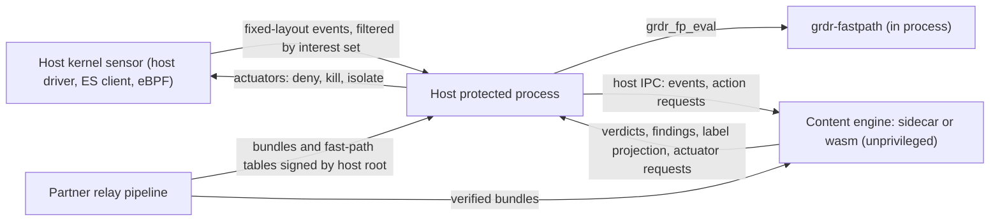

# 26. Embedding, OEM and white-label

_Status: draft 4 against spine version 4, rulings R-01 to R-71, the owner's answers (`_review/02-owner-answers.md`) and the owner's kit instructions (`_review/04-owner-kit-instructions.md`). Date: 2026-11-11. Owning squad: `ecosystem` (SQ-15, `team/02` section 4) for `spec/host-contract/`, `conformance/`, the content relay and L0 delivery; `grdr-ffi`, `grdr-wasm`, `grdr-fastpath` and `grdr-fastpath-ffi` are `core`'s paths (R-22), and the sidecar mode is a mode of `endpoint`'s `grdr-engine`. `grdr-fastpath` and the `unsafe` in both FFI crates are trust core under D-63. Read with: `00-decisions.md` (D-05, D-41, D-60, D-66, D-04, D-14, D-37, D-58, D-62); 03 (core contract, build profiles, stability classes); 04 (provenance grades, mappings, L1 feed formats); 07 (verdict providers, broker); 12 (floor tables, cache scopes); 21 (branding profile, provisioning API); 22 (pack format, trust roots); 11 (on-device update mechanics); 24 (build, signing, packaging); 25 (export destinations); 35 (security process); 36 (prices and legal terms); 30 (governance)._

## Summary

This document specifies how another vendor's EDR, gateway or MDR takes Guardrails ADR without the whole platform, from compiled content up to a rebuilt product under its own name. The options of D-41 are independent; a partner can take one, several or all.

Key choices:

1. **Two artefacts, two privilege levels.** Only the fast-path library (`grdr-fastpath`: `no_std`, no dependency, allocation, thread or parser) enters a protected host process; all parsing runs in the content engine as an unprivileged sidecar or WebAssembly module (D-41 L3, D-20).
2. **A protected process takes tables only from the host's signed channel**, never from the sidecar.
3. **One C ABI, one import-free WebAssembly module, same bytes**, over `grdr.embed.v1alpha1` protobuf messages (D-05, P5).
4. **The host contract is data.** A signed `HostProfile` yields the assurance record; unsupported rules return `not_evaluable` (D-60).
5. **Foreign telemetry maps through the core's one mapper**, so mapping fixes ship as content.
6. **The partner owns its content channel** through `grdr content relay`: verify, test on its engine builds, re-sign, ring. No trust root or call to Loonaro is embedded (D-60).
7. **Wire stays, surface changes.** A rebuild renames what people and the OS see and keeps every wire, ABI and Cedar identifier (D-66). `grdr` is the working namespace; if the registry and trademark search that D-66 requires changes it, every identifier here changes once, before the first release, and never after.
8. **L0 and L1 need no partner; recruiting for L3 waits on no component**, because an MVI-member partner is the only route to antimalware-protected processes on Windows (D-41, D-17; brief 12).
9. **Marks state option and assurance level and belong to the project** (D-03).
10. **We sell services, never the code** (D-04, P11).
11. **A white-label build swaps the whole brand manifest**, and no program holds a domain, host, URL, address or name of any brand (section 9, owner instruction 26).

## Requirements

| # | Requirement | Trace |
|---|---|---|
| R1 | Options from content-only to rebuilt product, each usable alone | Owner's request; D-41; brief 27 |
| R2 | Protected-process code has no parser, JIT, thread or hidden allocation and loads under dynamic-code prohibition | D-41; l08 F2; brief 12 |
| R3 | Identical core on native, C ABI and `wasm32`; engine, ABI and content versions independent | D-05; c6 F4; brief 27 |
| R4 | No panic crosses the boundary; bounded memory and steps; a rejected pack keeps last-known-good | c6 F4; P9 |
| R5 | Hosts declare inputs and verbs; unsupported rules report `not_evaluable`; assurance is derived | D-60; l08 F1; P1, P3 |
| R6 | Host telemetry maps with stated provenance; actuators get verdicts with cache key, scope, expiry | D-05; D-60; 04 |
| R7 | Partners re-host, re-sign, overlay, ring, restrict to official content, run offline | D-60; l08 F3; P7 |
| R8 | No call to Loonaro, no embedded trust root, no brand string, host or address compiled in | D-60; D-66; TB-12; owner instruction 26 |
| R9 | White-label covers theme, domains, mail, provider tier, desktop and OS identity | D-41; l08 F10; brief 13 |
| R10 | Conformance kits, an id registry, marks gated on passing | D-60; briefs 27, 28 |
| R11 | LTS lines, packs for every supported line, pre-disclosure, compliance pack | D-58; D-62; D-46; l08 F5 |
| R12 | Stability classes; nothing stable before one external embed pilot | D-60; l08 F8 |
| R13 | The privacy floor holds in every embedded and white-label build | D-51; P8 |
| R14 | Permissive-only licence closure with SBOM and provenance | D-02; briefs 10, 28 |

## Design

### 1. The options in detail

| Option | What ships | Interface | Partner work | Limits | Precedent | Requires |
|---|---|---|---|---|---|---|
| L0 Content | Detections and catalogue matches compiled to KQL, LogScale, EQL, XQL, SPL and generic Sigma (13 section 16); Apache-2.0, no attribution duty | One signed archive per backend with a coverage manifest (13) | Import and tune | Post hoc; EDR telemetry has no tool call, session or prompt (brief 27) | ModSecurity CRS, Sigma, Avira and Bitdefender feeds | Content packs and 13's L0 build; no partner |
| L1 Local feed | Our sensor writes Windows Event Log, journald, unified log, JSON lines, OTLP (formats owned by 04 section 15) | Stable event ids and channel names; `feed_seq` and gap records | Point the partner's collector at the channel | No blocking; metadata by default | LogScale Collector sources (no ETW), Elastic ETW input (brief 27, verified) | Our sensor; no partner |
| L2 Broker | `grdr-broker` library and `spec/hook-broker/`; the partner builds and signs its own shim and may run our engine as one provider | `grdr.provider.v1alpha1` (07) | Build and sign a shim; register providers | Hooks are requests (P1); opens to third parties only if native merging proves insufficient (D-41; c6 spike 1) | AMSI; Copilot Studio threat-detection webhook (preview); Claude Code's parallel hooks with deny over defer over ask over allow | Hook broker specification; a host vendor; for third-party registration, c6 spike 1 showing native merging insufficient |
| L3 Engine | Fast-path library for the protected process; content engine as sidecar or WebAssembly | Section 2 and 3 | Integrate the fast path and sidecar, write a host profile and a dialect mapping (l08 spike 2 measures the mapping effort) | Blocks only where the host has synchronous verbs; host owns self-protection, updates and response | Avira SAVAPI, libclamav and clamd, YARA-X, OPA's WASM and REST modes | Fast path (S-21); host contract; for the pilot, an MVI-member EDR or MDR design partner |
| L4 Cloud connector | `grdr-server` over the partner's lake; response through its API | Section 7 | Credentials and scopes per vendor | Cannot block; AL1 at most (D-13) | Elastic third-party response actions; Falcon Foundry apps | Server; host contract; an embedding partner (D-41) |
| L5 Full platform | Our sensors, gateway and server beside the partner's EDR, in the targeted install (D-23) | The platform | Deployment only | Coexistence pack and ceiling matrix apply | Palo Alto Cortex Targeted Sensor beside third-party EDRs (h03, verified) | Self-hosted server; the targeted install (01, D-23); as a partner offering, an embedding partner (D-41) |
| L6 Co-brand | Branding profile on a parent provider, provider or organisation (21 section 16) | Provisioning API, `grdr.brand.v1alpha1` | Configuration only | Binaries and OS identity stay ours and are disclosed | Avira "White Label", Bitdefender OEM | Provider tier (D-35); an embedding partner |
| L6 Rebuilt | Source, brand manifest, `dist.toml`; the partner signs, operates its own roots and cells | Section 9 | Brand manifest and distribution build, plus the partner's own Apple and Microsoft identities | Partner's Endpoint Security entitlement and Windows signing are its own | OTel Collector Builder distributions | Brand manifest (D-66); an embedding partner |

Partner work is measured in the first pilot and published.

**L0 delivery.** 13 section 16 builds the L0 packs (`grdr.l0`, the backends, executed or syntax-checked labels, the OCSF pipeline); this document delivers them to partners, the console download and the relay. One requirement on 13's KQL output: Defender custom detections take automated device actions only when the rule uses Defender data and returns `DeviceId`, so KQL rules meant to isolate or restrict join Defender tables on `DeviceId` (brief 27, verified).

### 2. The fast-path library

`grdr-fastpath` evaluates the floor tables of 12 section 8 over fixed-layout inputs. The same code runs in our daemon and in a partner's protected process; the daemon is its first consumer, so every daemon build exercises it, with or without a partner. A partner pilot requires an MVI-member design partner (D-41).

**Constraints, checked in CI.** `#![no_std]`, no `alloc`, no dependency, no `unsafe` (03 forbids it in layer 1 outside the FFI crates), no indexing or `unwrap` (clippy denies), no panic path in the linked object (a link-time check fails the build if any exported function can reach the panic handler), no executable-page allocation, bounded work: every table walk is bounded by the table size recorded in the header, and evaluation is O(rows touched) with a per-call cap.

**Packaging.** The `extern "C"` entry points live in their own crate, `grdr-fastpath-ffi` (layer 1, depends only on `grdr-fastpath`), so the protected-process artefact `libgrdr_fastpath` contains those two crates and nothing else; a closure check fails the build if `grdr-core` or any parser appears in it. Our daemon links `grdr-fastpath` directly from Rust. 03 lists the crate in the core squad, with its same-layer edge and its `unsafe` exception (R-22).

**Tables.** A table blob is produced by `compile` in `grdr-core` from a verified bundle. Header: magic, `table_format`, `abi_min`, `bundle_digest`, `compiler_version`, `effective_hash`, row counts and offsets. Body: the floor rows, the path, host and executable classifiers, the interest set and the reason-code table. The library validates the header and every offset before use and never copies the blob.

**Where tables come from.** A partner's protected process is the host's tamper anchor, so it must not take policy from a less privileged process: it loads only tables its own verifier accepts (the core verifies nothing, 03 section 3). Tables are compiled on the device by the host's privileged service from a bundle its verifier accepted, never by the sidecar (R-05). Only for an embedded host that cannot compile on the device does the partner's relay pipeline (section 6) compile them per bundle and per host OS and architecture, signed by the partner's root; rows that need per-device facts stay in the content engine. A blob returned by `grdr_engine_compile_fastpath` carries no signature and is for unprivileged hosts and tests. Our own daemon follows the same rule: its privileged service compiles the fast-path and fail-safe tables on the device and signs them with a device-local artefact key (D-14, R-05; 12 section 10).

**What the protected process still takes from the sidecar.** Enforcing-label bits and grant digests arrive as `Effect`s from the content engine (section 5), as they do in our daemon (03 section 4). A compromised sidecar can therefore withhold a label but cannot change a table row. Label bits are indexed by the bundle's label table, so each input carries the tag of the bundle they were produced under, and a tag that differs from the loaded table's `bundle_digest` is refused.

**C interface (`grdr_fastpath.h`).**

| Function | Contract |
|---|---|
| `uint32_t grdr_fp_abi_version(void)` | `major << 16 \| minor` |
| `grdr_status grdr_fp_arena_size(const uint8_t *blob, size_t len, size_t *out)` | Validates the header; returns the index arena the host must provide |
| `grdr_status grdr_fp_load(const uint8_t *blob, size_t len, void *arena, size_t arena_len, const grdr_fp_tables **out)` | Builds indices in the host's arena. The blob and arena must outlive the tables. No other memory is touched |
| `grdr_status grdr_fp_eval(const grdr_fp_tables *t, const grdr_fp_input *in, grdr_fp_verdict *out)` | Pure; callable concurrently from any number of threads on the same tables |
| `grdr_status grdr_fp_interest(const grdr_fp_tables *t, grdr_fp_interest_view *out)` | Pointers into the blob: process scope, path, host and port tables in the format of 12, for the host to compile into its kernel filters |

`grdr_fp_input` starts with `uint32_t struct_size`, then action class (`uint16_t`, spine order), principal kind, a host process key (`uint64_t`, the host's stable process identifier), executable digest (32 bytes), target path (pointer, length, encoding UTF-8 or UTF-16LE, already resolved by the host), destination host and port, enforcing-label bits (`uint64_t`, the label projection the engine emits as an effect), `labels_bundle_tag` (`uint64_t`, the first eight bytes of the digest of the bundle those bits came from) and grant digest. `grdr_fp_verdict` returns `pass`, `deny` or `step_up`, the rule index, reason code, cache scope (`bundle`, `session`, `call`, `none`, as 12 section 8) and expiry in nanoseconds. `pass` is not `ALLOW`: it means no floor row objects, and the action goes on to the content engine or, if the engine cannot answer in time, to the class's declared `on_failure` (D-15).

Fast-path functions return the `grdr_status` codes of section 3: `GRDR_E_ARG` for a null pointer or short `struct_size`, `GRDR_E_ABI` when `abi_min` in the header exceeds the library, `GRDR_E_BUNDLE` for a blob that fails validation, `GRDR_E_STATE` for a `labels_bundle_tag` mismatch. On any error the host applies the class's `on_failure` and reports it.

**Swapping tables.** The host loads the new blob into a new arena, swaps one pointer atomically and frees the old arena after its own quiescence point. No call is needed to unload.

**Targets.** p99 under 100 microseconds cached and 1 ms uncached (spine section 6); interest-set update within 50 ms of session start (target, l08 F4). Binary size and memory at 1,000 policies are measured by S-21 and published.

### 3. The content engine: C ABI, WebAssembly and sidecar

The engine is `Engine::{load, step, interest, snapshot, restore}` from 03 section 3, plus `compile_fastpath`. All three artefacts expose exactly that surface.

**C ABI (`grdr.h`, crate `grdr-ffi`).**

| Function | Notes |
|---|---|
| `grdr_abi_version`, `grdr_engine_version`, `grdr_abi_check(major, min_minor)` | `grdr_abi_check` fails with `GRDR_E_ABI` before any handle exists |
| `grdr_engine_new(const grdr_engine_config *cfg, grdr_engine **out)` | Config: `struct_size`, optional allocator callbacks (`alloc`, `realloc`, `free`, opaque context), memory cap in bytes, step budget per call |
| `grdr_engine_load(e, bundle, len, host_profile, len, grdr_buf *report)` | Caller asserts the bundle was verified; this is the documented FFI entry ARCH-012 allows to construct a `VerifiedBundle`. Report (`LoadReport`) lists skipped constructs and `not_evaluable` rules |
| `grdr_engine_step(e, input, len, int64_t now_unix_ns, const uint8_t entropy[32], grdr_buf *output)` | Input is an encoded `grdr.embed.v1alpha1.Input`; output an `Output`. The 32 entropy bytes seed a per-call deterministic generator, so a recorded seed replays exactly |
| `grdr_engine_interest(e, session_id, len, grdr_buf *out)` | Interest set for the bundle (empty `session_id`) or one session |
| `grdr_engine_compile_fastpath(e, grdr_buf *tables)` | Unsigned table blob of section 2 |
| `grdr_engine_snapshot(e, grdr_buf *state)`; `grdr_engine_restore(e, bundle, len, host_profile, len, state, len)` | State bytes the host persists; restore takes the same bundle and profile, as `Engine::restore` does (03 section 3) |
| `grdr_buf_free`, `grdr_engine_free`, `grdr_status_str`, `grdr_engine_last_error` | `last_error` returns an encoded `Diagnostic` for the last failed call on that handle |

**Memory ownership.** Inputs are borrowed for the duration of the call and never retained. Outputs are `grdr_buf { uint8_t *ptr; size_t len; }` owned by the library until `grdr_buf_free`, which any thread may call. When the host supplies allocator callbacks, every engine allocation goes through them; the memory cap applies either way.

**Threading.** A `grdr_engine` is used by one thread at a time (Rust `Send`, not `Sync`); the host serialises calls per handle. The engine creates no threads, uses no thread-local or global mutable state, so several handles in one process are independent.

**Error model.** Every function except the version, string and free functions returns `grdr_status`; numbers are never reused.

| Code | Meaning | Handle after |
|---|---|---|
| `GRDR_OK` (0) | Success | Usable |
| `GRDR_E_ARG` (1) | Null pointer, short `struct_size` | Usable |
| `GRDR_E_ABI` (2) | ABI mismatch | No handle |
| `GRDR_E_DECODE` (3) | Malformed input message | Usable, state unchanged |
| `GRDR_E_BUNDLE` (4) | Bundle rejected | Last-known-good stays active |
| `GRDR_E_PROFILE` (5) | Host profile invalid | Previous profile stays |
| `GRDR_E_RESOURCE` (6) | Memory cap reached | Usable, state unchanged |
| `GRDR_E_BUDGET` (7) | Step budget exhausted | Usable, state unchanged |
| `GRDR_E_STATE` (8) | Call out of order; for the fast path, label bits from another bundle | Usable |
| `GRDR_E_POISONED` (9) | Handle poisoned earlier | Free and recreate from snapshot |
| `GRDR_E_INTERNAL` (10) | An internal consistency check failed (a bug caught without panicking) | Poisoned |

`step` commits session state only on success, so replay stays exact (D-09). On any error for an `ActionRequest` the host applies the class's declared `on_failure` and reports it as an event. The step budget counts rule evaluations, not time, so native and `wasm32` exhaust it identically. The `embedded` build profile sets `panic = "abort"` (03 section 8): no panic crosses the boundary, but a panic is process-fatal, so in-process linking of the engine is offered only to unprivileged hosts and the sidecar or WebAssembly is the recommended form.

**Engine targets (c6 spike 3, l08 F4).** p99 under 200 microseconds per telemetry event and under 30 MB resident at 50 rules; a decision on an `ActionRequest` within 12's p99 of 5 ms; memory at 50 concurrent sessions and 1,000 policies measured and published. All are targets until c6 spike 3 and S-21 report.

**WebAssembly (`grdr-wasm`).** One `wasm32-unknown-unknown` core module with an empty import section (asserted in CI): time, entropy and all data arrive as arguments. Exports mirror the C ABI over linear-memory buffers, plus `grdr_alloc`, `grdr_free`, `grdr_result_ptr` and `grdr_result_len`. An instance is single-threaded; a host runs one instance per worker. Maximum memory is declared (64 MiB target); a host may add its runtime's fuel, and a trap poisons the instance. YARA-X uses its interpreter, because its default back end is a JIT (l08 F2). The module is for hosts that isolate it: an unprivileged worker process, a gateway, a browser. It does not belong in a protected process: a JIT runtime breaks dynamic-code prohibition, and an interpreter would put content parsing back in that address space behind only the WebAssembly sandbox. A Component Model world is a reserved seam, its name reserved in `spec/host-contract/`; building it requires a partner host that needs components.

**Sidecar.** `grdr-engine --sidecar` is the endpoint engine binary in a mode that serves `grdr.embed.v1alpha1.EngineService` (the six engine calls plus `Health`) over a socket or pipe in 07's length-prefixed framing with the peer check of 07. The host launches it under the host's own sandbox, owns restart and stores snapshots. It opens no network socket, holds no key and reads no file except the bundle and profile it is handed.

**Bindings.** Rust crate (source of truth), C header, WebAssembly module with a TypeScript loader. Go and Python bindings are built when a partner asks; the trigger is a signed pilot that needs one (c6 F4).

**Versioning.** Three independent numbers (brief 27 Part 5): engine semver; ABI `major.minor` (minor adds functions and trailing struct fields behind `struct_size`); content `format_version`, `min_engine` and `requires_capabilities` in the pack manifest (22). An engine meeting a construct it lacks marks that rule not evaluable and reports it; it never fails the load and never treats the rule as passed (03 section 7). Each artefact's build manifest declares the contract ranges it provides and requires (C ABI version, pack `format_version` and engine line, host-contract version), and the one resolver of D-71 refuses a combination outside them before anything is activated, naming the component and the contract that does not match; `grdr_abi_check` and the not-evaluable rule above are the run-time half. The C ABI, `wasm32` binding, provider protocol and host contract stay experimental until the first external embed pilot completes (D-60; 03 section 7).

### 4. The host contract

`grdr.embed.v1alpha1.HostProfile`, signed by the host's root and loaded with the bundle:

| Field | Content |
|---|---|
| `host_id`, `host_version` | Reverse-DNS id from the registry (section 8) |
| `event_classes[]` | Canonical class, provenance grade (04 section 9: `claimed`, `observed-user`, `observed-kernel` or `mediated`; `reported` is reserved for L4), delivery (`sync` before the effect, `async`), fields supplied, loss counter available or not |
| `session_mechanism` | `none`, `process-lineage` (stable process key, parent key, start time), `exec-tag`, `exclusive-container`, `hook-bound` |
| `attribution_bases[]` | Which evidence of D-25 the host can supply |
| `actuators[]` | Per action class: verbs (`deny-sync`, `step-up-hold`, `kill`, `suspend`, `isolate-network`, `quarantine-file`, `block-digest`, `revoke`), mediation grade, latency budget, achievable `on_failure` |
| `tamper` | `user`, `admin` or `platform`; `platform` only for a host whose service is protected (antimalware PPL, a system extension under SIP) |
| `capture_ceiling` | Highest capture level the host will pass in |
| `native_id_fields` | Which host ids fill `native_*` fields (04) |

**Derivation.** On `load` the engine computes the assurance record per action class from the profile, by the value rules of 07 section 11: `visibility` is `claimed` when only grade 1 sources cover the class, `observed` when a grade 2, 4 or 5 source does, and `cross-checked` only when a claim source and an observation source share a join key (tool-use id or exec tag), a housekeeping profile is calibrated for the agent version, and the host's loss counter for the class read zero over the last 24 hours; `control` is `mandatory-boundary` for `deny-sync` from a grade 5 source covering every process of the program identity, `scoped-boundary` for a host sandbox whose conformance covers the class, `request` for a hook, `none` for anything that acts only after the effect (`kill`, `quarantine-file`); `on_failure` and `tamper` as declared. The assurance level follows by the published level function. Host sensor events enter as control point `sensor`, not `connector`, so the AL1 cap of D-13 applies only to L4. Until the scenario kit has passed for that host version, the record carries `profile_verified: false` and the console and marks show the derived level as declared, not proven.

**Minimum events.** Published as `spec/host-contract/minimum-events.md` and enforced by the loader:

| Capability | Minimum host events |
|---|---|
| Discovery pass 1 (catalogue) | Process start with executable path, signer or package owner |
| Discovery pass 2 (building blocks) | Module loads or package-manifest reads, for processes already classed as LLM clients |
| Discovery pass 3 (behaviour) | Process start and exit with lineage; connect with destination name (SNI or DNS) per process; flow byte counters for loop evidence (else pass 3 returns `not_evaluable`, 05) |
| Attribution grade 3 | `exec-tag` or `exclusive-container` |
| Attribution grade 2 | A claim source (hook or SDK) plus a matching observation |
| `exec` Block | Synchronous process-create veto with argv and parent |
| `file.*` Block | Synchronous pre-open or pre-write with resolved path and process key |
| `net.connect` Block | Synchronous connect authorisation with destination |
| `config.change`, `cred.use` | File write and read events on the protected-path set |

A rule whose inputs or verbs the profile lacks is listed in `not_evaluable` on every decision it would have joined, and the load report counts them. Unknown action classes and enum values from a newer host evaluate as `not_evaluable` (l08 F8).

### 5. Mapping host telemetry and delivering verdicts

**Inbound.** The host sends its native records with a dialect id; a dialect mapping file (`grdr-schema/mappings/<dialect>/<version>.yaml`, format owned by 04) is interpreted by the core's one mapper, so a fix is a content release. Host ids go to `native_*`; the engine mints our ids. In L3 the host's sensor is a `SensorBackend` (03 section 6): its events carry `control_point: sensor` and the provenance grade the signed profile declares for that class (04 section 9 lets an embedding host's grades come only from its profile), and the scenario kit tests each declared grade. Records pulled from a partner's lake in L4 are `control_point: connector`, `provenance: reported`. The engine derives sessions from host lineage: a process start whose program identity matches the catalogue or the triage queue opens a session, and descendants inherit it (D-25). Lineage alone is attribution evidence `lineage` (grade 1); grade 3 needs the host's `exec-tag` or `exclusive-container` mechanism. Where the host also runs hooks (L2 with L3) the hook's tool-use id joins claims to observations and the D-13 cross-check runs unchanged. A host's own model or heuristic verdicts enter as facts with origin `model` or `heuristic` and can only restrict (P2).

**Outbound.** `step` returns `Effect`s: a `Decision` (verdict, obligations, cache key, scope, expiry, `not_evaluable`), `ActuatorRequest { verb, target (process key, path, flow, digest), scope, expiry, reason code, decision id }`, label-projection changes for the fast path, interest-set changes and expectations. The host executes, then reports `ActuatorResult` as an input event; a verb it could not execute becomes a finding of class coverage gap (D-30). Verdicts the host caches must honour scope and expiry; scope `none` (`STEP_UP`, `DEFER`, a verdict that consumed a grant, any action a session rule matches) is never cached, and a bundle swap clears the cache (12 section 8). The host executes `STEP_UP` as a denial with a retry token and holds only where its verb list includes `step-up-hold` (D-07).

**The broker's provider interface, from the partner's side.** 07 owns the protocol; third-party registration requires c6 spike 1 to show native hook merging insufficient (D-41). A partner has two routes. *Behind our broker:* implement `grdr.provider.v1alpha1.VerdictProvider`, connect to the daemon's provider endpoint, and ship a registration file for `providers.d/` signed by the deployment root, naming a registered reverse-DNS id, peer identity, action classes, capture level (metadata by default), deadline (150 ms default, 1,000 ms maximum), `on_failure` per class (`ignore` by default, `deny` or `step_up`), `step_up_min_grade`, any `may_modify` classes, and reason codes from the registry range. Registering, or raising a provider's capture level, is a widening operation (D-31). You see a request only if the built-in engine did not already deny. You may object (DENY or STEP_UP); you may MODIFY only in a class where you are the single `may_modify` provider, and the engine re-evaluates the rewrite; your allow overrides nothing. Your STEP_UP is approved and granted under the rule id `provider/<id>/<reason code>`. Five consecutive failures, or more than 5% in five minutes, suspend you with backoff and raise Degraded and a coverage-gap finding. *Hosting the broker:* link `grdr-broker` into your own shim, sign it, own registration and the trust root, take dialect tables and the signed per-agent `contract.json` from our adapter packs through your relay, and run our engine as one provider through the sidecar. Either route passes the provider kit.

### 6. The content channel for partners

**Relay.** `grdr content relay` (part of the `grdr` CLI, runnable in the partner's CI):

1. Pull from the project repository or a mirror; verify TUF metadata and each pack's DSSE envelope against the project root (22).
2. Run every pack through each engine build the partner names (`--engine 1.4.2-lts --engine 1.6.0`), using the production interpreter of those exact builds (P7). Unknown constructs are skipped and listed; a malformed pack is quarantined, never forwarded.
3. Apply partner tests (`relay.toml` names the partner's corpus and scenario pack); a failure holds that pack.
4. Compile fast-path tables per bundle only for L3 hosts that cannot compile on the device (R-05).
5. Re-sign: add the partner's signature to the DSSE envelope, keeping the upstream signature for provenance, and publish under the partner's own root with ring assignments: for L3, to whatever repository the host's verifier reads (we prescribe no layout); for a rebuilt L6, as targets of the `content` role under the partner's project-class root (22 section 6). A pack carrying only the upstream signature never verifies on a partner's devices.
6. Emit a relay report (pack, upstream digest, engines tested, skips, decision) as signed JSON.

Re-hosting needs no permission: the content repository and its TUF metadata are public, and `grdr content relay --mirror <dir>` pulls a full copy that the partner serves from its own origin.

**Overlays.** Evaluation order is upstream, partner, tenant. Partner and tenant packs are forbid-only like every pack outside `grdr.base` (12), so an overlay can narrow and never re-enable what upstream blocks. A partner may withdraw an upstream pack from its channel; that is the partner's decision, recorded in the relay report and listed in its conformance result (section 8).

**Official-only switch.** Engine configuration `content.accept = "official-only"` accepts only packs carrying both the upstream project `content` signature and the host's signature, rejecting partner-authored and tenant packs (the ClamAV `CL_DB_OFFICIAL_ONLY` precedent, brief 27). Layer documents that set modes and lists still apply. Default is `official-and-overlays`.

**Offline.** Packs verify from the DSSE envelope alone, so a relay can export a directory for air-gapped fleets. Expired freshness metadata marks a device Stale and never stops enforcement (D-37).

**Compatibility window.** Packs are published for every supported engine line for its whole support period; CI runs the content corpus against every supported line (22).

### 7. The cloud connector (L4)

The `connector` control point and the `reported` grade are in the core regardless of any partner. L4 is a `grdr-server` distribution running `ingest`, `detect` (which hosts the `discover` module here), `store`, `query`, `notify` and `control`. Run by a partner or customer in its own cloud it uses the `embedded` profile (one organisation, D-34), `ha`, or `distributed` above the `ha` ceiling, which requires the `distributed` load test (D-33, D-58). Hosted by us it is a tenant of the hosted service, which runs only the `distributed` profile (D-33) and requires the hosted service's preconditions, among them that load test and infrastructure funded by revenue, sponsorship or donated cloud credits (D-63, spine section 7); without that funding, L4 runs only where a partner or customer hosts it. Pull adapters read the partner's records (first members: Defender advanced hunting tables including `AgentsInfo`, commercial cloud only; CrowdStrike's read-only `/aidr/*` collection of 33 `GET` operations, which brief 26 verifies as SDK coverage, not licensing or scope) and map them through dialect files. Discovery passes 1, 2 and 4 run; pass 3 only where flow data exists. Findings return as the partner's custom alerts; response goes through the partner's API (containment through Falcon's device-actions endpoint, Defender isolation through a custom detection joined on `DeviceId`) as D-30 actions with declared verbs. L4 never blocks and never exceeds AL1 (D-13). Attribution is grade 1 (`connector`), or 2 where the lake holds both hook claims and OS observations joined on tool-use id. When the partner runs it, its only network calls are to the partner's APIs, in the partner's region.

### 8. Conformance, registry and marks

**Three kits (D-60).**

| Kit | Content | Oracle |
|---|---|---|
| Golden vectors | Bundle, profile, snapshot, input sequence, clock and entropy seed, expected output bytes | The native Rust engine's output; C ABI and `wasm32` must match byte for byte |
| Scenario pack | Scripted agent sessions from the D-45 harness (replay model endpoint, fixed tool calls), attack and benign, which the partner runs on its own sensor; includes 02's SR-01 to SR-07 as host-contract checks | The harness's independent oracle; same verdicts as our own sensor on at least 90% of process, file and network rules, every shortfall `not_evaluable` (target, S-21) |
| Provider kit | Recorded `ProviderRequest`s, deadlines, faults | 07's merge rules and failure policy |

A run produces a result signed by the party that ran it: host id and version, artefact digests, kit versions, option, per-class assurance record achieved, upstream packs withdrawn, privacy-floor checks. A listing needs that result plus the artefacts' digests; the project may rerun the public kits against a build the partner supplies. Private runs are a paid service, which like every paid offer requires counsel's opinion first (D-04); the kits are public and run on free hosted CI runners.

**Registry.** `registry/` in the main repository, one TOML file per namespace, changed by pull request, which the merge queue lands once verify and the evaluators its lane requires pass (D-61 as owner instruction 7 amends it): host ids, provider ids, dialect ids, pack namespaces, feed channel names and ETW provider GUIDs of rebuilt distributions, reason-code ranges. A reverse-DNS id is reserved only to an applicant that proves control of the domain with a DNS TXT record named in the pull request; CI checks the record. A registry of ids prevents collisions between vendors, as Falco's plugin registry does for plugin ids and source names (brief 27); the domain rule is ours.

**Marks.** The conformance marks, their evidence, listing and expiry rules are 30 section 8's, the usage rules 36's `TRADEMARKS.md`; they use the project name D-66 fixes, never Loonaro's house mark. A listing states the option and the assurance level per OS ("L3, AL3 on Windows x64, scenario pack 1.2").

### 9. White-label

The brand manifest and ARCH-009 are in the core regardless of any partner; co-brand requires the provider tier and rebuilt requires an embedding partner (section 1).

**Co-brand.** The branding profile of 21 section 16, inherited downward with `default` or `locked`:

| Surface | Mechanism |
|---|---|
| Token documents | DTCG token files (D-42) uploaded to the profile; validated by 27 section 10's theme validator (WCAG 2.2 AA contrast in every mode; no locked token overridden) before acceptance; generate console and desktop themes |
| Domains | Console and enrolment hostnames: in the hosted service by CNAME to the organisation's routed name with an ACME certificate on the cell's ingress (21 section 16); self-hosted, the operator's ingress with a certificate from the site's own CA or internal ACME directory |
| Mail | Sender on a verified domain with DKIM, through the `Mailer` port (25 section 9); SPF and DMARC checked before activation; the deployment's own sender until verified |
| Provider tier | The OEM is a parent provider with provisioning and billing rights only (spine section 3); MSPs below it are providers |
| Desktop | Rune app and tray read name, logo and tokens from enrolment configuration. Signer, Team ID (where Loonaro holds Apple's Developer Program, D-18), service and process names stay ours and the About screen discloses them |

Never brandable: the disclosure surface (D-51), the "acting as" banner, a block message's component name (the brand may replace ours, a component is always named, D-44), audit records.

**Rebuilt.** The partner forks nothing: it replaces the whole brand manifest `brand/brand.toml` with its own, writes a `dist.toml` and runs `cargo xtask dist`, and no value of Loonaro's manifest (name, domain, hosts, addresses, links) survives in the build. 36 section 2 owns the manifest schema (`grdr.brand.v1alpha1`) and its name classes; the table lists what a rebuild sets.

| Brand manifest field | Drives |
|---|---|
| `product_name`, `short_name`, `vendor_name` | Every user-visible string, through the language tokens' `:grdr:brand` function (D-69); optional per-locale display forms in `[display.locales.<tag>]` |
| `cli_name`, `binary_prefix` | Executable, service and process names |
| `paths` | Install, configuration, log and feed directories per OS |
| `os_identity` | Bundle ids, MDM payload domain, `HKLM\SOFTWARE\Policies\<brand>` key, ETW provider name and GUID, unified log subsystem, journald identifier |
| `signing` | Authenticode subject, Apple Team ID, package keys (the partner's own) |
| `domain`, `hosts`, `addresses` | The brand's own domain, the hosts its distribution and hosted service use (docs, update origins, the mail sending domain) and its `security` and `conduct` addresses. They are defaults of configuration keys: a self-hosted deployment sets its own hosts and addresses in boot configuration and runtime settings and never contacts or depends on the brand's (D-70) |
| `iana_pen` (optional) | The IANA Private Enterprise Number in syslog structured-data ids (25 section 8); without it no structured-data element is sent |
| `links` (`docs_base_url`, `support_contact_default`) | Docs and support links, display only; `docs_base_url` is the default of the setting `docs.base_url` (34 section 6) |
| `endpoints` (in `dist.toml`, never the brand manifest) | Which origins become the default update, intelligence and enrolment sources (the partner's; in Loonaro's distribution the update hosts its brand manifest names), written into the default configuration that packages install and never compiled into a program, so a change of names, logo or tokens alone cannot change `grdr egress` (36 section 2) and `network.mode = "isolated"` drops them all (24 section 3) |
| `trust` (in `dist.toml`) | The partner's project-class root compiled into its binaries in place of ours; it operates its own deployment roots and cells (21 section 16, 22 section 6) |

Unchanged in a rebuild: protobuf packages, Cedar namespace `Grdr`, C symbols `grdr_*`, event ids, rule ids, reason codes. That keeps packs, mappings and kits valid across distributions. The coexistence pack regenerates from the manifest (11). The partner's Endpoint Security entitlement and Windows signing identities are its own: Apple binds the entitlement to a Team ID and bundle id, so forks and self-builders cannot inherit ours (brief 13). ARCH-009 fails any brand string outside `brand/`, and the hard-coded-value check S7 fails any domain, host, URL, port, address or IP literal in a program (owner instruction 26). The privacy floor of D-51 is not a manifest field and cannot be configured away.

### 10. Long-term support, embargo and compliance pack

**LTS.** The engine, ABI and fast path follow the supported lines of D-58: the current minor, the two before it and the live LTS, where the first LTS is the first minor at least 90 days after 1.0, then every twelfth, with 24 months of public security fixes. The OEM deliverable is source plus a reproducible build and SLSA Build L3 provenance; the partner signs (l08 F2). Our signature would not load there in any case: user-mode binaries in an antimalware-PPL process must be signed through Artifact Signing with the vendor's own EKU listed in its ELAM resource (brief 12, verified). Longer maintenance is a paid service with terms set with counsel (D-04, D-58; 36).

**Embargo.** The pre-disclosure list (D-62, process owned by 35) is free to any redistributor meeting published criteria: it embeds or redistributes a released build, names a security contact with an encryption key, signs the embargo terms and ships fixes to each line it supports. Engine and normaliser fixes are developed by agents in a private fork of the repository with network tools off, and the question of the Claude subscription's data-retention terms is recorded, not a gate (D-62 as owner instruction 7 amends it); content fixes for a bypass are held in a private content branch and delivered to list members as signed packs through their relay at least ten working days before publication, backported to every supported line.

**Compliance documentation pack**, generated per release under `compliance/embed/`: SBOM (SPDX and CycloneDX), VEX per line, SLSA provenance, a licence-closure report for the `embedded` profile, OSPS Baseline evidence, the public CRA technical documentation and risk assessment (D-46), the TB-12 threat-model excerpt, conformance results, an OSCAL component definition, and an agent-provenance summary (per change the harness, the model id that wrote it and the attempt, from the pull request's metadata block; the evaluators that passed it, two on different models for trust-core changes; any free external audit or qualified volunteer review; D-61, D-62 and D-63 as owner instructions 7 and 27 amend them). Every item in the pack is generated by the project and costs nothing (D-46). Article 32(5) lets a manufacturer of a free and open-source product in an Annex III category self-assess if this documentation is public when the product is placed on the market (brief 28, verified); a partner's proprietary product does not qualify and needs its own conformity route, for which the pack is input. A file tailored to one partner's conformity assessment is paid.

### 11. Commercial models [prices in 36]

Every option is free under Apache-2.0 with no royalty and no per-endpoint fee; nothing below withholds code or content (P11). Every paid item requires counsel's opinion first, and Loonaro offers nothing paid without it; free legal help for open-source projects (foundation legal programmes) is the first route (D-04, D-46).

| Paid item (D-04) | Applies to | Terms |
|---|---|---|
| OEM services: integration engineering, private conformance runs, warranty and indemnity, a tailored compliance file, LTS maintenance beyond 24 months | L2, L3, rebuilt L6 | Per agreement; 07's adapter-freshness targets (break detected within 24 hours, early ring in two working days, stable in five) become contract terms |
| Live intelligence | L0, L3, L4 | Every record public after the fixed delay; malicious verdicts and withdrawals are public immediately, and the delay applies to enrichment and prevalence (D-04). Partner contributions are aggregate and digest-keyed with no organisation or device ids, and overlays or re-signing do not disqualify a partner (l08 F9) |
| Hosting | L4 connector, co-branded provider tier | Published price; branding is not an upcharge; requires the hosted service's preconditions (D-63) |

Vulnerability pre-disclosure is never paid (D-04).

### 12. Partner profiles and prerequisites

| Option | Partner profile | Requires | Why |
|---|---|---|---|
| L1 and L0 | Any EDR or SIEM shop; MDRs | Our sensor and content packs; no partner engineering | Proves the event model on their collectors |
| L3 sidecar | One MVI-member EDR or MDR with its own sensor | Recruiting waits on no component; the pilot requires the fast path (S-21), the sidecar and the three kits | On Windows, the only route to antimalware PPL (ELAM submission fails for non-members), the endpoint security platform and so `tamper: platform`; on macOS, the route to Endpoint Security if Apple refuses our entitlement or Loonaro does not join Apple's Developer Program (D-17, D-18, D-22, spine section 9; brief 12, verified) |
| L4 | XDR or SIEM vendors without endpoint enforcement; Defender-passive fleets | Server; access to the partner's API | Detection on data they already hold |
| L6 co-brand | MSPs and distributors | Provider tier | Branding on the tier they already use |
| L6 rebuilt | OEMs wanting their own product | Stable surfaces, so one external embed pilot complete (D-60) | Their distribution must survive our releases |
| L2 third-party | Vendors whose hooks collide | c6 spike 1 showing native merging drops or misorders verdicts | Native merging may suffice |

### 13. Why a vendor would refuse, and our answer

| Objection | Answer |
|---|---|
| Foreign code in our protected process | Fast path has no dependency, parser, JIT, thread or allocation; you build and sign it |
| Your content could take down our fleet | Only through your relay, your engine builds, your rings; unknown constructs skip |
| You compete in our accounts | No call to Loonaro, no brand string, reputation through you; marks go to a neutral project (D-03) |
| ABI churn | Three version numbers, load-time negotiation, `struct_size` on every struct. The ABI is experimental until your pilot completes; then stable, additive-only within a major, 12 months' overlap (D-60) |
| Your engine's failure becomes our outage | No threads, no I/O, bounded steps and memory; every error is a status and you apply the `on_failure` you declared per class; fail-closed only where your profile says so (brief 27 names inherited availability blame as the risk) |
| Agent-written code liability | Trust core needs two independent evaluators on different models (`eval-security`, `eval-adversarial`), cross-model review and the full verify; kernel components leave the internal ring only through D-62's review route, run by evaluator agents plus any free external audit or qualified volunteer review (D-62, D-63 as owner instruction 7 amends them); provenance pack; OEM warranty |
| Hot-path latency | Interest sets filter in your kernel; cacheable verdicts; published targets |
| We already ship hooks, DefenseClaw or Prempti | L2 is a library you sign; we interoperate with those projects (D-65) |
| Licence risk | Apache-2.0 code and content, permissive-only closure, no DRL content (D-02) |
| Support window shorter than our duty | 24 months public per line, paid extension, packs for every supported line |
| Embargo leaks through the public repository | Private fork and content branch, ten working days ahead |
| Single steward | Covenant and dated foundation trigger (D-03) |
| Incumbents bundle this free | Defender's local agent discovery and runtime protection need Defender Antivirus in active mode, apart from inventory of some VS Code extensions (brief 27, verified), so fleets on another EDR get neither; we serve vendors without their own agent engine |

## Interfaces and contracts

| Contract | Form | Other party |
|---|---|---|
| `grdr_fastpath.h` (crate `grdr-fastpath-ffi`) | C, `#[repr(C)]` structs with `struct_size` | Host protected processes (our daemon links `grdr-fastpath` from Rust; 03, 11) |
| `grdr.h` and `grdr-wasm` exports | C ABI; `wasm32` module with no imports | Embedders; 03 section 3 |
| `grdr.embed.v1alpha1` | `Input`, `Output`, `Effect`, `ActuatorRequest`, `ActuatorResult`, `HostProfile`, `LoadReport`, `Diagnostic`, `EngineService` | 03, 04, 12 |
| Dialect mapping files | YAML in `grdr-schema/mappings/` | 04 (format and mapper) |
| `grdr.provider.v1alpha1` | Protobuf service | 07 |
| Pack manifest, DSSE envelope, TUF layout | 22 | Relay; 11 activation; 24 signing |
| Fast-path table blob | Binary, header in `spec/host-contract/tables.md` | 12 (compiler) |
| `relay.toml`, relay report | TOML, signed JSON | Partner CI |
| `grdr.brand.v1alpha1.BrandingProfile`, provisioning API | Protobuf | 21; 27 and 28 (screens) |
| `brand/brand.toml` (schema 36's), `dist.toml` | TOML | 03, 11, 24, 34, 36 |
| L1 feed formats | 04 section 15 | Partner collectors |
| Conformance result | Signed JSON | Registry, listings |

## Behaviour by deployment shape

- **Standalone.** L1 works: JSON lines only in the user profile, every carrier in protected, so a local EDR collector can read our feed with no server. Nothing else here applies.
- **Platform, self-hosted.** L0 packs download from the console; L1 as standalone; the operator may run the L4 distribution or rebuild under its own brand.
- **Platform, hosted.** Requires the hosted service's preconditions (D-63). Co-brand on the provider tier; hosted L4 connector per organisation; project and cell roots.
- **Embedded.** The host owns processes, keys, updates, response and self-protection; roots are host-supplied; no network call to Loonaro.

## Extension points

- **Host profiles and dialect mappings**: data in the content repository or the partner's channel, tested by the scenario pack; no core change.
- **L0 backends**: new L0 emitters with fixture sets (13); Tier 2.
- **Verdict providers**: implement `VerdictProvider` and pass the provider kit (07).
- **Relay test hooks**: the partner's own corpora and scenario steps named in `relay.toml`.
- **Distributions**: brand manifest and `dist.toml`; contrib adapters enter only this way (03).

## Security and privacy

- **TB-12.** The host is trusted for its own sensor and actuators and for nothing beyond its profile; declared and kit-verified assurance are shown apart.
- **Privilege split.** Only `grdr-fastpath` enters a protected process, and its tables come from the host's signed channel. A compromised sidecar can withhold label and grant effects, which weakens Ask and Block rules that read labels, but cannot change a floor row, and floor rows that read no label are unaffected.
- **No roots, no network.** The `embedded` closure has no network crate, trust root, brand manifest or async runtime (03); CI scans symbols and runs the scenario pack under a syscall monitor expecting zero network calls.
- **Hostile input.** Every ABI entry point is fuzzed with malformed messages, bundles and profiles; step and memory bounds stop algorithmic attacks from packs.
- **Privacy floor.** Pseudonyms, data classes, the metadata default, the disclosure surface and the ban on per-person grouping hold in every build; capture never exceeds the profile's ceiling (D-51).
- **Models only restrict.** Host model verdicts are advisory facts (P2); a provider's allow overrides nothing.

## Test and evaluation strategy

| Property | Test | Oracle |
|---|---|---|
| Cross-target determinism | Golden vectors on native, C ABI and `wasm32`, three OSes, two architectures | Native engine output bytes |
| Fast path equals the engine | Differential test on the floor subset (03 B2) | `grdr-core` verdict |
| Protected-process fitness | Load under Windows dynamic-code prohibition and macOS hardened runtime without the JIT entitlement at 1,000 policies (S-21, l08 spike 1) | No executable page; spine fast-path row; interest-set update within 50 ms of session start |
| No panic across the boundary | Link-time panic-reachability check; 24-hour fuzz of the C ABI and the fast path from a C host (c6 spike 3) | Zero aborts; every abort or `GRDR_E_INTERNAL` the fuzzer finds is a release-blocking bug |
| Fast-path closure | Dependency and symbol scan of `libgrdr_fastpath` | Only `grdr-fastpath` and `grdr-fastpath-ffi`; no allocator, parser or `grdr-core` symbol |
| Label-bundle pairing | Feed label bits tagged with a different bundle | `GRDR_E_STATE` on every call; the host's `on_failure` applied |
| `not_evaluable` never passes | Mutation: remove each event class from a profile | Every dependent rule appears in `not_evaluable`; no ALLOW changes to pass silently |
| Mapping fidelity | 20 scripted sessions under Sysmon and one open EDR, mapped (l08 spike 2) | Our own sensor's verdicts on the same sessions |
| Relay across an LTS gap | Engine one LTS behind, 30 days of packs including one unknown construct and one malformed (l08 spike 3) | No load failure; skips reported; packs with only the upstream signature rejected on the partner's devices; overlays rejected under official-only; one-command rollback to the previous relay output |
| No network, no brand | Syscall monitor; string scan of rebuilt artefacts with a test manifest; 24-24's closure scan and 24-10 | Zero network calls; ARCH-009 and S7 clean; no domain, host, URL or address of any brand in any program |
| White-label completeness | Rebuild with a test manifest on three OSes | OS-visible names, log channels and coexistence pack all from the manifest |

## Work breakdown

**E1 Fast path**
- EM-1 Table blob format and validator. Accept: fuzzed for 24 hours with no fault; header rejects every corrupted offset in the corpus.
- EM-2 `grdr-fastpath-ffi` and `grdr_fastpath.h`. Accept: the fast-path closure and panic-reachability tests pass; header generated and diffed in CI; the label-bundle pairing test passes.
- EM-3 S-21 load test. Requires EM-1, EM-2. Accept: loads under both prohibitions; spine fast-path row and interest-set target met; size and memory published.

**E2 Engine bindings**
- EM-4 `grdr-ffi` with `abi_check`, `new`, `load`, `step`, `free`. Accept: golden vector 1 byte-identical from C.
- EM-5 `grdr-wasm` with empty import section and the TypeScript loader. Accept: CI asserts no imports; all golden vectors match native, through the loader too.
- EM-6 Transactional `step` and step budget. Requires EM-4. Accept: a budget or memory error leaves the snapshot byte-identical to before the call; engine targets of section 3 measured and published.
- EM-7 Sidecar mode serving `EngineService`. Requires EM-6. Accept: host kill and restart from snapshot loses no committed state; zero network syscalls.

**E3 Host contract**
- EM-8 `HostProfile` schema and assurance derivation. Accept: derivation table tests cover every verb and grade.
- EM-9 Minimum-events loader check. Requires EM-8. Accept: the mutation test above passes.
- EM-10 Golden-vector, scenario and provider kits released. Requires EM-8, EM-9 and the D-45 harness. Accept: our own sensor passes all three as a reference host.

**E4 L0 and L1**
- EM-11 L0 delivery of 13's E7.1 archives to partners, the console download and the relay. Requires 13's E7.1. Accept: each archive verifies offline with its coverage manifest; a Defender KQL rule with a device action returns `DeviceId`.
- EM-12 Partner guide for L1 collectors. Accept: LogScale Collector (licensed through a design partner or a free vendor programme, D-64) and Elastic ingest the feeds on the lab's runners with stable event ids.

**E5 Content relay**
- EM-13 `grdr content relay`, including mirror and air-gap export. Requires the pack format and verifier (22). Accept: l08 spike 3 passes; relay report signed; official-only rejects overlays; an exported directory activates on a device with no network.

**E6 L4 connector**
- EM-14 Defender and CrowdStrike pull adapters and response targets. Requires the server and partner sandbox tenants from an embedding partner. Accept: scripted sessions in partner sandboxes yield findings and an isolation round trip; console shows AL1.

**E7 White-label**
- EM-15 Co-brand surfaces (tokens, domains, mail, desktop). Requires the provider tier (D-35). Accept: unbrandable surfaces unchanged under a hostile profile; a token file the theme validator rejects (a failing contrast pair, or a locked token overridden) is refused; mail stays on the deployment's own sender until DKIM, SPF and DMARC verify.
- EM-16 Rebuilt distribution via brand manifest. Accept: the white-label completeness test passes; a rebuild with a test manifest carries none of Loonaro's manifest values; registry entry issued.

**E8 Programme**
- EM-17 Recruit one MVI-member EDR or MDR design partner. Waits on no component. Accept: signed pilot letter.
- EM-18 Registry, marks policy draft (with 36) and compliance pack generator. Accept: CI rejects a reverse-DNS reservation without a matching TXT record and a duplicate id; marks policy draft published; pack generated for a release with every listed item present.
- EM-19 L3 sidecar pilot. Requires EM-3, EM-7, EM-10 and EM-17. Accept: partner passes all three kits; the D-60 stability review runs.

## Risks, open questions and spikes

| Item | Kind | Response or experiment |
|---|---|---|
| No MVI-member partner signs | Risk | Windows AL4 then needs the optional driver (D-17), which itself requires a sponsor or partner for the EV certificate and Microsoft's hardware programme; without either, Windows stays driverless; offer L1 and L4 to keep the conversation alive |
| Host profiles overstate grades | Risk | Declared versus verified shown everywhere; marks only after the scenario kit |
| Tables for protected processes add a signing step partners dislike | Risk | Hosts compile them on the device; for hosts that cannot, the relay compiles and signs them in the same pipeline as bundles (R-05); measured in the pilot |
| Brief 12's verifier found a delegated permission route into the endpoint security platform that skips the PPL check; who issues it, and to whom? | Open | Only a partner can test it; part of EM-19 |
| Is 24 months of public LTS enough for partners' own support duties? | Open, chief architect and counsel | Two partner conversations before LTS terms are set with counsel |
| Do partners need Go or Python bindings? | Open | Count written asks from pilots |
| Should our own privileged daemon also refuse floor tables compiled by the sandboxed engine? | Settled by R-05 | The privileged service compiles and signs them on the device; the lab still red-teams a compromised engine handing weakened tables to the daemon |
| S-21 and l08 spikes 1 to 3; c6 spikes 1 and 3 | Spikes | As in the test table; S-21 requires EM-1 and EM-2 |

## Deviations from the spine and objections

None from the spine. Two from foundation documents, both now settled:

1. **Shipped tables (12 section 10, 03 section 5.3).** Those sections say compiled artefacts are not shipped and each device compiles from the verified bundle. For a partner's protected process this document had the relay compile fast-path tables and sign them under the host's root, because a protected process must not take policy from the less privileged sidecar. Our own devices are unchanged. Resolved by R-05: tables are compiled on the device; the relay compiles them, signed by the partner's root, only for embedded hosts that cannot.
2. **`grdr-fastpath-ffi` (03 sections 2 and 10).** A new layer 1 crate, a same-layer edge to `grdr-fastpath`, and an `unsafe` exception beside `grdr-ffi`'s, so the protected-process artefact carries no engine code. The alternative, exporting `grdr_fp_*` from `grdr-ffi`, would put `grdr-core` in that artefact's closure. Resolved by R-22: 03 adds the crate in the core squad with its `unsafe` exception.

## Sources

Research briefs: `27-embed-oem.md`, `28-oss-sustainability.md`, `10-oss-sensor-blocks.md`, `37-sensor-engineering.md`, `26-integrations.md`, `g05-edr-coexistence-testlab.md`, `12-windows.md`, `13-macos.md`, `h03-incumbent-vendor-docs.md`. Review notes: `_review/l08-oem-edr-vendor.md`, `_review/c6-product-oss-embed.md`, `_review/00-resolution.md`.

Primary URLs, as cited in those briefs' verification sections: https://github.com/VirusTotal/yara-x ; https://docs.clamav.net/manual/Development/libclamav.html ; https://github.com/falcosecurity/plugins/blob/main/registry.yaml ; https://code.claude.com/docs/en/hooks ; https://learn.microsoft.com/en-us/defender-xdr/custom-detection-rules ; https://learn.microsoft.com/en-us/defender-endpoint/discover-local-ai-agents ; https://learn.microsoft.com/en-us/defender-xdr/virus-initiative-criteria ; https://learn.microsoft.com/en-us/windows-hardware/drivers/install/elam-prerequisites ; https://cortex-docs.paloaltonetworks.com/cortex-xdr/protect-your-endpoints/endpoint-protection/endpoint-protection-capabilities ; https://github.com/CrowdStrike/falconpy/blob/main/src/falconpy/_endpoint/_aidr.py ; https://eur-lex.europa.eu/legal-content/EN/TXT/HTML/?uri=OJ:L_202402847. No web search was used for this document.
