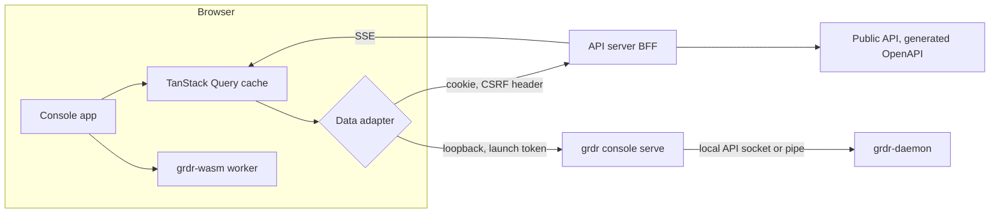

# 27. Web console: experience and front-end architecture

_Status: draft 5 against spine version 4 as amended on 2026-11-11 (principles P14 to P17, decisions D-69 to D-71), the rulings in `_review/01-document-rulings.md`, the owner answers in `_review/02-owner-answers.md` and the owner instructions in `_review/04-owner-kit-instructions.md`. Date: 2026-11-11. Owning squad: interfaces (`web/`). Specifies D-42 and D-44, the console side of D-31, D-51 and D-69, and the operator plane's interface (D-70). Read with: `00-decisions.md`, 02 (SR-18 to SR-26, SR-36), 03, 04, 05, 06, 07, 12, 18, 19, 20, 21, 22, 23, 24, 28, 34, 36._

## Summary

The web console is the only full interface to Guardrails ADR for an organisation: one static React application served locally by `grdr console serve`, by the self-hosted server and by the hosted service (which requires revenue, sponsorship or donated cloud credits, spine section 7). A second application in the same workspace, the operator plane, administers the deployment itself (section 13). Key choices:

1. **One app, two data adapters**: the server through an OIDC backend-for-frontend, or the daemon's local API through `grdr console serve` on loopback. Nothing is forked for standalone (D-01, D-42).
2. **Six areas in surface vocabulary** (Home, Inventory, Sessions, Respond, Protect, Coverage) plus Integrations and Settings; graded internals sit behind a per-user "Show technical detail" preference.
3. **The mode control is the signature pattern**: Off, Watch, Ask, Block with the effective outcome per scope and device counts, the approver for Ask, and replay before any move up from Watch (D-44, D-11).
4. **Value before change, account or sign-up**; setup lists open with steps ticked; every tile is a sentence with a number, a comparison and one action (D-44, D-48).
5. **One interface system (P17), built from Astryx.** Every element is an Astryx component through `@grdr/ui`, which adds only theme, tokens, language tokens and brand defaults; `@grdr/kit` composes `ui` components into the registered patterns and is the embeddable kit; React Aria and the specialised widgets enter only through the exception registry `web/packages/ui/exceptions.toml` (D-42).
6. **The browser holds no tokens and only proposes widening**; confirmation is a step-up over the canonical change digest; agent-written text renders inert; no per-person view exists (D-31, D-51, SR-36).
7. **The operator plane is separate**: its own origin, realm, authorisation and API, runtime settings with staged apply and rollback, and no route to tenant content (D-70).

## Requirements

| # | Requirement | Trace |
|---|---|---|
| R1 | First agent and session within 5 minutes of install, no account, no elevation | Spine section 6; D-48 |
| R2 | Local console that needs no server, usable over RDP and software renderers | D-43; c7 F4 |
| R3 | Mode controls show effective outcome per scope with device counts; Ask names its approver; block explanation within 1 s naming component, rule and Exception route | D-44; P1; h08 |
| R4 | Three policy views over one representation, diff before save, GitOps lock; nothing leaves Watch without replay on screen, in the local console as on a server | D-11; D-53; 12 |
| R5 | Widening from any console surface is a proposal finished by step-up | D-31; SR-23; S-17 |
| R6 | Session-based review queue with three buckets; evidence in 1 click, draft rule in 3, Watch to Block in 5 | D-44; brief 33 |
| R7 | Tiles are sentences; no chart without a claim and a table; "could not look" is never drawn as "nothing found", including pipeline lag | D-44; P9; D-56; c7 F10 |
| R8 | Provider workbench with routing timers, saved dispositions, branded reports, "acting as" banner | D-44; l05 F8 |
| R9 | No per-person score, ranking, group-by or export | D-51; l07 F3 |
| R10 | Content absent, not masked, without a content grant; reads and re-identification visible to the subject | D-51; 21 section 8 |
| R11 | WCAG 2.2 AA with a VPAT 2.5Rev INT per release line | D-42; brief 30 |
| R12 | Every user-visible string is a language token (D-69) from the first commit; pseudo-locales `en-XA`, `ar-XB` and `ja-XC` in CI and in Storybook; no product name in code, only the brand manifest | D-42; D-66; D-69; c7 F9 |
| R13 | Tables of any size and large session graphs stay responsive; live updates survive enterprise proxies | D-42; D-56; P15; brief 30 |
| R14 | The kit embeds in a partner host with no style or script leaking either way (Astryx inside a shadow root); disclosure and component naming not brandable | D-42; D-41; 21 |
| R15 | Two primary plans by default; plans never differ by feature | D-04; P11; c7 F10 |
| R16 | Agent-, tool- and model-written text never renders as links, images or markup | SR-36; TM-16 |
| R17 | A separate operator plane on its own origin and realm: runtime settings with diff, validation, staged apply and rollback; health, upgrades, bundle import with terms acceptance, organisation lifecycle, keys, backups and the operator audit log; no route to tenant content | D-70; D-55; D-58; D-59; D-71 |

## Design

### 1. Design review under the UI rules

**Evaluation.** The category's good parts sit in separate products: BeyondTrust's mode ladder and replay tabs, Origin's review buckets, Tailscale's one-file editors (brief 33). Their consoles also show what to avoid: every BeyondTrust console user is an administrator (docs of 2026-10-13, with more roles announced; brief 33 verification row 5), and its dashboard warns that an empty card may only mean the period excludes the activity (`_sources/beyondtrust/docs-dashboards.md`); Origin's setup starts with inviting a team before any endpoint reports, and offers "Hide system tray icon" (`_sources/origin/docs-llms-full.md`).

**Violations to avoid.** Tenant administration before value is a sign-up wall. Empty policy forms break Smart Defaults. Flat alert lists ignore Chunking. A one-word "Block" on a request-level device breaks Safety, because it predicts something that does not happen. A progress counter that starts at "0 of N devices" breaks Goal Gradient.

**Fixes** are sections 2 to 13; each non-obvious choice names its principle as *Applying: ...*.

### 2. Personas and their jobs

The single and monitored developers need only the local console; the other personas require the server, and the MSP technician requires its provider tier.

| Persona | Jobs | Lands on | Default role (21) |
|---|---|---|---|
| Single developer | See what my agents do; stop the dangerous few; not be nagged | Local Home after the first-run scan | None (standalone) |
| Small team lead | Shared baseline; know which agents the team runs; approve teammates | Home with the setup list | Organisation owner (D-55) |
| Enterprise policy author | Write, test, replay and roll out packs as code | Protect, Rules | Policy author |
| SOC analyst | Decide quickly what matters; investigate; contain | Respond, Review queue | Responder or investigator |
| IT administrator | Deploy, keep healthy, prove coverage | Coverage | Organisation owner |
| MSP technician | Work many organisations from one queue | Provider workbench | Provider policy or response technician |
| Auditor | Prove controls and access; export evidence | Settings, Audit log | Auditor (JIT) |
| Monitored developer | Keep working; understand and contest blocks; see what is collected and who looked | Local console Privacy and My activity, opened from the tray or a block message | None; never needs a console account |
| Deployment operator | Configure, upgrade, back up and health-check the server without editing files or redeploying | Operator plane, Overview (section 13) | An operator-realm role (21), never a console account |

Decision: the monitored developer's surface is the local console on their own device. My activity and Privacy are 28 section 5's screens, rendered here from `grdr.ui.v1alpha1`; My activity shows their sessions as an administrator sees them. Access records about them (`audit.access`, re-identification, model review) reach the device over the control channel keyed by their device-side pseudonym (the server maps its own ingest-layer pseudonym back, D-51), so no server account or re-identification is needed. Both views are two clicks from the tray, are also reached from the block message and `grdr console open`, and cannot be hidden in any shape (D-51). *Applying: Reciprocity, Safety.*

### 3. Information architecture and navigation

Conventional shell: product mark top-left, left rail of areas, top bar with scope switcher, time range (in the viewer's time zone, with a UTC toggle that persists per user), search and command palette (matching labels in the active language and in English), avatar menu bottom-left. In a right-to-left locale the shell mirrors: product mark top-right, rail on the right. At most eight rail items, three to five sections each. The operator plane is a separate application with the same shell and its own rail (section 13). *Applying: Safety, Chunking.*

| Area | Sections | Requires |
|---|---|---|
| Home | Insights tiles; "Needs you"; setup list until complete | Daemon local API, or the server |
| Inventory | Agents (with Unknown agents triage), MCP servers, Skills and plugins, Devices, Model endpoints | Daemon local API for the device; the server for the organisation |
| Sessions | Sessions list, Session detail; Hunt | Daemon local API; Hunt requires the server |
| Respond | Review queue, Findings, Incidents, Kill switch | Findings and the session or device kill switch run locally; Review queue, Incidents and wider kill-switch scopes require the server |
| Protect | Rules, Packs, Approvals and exceptions, Rollouts | Daemon local API; Rollouts require the server |
| Coverage | Assurance levels, Blind spots, Deployment health | Daemon local API, or the server |
| Integrations | Destinations, ticketing, notifications, importers, sign-on | The server |
| Settings | Three groups: Organisation (members and roles, enrolment, Branding); Trust (Privacy, keys and roster, Audit log); Data and plan (Usage, Plan, Export and delete) | A local subset runs on the daemon; the rest requires the server; Branding requires the provider tier; Plan requires the hosted service |

Scope switcher states: device (standalone), organisation, organisation set and provider. A provider scope swaps the rail for the workbench (4.20). The command palette lists every route and primary action the role can reach; shortcuts are shown there, never required. Shortcuts are rows of `interface/shortcuts.toml` (action, keys per OS, scope), read by the console, Rune and the docs; a key bound twice in one scope fails V26, and in every approval surface Escape is Deny and Enter activates the focused button.

Routes (TanStack Router, typed search params): `/l/...` for the local console, `/o/$org/...` for an organisation, `/p/$provider/...` for a provider. Filters, time range, selection and tab live in the URL, so every view is a link; notification deep links land on the object. Every destination is one row of `interface/routes.toml` (id, title token, icon meaning key, area, scopes, requires). The router, the Rune app's navigation, the tray menu, deep links, notification links, tile `action_route`s, the command palette and the docs read it, so a destination has one name and one icon on every surface. At device scope the session list is the destination `activity`, titled My activity, in place of `sessions`; the Rune app's screens are local-console destinations with the same ids and titles: First run, Home, My activity, Rules, Privacy and Settings.

### 4. Screens

Where a screen or part of one needs more than the daemon's local API, its row says so.

**Rules that apply to every screen.**

- *State.* Every screen and every data-bearing pattern renders exactly one `ViewState` of `grdr.ui.v1alpha1`, generated for TypeScript and Rust: `loading` (layout-shaped skeleton after `motion-delay-skeleton`, 150 ms; no spinner over content); `ready`; `empty`, of kind `nothing-yet` (with how to produce some), `could-not-look` (the reason from `health.coverage` or pipeline lag, and the fix) or `no-match` ("Clear filters"); `partial` (names who did not answer); `stale` (data kept, marked with its last revision time; the top bar shows "Live updates paused, reconnecting"); `lagging` (organisation pipeline lag over the 60 s queryable objective: "Could not look after HH:MM: pipeline lag", and counts after that time drawn with the `could-not-look` hatch, never as zero; D-56); `unreachable` (daemon or server: one sentence, the last known status with its age, and "Check health"); `unavailable`, of kind `requires-server`, `requires-internet` or `not-configured` (names the missing prerequisite and the setting or step that supplies an equivalent, such as an internal mirror or an on-premises service; never drawn as a failure or as nothing found; P9, P16); `error` (banner with code, request id and Retry; input is never discarded); `read-only` (with its reason). The `EmptyState` pattern takes the kind, one detail message and one action; the table below gives only the detail. *Applying: P9, Prioritize Intent, Safety.*
- *Primary action.* One per screen, at the top inline end (top-right in a left-to-right locale); secondary actions in a More menu. *Applying: Zen of Clarity.*

**Screen-specific loading and error states**, where they differ from the rules above:

| Screen | Loading | Error |
|---|---|---|
| 4.1 First run | Checklist opening with "Console started" ticked, one row per source scanned | An unreadable source is a "Could not look" row with its reason; the scan never fails as a whole |
| 4.9 Session detail | Header from `session_summary` first, timeline pages streamed after | A missing range is a hatched `health.gap` row; a failed page keeps earlier pages and retries that range |
| 4.13 Replay panel | Step list opening with "Window chosen" ticked, then "Sessions scanned N of M" | Partial replay names who did not answer; promotion stays disabled |
| 4.15 Approvals | Card skeleton with its expiry timer already running | Expired, consumed or voided requests turn read-only with the reason; a failed assertion mints nothing |
| 4.17 Kill switch | Confirm enabled only after 18's `PreviewResponse` returns per-device effective actions | Offline devices show "Applies before the next tool call on reconnect" (D-30) |

| Screen | Purpose and content | Primary action | Empty state |
|---|---|---|---|
| 4.1 First run | 28 section 9 owns the flow and `FirstRunVm`. The read-only scan: agents with tier and assurance level, MCP servers, skills, last week's sessions from transcripts, two or three things worth a look, "would have blocked N times" against Essentials | Turn on protection | Lists what was scanned; offers "Declare a bespoke agent" (05) |
| 4.2 Home | Bento grid of insight tiles (section 7); "Needs you" lists pending approvals for this user, sessions worth a look and the oldest pending request; setup list until done | The action of the top tile | New organisation: setup list plus "Your first device is reporting" tile |
| 4.3 Agents (the device locally; the organisation on a server) | Types and instances with the 05 state, tier, assurance level, sponsor, devices, last seen; header sentence counts agents without a sponsor | Assign sponsor | "No agents seen on N devices that could look" |
| 4.4 Agent detail | Identity evidence, versions, MCP servers, skills, model endpoints, credentials referenced, assurance record with `next_level_blockers`, sessions, policies in force | Fix the top blocker, for example "Restart contained" (D-21) | Not applicable |
| 4.5 Unknown agents triage (the device locally; the organisation on a server) | One card per program identity: evidence, devices, building blocks, inference hosts, outcome (`agent`, `agent-suspected`, `llm-client`); the likely decision is pre-selected | Confirm as new agent type (the 05 decision table; widening choices step up) | "No unknown agents this week" with the last scan time |
| 4.6 MCP servers, Skills, Model endpoints (configuration-observed; broker-observed requires the MCP broker) | Digest, pinning, drift, write-capable tools, reputation (14), users by agent and device | Pin or disable by digest | The configuration paths scanned |
| 4.7 Devices (one locally; all on a server) | Health, install profile, key protection, slot owners, update channel, assurance per agent, Stale and Degraded | Fix the top condition | Enrolment snippet with a deployment key |
| 4.8 Sessions | Filterable list: agent, device group, outcome, labels, assurance level, attribution grade; counts of blocked and asked actions | Open session | "No sessions in this range" with the earliest available date |
| 4.9 Session detail | Header (agent, device, pseudonym, sponsor, assurance level then, attribution grade, canary); tabs Timeline, Graph, Files, Findings, Receipts; content per 18 section 7 | Make a rule from this action (Advanced pre-filled; in the local console, Simple's list) | Not applicable |
| 4.10 Why (route `why/<reference>`; the title comes from the presentation registry by verdict: "Why this was blocked", "Why this needs approval", "Why this was changed", "Why this was delayed"; the `BlockCard` pattern, as 28's block card and `grdr why`) | Target of every block message: component that decided, rule, reason, what to do instead, grant or exception route, receipt link | The one next step chosen by the rule's mode, as 28 section 5's block card defines (Review, Request exception, Allow this pattern or Change mode), pre-filled on the device | Not applicable |
| 4.11 Review queue (requires the server) | Session lineages in Worth a look, Routine and Noise (18 section 6) with score contributions and sampled tags; sessions sharing rule ids, primary observable digest and agent type cluster into one card with a count, never by principal, and sessions over the threshold but beyond the queue's budget show as a count (P9) | Disposition | "Nothing worth a look today", sessions reviewed, canary status |
| 4.12 Findings and Incidents (findings locally; incidents require the server) | Class, two ratings, lifecycle; incident with sessions, observables as pivots, response panel with per-device effective action (D-30), ticket link, checklist opening with "Detected" ticked | Contain | Per class |
| 4.13 Rules (locally: Simple, read-only Code and local replay; on a server: Advanced and server replay; natural language requires a model back end, D-29) | Packs as switches with the mode control; rule list with mode, class, approver, minimum grade, hit counts; editor in three views; replay panel | Move to the selected mode (with replay) or Save draft | Never empty: Essentials is always present (D-53) |
| 4.14 Packs (installed packs locally; library and rings require the server) | Installed packs, version, mode, ring status, update with diff; a version that reads a new field or a higher data class is flagged privacy-relevant (l07 F7); fork | Update or Fork | Library view with the default packs of 12 section 14 |
| 4.15 Approvals and exceptions (the user's own locally; sponsor, admin, quorum and G3 require the server) | Pending requests sorted by expiry, card anatomy of 18 section 4: requests that share rule ids, offered pattern and approver kind arrive as one card with a count and a paged device list, one decision answers every member and each grant stays bound to its own digest; active approvals and exceptions with expiry; tiles Pending, Oldest pending, Median time to answer | Approve with the shown scope: locally by opening `grdr-approve` (28 section 7); on a server by WebAuthn, on another device for G3 (18 section 4) | "No requests waiting"; the expiring-soon list |
| 4.16 Coverage | Coverage ring per group; agent by OS matrix of assurance levels; Blind spots by reason; hook canary verified or unverified; the ceiling matrix (D-23) | Fix the largest blocker | "Coverage is computed after the first session with a tool call" |
| 4.17 Kill switch (session and device locally; wider scopes require the server) | Scope picker from session to organisation; effective action per device and OS; signatures collected and required (D-30) | Freeze (one approver, reversible, 60 minutes) or Request kill (two signatures at organisation scope or wider; until a second approver exists, 18's roster checklist) | Not applicable |
| 4.18 Integrations (requires the server) | Destinations, ticketing, notifications, importers, sign-on and SCIM; each form pre-filled from the manifest's defaults; delivery health with cursor lag | Test and save | The two first-party members of each family, pre-selected |
| 4.19 Settings (a local subset; the rest requires the server) | Privacy: capture level, retention, exclusions of principals, paths and repositories, monitoring catalogue, who can read what; raising capture or adding an exclusion is a widening proposal (D-31). Re-identification (requires the server): purpose, incident reference and two approvers (21 section 8), then a notice to the subject's local console. Keys and roster; Audit log; Usage; Export and delete (D-67). Content age (self-hosted): one tile, a sentence with the newest import's or sync's data age against `content.max_age` and the number of the organisation's Stale devices ("Content 14 days old of a 30-day limit; 3 devices Stale"), with one action, See Stale devices; imports run in the operator plane (section 13). *Applying: Smart Defaults and Zen of Clarity under D-44's tile rule.* | Per section | Not applicable |
| 4.20 Provider workbench (requires the provider tier) | One queue of approvals, worth-a-look sessions, unhealthy sensors and unknown agents, organisation column always shown, filtered by organisation set; per-organisation instructions and service-level timer (deny on timeout); saved dispositions rolled out with the organisation as ring unit; scheduled branded reports; load per technician team | Take next | "All organisations are quiet" with the next scheduled report |

### 5. The signature patterns

These six are signature entries of the pattern registry (section 10, Pattern library). Every surface that shows the object uses the registered pattern; the Rune app and the terminal implement the entries their screens use in their own kits.

**Mode control.** A four-segment control, each segment a Lucide icon plus label: Off `circle-off`, Watch `eye`, Ask `hand`, Block `ban`; never colour alone. Under it, one sentence for the selected scope: "Block here is a boundary on 41 devices, a request on 12, not enforceable on 3." Each count links to the device list. Ask adds "Asks:" and the approver's words from the presentation registry, the same words as 28's block card ("You", "Your team's sponsor", "An administrator", "Two approvers"). Moving up from Watch opens the replay summary ("would have asked you N times last week", "would have blocked M") and cannot be confirmed without it; on a server the promotion then waits for an approver other than the author (D-55). Moving down, or below a locked parent layer's floor, is a widening proposal (section 9) and the control says so before the click. *Applying: Prioritize Intent, Safety, Ethical Friction.*

**Approval card.** The web rendering of the `ApprovalPrompt` value that every approval surface renders (18 section 4, 28 section 7), for remote approvers: who, what in plain words with the canonical call one click away (length shown, hidden and bidirectional characters flagged), why, what is new, then Deny (default focus), Allow once, Allow for this session, Allow for one hour; Exception scopes for Block rules. Buttons arm after `approval-arm-default` (1 s) or `approval-arm-irreversible` (2 s), with a visible arming fill. The binding code is shown beside the WebAuthn prompt (SR-22). A pattern scope shows "would have lifted N requests in the last 7 days". *Applying: Ethical Friction, Excitement (the arming fill is the one micro-interaction here).*

**Session timeline.** A virtualised list (fixed rows of 32 px, 64 px for expanded phases) over 06's read model: tool calls, verdicts including Watch `would_be`, processes, files, network, labels. Like actions collapse into phases. Each row carries a provenance glyph (claimed or observed, P3), a verdict icon with label and any consumed grant id. Gaps render as a hatched "Could not look: reason" row.

**Session tree.** React Flow with dagre up to 2,000 nodes, Sigma above, clustered by child session; both are registered exceptions wrapped once in `ui` (section 11). Sigma needs WebGL, which software renderers and remote sessions may lack (R2): when no WebGL context is created, or a 500-node test frame takes over 50 ms, the tree stays in React Flow with child sessions collapsed into expandable clusters. Edge style encodes kind and grade; `undetermined` actors are drawn as such. A "Table" toggle carries the same data, and nothing requires dragging (WCAG 2.5.7).

**Policy editor.** Simple: pack switches, mode controls, list editors. Advanced: the sentence builder "When [agent scope] does [action] on [resource classes] unless [conditions], [mode]", one language token whose slots are markup, so a language can reorder them; each slot is a pick-list from the schema, pre-filled from the selected action or, for "New rule", from the most frequent Watch `would_be` action of the last 7 days. Natural language (requires D-29's review stage) exists only once the organisation selects a model back end (D-29) and yields a Watch-mode forbid draft labelled "AI-written" beside the deterministic `explain` back-translation (12 section 12, P2). Code: CodeMirror (a registered exception in `ui`) with a Cedar Lezer grammar we write, linted and formatted by `grdr-wasm` (the production compiler, P5). Out-of-subset constructs render as a read-only "Written in code" card; every Simple or Advanced edit shows the `Diff` before save; under the GitOps lock the primary action becomes "Open in repository" and the audited two-person "Edit anyway" sits in the More menu (12, D-55). *Applying: Smart Defaults, never an empty form.*

**Replay panel.** Matched, Almost matched, Not matched and Not evaluable tabs (12 section 11); estimated prompts per developer-day per group of five or more against the budget line; sample receipts. Content-reading rules say "Counted on devices; no content left them". The window defaults to the last 7 days (all history if shorter, 12 section 11). Progress never starts at zero: the step list opens with "Window chosen" ticked before scanning begins. *Applying: Goal Gradient, Smart Defaults.*

### 6. First run and onboarding by persona

**Single developer.** The installer opens the local console's first-run page through a one-time launch URL, with no account and no elevation (D-48); from there the flow, its setup list (opening at 3 of 6) and the Protected or User choice are 28 section 9, rendered from `FirstRunVm`. *Applying: No Onboarding rule, Reciprocity, Goal Gradient.*

**Small team lead (requires a self-hosted server or the hosted service).** Two entries, neither a wall: `grdr join` from a device that already ran standalone (36's "Install free" path), or the demo organisation of synthetic sessions (hosted, or on a self-hosted server the `grdr server demo-seed` organisation), inside which sign-up is offered: on the hosted service a passkey account with a verified email, or sign-in with the work IdP or Google through OIDC, or with GitHub through its OAuth app flow (21 section 6); on a self-hosted server the sign-on providers its operator configured (21 section 6). There are no passwords, SMS codes or magic links. The organisation name is pre-filled from the local alias or IdP domain. The six setup steps are "First scan" (join path) or "Account created" (demo path), "Organisation created", "First device joined" (`grdr join <code>`), "Invite teammates" (an email invitation, single use, expiring and bound to the invited address; 21 section 6), "Baseline selected" (Essentials plus Watch packs, pre-ticked) and "Propose one promotion after replay" (a teammate approves it, D-55); the list opens at 3 of 6 by the join path and 2 of 6 by the demo path. A joined device's live inventory fills Home at once; it is current state, not history, so D-51's local-history rule holds. *Applying: Reciprocity, IKEA Effect.*

**Other personas (require the server; the MSP technician requires its provider tier).** The policy author lands on Rules with replays ready on day 7 and "Lock to git" offered. The SOC analyst lands on the Review queue with the SIEM destination package and P1 and P2 paging pre-set (18 section 10). The IT administrator lands on Coverage with the per-OS MDM or RMM snippet and a minted deployment key (D-36); the rollout list opens with "Key minted" and "Snippet generated" ticked, then counts devices checking in with their assurance level (key-enrolled devices start in Watch until admitted). The MSP technician gets "New organisation from baseline", a four-step wizard that opens on step 2 with the baseline and organisation set pre-selected from the provider's last use, ending in the RMM script (target 10 minutes, spine section 6). The auditor lands on the Audit log under JIT elevation with exports pre-scoped to the last quarter. The deployment operator's first start is section 13's.

### 7. Insights and dashboards

Device tiles run locally; organisation tiles require the server; provider reports require the provider tier.

A tile is the `InsightTile` pattern over `{sentence (a language token over the typed query results, D-69), number, comparison, action, query_id}`, rendered by the server or `grdr console serve` in the viewer's locale and read by `grdr-ui-model` for the desktop's Home tiles, over typed queries against the roll-ups (20), compared with the previous equal period ("first week" until one exists). Examples:

- "Coverage is 82%: 41 of 50 agent instances reach their target level, up from 74%." See blockers.
- "2 new agents appeared this week on 6 devices; neither has a sponsor." Triage.

**Named metrics.** *Coverage*: share of agent instances at their target assurance level, a ring per group that closes at 100%. *Blind spots*: could-not-look conditions by reason. *Prompt health*: median and p95 interruptive prompts per developer-day per group against the budget. Never per person. *Applying: Gamify and Coin Metrics.*

**Charts.** Apache ECharts 6.1.0 behind the one `Chart` component in `ui` (a registered exception, section 11); the title is the claim, with the comparison and a "Table" toggle. "Explain why" is deterministic: the rules, agents or devices contributing most to the change, from the query layer. A model-written explanation appears only where the organisation chose a back end (D-29), labelled "AI-written" (19). Rings for Coverage, heat maps for prompts by rule and weekday, stacked bars for assurance levels by OS. *Applying: Meaningful Highlights, Intuitive Visuals.*

### 8. Progressive disclosure

| Level | What appears | How it is reached |
|---|---|---|
| Casual | Surface terms; assurance level names; modes; one sentence per object | Default for developer, team lead and IT roles |
| Practitioner | Assurance record fields, attribution grade and evidence, approval grade, provenance glyphs, rule ids | "Show technical detail" (per-user preference, persisted server-side or in local settings); default on for author, responder, investigator, auditor and provider roles |
| Expert | Code view, receipts, raw canonical action, hunt SQL (server), API request for the current view ("Copy as API call") | Tabs and More menu on each object; command palette |

There is no global expert mode: disclosure is per object, advanced options live in drawers and modals, and teaching is a one-line hint on first use, never a pop-up tour. *Applying: Zen of Clarity, progressive disclosure.*

### 9. Widening and step-up in the console

Every mutating `grdr.api` and `grdr.local` method carries a confirmation class (23 section 3), and the kit's `useAction` renders it: `none` applies with a staged-rollout note; `consequence` states what stops, with focus on Cancel; `typed` takes the object's name; `propose` is the two-phase proposal below; `quorum` shows "N of M signed". A screen never chooses its own (UX8).

The console controls that widen are: mode down, pause, Exception, removal of a pack, capture level up, exclusion or provider registration, and kill-switch release (D-31). Each is a two-phase proposal rendered from the canonical diff the server or daemon computed (`:propose`, then `:confirm`), and its button is labelled "Propose" with the required grade shown before the click:

- Server: WebAuthn user verification with the change digest as challenge (21 section 6); a two-signature change shows "1 of 2 signed" and who may sign; an author never sees Approve on their own change (D-55).
- Local: "Confirm on this device" hands the request to `grdr-approve` and its OS authenticator sheet. Where the minimum grade is unavailable, Ask becomes Block (D-31). The one exception is the user's own local policy in the User profile: the console shows 18's time-locked step-up in place of G1, with the pending change disclosed for 10 minutes (the default) and cancellable from any surface, then a second confirmation; the grant is marked time-locked and never satisfies a G2 requirement (D-31, R-11).
- From an agent session the daemon and API refuse (S-17), and the console says so.

Narrowing applies in one click with a staged-rollout note, except that promotion to Ask or Block on a server needs an approver other than the author (D-55). *Applying: Ethical Friction only where stakes are high.*

### 10. Design system

**Tokens.** DTCG Format Module 2025.10 files in `interface/tokens/` (primitive, semantic, component; light, dark and high contrast; the script sets below; brand overrides in `brand/tokens/`, ARCH-009) are the only source of visual values for every renderer. Semantic tokens include the status tones `neutral`, `info`, `success`, `warning` and `danger`; the locked mode, verdict, assurance, "acting as", operator-context and disclosure tokens (`$extensions.grdr.locked: true`); categorical, sequential and diverging chart palettes; the `could-not-look` hatch; diff colours; focus ring, elevation and z-index; the motion intents; and `approval-arm-default` and `approval-arm-irreversible`. Style Dictionary 5.8.0, run by `cargo xtask interface gen`, writes every output in one job: CSS properties (console, operator plane, embed, extension, docs and status sites), the Astryx `defineTheme` module, ECharts (the hatch as decals) and CodeMirror themes, Docusaurus Infima, Prism and Mermaid themes, email inline-CSS constants, terminal ANSI roles (16, 256 and truecolour), 28 section 15's desktop outputs and installer artwork; U05 fails a semantic token missing from any output. This section owns the source and the spacing, optical, type and icon rules below for every renderer. Semantic names follow Astryx's `--color-<property>-<role>` grammar.

**Spacing: exponential, base 4 px, ratio 2.** `space-0.5` 2 px, `space-1` 4, `space-2` 8, `space-3` 16, `space-4` 32, `space-5` 64, `space-6` 128. Stylelint rejects any margin, padding or gap literal outside the scale (UX1). Relationship strength sets the step: label to its value `space-1`; items inside a group `space-2`; groups inside a card `space-3`; cards in a grid `space-4`; page sections `space-5`. Spacing between two elements is owned by the larger element, the container, through `gap`, never by margins on children. *Applying: Exponential Scaling, Relationship Strength.*

**Optical corrections.** Named tokens, not spacing steps: `optical-icon-lead` (-2 px on the inline-start icon side of an icon-plus-label button), `optical-caps` (1 px top trim on all-caps labels, in scripts with case only), `optical-chevron-trail` (reduced call-to-action padding on the chevron side), `price-currency-scale` and `price-currency-raise` (36 section 12), `optical-round` (round and triangular glyphs scaled 1.08 against square ones), tabular figures in tables; `text-box-trim` where supported. Visual tests snapshot every button and chip variant. *Applying: Optical Corrections, never mathematical symmetry.*

**Type.** The script token sets `script.latn`, `cyrl`, `grek`, `arab`, `hebr`, `hans`, `hant`, `jpan`, `kore`, `thai` and `deva` set the family stack, line heights, size floor, emphasis and letter spacing for the UI locale's script; the outputs select a set from the generated locale-to-script table (D-69). Inter Variable sets Latin, Cyrillic and Greek; Noto Sans sets the other scripts; JetBrains Mono sets code. All are OFL-1.1 and self-hosted with `unicode-range` subsets, so air-gapped installs render every script alike and a page loads only the glyphs it draws. Ratio 1.25 from a 14 px body, rounded to whole pixels: 14, 18, 22, 28, 35. The size floor is 12 px for Latin, Cyrillic, Greek and CJK and 14 px for Arabic, Hebrew, Thai and Devanagari; weights 400 to 650. Line heights snap to the 4 px base and add one 4 px step for Arabic, CJK, Thai and Devanagari. Outside Latin, Cyrillic and Greek there is no italic and no letter spacing, and emphasis is weight 600. No `text-transform`: casing is written in the message.

**Colour.** A deep, muted neutral ramp with one accent; desaturated status colours for modes and assurance levels, always with icon and label. CI checks 4.5:1 for text and 3:1 for non-text (WCAG 1.4.11) in all three modes, and one theme validator in `grdr-schema` rejects any tenant, co-brand or rebuilt-brand theme whose pairs fail or that overrides a locked token, wherever it is applied (21, 26, 28 DX-22; brief 30 implication 6).

**Icons and words for every enum.** `interface/presentation.toml` maps each value of every enum shown to a person (Mode, verdict, `control`, `visibility`, assurance level, attribution and approval grade, approver, health severity and surface state, finding class and severity, review bucket, capture level, profile, notification class, provenance) to a label and description per disclosure level (language tokens), an icon meaning key, a tone, a CLI word and a tray glyph; `present(value, level)` is generated for TypeScript and Rust (UX5). `interface/icons.toml` maps each meaning key to a Lucide name (`lucide-react` 1.67.0, ISC) and a `mirror` value, seeded from Lucide's direction tags: arrows, chevrons, `undo`, `redo`, `log-out` and `send` mirror in right-to-left layouts; objects, time and status never do. Icons render only through `ui`'s `Icon`; no emoji anywhere; a glyph has one meaning unless a row declares `same_as`. Seed rows: Modes Off `circle-off`, Watch `eye`, Ask `hand`, Block `ban`; verdicts ALLOW `check`, DENY `ban` (same as Block), STEP_UP `hand` (same as Ask), MODIFY `pencil`, DEFER `clock`; assurance levels AL0 `list`, AL1 `binoculars`, AL2 `route`, AL3 `box`, AL4 `shield-check`; device states Protected `shield`, On (requests only) `shield-half`, Scan only `scan`, Degraded `shield-alert`, Safe mode `life-buoy`, Stale `clock-fading`, Snoozed `bell-off`; provenance claimed `quote`, observed `radar`; locked by a layer `lock`. Names are checked against the pinned Lucide version by V26. The language picker shows each language's own name and never a flag.

**Motion.** Three intents as tokens, `motion-quick` 120 ms, `motion-standard` 200 ms and `motion-emphasis` 320 ms, with two easings, plus `motion-delay-skeleton` 150 ms and `motion-live-fade` 2,000 ms; the desktop renders the same intents as springs (28 section 15). Micro-interactions are only a 1 px hover lift on cards, the approval arming fill and the live fade on rows that arrive live; numbers never animate; reduced motion removes all of it. *Applying: Excitement within a Safe structure.*

**Pattern library.** `interface/patterns.toml` registers every pattern: anatomy, the `ui` components it composes, the language tokens it shows, the `ViewState`s it renders, the tokens it reads, its accessibility contract and its renderers (`web`, `rune`, `term`, `notify`, `native` for `grdr-approve`). Fixtures in `interface/patterns/<id>/fixtures/<state>.json` validate against `grdr.ui.v1alpha1` and drive one Storybook story and one Rune headless golden each (U02, U08). Layout primitives (`Page`, `Section`, `Stack`, `Inline`, `Grid`, `Card`) are `ui` components over Astryx's layout components; containers own their gaps by token name. Signature entries: section 5's six, plus `BlockCard`, `ApprovalPrompt`, `Checklist` (its type requires at least one completed step, so no list starts at zero), `InsightTile`, `EmptyState`, `ErrorNotice`, `Quoted`, `ProvenanceBadge`, `StatusSummary`, `WideningProposal`, `KillSwitchPreview`, `Diff` (policy, settings and pack changes), `TermsAcceptance` (the import screen of section 13 and `grdr server airgap import`), `PlanCards` (typed to exactly two primary plans plus "View all plans"), `DisclosurePanel`, `ActingAsBanner`, `ContentGrantBanner`, `DegradedBanner`, `ManagedBanner`, `FilterBar`, `DataTable`, `Form` (its field type requires a default or a declared contact-only reason) and `Chart`. A part used on two surfaces is registered once; a renderer that does not ship a pattern leaves it out of `renderers` rather than drawing its own. Where a pattern needs something no Astryx component offers, the gap goes to the exception registry (section 11), never into a local component. *Applying: Safety (familiarity), Smart Defaults, Goal Gradient, the two-tier rule.*

### 11. Front-end architecture

| Concern | Decision |
|---|---|
| Build | Vite 8.3.7 and React 19.3.1 in a pnpm workspace (`packageManager` pinned; npm, npx and yarn are refused by `guard-command` and verify); static assets with content-hashed names embedded in the server binary and in `grdr console serve`, so self-hosting needs no Node runtime and any cache or CDN in front of the console serves them as immutable (P15) |
| Packages | `apps/console`, `apps/operator` (section 13) and any further application under `apps/`, each composing only `kit` and `ui`; `packages/tokens` (generated from `interface/tokens/`), `ui` (every element is an Astryx component; `ui` adds only theme, tokens, language tokens and brand defaults, never reimplements an Astryx component, and wraps each registered exception once), `kit` (the registered patterns of section 10, composed from `ui` components and nothing else), `api` (generated client, hooks and `useAction`), `i18n` (generated accessors, `present()`, `LocaleProvider`), `wasm`, `embed`. Lints (ARCH-101 to ARCH-106 and UX1 to UX8, team/05 section 8): `@astryxdesign/*` only inside `ui`; `kit` imports only `ui`, `tokens` and `i18n`; `react-aria-components` and `react-aria` only in files listed in `web/packages/ui/exceptions.toml` |
| Astryx | `@astryxdesign/core` pinned exactly to a `latest` release, never canary or lab (0.7.11 when brief 30 read it); each upgrade is one scripted step (bump, `astryx upgrade --apply`, typecheck, visual diff, axe, `eval-ux` verdict on the diff images) that also checks every exit condition in the exception registry; agents use the pinned CLI, not the hosted MCP (brief 30) |
| Exceptions | `web/packages/ui/exceptions.toml`: each entry names the need, the Astryx gap at the pinned version (component name and release notes or upstream issue), why composing Astryx components cannot meet it, the exit condition ("replace when Astryx ships X") and its owner. An entry lands only when `eval-ux` and `lead-interfaces` agree in check runs; a gardener checks every Astryx release against the exit conditions and opens the migration issue when one is met. Registered from the start: the specialised widgets Astryx does not ship as stable (`Chart` on ECharts, the Code view on CodeMirror, the session tree on React Flow and Sigma), each wrapped once in `ui` and styled from the tokens. React Aria enters only through an entry |
| Routing and state | TanStack Router 1.170.46 (URL is state); TanStack Query 5.107.1 with keys `[scope, resource, params]`; Zustand 5.1.0 only for scope, live connection and preferences |
| API client | `openapi-typescript` 7.13.0 and `openapi-fetch` 0.17.0 over the OpenAPI generated from the protobuf contract (D-38); the console calls only the public API, so partners can rebuild it |
| Flows | Setup list, approval card, widening proposal, rollout, kill switch, triage, and the operator plane's settings apply, upgrade and import are explicit typed state machines: a discriminated-union state, a pure `transition`, an exhaustive `switch` and a generated test per transition |
| Forms | TanStack Form 1.33.5 and Zod 4.6.7 inside the kit's `Form`, whose field type requires a default or a declared `contact-only` reason, so a form without defaults does not compile |
| Live updates | One SSE stream per browser (SharedWorker, a BroadcastChannel leader as fallback) carrying only the topics the visible views declare; `api` replicas consume the cell's `live` subject keyed by `(organisation, topic)`, and a coalescer per `(organisation, scope, topic)` emits at most one `{topic, revision, op}` per `min_interval_ms` (1,000 by default; 5,000 for list topics in organisations above 10,000 devices), tile topics carrying the new value so no refetch is needed; each `(organisation, topic)` keeps a five-minute replay ring, and a `Last-Event-ID` older than it receives `reset`, after which the client refetches with `If-None-Match`; the server's `retry:` follows the `console-live` retry policy (full jitter between 5 and 30 s; 03 section 10) and streams drain over a jittered five-minute window on deploy; lists show "N new" instead of reflowing under the cursor; long-poll after two failed connects |
| Tables | Every table, large or small, is the kit's `DataTable` over Astryx Table and its virtualisation plugin, which fits the fixed row heights; server cursor pagination, sort and filter; column virtualisation above 30 columns; APG grid keyboard model with `aria-rowcount` (-1 while the total is an estimate) and `aria-rowindex`; totals render as "about N" from `total_size_estimate`, tables jump by key (time, prefix), never by row index, and no more than 5 pages are held ahead. Brief 30 found no table windowing in Astryx 0.7.11; WEB-04 tests the plugin at the pinned version against the event grids, and only if it fails does TanStack Virtual enter as a registered exception. Filters are the kit's `FilterBar`, whose facets are the fields marked `(grdr.api.filterable)` and which writes the same AIP-160 string that the API, "Copy as API call" and the CLI's `--filter` take |
| Graphs and editors | Registered exceptions, each wrapped once in `ui` and themed from the tokens: React Flow 12.12.1 with dagre 3.1.3; Sigma 4.0.5 above 2,000 nodes (`elkjs` is EPL-2.0, brief 30); CodeMirror 6 (view 6.43.15) with `@codemirror/merge`; Apache ECharts 6.1.0 behind `Chart` |
| Core in browser | `grdr-wasm` in a Web Worker: compile, format, lint, `explain`, builder round-trip (P5); CSP adds only `'wasm-unsafe-eval'` |
| i18n | `@grdr/i18n`: typed accessors generated from the MF2 language tokens by `cargo xtask interface gen` (D-69); `Intl` used only inside this package; one `LocaleProvider` sets `<html lang dir>`, our accessors, Astryx's `InternationalizationProvider` and the `I18nProvider` of any registered React Aria exception from one negotiated locale. No FormatJS or other message runtime in application code (ARCH-106) |
| Testing | Vitest 5.1.0 browser mode, Testing Library 16.3.3, Storybook 10.6.6 with addon-a11y, Playwright 1.65.0 with in-repo screenshots, `@axe-core/playwright` 4.14.0, MSW 3.0.4 |
| Lints | stylelint 17.16.0 with `stylelint-declaration-strict-value` 1.12.1 and `stylelint-plugin-logical-css` 2.1.0, Oxlint 1.93.0, ast-grep 0.51.1 and dependency-cruiser 18.7.2 (all MIT) run ARCH-101 to ARCH-106 and UX1 to UX8 (gate V26); Guidepup 0.40.0 (MIT) drives the U09 screen-reader journeys |

Versions are brief 30's npm `latest` reads of 2026-11-09 (verified). When `web/` starts, the seed replaces each with the newest stable release, pinned exactly in the pnpm lockfile, and each must pass the advisory, licence and provenance checks; Dependabot then keeps them current under 24's dependency cooldown, through an `npm` ecosystem entry that reads `pnpm-lock.yaml`, and a security fix lands without waiting once `eval-security` has read its diff.

**Values are data.** Hosts, origins and ports come from boot configuration and runtime settings; names, domains and addresses from the brand manifest; bounds, intervals and timeouts from `limits.toml`; visual values from the tokens; every string from the language tokens. The figures in this document are those files' defaults, and the console's code holds none of them (check S7, ARCH-021, UX1, UX3).

**Agent guidance.** An agent editing `web/` loads `ui-architect` first, then `frontend-design` for a new screen, then `modern-web-guidance` (Modern Web Guidance v1.0, pinned in the agent marketplace) and `grdr-interface`, as `.agents/kit/path-skills.toml` lists. The guidance settles platform features, browser compatibility and its security topics (HTML sanitisation, strict CSP, passkeys). Where it differs from this document, this stack (React 19, Astryx behind `@grdr/ui`, the DTCG tokens, the CSP below) and D-44 win, and browser built-in AI APIs are used only where a spec asks for them (P2, P8). `garden-deslop` runs the guidance's modernisation workflow over `web/` and opens pull requests in the lane their diff earns.

**Software renderers.** The console needs no GPU: tables, the timeline and ECharts' canvas 2D renderer run on any renderer, and Sigma, the only WebGL dependency, falls back as section 5 states (R2, D-43).

**Local console data adapter.** `grdr console serve` exposes the server's OpenAPI subset for what standalone has (inventory, sessions, findings, packs, grants, health). `/config.json` names the adapter and capabilities; a missing capability renders the `unavailable` state of kind `requires-server` only where a server is genuinely needed, never as an upsell. The six desktop screens (28) are `/l/` routes over `grdr.ui.v1alpha1` view-models from `/vm/<route>`, with intents posted to `/vm/intent`, so web and Rune show the same screen model.

**Accessibility.** WCAG 2.2 AA, including 2.4.11 Focus Not Obscured, 2.5.7 Dragging Movements, 2.5.8 Target Size (our minimum is 32 px) and 3.3.8 Accessible Authentication, which WebAuthn satisfies. Pattern contracts per registered pattern run against the browser accessibility tree, after Astryx's `a11y-spec` approach; `forced-colors` in every pattern; screen-reader journeys per release through Guidepup driving NVDA on hosted Windows runners and VoiceOver on hosted macOS runners (U09), judged by `eval-a11y`; a person's NVDA, VoiceOver or JAWS pass adds evidence when someone is available and never gates. Astryx publishes no conformance report, so our VPAT covers it.

**Internationalisation.** D-69 and 34 section 15a own the system; this console applies it. Every visible string, `aria-label`, `title` and `alt` included, comes from a generated `@grdr/i18n` accessor, and sentences are never assembled from pieces (UX3, UX4). Layout uses logical properties only (UX6), so every screen mirrors under `dir="rtl"`. The canonical call, paths, hashes, ids and code render left-to-right in `<bdi dir="ltr">`; agent-written text renders in `Quoted` with `<bdi dir="auto">`. Times are UTC values shown in the viewer's zone, with the UTC toggle in the top bar and the ISO 8601 UTC form in each tooltip and copy action. Numbers use the locale's numbering system except identifiers, versions, ports and addresses, which use ASCII digits. Server-sorted tables use CLDR root order and say so; client-sorted lists use the viewer's locale. Rule ids, Cedar keywords, action classes, verdict codes and CLI commands render untranslated as code; Mode labels, rule titles and explanations translate, and the Practitioner level shows the English identifier beside a translated label. Deny reasons to agents are English `agent.*` tokens with stable codes (c7 F9). `en-XA`, `ar-XB` and `ja-XC` run in CI on every route and story (U04), and Storybook's locale toolbar renders every story in them and in each shipped locale.

### 12. Plans and pricing for the hosted service

Shown on the public site and in Settings, Plan, when the hosted service runs. It requires the `distributed` profile and its load test, and revenue, sponsorship or donated cloud credits (D-63, spine section 7). Any paid plan also requires counsel's opinion; until then Loonaro offers nothing paid and the catalogue holds only free plans (spine section 7). 36 section 12 owns the plan catalogue, cards, prices, calls to action and the downgrade and cancel flow: Free and Team by default, the rest behind "View all plans", plans differing only in quotas, retention, support and terms (P11). The public pricing page and Settings, Plan both render that catalogue with the kit's `PlanCards`, whose props take exactly two primary plans plus the rest behind "View all plans", and this console adds only that the cancel flow states devices keep enforcing cached policy (P4). Pricing and the demo organisation need no sign-up. *Applying: two-tier rule, Chunking, No sign-up wall.*

### 13. Operator plane

The operator plane administers one deployment: an enterprise's self-hosted server, any hoster's, or a cell or the router of Loonaro's hosted service. Settings, health and lifecycle live in a running application with history and rollback, as in GitLab's administration area, instead of in environment variables and redeploys (D-70). It is `apps/operator`, built from the same packages, tokens, patterns and language tokens as the console and composed from Astryx through `ui`, so a dialog, a table or a confirmation looks and behaves as it does in the console. Anything inside an organisation (rules, sessions, findings, members) stays in the console, and neither application links into the other's realm. *Applying: Safety (one system), Prioritize Intent.*

**Isolation.** The `operator` server target serves the plane on its own listener and origin, set in boot configuration (20, 24): loopback by default in `embedded`; in `ha` and `distributed` its own hostname through its own Ingress, with an optional IP allow-list and mutual TLS. It shares no cookie, session or account with the console and calls only `grdr.operator.v1alpha1` (23) through its own backend-for-frontend. It has no route to tenant content: it calls no content API, the operator still cannot read content (D-55; R10), and support grants and two-person break-glass work as 21 section 8 says. Its CSP is the console's, with `frame-ancestors 'none'` and no embed route.

**Sign-in and first start.** Operator accounts are a separate realm (21): passkeys, or the operator's own IdP through OIDC or SAML, authorised in the Cedar namespace `Grdr::Operator`. TOTP exists only as a second factor for an operator account that cannot use a passkey, never for approvals (21 section 6). On first start the server prints a bootstrap token once, which can register only the first operator passkey. Before sign-in the plane shows one status sentence (whether the server started and preflight passed, with no detail) and one action, "Register the first operator", which takes the pasted token (never carried in a link, like a join code) and a passkey whose name is pre-filled from the browser's platform. It shows nothing more without an account because it administers the deployment; `grdr server preflight` and the management port's `/livez` and `/readyz` give status without one. The setup list then opens with "Server started" and, when preflight is green, "Preflight passed" ticked, followed by "First operator registered", "Console sign-on connected" and "First organisation created" (its name pre-filled from the sign-on domain). *Applying: No sign-up wall (status before the account), Goal Gradient, Smart Defaults.*

**Shell.** Section 3's shell with its own rail, and a top bar in the locked operator-context tone naming the deployment, so the plane is never mistaken for the console. *Applying: Safety, Chunking.*

| Area | Content | Primary action | Empty state |
|---|---|---|---|
| Overview | Status sentence; "Needs you" (failed health checks, expiring certificates, an offered bundle, an overdue restore drill); setup list until complete; tiles | The action of the top item | Not applicable |
| Health | Every target and port (database, bus lag, lake commits, Keys and KMS, backup health, certificate expiry) with history | Open the failing check | Not applicable |
| Settings | Sign-on providers; mail; storage and retention defaults; quotas and cells; modules and adapters; telemetry export; maintenance mode | Review changes | Never empty: each group opens on the active revision |
| Upgrades | The offered bundle with changelog, upgrade path and preflight; migration status; the fleet offer by ring; update policy; bundle and content import | Upgrade, or Import bundle | "This deployment runs the newest bundle it knows of", with the source and the time it last checked |
| Organisations | Create, suspend, move between cells, provider tier | Create organisation | The setup list's "First organisation created" step |
| Keys | Deployment root, cell delegations, KEK versions, response-key certificates, rotation | Rotate | Not applicable |
| Backups | Backups and restore drills with their results | Run restore drill | "No backup yet", with "Back up now" |
| Diagnostics and audit | Support bundles with a preview of every file; the operator audit log on its own checkpoint chain | Create support bundle | Not applicable |

**Settings.** Runtime settings are versioned revisions in the relational store, validated against the `grdr.config` schema (03 section 9), and each form is generated from that schema, so a new setting needs no operator-plane release (P14). A form opens on the active revision, with the schema's defaults marked. A change is a draft revision: the plane shows its `Diff` against the active revision and the schema's validation, then applies it staged. Each target loads the revision and reports healthy; the apply list opens with "Validated" ticked; a target that fails its health check rolls the revision back everywhere, naming the check. Keys under a source lock (configuration as code through `grdr operator config export` and `apply`, or Terraform) render read-only with "Change in repository", as Rules does under the GitOps lock. Widening a setting the schema marks `security` is a `propose` action finished by passkey step-up (section 9); a `stability` option states the restart or drain it causes before the click. `grdr config explain`'s layering shows whether each value comes from boot configuration or a runtime revision. *Applying: Smart Defaults, Ethical Friction, Goal Gradient.*

**Upgrades.** Every source works the same way: the project's TUF repository through the operator's mirror or a CDN, or an imported air-gap bundle (24 section 7). The screen shows the offered product bundle, its changelog, the upgrade path's hops and the preflight result. Preflight includes the compatibility resolver, which refuses a combination outside the declared contract ranges before anything activates and names the component and the contract (D-71). Applying runs the server upgrade (rolling for one minor, recreate for two, expand-and-contract migrations so N and N+1 run together, automatic binary rollback when a health check fails), then offers the new sensor packages to the fleet through rings with bake times and automatic halt: server first, gateways next, endpoints last. The upgrade list opens with "Bundle verified" ticked. The update policy is a setting: manual, automatic patch releases, automatic minor releases inside a maintenance window, or LTS only. Where the server is upgraded through `helm upgrade` or endpoints through MDM, the screen shows skew and preflight and applies nothing. Content packs, rules, intelligence snapshots, adapter manifests and policy move on their own signed channels and appear here only with their data age (24 section 11, D-58).

**Import and terms.** In an isolated deployment the Upgrades screen leads with one tile: the newest import's data age against `content.max_age`, the freshness-statement state and the number of Stale devices ("Last import 12 days ago, content 14 days old of a 30-day limit; 3 devices Stale"), with one action, Import bundle, and the detected base pre-selected. Import is a step-up action that verifies the bundle offline against the project root and resumes after interruption. It then shows the `TermsAcceptance` pattern, the same screen `grdr server airgap import` prints: Guardrails ADR's Apache-2.0 terms, the licences of every bundled third-party component grouped by licence, and any component terms that need acceptance. Open-source licences are acknowledged; acceptance is real only where a component's terms ask for it. Nothing is imported before explicit acceptance, which the operator audit log records with the operator, the bundle digest and the time; an unattended install passes `--accept-terms <file>` naming the digest it accepts (D-59, 24 section 7). *Applying: Smart Defaults, Zen of Clarity, Ethical Friction.*

**Organisations, keys, backups and audit.** Creating an organisation opens a pre-filled form; suspending one is a `consequence` action that says devices keep enforcing cached policy and console sign-in stops; moving one between cells is a `propose` action showing 20's shard plan; the provider tier is a setting of the organisation. Key rotation and break-glass follow 21 section 8, and two-person actions show "1 of 2 signed" (`quorum`). A restore is a `typed` action. Support bundles open with a preview of every file, metadata only. The operator audit log is its own checkpoint chain with "Verify chain" (D-39). *Applying: Ethical Friction only where stakes are high.*

**Tiles and metrics.** Overview tiles follow section 7's rule: "2 of 14 targets degraded since 09:40: bus lag 95 s on `ingest`, against a 60 s objective. Open health." "Last passing restore drill 6 days ago, inside the 30-day objective. Run drill." Named metrics: *Content age*, the newest import or sync against `content.max_age`, and *Restore confidence*, the age of the last passing restore drill against its objective. Organisations appear by name; nothing ranks organisations or people (D-51). *Applying: Meaningful Highlights, Gamify and Coin Metrics.*

**Hosted.** Loonaro's hosted service runs the same plane per cell and for the router, reachable only from Loonaro's private network (32).

## Interfaces and contracts

| Contract | Shape | Other side |
|---|---|---|
| Public API | Generated OpenAPI 3.1 from `grdr.*` protobuf; the console calls nothing else except BFF routes | 23 |
| BFF routes | `/auth/login`, `/auth/callback`, `/auth/logout`, `/bff/session` (account, roles, scopes, step-up freshness), `/bff/live` (SSE); `__Host-` HttpOnly SameSite=Lax cookie; CSRF header plus Origin and Fetch-Metadata checks on every mutation | 21, 23 |
| Step-up | `POST .../changes/{id}:propose` returns canonical diff and digest; `:confirm` takes a WebAuthn assertion over the digest | 18, 21 |
| Local console | `grdr console serve --launch` prints a one-time URL; loopback random port; Host and Origin checks; no CORS; widening forwarded to `grdr-approve` | 03, 18 |
| Read models | `session_summary`, `session_edge`, timeline pages, assurance record with `next_level_blockers`, replay result buckets, review-queue score contributions | 06, 07, 12, 18, 20 |
| Tile spec | `{id, sentence (a language token; translations in the pack's `messages/<locale>.mf2.toml`, D-69), number_query, comparison_query, action_route, roles[], rollup, freshness_s}` as entries of kind `tile` (and `report`) in a signed pack on the detection-content channel (P7, D-37); both queries read the declared roll-up, the validator refuses a raw-table query, and `freshness_s` defaults to 60; `action_route` names a route id from `interface/routes.toml`, never a URL; read by the server, the console and `grdr-ui-model` | 22 (pack format) |
| Capabilities | `/v1/capabilities` or `/config.json` locally: adapter, features, and which prerequisites (server, provider tier, model back end, hosted service, internet) are present | 23 |
| Embed | `@grdr/kit`, `@grdr/tokens`; the kit renders Astryx inside a shadow root with Astryx's stylesheet adopted there (WEB-43); iframe contract `grdr.embed.v1` (`ready`, `resize`, `navigate`, `select`, `theme`) with a signed embed token; `@grdr/kit` takes `locale` and `timeZone` from the host and carries its compiled tokens for every shipped locale | 21 |
| Brand manifest | `brand/brand.toml`: product name, short name, domain, support and security addresses, legal links; a self-hosted deployment sets its own hosts in configuration and never depends on the manifest's domain | 36, D-66 |
| Desktop | `grdr.ui.v1alpha1` view-models rendered as the six `/l/` screens; the token source (desktop outputs are 28's); the same language tokens and generated accessors (D-69) | 28 |
| Operator API | `grdr.operator.v1alpha1`, separate from `grdr.api`, through the operator plane's own backend-for-frontend: runtime-settings revisions, health history, upgrade and import operations, organisation lifecycle, keys, backups, operator audit | 20, 21, 23, 24 |

## Behaviour by deployment shape

| Shape | Differences |
|---|---|
| Standalone | Local adapter; no accounts; scope is the device; widening via `grdr-approve`; Hunt is CLI-only (the Hunt view requires the server); Plan and Branding absent; no operator plane (`grdr doctor` covers the device) |
| Platform self-hosted (the default way to run the platform) | BFF with OIDC, SAML or local passkeys; full IA; GitOps lock; no phone-home, so the demo organisation is a local seed (`grdr server demo-seed`); the operator plane on its own listener and origin (section 13) |
| Hosted (requires revenue, sponsorship or donated cloud credits) | Same app; router-assigned cell is invisible; Plan in Settings; "acting as" banner on support grants (21 section 8); the operator plane per cell and for the router, on Loonaro's private network only |
| Provider | Workbench; organisation sets; co-brand profile applies unlocked tokens, logo, domain and display name |
| Embedded (L5, co-brand L6, and rebuilt L6, which requires an embedding partner) | Partners use the public API, mount `@grdr/kit` (experimental until an external embed pilot, D-60) or frame console routes with a signed short-lived embed token instead of third-party cookies, per-organisation `frame-ancestors` and `allow="publickey-credentials-get"` for step-up; R14 holds (21 section 16) |

## Extension points

- **Tiles and reports** as signed pack data (`tile`, `report`): a language token over typed queries, translated in the pack's locale members.
- **Integration forms** generated from integration manifests (D-40).
- **Operator settings forms** generated from the `grdr.config` schema, so a new runtime setting needs no plane release (P14).
- **Third-party panels** through the iframe contract in reverse, declared in a manifest, metadata only.
- **Builder atoms** from the Cedar schema and class vocabularies (12), so a new class needs no console release.

## Security and privacy

- No tokens in the browser; BFF per RFC 10017 (BCP 212). Console session 12 hours absolute, 1 hour idle (21).
- CSP: `default-src 'self'` with `connect-src 'self'`, so a headless crawl of every route records no request to another origin in any shape (24-28); scripts by hash only; `'wasm-unsafe-eval'`; no `eval`; Trusted Types; `frame-ancestors 'none'` except embed routes.
- Inert rendering (SR-36): agent, tool, model and ticket text renders through the kit's `Quoted` from 23 section 10's untrusted envelope, which caps length, flags hidden and bidirectional characters, renders inside `<bdi dir="auto">` and never links; the desktop kit, `term`, the notification kit and the extension render the same envelope and never re-escape it; `dangerouslySetInnerHTML` is lint-banned outside one audited component for our own documentation.
- Under a content grant a banner names purpose, expiry and that the subject sees the access (R10; 21 section 8).
- The API refuses group-by, sort or export by human principal (R9). Pseudonyms render as short handles (`prn_7f3a`) outside an approved re-identification.
- The local console refuses requests whose Host or Origin is not the launch origin, preventing DNS-rebinding; mutating calls from agent lineage are refused by the daemon (S-17).
- Approval and widening cards render from the server's canonical action, never from agent text (SR-18).
- Support bundles and exports from the console obey the capture level (04 section 11).
- The operator plane is its own origin and realm: no credential, cookie or session is valid across it and the console, it reaches no content API, and widening a `security` setting needs passkey step-up (section 13, D-70).

## Test and evaluation strategy

| Property | Test | Oracle |
|---|---|---|
| First value (spine section 6) | Scripted install on clean images of three OSes with seeded transcripts | First-run page with agents and sessions under 5 minutes; no elevation prompt |
| Mode control truth | Fixture fleets with known assurance records | Sentence counts equal the assurance read model per device |
| Empty-state honesty | Inject `health.coverage` gaps and pipeline lag | "Could not look" rendered, never "Nothing yet" |
| Privacy at metadata | Canary strings in prompts, paths and commit messages at default capture | Zero canaries in responses or DOM for any role without a grant |
| No per-person view | Static scan of group-by options; API contract tests | No principal field as group-by, sort or export key; API refuses |
| Inert text | Hostile strings (Markdown, HTML, `javascript:` URLs, bidi overrides, 100 kB padding) in every agent-written field | Text nodes only; flags shown; no navigation |
| Widening surfaces | S-17 harness drives the local console and loopback from an agent session | No change confirmed without a grant |
| Accessibility | axe in Playwright on every route and story; pattern contracts; Guidepup screen-reader journeys (U09) | Zero AA failures; VPAT evidence present |
| State machines | Generated test per transition; model-based tests of setup, approval, settings-apply, upgrade and import flows | Every state reachable, none stuck |
| Performance | Playwright traces with marks on seeded data (100,000 rows; 10,000-event session; 5,000-node tree); bundle-size check | Section budgets below |
| Console read path at scale | SP-Q2 | Its pass line in the risk table |
| Air-gapped surfaces | S-31 step 15 (gate 24-28): headless crawl of every console, operator-plane and local-console route in the isolated lab | Zero requests to another origin |
| Web security baseline | OWASP ZAP baseline scan of the console, the operator plane and both BFFs against the embedded server in CI; CodeQL from the first push, the repository being public from it (its terms allow no automated analysis of a private repository) and Semgrep OSS rules for TypeScript | No unresolved high finding |
| Operator isolation | Cookie, session and CORS probes between the console and operator origins; static scan of the operator API's methods; canary strings in tenant content | No credential is accepted across origins; no operator method reads content; zero canaries in any operator response or DOM |
| Settings rollback | A runtime revision that fails one target's health check, in `embedded` and `ha` | Every target back on the previous revision; the failing check named; each step in the operator audit log |
| Terms at import | Import without acceptance, with acceptance, and unattended with an `--accept-terms` file naming another digest | Nothing imported without acceptance; the record carries operator, digest and time; the wrong digest is refused |
| Usability | Persona council (D-47) on each change to a primary flow, walking scripted persona journeys; a study with five developers (l10 spike 3) adds evidence when people are available and never gates | Find a session and block one action in 10 minutes, no documentation |

**Performance budgets (targets, measured per release on stated hardware).** Hosted cold load of the shell and Home under 350 KB gzip transferred, of which `astryx.css` is 42 KB (measured, brief 30); route chunks under 150 KB gzip; ECharts, React Flow, Sigma, CodeMirror and `grdr-wasm` lazy-loaded. Time to usable Home p75 under 2 s hosted and under 1 s local. INP p75 under 200 ms. No long task over 100 ms while scrolling 100,000 rows. Session timeline first rows painted within 500 ms of the first page arriving (server target 2 s, spine section 6). JS heap under 250 MB after 8 hours on Home with live updates. Each `@grdr/kit` pattern under 60 KB gzip excluding React and the shared `ui` chunk.

## Work breakdown

**E1 Foundations.**
- WEB-01 `web/` pnpm workspace and import lints. Accept: every rule of ARCH-101 to ARCH-106 and UX1 to UX8 fails CI on its fixture with a message naming the fix, including an `@astryxdesign/*` import outside `ui`, a `kit` import of anything other than `ui`, `tokens` and `i18n`, a `react-aria-components` or `react-aria` import from a file not listed in `web/packages/ui/exceptions.toml`, and an npm, npx or yarn call or lockfile.
- WEB-02 Token outputs of section 10 (desktop outputs are 28's DX-24 and DX-25). Requires: WI-0041. Accept: one token change reaches every output; a semantic token missing from an output, a failing contrast pair or an overridden locked token fails CI (U05).
- WEB-03 Spacing, optical, string and direction checks. Accept: an off-scale literal, a JSX string literal (`aria-label`, `title` and `alt` included), a hard-coded product name, a physical CSS property, a `text-transform`, a message concatenated with other text, or an `Intl` or `toLocale*` call outside `@grdr/i18n` fails the build (UX1, UX3, UX4, UX6).
- WEB-04 Astryx hedge spike (c7 spike 3). Accept: eight `ui` components re-pointed from Astryx to another implementation on a scratch branch with zero application diff, recorded and discarded, never shipped beside Astryx; Astryx Table's virtualisation plugin meets the 100,000-row and 10,000-event budgets, or TanStack Virtual is registered as an exception; decision recorded.
- WEB-05 `LocaleProvider` and negotiation. Accept: one negotiated locale drives our accessors, Astryx and every registered exception (a story asserts each in `ar-XB`); `<html lang dir>` matches; every route passes the `en-XA` overflow check, the `ar-XB` mirrored screenshot and the `ja-XC` glyph check.

**E2 Local console.** Requires the daemon local API and `grdr console serve`.
- WEB-10 Local adapter against `grdr console serve`. Accept: launch-token, Host and Origin tests pass; every local-console route passes its Playwright suite with the GPU disabled (SwiftShader) and in a Windows RDP session.
- WEB-11 First run and setup list. Accept: the first-value harness passes on three OSes; the list opens at 3 of 6 (28 DX-08).
- WEB-12 Home, Coverage, Agents, Unknown agents triage, MCP servers and Skills. Accept: every tile has number, comparison and action; the empty-state honesty test passes.
- WEB-13 Sessions, session detail and Findings. Accept: a 10,000-event session meets the paint budget; gaps render as could-not-look; finding to evidence in 1 click.
- WEB-14 Why page and local exception request. Accept: opens from a block message within 1 s, pre-filled.
- WEB-15 Rules (Simple and read-only Code), Packs, mode control. Accept: the control's sentence matches the assurance model; each widening control of section 9 opens a proposal and none applies without a grant at its minimum grade.
- WEB-16 Privacy and My activity. Accept: collected categories, readers and "who looked" within 2 clicks of the block message's console link and of the tray (28 DX-14).
- WEB-17 Session and device kill switch. Accept: freeze and end session confirm only after the effective action is shown; release is a widening proposal; state survives a daemon restart in the view.

**E3 Signature patterns.**
- WEB-20 Mode control and approval card in `kit`. Accept: pattern contracts and axe pass; arming at 1 s and 2 s.
- WEB-21 Local replay panel. Accept: four buckets and prompt estimate; promotion refused without a replay over at least 7 days of history; the step list never renders at zero.
- WEB-22 Advanced builder and Code editor on `grdr-wasm`. Accept: round-trip property test 100%; "New rule" never opens with an empty slot.
- WEB-23 Session tree at 5,000 nodes. Accept: Sigma path loads; with WebGL disabled the clustered React Flow path renders the same nodes; table equivalent; no drag-only action.

**E4 Server console.** Requires the server.
- WEB-30 BFF and live updates. Accept: works through a buffering proxy in every S-18 topology; SP-Q2 passes.
- WEB-31 Review queue, Findings, Incidents. Accept: finding to evidence in 1 click; per-device effective action shown before confirm.
- WEB-32 Approvals with G3. Accept: a mismatched binding code mints nothing; an author sees no Approve on their own change.
- WEB-33 Rollouts, Integrations, Settings, Kill switch. Accept: two-signature progress shown; content absent without a grant; a re-identification with one approver, or without purpose or incident reference, is refused, and a completed one appears in the subject's local "who looked" log.
- WEB-34 Organisation onboarding. Accept: tenant to first device inventory in 30 minutes (brief 33).
- WEB-35 VPAT 2.5Rev INT. Accept: zero AA failures in the automated audit and the U09 journeys.

**E5 Provider and embed.** Requires the server's provider tier and tenancy model.
- WEB-40 Provider workbench. Accept: cross-organisation approval in 2 clicks, in both audit logs; queue p95 under 1 s at 100 organisations (l05 S1).
- WEB-41 Co-brand. Accept: everything but disclosure, "acting as" and component naming changes with the brand.
- WEB-42 Iframe embed. Accept: embed token, `frame-ancestors` and in-frame step-up work in Chromium, Firefox and WebKit.
- WEB-43 Kit in a shadow root. Accept: `@grdr/kit` mounted in a partner-shaped host page renders Astryx inside a shadow root with Astryx's stylesheet adopted there; no host style changes a kit element and no kit style reaches the host (computed-style diff in Chromium, Firefox and WebKit); focus, dialogs and popovers stay inside the root. If it fails, the embed package becomes a registered exception that still matches through the tokens.

**E6 Hosted.** Requires the hosted service (spine section 7). WEB-50 Demo organisation and the Settings, Plan view of 36's catalogue. Accept: Free and Team shown and the rest only behind "View all plans"; no feature differences (36's `plans-lint`); pricing and the demo organisation load with no account; the cancel flow follows 36 section 12, opening with Export.

**E7 Rebuilt white-label.** Requires the brand manifest (D-66); shipping it requires an embedding partner. WEB-60 Build from another brand manifest. Accept: no value from Loonaro's brand manifest in the output.

**E8 Operator plane.** Requires the server's `operator` target and runtime-settings store (20), the operator realm (21), `grdr.operator.v1alpha1` (23) and the operator listener and Ingress (24).
- WEB-70 Operator shell, sign-in and first start. Accept: the bootstrap token registers exactly one passkey and is refused after; no console cookie or session is accepted on the operator origin, and none of the plane's by the console; the setup list never opens at zero.
- WEB-71 Settings with diff, validation, staged apply and rollback. Accept: every runtime key renders from the schema with no hand-written form; a failed health check on one target rolls the revision back everywhere; widening a `security` setting needs passkey step-up; source-locked keys are read-only.
- WEB-72 Health, diagnostics and the operator audit log. Accept: every target and port has a check with history; a probe that cannot run shows `could-not-look`, never healthy; chain verification fails on an altered entry.
- WEB-73 Upgrades, import and terms. Accept: the resolver's refusal names the component and the contract (D-71); the rings halt on an injected failure; an import without acceptance changes nothing, and the acceptance record matches the bundle digest; under Helm or MDM management nothing is applied and skew is shown.
- WEB-74 Organisations, keys and backups. Accept: suspension states its consequence before confirming; break-glass needs two operators; a restore drill's result reaches the Overview tile.

## Risks, open questions and spikes

| Item | Risk or question | Spike or response |
|---|---|---|
| Astryx churn | 47 stable releases in 136 days; 26 breaking migrations in 0.7.0; breaking changes ship only in minors under a CI-enforced rule, but `[experimental]` surfaces may break in a patch (brief 30 verification rows 2 and 3) | WEB-04; the `ui` boundary makes the fallback a one-package change; revisit when one upgrade takes more of the subscription's usage windows than a typical accepted work item (S-20) |
| Astryx gaps | A pattern needs a component Astryx does not ship | The exception registry, with an exit condition per entry and a gardener checking each release; never a local component |
| SSE through enterprise proxies | Buffering proxies stall streams | WEB-30 tests the S-18 topologies; long-poll fallback |
| SP-Q2 Console read path | Do tiles, live updates and conditional reads hold at fleet scale? | A 1-million-endpoint model with 300 users and 450 streams: Home under 2 s at p75; tiles under 300 ms at p99; zero tile plans touch `activity`; at most 1 message a second per topic per stream; deploy drain under 2× the steady reconnect rate; 304s at least 70% when 80% of requests send `If-None-Match` |
| WebAuthn in iframes and on remote desktops | Permissions policy and RDP authenticator redirection vary | WEB-42 matrix; fall back to opening the step-up in a top-level window |
| Cedar grammar | Our Lezer grammar can drift from Cedar | Grammar tests against Cedar's corpus and `grdr-wasm` parse results |
| `grdr-wasm` size | Unmeasured | Measure in the local console build; over 1.5 MB gzip, compile in the BFF and keep format and lint in the browser |
| Rune token mapping | Rune is pinned to a revision with no releases (brief 30) | Generator versioned against the pinned revision (28) |
| Open: demo organisation | Public without any account? | `product-lead` decides; default public, synthetic only; self-hosted installs use the local seed |

## Deviations from the spine and objections

None against the spine. Readings recorded so they can be overruled:

1. Resolved by R-03: `grdr console serve`, an unprivileged per-logon-session process, fronts the daemon's local API and the daemon binds no TCP port (spine D-42, D-43).
2. Open: `l05` F8 budgets approval load per technician; following P8 and 18 section 13, it is reported per technician team.
3. Resolved by R-11: the time lock stands in for G1 only for the user's own local policy in the User profile, default 10 minutes; elsewhere Ask becomes Block (spine D-31). Section 9 follows it.

## Sources

Research briefs: `research/33-ux-personas.md`, `research/30-web-stack.md` (with its independent verification), `research/36-response-operations.md`, `research/01-origin.md`, `research/02-beyondtrust.md`, `research/h08-practitioner-voice.md`; captures `research/_sources/beyondtrust/docs-dashboards.md`, `research/_sources/beyondtrust/docs-exception-requests.md`, `research/_sources/origin/docs-llms-full.md`. Review notes: `design/_review/c7-interfaces-ux.md`, `l03`, `l05`, `l06`, `l07`, `l10`, `00-resolution.md`.

Primary URLs, as cited in the briefs: https://www.rfc-editor.org/info/rfc10017 ; https://www.itic.org/policy/accessibility/vpat ; https://www.designtokens.org/tr/drafts/format/ ; https://github.com/meta/astryx/wiki/Release-Process ; https://tailscale.com/kb/1550/visual-editor . Not in the briefs, to confirm before first use: https://github.com/lucide-icons/lucide , https://github.com/rsms/inter , https://github.com/JetBrains/JetBrainsMono , https://developer.chrome.com/blog/modern-web-guidance-v1 , https://github.com/GoogleChrome/modern-web-guidance .

Lucide's licence was read on 2026-11-10 (ISC, with MIT for Feather-derived icons; 28 Sources). Inter, JetBrains Mono and the Noto Sans families are OFL-1.1 per their npm metadata (`@fontsource-variable/*`, read 2026-11-11; the licence gate reads each licence file before adoption). Unverified: `text-box-trim` support, whether Astryx Table's virtualisation plugin exists at the pinned version and meets the event grids (WEB-04), whether Astryx's `InternationalizationProvider` takes our locale, and current browser behaviour for third-party cookies and WebAuthn in iframes.
