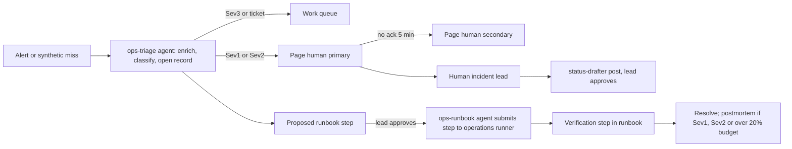

# 32. Hosted service operations, day-2 for self-hosters, and economics

_Status: draft 4 against spine version 4, rulings R-36 and R-43 (`_review/01-document-rulings.md`) and the owner's answers (`_review/02-owner-answers.md`), revised against the owner's instructions of 2026-11-11 (`_review/04-owner-kit-instructions.md`: no human gates in building, reviewing, landing and releasing, the operator plane per cell, defaults that need no new account, nothing hard-coded, the repository public from the first push) and principles P15 to P17. Owning squad: SQ-13 Server platform (team/01), with SQ-16 Release and lab for the deployment modules and the release-side day-2 artefacts. Specifies D-56, D-58, D-68, the operational half of D-63 and D-04. Read with: `00-decisions.md`; 02 (ADV-8, ADV-10, ADV-11, SR-42 to SR-46, SR-50); 19 (payer and budgets); 20 (targets including `operator`, runtime settings, backup and restore mechanics, quotas, cells, capacity model, self-observability); 21 (lifecycle states, usage record, SupportGrant, statement key, quotas, operator realm); 22 (rings, gates, skew, admission and pacing); 23 (API mechanics, CLI grammar, exit codes, operator API); 24 (packaging, Helm, Terraform, `upgrade-path.json`, LTS tooling, release pipeline, project origins); 25 (PSA usage posting); 26 (OEM LTS and pre-disclosure); 33 (prerequisites and risk register); 34 (support channels, severities and targets, runbook format, lifecycle data); 35 (product security programme and PSIRT); 36 (prices, plans and legal terms)._

## Summary

This document says how Loonaro runs the hosted service, what a self-hoster gets for day 2, what a tenant costs, and how usage becomes revenue without withholding a feature. It owns the reliability model, incident and on-call process, capacity and noisy-tenant policy, cost model, usage ledger semantics and billing adapters, pricing skeleton, the support cost and plan mapping, day-2 commands and hosted runbooks, disaster recovery for the hosted service, security operations for our own service, abuse handling, the operating side of tenant lifecycle, status communication and the operations staffing table. Storage mechanics and quota enforcement are 20's, tenancy states, quota defaults and key handling are 21's, support channels, severities and targets are 34's, prices and plan contents are 36's.

Key choices:

1. **Objectives from D-56 on a 28-day window, measured at the cell edge and by an independent synthetic sensor.** Paging only on tier 0 and tier 1 burn rates (14.4 and 6); a spent budget freezes every release except fixes for that budget.
2. **Agents and deterministic gates first, people accountable for incidents and the legal entity's acts.** An `ops-triage` agent receives every alert, gathers context and drafts. Server releases, ring promotions and changes to the hosted deployment repository move through the merge queue and 22's gates with no person (D-61, D-63). A named on-call person leads every Sev1 and Sev2, approves `agent-approved` runbook steps, and alone performs restore, failover, deletion, break-glass and breach declaration. Agents hold no production credentials: an agent-actor runbook step runs through the operations runner, which holds the role and checks the step's actor tag and bounds (section 3).
3. **The hosted service requires D-63's preconditions and the `distributed` load test** (S-24; spine section 7, R-36): two people on call (D-63); the legal entity, Loonaro; a written incident-reporting process; and infrastructure funded by revenue, sponsorship or donated cloud credits, because the budget is zero. Self-hosting is the default way to run the platform and needs none of these. Without multi-cell placement (OPS-19b) the hosted service runs one production cell per region plus a canary cell (20 s11, 21 s3), and it is capped at 50 organisations and 5,000 endpoints while fewer than four humans share the rotation.
4. **Bill by active endpoint (monthly average of daily distinct), never by agent.** Metering discovered agents would make better discovery cost the customer more. `users.active` is reported for comparison with per-user rivals but never rated per person.
5. **The cost model gives a cost per endpoint-month, which is an input for pricing (36), not a budget.** The cost driver is support for small organisations, then compute; model spend under the default budget and storage are cents. Modelled variable cost in a filled cell is about USD 0.13 infrastructure, 0.06 support and 0.04 platform-key model spend (19's review default, batched) per endpoint-month at the base volume; a 10-endpoint organisation costs about USD 2 per endpoint-month in human support, so Team needs a minimum monthly charge (R-46: set with prices) and the free plan is community-supported.
6. **Quotas are 21's defaults, enforced as 20 s10 says:** 100,000 events per active endpoint-day averaged over the organisation, burst 3× for 15 minutes; `decision` and `spine` are always accepted; the hard ceiling at 10× answers retry-after and drops nothing.
7. **The usage ledger is the only source of truth for money.** Billing systems are fed from it through a cursor, reconciled daily, and never metered from their own copy. Stripe and the signed statement file are the two release-gating adapters; Kill Bill and OpenMeter live in contrib; PSA usage posting is 25's provider integration, reading the same cursor.
8. **Self-hosters get D-58's supported lines (current minor, two before it and the live LTS) and six day-2 commands**, all refusing unsafe states rather than warning: `preflight` (with `--plan`), `backup`, `restore --verify`, `restore-drill`, `support-bundle --preview`, `status`. The operator plane (D-70) shows and runs the same commands with the same refusals, and Loonaro runs one per cell and for the router. No phone-home; the avoid list and known issues travel in signed release metadata from the mirror (34 s6).
9. **Revenue lines are hosting, support, extended LTS maintenance, OEM services and live intelligence** (D-04), none sold before D-46's paid-offer preconditions hold. Every feature, every security fix and the pre-disclosure list stay free.

## Requirements

| # | Requirement | Trace |
|---|---|---|
| R1 | Publish and measure the D-56 objectives per cell and per self-hosted install, with an independent synthetic sensor and alarm path | D-56; l11 F2; g10 s3 |
| R2 | A server outage never stops developers: cached policy and grants, local step-up, broker from the customer's store | D-56, P4; l11 F1, S4 |
| R3 | Error-budget policy with burn-rate paging, release freeze and postmortem triggers | g10 s3 (Google SRE workbook) |
| R4 | Human incident lead for Sev1 and Sev2; agents triage and draft; every production change carries its approval record: the gates and evaluators that passed it, or the person who approved a runbook step | D-63, D-47; l11 F7; g10 s8 |
| R5 | A hosted tenant requires two people on call (D-63), the legal entity (Loonaro), a written incident-reporting process and infrastructure funded by revenue, sponsorship or donated cloud credits | D-63; spine section 7 |
| R6 | Per-organisation limits on ingest, bus, query, API, enrolment and model tokens; verdicts, findings and audit never dropped | D-68, SR-44; l11 F3; ADV-8 |
| R7 | Reconnect storms, enrolment waves and cold starts are controlled by the server | D-36, P15; l11 F5, S2 |
| R8 | Cost model per endpoint at three scales with every assumption an input | Owner request; g10 s1; S-01 |
| R9 | Token payer is an organisation setting; free organisations never use a platform key; spent budget shows "review skipped" | D-29; 19 s7; l11 F10 |
| R10 | Append-only usage ledger with ancestor ids, roll-ups, export and signed statements; rating and invoicing as adapters | D-68; g10 s2; l05 F3 |
| R11 | Published pricing skeleton with nothing withheld; provider wholesale unit | D-04, P11; c6 F3; l05 F10; h04 s4 |
| R12 | Support for hosted, self-hosted and OEM users: 34's channels and targets mapped to plans, staffed and costed | Owner request; g10 s7; 26; 34 s8 |
| R13 | Monthly minors; supported lines are the current minor, the two before it and the live LTS; an LTS every twelfth minor with 24 months of public security fixes; hops of at most two minors; expand-and-contract migrations, upgrade-path manifest, preflight refusal | D-58; l11 F6 |
| R14 | Backup, verified restore and drills in every profile; hosted DR with evidence for SOC 2 (the audit itself requires revenue or a sponsor, D-46) | D-57; g10 s5; 34 brief |
| R15 | Redacted support bundle previewed on the host | D-59; g10 s7 |
| R16 | Operator cannot read content; support access is a tenant-visible, time-boxed grant | D-55, SR-43; 21 s8 |
| R17 | Security operations for our own service, including our own product on our own fleet | D-47, D-62; ADV-10, ADV-11 |
| R18 | Abuse handling that never strands a tenant's sensors without policy | 21 s13; P4 |
| R19 | Status communication per region and component; per-organisation lag in the console as "could not look" | D-56, P9 |
| R20 | Staffing table of agent and human roles for operations | Owner request; D-63 |
| R21 | No paid line (hosting, support, LTS extension, OEM services, live intelligence) before D-46's preconditions | D-46, D-04 |
| R22 | Each cell and the router are administered through their own operator plane, reachable only from Loonaro's private network, with runtime settings kept as code | D-70 |
| R23 | Update distribution uses the project origins, which cost nothing and need no new account; cells pay only for organisation targets and responses | P15; 24 section 2 |

## Design

### 1. Service objectives and error budgets

All objectives use a rolling 28-day window. "Valid" means the response passed schema validation and carried the expected signature where one applies. Measurement is at the cell's load balancer for request objectives and by the synthetic sensor for end-to-end objectives, never by the component itself.

| Objective | SLI | Target | Budget per 28 days | Pages |
|---|---|---|---|---|
| Tier 0 verdict | Requests to `decide` (AuthZEN, verdict-provider adapters, `POST /v1/guard`) answered with a valid verdict within 150 ms | 99.95% | 0.05% (about 20 minutes of full outage) | Yes |
| Approval relay and commands (tier 0) | G3 approval prompts and freeze or kill commands delivered to a connected device within 60 s | 99.5% | 0.5% | Yes |
| Ingest acknowledgement | Batch POSTs answered 2xx or a quota answer within 2 s | 99.9% | 0.1% | Yes |
| Freshness | Synthetic events queryable within 60 s | 99% | 1% | Ticket |
| Finding latency | Synthetic known-bad sequence produces a finding within 2 minutes of its last event | 99% | 1% | Yes (tier 1) |
| Policy propagation | Connected sensors report `APPLIED` within 60 s of a published change, at p99 per change | 99% of changes | 1% | Ticket |
| Console and API | Non-5xx responses, excluding 429 with retry-after | 99.9% | 0.1% | Ticket |

The approval-and-command row is not in D-56's list. It is added as an internal objective because the kill path (D-30) is tier 0, and is not offered under any SLA until measured for a quarter.

**Burn-rate alerts** (Google SRE workbook, g10): page at 14.4× over 1 hour confirmed over 5 minutes, and 6× over 6 hours confirmed over 30 minutes; open a ticket at 1× over 3 days. Low-traffic cells add the synthetic sensor's own traffic so a single failure is not an outage.

**Error-budget policy.** When an objective's 28-day budget is spent: binary and server releases to that cell freeze except fixes for the objective; content and policy rings keep moving only through the rapid lane (22). Any single incident burning over 20% of a budget gets a postmortem regardless of severity. A budget spent twice in a quarter triggers a reliability review that the `programme-manager` turns into work items above feature work.

**Contractual SLA** sits below the objectives and is 36's text (proposed: console and API 99.5% monthly on Team and 99.9% on Enterprise, ingest acceptance 99.5%, Grafana's credit bands). This document fixes what is measured: monthly uptime on the console and API and on ingest acknowledgement, computed from the same SLIs; tier 0 is reported but not credited until one quarter of measured history exists; volume above 300% of the organisation's highest sustained 24 hours in the previous 30 days is excluded (the Grafana Cloud pattern, g10), though it is still accepted up to the hard ceiling. The hosted service has no SLA while fewer than four humans share the rotation (section 2).

**Offline contract** (D-56) is a test, not a promise: spike l11 S4 blocks the server for four hours on 20 real developer machines (tier B machines plus design partners' or volunteers' machines; marked "requires hardware" until 20 are available, D-64); pass is zero new denials, step-up falling back to the local authenticator, credential helpers working from the customer's store, and zero tamper findings on recovery because `server_outage_window` suppresses heartbeat-gap findings (20 s13, D-22).

### 2. Incidents and on-call

**Severities.**

| Sev | Definition (any one) | Human lead | First status post | Updates |
|---|---|---|---|---|
| 1 | Tier 0 objective failing in a cell; command or kill path broken; suspected cross-organisation data exposure; compromise of a signing or deployment-root key; ingest down in a cell over 15 minutes | Within 15 minutes, 24×7 | 30 minutes | Every 30 minutes |
| 2 | Tier 1 objective failing in a cell over 30 minutes; one organisation's ingest or findings stopped; a rollout halted with devices degraded | Within 30 minutes (business hours while two people hold the rotation) | 60 minutes | Every 60 minutes |
| 3 | Tier 2 degraded (query, review, intel); a single feature broken; a halted ring with no device impact | Next business day | Only if customer-visible | Daily |

Anyone may declare, agent or human. An agent may raise severity but never lower a Sev1 or Sev2 or close one. Security incidents (key compromise, exposure, intrusion into our service) run on a private channel under 35's PSIRT process, whose clocks include the CRA's 24-hour, 72-hour and 14-day reports, GDPR's 72-hour notice and, once the hosted service is in NIS2 scope, NIS2's 24-hour, 72-hour and one-month reports (D-46; brief 34). A Sev1 that could involve exposure, key compromise or intrusion is a security incident until the security lead rules otherwise. Incident severities are distinct from 34's support severities S1 to S4: a support S1 or S2 caused by the service opens a Sev1 or Sev2 incident.

**Roles per incident.** Incident lead (human; decides, approves changes); operations responder (human, or the `ops-runbook` agent executing an approved runbook step); communications (the `status-drafter` agent drafts, the lead approves every Sev1 and Sev2 post); scribe (`ops-triage` agent keeps the timeline from chat, alerts and change records). Postmortems are blameless, drafted by an agent within two business days, finalised by the lead within five, and every action item becomes a work item with a test.

**Rotation.** On-call is the two people of D-63, the owner and the owner's buddy: week-on primary, the other secondary; Sev1 paged 24×7, Sev2 and below in business hours of the operating time zone; no SLA. Any SLA requires at least four humans, so nobody is primary more than one week in four; Sev1 and Sev2 are then paged 24×7. Out-of-hours pages above two per week for two consecutive weeks freeze feature releases to that cell until the cause is fixed. Agents never hold the pager (g10 s8).

### 3. Production change control

Every production change is a merged change to the hosted deployment repository (Terraform or OpenTofu modules and Helm values from 24, cell inventory, `bounds.toml`, and each cell's runtime settings exported with `grdr operator config export`) applied by the pipeline, or a runbook step executed by the **operations runner**. A merged change lands through the same merge queue and lanes as the product (team/05 section 15); `bounds.toml`, IAM and the runner configuration are protected paths, so a change to them lands only after `eval-security` and a second evaluator on the other model pass. Each change carries an approval record (the merge queue's record of the gates and evaluators that passed it, or the actor and approver of a runbook step), which doubles as SOC 2 change-management evidence (brief 34) for an audit funded by revenue or a sponsor (D-46).

The operations runner is a pipeline job in the hosted deployment repository and the only holder of the cells' operations role. It accepts `RunbookStep{runbook_id, step, parameters, incident_id, approval?}`, loads the runbook file (section 10), and refuses the step unless the step's `actor` matches the requester (the three columns below: an agent may submit `agent` steps, and `agent-approved` steps only with an approval record signed by a human's hardware-backed key; `human` and `two-humans` steps are submitted by humans, the latter with a second person's approval), every parameter lies inside `bounds.toml` (for example replica counts per target, throttle floors, retry-after floors), and the cell is not in a change freeze. It writes the change record before and after execution. Agents hold read-only telemetry credentials and nothing else.

| Agents run unattended | Agent proposes, human approves | Human only (two people where marked) |
|---|---|---|
| Alert triage, enrichment, timelines; burn analysis | Quota override above plan for one organisation | Restore or failover of production; region evacuation |
| Restore drills into scratch cells | Suspending an organisation | Tenant deletion and backup deletion (two) |
| Scaling within `bounds.toml` | Credits, refunds, invoice corrections | Cloud break-glass role (two) |
| Throttling a noisy organisation to its plan quota | Status posts for Sev1 and Sev2 | Breach declaration, regulator and customer notification |
| Dependency and base-image update PRs, release notes, upgrade-path manifest drafts | Customer emails about incidents | Hosted deployment-root ceremonies and root changes (two) |
| First-line support answers; support-bundle analysis with consent | | Contracts, pricing, legal and abuse escalations |
| Ledger-to-billing reconciliation | | Requesting a SupportGrant; operator break-glass SupportGrant (two, 21 s8; metadata only, never content) |

Release signing is not in the table: artefacts are signed keylessly and the TUF keys live in two GitHub Actions environments (24 section 10), so no person signs a release.

**Operator plane per cell (D-70).** Each cell and the router run their own operator plane, on its own listener and hostname, reachable only from Loonaro's private network. Operator accounts are passkeys in the operator realm (21), and the pipeline and the operations runner reach a cell's runtime settings, health, upgrade path, backups and drills only through its `grdr.operator.v1alpha1` API (23). A source lock makes the hosted deployment repository authoritative for the runtime-setting keys it holds, so the operator plane shows them read-only; settings applied there take effect without a restart and roll back automatically when a target fails its health check (20). The operator plane has no route to tenant content (D-55).

**Hosted release train.** A canary cell holds the project's own organisations (22's hosted ring 0) and organisations that opt into early server releases; server releases then go to each production cell in turn with a 24-hour bake that includes a business-hours peak. Without multi-cell placement (OPS-19b) that is one production cell per region; with it, waves of cells within a region. No change of any kind, node patching and managed-service maintenance windows included, runs in two regions in one window; the scheduler refuses overlapping windows (Datadog 2023 lesson, g10). Gates are 22's plus the cell objectives of section 1, and they alone promote: a server release passes the canary cell, and content or policy passes ring 1, when the gates are green after the bake, with no person approving (24 section 10).

### 4. Capacity and noisy-tenant controls

**Ingest quota.** Defaults are 21 s15's and enforcement is 20 s10's: a per-organisation token bucket at 100,000 events per active endpoint-day averaged across the organisation (the D-52 upper design point), burst 3× for 15 minutes. Over the bucket, `bulk` is sampled and roll-ups coarsened and `evidence` is deferred into the flight recorder, each as a `health.coverage` gap with reason `quota`. `decision` and `spine` are always accepted. At the hard ceiling of 10× the bucket, all lanes get retry-after and sensors spool; nothing is discarded server-side. Self-hosted installs keep only the hard ceiling by default. Because the base volume (A1) is 15,000 events, the bucket is never the binding limit for an ordinary organisation; it exists for ADV-8 and runaway sensors, and the SLA's volume exclusion (section 1) handles legitimate surges commercially.

**Other limits** are 21 s15's (query 4 concurrent and 50 GB scanned; API 50 requests per second per token and 200 per organisation; 2 concurrent export Operations), plus enrolment admission, which this document adds: every multi-use credential carries its own budget (a deployment key `max_devices`, at most the plan allowance plus 10%, and `rate_per_hour`, default 1,000, which the organisation owner with step-up may raise to `max_devices` an hour; a `vdi-pool` key `max_active`; a federation rule `max_concurrent` and `rate_per_minute`), under a per-organisation bucket (the larger of 1,000 an hour and 10% of active endpoints an hour) and a per-cell bucket (200 enrolments a second per `control` replica, target, S-30). Over a bucket `Enrol` answers `RESOURCE_EXHAUSTED` with `retry_after_ms` set to the slot the bucket assigns (queue position ÷ rate, plus up to 10% jitter), and the sensor waits for that slot instead of its own backoff. Buckets are checked before signature or attestation verification and debited only after it succeeds, and each `control` replica reserves a credential's use counter in blocks of 100. A leaked key is bounded by its own `max_devices`, and its devices start in Watch (D-36). Every default here is a `limits.toml` entry.

**Fairness inside a cell.** Bus partitioning is 20's: the partition key is the organisation below 2,000 endpoints and `(organisation, device)` above (20 s4), and an organisation over 2% of a stream's bytes moves to its own partition set (20 s10). Query and review workers serve one organisation at a time (ADV-8; SR-42 to SR-44).

**Headroom and cell sizing.** Each cell runs at or below 60% CPU at the weekly peak (target). Its tested cap is 50,000 endpoints or 250 GB compressed a day until a larger load test raises it (20 s11). Without multi-cell placement (OPS-19b) there is one production cell per region, so at 70% of the cap the region closes to new organisations; with it, new organisations go to the next cell, which the `capacity-planner` agent's forecast provisions two weeks ahead, and an organisation forecast above 20% of any dimension of a cell's capacity vector may take a dedicated cell (the silo tier; cell choice is an Enterprise contract term in 36), while one larger than a cell's free capacity is placed as device shards (20 s11). Every new cell is infrastructure the hosted service's funding must cover (section 5).

**Reconnect storms.** Sensors back off under the `uplink-reconnect` retry policy (full jitter seeded by device id, 03 section 10) and treat retry-after as a floor; every response may carry retry-after and a backfill credit; `decision` and `spine` drain before backfill, which is credited per organisation; gateways drain over at least five jittered minutes on deploy (D-36, l11 F5). A cold start of a full cell (l11 S2, 20 I-3: 50,000 simulated sensors with 24-hour spools; live-lane findings within 2 minutes, no out-of-memory, backfill only from spare capacity, within 6 hours at 5,000 and 24 hours at 100,000 events per endpoint-day) is a release gate for any change to `ingest` or the bus adapter, as is S-23's herd simulation for any change to the uplink scheduler, admission, nudge pacing or rollout ramp.

### 5. Cost model

The model is a spreadsheet in the repository (`ops/cost-model/`) with sheets Inputs, Volume, COGS, Tenant P&L and Sensitivity (g10 outline), regenerated by the `garden-cost` gardener (section 18) whenever an input changes. It exists in three versions: v0 from the assumptions below, v1 with S-01 and S-02 measurements, v2 fitted to the hosted service's own cloud bills. Every number below is an input or a target-derived estimate, not a measurement.

The model's output is a cost per endpoint-month, which is an input for pricing (36). It is not a budget: Loonaro's budget is zero, so nothing here is money set aside to run the product. The hosted service's infrastructure requires revenue, sponsorship or donated cloud credits (D-63); self-hosting is the default and costs Loonaro nothing to run.

| # | Assumption | Value | Status |
|---|---|---|---|
| A1 | Events shipped per endpoint-day | Base 15,000 (30% heavy users at 40,000, 70% light at 3,000; 04 s12 estimates 12,000 to 55,000 heavy); sensitivity at 5,000 and 100,000 (D-52) | Target; S-01 replaces |
| A2 | Raw bytes per event | 500 (04 range 180 to 1,200) | Estimate (20) |
| A3 | Compression | 10× (brief 24 infers 10 to 15×) | Estimate |
| A4 | Stored bytes | 184 days of all lanes (D-51's structural default) plus an archive of equal size (20 s14); content off at `metadata` | Design |
| A5 | Object storage | USD 0.023 per GB-month | Secondary sources citing the AWS price list; primary page did not render (Sources) |
| A6 | Compute | USD 30 per vCPU-month, arm64 general purpose, 4 GiB per vCPU, on demand | Recalled, unverified; OPS-02 verifies via the AWS Price List API |
| A7 | Managed PostgreSQL | USD 60 per vCPU-month per instance; Multi-AZ is two instances | Assumed 2× A6, unverified |
| A8 | Block storage | USD 0.08 per GB-month | Recalled, unverified |
| A9 | Overhead (observability, load balancers, KMS, logs) | +20% of infrastructure; egress is A15 | Assumption |
| A10 | Disaster recovery | One cross-region PostgreSQL replica plus replicated objects | Design (20 s9) |
| A11 | Model spend under `platform-capped` | Heavy endpoint USD 0.08 per month (19 s7's default: Haiku 5.5 finder, Sonnet 5.5 verifier, batched; 0.16 unbatched); light USD 0.02; blended about USD 0.04, which is also what section 6's default budget costs. Sensitivity: brief 39's heavier cascade at 0.20 to 0.30 heavy, about 0.10 blended. Zero under `customer-key` or `local` | Estimate (19); prices from g10 verification row 1, which notes a 1.1× multiplier for US-only inference that this omits |
| A12 | Support | Tickets per organisation-month = 1 + endpoints / 500; agents resolve 60%; human 30 minutes per escalated ticket valued at USD 100 per hour; agent cost USD 0.50 per ticket. The two people of D-63 are unpaid; the hourly value is a pricing input so that prices cover human time, not a wage budget | Assumption |
| A13 | Payment processing | 3% of revenue | Assumption; 36 confirms |
| A14 | Staff | The two people of D-63, unpaid. Not in COGS; any paid staff enter the break-even line | Owner input |
| A15 | Egress | Update distribution costs Loonaro nothing: project targets come from the project origins (GitHub Releases for binaries and bundles, GitHub Pages for TUF metadata and small targets, both behind GitHub's CDN, and jsDelivr's GitHub mirror; 24 section 2), about 2 MB per endpoint-day on average. Cells pay only for organisation targets (about 2 GB a day per cell) and response bytes (about 9 to 20 TB a day across 10 million endpoints, about USD 0.05 per GB recalled). Serving project binaries from cells would cost about USD 72 per cell per release, about USD 43,000 a month across 200 cells (estimates) | Estimate |
| A16 | Cross-zone bus traffic | Each bus byte crosses zones about 4 times at R3 (two replica copies, producers, two consumer groups), about USD 0.087 per endpoint-month at 100,000 events a day at USD 0.02 per GB (estimate, recalled price); S-03's `distributed` arm reports it | Estimate |

**Cell infrastructure** (resources from 20 s14 at its two volumes, interpolated between them for the base case; every figure is a target-derived estimate, not a bill):

| Cell at 50,000 endpoints | 5,000 events/day | Base 15,000 | 100,000 events/day |
|---|---|---|---|
| Application targets | 62 vCPU, USD 1,860 | 79 vCPU, USD 2,370 | 224 vCPU, USD 6,720 |
| NATS (compute and disk) | USD 480 | USD 544 | USD 1,680 |
| PostgreSQL (Multi-AZ, storage) | USD 1,000 | USD 1,250 | USD 3,360 |
| Object storage (lake and archive) | 4.5 TB, USD 104 | 13.5 TB, USD 310 | 90 TB, USD 2,070 |
| DR replica and replication | USD 584 | USD 910 | USD 3,030 |
| Overhead +20% | USD 806 | USD 1,077 | USD 3,372 |
| **Total per month** | **USD 4,834** | **USD 6,461** | **USD 20,232** |
| **Per endpoint-month** | **USD 0.10** | **USD 0.13** | **USD 0.40** |

Object storage stays under the spine's USD 0.05 storage target at every volume (USD 0.002, 0.006 and 0.04). Total infrastructure is USD 0.10 to 0.40 and grows almost fourfold between the two volumes, which is why D-52's roll-ups and the quota rule matter more than the table format.

**Empty-cell floor.** 26 target processes at 2 vCPU (tier 0 doubled), NATS 3 × 2 vCPU, PostgreSQL 4 vCPU Multi-AZ, DR replica, overhead: about USD 3,000 per month per cell, consistent with g10's USD 1,500 to 3,000 inference. The minimum hosted footprint is the canary cell plus one production cell per region; with 21's `eu` and `us` regions that is three cells, about USD 9,000 per month before the first tenant. Revenue, sponsorship or donated cloud credits must cover that floor before the hosted service can open (section 16); one region (two cells) halves it.

**Per endpoint-month at three hosted scales** (base volume, filled cell unless stated):

| Line | 10-endpoint organisation | 1,000-endpoint organisation | 50,000 endpoints (one full cell, 50 organisations) |
|---|---|---|---|
| Infrastructure | 0.13 | 0.13 (3.13 if it is the cell's only tenant) | 0.13 |
| Support, paid plan (A12) | 2.09 | 0.06 | 0.06 |
| Support, free plan (agents and community only) | 0.05 | n/a | n/a |
| Model, `platform-capped` at the default budget (A11) | 0.04 | 0.04 | 0.04 |
| **Variable total, paid plan, platform key** | **2.26** | **0.23** | **0.23** |
| Variable total, customer key | 2.22 | 0.19 | 0.19 |

**What the model says.** Support for small organisations dominates; then compute; model spend under the default budget and storage are cents. g10's headline put model spend first; the difference is that 19 reviews only a priority slice in batch and puts the investigator, which is about 90% of g10's model spend (g10 verification row 9), on its own budget line, and that g10 did not cost support. Under brief 39's heavier cascade (A11 sensitivity) model spend rises to about USD 0.10 and passes storage, not compute. Sensitivity order to be confirmed by the spreadsheet: events per endpoint (A1), tickets per organisation (A12), model payer and cascade (A11), retention (A4).

**Break-even (illustrative).** Fixed monthly cost F = three empty cells (USD 9,000) + any paid staff (A14). The staff are unpaid (A14), so F is infrastructure only, and donated cloud credits reduce it. Endpoints needed = F / (price − variable cost − 3% payment processing, A13). At an illustrative USD 5 per endpoint-month and USD 0.23 variable: about 1,950 paid endpoints. At 36's proposed Team price (USD 12 annual) the same F needs about 790. An SLA requires four humans on call (section 2); if the two beyond D-63's two are paid, their cost enters F. The owner replaces F; 36 replaces the price.

**At ten million endpoints (P15).** The hosted fleet would need about 286 cells at 70% fill, about USD 1.4 million (5,000 events) to 5.8 million (100,000 events) a month, of which the empty-cell floor alone is about USD 858,000 (estimates from this section's figures). Cells open only on revenue, sponsorship or donated credits (D-63). Self-hosting is the ten-million-endpoint path and costs Loonaro nothing: every mechanism of P15 is in the self-hosted build, and 20's capacity model gives the arithmetic. What only revenue can pay in the hosted service is cross-zone bus traffic (A16) and object replication for disaster recovery.

**Self-hosted operator cost** (what our documentation tells self-hosters, base volume): 10 endpoints on `embedded`, one 2 vCPU, 4 GB VM: about USD 60 a month or existing hardware. 1,000 endpoints on `ha`: 3 × 4 vCPU replicas, managed PostgreSQL 4 vCPU Multi-AZ, object storage: about USD 1,000 a month, USD 1.00 per endpoint. 50,000 endpoints: on `ha` only if S-03 shows the PostgreSQL-backed bus carries it at that rate; above the `ha` ceiling (about 50,000 endpoints, to be load-tested) self-hosters run `distributed` with the published reference architecture, which requires the `distributed` load test (D-33, D-58), at roughly the filled-cell infrastructure figure above.

### 6. Token payer and budgets

19 owns `ai.payer` and budget mechanics. This document fixes what each plan permits and the defaults. The owner's Claude subscription runs Loonaro's agent team only and never serves tenant model calls; `platform-capped` requires an operator model account paid from hosted revenue, so it exists only in paid plans after the paid-offer gate (section 17):

| Plan | Allowed payers | Default budget under `platform-capped` |
|---|---|---|
| Self-hosted, standalone, embedded | `customer-key`, `local` | n/a |
| Hosted Free | `customer-key`, `local` (19) | n/a |
| Hosted Team, Enterprise, provider | Also `platform-capped`, small-model class only, chosen explicitly (there is no default third-party model, D-29) | 500,000 input and 50,000 output tokens per active endpoint-month, pooled per organisation; a provider's organisations sit inside the provider's cap |

At Haiku 5.5 batch prices the default budget costs about USD 0.04 per endpoint-month; the same tokens on Sonnet 5.5 cost about USD 0.75, which is why `platform-capped` is limited to the small-model class and larger models need the customer's key (prices from g10 verification row 1). Tokens under `platform-capped` are billed at the provider's list price plus 10% (36). The cap is set in tokens and currency is display only, from the signed price-table pack (19 s7), so a price change never silently raises spend; 19's reservation mechanism enforces it. Every token is metered as `llm.tokens` with `key_owner`, including customer-key tokens, so the customer sees its own spend; only `key_owner = operator` is ever rated. At 50%, 80% and 100% of budget the organisation owner gets a notification; at 100% model tiers stop and the console says "review skipped".

### 7. Usage ledger, statements and billing adapters

21 section 15 fixes the record shape and meter names; this section fixes their semantics, production and reconciliation.

| Meter | Producer | Window | Definition | Rated |
|---|---|---|---|---|
| `endpoints.active` | `ingest` | Day | Distinct persistent device ids with an accepted batch that day, excluding the synthetic sensor and devices in `Pending admission` (22); ephemeral workloads (CI, containers) as sensor-hours divided by 730 (36) | Yes: monthly mean of the daily values plus the month's ephemeral equivalent |
| `users.active` | `identity` | Day | Count of distinct human pseudonyms per organisation; no pseudonym leaves the counter | No |
| `agents.observed` | `control` | Day | Distinct agent instances in inventory | No (see choice 4) |
| `events.ingested`, `bytes.ingested` | `ingest` | Hour | By lane | Only above the plan's included volume |
| `retention.gb_month` | `store` | Day | Compressed bytes by retention class | Only above plan |
| `llm.tokens` | `review` and assistants | Hour | By model, input, cached and output, and `key_owner` | Only `key_owner = operator` |
| `gateway.requests` | `gateway` | Hour | Requests through the server-mode proxy | Plan-dependent (36) |

**Production rules.** Each producer writes records through one `UsageRecorder` port call inside the same transaction as the work it meters, or from a bus consumer with the bus offset as part of the idempotency key, so replays after restore never double-count. Record ids are UUIDv5 over (meter, organisation, window_start, producer instance, sequence). Producers aggregate in memory per (organisation, meter, dimensions, window) of the table above and append one record per window per producer to the `usage` stream; one aggregator per partition writes one ledger row per (organisation, meter, dimensions, window). `endpoints.active` is exact: each `ingest` replica keeps a Roaring bitmap of device ordinals per organisation-day and OR-merges it into the ledger every 10 minutes. Late data is accepted for 35 days (matching Stripe's back-dating limit, g10) and lands in the window it belongs to; a closed statement is never edited, and late usage appears as an adjustment line on the next one.

**Statements.** On the second day of each month the `usage` job writes a statement per organisation, per provider and per parent provider: totals per meter, adjustments, the hash of the included record set, the cell and server epoch, signed with the usage statement key (21 s11). Self-hosted and air-gapped installs produce the same statement offline (`grdr server usage statement --period 2026-11`), which is what OEM and provider revenue share run on (g10 whitespace).

**Billing adapters.** A billing adapter is an out-of-process integration (D-40) that reads `ListRecords` with a cursor, posts to an external system idempotently, and writes back `AckBilling`. Release-gating adapters (P6): the **statement file** (CSV, Parquet and the signed statement, core) and **Stripe** (used by our hosted service). The Stripe adapter posts only rated meters of paid organisations, daily meters once a day and hourly meters once an hour, each at an offset of `hash(organisation)` within the window, and pre-aggregates per organisation and meter to stay within one concurrent call per customer per meter, 100 dimension combinations per customer per meter and 1,000 meter events per second per account (g10, confirmed by its verification). Providers are invoiced directly from their signed statement, not through Stripe Connect, whose calls on behalf of a connected account get only the regular 100 operations per second (g10 verification; 36). Kill Bill and OpenMeter (both Apache-2.0; OpenMeter is still `v1.0.0-beta.236` and documents an under-billing issue, g10) are contrib adapters. PSA usage posting is 25's provider-scoped integration (NTF-4) over the same cursor. Lago, Flexprice and Meteroid are AGPL-3.0 and never linked or shipped (g10).

**Reconciliation.** Daily, the `usage-reconciler` agent runs a deterministic job that recomputes `endpoints.active` from the lake (distinct device ids per organisation-day) and compares ledger, statement and billing-provider totals. Tolerance is zero for `endpoints.active` and 0.1% for bytes; any difference opens a ticket and blocks invoice finalisation for that organisation until a human resolves it.

### 8. Pricing skeleton

Numbers are owned by 36, and the pricing page is published before the hosted service takes its first tenant. The software is identical in every plan; plans differ only in quotas, retention, region and cell choice, support terms and contract terms, and 36's `plans-lint` rejects any feature key (P11). SSO, SCIM, roles, audit, customer-managed keys, the provider tier and the full console are in every plan (36). Prices are 36's proposals.

| Offer | Unit | What varies (never features) | Support (34 s8) | Model payer |
|---|---|---|---|---|
| Community (self-hosted, standalone) | Free | Nothing | Community | Customer key, local |
| Hosted Free | Up to 10 active endpoints | Structural events 30 days; receipts 13 months; one region; no SLA | Community and agents | Customer key, local |
| Hosted Team | Active endpoint, monthly mean | Default retention (D-51); SLA from 36 | Hosted targets | Adds `platform-capped` |
| Hosted Enterprise | Active endpoint, annual | Region and cell choice (a dedicated cell requires multi-cell placement, OPS-19b), longer retention, higher quotas, negotiated DPA, SLA with credits | Hosted targets plus a named contact | Adds `platform-capped` |
| Provider wholesale | Active endpoint, monthly mean, no minimum; one free not-for-resale organisation | Co-brand profile | Partner channel | As the organisation's plan |
| Self-hosted support | Per endpoint per year with a minimum (36) | Supported lines only (D-58) | Self-hosted standard or 24×7 add-on | n/a |
| Extended LTS maintenance | Per line per year, beyond the 24 public months | Terms with counsel (D-58) | Included | n/a |
| OEM services | Contract | Integration engineering, private conformance runs, warranty, compliance file (D-04, 26) | Partner channel | Partner's own |
| Live intelligence | Included in hosted plans; per endpoint for self-hosted (36) | Freshness of enrichment and prevalence only; malicious verdicts and withdrawals public immediately, every other record after the fixed delay (D-04, D-32) | n/a | n/a |

Floors 36 must respect, from section 5: a Team organisation's monthly charge must cover A12's support cost, about USD 21 a month for any organisation under about 20 endpoints, so either a minimum monthly charge of about USD 25 or a support channel for small Team organisations that is agents first with human escalation only for S1 and S2; and gross margin at the filled-cell variable cost is at least 80%. 36 proposed Team at USD 12 per endpoint-month with no minimum, which loses money below 2 endpoints and misses the 80% margin floor below about 11 under A12; R-46 settles this in favour of a minimum monthly charge that covers support cost, set with prices. Public anchors (h04 s4 and its verification): Knostic USD 15 per user per month, Microsoft Agent 365 USD 15 per user (secondary source), Unbound Pro USD 20 per user billed annually, Aembit USD 20 per agent, Pomerium Zero USD 7 per monthly active user billed annually. D-02's go or no-go review of the server licence is the owner's decision (owner question 6); 36's willingness-to-pay conversations are its input.

### 9. Support operations

Channels, the S1 to S4 severities and first-response targets are 34 s8's, and nothing here restates them. This section fixes how operations staffs and costs them. Community support needs nothing; paid self-hosted support requires the paid-offer gate (section 17); hosted support requires the hosted service (section 16); OEM support requires an embedding partner.

- **Who answers.** The `support-first-line` agent drafts every first answer from docs, source and known issues with links, and marks itself as an agent; on the community channel it posts only replies citing docs pages (34). A person sends every S1 and S2 reply, every contractual statement, credits and plan changes. A support S1 at night pages the incident rotation of section 2; there is no separate support pager, so 34's 24×7 hosted S1 target needs the same human count as the incident rotation: the two people of D-63.
- **Plan mapping.** Hosted Free is community only, which A12's free-plan row assumes; Team and Enterprise get 34's hosted column; self-hosted subscribers get its standard or 24×7 column on supported lines and must attach a support bundle; OEM partners get the partner channel with pre-release content for testing (security fixes are never pre-release only: pre-disclosure is free, D-04).
- **Tenant data.** Support never needs tenant content: staff request a SupportGrant from the operator plane (metadata only, default 24 hours, approved by the organisation owner, 21 s8). Support agents may analyse a customer-submitted bundle only when the submitter ticks consent, only through a model account under zero-retention terms, read-only with no network (34 s6), and never with the customer's events; otherwise a human handles it. If the owner's Claude subscription, which runs the support agents, does not give zero retention, customer bundles are analysed by a human only, because they are customer data under the DPA (36), not project code.
- **Cost.** A12 is measured from hosted support tickets over a 90-day window (agent resolution rate, human minutes per escalation) and replaces the assumption in the cost model.

### 10. Server lifecycle and the self-hosted contract

**Cadence (D-58, R-43).** Monthly minor releases. Supported lines are the current minor, the two before it and the live LTS. The first LTS is the first minor at least 90 days after 1.0, then every twelfth minor, each with public security fixes for 24 months. Lifecycle dates are 34 s9's and the tooling is 24 s10's, both under that rule. Paid extension beyond 24 months is set with counsel before any offer (D-58, 26 s10).

**Upgrade paths.** A deployment moves from one tested bundle version to another, transferring only the components whose digests changed, and the compatibility resolver refuses any untested combination (24 s11, D-71). The `upgrade-path.json` schema is 24's; the rule is D-58's: upgrades hop at most two minors, with required stops; rollback is one release back without restore (20 s12's expand and contract), anything further is a restore. Upgrade order is server, gateways, sensors; the server ingests any sensor of the same wire major (22). The avoid list and known issues ride the signed release metadata (34 s6, `lifecycle.toml` and `known-issues.toml`) from the local mirror or the air-gap bundle, so a self-hosted install never calls us (D-58).

**Day-2 commands.** All follow 23's grammar and `--json` envelope; exit code 4 (not permitted) means refused. 20 owns the server mechanics of `backup` and `restore`; this table fixes the operator contract. The operator plane (D-70) runs the same commands through the same code, with the same checks and refusals, so a result never differs between the CLI and the plane.

| Command | Does | Refuses when |
|---|---|---|
| `grdr server preflight [--to <version>]` | Runs every check below and prints pass, warn or fail per check | Any fail |
| `grdr server preflight --plan --to <version>` | Prints the hop sequence, required stops and background gates from the manifest of the newest imported release or export; `--offline` adds each hop's bundle file names, sizes and digests; the upgrade guide's oracle (34) | Target unreachable from the current version, or a bundle a hop needs not imported (named) |
| `grdr server backup` | 20 s9's consistent marker, then verifies the backup target: bucket versioning and the noncurrent-version rule (`ha`), or the SQLite backup in `backup/` (`embedded`) | `ha`: bucket unversioned or without the rule; WAL archive lag over 5 minutes. `embedded`: latest SQLite backup older than 10 minutes. A `backup/` on the data device is a warning |
| `grdr server restore --to <time> [--verify]` | 20 s9's eight steps, a signed state transition | Missing manifest; signature failure |
| `grdr server restore-drill` | Restores the latest backup into a scratch namespace or directory, runs `--verify`, compares row counts per (organisation, table, day) with the manifests, deletes the scratch copy, and writes a signed drill record | Scratch target equals production |
| `grdr server support-bundle --preview` | Collects, redacts on the host, writes a local directory and a manifest of what would be shared; `--out <file>` writes the previewed content as one file (34 section 6); `--submit --to <origin>` sends it only to an origin named on the command line | Preview not run on this exact content |
| `grdr server status` | Objectives, pipeline lag per organisation as "could not look", queues, last backup, last drill, epoch, version and support state | Never |

**Preflight checks** (each with a stable id, `PF-nn`, registered with the health codes and their language tokens so documentation, support and the operator plane use one name, 03 section 10 and D-69; every threshold is a `limits.toml` entry; the object-store, PostgreSQL and NATS probes are 20 O-2's): version path legal and not on the avoid list; last backup under 24 hours; last restore drill under 35 days (warn) or 90 days (fail); bucket versioning and object lock where configured; object-store conformance (put, get, conditional put, list-after-write, multipart, versioned delete) against the configured store, run on a scratch prefix; PostgreSQL, Kubernetes and object-store versions inside the release's tested matrix (AWS S3, GCS, Azure Blob, SeaweedFS, Ceph RGW; another S3-compatible store that passes the conformance probe is a warning and runs as Tier 2, 20 section 3; MinIO is archived, brief 11); profile and adapter combination valid (P6); the target bundle's `compat` block accepted by the compatibility resolver for every installed component (D-71); every configured destination listed by `grdr server egress` and, in isolated mode, inside `network.allow` (P16); every TLS dependency chaining to a configured anchor (24 section 6); row-level security forced on every tenant table; background migration gates met; the Keys back end (`local` or a `kms` back end) answers a test wrap, unwrap and sign; server and enrolment certificates valid for over 14 days; the host clock synchronised from a site time source (Linux `adjtimex`, Windows `w32time`), with offsets to PostgreSQL's `now()` and between replicas under 1 second (fail) and to the object store's and IdP's HTTP `Date` under 2 seconds (warn) and 60 seconds (fail), and no public time server named or used; an unsynchronised host shows `time-unsynchronised` in `status`; disk headroom over 30% for SQLite, spool and the relational-port bus; the approver roster present (warn when absent, 21 s10); the synthetic sensor's alarm path tested in the last 7 days.

**Support bundle contents.** Versions, profile, adapter list, configuration with every secret-typed field replaced by its digest, `preflight` and `status` output, 24 hours of server metrics, logs (only `LogSafe` types exist, so no content-class field can be logged, 03), migration state and Kubernetes object summaries. Never: tenant events, pseudonym mappings, keys, tokens, integration secrets. Domain redactors hash hostnames, repository names and file paths with a per-bundle salt that stays on the host; the patterns from Replicated `troubleshoot` (Apache-2.0) are the reference set for generic secrets (g10). The CI oracle plants canary secrets and content strings and fails if any reaches the bundle.

**Runbooks.** The format is 34 s5's (trigger, impact, read-only diagnosis, actions, verification, rollback, escalation), and 34 owns the self-hosted set. Hosted runbooks live in the hosted deployment repository as `runbooks/RB-nn.md`, whose front matter makes 34's fields machine-readable: `{id, trigger_alerts, impact, severity, diagnosis: [command], actions: [{command, mutating, actor: agent|agent-approved|human|two-humans, bounds_ref?}], verification, rollback, escalation}`. The operations runner (section 3) executes only actions whose `actor` and bounds admit the requester, so the `ops-runbook` agent stops at every `human` and `two-humans` action. Actions are commands, never prose. The hosted set:

| Id | Trigger | Actor | Verification |
|---|---|---|---|
| RB-01 Ingest acknowledgement burn | Tier 1 page | Agent diagnoses and scales within bounds; scale-out above bounds is a protected `bounds.toml` change the merge queue lands (section 3) | Ack SLI back above target for 30 minutes |
| RB-02 Bus lag or stuck consumer | `grdr_server_bus_lag_seconds` | Agent restarts a consumer within bounds | Lag under 60 s; no gap events |
| RB-03 Noisy organisation | Quota refusals, query queue | Agent throttles to plan | Other organisations' freshness within 60 s |
| RB-04 Reconnect storm | Gateway connection rate | Agent raises retry-after floor | Live-lane findings within 2 minutes |
| RB-05 Backup health red | WAL lag or SQLite backup age | Agent | `durable_through` advancing again |
| RB-06 Restore to time T | Corruption or operator error | Human (two for production) | `restore --verify` pass; revoked grants stay revoked |
| RB-07 Region evacuation | Region loss | Human | Section 11 sequence complete; synthetic finding in the new region |
| RB-08 KMS unavailable | Unwrap failures | Human | 21's `key_unavailable` cleared |
| RB-09 Rollout halted | 22 gate | Human resumes | Gate metrics at baseline |
| RB-10 Synthetic sensor miss | Independent alarm | Agent triages, human leads if Sev1 | Next synthetic run passes |
| RB-11 Certificate or metadata expiry approaching | 14-day warning | Agent proposes rotation | Devices not Stale |
| RB-12 Suspected cross-organisation read | Any tenant-context violation metric | Human, security incident | 35's process |

### 11. Disaster recovery for the hosted service

Objectives are D-57's: relational 5 minutes and 1 hour; events 15 minutes and 4 hours; `state-log/` records zero loss. Mechanics are 20 s9; this section is scenarios.

| Scenario | Response | Devices meanwhile |
|---|---|---|
| Zone loss | Multi-zone node pools, Multi-AZ PostgreSQL, NATS R3 across zones; automatic | Unaffected beyond reconnects |
| Cell loss in a healthy region | Rebuild the cell from IaC, restore PostgreSQL from PITR, reattach the bucket, start NATS empty; sensors re-send everything above `durable_through` (20 s9) | Enforce cached policy (P4); approvals fall back locally |
| Region loss | RB-07: freeze deploys; promote the cross-region replica in the same jurisdiction; repoint the cell's ingest DNS; start NATS empty; throttle reconnects; live lanes before backfill | Same; Stale after metadata expiry never stops enforcement (D-37) |
| Logical corruption or operator error | RB-06 restore to T; new server epoch; `state-log/` replay | Re-send from watermark |
| Cloud account compromise or loss | Backups and `state-log/` replicated to a second account with object lock, readable only by a break-glass role | As above |
| Global service loss | `router` replicated per region (enrolled devices never use it), each replica with its own operator plane; the project origins (24 section 2) sit behind each cell's `content`, and devices keep last-known-good; billing lags without data loss because the ledger is in cells | Unaffected |

**Drills.** Quarterly automated restore of each cell into a scratch cell with `restore --verify` (agent-run); quarterly tabletop of a Sev1 security incident; yearly full-region game day with a human lead. Each drill writes a signed record that the compliance evidence collector (D-46) maps to SOC 2 availability criteria. The criteria numbers A1.2 and A1.3 are cited from memory in g10 and must be confirmed against the AICPA text by the auditor. The evidence costs nothing; the SOC 2 audit itself requires revenue or a sponsor (D-46).

### 12. Security operations for our own service

- **Accounts and access.** One cloud account per cell and per environment; a separate logging account with object lock receives cloud audit logs. No SSH or console access to nodes; each cell's and the router's operator plane is reachable only from Loonaro's private network, with operator accounts as passkeys in their own realm (section 3); production IAM changes are protected changes to the hosted deployment repository, landed only after `eval-security` and a second evaluator on the other model pass; the cloud break-glass role is two people, 4 hours, and alerts the security lead (the 21 s8 pattern).
- **Our product on our infrastructure.** The development fleet runs under the last signed release (D-47); cell nodes run the Linux node sensor; our own operator organisation receives findings from it, and its incidents page the security lead, not the general rotation.
- **Detections on the control plane.** Cloud audit logs are ingested into a dedicated self-hosted Guardrails install outside the cells (so an outage of a cell does not blind us), with rules for IAM drift, KMS policy changes, key-usage anomalies, mass content-grant requests and support-grant abuse.
- **Patching.** Seven-day target for bundled dependencies (D-62); base images rebuilt weekly; node OS patches through the cell wave schedule.
- **Insider limits.** The operator cannot read content (SR-43); operator access is a tenant-visible SupportGrant; quarterly access review by the security lead; deployment-root signing needs a quorum and organisation signatures cover widening (SR-26).
- **Testing.** `eval-security` and `eval-adversarial` review the hosted surface in clean contexts, and its tenancy code, being trust core, needs two passing evaluators on different models (D-63); D-62's reviews cover the transport before the server's first release. An external penetration test of the hosted surface runs yearly when a free programme, a sponsor or hosted revenue pays for it; there is no money for paid tests. Vulnerability intake and disclosure are 35's.

### 13. Abuse handling

| Abuse | Detection | Response (actor) |
|---|---|---|
| Free-plan sign-up farming | Email verification for all accounts; device-fingerprint-free signals only (sign-up rate per network, disposable domains) | Rate limit (agent); block (human) |
| Storing or relaying arbitrary data through event fields | Entropy and size outliers per organisation on `bulk` and `evidence` | Throttle to plan (agent); suspend (human approves) |
| Leaked deployment key enrolling foreign devices | Enrolment rate limits; devices start in Watch (D-36) | Rotate key (agent proposes, the organisation owner approves) |
| Reputation poisoning from fake organisations | k-tenant threshold and two-source rule (D-32) | Exclude organisation from prevalence (human) |
| Scraping through API or our MCP server | Per-token limits; read-only tools only (D-38) | Revoke token (on-call person), throttle (agent) |
| Covert monitoring of a person who has not agreed | Abuse reports; the disclosure surface cannot be hidden (D-51), which limits the harm | Human review; suspension with notice to the organisation owner |

Suspension never strips a tenant's sensors of policy: suspended organisations keep enforcing cached policy and grants, ingest accepts `decision` and `spine` only, the console is read-only and export stays available (21 s13). Abuse decisions and appeals are logged in the organisation's audit log.

### 14. Tenant lifecycle operations

States are 21's.

| Event | Timeline | Notes |
|---|---|---|
| Provisioning | Under 1 minute from sign-up to an enrolment token; provider baseline in 10 minutes of technician time (spine section 6) | Organisation pinned to a region and cell at creation |
| Trial | 30 days of Team limits, then Free limits | Data above Free retention trimmed only after 14 days' notice |
| Payment failure | Retries for 14 days, then `suspended` for 60 days, then `deleting` with 21's 30-day cancel window, then `shredded` | At least 104 days from failure to shred; export available throughout |
| Free inactivity | No active endpoint for 90 days, notice, 30 days, then `deleting` | |
| Organisation owner deletion | Step-up, `deleting`, 30-day cancel, `shredded` | Erasure deadline includes the 35-day backup retention (20 s9) |
| Move to self-hosted | 21 s14 bundle and signed redirect | No operator help needed (D-67) |

### 15. Status communication

A status site per region and component (tier 0 decisions, approvals and commands, ingest, detection, console and API, notifications, updates and content, sign-in and `router`), hosted on a different provider and domain from the cells (GitHub Pages by default, at the host the brand manifest names), generated from a git repository by the `status-drafter` agent, with Atom and JSON feeds and email or webhook subscriptions. The site and its emails are built from the interface system and its language tokens, with the console's names, icons and states for each component (P17, D-69). Planned maintenance with possible customer impact needs 7 days' notice and happens at most once a quarter; the target is zero-downtime upgrades through expand-and-contract migrations. Inside the console, each organisation sees its own pipeline lag and objective state as "could not look" (D-56, P9), which is more precise than any public page. `server_outage_window` rows (20 s13) are shown to the organisation so heartbeat gaps inside them are explained.

### 16. D-63 for operations: hosted gate and human capacity

The hosted service, with or without an SLA, takes a tenant only when every item is true and recorded in `ops/hosted-gate.md` with evidence: two people share on-call (D-63); the legal entity, Loonaro, holds the accounts; the incident-reporting process (CRA, GDPR, NIS2 clocks) is written and tabletop-tested; the `distributed` load test has passed (spine section 7, R-36); infrastructure for at least the empty-cell floor (section 5) is funded by revenue, sponsorship or donated cloud credits; a cell restore drill, the l11 S2 cold start and the operations runner refusal test have passed; the synthetic sensor's independent alarm path pages a human; the status site is live; the DPA and sub-processor list exist (36); D-62's reviews of the privileged core, updater, shim and transport are complete (two independent evaluator passes on different models, plus free external audits where granted); every cell's and the router's operator plane answers only from Loonaro's private network. Caps: 50 organisations and 5,000 endpoints while fewer than four humans share the rotation.

On-call time is bounded: the `programme-manager` tracks the on-call people's approvals and pages per week against the weekly operations-hours budget set as data in the hosted deployment repository; if operations work exceeds it for two weeks, onboarding of new hosted organisations pauses. Operations agents run within the owner's Claude subscription under the dispatcher's limits, with a usage cap per run; when a usage limit is reached they pause and resume after the window resets, and pages to the humans never depend on the subscription. Circuit breaker: when more than 15% of a month's hosted production changes are rolled back or cause an incident, scaling and throttling move from "agents run unattended" to "agent proposes, on-call person approves" in `bounds.toml`, and server releases bake 72 hours in the canary cell, until the rate is under 15% for a full month.

### 17. Revenue lines without withheld features (D-04)

**Paid-offer gate.** No line below is sold, the hosted service included if it charges, until D-46's preconditions are recorded with evidence in `ops/paid-offer-gate.md`: the legal entity (Loonaro), counsel's opinion (free foundation legal programmes first) on the Cyber Resilience Act class and route, a human-staffed incident response team able to meet the 24-hour, 72-hour and 14-day clocks (35), an EU contact, public technical documentation and the public support statement (34). Until then community is the only support channel (34 s8).

| Line | What is sold | What stays free | Cost driver | Requires |
|---|---|---|---|---|
| Hosting | Operation of the service, SLA, regions, capacity | All features in the self-hosted build | Section 5 | Paid-offer gate; hosted gate (section 16); an SLA needs four humans on call |
| Support | Response targets on supported lines | Community support, all fixes | A12 | Paid-offer gate |
| Extended LTS maintenance | Fixes beyond the 24 public months | The 24 months | Backport engineering | Paid-offer gate; terms with counsel; an LTS line nearing the end of its 24 public months |
| OEM services | Integration engineering, private conformance runs, warranty, tailored compliance file | Conformance kits, pre-disclosure list for redistributors meeting the criteria (D-04, D-62) | Engineer time | Paid-offer gate; an embedding partner |
| Live intelligence | Freshness of enrichment and prevalence | Malicious verdicts and withdrawals immediately; every other record after the fixed delay | Curation | Paid-offer gate; the server's `intel` target and data from many organisations (D-32) |

### 18. Operations staffing: agent and human roles

Agent roles run under D-47's rules: single writer, no merge rights, no production credentials, read-only access to our own telemetry, which never contains tenant content (20 s13). They run on the owner's Claude subscription within the dispatcher's limits (section 16); their work is measured in share of the subscription's usage windows, not dollars. R-56 adds them to team/02's roster. Human roles map to D-55's platform operator role in our own operator organisation.

| Role | Kind | Does | Never | Access |
|---|---|---|---|---|
| `ops-triage` | Agent | Receives every alert and synthetic miss; enriches, classifies severity, opens the incident record, keeps the timeline, drafts postmortems | Lowers or closes a Sev1 or Sev2; holds the pager | Read-only telemetry, alert and change records |
| `ops-runbook` | Agent | Submits `agent` and approved `agent-approved` runbook actions to the operations runner; runs restore drills into scratch cells | Submits `human` or `two-humans` actions | Runner request API only |
| `status-drafter` | Agent | Drafts status posts and customer incident emails; publishes Sev3 and maintenance posts | Publishes a Sev1 or Sev2 post without the lead's approval | Status repository pull requests |
| `capacity-planner` | Agent | Weekly forecast per cell; proposes cell provisioning two weeks ahead and `bounds.toml` changes as pull requests the merge queue lands after their evaluators pass | Merges either itself | Read-only telemetry; pull requests |
| `usage-reconciler` | Agent | Runs the daily reconciliation job (section 7) and opens tickets on differences | Finalises or corrects an invoice | Read-only ledger and billing-provider reports |
| `support-first-line` | Agent | Drafts first answers; analyses consented bundles (section 9) | Sends S1 or S2 replies; requests a SupportGrant | Ticket system; consented bundles only |
| `garden-cost` | Agent (gardener) | Regenerates the cost model whenever an input changes and after each monthly bill (OPS-01, OPS-03) | Changes prices | Cost-model directory; billing exports |
| On-call primary and secondary | Human | Hold the pager; the primary is incident lead by default for Sev1 and Sev2; approve `agent-approved` actions; perform `human` actions | Approve their own `two-humans` action alone | Hardware-key approvals; break-glass with a second person |
| Security lead | Human | Owns security incidents under 35, breach declaration, quarterly access review, control-plane detection pages (section 12) | Reviews their own access | As on-call, plus read access to the logging account |
| Support engineer | Human (a role of an on-call human while D-63's two people are the only humans) | Sends S1 and S2 replies, requests SupportGrants, approves credits | Reads content | Ticket system; SupportGrant requests from the operator plane |
| Project owner (spine section 10) | Human | Prices, contracts, abuse escalations, hosted deployment-root ceremonies, and the legal entity's decision to open the hosted service or a paid offer once its gate's evidence is complete | Delegates any of these to an agent | Deployment-root quorum member |

Headcount: two people run the hosted service without an SLA (D-63); each holds on-call and support, one is the project owner and the other the security lead. Any SLA requires four (section 2). No person reviews, lands, signs or promotes a release; those steps are the gates' (section 3, 24 section 10).

## Interfaces and contracts

| Interface | Shape | Other side |
|---|---|---|
| Usage API | `organisations/{o}/usage`: `Get` (current period totals), `ListRecords` (cursor), `ExportStatement` (LRO, signed); `providers/{p}/usage` (providers of either kind, parent included, 21 s1) with the same verbs over the set-valued context | 23 (mechanics), 21 (record, statement key) |
| `UsageRecorder` port | `record(TenantCtx, meter, quantity, unit, window, dimensions, idempotency_key)`; in-transaction or offset-keyed; the adapter appends to 20's `usage` stream, which `store` writes into `usage_event` (20 s7) | 20 targets |
| Billing adapter contract | Reads `ListRecords` from a cursor, posts idempotently, writes `AckBilling{cursor, external_ref}`; must pass the reconciliation test kit | contrib adapters, D-40 |
| `upgrade-path.json` | 24's schema, TUF target; read by `preflight` and the operator plane | 22 (repository), 24 (owner) |
| Operator plane per cell and router | `grdr.operator.v1alpha1` on its own listener, reachable only from Loonaro's private network; runtime settings exported to the hosted deployment repository under a source lock | 20, 21, 23 (D-70) |
| Preflight output | `{check_id, status: pass\|warn\|fail, detail, remedy}` per check in 23's `--json` envelope | 34 (documented ids) |
| Support bundle | Directory plus `manifest.json` `{bundle_version, server_version, collected_at, files: [{path, digest, redactors}], signature}` | 34 (support intake) |
| Runbook file | Section 10 front matter over 34 s5's format | Agent kit (team/), 34 |
| `RunbookStep` and `bounds.toml` | Section 3; the operations runner's only input and its parameter limits | Hosted deployment repository |
| Objectives and alerts | Recording rules over 20 s13's metrics; alert names `grdr_slo_<objective>_burn` | 20 |
| Status feed | Atom and JSON per region and component | Customers |
| Price-table pack | Signed data pack of model prices (19) | 19, 13 (pack format) |

## Behaviour by deployment shape

| Concern | Standalone | Platform, self-hosted | Platform, hosted | Embedded |
|---|---|---|---|---|
| Objectives | None; `grdr doctor` | D-56 measured locally; synthetic sensor required by preflight | Published, paged, SLA from 36 | Partner's |
| Usage ledger | None | Kept; safety ceilings only; offline statements | Rated and billed | Statements if the OEM agreement uses them; no call to Loonaro (D-60) |
| Day-2 commands | `grdr doctor`, `support-bundle --preview` | All of section 10, from the CLI or the operator plane | Run by operations agents under section 3, through each cell's operator plane | Partner's |
| Updates and advisories | Anonymous mirrorable fetch (D-48) | Mirror; avoid list in signed release metadata; no phone-home | Section 3 release train | Content relay (D-60) |
| Support | Community | Community or subscription | Plan targets | Partner channel |
| Model payer | Customer key or local | Customer key or local | Section 6 | Partner's |

## Extension points

- **Billing adapters** in contrib, implementing the billing adapter contract and passing the reconciliation kit (ledger fixtures with late data, replays and restores).
- **Preflight checks** for community object stores and platforms, registered by adapters through the port test kit (P6); a contrib adapter's check runs only when that adapter is configured.
- **Support-bundle collectors and redactors** per adapter, declared in the adapter manifest; redactors are data (patterns), never code.
- **Runbooks** as files; a self-hoster can add site runbooks in the same format and have their agents execute agent-actor steps.
- **Status providers** for self-hosters: the status feed is a documented format a site can publish from `grdr server status --json`.
- **Cost-model inputs**: a self-hoster or provider replaces the Inputs sheet to price its own service.

## Security and privacy

- Usage records carry counts, never content, pseudonyms or device names; `users.active` is computed inside `identity` and leaves as a number (D-51).
- Statements are signed so a provider or OEM cannot inflate or deflate revenue share undetected; the verification key is published per cell and install.
- Operations agents run under the same rules as development agents (D-47): no production credentials, protected paths enforced outside hooks, read-only access to our own telemetry only, which never contains tenant content (20 s13).
- Support bundles are previewed on the host; consent is per bundle; model processing is zero-retention or none.
- Break-glass and SupportGrants are visible in the organisation's audit log; there is no content break-glass (21 s8).
- ADV-8 (malicious tenant) is met by sections 4 and 13; ADV-10 (operator insider) by sections 3 and 12 with SR-26 and SR-43; ADV-11 by section 12 and 35.

## Test and evaluation strategy

| Property | Oracle | Where |
|---|---|---|
| Objectives are measured truthfully | Synthetic sensor results compared with the SLI pipeline; a fault injected into `detect` must show as a missed finding objective and "could not look", not as silence | Hosted canary cell; self-hosted CI install |
| Offline contract | l11 S4 on 20 real machines: zero new denials, zero tamper findings on recovery | Lab tier B (D-64) plus design partners' or volunteers' machines; "requires hardware" until 20 exist |
| Noisy tenant isolation | l11 S1: one organisation runs 20 concurrent 30-day hunts during compaction; no process killed, ack p99 under 200 ms, others fresh within 60 s | S-02 harness |
| Cold start | l11 S2 as in section 4 | Load capacity from donated cloud credits or a sponsor, else "requires hardware"; hosted gate (section 16) |
| Restore safety | l11 S3: no acknowledged event missing after replay; revoked grant stays revoked; a new command accepted and an old one refused | CI and quarterly drills |
| Ledger correctness | Independent recount from the lake; replay of the bus after a restore leaves totals unchanged; late records land as adjustments | CI fixture, daily in production |
| Stripe adapter limits | Stripe test mode at 2× expected peak (200,000 organisations with daily and hourly rated meters at their hashed offsets); no rejected calls, totals equal statements | Spike OPS-S2 |
| Operations runner refuses | Each agent identity submits a `human` action, an `agent-approved` action without approval, an out-of-bounds parameter and a step during a freeze; all refused, each with a change record | CI on the hosted deployment repository; monthly in production |
| Upgrade paths | CI upgrades from every supported version along every legal hop, both profiles, then rolls back one release | Release gate |
| Preflight refuses | Fault-injected environments (unversioned bucket, stale backup, untested PostgreSQL, `avoid` version, RLS off) each produce `fail` and exit 4 | CI |
| Bundle redaction | Planted canaries (secret, prompt text, repository name, path) never appear in the bundle | CI and a quarterly red-team pass |
| Agents cannot change production | Attempts by each operations agent identity to apply, restore or delete are refused by IAM and logged | Monthly permission test |
| Operator plane isolation | From outside Loonaro's private network, every cell's and the router's operator plane refuses connection; a console session is refused on it; a runtime setting whose target fails its health check rolls back | CI on the hosted deployment repository; monthly in production |
| Enrolment storms | S-30: a deployment key, a `vdi-pool` boot wave and federated CI jobs enrol within their budgets with no request verified twice | Spike S-30 |
| Incident process | Game day: Sev1 declared, lead within 15 minutes, first post within 30 | Quarterly |
| Cost model | Predicted cell cost within ±25% of the hosted service's first three monthly bills; else the model is re-fitted before pricing changes | Hosted service bills |

## Work breakdown

**E1 Cost model and inputs**
- OPS-01 Cost model v0 spreadsheet with A1 to A16 as input cells. Accept: regenerates section 5's tables from inputs by script; every cell cites a source or "assumption".
- OPS-02 Verify A5 to A8 through the AWS Price List API and the GCP pricing API. Accept: values replaced with retrieved prices and dates.
- OPS-03 Model v1 from S-01 and S-02 measurements. Accept: A1 to A3 replaced by measured p50 and p95. Requires: OPS-01; S-01 and S-02.

**E2 Objectives** (the synthetic sensor, outage windows and base burn-rate rules are 20 O-1)
- OPS-04 Recording rules and `grdr_slo_<objective>_burn` alerts for every objective of section 1, including the approval-and-command objective. Accept: injected 2% error over 1 hour pages; 0.1% does not; a fault in `detect` shows as a missed finding objective and "could not look".
- OPS-05 Alarm-path self-test and its PF check. Accept: with `notify` stopped, the weekly test alarm reaches the configured webhook; an install whose last successful test is over 7 days old fails `preflight`.
- OPS-06 Offline-contract test (l11 S4). Accept: pass criteria of section 1.

**E3 Day-2 commands** (backup and restore mechanics are 20 R-2; store probes 20 O-2; the manifest 24-16)
- OPS-07 `preflight` PF checks of section 10 beyond 20 O-2's probes. Accept: section 10's fault-injection suite, each fault producing `fail` and exit 4, including a 3 s skew against PostgreSQL, which fails and names PostgreSQL; an IdP 30 s off, which warns; an anchorless dependency, which fails by name; a destination outside the allow-list, which fails; and a target bundle whose `compat` block the resolver rejects, which fails naming the component and contract.
- OPS-08 `preflight --plan` over 24's `upgrade-path.json`. Accept: for every supported pair the printed plan equals 34's generated upgrade guide; forbidden hops exit 4; from the previous LTS, `upgrade --to <next LTS>` completes in the air-gap lab (24-28) using only the bundles `plan --offline` listed, and removing one makes `plan` and `preflight` refuse, naming it.
- OPS-09 `restore-drill` with signed drill record. Accept: drill on a 30-day S-02 dataset under 1 hour; record verifies; a scratch target equal to production is refused.
- OPS-10 Server `support-bundle --preview` and `--submit`. Accept: canary test passes; manifest digests match; `--submit` of content not previewed is refused.
- OPS-11 `status` command. Accept: shows per-organisation lag as "could not look" during an injected consumer stall.
- OPS-12 Hosted runbooks RB-01 to RB-12 in section 10's format. Accept: every `agent` action executes through the runner in a scratch cell; every `human` action stops the agent. Requires: OPS-20b.

**E4 Usage ledger and billing**
- OPS-13 Meter producers and `UsageRecorder` with idempotency rules. Accept: replay and restore leave totals unchanged.
- OPS-14 Statements per level and offline; statement file adapter. Accept: statement verifies with the published key; air-gapped install produces one.
- OPS-15 Reconciliation job and kit. Accept: injected 1-endpoint discrepancy blocks finalisation.
- OPS-16 Stripe adapter with hourly pre-aggregation. Accept: OPS-S2 passes (Stripe test mode, no cost).
- OPS-17 Kill Bill adapter in contrib, as the self-hoster's reference. Accept: passes the reconciliation kit.

**E5 Capacity and quotas** (ingest buckets are 20 I-2)
- OPS-18 Enrolment admission of section 4: credential budgets, the organisation and cell buckets, slot-assigning `retry_after_ms`. Accept: S-30 passes; a device beyond a deployment key's `max_devices` is refused; a request over a bucket is answered before any signature verification, with the slot the bucket assigns.
- OPS-19 Cell-scale fairness test of 20's partition and 2% re-partition rules (20 I-1). Accept: one organisation at 10× its rate for an hour raises other organisations' freshness p99 by under 10 s in the S-02 harness.
- OPS-19b Cell placement and the `capacity-planner` forecast. Accept: two-week-ahead forecast error under 20% on replayed growth; a region at 70% of cap places new organisations in the next cell. Requires: OPS-20; cells and router (D-35).

**E6 Hosted operations**
- OPS-20 Cell IaC (Terraform and OpenTofu), canary cell and a window scheduler refusing two-region windows. Accept: overlapping windows refused; a cell builds from scratch in under 2 hours. Requires: a cloud account funded by revenue, sponsorship or donated credits.
- OPS-20b Operations runner, `RunbookStep` and `bounds.toml`. Accept: the "operations runner refuses" test passes; every executed step has before and after change records naming the approver.
- OPS-30 Operator plane per cell and for the router (D-70): private-network listeners, operator realm, runtime settings exported to the hosted deployment repository under a source lock, and the pipeline and runner reaching cells only through `grdr.operator.v1alpha1`. Requires: OPS-20; 24-31. Accept: the "operator plane isolation" test passes; a runtime-setting change merged to the repository applies to every cell in its wave and rolls back in a cell whose target fails its health check.
- OPS-21 DR: cross-region replica, second-account backups with object lock, RB-07. Accept: game day meets D-57 objectives. Requires: OPS-20.
- OPS-22 Incident tooling, rotation, status site and feeds. Accept: game day timings of section 2.
- OPS-23 Security operations of section 12, including the control-plane detection install. Accept: an injected IAM drift produces a finding paging the security lead.
- OPS-24 Abuse controls and tenant lifecycle timers. Accept: dunning timeline runs on a simulated clock; suspended organisation's devices keep enforcing.
- OPS-25 Hosted gate checklist `ops/hosted-gate.md`. Accept: the release pipeline refuses to create a hosted organisation while any item lacks evidence.

**E7 Support and revenue**
- OPS-26 Support staffing and consent flow for bundle analysis. Accept: an agent cannot open a bundle without the consent flag; an S1 ticket pages the incident rotation.
- OPS-27 Paid-offer gate `ops/paid-offer-gate.md` (section 17). Accept: the billing adapter and the support portal refuse to create a paid subscription while any item lacks evidence.
- OPS-28 Pricing page from 36's numbers in the skeleton of section 8. Accept: 36's `plans-lint` and Free-versus-Team differential test pass.
- OPS-29 Operations agent roles of section 18 added to team/02's roster, with OPS-S1 as their evaluation. Accept: OPS-S1 passes; the monthly permission test refuses every production write by each agent identity.

## Risks, open questions and spikes

| Item | Kind | Response or experiment |
|---|---|---|
| Two people cannot sustain 24×7 on-call | Risk | Section 16's caps and Sev2 in business hours; any SLA needs four humans |
| A13, A12 and A6 to A8 unverified | Risk | OPS-02; A12 measured from hosted support tickets over a 90-day window |
| Small organisations unprofitable on Team | Risk | Minimum billable endpoints; agent-first support measured; revisit once 90 days of hosted support data exist |
| `ha` cannot reach 50,000 endpoints on a PostgreSQL bus | Open | S-03 settles; if it fails, the self-hosted support statement caps `ha` at the tested size and points larger installs to `distributed`, which requires its load test (D-58) |
| OPS-S1 Agent on-call shadow | Spike | Replay 50 incidents to `ops-triage` (game-day recordings plus scenarios rebuilt from public postmortems such as g10's Datadog and Cloudflare cases); pass: severity agrees with the human lead 90% of the time, zero actions outside its rights |
| OPS-S2 Stripe at scale | Spike | Section test table, rescaled for P15: 200,000 organisations with daily and hourly rated meters at their hashed offsets; pass: no rejected calls, totals equal the statements |
| Project origins at hosted scale | Spike S-26 | GitHub's free origins carry project targets (A15); S-26 records their terms and measures them, and a failing origin is replaced in `updates.sources` by configuration (24 section 2) |
| Hosted service never funded | Risk | Self-hosting is the default way to run the platform and needs no Loonaro infrastructure; the hosted service requires revenue, sponsorship or donated cloud credits for at least the empty-cell floor (section 5), and no capability depends on it |
| OPS-S3 Support bundle red team | Spike | `eval-adversarial` and a second evaluator on the other model, each in a clean context, try to recover planted canaries from 20 bundles; pass: none recovered |
| Whether `platform-capped` is offered at all | Open (owner) | 19 open question 2; default here follows 36: paid plans, small-model class only |
| Team minimum charge | Settled (R-46) | A minimum monthly charge covering support cost, set with prices; 90 days of hosted support data recalibrate its amount |
| First region | Open (owner) | 21 plans `eu` and `us`; the hosted service may open one (which halves the empty-cell floor, section 5), chosen with the first design partners' residency needs |

## Deviations from the spine and objections

1. **D-63's "two people share on-call" admits a hosted service without an SLA, not one with an SLA.** Two people cannot hold a 24×7 rotation for long. This document follows D-63 for the service without an SLA and adds caps (50 organisations, 5,000 endpoints) and a four-human condition for any SLA. Recorded as an addition, not a contradiction. Open: no ruling or spine change covers it.
2. **D-56 omits an objective for approval relay and command delivery,** although both are tier 0 under D-33. An internal objective is added (section 1) and kept out of the SLA until measured. Open: D-56 is unchanged in spine v4.
3. **Hosted service prerequisites.** Resolved by R-36 and spine v4: the hosted service requires the `distributed` load test, D-63's preconditions and infrastructure funded by revenue, sponsorship or donated cloud credits (spine section 7). Multi-cell placement requires cells and the router (D-35, spine section 7); without it the hosted service is a canary cell plus one production cell per region (20 s11, 21 s3).
4. **A private hosted deployment repository.** Spine section 5 lists four repositories. The hosted service adds a fifth, private one, created under the same GitHub profile as the others when the hosted work starts, holding cell inventory, account ids, `bounds.toml`, each cell's runtime settings, hosted runbooks and the operations runner configuration. It contains no product code or feature, so P11 is untouched; everything it deploys is built from the public repositories. Open: spine section 5 still lists four repositories.

## Sources

Research briefs: `research/g10-saas-ops-day2-economics.md` (SRE, metering, billing engines and licences, Stripe limits, SLAs, skew rules, support patterns, agents versus humans; its independent verification governs the cost figures); `research/24-platform-architecture.md` (cells, shuffle sharding, tenancy, sizing, rollout gates); `research/11-oss-platform-blocks.md` (MinIO archived, SeaweedFS, CloudNativePG, NATS accounts); `research/25-deployment.md` (Helm, marketplaces, air gap, Terraform and OpenTofu); `research/34-compliance.md` (SOC 2 timeline, CRA clocks, NIS2, DORA); `research/h04-market-news-sweep.md` (public price anchors and its verification, Unbound added).

Review notes: `design/_review/l11-sre-operator.md` (F1 to F10, spikes S1 to S4), `design/_review/l05-msp-operator.md` (F3 ledger, F10 provider commercials), `design/_review/c6-product-oss-embed.md` (F3 revenue, spike 4).

Design documents: 02, 03, 04, 19, 20, 21, 22, 23, 24, 25, 26, 27, 34, 36; team/01 (squads). The P15 figures (cell counts, A15, A16, enrolment admission, the Stripe rescale) come from the ten-million-endpoint review of 2026-11-11; the air-gap preflight checks from the air-gap review of the same day.

Primary and other URLs: https://sre.google/workbook/alerting-on-slos/ and https://sre.google/workbook/error-budget-policy/ (via g10); https://grafana.com/legal/grafana-cloud-sla/ (via g10); https://docs.stripe.com/billing/subscriptions/usage-based/recording-usage-api (via g10); https://platform.claude.com/docs/en/about-claude/pricing (via g10); https://troubleshoot.sh/docs/redact/ (via g10); https://www.datadoghq.com/blog/2023-03-08-multiregion-infrastructure-connectivity-issue/ (via g10). Object storage price A5: secondary sources only, https://www.devzero.io/blog/aws-s3-pricing and https://nubbo.app/blog/aws-s3-pricing-2026, both citing USD 0.023 per GB-month for the first 50 TB in us-east-1; https://aws.amazon.com/s3/pricing/ did not render its tables on 2026-11-10, so the figure is unverified at the primary source.
