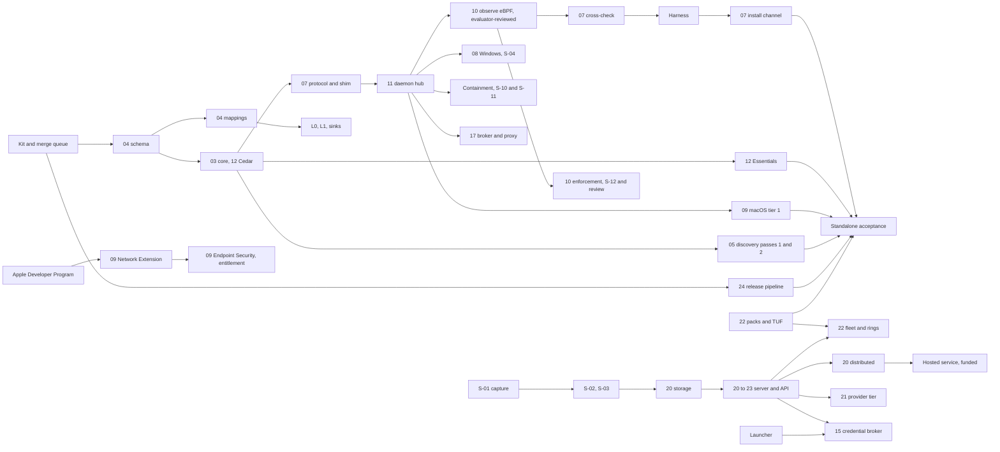

# 33. Build order, experiments and risks

_Status: draft 5 against spine version 4, rulings R-01 to R-71 and `_review/02-owner-answers.md`, then the owner's kit instructions (`_review/04-owner-kit-instructions.md`; 7, 22, 23, 25 and 28 change this document) and the ten-million-endpoint (P15), air-gap (P16) and cohesion (P17) reviews. Owning squad: Direction group (programme manager and chief architect, `team/02` section 3). Specifies D-50, D-63 and spine sections 6 to 10. Read with: `00-decisions.md`; `team/01` (ladder, metrics); `team/06` (bootstrap checklist, WI-0001 to WI-0053); 24 (release); 30 (governance); 32 (cost model, hosted preconditions); 34 (lifecycle, design partners); 35 (security review); 36 (entity, counsel). Other documents state their own prerequisites; the dependency graph of the whole product is here and in spine section 7._

## Summary

This document describes the complete product as a set of components with prerequisites, not as a schedule. It holds the dependency graph, the acceptance clauses per capability, the external preconditions, the experiments (spikes) that can still reverse a decision, and the risk register. Key choices:

1. **Prerequisites, not phases.** Work can start on any component whose prerequisites exist (spine section 7). There are no milestones, horizons or dates; the only ordering is what one component requires of another, of a spike verdict, of a decision or of something outside the team's control.
2. **Acceptance is per capability.** Each capability area lists acceptance clauses with an oracle per clause. A release ships the capabilities whose clauses are green; nothing else gates it.
3. **Windows joins Tier 1 when S-04 passes in full.** It ships at Tier 2 once the Defender and free-EDR arm of S-04 passes, and moves to Tier 1 when the Falcon arm and the D-23 interference test pass (D-50).
4. **Trust-core review is the evaluators'.** `eval-security` and `eval-adversarial` review every trust-core change in clean contexts, and two independent evaluators on different models must pass it; a component without the review D-62 sets stays in the internal ring, and a kernel component leaves it through that route plus any free external audit that has arrived (D-62, D-63; owner instruction 7).
5. **The hosted service requires the `distributed` load test and funded infrastructure** (spine section 7; 32 section 16). Self-hosting is the default way to run the platform and needs neither.
6. **Spikes block named work items.** The dispatcher refuses an item in a spike's `blocks` list until the spike has a verdict.
7. **The register is data.** `docs/plan/risks.toml` triggers are computed by the `team/01` section 12 metrics job; a fired trigger executes its response.
8. **Kill criteria at three levels**: spike fallbacks, component rules (internal ring, demotion) and decisions: the owner's on licence, hosting and paid offers, the chief architect's on the wedge.
9. **Zero budget, one Claude subscription, no human gate.** Work is measured in share of the subscription's usage windows, calibrated by S-20, and no step waits for a person (owner instruction 7). Money appears only as external preconditions: Apple's annual Developer Program fee (the one unavoidable cost, question 8), and the driver, hosted infrastructure, paid certifications and live-cloud tests, which require a sponsor, a partner, revenue or donated credits. No default needs a new third-party account (owner instruction 23).
10. **Scale and the air gap are release conditions.** S-23's fleet herd simulation gates every change to the uplink scheduler and every release (P15), and the air-gap conformance run S-31 gates every server release (P16).

## Requirements

| # | Requirement | Source |
|---|---|---|
| RR-1 | Every component and capability states its prerequisites, external preconditions and acceptance clauses with an oracle per clause, assurance per operating system and Tier 1 cells | Spine section 7; `c9` F2; `l12` F2 |
| RR-2 | "Complete" means all five jobs work in every Tier 1 cell at the stated assurance with zero silent fail-open; `PLAN.md` traceability has no empty cell | D-50; owner's request |
| RR-3 | One testable definition of standalone acceptance on a clean machine | `c9` F3; spine section 6 |
| RR-4 | Each external precondition has an owner, a status and the work it blocks | Spine section 7; `c9` F5; g05 implication 8 |
| RR-5 | Each spike states pass, decision at stake and fallback | Spine section 8 |
| RR-6 | Evaluator capacity and the subscription's usage windows throttle writers; no step waits for a person | D-63; owner instruction 7; brief 31 |
| RR-7 | Work is measured in share of the subscription's usage windows, calibrated by S-20; no dollar estimates | D-47; `02-owner-answers.md` |
| RR-8 | Every risk has likelihood, impact, a computable signal, a response and an owner | Spine section 9 |
| RR-9 | No hosted tenant without two people on call (the owner and the buddy), the entity, written incident reporting and funded infrastructure | D-63; brief 28 section 10 |
| RR-10 | Shipped capability is published apart from capability not yet built | h04 checklist item 13 |

## Design

### 1. Planning mechanics

Four files under `docs/plan/` hold the plan: `build-order.toml` (components and capabilities, their `requires`, acceptance clauses and an oracle per clause: harness scenario, CI job, signed or drill record), `spikes.toml`, `preconditions.toml` and `risks.toml`. `cargo xtask plan check` validates them in `verify`, and `PLAN.md`'s dependency table and D-50 matrix are generated from them and `support.toml` (03 F3). For each release the chief architect assembles `docs/agents/releases/<version>.md` with a run link per clause of every capability the release claims, `eval-release` re-runs the oracles on the release commit, and the merge queue lands the release pull request, after which release-please creates the tags (owner instruction 7). A clause is met, or the capability it belongs to is not claimed in that release, by decision record; there is no "met with exceptions".

Support tiers (D-50). Promotion needs a named maintainer and 30 green days; an adapter with no Tier 1 owner for two releases is demoted, then removed (`l10` F3, F10).

| Cell | Tier | Requires |
|---|---|---|
| Claude Code and Codex on Linux x64 and macOS arm64 | 1 | No external precondition (D-50) |
| Windows x64 | 2, then 1 | Tier 2 when S-04's Defender and free-EDR arm passes; Tier 1 when S-04 passes in full (Falcon arm) and the D-23 interference test passes |
| Linux arm64, WSL2 | 1 | Passing the conformance suite |
| Cursor, Copilot CLI | 1 | Passing the conformance suite; Cursor has no custom model endpoint, so its efficacy coverage is model-driven scenarios only (D-45, R-61) |
| macOS x64, Windows ARM64, containers on a Linux host | 2 | Conformance suite |
| Server `embedded` and `ha` (amd64, arm64) | 1 | Server |
| SDK-declared bespoke agents; Kubernetes runc nodes; GitHub and GitLab CI; `distributed` | 1 | SDK declaration path; Linux sensor; Kubernetes and CI modes; the `distributed` load test |
| Contrib adapters; sidecar tier; Agent Router; Kong | 2 | Contrib repository and the published port test kit |

### 2. Capabilities and acceptance

The groups below are areas of the product, not stages. Order comes only from each row's prerequisites and from section 3. Scope names the owning document's epics. Assurance per operating system is in section 4. Every capability, in addition to its clauses, requires D-50 completeness for the Tier 1 cells it touches: all five jobs work in each cell at the section 4 level, and fault injection finds zero silent fail-open. The oracle is the generated `PLAN.md` matrix with no empty cell and a green `eval-release` run per cell.

#### 2.1 Foundations

*Scope.* Bootstrap (`team/06` B1 to B9); Loonaro's accounts and names (36 LBC-1, LBC-2, LBC-10); kit, `verify`, merge queue, dispatcher (WI-0001 to WI-0013, and the kit items WI-0042 to WI-0053); schemas at `v1alpha1` (04 E1, E2); sans-IO core with C ABI and `wasm32` skeletons (03 B); Cedar schema and S-15 (12 E1); shell canonicaliser as the S-20 item (WI-0019); harness and held-out evaluator (WI-0027, WI-0028); tier A lab on free hosted CI runners, which runs the held-out suite (D-64); signed test binary (24-1); the Linux x64 thin slice (WI-0020 to WI-0026, WI-0031); cost model (32 OPS-01).

*Requires.* Nothing for the repository to be public, which it is from its first push (owner instruction 28): `SECURITY.md` is in the seed, and `GOVERNANCE.md`, `MAINTAINERS.md`, the covenant and the recorded D-66 search are work items of this group; RFC 0001 accepted (30-17). Trust-core items in the slice (WI-0016, WI-0018, WI-0021 to WI-0023) require the trust-core evaluators (D-63, R-41; owner instruction 7).

*Acceptance.* (1) The slice passes its harness scenarios: Claude Code and a scripted bespoke agent, shim to daemon to verdict, one session scope, observe-only exec, open and connect, one finding per unmatched effect, the bespoke agent found by passes 2 and 3, local history, CLI. (2) A test binary built for three systems from one tag, Sigstore-signed with provenance, and platform-signed wherever its signing precondition exists (section 6). (3) A usage baseline from S-20: share of the subscription's usage windows and evaluator rounds per accepted item. (4) Scorecard v0 in AMTSO vocabulary (D-45), after counsel's harness and export review (LBC-27). (5) S-22 passes. (6) Recorded whether hosted Windows runners allow Defender real-time protection; if not, the Windows Defender runs move to a tier B machine (the owner's or the buddy's) and are marked "requires hardware" until one is available (D-64, R-61).

#### 2.2 Standalone

*Scope.* Claude Code and Codex on Linux and macOS, Windows at the tier S-04 allows; both profiles (D-48); broker, shim, fail-safe table, install channel with canary proof, assurance record (07 E1 to E6, D-49); Essentials and Watch packs (12 E5.1, 13 E4.1); local policy, replay, history; discovery passes 1 and 2 (05); observed identifiers and credential inventory (15, D-27); Linux reconciliation (07 E5.2); config integrity; protected paths and decoys (16 A, E1); CLI and local console subset served by `grdr console serve` (27 E2, 28 E1 to E4; D-42); local audit chain (04-15); mirrored intelligence (14 E14.1, E14.2); packages (24 E2); pack format, TUF client and project-root ceremony (22-18 to 22-21); PSIRT tooling (35 SP-E7); the development fleet runs under the last signed release.

*Requires.* Foundations; the S-04 verdict for Windows; content lands on evaluator passes with evidence, and community content leaves Watch only with those passes from two evaluators on different models (13 section 17; owner instruction 7); D-62's review of the privileged core, updater, shim and approval helper before their first stable-channel release, run by the trust-core evaluators (35 section 5).

*Acceptance.* (1) Standalone acceptance (section 5). (2) Zero silent fail-open under fault injection in every Tier 1 cell. (3) Essentials block reliability 99.9%. (4) No Defender alerts on install, run or uninstall, on Windows and with Defender for Endpoint on Linux. (5) S-05, S-07 (Linux), S-09, S-12, S-14 and S-16 pass, or their section 7 fallbacks are applied before release; S-06 and S-17 have no fallback and must pass. (6) The evaluator route's findings rated high or critical are fixed (35 section 5); a free external audit's findings likewise when one is granted. (7) Server-licence decision recorded before the first public release (D-02, LBC-13). (8) Counsel's copyright and inbound-terms opinion filed before the stable channel (36 L-11, L-12). (9) OpenSSF Best Practices passing.

#### 2.3 Breadth and containment

*Scope.* Windows complete (08 E2 to E7, WSL); Cursor and Copilot CLI; user-mode WFP; MCP broker and explicit proxy (17 N1 to N4, N7); containment where the corpus passes (10 E5, 09 E2, 08 E3); behavioural discovery on three systems; incumbent importers (25 IMP-1 to IMP-4); L0 and L1 (26 E4, 04-26); generic sinks (25 EXP-1, EXP-2); tray; Rune desktop if S-19 passes; the judge back-end trait, off by default (19, D-29); tier B self-hosted runners on the owner's and the buddy's machines, with incumbent licences only through design partners or free vendor programmes (D-64).

*Requires.* Daemon and OS sensors; S-10 and S-11 verdicts for containment; a Falcon tenant for S-04's Falcon arm, else R-10's response; a review of the `cgroup_sock` program for the Linux network fence (section 4, R-40), or, without it, a launcher-added network namespace where unprivileged user namespaces are available (10 section 7); for behavioural discovery on macOS, the Network Extension (D-18 tier 2). An MVI-member partner is the precondition for the L3 pilot and the Windows platform questions, not for this group (D-41).

*Acceptance.* (1) Coexistence pack and ceiling matrix published; zero alerts from Defender, Falcon and a third incumbent on three systems (D-23), with cells lacking a licence marked untested. (2) Held-out discovery recall 85%, precision 95%, on Linux and Windows. (3) Hook-against-OS false rate under 1% on benign sessions on three systems. (4) S-08 met per Tier 1 shared-host agent, else instance-level. (5) Sandbox conformance green for every claimed class. (6) Windows hook row met beside Defender and one more EDR. (7) An outsider lands a Watch detection from the guide (03 G2). (8) D-62 review complete for every component leaving the internal ring.

#### 2.4 Server and self-hosted platform

*Scope.* Server in `embedded` and `ha` (20); tenancy, keys and access (21 T, A, K1 to K5, L); transport, enrolment and rings (22); API, policy as code and our MCP server (23); web console (27 E4); roles and sign-on (D-55); review queue, findings lifecycle, hunting, export contract (18, 13 E6, 25 EXP-3 to EXP-6); two read-only SaaS connectors, Anthropic Compliance API and OpenAI Compliance Logs (25, R-39), whose credential halves of parity items T12 and T16 require the credential broker and token service (section 2.5); out-of-band approvals; Linux kernel enforcement after review (10 E4); macOS Network Extension (09 E3); AWS, GCP and Azure modules, Helm, air gap (24 E6 to E8); penetration test.

*Requires.* Core and wire; S-02, S-03 and S-13 verdicts; for Linux kernel enforcement, S-12 and the review in D-62 (the trust-core evaluator route plus any free external audit that has arrived); for the Network Extension, Apple's Developer Program; for the penetration test, `eval-adversarial` against the `embedded` server with the ZAP baseline scan (35 section 2.6), plus a free programme or a qualified volunteer when one is available; for live-cloud tests of the modules, cloud accounts funded by donated credits or a sponsor.

*Acceptance.* (1) Storage row met at 5,000 and 100,000 events per endpoint-day. (2) Upgrade and restore drills pass in both profiles. (3) Review and penetration-test findings rated high or critical fixed, mediums tracked. (4) Schema `v1` frozen with one external consumer (04-29). (5) Fourteen green nightly cloud applies (24-17) wherever funded cloud accounts exist; without them the modules are marked untested against live clouds. (6) Synthetic sensor and independent alarm pass on a self-hosted install (D-56). (7) S-18 passes in every topology against the real server (22-9). (8) Held-out discovery recall 85%, precision 95%, on macOS with the Network Extension (R-37). (9) The air-gap conformance run S-31 is green for `embedded` and `ha` in tier A, after which release gate 24-28 holds every server release (P16). (10) S-23's fleet herd simulation passes at 1 million devices on every change to the uplink scheduler, admission, nudge pacing or rollout ramp, and at 10 million before each release (P15). (11) S-26 passes before the first public release.

#### 2.5 Enterprise and provider

*Scope.* Provider tier and co-branding (21 P); `distributed` (20 X-1), supported for self-hosters above the `ha` ceiling (D-33, D-58); credential broker and token service (15 E4); labels and sink gating beyond Essentials (16 C4); Endpoint Security (09 E4); Kubernetes and CI (10 E7, E8); one review stage (19 E3) and the natural-language authoring model step (19, R-34); compliance evidence (29 E5); browser extension (17 N6); L3 pilot and L4 connector (26); further SaaS connectors with the credential halves of T12 and T16 (R-39), and registry connectors.

*Requires.* Server; S-ID-1, S-ID-3 and S-ID-4 verdicts for the credential broker; the launcher and the server's `identity` and `keys` targets for the token service; S-14 for sink gating; the G-ES decision and Apple's entitlement for Endpoint Security; an MVI-member partner for the L3 pilot and L4; each browser's extension store account; for model tiers, the organisation's chosen judge back end.

*Acceptance.* (1) One embed pilot complete, the partner passing all three host-contract kits (D-60). (2) Provider onboarding targets met. (3) `distributed` load test (S-24) meets D-56. (4) Each review-stage gate of 19 passed, or the stage stays off. (5) S-28, S-29 and S-30 pass before an organisation spans cells or a multi-cell installation is supported (D-35, D-58).

#### 2.6 Hosted service

Beta without an SLA, then SOC 2 Type I, then Type II. Requires evidence in `ops/hosted-gate.md` for every item (32 section 16): two people on call (met by the owner and the buddy), the entity (Loonaro), tabletop-tested CRA, GDPR and NIS2 reporting, the `distributed` load test, restore and cold-start drills, D-62 reviews, terms and DPA, and infrastructure funded by revenue, sponsorship or donated cloud credits. SOC 2 requires revenue or a sponsor (D-46). Beta caps 50 organisations and 5,000 endpoints until four people share the rotation. No paid plan before 32 OPS-27.

#### 2.7 Ecosystem

Rebuilt white-label, own reputation scanning, optional Windows driver on its own release train, more cells, tile log and receipts, registry correlation and ID-JAG, third-party scorecard rerun, foundation transfer. Each has the external precondition spine section 7 names (an embedding partner, data from many organisations, a driver sponsor or partner, an external witness, an independent party, a foundation's acceptance). Acceptance: conformance listings; transfer executed when the covenant's trigger is met. Seams kept in the core regardless: reserved `Sealed` fields and the `transparency` member (04-19, 21 K5), the brand manifest (D-66), the driver adapter behind the Windows sensor trait (D-17), reserved pack kinds (19 AI-01).

### 3. Dependency graph

A component can be built when its upstream interfaces are at `v1alpha1` and the spikes it depends on have verdicts. Spine section 7 holds the full component table with external preconditions; the table below adds the epic-level edges this plan schedules work against.

| Component (document, epic) | Requires |
|---|---|
| Kit, `verify`, merge queue, dispatcher (`team/06`) | Nothing |
| Schema (04) | Kit |
| Core (03) and Cedar schema (12) | Schema; S-15 |
| Decision protocol and shim (07) | Core |
| Daemon hub (11) | Shim |
| Linux observe programs (10) | Daemon; the trust-core evaluator route |
| Cross-check (07) | Linux observe programs or another OS sensor; S-07 |
| Harness (D-45) | Core; replay model endpoint |
| Install channel (07, D-49) | Harness; S-05 |
| Essentials (12) | Core; benign corpus |
| macOS tier 1 (09) | Daemon |
| Discovery passes 1 and 2 (05) | Core |
| Release pipeline (24) | Kit and merge queue; platform signing identities only for platform-signed artefacts (section 6) |
| Packs and TUF (22) | Pack verifier; project-root ceremony |
| Windows sensor (08) | Daemon; S-04 |
| Containment (10, 09, 08) | Launcher; S-10; S-11 |
| MCP broker and proxy (17) | Daemon |
| Mappings, L0, L1, sinks (04, 26, 25) | Schema; content packs |
| Storage (20) | S-01; S-02; S-03 |
| Server and API (20 to 23) | Storage; wire |
| Fleet and rings (22) | Server; packs and TUF |
| Linux enforcement (10) | Linux observe programs; S-12; S-13; D-62 review |
| `distributed` (20) | Server; load test (S-24) |
| Air-gap bundle and conformance run (24) | Server; release pipeline; S-31 |
| Provider tier (21) | Server; tenancy model |
| Credential broker (15) | Launcher; server `identity` and `keys` targets |
| Hosted service (32) | `distributed`; hosted preconditions (section 2.6) |

Longest chains: to standalone acceptance, kit and queue, schema, core and Cedar, decision protocol and shim, daemon hub, Linux observe programs (evaluator-reviewed), cross-check, harness, then the install channel and Essentials. To the self-hosted server: S-01, then S-02 and S-03, then storage ports. Platform signing identities add signatures where a vendor programme exists and gate no release (owner instruction 23).



### 4. Assurance level by operating system

Highest level for a Tier 1 agent in the Protected profile, with what each level requires. The User profile never exceeds AL2 and reports every control as a request (D-48). Policy reads the record, never the label.

| System | Level | Requires |
|---|---|---|
| Linux | AL1 | Linux observe programs |
| Linux | AL2; exec `cross-checked` | Shim, Linux sensor, reconciliation |
| Linux | AL3 (Landlock, seccomp, cgroup network) where the corpus passes | Containment; the network fence needs the `cgroup_sock` program reviewed (10, R-40), otherwise only where the launcher can add a network namespace |
| Linux | AL4 only on hosts where T1 (BPF LSM) or T2 (`security_*` override) attaches; stock Ubuntu only if S-12 passes there. T3-only hosts stay at AL3, because fanotify cannot deny `file.write` or `file.delete` (10) | Kernel enforcement and its D-62 review |
| macOS | AL2; exec and file `claimed` | Tier 1 (Sigstore-signed, marked not platform-signed, without Apple's Developer Program) |
| macOS | AL3 (Seatbelt or delegate); exec and file still `claimed` | Containment |
| macOS | AL3 with `net.connect` a mandatory boundary via the content filter | Tier 2, which requires Apple's Developer Program |
| macOS | AL4 | Tier 3: the Program and the Endpoint Security entitlement |
| Windows | AL2 at Tier 2 | S-04's Defender and free-EDR arm |
| Windows | AL3 (WFP, job objects, sandbox principals) for agents that pass S-10 | Containment routes |
| Windows | AL4 | The optional driver (sponsor or partner) or an L3 partner's sensor |
| Off the laptop | Containers on a Linux host AL2 to AL3; runc nodes AL4 where T1 or T2 attaches; sidecar, gVisor, Kata, Fargate at most AL2; SaaS agents AL1 (D-13) | Linux sensor; Kubernetes mode; connectors |

### 5. Standalone acceptance

On a clean machine with no account, each proven by a harness scenario or CI job:

1. A package installs: deb and rpm from signed repositories on Linux x64; a universal pkg on macOS arm64 and the MSI on Windows x64 (once S-04's first arm passes), each Sigstore-signed with provenance, notarised or signed through the free open-source signing programme where Loonaro holds the vendor programme, and otherwise marked "not platform-signed", with macOS then at tier 1 only (D-17, D-18; owner instruction 23).
2. First run changes nothing (byte diff) and shows found agents and recent sessions (D-48).
3. After "Turn on protection" it finds Claude Code and Codex, installs managed hooks through the probed owner (D-49), and within five minutes shows inventory, a session timeline and a deterministic block of a protected-path read.
4. Assurance level and Degraded state are truthful; AL2 appears only after the canary tool call fired.
5. Essentials enforces from first protection; everything else is in Watch (D-53).
6. The only outbound traffic is anonymous update fetches, asserted by `grdr egress` in CI.
7. `grdr audit verify` passes; `grdr uninstall` restores every changed file byte for byte.
8. Docs, `SECURITY.md`, support statement and release policy are published.

A release meeting these goes to the preview channel for the development fleet and the developer cohort (34 DP-3), and to the stable channel when clauses 6 to 8 of section 2.2 hold.

### 6. External preconditions

Things outside the team's control, stated as conditions. Status is tracked in `preconditions.toml`; none carries a date.

| Item | Blocks | Owner | Condition |
|---|---|---|---|
| Legal entity | All accounts and agreements | Owner | Met: Loonaro holds the Apple, Microsoft and signing accounts, the trademarks and the domains; the repository lives under the owner's GitHub account (owner instruction 5) |
| D-U-N-S number for Loonaro | Apple organisation enrolment | Owner | Free; required by Apple |
| Apple Developer Program (organisation, the buddy as second administrator) | Developer ID, notarisation, macOS tier 2, behavioural discovery on macOS, macOS discovery acceptance | Owner | Annual fee, the one unavoidable cost (question 8). Without it macOS ships Sigstore-signed but not platform-signed or notarised, with tier 1 only |
| Endpoint Security entitlement | macOS tier 3 | Owner | Requested once the Team ID exists; no SLA (brief 13); turnaround for open-source projects unknown |
| Free open-source signing programme (for example SignPath Foundation) | Windows platform signing; without it Windows artefacts ship Sigstore-signed and marked "not platform-signed" (owner instruction 23) | Owner | Acceptance verified at setup (D-17) |
| Name search | First release | `product-lead` (36 LBC-2) | Agents run and record the registry and knockout searches for Guardrails ADR and `grdr`; counsel's clearance is outside the zero budget and gates nothing (owner instruction 25) |
| DNS for the brand manifest's domain | Moving the docs, update and mail hosts off their GitHub-hosted defaults; the security and conduct addresses | Owner | Needs the registrar or DNS host; the setup step prints the records to add (owner instruction 25) |
| Second person where Loonaro's own operation needs two people | The hosted service's two-person controls (D-55) | Owner | Met: the buddy (D-63) |
| Counsel: assignment, export, copyright and inbound terms, KEV terms | First release (assignment, export); scorecard publication; stable channel; KEV mirroring | Owner | Free foundation legal programmes first |
| Self-hosted runners (tier B) | Snapshot-revert Windows guests; Windows Defender runs if hosted runners lack real-time protection; tests marked "requires hardware" | Owner, buddy, `lab` | The owner's and the buddy's own machines, when available (D-64) |
| Incumbent licences (Falcon, SentinelOne) | S-04's Falcon arm; D-23 interference test | Owner | Only through a design partner or free vendor test programme (D-64, R-61); Defender, Elastic, Wazuh and Santa are free (g05) |
| MVI-member partner | L3 pilot, Windows platform questions, WESP | Owner | A pilot letter |
| External security review | Nothing waits on it: it adds evidence to the evaluator route for kernel components, the penetration test and the `cgroup_sock` program (owner instruction 7) | Owner | Free programmes for open-source projects (for example OSTIF, OpenSSF Alpha-Omega) or a documented review by a qualified volunteer (D-62) |
| CRA reporting process | Any paid line; steward reporting | Owner, `security` | Manufacturer reporting under Article 14 has applied since 2026-09-11 and likely reaches the free sensor as soon as any paid hosted or intelligence line exists; steward reporting under Article 24(3) applies from 2027-12-11 (brief 28 verification 3, caution 1; legal dates, not plan dates). The process is written before either applies to Loonaro |
| Counsel: CRA class, support period, hosted terms, sanctions | Paid offers, hosted service | Owner | Free legal help first |
| SOC 2 auditor | SOC 2 Type I and II | Owner | Revenue or a sponsor |
| On-call pair | Hosted service | Owner | Met: the owner and the buddy |
| Hosted infrastructure | Hosted service, cells and router | Owner | Revenue, sponsorship or donated cloud credits |
| Cloud accounts for module tests | Nightly cloud applies (24-17) | Owner | Donated credits or a sponsor |
| EV certificate; Partner Center with two administrators (the owner and the buddy) | Optional Windows driver | Owner | Paid for by a sponsor or partner |
| Minifilter altitude | Optional Windows driver | `windows`, owner sends | Requested after the load-order group is frozen; no expedite (g05, verified) |
| HLK lab, tier C | Driver WHCP | `lab` | The driver's sponsor or partner |
| Browser extension store accounts | Browser extension | Owner | Per browser |
| A foundation's acceptance | Foundation transfer | Owner | Covenant trigger (D-03) |

Human actions that unblock work (`team/06` section 11). None blocks building, reviewing, landing or releasing; each unblocks an external artefact or account (owner instructions 7 and 23):

| Action | Unblocks |
|---|---|
| D-U-N-S, Apple organisation enrolment with the buddy as second administrator, Endpoint Security request on the Team ID | macOS tiers 2 and 3, notarisation |
| Application to the free open-source signing programme | Windows platform signing; releases proceed without it, marked "not platform-signed" |
| The repository `416rehman/Guardrails` on the owner's personal account, public from its first push (owner instruction 28), with the buddy as collaborator and no organisation (owner instruction 5, `_review/04-owner-kit-instructions.md`) | Work-item issues, CI |
| DNS records, mail forwarding for the security and conduct addresses, SPF, DKIM and DMARC for the brand manifest's domain | Hosts off their GitHub-hosted defaults; the security address (35 section 4.1) |
| Hardware-backed two-factor authentication on the owner's GitHub account, which every agent uses (a platform authenticator such as the TPM or Secure Enclave where no separate security key is available) | Account security (35 section 8) |
| Optional: per-role GitHub Apps; a Claude Code token for agent runs on GitHub-hosted runners (`claude setup-token` needs a browser) | Separate identities per role; hosted agent runs. The local dispatcher runs every role on the owner's `gh` login and logged-in Claude Code and needs neither (owner instruction 23) |
| Counsel through free legal programmes | First release, scorecard, stable channel |
| First EDR or MDR conversation; design-partner letter (LBC-22) | Falcon arm, L3 pilot, WESP |
| Willingness-to-pay conversations (LBC-12) | G-licence |
| KEV terms read (14 Q6) | Mirrored intelligence |
| IANA PEN request | Structured identifiers in exports |
| Applications to free audit programmes | External audit evidence for trust-core components (35 section 5); nothing waits on a grant |

### 7. Experiments (spikes)

None is scheduled. Each runs once its prerequisites exist and is due before the first work item it blocks; on failure the fallback applies without a meeting.

| Spike | Work item and prerequisites | Pass | At stake | Fallback |
|---|---|---|---|---|
| S-01 Volume | WI-0029 installs the capture | Measured p95 day per class group and lane, with the batch-size distribution S-25 replays | D-52, D-34, prices | Measurement only |
| S-02 Storage | S-01; dataset (20 P-2; 20 section 5) | Storage row both volumes; clean restore; at 50,000 organisations per catalogue, commit p99 under 100 ms at three times the jittered peak | D-34 | Iceberg, then a bespoke catalogue; a ClickHouse adapter behind the query IR only if both volumes miss (D-34 revisit) |
| S-03 Bus | S-01; dataset (20 P-2) | Ack p99 200 ms; lag p99 5 s; no loss; the `distributed` NATS arm at or under 50% of its measured ceiling at 4× peak | D-34 | `ha` capped at tested size |
| S-04 Hook latency | WI-0030; shim | Hook row; zero alerts | D-14, Windows in Tier 1 | Windows stays Tier 2; `http` handler for non-strict tools |
| S-05 Hook delivery | WI-0035; install channel | Every cell correct | D-49 | Rendered fragments only |
| S-06 Shim failure | WI-0034; shim and fail-safe table | No hang over 2 s | D-14, D-15 | None: standalone does not ship until it passes |
| S-07 Cross-check | Shim; an OS sensor; housekeeping profiles | Under 1 per 100; 20 of 20 | D-13, P3 | Tamper rows off; visibility `observed` |
| S-08 Shared hosts | A prototype on the daemon, then the full run per shared-host agent | Attribution row | D-25 | Instance-level |
| S-09 Content-free discovery | OS sensor with network visibility | Discovery row | D-24 | Pass 3 stays `llm-client` |
| S-10 Windows containment | Windows sensor; launcher | Three of four finish | D-17, D-21 | Request level with reason |
| S-11 Sandbox composition | Launcher; sandbox back ends | Inner sandbox holds | D-21 | Delegate mode |
| S-12 Linux deny | Linux sensor | Synchronous, no deadlock | D-19 | Cell reported T3 |
| S-13 Agent eBPF | WI-0023; kernel matrix | Matrix loads; zero mismatches; two independent evaluators on different models pass it with no person in the loop | D-19, D-63 | Kernel enforcement waits for a rerun that passes; Linux reports observation tiers meanwhile |
| S-14 Opacity, prompts | Canonicaliser; default sinks in Watch | Under 2% opaque; in budget | D-10, D-28 | Rules stay Watch |
| S-15 Cedar | WI-0018 | Policy row | D-08 | Slicing by action class |
| S-16 Approval forgery | Approval helper per platform | Zero in 1,000 | D-31 | Relabel; Ask becomes Block |
| S-17 Local surfaces | CLI, tray, local console | Zero widening | D-31, D-48 | None: standalone does not ship until it passes |
| S-18 Uplink | A stub (22-2), then the real server (22-9) | Kill in 60 s everywhere | D-36 | Failing rung named with a fix (22-2); that topology is published as unsupported until the fix passes, and no server release ships with one open |
| S-19 Rune | Rig; view-model crate | Idle under 1%; flat 48 h | D-43 | Web-only desktop |
| S-20 Calibration | WI-0019 with three writers | Usage per accepted item measured per review lane; no owner step per item; gap under 5; no item fails because of a usage limit | D-47, D-63 | Writers stay three |
| S-21 Fast path | Fast-path library | Fast-path row; 90% agreement | D-41, D-60 | L3 sidecar only |
| S-22 Outsider build | WI-0002 | `verify` under 15 min; fix merged with no private help | Spine section 5 | None: the first public release requires it |
| S-23 Fleet herd simulation | The uplink scheduler crate; `xtask fleet-sim` at 1 million devices on a free runner, 10 million on a tier B machine | After every common event, no request class above 2× its steady per-cell rate and new TLS connections under 2,000 a second per cell; kill on 99% of online devices within 10 s | P15, D-36, D-37, D-56 | None: a change to the scheduler, admission, nudge pacing or rollout ramp does not land, and no release ships, while it fails |
| S-24 Cell load test | `uplink-sim`; one `distributed` cell from donated capacity (D-64); a 5,000-uplink `ha` arm on a free runner | Each dimension of the cell's capacity vector published at 70% of its first failing point; `decision` acknowledgement p99 under 2 s throughout | D-33, D-35, D-58 | The cell cap stays at 50,000 endpoints and self-hosted `distributed` and multi-cell installations stay gated; on failure the cap drops to the largest size that passes |
| S-25 Wire bytes, batching and dictionaries | S-01's captures; a free runner | Default `spine` interval the shortest at which framing and signatures are at most 30% of upload, never above 30 s; a dictionary per lane only where it saves over 30% | D-36, D-52 | Current defaults stay: 10 s `spine` interval, no dictionary, 04's current wire form |
| S-26 Free origins and TUF through caches | GitHub Releases, GitHub Pages and jsDelivr's GitHub mirror (owner instruction 23); free runners | At least 99% cache hits on immutable paths; zero `tamper` findings from lag alone; `timestamp.json` never more than 300 s stale | D-37 | A failing origin is replaced in `updates.sources`; the first public release requires a pass |
| S-27 Deltas and log-structured content | Ten nightlies, three minors and 30 days of feed history; a free runner | Median binary delta at most 30% of full for patches and 60% for minors; 100% hash equality | D-37 | A triple that fails publishes no deltas |
| S-28 Organisation shards across cells | Two cells and a router on one host; 1 million synthetic devices | Findings identical to a single-process reference; zero acknowledged events lost across a split; a kill applied in both cells within 10 s at p95 | D-35, D-58 | An organisation stays inside one cell, capped at that cell's capacity |
| S-29 Key service at scale | A test cell with a throttling KMS fake; a free runner | Zero KMS sign calls; a cold start at most 50 KMS calls a second; every mode 2 organisation `key-unavailable` within 60 minutes of a KMS block | D-35 | No hosted cell or multi-cell installation opens until a rerun passes |
| S-30 Enrolment storms | A free runner; 100,000 synthetic devices on one deployment key | All enrolled within 10 minutes; none verified twice; zero over-enrolment | D-36 | Per-credential budgets set to the largest rate that passes |
| S-31 Air gap | Tier A lab on free hosted Linux runners; `embedded` and `ha`; release gate 24-28 | 24-28's run green, carrying in only the bundle: every step's oracle, zero frames outside the lab prefixes and zero DNS queries outside its zone, in both the NXDOMAIN and blackhole variants | P16, D-37, D-58, D-59 | None: release gate 24-28 blocks every server release and any release that changes the uplink, updater, importer, `Dialer`, Keys, notify or backup |

S-04 and the Windows hook row need Defender plus one more EDR. The first arm uses Defender on tier A and a free incumbent (Elastic Defend) on a tier B machine; that result decides G-Windows. The Falcon arm runs when a tenant exists through a design partner or vendor programme and is required before Windows becomes Tier 1 (section 2.3 clauses 1 and 6), so a missing Falcon licence never holds the first arm.

Document spikes that can overturn a decision: S-CM1 (D-65, D-01; fail changes which leads the standalone shape puts first); 04 SP-1 codec (D-06; never re-encode); SP13-1 Sigma fit (D-09; own matcher); SP-22-2 TUF client (D-37; minimal reviewed client); SP-06-1 nested cgroup (D-25; tag-only); W-S3 ETW forging (P3; permanent snapshot cross-check); EN-S1 Windows handover (D-15; short-lived broker); adapter rot (`l10` spike 4) (D-40; the limit stays at two); NS-1 chained base URL (D-16; route off per version); SP-23-1 git identity and SP-29-1 works council (D-55, D-51); S-ID-1 and S-ID-4 (D-27); S-AI-2 (D-29).

### 8. Capacity

The agent team runs on the owner's Claude subscription (D-47). Work is measured in share of the subscription's usage windows, not dollars. The dispatcher caps concurrent agents, pauses when a usage limit is reached, resumes after the window resets and never fails work because of a limit; every recurring agent has a usage cap per run. Writers follow the `team/01` ladder, throttled by evaluator capacity and by the usage window, whichever binds; no person's time is a limit (owner instruction 7). Review spends tokens in proportion to the change: the classifier's `static`, `light`, `standard` and `full` lanes (owner instruction 8). S-20 measures usage and evaluator rounds per accepted item; RM-7 records the result and sets writer concurrency from it. If S-20 shows more usage per item, concurrency drops; scope does not.

Model tokens for model-driven efficacy runs come from the same subscription and carry their own usage cap per run (D-45, R-61). There is no money for lab hardware, paid audits, paid certifications or hosted infrastructure; each appears in section 6 as an external precondition.

CI time follows owner instruction 22. Targets: verify fast under 3 minutes and full under 15 on a 4-vCPU hosted runner. The local dispatcher's verify is the primary gate on every change and hosted CI is a backstop. Pull requests build only the crates whose inputs changed (from `cargo metadata` and the diff) and the merge queue builds the whole workspace; the Rust cache action and sccache on local disk, `cargo nextest` partitions and a fast linker (mold on Linux, lld elsewhere) cut the rest; the macOS, Windows and kernel matrix runs on the merge queue and nightly, not on every push. The repository is public from its first push (owner instruction 28), so standard hosted runners are free and the full matrix runs in CI from the first commit. The Linux-only form, with the matrix through `matrix-run` on the owner's machine, stays only as the fallback for a private fork or copy, where GitHub's free plan gives 2,000 runner minutes a month with macOS minutes counted at ten times and Windows at twice.

### 9. Risk register

L and I are low, medium or high; high impact means a release cannot ship or a host is harmed. Signals are computed unless marked manual.

| Id | Risk | L | I | Early signal | Mitigation | Owner |
|---|---|---|---|---|---|---|
| R-01 | Review queue saturates | H | H | Over 20 items in `status:in-review` or oldest over 48 h | Writers to three (D-63); trust-core, security and release items first | Programme manager |
| R-02 | Trust-core evaluators stall or disagree | M | H | A trust-core item with fewer than two passing evaluators on different models after three rounds | Component stays in the internal ring (D-63, R-41); the item goes to its lead, then the chief architect (owner instruction 7) | `security` lead |
| R-03 | No platform signing identity: the free signing programme declines, or Apple's fee is unpaid | M | H | No acceptance recorded in `preconditions.toml` when a release is ready (manual) | Releases ship Sigstore-signed with provenance and marked "not platform-signed"; apply to another free open-source signing programme; macOS then at tier 1 only (D-18; owner instruction 23) | Owner |
| R-04 | Evaluators pass a poisoned community rule | L | M | A community rule halted or reverted in a ring | Watch entry, the benign corpus, rings and gates; the two passes must come from different models (30 section 4) | `content` lead |
| R-05 | Agent-written kernel code harms hosts | M | H | Verifier failures; any panic in matrix or soak | Observe-only until kernel enforcement passes its review; internal ring; D-62's evaluator route plus any free audit (owner instruction 7) | `linux` lead |
| R-06 | Hook interfaces change or close | H | H | 24-hour release canary fails (07 E6.3) | Unknown versions to Watch (D-10); OS points enforce | `adapters` lead |
| R-07 | Thesis spikes fail (S-07, S-08, S-09) | M | H | Rates above pass values | Fallbacks of section 7; claims narrowed in the scorecard | `adapters`, `discovery` leads |
| R-08 | Prompts exceed budget; users switch off | M | H | Dogfood median over 3 or p95 over 8 per developer-day | Watch first; replay before promotion; demote noisy rules | `content` lead |
| R-09 | Incumbent alerts on our install | M | H | Any alert in an interference run | Coexistence pack; publisher exclusions; broad release blocked | `endpoint` lead |
| R-10 | No incumbent licences for testing | H | M | No Falcon tenant when the S-04 Falcon arm is otherwise ready (manual) | Partner tenant or free vendor programme; ceiling matrix marks the cells untested; Windows stays Tier 2 | Owner |
| R-11 | No MVI-member partner | M | M | No pilot letter on record (manual) | Offer L1 and L4; Windows AL4 requires the driver | Owner |
| R-12 | Entitlement withheld | M | M | Refusal recorded (manual) | Endpoint Security only through a partner; macOS keeps tiers 1 and 2 | Owner |
| R-13 | Test fitting or held-out leakage | M | H | Margin above 5 points; canary GUID in a context | Release blocked; set rotated | `lab` lead |
| R-14 | Harness silently tests nothing (Claude Code's docs say `--bare`, which skips hooks, will become the `-p` default; g08 verification 8) | M | H | Hook-fired canary missing | Flags pinned per scenario; scenario fails without a hook | `lab` lead |
| R-15 | Subscription usage runs away or hits limits | M | M | A usage limit reached; usage per accepted item over twice the S-20 baseline | Dispatcher pauses and resumes after the window resets, no work fails; above twice baseline, writers cut and new feature work paused until it is back under; trust-core, security and release work first | Owner |
| R-16 | Injection into build agents or our supply chain | M | H | Threat-detection hit; foreign signature naming our repository (35 SP-31) | Read-only jobs; fleet guard is the last signed release | `security` lead |
| R-17 | Signing account suspended | L | H | Account notice (manual) | The buddy as second administrator; re-sign drill (24-27) | Owner |
| R-18 | Volume or storage misses targets | M | H | S-01 p95 over 100,000 events; S-02 or S-03 fail | Roll-ups and quotas (D-52, D-68); spike fallbacks | `server` lead |
| R-19 | Key dependency abandoned (`tough`, the ETW crate, `rsigma`, `datafusion-ducklake`, `connectrpc` 0.x) | H | M | Six months without commits or an unpatched advisory | Behind our traits; fork plan per crate | `core` lead |
| R-20 | Rune not ready | H | M | Soak gate fails | Web-only after two failures; soak rerun on each new Rune release | `interfaces` lead |
| R-21 | Incumbent bundles it free | H | M | 01 re-verification flags a closed lead (manual) | Wedge review when an incumbent ships it | Programme manager |
| R-22 | Two people hold the hosted pager | M | H | Either person unavailable with an open page (manual) | No hosted tenant without both on call; PSIRT and release need no person (owner instruction 7); succession stated in the covenant (D-61) | Owner |
| R-23 | Counsel opinions adverse (copyright, inbound terms, CRA support period) | M | H | Opinion pending when a release needs it (manual) | Adjust `AI_POLICY.md` and `CONTRIBUTING.md`; lengthen gaps between LTS lines, not support | Owner |
| R-24 | A blocking mark found for Guardrails ADR | M | M | Search finding (manual) | The brand manifest changes the display name; `grdr` stays (36 section 1) | Owner |
| R-25 | A paid line makes the free sensor a CRA manufacturer product, with Article 14 reporting already in force (brief 28 verification 3) | H | H | Any item of `ops/paid-offer-gate.md` opened while counsel's CRA opinion is pending | No paid line, hosted beta included if it charges, before the opinion and a tabletop-tested 24-hour reporting process (32 OPS-27, D-46) | Owner |
| R-26 | Automation is bound to one account | M | H | Subscription terms or limits change, or the account is restricted (manual) | Verify current terms; the local dispatcher uses the owner's logged-in Claude Code and stores no token (owner instruction 23); a hosted-run token, if one is made, lives only as a CI secret and rotates on any suspected leak; the repository and its issues hold all state and the kit is harness-neutral, so people can continue the work | Owner |
| R-27 | Zero budget blocks a precondition | H | M | A section 6 row whose condition needs money stays unmet (manual) | Apple's fee unpaid: macOS not platform-signed, tier 1 only. No driver sponsor: Windows stays driverless. No free audit: kernel components leave the internal ring on the evaluator route, and the release notes say so. No hosting funds: self-hosting only, which is also the ten-million-endpoint path (P15). No incumbent licences: Defender and free programmes, other cells untested | Owner |
| R-28 | Subscription data terms do not give zero retention | M | M | Terms check when the dispatcher's plan is recorded (36 LBC-28; manual) | Agents make embargoed fixes in the sealed enclave with network tools off; the terms are recorded with each advisory (owner instruction 7; 35 section 4.5) | `security` lead |
| R-29 | Free origins do not carry the fleet | M | H | S-26 fails, or an origin throttles or changes its terms | Replace the origin in `updates.sources`; self-hosted devices fetch from the operator's pull-through `content` cache, so the project origin serves about one fetch per installation per file (P15) | `fleet` lead |
| R-30 | A step needs the internet in an air-gapped site | M | H | S-31 records a frame or DNS query outside the lab | Release gate 24-28 blocks the release until the step has an in-network equivalent or reports `requires internet` (P16) | `release` lead |

### 10. Decisions and kill criteria

| Decision | Trigger | Decider | Outcomes |
|---|---|---|---|
| G-Windows | S-04 verdict per arm | Chief architect | Windows at Tier 2, Tier 1, or not shipped |
| G-release | Each release | The merge queue lands the release pull request after `eval-release` re-runs every clause (owner instruction 7) | Ship the capabilities whose clauses are green; others are not claimed |
| G-licence | Before the first public release | Owner, with LBC-12's conversations | Server licence confirmed or changed; never revisited after the first public release (D-02) |
| G-Rune | S-19 verdict | Chief architect | Rune or web-only desktop |
| G-wedge | An incumbent ships a D-65 lead, or the RM-9 report | Chief architect, by RFC (owner instruction 7) | D-65 leads kept, reordered or dropped |
| G-kernel-enforce | D-62's evaluator route recorded, with any free audit that has arrived | Chief architect | Out of the internal ring, or not |
| G-foundation | Pre-reads held; covenant trigger approaching | Owner, RFC | CNCF Sandbox first, then OpenSSF (D-03) |
| G-ES, G-driver | Entitlement response; a driver sponsor or partner and a frozen driver design | Owner | Build, or partner-only |
| G-hosted, G-paid | Section 2.6 preconditions met; before any offer | Owner | Open or stay closed (32) |
| G-transfer | D-03 trigger | Owner, steering group | Executed |

Owner questions (spine section 10), each recorded with the decision that needs it: 1 to 3 are answered (Loonaro; zero budget on the Claude subscription; the buddy). 4 is answered: the product is Guardrails ADR and `grdr` stays, with the recorded search still run before the first release (owner instructions 25 and 28; D-66, B8); 5 (foundation, transfer trigger) at G-foundation; 6 (licence review) at G-licence; 7 (licences for the owner's skills) before the kit carries them, else the kit ships without them; 8 (Apple's fee) before macOS tiers 2 and 3 and notarisation; 9 (pseudonym issuance) before the standalone release ships the device-side pseudonym (D-51). An unanswered question blocks the decision that needs it.

**Kill criteria.** Spike: section 7's fallback. Component: stays in the internal ring without the review D-62 sets for it (D-63); internal ring on any panic; demoted without a Tier 1 owner for two releases; detections demoted below 50% precision; a model tier stays off when its gate fails. Capability: a capability whose acceptance clauses are not green is not claimed in a release. Project: usage per item over twice baseline pauses feature work; the hosted service never opens without its preconditions.

Never relaxed by any fallback: zero silent fail-open, Essentials, the privacy floor (D-51), receipts and audit, uninstall restoration.

### 11. Success metrics by capability

There is no product telemetry (D-48). Adoption is counted only from public aggregates: anonymous update-fetch counts per channel, package downloads, `ADOPTERS.md`, partner letters, merged pull requests by affiliation (30-28).

Every figure is a target until the scorecard publishes it as measured, with its test conditions. Each spine section 6 row is gated with the capability named here.

| Capability | Engineering (spine section 6 unless stated) | Programme and adoption |
|---|---|---|
| Foundations | Slice scenarios; zero silent fail-open in slice faults; policy evaluation p99 under 1 ms at 1,000 policies (S-15) | No owner minutes on any item; held-out gap under 5; usage baseline |
| Standalone | Standalone acceptance in five minutes; Essentials 99.9%; hook p50 10 ms, p99 50 ms on Linux and macOS; footprint under 1% of a core idle, 250 MB resident, 1 GB disk; prompts median 3 or fewer and p95 8 or fewer per developer-day on the development fleet and cohort | Cohort of 10 active (34 DP-3); four of five reach a block from docs alone (34 DOC-7) |
| Breadth and containment | Discovery 85% recall, 95% precision on Linux and Windows, at most one triage item per ten endpoints a week; cross-check false rate under 1%; shared-host attribution 99% precision with at most 5% undetermined, else instance-level (S-08); Windows hook p50 25 ms, p99 100 ms; proxy and broker added p99 under 20 ms; build overhead under 3%, 2% per incumbent; fast path p99 under 100 µs cached (S-21) | Pilot letter; outsider detection (03 G2); three consecutive monthly partner reports (34 DP-1) |
| Server and self-hosted platform | Storage row at both volumes, under USD 0.05 per endpoint-month; discovery row on macOS; findings within 2 min for 99%; worth-a-look under 2% of sessions; stable rules 90% precision | External schema consumer; foundation RFC |
| Enterprise and provider | Provider onboarding 10 min and 60 min; D-56 under the `distributed` load test | Embed pilot complete |
| Hosted service | D-56 over 28 days | SOC 2 Type I, then Type II, given revenue or a sponsor |
| Ecosystem | Conformance listings | Third-party rerun; transfer executed |

### 12. Deliberately out of scope

| Item | Reason |
|---|---|
| Identity provider, SIEM, routing or key-management gateway, model-safety product, mobile or ChromeOS sensor | Spine section 1 |
| Mandatory TLS interception | D-16 |
| Installing Sysmon; exclusive OS slots | D-17, D-23 |
| Per-person scoring, covert mode, keystroke, screen or clipboard capture | P8, D-51 |
| Default telemetry or phone-home | D-48, D-58 |
| Open core, enterprise directory, CLA | P11, D-02 |
| Model-dependent allow, grant or suppression | P2 |
| A third expression language; Kafka, Redis, graph database; ClickHouse unless S-02 misses at both volumes | D-09, D-34 |
| DNS proxy, transparent proxy or VPN configuration on macOS by default; approvals in the Rune app | D-18, D-23, D-43 |
| Self-hosted `distributed` below the `ha` ceiling, or without its load test | D-33, D-58 |
| WESP except through a partner | D-17 |
| Multi-session hosts without per-logon-session policy | D-59 |
| Cash bounties; marketplace listings before their trigger | 35, 24-23 |

## Interfaces and contracts

- `docs/plan/*.toml` (this document): read by `xtask plan check`, the dispatcher (spike `blocks`), the metrics job and the `PLAN.md` generator.
- `support.toml` and the generated matrix (03 F3, 24-26): tiers from section 1.
- `docs/agents/releases/<version>.md`: signed evidence packs per release (`team/06` section 1 for the bootstrap pack).
- `ops/hosted-gate.md`, `ops/paid-offer-gate.md` (32); `legal/counsel-register.yaml` (36), ordered by the decisions that need each opinion.
- Scorecard JSON per release (D-45).

```toml
[[risk]]
id = "R-01"
likelihood = "high"            # low | medium | high
impact = "high"
signal = { any = [ { metric = "review_queue_items", op = ">", value = 20 },
                   { metric = "review_queue_oldest_hours", op = ">", value = 48 } ] }
response = "writers-to-three"   # executed by the dispatcher
owner = "programme-manager"
```

## Behaviour by deployment shape

Standalone requires the standalone capabilities and nothing else. The self-hosted platform runs in `embedded` and `ha`, and in `distributed` above the `ha` ceiling once the load test passes. The hosted service requires the `distributed` load test and the section 2.6 preconditions, including funded infrastructure. Embedded offers L0 and L1 with only the sensor and content, and L2 to L6 each with an embedding partner (D-41). Self-hosted releases add storage, upgrade and restore drills; hosted adds D-63's people and legal preconditions; embedded adds the host-contract kits (D-60).

## Extension points

Contributors add a spike, risk or precondition by a work item editing `docs/plan/*.toml`; `plan check` validates it. Community adapters enter at Tier 2 through the contrib repository and never block a release. Community rules are accepted and stay in Watch until two independent evaluators on different models pass them (30 section 4).

## Security and privacy

Embargoed risks (an unfixed bypass, a custody weakness) live in the private PSIRT ledger (35) with a public stub id. Metrics describe items, agents and the programme; no person is scored (P8). Adoption counts are aggregates from anonymous fetches and public registries.

## Test and evaluation strategy

| Property | Oracle |
|---|---|
| Every claimed capability has evidence | `plan check` fails a release commit with an unlinked or failing clause for a claimed capability |
| Evidence is real | `eval-release` re-runs every clause's oracle on the release commit |
| No build before its spike | Dispatcher test: a `blocks` item is refused while its spike has no verdict |
| No build before its prerequisite | Dispatcher test: an item whose `requires` are unmet is refused |
| Triggers fire | Replayed metric history crossing a threshold opens the escalation within one metrics run |
| Traceability complete | The `PLAN.md` generator fails on an empty cell |
| No schedule creeps back | `plan check` fails any design document carrying a milestone tag, horizon tag or schedule date |

## Work breakdown

- RM-1 `docs/plan/` schemas and `plan check` in `verify`. Accept: a clause without an oracle, a spike without a fallback, a precondition without an owner and a risk without an owner each fail.
- RM-2 Risk triggers in the metrics job. Accept: replayed history crossing R-01 caps writers at three.
- RM-3 Spike `blocks` and component `requires` in the dispatcher. Accept: both refusal tests.
- RM-4 Precondition tracker seeded from section 6. Accept: `plan check` fails a row without item, blocks, owner or condition; the digest lists every unmet precondition and the work it blocks.
- RM-5 Evidence-pack template and the bootstrap pack. Accept: the bootstrap pack lists each `team/06` section 11 action and each component held in the internal ring.
- RM-6 `PLAN.md` generator. Accept: output equals spine section 7 plus this document's additions; an empty cell fails.
- RM-7 Calibration record from S-20 and S-01. Requires: S-20 and S-01 verdicts. Accept: section 8 holds measured usage and evaluator rounds per item; dispatcher concurrency is set from them.
- RM-8 Public status page separating shipped from not yet built. Accept: no unshipped item in the shipped list.
- RM-9 Aggregate adoption report. Accept: byte-identical rebuild from one snapshot; no per-person field.
- RM-10 Wedge review. Requires: RM-9. Accept: a G-wedge decision record filed by RFC whenever its trigger fires, citing the RM-9 report and a re-verification of 01's lead table.
- RM-11 Release review. Accept: `eval-release` re-run green on the release commit for every clause of every claimed capability; the release pull request landed by the merge queue and tagged by release-please; scorecard published; each owner question the release needs recorded.

## Risks, open questions and spikes

| Item | Settled by |
|---|---|
| Plan rot: documents state prerequisites against outdated scope | `plan check` of every document's prerequisites against `build-order.toml` |
| Schedule creep: milestones, horizons or dates reappear | `plan check` (section "Test and evaluation strategy") |
| Open: the third incumbent for D-23 (proposed: Elastic, free) | Chief architect, before the D-23 interference test (owner instruction 7) |
| Open: whether Loonaro pays Apple's annual fee (question 8) | Owner; without it macOS ships Sigstore-signed but not platform-signed or notarised, with tier 1 only |

## Deviations from the spine and objections

1. **D-63's reviewer rule.** Resolved by R-41 and owner instruction 7: the rule applies at the start of the first trust-core work item for a component, the trust-core evaluators review it (the buddy did under spine v4), and a component without the review stays in the internal ring.
2. **The hosted service.** Resolved by R-36 and spine v4: it requires the `distributed` load test and funded infrastructure (spine section 7).
3. **D-50 and "Windows when S-04 passes"** read together: Windows ships at Tier 2 after S-04's first arm and joins Tier 1 when S-04 passes in full. A reading, not an objection.
4. **D-53 and D-61** both hold only if first-party content can Block without waiting for two people. Resolved in spine v3 (D-61, R-58) with one human for first-party content and two for community content, and superseded by owner instruction 7: first-party content, Essentials included, lands on evaluator passes with evidence, and community content on those passes from two evaluators on different models (13 section 17).
5. **Spine section 7, "AL3 through launch containment on all three systems".** Resolved by R-40: the Linux network fence needs the `cgroup_sock` program reviewed (section 4; 35 section 5). Without that review Linux reaches AL3 only where the launcher can add a network namespace.
6. **S-04 "beside Defender and Falcon".** Falcon access needs a partner agreement or vendor programme, so section 7 splits the spike: Defender plus a free EDR decides Windows at Tier 2; the Falcon arm gates Windows Tier 1. A reading, not an objection.

## Sources

Research briefs: `31-agentdev-operating-model.md`, `g05-edr-coexistence-testlab.md`, `g08-efficacy-eval-emulation.md`, `25-deployment.md`, `28-oss-sustainability.md`, `h04-market-news-sweep.md`, plus `12-windows.md`, `13-macos.md`, `34-compliance.md` for preconditions. Reviews: `c9-delivery-team.md`, `l10-simplicity-auditor.md`, `l12-completeness.md`, `00-resolution.md`, `02-owner-answers.md`. Primary URLs as verified in those briefs: https://github.com/MicrosoftDocs/windows-driver-docs/blob/staging/windows-driver-docs-pr/ifs/minifilter-altitude-request.md ; https://code.claude.com/docs/en/permissions.md ; https://docs.github.com/en/actions/reference/runners/github-hosted-runners ; https://eur-lex.europa.eu/legal-content/EN/TXT/HTML/?uri=OJ:L_202402847 .
