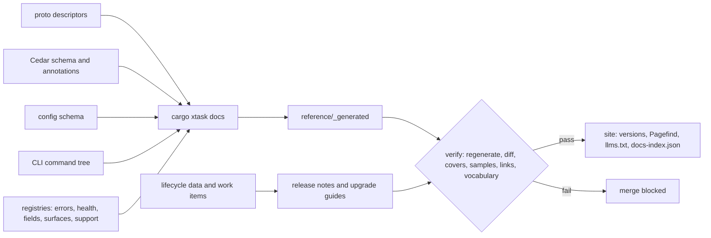
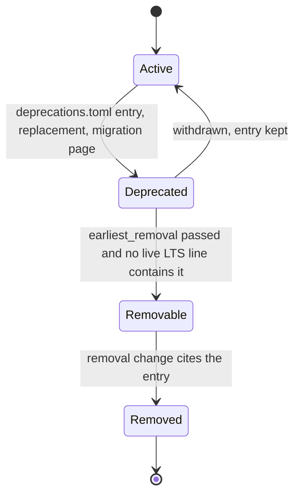

# 34. Documentation, support and product lifecycle

_Status: draft 1 against spine version 2, revised by a second reader, updated to spine version 3 and rulings R-43 and R-44, then to spine version 4 and the owner answers (`_review/02-owner-answers.md`), then to the owner's kit instructions (`_review/04-owner-kit-instructions.md`) and the air-gap (P16) and cohesion (P17, D-69) reviews. Date: 2026-11-11. Owner: `product-lead` in the Direction group (`team/01` section 2, `team/02` section 3); the `release` squad co-owns sections 9 to 11 and 14. Specifies D-58, D-59 (support matrix, diagnostics for support), D-50 and D-60 (stability and deprecation). Read with: `00-decisions.md`; 03 (`surfaces.toml`, `support.toml`, versioning); 04 (field registry); 07 (decision `reason`, shim messages); 11 (health codes, doctor, bundle); 12 (rule annotations); 18 (block-message routes); 20 (server commands, migrations); 21 (SupportGrant); 22 (handshake, support window); 23 (generated API docs, CLI grammar); 24 (release pipeline, LTS cut, support matrix); 26 (brand manifest); 27 and 28 (screens, catalogues, agent-facing text); 29 (worker notice); 32 (upgrade-path manifest, day-2 commands, support plans, incident severities); 35 (security response); 36 (terms, prices)._

## Summary

This document makes Guardrails ADR usable, supportable and predictable over time. Key choices:

1. **Docs as code in the main repository**, built with Docusaurus 3 (MIT, v3.10.2 verified 2026-11-10) into a static, versioned site with local search (Pagefind) and no analytics, cookies or third-party requests.
2. **All reference is generated** from protobuf descriptors, the Cedar schema, the configuration schema, the CLI tree and the registries, committed, and regenerated by `verify`, which fails on drift.
3. **Pages declare the surfaces they cover**; changing a covered surface without touching its page fails CI unless a reviewed waiver is recorded.
4. **An agent-readable index per version**: `llms.txt`, `llms-full.txt`, raw Markdown per page, `docs-index.json`.
5. **The block message is a contract** (`BlockNotice`, the typed form of 07's `reason`): component, decision, rule, reference code, approver and the person's route to an exception within one second on every surface, never blaming absent software; the agent-facing text is 28 §11's.
6. **Four support channels with severities and response targets** (first human response; targets). Paid support requires D-46's preconditions; hosted support also requires D-63's hosted-service preconditions, including infrastructure funded by revenue, sponsorship or donated cloud credits.
7. **One product bundle version over separately versioned components**, monthly minors, one LTS line a year with 24 months of public fixes, lifecycle data signed into release metadata so EOL warnings need no phone-home (D-58, D-71).
8. **Deprecation is data** (`deprecations.toml`), checked against the stability class in `surfaces.toml` (D-60).
9. **Release notes and upgrade guides are generated** from commit subjects, pull-request `release_note` blocks and schema diffs; the guide and `grdr server upgrade plan` read one manifest, 32's `upgrade-path.json`.
10. **Design-partner feedback moves only by explicit, previewed acts**: a local report command, interviews, opt-in crash reports with a published schema and no default destination.

## Requirements

| # | Requirement | Trace |
|---|---|---|
| R1 | Docs for every component, persona and shape; nothing ships undocumented | Owner ("cannot be an incomplete product"); D-50; l12 F4 |
| R2 | Reference generated from protobuf, Cedar schema, configuration schema and CLI; stale docs fail CI | D-06, D-08, D-38; 23 §14; brief 31 |
| R3 | Versioned site per supported line; agent-readable index | D-58; brief 31 |
| R4 | A runbook for every degraded or critical health code and server alert | D-58, D-59; l11 F6, F9; brief g10 §5 |
| R5 | Doctor and support bundle link to docs and support; bundles redact on the device | D-59; l04 F10; g10 §7 |
| R6 | Every block names component, rule and route to an exception within 1 s; the agent gets an actionable reason; absent software is never blamed | D-44; h08 implication 6 |
| R7 | Support for community, hosted, self-hosted and OEM, with severities and targets | l12 F4; l02 F8; g10 §7 |
| R8 | Monthly minors, yearly LTS for 24 months, expand-and-contract migrations, upgrade-path manifest, tested dependency versions, no phone-home | D-58; l11 F6, F9 |
| R9 | Stability class on every public surface; stable is additive within a major with 12 months' overlap, and none before an external embed pilot | D-60 |
| R10 | Support matrix per release; a support tier on every adapter, target, control point, integration and dialect | D-59, D-50 |
| R11 | Design-partner feedback that sends nothing by default | D-41, D-48, D-58 |
| R12 | Release notes and upgrade guides from work items | D-61; g10 §8 |
| R13 | Localisable docs, pseudo-locale and right-to-left builds, WCAG 2.2 AA | D-42, D-69; brief 33 §7; brief 34 |
| R14 | Training for administrators, analysts, monitored developers and operators | Owner; brief 33 personas |
| R15 | Support never reaches tenant data without a tenant-visible, time-boxed grant | D-55, D-51, P8 |

## Design

### 1. Sources, layout and site

| Path | Content | Rule |
|---|---|---|
| `docs/product/{tutorials,how-to,concepts,operate,embed,lifecycle}/` | Prose by Diátaxis type (https://diataxis.fr/) | Front matter: `id`, `type`, `personas`, `shapes`, `covers`, `owner_squad`, `stability` |
| `docs/product/reference/_generated/` | Generated reference, committed | "Do not edit" header; hand edits fail CI |
| `docs/runbooks/`, `docs/training/` | Public runbooks (section 5); learning paths and labs (section 16) | Structured front matter; oracles run nightly |
| `docs/i18n/<locale>/` | Translations | Never block a release |
| `site/` | Docusaurus app. Its Infima, Prism and Mermaid themes are token outputs (27 section 10); MDX components, admonitions, tables, tabs, code blocks and plan cards are `@grdr/kit` components; screenshots are generated from the pattern stories; the glossary and `/codes/<code>` pages use the product's own language tokens; the Storybook static build is served at `/design/` | Built in an isolated CI job with no secrets; never in a product package |
| `lifecycle/` | `lifecycle.toml` (line dates and windows), `deprecations.toml`, `known-issues.toml` | Schemas in `grdr-schema`; signed into release metadata beside 32's `upgrade-path.json`, which holds hops, required stops and the avoid list |

Design documents and decisions stay elsewhere under `docs/` as 03 assigns. `team/01` gives every path one owning squad; these four have none yet (Deviations, item 3).

**Why Docusaurus.** Versioning and i18n, including right-to-left locales, are built in and documented in its repository (`website/docs/guides/docs/versioning.mdx`, `website/docs/i18n/i18n-introduction.mdx`, read 2026-11-10), it is MIT-licensed, and it is on the React stack the Interfaces squad already uses. Starlight (MIT) is the fallback.

**Versions on the site:** `next` plus 22's support window (the current minor, the two before it and each live LTS line), at most six, as the Docusaurus guide advises keeping versions few. An EOL line is frozen to `/archive/<version>/` and never rebuilt. Pages take product versions from release metadata variables.

**Site rules.** The site is served from free static hosting for a public repository (there is no budget for hosting): GitHub Pages under the repository owner's account until the docs host named in the brand manifest has DNS, after which moving is a brand and configuration change (owner instruction 25). The host is chosen so that these rules hold, and its log retention is stated on the privacy page (target: truncated addresses kept for 14 days). No third-party scripts, fonts, analytics or cookies; Pagefind (MIT, v1.6.0) builds a static index, so no query leaves the browser. "Report a problem" opens a pre-filled issue; the page sends nothing. Install pages use only signed packages and show verification (24), never `curl | sh`: Windows user-mode packages are signed through the free open-source signing programme (D-17), deb and rpm repositories are signed, and the macOS pkg is signed and notarised only with Apple's Developer Program; without it the macOS page says the package is not platform-signed or notarised, carries its Sigstore signature and has tier 1 only (D-18, D-59) and shows checksum and provenance verification. Every page is also served as Markdown at `<url>.md`. The site of each version is built once with base path `/docs/<version>/`, no external resource, and every link to another origin marked external. The same files serve the public site, `grdr-server` (at `/docs/<version>/`, from the imported bundle), `grdr console serve` on loopback (from the `grdr-docs` package, adding no listener) and any static file server. Pagefind search works in all of them, because each serves over HTTP, never `file://`. In a copy served without internet, "Report a problem" shows `grdr feedback issue`, which writes the issue to a file. Prose takes product name, CLI name, paths and endpoints from the brand manifest (D-66), so `cargo xtask docs --brand <manifest>` gives a rebuilt distribution its own site; the disclosure pages cannot be removed by a brand build (26).



### 2. Generated reference

| Source | Output | Semantics owner |
|---|---|---|
| Protobuf descriptors with custom options (`data_class`, `filterable`, `scope`, `audit`, `rate_class`, `stability`) | Message and field reference with the data class of each field; API reference per service | 04, 23 |
| `grdr-schema/policy/v1alpha1.cedarschema` and the annotation list, parsed with the `cedar-policy` crate | Entities, actions, context, annotations, rule classes with default grade and loss behaviour | 12 |
| `grdr.config.v1alpha1.Config` | Every key: type, default, stability, `security`, `GRDR_*` name, plist, registry and JSON forms, which layers may set it | 03 |
| CLI command tree | Pages and man pages per `grdr <noun> <verb>`, exit codes, `--json` schema | 23 |
| Error register, `health.toml`, metrics, `limits.toml` | One anchored entry per code: meaning, cause, fix command, runbook | 03, 11 |
| Field registry and capture levels | "What is collected at each capture level"; feeds the disclosure surface and 29's worker notice | 04, 16, 29 |
| `surfaces.toml`, `support.toml`, conformance results | Stability table (D-60); support matrix (section 11) | 03 |
| Content-repository packs | A page per public rule id: intent, `@message`, class, default Mode, approver, tier, data classes read; no matcher internals | 12, 13 |
| Log-source taxonomy, mappings, `grdr egress` list, coexistence pack, ceiling matrix | Taxonomy and mapping tables; "every network destination" per shape (D-48); exclusion templates; reachable assurance | 04, 11, 13 |
| OpenAPI, webhooks, MCP tools, Terraform (`tfplugindocs`) | 23's generators | 23 |

`xtask docs` reads one descriptor set per source. Proto comments are the reference prose; `buf lint` COMMENTS makes them mandatory (23). Every generated page shows its surface's stability badge.

### 3. Freshness checks that fail CI

All run in `verify` unless marked nightly; a failing nightly check on a release branch blocks that release.

| # | Fails when |
|---|---|
| F1 | Regenerated reference differs from the committed bytes |
| F2 | A surface in `surfaces.toml`, command, configuration key, error code, health code or metric has no page or anchor |
| F3 | A change alters a surface named in a page's `covers` list without touching that page, unless the work item carries `docs: no-impact` with a reason the evaluator accepted |
| F4 | A `grdr-test` code block fails: CLI blocks run against a standalone install in a container; Cedar, TOML, JSON and YAML blocks validate against their schemas; API blocks run against an `embedded` server (requires the server) |
| F5 | An internal link or anchor breaks (lychee, Apache-2.0); external links are checked nightly and open a work item |
| F6 | Vale (MIT), with accept and reject lists generated from `schema/vocabulary.toml`, finds a spine-vocabulary violation (`posture` for Mode, `case` as an object, coined synonyms of surface terms), a wrong product-name form, an uncapitalised Mode name, a word from the filler and marketing list in `site/vale/` (owned here, seeded from the spine's style rules), a literal product version, or text addressed to AI readers as instructions |
| F7 | A `degraded` or `critical` health code or a server alert has no runbook |
| F8 | A Tier 1 cell in `support.toml` lacks install, operate and troubleshoot pages |
| F9 | (Nightly) A tutorial or lab oracle fails on main or a supported line |
| F10 | axe-core (MPL-2.0, test tool only) reports a WCAG 2.2 AA violation; an image lacks alt text; a diagram lacks a text description |
| F11 | A headless crawl of the built site, served from the public host and from `grdr-server` with no route out, records a request to another origin or finds a link to another origin not marked external |
| F12 | `docs-index.json` or `llms.txt` misses a page or lists a missing one |
| F13 | A name cited in `docs/`, `AGENTS.md` or a skill (crate, program, command, flag, configuration key, error or health code, metric, route, pattern, language-token id, pack kind, id family) is absent from its registry (the reverse of F2) |
| F14 | Outside `docs/design/00-decisions.md`, a sentence of ten words or more repeats spine text without citing its decision id |

### 4. Agent-readable index

Per site version: `/llms.txt` in the llmstxt.org format (`AnswerDotAI/llms-txt`, Apache-2.0) linking the Markdown of concepts, reference and how-to pages; `/llms-full.txt`, those sections concatenated and split above 2 MB; `docs-index.json` with each page's `id`, `title`, `type`, `personas`, `shapes`, `covers`, `stability`, `version`, `source_path` and `content_sha256`. The development fleet reads `docs/product/` directly; `AGENTS.md` (owned by `team/`) points to the index. Whether 23's read-only MCP server exposes the index is 23's call.

### 5. Persona paths and runbooks

Top level: Get started, Tutorials, How-to, Concepts, Reference, Operate, Security and privacy, Embed, Lifecycle (releases, support matrix, deprecations, known issues), Contribute (owned by 30).

| Persona | First path | Requires |
|---|---|---|
| Solo developer | Install, scan, first session and first block in five minutes, no account (spine §6) | Standalone daemon and shim |
| Monitored developer | What is collected, who can see it, why something was blocked, how to ask for an exception | Standalone daemon and shim |
| Small-team lead | Share a pack by git URL pinned to a digest; `grdr join` to a server (28 §12) | `grdr join` requires the server |
| IT administrator | Intune, Jamf, Configuration Manager, apt and dnf; managed-source ownership (D-49); coexistence pack; Watch-only pilot | Packages and MDM profiles (D-59) |
| Detection engineer | Author, test, replay, promote through Watch | Policy replay (D-11) |
| Platform operator | `embedded` install, move to `ha`, upgrade, backup and restore, air gap | Server |
| SOC analyst; privacy officer and CISO | Review queue, incidents, response, hunting, export; capture levels, content grants, re-identification, reports | Server |
| MSP technician and owner; OEM partner | Provider workbench and templates; embedding options and kits | Provider tier (D-35); L2 to L6 kits require an embedding partner (D-41) |

**Runbook format.** One format for public runbooks in `docs/runbooks/` and hosted-only runbooks in 32's `deploy/ops/runbooks/` (never published): 32's front matter (`id`, `trigger_alerts` or health codes, `severity`, `preconditions`, `steps`, `verification`, `rollback`) plus `impact` and `escalation`. Each step is a command with expected output and an `actor` of `agent`, `human` or `two-humans`; read-only diagnosis steps come first. Steps that g10 §8 and 32 reserve for people (production restore, failover, tenant suspension or deletion, key ceremonies, breach declaration) carry `human` or `two-humans`, and the operations runner stops at them. The server set covers install, upgrade, failed migration, `restore --verify` drill, lake rebuild, `embedded` to `ha`, key rotation (21), expiry and Stale devices, ring halt and resume, content rollback, kill switch use and release, block storms (Watch through a signed pack), an agent vendor's breaking release (D-10), crash loops, proxies, VDI clone findings, quota, disk full, synthetic-sensor alarm, "could not look", organisation export and delete (D-67). The endpoint set covers every endpoint health code. Steps tagged `drill` run in the lab (D-64: free hosted CI runners, or the owner's and the buddy's machines as self-hosted runners) against a fault-injected install; that run is the runbook's oracle.

### 6. In-product help and diagnostics

11 owns `grdr doctor` and `grdr support-bundle`, 20 the server equivalents. This section adds support behaviour.

- **Offline help:** man pages and `grdr help <topic>` in every package; the `grdr-docs` package (deb, rpm, MSI feature, pkg choice, tar) and the air-gap bundle (D-59) carry the site for that version, served as section 1 says; the air-gap page gives every verification command in its offline form.
- **Code links:** every health and error code and every preflight check id (`PF-nn`, 32) renders with `{docs_base_url}/<locale>/codes/<code>` for a shipped docs locale, else the English page. `docs_base_url` resolves in this order: the setting `docs.base_url` (a URL, `server` for the enrolled server's `/docs/<version>/`, or `local` for the loopback console); the server's value, sent to enrolled devices in the fleet-signed `ConnectionOffer`; then the brand manifest's `links` table (26, 36). The link points at the installed version. Importing a bundle (24 section 7) sets the server's value to its imported copy, so an air-gapped install never renders a link to a host outside it.
- **`grdr why <reference>`** (28 section 10; there is no `receipts` noun) prints the receipt behind a block: decision, component, rule, Mode, approver, grant options, the person's route. `--last` shows the most recent denial the device observed; when it was not ours it says so and names the component as section 7 allows. From agent lineage it returns only what the agent already received (D-38).
- **Known issues and versions to avoid:** entries in `known-issues.toml` (affected versions, matching codes, symptom, workaround, fixed-in) and the `avoid` list of 32's `upgrade-path.json` ride the signed release metadata the updater already fetches anonymously (22) or the air-gap bundle carries. `grdr doctor --known-issues` and `grdr server preflight` match locally. No new destination (D-58).
- **`grdr doctor --summary`** prints a metadata-only block safe for a public issue. Issue templates ask for it and warn against attaching bundles publicly.
- **Bundles** pass the capture filter at `metadata` (11), contain no memory dumps or minidumps (R-44), and leave only as a file. `--out <file>` writes one uncompressed POSIX tar of UTF-8 JSON and text, with no nested archive or executable member, and a `MANIFEST.txt` listing every member with its digest and data classes. The bundle is signed by the device or server key with its certificate chain to the deployment root, so a content-inspecting transfer guard and the site's reviewer can read every byte. The operator-set `support.bundle_marking` heads the manifest and every member, and a marked bundle is handled by a person only. `--submit --to <origin>` sends a bundle only to an origin named on the command line; nothing has a default destination. `grdr support-bundle inspect <file> --fingerprint <deployment root>` verifies and renders a bundle on any machine with no server and no network, so a vendor or partner can read one carried out of an air gap. A support answer never asks a site to run anything outside its installed release: fixes, known-issue updates and configuration packs arrive as signed artefacts in a bundle or export (24 section 7). Support deletes a bundle 30 days after its ticket closes and treats every string in it as untrusted: an agent analyses one only when the submitter ticked consent, which names the model provider, read-only with no network, returning typed findings (the framing rule of D-29). Whether the data terms of the owner's Claude subscription, on which the agents run, give zero retention is recorded beside the analysis (32 §9), as owner instruction 7 records it for embargoed work; it is not a gate.

### 7. The block message contract

34 owns the semantics. `BlockNotice` is the typed form of the `reason` field of 07's `DecideResponse` in `grdr.decide.v1alpha1` (07 adds it), filled by the engine (or the shim from its fail-safe table) and rendered by each surface. 18 owns the routes, 28 §11 the agent-facing wording and the CLI layout.

| Field | Content |
|---|---|
| `component` | `guardrails`, `guardrails-offline-table`, `verdict-provider` (a provider registered with the broker, D-14), `agent-native` (the agent's own permission system or classifier), `incumbent`, `gateway` (a third-party gateway adapter, D-40) or `unknown` |
| `component_label`, `component_confidence` | Our brand name, the provider's registered name, or a product named by the slot broker; `confirmed` or `possible` (rule 2) |
| `decision`, `mode` | `DENY`, `STEP_UP`, `MODIFY` or `DEFER`; the Mode that produced it |
| `rule_id`, `rule_title`, `pack` | Stable id (`provider/<id>/<reason code>` for a provider, 07), title as a language token rendered in the reader's locale, pack id and version (12) |
| `person_text` | `@message` as a language token from the pack's `messages/<locale>.mf2.toml`, rendered by the engine in the session owner's `ui.locale` (English when the pack has no translation), at most 280 graphemes; the receipt stores the `MessageRef`, so each later reader sees their own locale |
| `agent_text` | `@steer`, an `agent`-domain message: English, never translated, at most 400 characters |
| `reference` | Ten Crockford base32 characters from the receipt id, grouped 5-5, plus a check character |
| `approver` | `self`, `sponsor`, `admin`, `quorum` (12's `@approver`), or `none` for a hard block |
| `person_route` | The person's one route (D-44; 18): `ask-approver` (Ask), `request-exception` (non-final Block), `propose-mode-change` (final Block), `agent-setting` (an `agent-native` denial), `contact` (the organisation's configured contact), `wait` (DEFER), `run-doctor` (offline table), `none` (MODIFY: informational, "Details" only) |
| `agent_next` | 28 §11's next-step kind: `retry-after-approval` (with D-07's retry token), `use-alternative`, `blocked`, `snoozed`, `frozen` (D-31's three refusals), `offline-rule`, `retry-later`, `modified` |
| `control`, `degraded` | The assurance record's `control` value for this action class (`request`, `scoped-boundary`, `mandatory-boundary`; P1); set when 12's evaluator path was `failsafe` or `floor` |

**Agent text.** 28 §11 fixes it: English, plain text, at most 600 characters, three lines (what was denied, with code, rule id and reference; `Reason:` from `agent_text`; `Next:` chosen by `agent_next`), with no links, policy text, grant state or exception routes (D-38; 07). The product name enters as the `{product}` argument of the `agent.*` message, from the brand manifest's `product_name` or the co-brand profile's display name (21); there is no separate template. It is English because the agent acts on it and translation drift would change its behaviour; person text is localised.

**Rules.** (1) Visible within one second (target, D-44), offline included, because every field is local. (2) `incumbent` needs a product the slot broker identified on this device and an event tying it to the failure; `component_confidence` is `confirmed` only when that product's own telemetry confirms the block and is otherwise rendered "possibly <product>" (28 §11). Without both conditions the component is `unknown`, and `grdr why --last` says the block was not ours. Software that is not installed is never named (h08). (3) No matched patterns, list contents or other rules ever appear; pack text is inert, capped and URL-free (P7); person-facing renderers add a docs link only for rule ids in the public catalogue and a console link for organisation rules. (4) The pack validator rejects `@steer` text naming a widening command (pause, Mode down, uninstall, exclusion). (5) Our engine never denies on model output (P2; 12 §7); when the agent's own classifier denied, the route is `agent-setting`, never a dead end (D-44). (6) A component is always named, white-label included (26).

**Surfaces.** Hook: 07's translator maps the agent text into the dialect's reason field and the person text into any user-visible message field. CLI and `grdr run`: stderr and `--json`. Tray and local console: title, `person_text`, approver, one button for `person_route` ("Request exception" carries the justification pre-filled from the session task, brief 33), "Details". OS-level denial with no message channel (LSM or WFP error code): tray toast plus the receipt. Proxy and gateway: HTTP 403; on model-provider routes the body uses that provider's error shape with `agent_text` as the message and the `BlockNotice` fields in a `grdr` member, and elsewhere, `/v1/guard` included, it is RFC 9457 with the same fields. MCP broker: a JSON-RPC error whose `data` carries the fields (17).

### 8. Support model

| Channel | How | Scope |
|---|---|---|
| Community | GitHub Discussions and issues; vulnerabilities through `SECURITY.md` (35) | Best effort; Tier 1 and 2 |
| Hosted (Team, Enterprise plans, 32 §9) | Tickets from the console and by email; status page (32) | Service and connected sensors |
| Self-hosted subscription | Ticket portal, reached from any connected machine; a support bundle with each ticket, carried out of an air-gapped site by the site's own transfer process; the portal checks entitlement, never the product | Tier 1 cells on supported lines |
| OEM | Private shared channel, named engineer (the pre-disclosure list of 35 is separate and free to any qualifying redistributor, D-04) | Engine, ABI, kits, relayed content |

A provider (MSP) gives first-line support to its own organisations and escalates to us through its plan's channel; we take tickets about a provider's organisation only from that provider's technicians or the organisation's owner.

The hosted, self-hosted subscription and OEM channels are paid, so each requires D-46's preconditions: counsel's CRA opinion (free legal help for open-source projects is the first route), a human-staffed incident response team, an EU contact, public technical documentation and the support statement. Loonaro offers nothing paid without them. The hosted channel also requires the hosted service's preconditions (D-63; spine section 7): two people on call (met by the owner and the buddy), the legal entity (Loonaro), a written incident-reporting process, the `distributed` profile and its load test, and infrastructure funded by revenue, sponsorship or donated cloud credits. Where these do not hold, community is the only channel, and the docs say so.

| Severity | Definition |
|---|---|
| S1 | No workaround: silent fail-open in any Tier 1 cell; our configuration stops agents starting; fleet-wide blocking; cross-organisation exposure; hosted tier 0 verdicts unavailable; kill switch not executing |
| S2 | Workaround exists: a Tier 1 cell Degraded across many devices; a block storm contained by Watch; ingest or findings outside D-56 objectives; one organisation's console down |
| S3 | One device, feature or integration impaired |
| S4 | Question, documentation defect, cosmetic, request |

Suspected vulnerabilities go to 35 at any severity. An S1 or S2 release defect is a project incident whatever channel reports it, community included: `lead-release` starts the halt job for the affected ring (22) and the fix reaches every supported line (owner instruction 7). A ticket severity is the customer's impact; a hosted S1 or S2 ticket opens or joins a Sev1 or Sev2 service incident under 32 §2, whose clocks then govern status posts.

**First-response targets** (targets, response not resolution, until 36 publishes terms; business hours are Monday to Friday 09:00 to 17:00 in the organisation's region, 21). The numbers are 32 §9's plan table, which maps them to prices and staffing:

| Severity | Hosted Team | Hosted Enterprise | Self-hosted subscription | OEM | Community |
|---|---|---|---|---|---|
| S1 | 4 hours | 1 hour, 24x7; updates every 2 hours until mitigated | 4 business hours | 1 hour, 24x7 | No target; release defects become project incidents |
| S2 | 1 business day | 4 business hours | 1 business day | 4 business hours | No target |
| S3 | 2 business days | 1 business day | 1 business day | Per contract | No target |
| S4 | 2 business days | 1 business day | 1 business day | Per contract | No target |

**Agents and people** (g10 §8; 32 §3). Agents classify, match known issues, analyse bundles under the consent rule of section 6 and draft replies. A person sends every S1 and S2 communication and approves credits and plan changes; only a person holds a SupportGrant. The community answer agent marks itself as an agent and posts only replies citing docs pages; a draft suggesting a widening step is never posted, and the answer cites the exception route instead (D-44). Each agent action is audited, with the approving person where this paragraph requires one. Support agents run on the owner's Claude subscription under the dispatcher's limits, each with a usage cap per run (D-47); when a usage limit is reached they pause until the window resets, and the untriaged queue stays visible on the issue tracker.

**Tenant data.** Support reads tenant data only under 21's SupportGrant (23's access request resource): requested with a ticket reference, approved by the organisation owner after step-up, default 24 hours and at most 72, metadata only, with a banner in the organisation console while active. Operator staff never reach content; if a ticket needs content, the organisation issues a content grant to its own investigator (21). Reads write `audit.access` and show in the monitored developer's "who looked" view (D-51, D-55).

**Support statement:** a public page generated from `lifecycle.toml`, the support matrix and this section; one of D-46's required artefacts.

### 9. Versions and release lines (D-58)

- **One product bundle version** `MAJOR.MINOR.PATCH` names a tested set of components, and a deployment always moves from one bundle to another (owner instruction 17). Components (public crates, SDKs, endpoint and server programs, the eBPF object, the optional Windows driver) carry their own versions, tags and changelogs, which release-please proposes from Conventional Commit subjects (owner instruction 3). The bundle pins each component by version and digest and carries the `compat` block of contract ranges that one resolver checks (D-71), so a patch that changes one component is a new bundle whose other entries are unchanged digests. `0.x` until the event and API packages freeze as `v1` (section 10), and `1.0.0` is the bundle that freezes them. Packs, the wire major and the Cedar `schema_version` keep their own version carriers (03 section 7).
- **Cadence:** a minor every month, patches as needed, content continuously through rings (D-37). Upgrade order is server, gateways, sensors.
- **Fixes:** before 1.0, latest minor only. From 1.0, security and S1 fixes for the current minor, the two before it and every live LTS line, which is 22's support window and spine D-58 (R-43).
- **LTS:** the first LTS is the first minor at least 90 days after 1.0.0 with no open S1 or S2 defect, then every twelfth minor (D-58, R-43), so the 90 days give the first line field soak. Security and S1 fixes for 24 months, S2 fixes for the first 12; at most two live lines. An LTS patch never removes or deprecates a surface; a new OS release joins an LTS line only if no engine change is needed. Packs keep flowing because they are published for every supported engine (03).
- **Longer support** is paid, on terms set with counsel (D-58, D-04), and so requires D-46's preconditions. `lifecycle.toml` keeps `public_fixes_until` and `commercial_support_until` per line, so a CRA support period (Article 13(8) sets a five-year floor, brief 34 verification row 3) can be recorded without changing the public window.
- **Upgrade paths:** an upgrade hops at most two minors, with required stops (D-58, R-43). The hop rules, required stops, background-migration gates and avoid list are 32 §10's `upgrade-path.json`, built by 24 §11's release side; `grdr server preflight` and `grdr server upgrade plan --to <version>` read it (32). Migrations expand and contract across two releases (D-58; 20 §12), so a one-release rollback needs no restore and anything further is `restore --verify`. This document generates the upgrade guide from the same file (section 14).
- **Tested versions** of Kubernetes, PostgreSQL, NATS and object stores are in each support matrix; on 2026-11-10 the maintained Kubernetes lines are 1.35 to 1.37 (brief 25 verification).

### 10. Deprecation and end of life (D-58, D-60)

Classes come from `surfaces.toml` (03 §7): every surface starts experimental. When the event and API packages freeze as `v1` (before the server's first release, D-06) they become additive-only but labelled beta, and the pack format, Cedar schema and configuration become beta. The C ABI, `wasm32` binding, provider protocol and host contract stay experimental, and nothing is stable, until D-60's embed pilot completes, which requires an embedding partner.

| Class | Rule |
|---|---|
| Experimental | May change in any minor; listed in release notes; first-use warning for configuration keys and CLI flags |
| Beta | A break needs a deprecation release (03 §7), here at least two minors in `deprecated` before removal; never removed inside an LTS line |
| Stable | Additive within a major; a new major overlaps the old for at least 12 months (D-60) |



A `deprecations.toml` entry holds `surface`, `item`, `class`, `announced_in`, `earliest_removal`, `replacement` and `migration_page`. CI fails a removal or break without an entry past its `earliest_removal`, or without its migration page. **Signals:** API `Deprecation` and `Sunset` headers with per-client counts (23); CLI stderr warning and `meta.deprecations` in `--json`; configuration start-up warning, `grdr config explain` and a doctor condition; Cedar validator warning; `grdr content test` warning for packs; the deprecated attribute in the C header. Health and error codes, metric names and rule ids are never reused.

| Artefact | Outside support | End of life |
|---|---|---|
| Sensor | Keeps enforcing, renews and upgrades; health `Out-of-support` (22) | When its wire major is no longer accepted: a wire major stays accepted for at least 24 months after its successor ships and until the last LTS line emitting it ends; the frozen bootstrap service then upgrades it (22) |
| Server | Preflight warns; no fixes | Line end in `lifecycle.toml`; doctor and preflight warn 90 days ahead |
| Packs | Not published for EOL engines | A rule spends at least two minors in `deprecated` (replay only, 13) before removal; removing a protective rule is widening and needs the organisation's signature where D-31 requires it |
| Public interfaces (API, C ABI, pack format, Cedar schema, configuration) | Class rules above | API package N and N-1 served for at least 12 months (23); a stable C ABI major overlaps the next by 12 months (03 §7) |
| Agent adapters | Out-of-range versions drop to Watch, `unknown-version` (D-10) | A vendor version leaves the tested range 90 days after a newer release, announced 30 days before it leaves |
| Operating systems | Outside the matrix: runs if probes pass, labelled unsupported (24 §9) | The floors of 24 §9 (Windows 11 releases in servicing and Server 2022 and 2025; the current macOS major and two before it; Linux 5.10 with BTF for the sensor); dropped no earlier than the vendor's end of security support, announced two minors ahead, and inside an LTS line only marked "vendor-unsupported" |
| Server dependencies | Preflight fails on an untested version (32 §10) | Dropped at a minor boundary, announced two minors ahead |

### 11. Support matrix per release (D-59)

24 §9 owns the platform rows and the generator (`support.toml` to matrix and release-blocking jobs, 24-26). This document adds the dimensions beyond platform and the publication rule. `xtask docs matrix` joins 24's output with conformance results and the ceiling matrix (11) into `support-matrix.json` and its page, signed into release metadata and published with the release notes. Added dimensions: install profile; agent adapter and tested range; control point; incumbent and reachable assurance; MDM and package tools; server profile; IdPs; console browsers (current and previous major of Chromium-based browsers, Firefox and Safari); integration and dialect tiers. Each cell carries its support tier and the CI run proving it; a cell without a green run blocks publication. A cell whose test needs hardware nobody has is marked "requires hardware" (D-64) and is not published as supported until that run is green; incumbent cells other than Defender require a licence through a design partner or a free vendor programme (D-23). `grdr doctor` reports "outside the support matrix" as a condition, never an error (24 §9); `grdr server preflight` fails on untested server dependencies (32 §10).

### 12. Support tiers in docs and support (D-50)

Definitions, promotion and demotion are 03's §12. Here: every page about an adapter, target, control point, integration or dialect shows its tier, and Tier 3 pages sit under "Experimental" and say the feature is off by default; paid support and targets cover Tier 1 cells only, Tier 2 issues go to the named maintainer without a target, Tier 3 gets community support; `grdr doctor` lists each active component's tier. **Complete** (D-50) includes docs: a Tier 1 cell is complete only when F7 and F8 pass for it, and `PLAN.md`'s traceability matrix gains a docs column filled from `docs-index.json`.

### 13. Design partners and feedback without telemetry

| Cohort | Requires | Size | Purpose |
|---|---|---|---|
| EDR or MDR partner (D-41) | An MVI-member EDR or MDR design partner (external) | 1 | L3 pilot (26 owns it), Windows platform questions, incumbent licences for coexistence tests (D-23, D-64) |
| Developers and small teams | Standalone daemon and shim | 10 to 20 people | First value, prompt budget, block messages, uninstall |
| Enterprise pilot | Packages and MDM profiles (D-59) | 1 to 3 organisations, a few hundred devices in Watch (l02) | MDM delivery, coexistence |
| Self-hosting operators | Server | 3 to 5 | Upgrade, restore, runbooks |
| MSPs | Provider tier (D-35) | 2 to 3 | Provider workbench, onboarding targets |

Terms are 36's; none is paid. Each cohort has an entry checklist, a recurring call, a structured report each round and an exit review. Feedback moves only by the partner's own acts:

1. `grdr feedback report --preview`: a local file with version, profile, health-code histogram, hook latency percentiles, counts of prompts, blocks and overturned blocks per rule, Mode changes, triage counts. Metadata only, no identifiers or paths. On a device it describes only that person's own use; run with `--context` against a server (requires the server), it aggregates per rule and group and suppresses any group under five (D-51). The partner reads it and sends it by any route.
2. `grdr feedback issue`: an issue body from `doctor --summary` and the person's text, opened in the browser or written to a file.
3. Opt-in crash reports: `crash_reports = off | ask | send`, default `off`; symbolised backtraces without memory (11); a published JSON Schema. `ask` writes the report and offers `grdr feedback issue`. `send` posts to `crash_reports.endpoint`, which defaults to the enrolled server (stored as a device health record the operator may forward) and has no default in standalone, so a standalone user names the destination. The endpoint is listed in `grdr egress` only while `send` is set.
4. Preview content channel: opted-in partners get new rules in Watch first; their report counts feed D-53's promotion evidence.
5. Moderated usability sessions: per-persona task scripts, five participants per persona per round.

Partner material is kept privately for 12 months, quoted without names, never used to train a model without a separate agreement. Each item becomes a work item citing the evidence id; the persona council (D-47) reviews the cohort summary after each round.

### 14. Release notes and upgrade guides

Every pull request that closes a work item (D-61) carries a `release_note` block in its body, beside the metadata block (owner instruction 27); the merge queue rejects one with neither a note nor `none` with a reason:

```toml
[release_note]
category = "fix"     # feature | fix | security | deprecation | breaking | known-issue | none
audiences = ["administrator", "operator"]
surfaces = ["config:updates.enabled"]
text = "The updater honours updates.enabled = false before its first fetch."
action_required = "" # mandatory for breaking and deprecation: what to do and how to verify it
```

release-please writes each component's `CHANGELOG.md` from the Conventional Commit subjects (owner instruction 3). `xtask release-notes <from> <to>` writes the bundle's notes: it groups the merged pull requests by category and audience and adds generated sections: API and descriptor diff (23), configuration, Cedar schema, health and error code and support-matrix diffs, deprecations and removals, known issues, and links to 35's CSAF and VEX advisories. It emits site Markdown, the GitHub release text and `release-notes.json` in release metadata, so the console and doctor can show what changed locally. An evaluator checks that every `breaking` and `deprecation` entry has an imperative `action_required` with a verification step. release-please opens the release pull request, the merge queue lands it, and release-please creates the tags and GitHub releases; artefacts are signed keylessly with Sigstore through GitHub's OIDC identity, so no person signs a release (owner instruction 7; 24 §10).

An upgrade guide is generated for each supported `from` and `to` as the union of the hops, required stops and background-migration gates of `upgrade-path.json` and the removals and `action_required` texts between them. `grdr server upgrade plan --to <version>` prints the hop sequence from the same manifest (32 §10), which is the guide's oracle. The content repository generates per-pack notes from the rule diff.

### 15. Localisation and accessibility

English with British spelling is the source, matching API nouns such as `organisations/{o}`. Generated reference stays English because it is identifiers and proto comments; tutorials, how-to guides, concepts, the monitored-developer pages and legal pages translate. Translations live in git under `docs/i18n/<locale>/`. Docusaurus builds each shipped locale with its direction from the generated locale table, plus the `en-XA` and `ar-XB` pseudo builds in CI (D-42, D-69). The glossary is `schema/vocabulary.toml` (spine section 3), the one termbase for product and docs: its `translate = false` terms stay English everywhere, each translated term has one approved form per locale, and Mode labels follow the language tokens with the English identifier in parentheses on first use; Vale's lists and the Docusaurus theme strings are generated from it. Code blocks, commands, anchors and front-matter keys are byte-identical across locales. Translations follow section 15a, with no human gate. A page whose source changed shows "may be out of date; English is authoritative" until it is regenerated. Docs translations never block a release.

The site targets WCAG 2.2 AA (D-42): F10 on every build; U09's screen-reader journeys over the docs persona paths per LTS line, judged by `eval-a11y` (a person's audit adds evidence when someone is available and never gates); keyboard paths, unobscured focus, 32 by 32 px targets (27 section 11's product minimum; inline text links excepted, as WCAG 2.5.8 allows) and 4.5:1 contrast from shared tokens; text descriptions for diagrams; captions and transcripts for video; no meaning by colour alone. An Accessibility Conformance Report on the VPAT INT template, the edition 27 and 28 use (brief 34 names VPAT 2.5 INT without verification), is published per LTS line beside 27's.

### 15a. Translation workflow (D-69)

No step needs a person, and anyone may improve any step's output by pull request.

(1) **Source.** A writer adds an English token with `desc`, `max` (graphemes), `risk` (`normal`, or `safety` for approvals, widening, block messages, privacy disclosure and legal text) and typed arguments (`cargo xtask scaffold token`).

(2) **Translate.** `impl-l10n` writes each shipped and preview locale from the glossary, `interface/strings/style/<locale>.toml`, the token's `desc`, earlier translations of the same source (git is the translation memory) and the `en-XA` screenshot of each story that uses it, recording `source_hash`.

(3) **Deterministic checks (V26).** MF2 syntax and data model; identical argument names, types and data classes; identical markup; every plural and ordinal category the locale needs; glossary terms only through `:grdr:term` and none of the locale's rejected synonyms; `max`; NFC; no URL, Markdown, emoji, control or bidi character; code spans byte-identical.

(4) **Back-translation.** `eval-l10n`, in a clean context on the other of Opus 5.5 and Sonnet 5.5, translates back to English without the source and compares. `safety` tokens need `equivalent` and exact glossary terms; others need `equivalent` or `minor`. A failure returns to step 2, at most three rounds; after that the token ships English in that locale with a `translation-held` entry and an issue.

(5) **Rendering gates (U04, U11)** in every shipped locale and the three pseudo-locales.

(6) **Merge and release.** A change merges when its source is valid and the pseudo-locales pass. The release fails on a pending or held token in a shipped locale, unless that locale is demoted to `preview` for the release, as the release notes state.

(7) **Corrections.** Translation and glossary changes from anyone pass steps 3 to 5 and merge with no maintainer approval; a glossary change re-checks every token that uses the term.

(8) **Docs** pages follow the same steps, plus code-block, anchor and link checks.

**Locale list.** `interface/strings/locales.toml` is data. Anyone may propose a locale. It enters as `preview` when CLDR rates it `modern` and our fonts cover its exemplar characters, and becomes `shipped` after one release with every token translated and every gate green. The first shipped locales are `de`, `ja` and `ar`, so each mechanism meets expansion, CJK and right-to-left text in a real language. Translation runs within a usage cap per run; shipped locales go first, preview locales wait, and nothing fails at a usage limit (D-47). A locale is demoted with a stated reason, never removed silently.

### 16. Training

Learning paths per persona: developer (two hours), administrator, analyst and operator (a day each), privacy officer (two hours), MSP technician (half a day), embedder (a day). Labs are scenarios for the public efficacy harness (spine D-45 and D-64; the detailed harness and lab document is pending) in a disposable container or VM; the replay model endpoint makes the real agent emit fixed tool calls, so each lab produces the same blocks with no model account or token spend. Each lab has an oracle (expected receipts, findings or health states) and runs nightly (F9). A rollout kit for monitored developers (one-page explainer, FAQ, 15-minute briefing outline) is generated from the organisation's live configuration beside 29's worker notice, so it cannot claim less collection than is configured. Learner certification is part of the training: lab oracles emit per-learner results, which the certification reads; it requires demand from outside the team, three provider partners asking for it.

### 17. Content standard for every surface

Words come only from the glossary (`schema/vocabulary.toml`). Sentence case. Buttons are a verb and an object, with the same label on every surface. Messages say what happened, why, then the one next step; no apology, blame, exclamation or "please". Copy addressed to the monitored person is neutral and factual, and notifications carry no content. Numerals always; compact notation in sentences from 10,000 ("1.2 million devices", exact value on hover or in the table); exact tabular figures in tables. Times are local with the zone shown, with UTC as a preference on every surface. Machine-written text appears only quoted, with its provenance label ("written by an agent", "AI-written"). No marketing words and no emoji. U10 runs Vale over the exported English tokens and these pages against this standard.

## Interfaces and contracts

| Contract | Form | Other side |
|---|---|---|
| `BlockNotice` | Protobuf, the typed `reason` of `grdr.decide.v1alpha1.DecideResponse` | 07 (adds it), 12, 17, 18, 26, 27, 28 |
| Pack `messages/<locale>.mf2.toml` | MessageFormat 2 language tokens by rule id (D-69), capped, URL-free | 12's validator; content repository |
| Brand manifest `links.docs_base_url`, `links.support_contact_default` | `brand/brand.toml` | 26 (rebuilds), 36 (schema) |
| `lifecycle.toml`, `deprecations.toml`, `known-issues.toml` | TOML, schemas in `grdr-schema`, signed into release metadata | 20, 22, 24, 11 |
| `upgrade-path.json` | 32 §10's schema; read here for guides and the avoid list | 32, 24 |
| `grdr why`, `grdr feedback report`, `grdr feedback issue` | CLI commands in 23's grammar | 23 (requested), 11 |
| `support-matrix.json`, `release-notes.json` | Signed release artefacts | 24, 27, 28, 11, 20 |
| `release_note` block | TOML in the pull-request body | Pull-request template, merge queue |
| `docs-index.json`, `llms.txt`, `llms-full.txt` | Static files per version | Development fleet, 23 |
| Doctor JSON, bundle manifest, `health.toml` | Schemas and registry | 11, 20 |
| SupportGrant | 21's resource, 23's access request API | 21, 23 |

## Behaviour by deployment shape

| Aspect | Standalone | Platform, self-hosted | Platform, hosted | Embedded |
|---|---|---|---|---|
| Docs | Online site, or the `grdr-docs` package through `grdr console serve`; man pages and help | Plus runbooks; the server serves its version's site at `/docs/<version>/` from the air-gap bundle | Plus service pages and status (32) | Partner rebuilds docs from its brand manifest |
| Support | Community | Community; paid on supported lines, which requires D-46's preconditions | Hosted targets, which require D-46's and D-63's hosted-service preconditions | Contract, which requires D-46's preconditions |
| Lifecycle data | Anonymous update metadata, or none with updates off | Release bundle and preflight | Operated by Loonaro; version view (22) | Partner relays and re-signs (26) |
| Block message | Our label | Same | Same | Partner brand may replace ours; a component is always named |

## Extension points

Docs pages by pull request, in the `static` lane when the change is prose only outside protected paths (owner instruction 8) and otherwise in D-63's low tier, with front matter and F1 to F14 as the contract; adapter and integration templates include a docs page (F8 for Tier 1, the same pages for promotion from Tier 2); known issues and runbooks for contrib adapters in the contrib repository, merged at build; translations under section 15a's workflow; labs as harness scenarios plus a page; brand builds of the docs.

## Security and privacy

- The secret scan covers `docs/`; examples use RFC 2606 names and fake keys.
- The site sends nothing to third parties (F11); search is local.
- The docs domain is a phishing target: install pages reference only signed packages with verification, and state plainly where a package is not platform-signed (macOS without Apple's Developer Program); the domain transfers with the marks under D-03.
- Block messages reveal nothing beyond rule id and texts; steer text cannot instruct widening.
- Bundles are metadata-only, signed, previewed, leave only as a file or by an explicit `--submit` to an origin the person names, are deleted 30 days after closure and are analysed as untrusted.
- Support access to tenant data is owner-approved, tenant-visible, time-boxed, metadata only, audited, and visible to the monitored developer; operator staff never read content.
- Feedback and crash reports are opt-in with published schemas and no default destination in standalone; partner data is kept 12 months and never trains models without agreement.

## Test and evaluation strategy

| Property | Test | Oracle |
|---|---|---|
| Reference matches source; docs track surfaces | F1 to F3 with seeded fixtures (new key without page, changed flag) | Byte equality; each fixture fails with its check id |
| Block notice complete and fast | Harness fault matrix on every Tier 1 cell: Cedar deny, floor deny, fail-safe table, verdict-provider deny, `STEP_UP`, `DEFER` timeout, frozen session, OS-level deny, proxy and MCP deny | Mandatory fields present; `person_route` and `agent_next` match the case; agent text within 1 s (target); character caps held; agent text contains no exception route |
| No false blame | Lab with Defender ASR blocking the shim, an agent-native denial, and a machine with no security software (h08) | `incumbent` only with an identified product and a tying event, `confirmed` only with that product's telemetry, `agent-native` only with an observed native deny, else `unknown` |
| No policy leak | Governed-session red team against notices and `grdr why` | No pattern, list or other rule text |
| Upgrade guide correct | Guide versus `grdr server upgrade plan` for every supported pair; upgrade and rollback drill (20) | Equality; drill green |
| Lifecycle rules | `deprecations.toml` fixtures: early removal, missing page, removal inside LTS | Each fails |
| Matrix honest | Publication gate | Every cell links a green run |
| Feedback sends nothing | `grdr feedback` in a network namespace | No socket beyond the browser hand-off the person triggers |
| Docs usable | Moderated sessions | Solo developer reaches a first block in five minutes from docs alone; task success 80% (target) |
| Runbooks work | `drill` steps on a fault-injected install | Verification passes |

## Work breakdown

| ID | Issue | Acceptance | Requires |
|---|---|---|---|
| **DOC** | **Docs as code and paths** | | |
| DOC-1 | Layout, front matter, pinned Docusaurus 3, Pagefind | Isolated build; F11 passes | |
| DOC-2 | `cargo xtask docs` for proto, Cedar, config, CLI, registries, fields, egress | F1 green; an uncommented field fails `buf lint` | |
| DOC-3 | Checks F2 to F8, F10 and F12 to F14 in `verify`; F5 external links and F9 nightly | Each check has a seeded fixture that fails with its check id | DOC-1, DOC-2 |
| DOC-4 | Vale rules from the spine vocabulary and the filler and marketing list | `posture`, a literal version and an instruction to AI readers each fail | |
| DOC-5 | `llms.txt`, `llms-full.txt`, Markdown pages, `docs-index.json`; man pages and `grdr help` in every package | Every page indexed; hashes match; man pages present in each package of the release; with no route out (air-gap conformance run S-31, steps 14 and 15), every code link from `doctor`, `preflight`, a block message, the console and a notification opens a locally served page and search returns results | DOC-1 |
| DOC-6 | Versioned site and archive job | Six-version cap held; EOL line served from archive | DOC-1; LC-1 |
| DOC-7 | Developer, monitored-developer and team paths | At least four of five participants reach a first block from the docs alone within five minutes (target) | Standalone daemon and shim; SUP-2 |
| DOC-8 | Administrator paths | Pilot partner deploys 25 devices from docs alone | An enterprise pilot partner (DP-5) |
| DOC-9 | Runbooks for every degraded and critical code and alert, with `drill` steps | F7 green; drills pass | Server runbooks require the server |
| DOC-10 | Analyst, detection, privacy and CISO paths | A partner analyst completes the analyst lab | Server |
| DOC-11 | Provider and embedder paths; brand-parameterised docs | MSP cohort onboards an organisation from docs; test brand site has no Loonaro string outside component attribution | Provider tier (D-35); an MSP cohort (DP-5) |
| **SUP** | **Help, notices, support** | | |
| SUP-1 | `BlockNotice` with 07, 12, 18, 26, 28 | Merged in `grdr.decide.v1alpha1`; validator rejects widening steer text and URLs; a fixture per `person_route` and `agent_next` value | |
| SUP-2 | Hook, CLI, tray and local console rendering; `grdr why` | Fault matrix green on the hook, CLI, tray and local console; 1 s target met | SUP-1; hook shim and daemon |
| SUP-3 | Proxy (RFC 9457) and MCP rendering | Same matrix on the proxy and MCP broker | SUP-1; MCP broker and proxy |
| SUP-4 | Code links, `doctor --summary`, `--known-issues`, signed known-issue list | Seeded issue matched offline; changing the server's `docs.base_url` changes the links on enrolled devices within one check-in | |
| SUP-5 | Issue templates, agent triage (`support-first-line` and the community answer agent), answer-agent rules | Widening drafts are never posted in a red-team run; every agent reply carries the agent marker and a docs citation; the answer agent pauses at a usage limit without dropping a thread | |
| SUP-6 | Tickets, severities, bundle retention, SupportGrant flow | Bundle deleted 30 days after closure; a grant read appears in "who looked"; an operator content read is refused; a bundle carried out verifies with `grdr support-bundle inspect` against the deployment-root fingerprint offline, and one changed byte fails | Server (21's SupportGrant); paid tickets require D-46's preconditions |
| SUP-7 | Hosted support and OEM channel | Targets met in a game day; partner receives a test fix through the relay | Hosted: D-63's hosted-service preconditions; OEM: an embedding partner; both require D-46's preconditions |
| SUP-8 | Generated support statement | Regenerates from data; D-46 item ticked | LC-1 |
| **LC** | **Lifecycle and release notes** | | |
| LC-1 | Bundle and component version scheme, `lifecycle.toml`, `release_note` block and merge-queue check | Each bundle pins every component by version and digest; a pull request without a note is rejected | |
| LC-2 | `deprecations.toml` check and per-surface signals | Early removal and LTS removal fixtures fail | LC-1 |
| LC-3 | `xtask release-notes` and `release-notes.json` | A 0.x release ships all sections | LC-1 |
| LC-4 | Generated upgrade guides from `upgrade-path.json` | Guide equals `grdr server upgrade plan` output for every supported pair; in the 24-28 lab (S-31), `upgrade --to <next LTS>` from the previous LTS completes with only the bundles `plan --offline` listed, and removing one makes `plan` and `preflight` refuse, naming it | 32 OPS-07 and OPS-08 (the manifest and preflight) |
| LC-5 | LTS backport pipeline and EOL warnings | Security backport lands on the LTS branch; warnings 90 days ahead online and air-gapped | The first LTS cut (24 §10) |
| LC-6 | Matrix dimensions beyond platform, docs page and publication gate (generator is 24-26) | A cell without a green run blocks publication | Server rows require the server |
| **DP** | **Design partners** | | |
| DP-1 | EDR or MDR partner loop | Three consecutive structured reports | An MVI-member EDR or MDR design partner |
| DP-2 | `grdr feedback report --preview` and `feedback issue` | No socket in a network namespace; server-side report suppresses a seeded group of four | The server-side report requires the server |
| DP-3 | Developer cohort and usability scripts | 10 active participants; findings filed | |
| DP-4 | Opt-in crash reports; preview content channel | Off by default; `send` in standalone without an endpoint sends nothing; endpoint in `grdr egress` only while on; preview-channel counts appear in D-53 promotion evidence | |
| DP-5 | Enterprise, operator and MSP cohorts | Entry checklists met; exit reviews recorded | Operator cohort requires the server; MSP cohort requires the provider tier |
| **LOC, TRN** | **Localisation, accessibility, training** | | |
| LOC-1 | Pseudo-locale and right-to-left builds; glossary-generated Vale lists and theme strings; stale-translation banner; docs translation jobs | Builds pass; a changed source flags its translation; a changed code block in a translation fails | |
| LOC-2 | U09 journeys and ACR | Zero AA failures; ACR published | |
| LOC-3 | Section 15a pipeline with `impl-l10n`, `eval-l10n`, `garden-l10n` | Seeded faults each fail their check (a dropped placeholder, a missing Arabic plural category, a literal glossary term, an over-length toast, a back-translation that inverts a safety step); a community correction merges on gates alone | DX-16; WI-0041 |
| TRN-1 | Developer path with two replay-endpoint labs | Green nightly, no model account | Replay model endpoint (D-45) |
| TRN-2 | Monitored-developer rollout kit; administrator, analyst and operator paths | Kit text changes when the seeded capture level is raised; labs green on main and supported lines | Analyst and operator labs require the server |
| TRN-3 | Certification | Lab oracles emit per-learner results; a learner's certificate is issued from them | TRN-1; three provider partners asking for it |

## Risks, open questions and spikes

| Item | Risk or question | Settled by |
|---|---|---|
| F3 noise | `covers` may block unrelated changes and invite blanket waivers | Spike over 200 consecutive changes: pass if under 10% need a waiver, else narrow `covers` to descriptor ids |
| Support capacity | Two people (the owner and the buddy) cannot staff the 24x7 targets of 32 §9 or a large community queue; agent triage is bounded by the subscription's usage limits | Community best effort with agent triage; paid and hosted channels require D-46's and D-63's preconditions, and the 24x7 targets require staffing funded by revenue |
| CRA support period | Article 13(8)'s five-year period against the 24-month public LTS (Deviations, item 1) | Counsel (free foundation legal programmes first); `lifecycle.toml` already separates the windows |
| Docusaurus weight | Snapshot versioning grows the repository; a large Node tree; the build runs on free hosted CI runners | Six-version cap; isolated build; Starlight if the build exceeds 10 minutes |
| Sparse feedback | Structured reports may not arrive | Measured per cohort round: below half the cohort reporting, more interviews; never automatic sending |
| Translation quality | Agent translations may change the meaning of security steps | `safety` tokens and pages need an `equivalent` cross-model back-translation and exact glossary terms; a failing token ships English in that locale with a `translation-held` entry and an issue; anyone may correct it by pull request through the same gates |
| Docs domain (D-66) | Loonaro's distribution reads the docs host from its brand manifest (owner instruction 25); a self-hosted or rebuilt deployment sets its own through `docs.base_url` and its manifest (owner instruction 26) | Answered: GitHub Pages until the manifest's docs host has DNS; the recorded namespace and trademark search still runs before the first release; Loonaro holds the domain |

## Deviations from the spine and objections

1. **D-58 defers support periods beyond 24 months to "before any paid offer".** Followed. Objection: brief 28's verification (Commission guidance point 54) indicates the free distribution may be a manufacturer product once it connects to a paid hosted service, so counsel's opinion on the CRA support period (free foundation legal programmes first, D-46) should precede the first public release. Open: spine v4 D-58 keeps "before any paid offer".
2. **D-48 and D-58: nothing leaves by default, no phone-home.** Opt-in crash reports (l12 F4, accepted by the resolution) are added as a setting, off by default, with no default destination in standalone and listed in `grdr egress` while on; known-issue and EOL data reuse the existing anonymous update fetch. I read both as consistent with the spine; the architect may strike crash reports. Open: no ruling.
3. **Path ownership.** `team/01` requires one owning squad per path; `docs/product/`, `site/`, `lifecycle/` and `docs/runbooks/` have none, and `product-lead` writes no code. Proposed: `release` owns `lifecycle/` and `site/`; each squad owns the pages whose `owner_squad` names it; `product-lead` owns persona paths and training. Needs a `team/01` change. Open: no ruling.
4. **Conflicts in neighbouring documents this one cannot fix.** (a) Patched lines: resolved by R-43 (current minor, two before it and the live LTS; spine D-58). (b) First LTS: resolved by R-43 (first minor at least 90 days after 1.0, then every twelfth). (c) Hop rules: resolved by R-43 (at most two minors with required stops). (d) Support bundles: resolved by R-44 (no memory dumps; 11 wins). Open: (e) 28 §11's next-step kinds are adopted unchanged as `agent_next`; 18's person routes need the `person_route` names. (f) Severity names: resolved by R-48 (support severities are S1 to S4); still open, 32 §9 should say whether the four-hour S1 targets for Hosted Team and self-hosted are business or calendar hours (this document assumes calendar for Team, business for self-hosted).

## Sources

Research briefs: `25-deployment.md`, `28-oss-sustainability.md`, `g10-saas-ops-day2-economics.md`, `33-ux-personas.md`, `h08-practitioner-voice.md`, `31-agentdev-operating-model.md`, `24-platform-architecture.md`, `34-compliance.md` (verification row 3; VPAT). Review notes: `l12` F4, `l04` F7 and F10, `l11` F6, F7 and F9, `l02` F8, `l06` F6 and F8. Design documents checked for agreement: 03, 07, 11, 12, 18, 21, 22, 23, 24, 26, 28, 32; `team/01` and `team/02` for ownership.

Primary sources checked for this document on 2026-11-10 (GitHub API and repository files): https://github.com/facebook/docusaurus (MIT, v3.10.2; `versioning.mdx` "Keep the number of versions small"; `i18n-introduction.mdx` RTL support); https://github.com/CloudCannon/pagefind (MIT, v1.6.0); https://github.com/AnswerDotAI/llms-txt (Apache-2.0) and https://llmstxt.org/; https://github.com/errata-ai/vale (MIT, v3.26.0); https://github.com/lycheeverse/lychee (Apache-2.0); https://github.com/dequelabs/axe-core (MPL-2.0, v4.14.0); https://github.com/withastro/starlight (MIT); https://diataxis.fr/. RFC 9457, RFC 9745 and RFC 8594 (via 23), RFC 2606.
