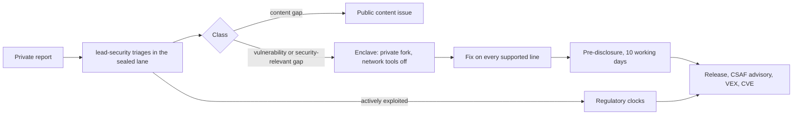

# 35. Product security programme

_Status: draft 5 against spine version 4, rulings R-01 to R-62, and the owner's answers (`_review/02-owner-answers.md`): no milestones or schedule, zero budget, the owner's Claude subscription, Loonaro as the legal entity and the owner's buddy as the second person. Then the owner's kit instructions (`_review/04-owner-kit-instructions.md`): 7 (no human gates), 20 (the complete air-gap bundle), 22 (latest versions, proactive vulnerability work, cooldown), 23 (no new third-party account), 28 (the repository public from the first push) and the air-gap review (P16). Owning squad: Security and trust core. Read with: `00-decisions.md` (D-37, D-45, D-46, D-47, D-61 to D-64); 02 (SR and SD rules, `trust-core.paths`); 03 (layers, bill of materials); 11 (update ladder); 13 and 14 (content and intelligence lanes); 22 (roots, roles, rings); 24 (build, signing, packaging); 29 (regimes); 30 (governance); spine D-45 and D-64 (harness, lab; the detailed document is pending); 32 (hosted operations); 33 (risk register); 36 (counsel, contracts); `team/05` (CI gates)._

## Summary

This is the process half of product security: who decides, what evidence a change needs, how releases are proven, how vulnerabilities and incidents are handled, and how the agent fleet that writes the code is kept from becoming the attack path. Doc 02 owns the code rules (SD-01 to SD-13) and requirements (SR-01 to SR-50), 22 the update protocol and roots, 24 the pipeline. This document binds them to roles, clocks and gates.

Key choices:

1. **Agents run the security programme, and no step needs a person** (owner instruction 7). `lead-security` leads the PSIRT: it triages private reports in a sealed lane, classifies them, sets severity and runs the embargo. `eval-security` and `eval-adversarial` review every high-tier and trust-core change. release-please and the merge queue release, and artefacts are signed keylessly. Separation of duties holds between agents and deterministic software: the writer of a fix never evaluates it, and a trust-core change needs two independent passing evaluators on different models. Loonaro, as manufacturer, files the regulatory reports agents prepare (section 4.7).
2. **Tiers come from a deterministic classifier configured on the base branch.** A model may raise a tier, never lower it; circuit breakers tighten tiers on revert and incident rates.
3. **Trust-core evidence is a fixed bundle**: reference model and differential test, matrix run, 72-hour soak for runtime components, cross-model review by the model that did not write the change, threat delta, `eval-security` and `eval-adversarial` reviews with two independent passes on different models, and the review reference D-62 sets for the component.
4. **Every parser, normaliser, verifier and evaluator has a named oracle and fuzz time** (section 2.5).
5. **Three report classes**: vulnerability (CVE, CSAF advisory, VEX per supported line), security-relevant content gap (advisory, no CVE, embargoed), content gap (public). Rendering a request as a boundary is a vulnerability (P1).
6. **Embargoed work runs in a sealed enclave**: a private fork of the repository and agents with network tools off. Whether the Claude subscription's data terms give zero retention is recorded with each advisory and is not a gate (owner instruction 7, amending D-62).
7. **Releases are proven three ways**: SLSA Build L3 provenance with the builder identity checked; Sigstore keyless signatures through GitHub's OIDC identity, with Rekor inclusion proofs carried for offline checks; and an independent rebuild in its own GitHub Actions environment that must match, whose signature is the second of 22's `binaries` threshold, so no person holds a key (owner instructions 7 and 23). Only the project root can authorise a binary; a deployment root (operator, cell or OEM) authorises policy and configuration and nothing else (D-37).
8. **No cash bounty**; there is no money for one. Reporters get credit, and reports need a reproducer. A cash programme requires revenue from the hosted service or a sponsor.
9. **We run the Cyber Resilience Act manufacturer process from the first public release**, since a free sensor tied to a paid hosted service is likely a manufacturer product (research/28 verification row 3).
10. **The development fleet runs under the last signed release** with a published fleet pack, in disposable sandboxes, with no standing credentials; agents that read outsider text cannot write or hold secrets (D-47).
11. **Vulnerability work is proactive and free** (owner instruction 22): latest stable versions at bootstrap, a short cooldown after it, CodeQL, Semgrep OSS, ClusterFuzzLite, Grype, a ZAP baseline scan and a ratcheted OpenSSF Scorecard beside the existing gates, KEV and EPSS to order remediation, and variant analysis that turns every fixed vulnerability into an audit over the whole tree.

## Requirements

| # | Requirement | Source |
|---|---|---|
| PS-1 | Threat modelling on every change that crosses a trust boundary or adds an untrusted input | D-63; 02 R10 |
| PS-2 | Classifier-set review tiers and lanes; trust core always needs two independent passing evaluators on different models; no evaluator judges its own change | D-63; owner instructions 7 and 8; research/h09 |
| PS-3 | Trust-core evidence and the review D-62 sets before the internal ring is left | D-62, D-63; c9 F7; l01 F10 |
| PS-4 | Machine-enforced memory-safety and `unsafe` policy | SD-01, SD-02; research/37 |
| PS-5 | Fuzz and differential obligations per component with real oracles | D-10, SD-04; research/32 |
| PS-6 | Dependency admission, latest versions at bootstrap, cooldown, advisory watch, proactive scanning and variant analysis, seven-day patch target for bundled dependencies, the air-gap bundle's contents | D-62; owner instructions 20 and 22; research/32, h05 |
| PS-7 | Provenance, reproducible builds, key custody, ceremonies, release authority | D-37, D-46; owner instruction 23; research/25 |
| PS-8 | Private intake triaged in a sealed agent lane; CVE and VEX per supported line; bypass versus content gap | D-62; owner instruction 7; l08 F5, l09 F8 |
| PS-9 | Embargoes that do not leak through agents or the public content repository | D-62; l08 F5 |
| PS-10 | Free pre-disclosure list with published criteria, at least ten working days ahead | D-04, D-62 |
| PS-11 | CRA 24-hour, 72-hour and 14-day clocks met: agents run the clocks and draft the reports, Loonaro files them, and D-46's human-staffed team exists before any paid offer | D-46; research/28, 34 |
| PS-12 | Audits and penetration tests per component, by the evaluator route, free programmes for open-source projects and qualified volunteers | D-62, D-19; owner instruction 7; spine section 7 |
| PS-13 | Incident response for the hosted service and for a compromised release, key or pack | D-63; research/37 |
| PS-14 | Fleet isolation, credentials and injection defences; fleet runs the last signed release | D-47; research/21, h09 |
| PS-15 | Metrics with thresholds that trigger action | Owner request; D-63 |

## Design

### 1. Roles and capacity

| Role | Held by | Duties |
|---|---|---|
| PSIRT lead | `lead-security` | Triage in the sealed lane (section 4.1), class, severity, embargo, regulatory report drafts, advisory publication |
| Release authority | release-please and the merge queue; `lead-release` keeps the release checklist (30 section 3) | Release pull requests land through the queue; release-please creates tags and releases; Sigstore keyless signing and the rebuilder environment's threshold signature (owner instruction 7) |
| Trust-core reviewers | `eval-security` and `eval-adversarial` in clean contexts for every family (Rust privileged code, eBPF, macOS, Windows, web), with two independent passing evaluators on different models; free external audits from programmes for open-source projects when granted; a qualified volunteer's documented review adds evidence (D-62) | Review, audit, delta review |
| Security evaluator (agent) | Evaluator pool | Security review, fuzz triage, VEX reachability on public advisories, threat-delta checks, variant analysis |
| Advisory drafter (agent) | Embargo enclave only | Patches, tests and advisory drafts under section 4.5 |
| Regulatory filer | Loonaro, through its account on ENISA's Single Reporting Platform | Files the reports `lead-security` drafts (section 4.7) |

Security work has a reserved share of the subscription's usage windows in `.agents/kit/usage.toml`, with triage and trust-core review first (D-47). When the security queue overruns its share two weeks running, the programme manager schedules no new trust-core work, only fixes.

### 2. Secure development lifecycle

#### 2.1 Threat modelling per change

Each work item carries a `security` block that the planner fills and the security evaluator checks: (1) trust boundaries touched (02 TB-1 to TB-15); (2) any new input, parser, listener, IPC message, read from user-writable space, destination or privilege; (3) SRs implemented, weakened or with changed tests; (4) can it widen policy, capture, grants, egress or privilege; (5) behaviour on failure, hang and hostile input; (6) what a reviewer must read first. A yes to 2 or 4 makes the change at least medium tier and requires a `threats.yaml` delta or a written justification. A new parser without a registered fuzz target fails `verify`. Each trust-core component and each new process has a component threat model in its design document before its first merge.

#### 2.2 Classifier, tiers and circuit breakers

The classifier is `cargo xtask risk`, configured by `.agents/risk-tiers.toml`, whose `[trust_core]` reads 02's `security/trust-core.paths` (the one name fixed in `team/06` section 2.2), both read from the base branch. It emits a check run with `tier`, `reasons[]` and `evidence_required[]`.

| Tier | Triggers (any) | Merge rule |
|---|---|---|
| High | `trust-core.paths`; any `unsafe`; public crate API, wire format, Cedar schema or pack format; new dependency or major bump; removed or weakened security or SR test; Essentials pack or fail-safe table; CI, release, classifier, hook or agent-kit instructions | `full` lane: `eval-security` and `eval-adversarial` in clean contexts plus cross-model review by the model that did not write the change (D-47); a trust-core change needs two independent passing evaluators on different models; section 2.3 evidence where it applies |
| Medium | Layer 3 adapters, server targets, other parsers, first-party content outside Essentials, installer logic | `standard` lane: the tier's evaluators (`team/02` section 10); `eval-tier` samples at least 20% after landing |
| Low | Documentation, additive tests, flagged layer 4 interface changes | `light` lane (one `eval-diff` pass) or `static` lane (deterministic proofs only), as the classifier sets (owner instruction 8) |

AI review stops after three rounds (D-47). Low-tier changes land on their lane's checks, so the low tier holds only the triggers above, and no path moves into it, until the incident evaluation set holds 50 cases (research/h09).

Breakers (targets, `security/breakers.toml`): a low-tier revert rate over 3% in 28 days, or one V1 or V2 vulnerability (section 4.3) traced to a low-tier merge, makes low merge as medium for 28 days; a medium sampled defect rate over 5% sends every medium change through the `full` lane's evaluators for 28 days; a trust-core regression in ring 1 freezes trust-core work to fixes until the regression has a three-arm proof and a new oracle; two V1s in a quarter freeze features on that layer and put its re-review first in the trust-core review queue. Only `lead-security` releases a breaker, with a root-cause note that `eval-security` accepts in a check run.

#### 2.3 Trust-core evidence

Runtime components: the eBPF crate, Windows driver, macOS extension shell, `grdr-daemon`, IPC peer authentication, `grdr-update` and `grdr-updater`, `grdr-crypto`, `grdr-policy` evaluator semantics, tenancy and row-level security, `unsafe` in `grdr-ffi`, `grdr-approve`. Control component: gate, CI and release configuration.

| Evidence | Runtime | Control |
|---|---|---|
| Reference model and passing differential test (Cedar's Lean model; a user-space model for eBPF; the TUF attack suite for the updater) | Yes | No |
| Matrix run (OS, architecture, kernel matrix, both topologies) | Yes | Dry run on a fork |
| 72-hour soak on a tier B machine (the owner's or the buddy's) beside Defender and, where a design-partner or free vendor-programme licence exists, one more incumbent; zero panics, flat memory. Requires hardware: without a tier B machine able to run it, the component stays in ring 0 | Long-running privileged code: eBPF programs, driver, macOS extension shell, daemon, updater, approval helper; the other runtime components rely on differential tests and the matrix (deviation 2) | No |
| Cross-model review by the model that did not write the change, `eval-security` and `eval-adversarial`, two independent passing evaluators on different models, threat delta | Yes | Yes |
| Specification statements and properties approved by the item's lead and checked by `eval-adversarial` against the requirement they encode (research/h09: kernels check proofs; someone other than the prover checks they prove the right thing) | Yes | No |
| Independent review (D-62) | Before first leaving the internal ring: D-62's review route, run by `eval-security` and `eval-adversarial` on different models over the whole component, plus any free external audit that has arrived; a qualified volunteer's documented review adds evidence; then delta review | Yearly supply-chain review by `eval-security`, plus a free external programme when granted |

Delta review: changes under a reviewed component accumulate in a ledger; a release carrying them leaves ring 0 only after `eval-security` and `eval-adversarial` pass the delta on different models, and an external auditor who reviewed the component reviews the delta where available. Full re-review yearly, or when the ledger passes 25% of the component's lines, by the same route. A trust-core component without the review D-62 sets stays in the internal ring (D-63); it remains part of the product.

#### 2.4 Memory safety and `unsafe`

SD-01 and SD-02 are the rules. Every `unsafe` block is listed in a generated `security/unsafe-register.toml` with its invariant, who upholds it and its Miri, AddressSanitizer or Kani coverage; an unlisted block fails CI. Nightly: Miri wherever it runs, AddressSanitizer on FFI and OS adapter tests, Kani no-panic proofs for `grdr-fastpath`. Swift uses `Unsafe*` APIs only in the bindings layer. TypeScript bans `innerHTML`, `dangerouslySetInnerHTML` and `eval` by lint, with Trusted Types and a strict content security policy (SR-36). The optional Windows driver (requires the sponsor or partner of D-17) is C or C++ (Rust driver crates are prototypes only, 03) and adds Driver Verifier, annotated static analysis, IOCTL fuzzing and HLK to its bundle.

#### 2.5 Fuzzing and differential obligations

The harness exists from the first fuzz target; each row applies from its component's first merge. Fuzzing runs in ClusterFuzzLite on GitHub Actions for every target, which needs no account (owner instruction 23), and on tier B machines (D-64), with long campaigns split to fit the runners' job limits.

| Component | Oracle | Fuzz time (target) |
|---|---|---|
| Shell, PowerShell and path normalisers | Real shells and kernel under exec and open tracing (D-10) | PR 5 min; nightly 1 CPU-h per target; weekly 24 CPU-h |
| Hook dialect and transcript parsers | Each agent's own parser at its pinned version | Nightly 1 CPU-h |
| `grdr-proto` decoding | Unknown-field preservation, round-trip, size caps | Nightly |
| Cedar semantics and layer composition | Cedar's Lean model and `cedar-drt` generators; our ceiling and deny-wins model (12) | Nightly 4 CPU-h |
| `grdr-crypto` compositions | Known-answer and negative vectors | PR |
| Pack verifier and validator | Production interpreter; forbidden-field corpus, mutation score above 90% (02 TM-11) | Nightly |
| Fail-safe table compiler (runs on the device in the privileged service, output signed with the device-local artefact key, D-14) | Its denials are a subset of the engine's | PR property test |
| Compile-down | Pinned agent's own enforcement per version (D-12) | Each adapter release |
| `grdr-update` metadata | TUF attack suite plus fuzzing (`tough` had three 2026 CVEs, research/h05) | Nightly |
| `grdr-wire` frames | Structure-aware fuzzing; fault tests for peer authentication | Nightly |
| LLM and MCP protocol parsers | Reference SDK decoders; round-trip | Nightly 1 CPU-h |
| eBPF programs, observe and enforce | User-space model on the same events, zero mismatches over one million; verifier load across the kernel matrix (S-13) | Per change and weekly |
| Server decoders and tenant context | Canary records under a foreign organisation (SR-42) | Nightly |
| `grdr-fastpath` (floor and fail-safe tables, and the L3 library) | Full engine on the same input (03 B2) | Nightly |

Trust-core corpora stay private until the code is two releases old. No OSS-Fuzz application is made, because it needs an account (owner instruction 23); ClusterFuzzLite keeps the corpora and the campaigns. A trust-core crash not minimised and fixed within seven days blocks release; elsewhere it blocks the next minor.

#### 2.6 Dependencies, advisory watch and patch targets

- **Admission.** A new direct dependency is high tier with a justification record (purpose, why not std or an existing crate, maintainers, `unsafe`, build script, proc macro, licence) and a registry-existence check against invented names (research/h09).
- **Latest at bootstrap.** The seed pins the newest stable version (never a prerelease, canary or lab build) of every dependency, tool, action and toolchain when it is written: the Rust toolchain, every crate (`cargo update`, then each direct requirement raised to its newest major where the code builds), Node LTS, pnpm and the web packages, every GitHub Action by its latest release SHA, every plugin and skill pin and every container base. The cooldown does not apply to the seed. Each pinned version must still pass: not yanked, no open advisory (osv-scanner, `cargo deny advisories`), licence on the allow-list, and provenance or a signature where the ecosystem offers one (npm provenance, Sigstore, crates.io trusted publishing) (owner instruction 22).
- **Sources and cooldown.** crates.io and vendored `third_party/` only; pnpm with strict `minimumReleaseAge`, `blockExoticSubdeps` and `trustPolicy: no-downgrade`; build tools pinned by checksum and never linked. Dependabot proposes updates daily with a cooldown of 3 days for patch and minor releases and 7 days for majors (owner instruction 22), held in `.github/dependabot.yml`; it needs no account beyond the repository (owner instruction 23), and pnpm's `minimumReleaseAge` in `pnpm-workspace.yaml` repeats the 3 days. Cargo's `registry.global-min-publish-age` carries the same value in `.cargo/config.toml` once the pinned toolchain has it stable (research/32 row 4 reads it as stabilised in Rust 1.100; before that it is `-Zmin-publish-age`). The Cargo setting does not check versions already in the lockfile and `cargo update` can downgrade them, so an `xtask` check also rejects any lockfile entry added in the change whose publish time falls inside the cooldown for its update class. Security fixes skip the cooldown: `eval-security` reads the diff, and the update lands in the lane its diff earns. `garden-deps` keeps the tree at the newest versions and opens a work issue for every major that needs code changes.
- **Audit and bans.** `cargo vet` with imported audit sets, unaudited count ratcheted down; `cargo auditable`; CycloneDX 1.7 SBOM per artefact; 03's do-not-use list enforced by `cargo-deny`, including the `rsigma` daemon, runtime and MCP crates.
- **Watch.** Nightly `osv-scanner` and `cargo-deny advisories` over lockfiles, SBOMs and shipped images, with Grype as a second image scanner, plus a watch list of components we reference by digest (PostgreSQL, NATS, rustls and aws-lc-rs, Cedar, YARA-X, `tough`, SQLite). NATS carried 27 advisories and OpenBao 38 in 2026 (research/h05).
- **Proactive scanning** (owner instruction 22; all free for open source). gitleaks locally and in Actions; CodeQL for Rust and TypeScript in Actions, with GitHub's secret scanning and push protection, from the first push, because the repository is public from it (owner instruction 28) and CodeQL's terms allow automated analysis only of open-source code published in a public GitHub repository (read 2026-11-11), so it has no local or private form (owner instructions 22 and 23). Semgrep OSS rules for Rust and the web; OpenSSF Scorecard weekly, its score ratcheted; an OWASP ZAP baseline scan of the console and API against the `embedded` server in CI. A finding becomes a work issue, or a recorded false positive with its reason.
- **Remediation order.** KEV and EPSS order the queue: a KEV-listed reachable advisory is fixed first, on every supported line; within a severity, higher EPSS goes first.
- **Variant analysis.** Every fixed vulnerability becomes an audit prompt in `audits/` (`team/04`), run over the whole tree; every hit that survives the refuting pass becomes a work issue.
- **The air-gap bundle** (24 section 7; owner instruction 20). The supply-chain gate checks every bundled component: redistributable under its licence, with its source in `sources/` where it is copyleft (30 section 1). The third-party images in it are built by us from source on a minimal base, reproducible and signed, with SBOM and provenance, and every bundled image and package goes through the same watch, VEX and patch targets as our own artefacts.

| Case (from upstream publication) | Target |
|---|---|
| Bundled (linked, vendored, or shipped by digest in our images or charts), high or critical, reachable | Patched release on every supported line in 7 days (D-62) |
| Same, unreachable | VEX `not_affected` with justification in 7 days |
| Medium or low | Next minor; VEX in 7 days |
| Integrated, not shipped by us | Guidance and any detection update in 7 days |
| Unmaintained (no release for 12 months, or a security issue unanswered 90 days) | Replacement or fork plan recorded as a high-tier work item before the next minor |

### 3. Build and release integrity

#### 3.1 Provenance

A reusable GitHub workflow builds every artefact with SLSA Build L3 provenance (`actions/attest-build-provenance`) and cosign 3 bundles logged to Sigstore's public log, signed keylessly through GitHub's OIDC identity (research/25; owner instruction 23). Each artefact's Rekor inclusion proof travels with it, so verification works offline (P16). Verification checks the certificate identity (repository, workflow path, ref, trigger), not the presence of an attestation, because a 2026 package compromise forged Sigstore provenance (research/21 item 103). The release key signs only artefacts that pass this check. `grdr verify-artefact` runs offline. The trusted root and the expected identities (repository, workflow path, ref pattern, issuer, SLSA builder id) come from `release-manifest.json` verified under the project root, never from the bundle under test or the network, and it checks the SLSA v1 predicate's subject digest, builder id, build type, source repository and ref. Install documentation gives each verification command in an online and an offline form. The air-gap bundle may also carry `grdr-source-<v>.tar` (vendored crates and pnpm store, pinned toolchains), so a site can rebuild with `cargo xtask dist --offline` and compare Linux digests with ours.

#### 3.2 Reproducible builds

Toolchain pinned by hash, dependencies vendored, no network after fetch, `SOURCE_DATE_EPOCH`, remapped paths. An independent rebuilder runs in its own GitHub Actions environment, with its own key and no access to the release environment, and rebuilds every candidate; its signature is the second of the `binaries` threshold (owner instruction 23). Linux binaries and packages, server images and packs must match byte for byte; macOS and Windows artefacts are compared with signatures removed; MSI and pkg by payload. A mismatch blocks signing. Third parties may run the rebuilder and have their attestations listed in `release.json`.

#### 3.3 Key custody and ceremonies

D-37's two roots are held apart. The project root is ours alone and is the only key that can authorise a binary. A deployment root belongs to whoever operates a deployment: the operator of a self-hosted server, Loonaro for each hosted cell, the partner for a rebuilt white-label (D-60: embedded builds carry no root). The two never share key stores or tokens, and devices accept a binary only under the project root, so the loss of a hosted cell's root cannot put a binary on any device.

| Key | Custody |
|---|---|
| Project root and project `targets` | Threshold two across two GitHub Actions environments, the release signer's and the independent rebuilder's. Each key is generated inside its environment's job and stored as that environment's secret from stdin, never printed (owner instruction 23); each environment accepts jobs only from the default branch. No person holds a root key (22 section 6.2) |
| `binaries` | The release environment's key plus the rebuilder environment's key, each usable only by its environment's jobs on merge-queue release commits |
| `content` | Online key, usable only by the content release job after its evaluator checks |
| Project snapshot, timestamp, `rollout` | Online keys in the release environment; `rollout` is also usable by the halt job, so a halt never waits |
| Where the online project keys live | Environment secrets on the free CI runners, with a zero budget; a cloud KMS is one configuration change where donated cloud credits or a sponsor pay for it (22 section 6). A stolen secret of one environment alone cannot authorise a binary, because the threshold needs the other |
| Hosted cell deployment root | Requires the hosted service's preconditions (D-63). Made by `grdr server keys init --ceremony` with the cell's KMS (22 section 6.2); its offline tokens, separate from the project root's, are held by the two people on call that the hosted service requires (D-63); online `targets`, snapshot, timestamp and `fleet` keys sit in the cell KMS behind the Keys port (21) |
| Self-hosted deployment root | The operator's. We ship the ceremony command and recommend 2 of 3 tokens; we hold nothing |
| Apple Developer ID, notarisation | Requires Apple's Developer Program for Loonaro (annual fee, spine question 8); without it macOS ships with Sigstore signatures and provenance, marked not platform-signed and not notarised, at tier 1 only (D-18, D-59). Organisation account, two administrators (the owner and the buddy) with hardware second factors; the Developer ID certificates are secrets of the release-signer environment, used only by the release job (24 section 10) |
| Windows user-mode signing | Through a free open-source signing programme (for example SignPath Foundation), verified at setup (D-17); Loonaro's account with two administrators (the owner and the buddy), workload identity access from the release environment |
| deb and rpm repository keys | Encrypted secrets of the release environment, usable only by merge-queue release jobs; hardware-backed where a sponsor or donated KMS provides it |
| Approver keys | Each approver's own WebAuthn authenticator (22) |

The project's key ceremony is 22 section 6.2's workflow in `release/ceremony/`, dispatched only when a protected change to that path lands on `main`: a job in each environment generates its keys inside the job, stores them as that environment's secrets from stdin and publishes only public keys and signed metadata, and the transcript of key ids and output hashes is committed. Root rotation runs yearly and on suspicion; a suspected exposure of an environment means rotation within 30 days (target). No agent session and no person reads a private key: the keys exist only inside their environments' jobs, and no role's `gh` calls can read environment secrets (`guard-command`). Agents never handle `fleet`, approver or organisation keys. Recovery codes for Apple, Microsoft, GitHub, the signing programme and any KMS are held offline by Loonaro.

#### 3.4 Release authority and checklist

Agents prepare candidates (notes, SBOM, VEX, rebuild requests). The second `binaries` signature comes only from the rebuilder's environment after its rebuild matches (section 3.2). `release/checklist.toml` blocks the release while any item is open: provenance and rebuild verified; no open V1 or V2 affecting it unless the embargoed fix is included; trust-core delta ledger passed by its evaluators; the air-gap bundle's notices and `sources/` complete (36 section 6); held-out suite and scorecard pass with overfit margin at most 5 points (D-45); coexistence results present (D-23); SBOM, VEX per line and licence report generated; artefact file list matches the manifest and a secret scan is clean (a 2026 release leaked client source through a source map, research/21 item 28); SD-05, SD-08, SD-09 and SD-10 confirmed. Content follows 13 and 14: a rule lands on `eval-acceptance`, `eval-adversarial` and `eval-licence` passes with evidence, a community rule needs them from two evaluators on different models and stays in Watch without them, and a ceiling of `contain` or above also needs `eval-security` (13 section 17; owner instruction 7); and 14's guard list and device circuit breaker for the intelligence lane.

### 4. Security response

#### 4.1 Intake and triage

`SECURITY.md` at the first commit (D-62). Channels: GitHub private vulnerability reporting (on from the repository's setup, `team/06` section 11 item 6; temporary private fork, CVE request; GitHub "usually reviews the request within 72 hours", research/28) and the security address from the brand manifest, with an OpenPGP key whose private half lives only in the sealed triage lane. The address works once its mail forwarding exists (owner instruction 25); until then GitHub private reporting is the only channel. curl left GitHub private reporting in 2026 for missing features (research/28 row A), so spike SP-S2 compares it with a hosted platform that is free for open-source projects, and its result decides the channel (SP-21); adopting a hosted platform needs an account in Loonaro's name (owner instruction 23). Reports need a reproducer; AI-assisted reports are accepted on the same terms. Acknowledge in 2 working days, classify in 5 (targets). Triage runs in the sealed lane: a `lead-security` session with no public write, no secret beyond the triage key and network tools off, which returns class, severity and reproduction status as typed fields (SD-06). Report text never enters any other agent session.

#### 4.2 Classification

| Report shows | Class | Handling |
|---|---|---|
| A component fails its contract or the assurance record: a normaliser says `resolved` where the real consumer disagrees; malformed input accepted; wrong fail-safe table or verifier; silent fail-open; grant reuse or approval forgery, including an agent's own prompt accepted as an approval (section 3 of the spine); widening without a person; peer-authentication or update bypass; cross-organisation read; `request` rendered as a boundary; any other violation of an SR in 02 (SD-09) | Vulnerability | CVE, CSAF, VEX; embargo |
| Memory-safety fault, or a privileged process panicking or hanging, from untrusted input | Vulnerability | CVE; embargo |
| A shipped rule in a protective class (Essentials, fail-safe table, protected paths, `elevate`, day-one sinks) misses what it documents, engine correct | Security-relevant content gap | Advisory without CVE; private content branch; pre-disclosure |
| Missed technique; new technique; any model-tier miss (P2) | Content gap | Public content issue |
| An agent ignores a control documented as `request`; a residual in 02 section 3.9 | Not a vulnerability | Linked to the residual |
| A flaw in an agent, IDE or dependency seen through us | Upstream | Report to vendor; detection ships with the vendor's disclosure, earlier only with consent or exploitation |

#### 4.3 Severity and targets

CVEs carry CVSS v4.0 vectors (https://www.first.org/cvss/v4.0/specification-document); internal severity drives targets (fix ready on all supported lines, from triage). Vulnerability severities are V1 to V4, distinct from 34's support severities S1 to S4 and 32's incident severities Sev1 and Sev2:

- **V1, 7 days**: code execution or widening on devices via a channel or the server; signature or root bypass; cross-organisation access; fleet-wide silent fail-open of a fail-closed class; forgery at G2 or G3.
- **V2, 14 days**: a same-user agent defeats a boundary in the Protected profile; Essentials Block bypass through a normaliser; enforcement denial of service from untrusted input; privilege escalation through our service.
- **V3, next minor, at most 60 days**: bypass needing administrator rights; metadata disclosure.
- **V4, best effort**: defence in depth.

Disclosure follows pre-disclosure, at most 90 days from triage unless the reporter agrees. Exploitation in the wild or disclosure by others ends the embargo once a fix or mitigation exists.

#### 4.4 Supported lines, CVE and VEX

Supported: the current minor, the two before it and the live LTS, which gets public security fixes for 24 months (D-58, R-43), endpoints and server; packs for every supported engine line (03). Each fix is backported or the advisory states why a line is unaffected. GitHub is our CNA (it cannot assign where another CNA covers the project, research/28); we apply to become a CNA at more than ten CVEs a year or when the hosted service opens. Advisories are CSAF 2.0 with the VEX profile, plus OpenVEX 0.2.0 per line and per image (research/34), generated from one source in `security/advisories/` and exported to OSV.

#### 4.5 Embargo with agents

Code is fixed in the advisory's private fork of the repository; content on a private content branch; access is the advisory's enclave sessions. Agents make embargoed fixes, and only in the enclave (owner instruction 7). Whether the Claude subscription's data terms give zero retention is recorded with the advisory; it is not a gate. The enclave is a disposable VM on the owner's machine whose only network route reaches Claude under the owner's subscription, with network tools off: no MCP servers, web fetch, package installation (dependencies come from the vendored tree), third-party plugins or scheduled tasks; transcripts are deleted 30 days after publication. Reproducers and regression tests live in the held-out suite until publication. A shipped pack is readable by anyone, so security-relevant content fixes reach pre-disclosure members first and public rings on the date. Fixes touching an upstream (Cedar, `rsigma`, rustls) follow that project's policy and never land first in our public tree.

#### 4.6 Pre-disclosure list

Free to redistributors meeting published criteria (D-04): distributions and package repositories shipping `grdr`; embedders at L2 to L6 with a signed embargo agreement (26); providers and self-hosted operators serving other organisations. Each names a contact with an OpenPGP key and accepts the terms: no public description before the date; services they operate may be patched early; packages and partner releases wait for the date. Members receive per-line patches, signed packs, the draft advisory, CVE, CVSS vector and draft VEX at least ten working days ahead (D-62). A leak removes a member for 12 months. The member list, without contacts, is public.

#### 4.7 Regulatory clocks

`lead-security` runs every clock and drafts every report. Loonaro files them through its account on ENISA's Single Reporting Platform, an external precondition the entity holds (36 section 4); a paid offer also needs D-46's human-staffed team.

| Trigger | Regime | Clock |
|---|---|---|
| Actively exploited vulnerability in our product | CRA Art. 14, through ENISA's Single Reporting Platform to the CSIRT of our main establishment | Early warning 24 h; notification 72 h; final report within 14 days of a corrective measure |
| Severe incident affecting our product's security (compromised release, key, channel) | CRA Art. 14 | 24 h; 72 h; final report one month after the notification |
| Users affected by either | CRA Art. 14 | Without undue delay, through 34's channels |
| Personal data breach in the hosted service | GDPR Art. 33 | To tenants without undue delay; 72 h to the authority for our own controller data |
| Significant hosted incident once in NIS2 scope | NIS2 Art. 23 | 24 h; 72 h; one month |
| Contracts (processing terms, DORA addenda; 36) | Contract | Target 24 h after confirmation |

The clock starts at awareness: the PSIRT lead's confirmation, decided within 4 hours of a V1 report (target). Manufacturer reporting applies since 2026-09-11 and the platform has operated since then (https://digital-strategy.ec.europa.eu/en/policies/cra-reporting); steward reporting starts 2027-12-11 (research/28 row 3). We run the manufacturer process from the first public release with quarterly tabletops; counsel's classification (D-46, 36) decides only which reports are mandatory.

### 5. Audits, penetration tests and bounties

No audit is paid for (zero budget). Every scope below gets D-62's review route, run by `eval-security` and `eval-adversarial` on different models over the whole scope (owner instruction 7). We apply for free external audits from programmes for open-source projects: OSTIF, OpenSSF Alpha-Omega, Sovereign Tech Resilience, the GitHub Secure Open Source Fund and similar funds (research/28). A kernel component leaves the internal ring only through that route, with any free external audit that has arrived; a qualified volunteer's documented review adds evidence. The other scopes take a free external audit when one is granted (D-62).

| Scope | Gate |
|---|---|
| CI, merge queue, release workflow, key custody, fleet isolation | First public signed release |
| `grdr-daemon`, updater, `grdr-hook`, `grdr-crypto`, IPC peer authentication, `grdr-approve`, pack verifier | First stable-channel release of these components (D-62) |
| The observe-only eBPF programs that Linux reconciliation ships (kernel components) | They leave the internal ring |
| Windows service, ETW and WFP adapters; macOS shell and launch sandbox; `grdr-run` back ends with escape testing; the Linux `cgroup_sock` enforce program that fences launched trees (R-40, a kernel component); `grdr-proxy`, MCP broker, interception CA | Each leaves the internal ring |
| eBPF enforcement (D-19, kernel components); macOS Network Extension (D-18 tier 2, requires Apple's Developer Program) | Each leaves the internal ring |
| Transport: `grdr-uplink`, fleet service, command verifier; tenancy, row-level security, API authorisation, console, our MCP server; penetration test of the self-hosted server; 02's compromised-server drill | The server's first release (D-62): high and critical fixed, each medium carried as a work item |
| Grey-box penetration test of the hosted service, cells and router; then yearly. Requires the hosted service's preconditions (D-63: the `distributed` profile and its load test, and infrastructure funding), and is paid from that funding or done by a free programme | First tenant |
| Credential broker and token service; macOS Endpoint Security (requires the Endpoint Security entitlement); Kubernetes node sensor; judge workers; provider isolation | Each leaves the internal ring |
| Windows driver with WHCP and HLK (requires the sponsor or partner of D-17); detonation workers; tile log | The driver's release train; each leaves the internal ring |
| Full trust-core re-review; supply-chain review, yearly | Next LTS |

Reports are published in `security/audits/` once high findings are fixed, at most 90 days after delivery. Where no free audit is granted, the release notes state which components left the internal ring on the evaluator route alone.

**Bounties.** None in cash: there is no money for one, and curl ended its bounty on 2026-01-31 after the confirmed rate fell below 5% (research/28). Reporters get advisory credit and CVE attribution. A private, invite-only programme scoped to the hosted service requires paying customers of the hosted service or a sponsor; two people on call are already met by the owner and the buddy.

### 6. Incident response

#### 6.1 Hosted service

Requires the hosted service and its preconditions (D-63). Doc 32 owns on-call, status page and objectives; this section owns security incidents. Roles: incident commander, communications lead (a different person; the owner and the buddy hold these two) and scribe. Steps: declare and open a record in `audit.admin`; contain (revoke sessions and tokens, freeze cells, rotate keys by 21's procedures; isolate before revoking where malware may carry dead-man logic, research/h07); preserve evidence (D-39 archives); start 4.7's clocks; tell affected organisations what is known and when the next update comes; recover; publish a review within 10 working days naming the failed control and the oracle added. Operator access to tenant data still needs D-55's tenant-visible grant; break-glass needs two people.

#### 6.2 Compromised release, key or content pack

| Situation | Response |
|---|---|
| Bad binary in rings | Halt in `rollout.json` and deployment state (22); yank record; raise `security_floor` above it; superseding higher version; V1 advisory; CRA severe-incident report if compromised |
| Bad content pack | Halt the channel; yank; devices fall back to last-known-good (11); superseding pack |
| `binaries` or `content` key exposed | Revoke through the parent role at a `targets` ceremony; yank what it signed after the suspected time; re-sign valid artefacts, proven by rebuild |
| One root environment's key exposed | Rotation workflow within 30 days; the other environment's signature and the threshold hold meanwhile |
| Hosted cell deployment root, `targets` or `fleet` key exposed | Until rotation the key can only narrow policy and send expiring session or device containment, since widening needs the organisation roster (02 section 3.9; 21). Freeze policy publication and command dispatch for the cell, rotate at a deployment-root ceremony signed by old and new thresholds, and reissue the online keys; if the old threshold is lost, devices re-pin only by a redirect co-signed by each organisation's roster quorum (21) or by MDM. CRA severe-incident and GDPR clocks start (4.7) |
| A self-hosted operator's deployment root exposed | The operator's incident. We publish the rotation runbook and, if our code caused it, an advisory |
| Root threshold compromised | Total (02 residual): stop publishing, announce everywhere we control, ship a new compiled-in root through package managers, MDM and the signed repositories |
| Signing account suspended or taken | The buddy, as second administrator, recovers; revoke certificates; documented re-sign path |

The yank record is a requirement on 22 and 11: a signed list in `binaries` or `content` targets metadata of `{digest, reason: superseded | defective | compromised, superseded_by, advisory}`. A device on a yanked digest reports health `withdrawn` in `grdr doctor` and the console and is offered the superseding artefact; for `compromised` the offer skips the percentage gate but still passes ring 0 with a bake `lead-security` shortens per incident (22: nothing skips ring 0). Order of communication: pre-disclosure members and providers, then the advisory and status page, then release notes. No free-text push exists, since packs cannot carry URLs to fetch or commands; host patterns appear only as typed match fields (P7, SR-25). Standalone installs with updates off learn of a yank only on a manual check, and the advisory says so.

### 7. The development fleet

- **Isolation.** One disposable VM per work item with only its worktree mounted. Self-hosted runners (the owner's and the buddy's machines, tier B) run merge-queue commits only (D-64). Public recurring agents use GitHub Agentic Workflows (generally available 2026-10-28; read-only is a default, so its configuration is high tier, research/h09).
- **Credentials.** None standing in a worker. Every agent uses the owner's `gh` login through the token-injecting egress proxy, so the token never enters the VM, and `guard-command` limits each role's `gh` calls: an implementer pushes only its `agent/<n>/a<attempt>` branch and cannot merge, edit workflows, publish or read secrets (owner instructions 6 and 23). Per-role GitHub Apps are an optional later hardening; their installation tokens "expire after 1 hour" (https://docs.github.com/en/apps/creating-github-apps/authenticating-with-a-github-app/generating-an-installation-access-token-for-a-github-app). The fleet runs on the owner's logged-in Claude Code through the local dispatcher, which stores no token (owner instruction 23); agent runs on GitHub-hosted runners are optional. With the credential broker, the fleet uses it in `inject` mode (requires the credential broker, D-27). The dispatcher caps concurrent agents, pauses when a usage limit is reached and resumes after the window resets, and every recurring agent has a usage cap per run (D-47).
- **Input lanes.** Agents reading outsider text (issues, fork pull requests, external contributions) have no write access and no secrets (SD-06) and emit typed records (labels, reproduction status, fixed-vocabulary summary); raw text never reaches a writer. Ingest strips and flags hidden Unicode. About 2.5 hidden injections appear per 100,000 GitHub items (research/22).
- **Instructions are protected paths.** `AGENTS.md`, `.agents/`, `.claude/`, hook and permission files, workflows, `security/`, `supply-chain/` and acceptance tests are read-only mounts and rejected by the CI diff check for bot changes; hooks are advisory because agents write blocked files through the shell (research/h09).
- **Last signed release.** Fleet hosts run the Protected profile at ring 0 with the published `grdr.fleet` pack: Block for agent-lineage writes to protected paths, credential stores and publish commands; egress only to the model route, dependency mirror and documentation hosts; Ask for `elevate`. The guard is never built from the working tree; if the current release is unusable the fleet pins N-1, and with no usable signed release it stops. Fleet sessions feed the benign corpus (13).
- **Skills and plugins.** A private marketplace pins each entry by commit, verifies the resolved commit after checkout (a 2026 pin bypass used a branch named like the pinned hash, research/22), applies the dependency cooldown of section 2.6 except where owner instruction 2 waived it for the listed third-party plugins, and takes updates as high-tier changes. Scanner verdicts are not a control (research/h09).
- **Watching the fleet.** Our product's findings on fleet sessions reach `lead-security` daily; seeded canary instructions in test issues measure whether any is obeyed.

### 8. Attacks on our supply chain

| Scenario (evidence) | Countermeasure |
|---|---|
| Issue-title injection into a triage agent with shell; poisoned cache; stolen publish token (Clinejection, research/21 item 30) | Reader lane; no cache shared between untrusted and release workflows; no long-lived publish tokens |
| Malicious pull request plants an instruction that ships (Amazon Q, item 4) | Instruction files high tier, so `eval-security` and `eval-adversarial` review them; artefact content check |
| Worker writes a protected file through the shell (h09) | Read-only mounts; CI diff check by author |
| Agent removes a monitor and rewrites its test (h07 N5) | Weakened security tests high tier; mutation ratchet; held-out suite; three-arm proofs; survival tests |
| Invented or look-alike dependency (h09) | Existence check, admission by `eval-licence` and `eval-security`, cooldown |
| Compromised upstream release (Shai-Hulud lineage; LiteLLM through a compromised Trivy dependency, research/21) | Cooldown, `cargo vet` diffs, vendored offline builds, SBOM watch |
| Retagged CI action (research/32) | SHA pinning, `zizmor`, least-privilege permissions |
| Hijacked CI OIDC token publishes packages (item 102) | Publishing only from the release environment, restricted to the default branch and merge-queue release commits, and a binary needs the rebuilder environment's matching signature as well |
| Malicious skill in the fleet (ClawHavoc; scanner bypasses) | Pinned private marketplace; fleet pack egress limits |
| Compromised release of the coding agent the fleet runs (Amazon Q, item 4; Cline, item 30) | Agent versions pinned by digest in the worker image and taken as high-tier changes after the section 2.6 cooldown; the `grdr.fleet` pack judges the agent's effects at the OS, not its claims |
| Owner account takeover (every agent uses the owner's login) | Hardware-backed two-factor authentication; no person holds a root key; `guard-command` role limits; the transparency-log monitor (SP-31) flags a signature that no merge-queue release commit explains. The account reaches both key environments, which per-role Apps and a rebuilder outside the account would split (risks table) |
| Build host injects code | Isolated L3 builder; independent rebuild in its own environment |
| Forged provenance (item 103) | Builder identity verified |
| Release key misuse | Key usable only by the release environment's merge-queue jobs; threshold with the rebuilder environment's key; transparency-log monitor for our identities |
| Poisoned rule (mass Block, widening) | Evaluator passes with evidence for every rule, from two evaluators on different models for community content, and `eval-security` for a ceiling of `contain` or above (13 section 17); widening lint; benign corpus; rings and gates |
| Poisoned upstream feed in the mirrored intelligence pack (OpenSSF malicious-packages, GHSA, KEV; D-32) marks a popular package malicious | Feed entries only restrict; 14's guard list holds any rapid-lane entry naming a high-prevalence artefact in Watch until the standard lane confirms it; the device circuit breaker caps a delta at Ask after three new Block matches in an hour |
| Verifier and interpreter disagree (CrowdStrike Channel File 291, research/37) | Differential fuzzing; trial load; rings |
| Fake installer or extension under our name (items 56, 92) | Namespaces registered (D-66); signed repositories only; registry monitoring (SP-31) |
| Hosted cell deployment root stolen | Devices accept binaries only under the project root, on separate tokens (3.3); narrow-only without the organisation roster; section 6.2 rotation |
| Embargo leak through a model provider (l08 F5) | Enclave rules (4.5) |
| Fast-moving desktop framework (Rune, l01 F10) | Pinned mirrored fork, soak, sandbox, never in approvals (D-43) |

### 9. Metrics

Thresholds are targets. The programme dashboard is SP-30.

| Metric | Target | When missed |
|---|---|---|
| Acknowledge and classify | 2 and 5 working days | Capacity review |
| V1 and V2 fixed within target | 100% | Post-incident review |
| Bundled-dependency advisories within 7 days; VEX per line | 100% | Freeze on the line |
| Internal share of vulnerabilities found | Rising quarterly | Fuzz time and review priority to the weakest component |
| Releases with verified provenance and matching rebuild | 100% | Signing blocked |
| Trust-core merges with two independent passing evaluators on different models; review coverage (D-62) before ring 0 exit | 100%; 100% | Trust-core freeze; component held in the internal ring |
| KEV-listed reachable advisories open; OpenSSF Scorecard score | Zero; never down (ratchet) | Release blocked; Scorecard regression is a work issue |
| High or critical audit findings older than 30 days; trust-core fuzz crashes older than 7 days | Zero | Release blocked |
| Mutation score per trust-core crate; unaudited crates | Never down; falling | Merge or dependency freeze |
| Low revert rate; medium sampled defect rate | Under 3%; under 5% | Breakers |
| Fleet canary instructions obeyed | Zero | Fleet stopped |
| Fleet sessions run under an attested signed release | 100% | Fleet stopped |
| Lab yank drill: gate trip to halt flag published; 95% of lab devices off the build | 15 min; 24 h | 22 and 11 revised |
| Regulatory clocks met, drill and live | 100% | `lead-security`'s clock runbook and the filing step reviewed |
| OpenSSF Best Practices and OSPS Baseline | OSPS level 1 once the governance files land, level 2 before the first stable-channel release, level 3 before the server's first release; Best Practices passing before the first stable-channel release, silver before the server's first release (29, 30) | Checklist item |

## Interfaces and contracts

- `SECURITY.md`, `security/predisclosure.md` (this document); `AI_POLICY.md` security section (with 30).
- `.agents/risk-tiers.toml` (format in `team/01`), `security/breakers.toml`, classifier check run `{tier, reasons[], evidence_required[]}` (merge queue, `team/05`).
- 02's `trust-core.paths`, `threats.yaml`, `requirements.yaml` (read here).
- `security/unsafe-register.toml`; `security/fuzz-targets.toml` `{target, oracle, fuzz_time, component}`; variant-analysis prompts in `audits/` (`team/04`).
- Evidence template fields `threat_delta`, `reference_model`, `diff_test_job`, `matrix_run`, `soak_run`, `cross_model_review`, `trust_core_review`, `audit_ref`, `tier` (merge queue).
- `security/advisories/<id>/`: CSAF 2.0 source, OpenVEX per line, OSV export, published as a feed on the project domain.
- `release/checklist.toml`; `release.json` (digests, provenance, rebuild attestations, SBOM, VEX, audit references, approvals) (with 24).
- Yank record in targets metadata and health state `withdrawn` (requirement on 22 and 11); `grdr verify-artefact` (requirement on 24).
- `grdr.fleet` pack (with 12); incident records in `audit.admin` and the per-regime clock export (with 18, 29, 32).

## Behaviour by deployment shape

| Shape | Differences |
|---|---|
| Standalone | We cannot see who is affected; advisories, yank records and `grdr doctor` carry the message; updates off means manual checks only |
| Self-hosted platform | LTS lines, VEX for server images, the incident clock export; operators serving others may join pre-disclosure; their incidents are theirs |
| Hosted | Requires the hosted service's preconditions (D-63). Section 6.1 with the owner and the buddy on call; yearly penetration tests; SOC 2 evidence drawn from these records (29), for a certification that requires revenue or a sponsor (D-46) |
| Embedded | Partners take source fixes through pre-disclosure, rebuild under their own identities (D-60) and publish their own advisories citing our CVE; VEX per engine line; yanks reach them only through their relay, as embedded builds carry no root |

## Extension points

Reporters use `SECURITY.md`. Contributors add fuzz targets with an oracle in `fuzz-targets.toml` and threats through 02's register. Anyone may run the rebuilder and submit attestations. Contrib adapters carry a `SECURITY.md` pointing to our intake; their advisories are ours but never gate a release (P6). CSAF, OpenVEX and OSV feeds need no account. Partner PSIRTs join through the pre-disclosure terms and the content relay (26). Qualified volunteers may review a trust-core component under a documented review record, which adds evidence to the evaluator route (D-62).

## Security and privacy

The programme holds unpublished vulnerabilities, reproducers, reporter identities and member contacts. Contacts live outside the repositories, readable only by the sealed triage lane and the pre-disclosure distribution job; reporters are credited only with consent; enclaves keep nothing 30 days after publication. Fleet sessions are recorded by our product at the default capture level and never attached to public issues. Report text and fleet inputs are untrusted, as P3 treats claims.

## Test and evaluation strategy

| Property | Test | Oracle |
|---|---|---|
| Classifier cannot be bypassed | Seeded changes on each trust-core glob, new `unsafe`, removed SR test, `risk-tiers.toml` edited in the same change | High tier from base-branch configuration |
| Fleet protected paths hold | Worker told to edit workflows and `AGENTS.md` via shell, script and symlink | Mount denies; diff check fails; our finding raised |
| Reader lane leaks nothing | Canary instructions and a fake secret request in issues | No tool call beyond typed output; egress log empty |
| Enclave is sealed | Network probes from inside | Only the model route answers |
| Provenance is strict | Artefacts from a fork's workflow, a wrong ref, another builder id, a subject mismatch, a forged attestation, each with no route out | `grdr verify-artefact` and the release-key gate reject each; a rebuild from the source bundle with no route reproduces the Linux digests byte for byte |
| Roots stay apart | A binary signed under a deployment root, in the lab against a self-hosted server and, where a hosted cell exists, against a staging cell | Device refuses it (22-19) |
| Builds reproduce | Independent rebuild of each candidate | Byte or documented payload equality |
| Yank works | Quarterly lab drill with a defective build and pack | 15 minutes to halt; 95% off in 24 hours; never below the floor |
| Keys survive loss | Yearly `content` rotation and simulated root-share loss | Devices verify new keys; transcripts complete |
| Clocks are met | Quarterly tabletop with a scripted V1 | CRA early-warning draft within 24 hours of awareness |
| Breakers trip | Replayed revert history | Tier change applied and recorded |

## Work breakdown

**SP-E1 Foundations**
- SP-1 `SECURITY.md`, both channels, OpenPGP key, triage runbook. Accept: a test report via each channel is acknowledged within 2 working days; no session outside the sealed triage lane receives it.
- SP-2 PSIRT and release roles: `lead-security` as PSIRT lead, `lead-release` for the release checklist, Loonaro's filing account for regulatory reports. Accept: a tabletop runs from report to advisory with no person; the filing step reaches the platform's acknowledgement, or the record says why no test route exists.

**SP-E2 Tiers**
- SP-3 Classifier and check run. Accept: every seeded case classifies as specified from base-branch configuration.
- SP-4 Breakers. Accept: replayed history over each threshold changes the tier within one queue cycle.
- SP-5 Work-item `security` block and evaluator check. Accept: a parser without a fuzz target, or a yes to question 2 or 4 without a register delta, fails `verify`.

**SP-E3 Trust core**
- SP-6 Evidence template enforced by the merge queue. Accept: a trust-core change missing a field cannot enter the queue.
- SP-7 Delta-review ledger. Accept: an unsigned delta stops promotion past ring 0.
- SP-8 Review route per family (Rust privileged code, eBPF, macOS, Windows, web): `eval-security` and `eval-adversarial` on different models; applications to the free audit programmes of section 5; a register of qualified volunteer reviewers whose reviews add evidence. Accept: each component's record names its evaluator reviews before its first trust-core work item lands, and any external audit or volunteer review it received.

**SP-E4 Memory safety and fuzzing**
- SP-9 Generated `unsafe` register; nightly Miri, AddressSanitizer, Kani. Accept: an unlisted block fails CI; a seeded use-after-free in an FFI test is caught.
- SP-10 Fuzz farm with persisted corpora per section 2.5, in ClusterFuzzLite on GitHub Actions and on tier B machines. Accept: every row whose component exists runs at its fuzz time; a seeded crash yields a minimised issue in 24 hours.
- SP-11 Proactive scanners (owner instruction 22): Semgrep OSS, gitleaks, Grype and the ZAP baseline in the kit and in Actions; CodeQL and a weekly Scorecard in Actions from the first push, the repository being public from it. Accept: a seeded finding of each class fails its job; the Scorecard score cannot fall without a work issue.

**SP-E5 Dependencies**
- SP-12 `cargo-deny`, `cargo vet`, pnpm, Dependabot and cooldown keys. Accept: a patch or minor release inside the 3-day cooldown, a major inside 7 days, an unlisted source and a banned `rsigma` crate each fail CI; a seed commit pins the newest stable version of each dependency and passes the advisory, licence and provenance checks.
- SP-13 Advisory watch, VEX reachability, KEV and EPSS ordering, and variant analysis. Accept: a replayed advisory yields VEX drafts for every line within 24 hours; a KEV-listed reachable advisory sorts first; a fixed advisory yields an audit prompt whose run over the tree files an issue per surviving hit.
- SP-32 Supply-chain gate over the air-gap bundle (with 24 and 30). Accept: a component without a redistribution licence, or a copyleft component without its source in `sources/`, fails the bundle build; every bundled image carries SBOM and provenance.

**SP-E6 Release integrity**
- SP-14 Reproducible builds and rebuilder (with 24). Accept: two consecutive releases match on separate infrastructure.
- SP-15 Identity-checked provenance and `grdr verify-artefact`. Accept: each forgery case is rejected.
- SP-16 Custody and the key workflows (with 22-19). Accept: both environments hold their keys, the root metadata verifies under both, and the transcript is committed with no private key in any log; the hosted-cell deployment-root ceremony (22-22) witnessed and its holders named before the first tenant (requires the hosted service's preconditions).
- SP-17 Checklist and `release.json`. Accept: any open item blocks the release job.

**SP-E7 Response tooling**
- SP-18 CSAF, OpenVEX and OSV generation. Accept: outputs validate; a dry-run advisory covers every line.
- SP-19 Enclave image and runbook, recording the subscription's data terms (not a gate, owner instruction 7). Accept: enclave tests pass; a dry-run fix moves its tests to public on publication.
- SP-20 Pre-disclosure terms (with 36) and distribution. Accept: criteria published; a dry run reaches a test member ten working days ahead.
- SP-21 Channel decision from SP-S2. Requires SP-S2. Accept: decision record merged.

**SP-E8 Audits**
- SP-22 One issue per row of section 5. Accept: the evaluator route's report delivered, with any free programme's or volunteer's report attached; high and critical fixed before the gate; published within 90 days.

**SP-E9 Incidents**
- SP-23 Compromise playbook and yank record (with 22, 11). Accept: lab drill within the section 9 targets.
- SP-24 Clock runbook and quarterly tabletops. Accept: the first tabletop produces a complete early warning within 24 hours.
- SP-25 Hosted security incident process (with 32). Requires the hosted service's preconditions. Accept: rehearsed by the owner and the buddy before the first tenant (D-63).

**SP-E10 Fleet**
- SP-26 Worker image, token-injecting egress proxy, role scopes in `guard-command`. Accept: an implementer session cannot merge, edit workflows or read environment secrets; no token is readable in a VM.
- SP-27 Reader lane, typed outputs, hidden-character stripping. Accept: canary test passes.
- SP-28 `grdr.fleet` pack and pin-to-signed procedure (a signed test build until the first signed release exists, then signed releases). Accept: hosts attest signed builds; a working-tree guard is refused.
- SP-29 Private marketplace with post-checkout commit check. Accept: a branch named like a pinned hash is refused.

**SP-E11 Metrics**
- SP-30 Programme dashboard from CI, the advisory store and drills. Accept: every section 9 row shows a live value and threshold.
- SP-31 Transparency-log and registry monitor for our signing identities and namespaces. Accept: a test signature by a non-release identity naming our repository, and a look-alike package published in a test namespace, each raise an alert to the PSIRT lead within one hour.

## Risks, open questions and spikes

| Item | Experiment or trigger |
|---|---|
| SP-S1: where byte-identical builds fail (MSI, pkg, signed Mach-O, Authenticode) | Build twice on separate hosts (two free runner images, or a runner and a tier B machine); pass when each artefact has an automated equality or payload check |
| SP-S2: GitHub private reporting against a hosted platform that is free for open-source projects, without bounty | Three synthetic reports through each, scored on private fork, CVE request, embargo control, reporter contact, export; the result decides SP-21 |
| A takeover of the owner's GitHub account reaches every agent role and both key environments | Hardware-backed two-factor authentication; the transparency-log monitor (SP-31) and the rebuilder's public attestations flag a signature with no merge-queue release commit behind it; per-role GitHub Apps and a rebuilder environment outside the account are the later hardening (owner instruction 23) |
| Free external audits may not be granted, and qualified volunteers may not be found | Apply to each free programme of section 5; without a grant the evaluator route covers every component, kernel components included, and the release notes state which components have no external audit (D-62, as owner instruction 7 amends it) |
| Cedar's differential harness is tested only on Amazon Linux 2 (research/32) | Run it in that distribution's container in tier A CI; otherwise keep our own generators |
| Zero-retention terms under the owner's Claude subscription | Recorded before SP-19 and with each advisory; not a gate (owner instruction 7) |
| CRA class and manufacturer status | Counsel (D-46, 36), free foundation legal programmes first; the process runs regardless |
| CRA Article 13(8) sets a support period of at least five years unless expected use is shorter (research/34 row 3); D-58 publishes 24 months per LTS | Counsel's opinion before the first paid offer (D-46, D-58) decides the support statement; section 4.4's supported lines follow it |
| Who holds the `release` role | Answered by owner instruction 7: release-please and the merge queue release, `lead-release` keeps the checklist, and no person holds the role (30 section 3) |

## Deviations from the spine and objections

1. **D-62's ten working days of pre-disclosure has no exception for exploitation.** Followed for embargoed fixes; when a flaw is exploited in the wild or disclosed by others, section 4.3 ends the embargo once a fix or mitigation exists, since holding a public fix for ten days leaves every user exposed. Open: no ruling or spine change settles it.
2. **D-63 requires a reference model, matrix and soak evidence for "a trust-core change".** Read as applying where they can exist: CI and release configuration has no reference model and gets a dry run on a fork, and the 72-hour soak covers long-running privileged code while `grdr-crypto`, `grdr-policy` semantics and tenancy rely on differential tests and the matrix (section 2.3). Spine version 4 asked for the buddy's review per change and external review per component (D-62); owner instruction 7 replaces the buddy's review with the evaluator route of section 2.3, and the earlier objection to an external audit per change stays settled. Open: the reference-model and soak wording.
3. **Settled in spine version 4.** D-62 now sets review of the privileged core, updater, shim and approval helper before their first stable-channel release, the transport before the server's first release, and each kernel component before it leaves the internal ring; section 5 follows it.
4. **D-62's seven-day patch target for bundled dependencies** is read as a patched release on every supported line for reachable high or critical advisories, and a VEX statement within seven days for everything else; medium and low fixes ride the next minor (section 2.6). A patch release on every line for each low advisory would spend release capacity without reducing risk. Open: no ruling or spine change settles it.
5. **D-62 and D-63 name people** for private triage, embargoed fixes, trust-core review, release signing and the clocks. Owner instruction 7 replaces each with the agent or deterministic route this document gives (sections 1 to 4), and instruction 23 moves the project's keys into two GitHub Actions environments, which also changes SD-10 ("no root key touches CI") in 02. Open until the spine and 02 carry the amendment.

## Sources

Research briefs: `28-oss-sustainability.md` (sections 9 to 11; verification rows 3, 4, 9, A), `32-agentdev-quality.md` (Parts 1 and 5; CI gate specification; verification rows 4 to 6), `h09-agentdev-practice-sweep.md` (sections 3, 4, 6, 7; human checkpoints; verification rows 1 to 4, 8), `34-compliance.md` (section B; verification row 3), `25-deployment.md` (sections 2, 5; verification rows 7, 8), `37-sensor-engineering.md` (sections 1, 6; verification row 5), `21-threats-incidents.md` (items 4, 28, 30, 56, 92, 95, 100 to 104; verification rows 3, 6), `22-research-conferences.md` (items 63, 64), `h05-open-source-sweep.md`, `h07-incidents-sweep.md` (N1, N5, N13, N18), `h02-conference-talks-sensors.md`. Design documents 02, 03, 11, 13, 14, 21, 22, 30, 32, 34. Review notes `l01` (F10), `l02` (F8), `l08` (F5), `l09` (F8), `c9` (F1, F7, F8), `00-resolution.md`, `02-owner-answers.md`.

Primary URLs via the briefs: https://eur-lex.europa.eu/legal-content/EN/TXT/HTML/?uri=CELEX:32024R2847 ; https://docs.github.com/en/code-security/security-advisories/working-with-repository-security-advisories/about-repository-security-advisories ; https://daniel.haxx.se/blog/2026/01/26/the-end-of-the-curl-bug-bounty/ ; https://daniel.haxx.se/blog/2026/02/25/curl-security-moves-again/ ; https://slsa.dev/spec/ ; https://baseline.openssf.org/ ; https://github.com/openvex/spec ; https://github.com/sigstore/cosign/releases ; https://docs.github.com/en/actions/concepts/security/artifact-attestations ; https://learn.microsoft.com/en-us/azure/artifact-signing/faq ; https://doc.rust-lang.org/beta/cargo/reference/unstable.html#min-publish-age ; https://github.com/cedar-policy/cedar-spec ; https://claude.dev/blog/solving-code-review-at-anthropic/ ; https://blog.trailofbits.com/2026/06/03/the-sorry-state-of-skill-distribution/ ; https://www.crowdstrike.com/wp-content/uploads/2024/08/Channel-File-291-Incident-Root-Cause-Analysis-08.06.2024.pdf ; https://github.com/github/gh-aw .

Checked outside the briefs: https://digital-strategy.ec.europa.eu/en/policies/cra-reporting (CRA deadlines, recipients, Single Reporting Platform); https://www.first.org/cvss/v4.0/specification-document (CVSS v4.0); https://docs.github.com/en/apps/creating-github-apps/authenticating-with-a-github-app/generating-an-installation-access-token-for-a-github-app (one-hour token). GDPR Art. 33 (https://eur-lex.europa.eu/eli/reg/2016/679/oj) and NIS2 Art. 23 (https://eur-lex.europa.eu/eli/dir/2022/2555/oj) are cited for their clocks, which research/34 gives from prior knowledge; NIS2's were not re-read.
