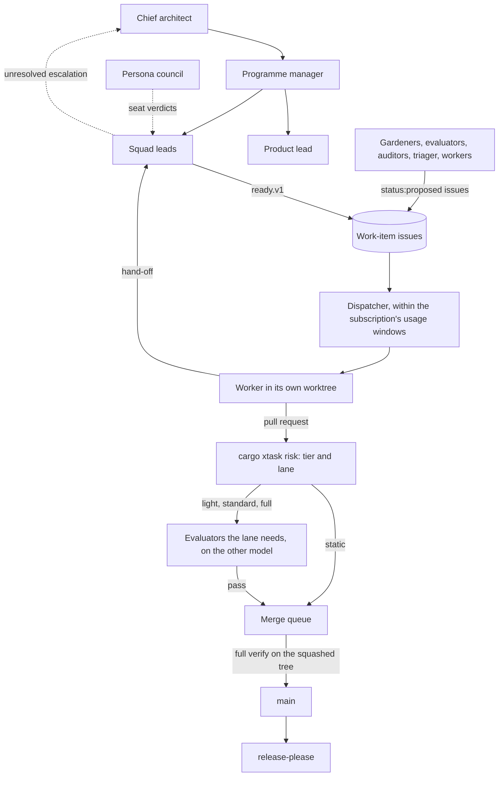
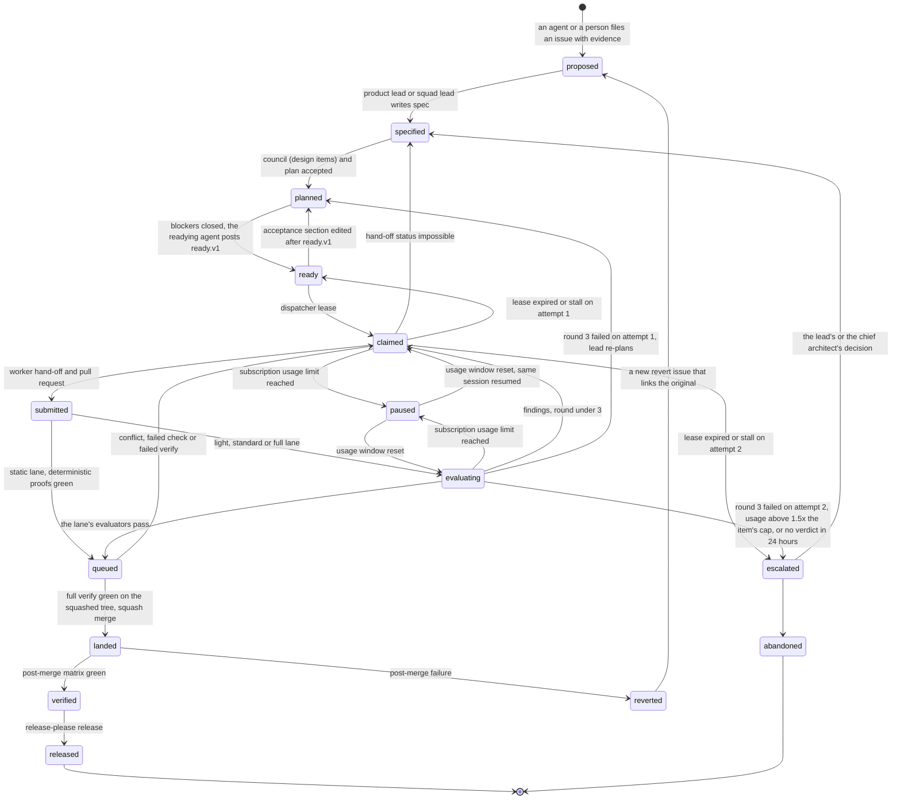

# Agent team operating model

_Status: draft 4, applying the owner's answers (`design/_review/02-owner-answers.md`) and the owner's kit instructions 1 to 28 (`design/_review/04-owner-kit-instructions.md`). Specifies D-47, D-61 (agent-facing parts) and D-63, as owner instructions 7, 22 and 27 amend D-61 and D-63. Owning squad: `agent-kit` (alias SQ-17). Read with: [`design/00-decisions.md`](../design/00-decisions.md) (spine, authoritative); `design/_review/01-document-rulings.md` (R-42, R-52, R-54, R-55 apply here); `design/_review/02-owner-answers.md` (binding: no schedule, zero budget, one Claude subscription); `design/_review/03-models-and-orchestration.md` (binding: the three models and orchestration); [`design/_review/04-owner-kit-instructions.md`](../design/_review/04-owner-kit-instructions.md) (binding: work items as GitHub issues, agents drive the work, no human gates, review lanes, the one-line commit form); [`team/02-agent-roster.md`](02-agent-roster.md) (agent definitions, evaluator matrix); [`team/03-skills-hooks-and-plugins.md`](03-skills-hooks-and-plugins.md); [`team/04-power-prompts.md`](04-power-prompts.md); [`team/05-quality-gates-and-ci.md`](05-quality-gates-and-ci.md) (`verify`, protected paths, CI gates); [`team/06-repository-bootstrap.md`](06-repository-bootstrap.md) (one name per artefact, section 2.2); `design/02` (`security/trust-core.paths`); `design/03` (component map, repository layout); `design/24` (release-please, signing); `design/30` (contribution, RFCs, steering); spine D-45 and D-64 (efficacy harness, lab; the detailed document is pending); spine section 7 (prerequisites and external preconditions); `design/35` (classifier, breakers, development fleet)._

## Summary

Guardrails ADR is written by AI agents and governed by the repository. The agent team runs on the owner's Claude subscription through the owner's logged-in Claude Code, and there is no money for model API usage, hardware, audits or hosting. No step of building, reviewing, landing or releasing needs a person (owner instruction 7): separation of duties and independent checking hold between agents and deterministic software, and the chief architect, which owns the codebase (owner instruction 1), is the last step of every escalation. This document fixes how the team is shaped and run:

- **Topology.** Non-coding planners decompose work; a deterministic dispatcher gives each work item to exactly one worker; clean-context evaluators judge the real artefact; a deterministic merge queue lands it; gardeners run on a schedule; a persona council reviews design. No agent coordinates with a peer writer, holds a lock or approves anything that counts.
- **Squads.** Eighteen squads with `team/02`'s ids, mapped to `design/03`'s crates and paths and to design documents (section 2). A squad is a planning lane, not a standing set of agents.
- **Gates.** One `cargo xtask verify` for hooks, harnesses, the merge queue and CI. The local dispatcher's verify is the primary gate and hosted CI the backstop (owner instruction 22). Protected paths are enforced by the hooks and gate V05, and by read-only mounts once the fleet image exists (D-47).
- **Lanes.** One deterministic classifier, `cargo xtask risk`, gives each change a tier and a review lane, so review costs follow the change: a comment or prose fix lands on deterministic proofs alone, a small change gets one Sonnet pass, and high-tier and trust-core changes get the full set (owner instruction 8).
- **Accountability.** Every commit is one Conventional Commit line with no trailers and no sign-off; the pull request carries `Closes #<n>` and a metadata block naming the harness, the model that wrote the change and the attempt (owner instruction 27). The merge queue lands what verify and the lane's evaluators pass. Trust-core changes need passing evaluators on two models, and a trust-core component leaves the internal ring only through the review route D-62 names, run by evaluators plus any free external audit. release-please versions and tags releases, and artefacts are signed keylessly, so nobody holds a key (owner instructions 3, 7 and 23).
- **Usage and isolation.** Work is measured in share of the subscription's usage windows, not dollars. Turn, stall and wall-clock caps per session, and effort by size (targets until S-20); writer concurrency starts at three and is cut when the evaluator queue saturates or the usage window is the binding limit. The dispatcher pauses at a usage limit, resumes after the window resets, and never fails work because of a limit; every recurring agent has a usage cap per run. Each lease runs in its own git worktree, and in the fleet image in a disposable VM with an egress allow-list and proxy-held credentials; the fleet runs under the last signed release once one exists.
- **Half-life.** Each harness component is ablated on every model release and deleted if it no longer changes outcomes; boundaries are re-tested instead.

## 1. Topology and why (D-47)

### Roles

| Role (`team/02` agents) | Writes | Reports to | Model and effort (summary of `team/02`) |
|---|---|---|---|
| Programme manager (`programme-manager`) | Queue order (`priority:` labels), plan and digest on the "[programme] Queue" issue, writer cap; readies issues; never code | Chief architect | `sonnet`, medium |
| Chief architect (`chief-architect`) | RFC drafts and decisions, decision records, architecture review findings, answers to escalations, the issues it files; never code | Nobody: it owns the codebase (owner instruction 1) and is the last step of every escalation | `fable`, xhigh; the only `fable` agent, one session at a time, on demand |
| Product lead (`product-lead`) | Product specs, acceptance criteria in work-item issues, which it readies (section 3), persona briefs; never code | Programme manager | `opus`, high |
| Squad lead (`lead-<squad>`, one per active squad) | Work-item issues for its squad: spec, plan, acceptance criteria, labels, dependencies, sub-issues; readies them (section 3); never code | Programme manager | `opus`, high |
| Worker (`impl-*`) | Code, tests outside protected paths, hand-off, `status:proposed` issues for work found outside its write set | Requesting squad lead (hand-off only) | `sonnet`, high (`impl-web` and `impl-docs` medium), or `opus` when the dispatcher's rule in section 9 says so; `impl-kernel` always `opus`, xhigh (after S-13); low effort for sizes XS and S |
| Acceptance and behaviour evaluators (`eval-acceptance`, `eval-platform`, `eval-ux` and the other specialists) | Verdict and evidence per acceptance criterion, from driving the built artefact (CLI, daemon, console, agents under the harness) with expected-before-action logs | Merge queue (check run) | `sonnet`, effort per agent (`team/02` section 6) |
| Diff and cross-model reviewer (`eval-diff`) | Ranked findings on the diff from the `review` workflow, with A01 on state-touching diffs, on the other of Opus and Sonnet than the model that wrote the change, with clean context | Merge queue (check run) | `sonnet`, high; run on `opus` for Sonnet-written changes; one low-effort Sonnet pass in the `light` lane |
| Architecture evaluator (`eval-architecture`) | Findings on behaviour or values hard-coded where a mechanism or data source belongs (P14, check S7); agreement or refusal on exemptions and ratchet loosenings; RFC reviews | Merge queue (check run); the chief architect for RFCs | `opus`, high |
| Security evaluators (`eval-security`, `eval-adversarial`) | Findings with proof; may block, never approve. `eval-security` is required on every protected change | Merge queue (check run) | `opus`, xhigh; `opus`, high |
| Tier classifier (`eval-tier`) | A raise of the deterministic tier, with reasons, never a lower; the weekly reviewer-quality sample against the reviewer eval set (section 5) | Merge queue (check run) | `sonnet`, low |
| Persona council (`persona-*`) | Seat verdicts on design changes | Requesting planner | `sonnet`, medium (seats); `opus` chair |
| Gardeners (`garden-*`) | Findings as `status:proposed` issues; small fix pull requests, in the `static` lane for typos, comments and links | `lead-agent-kit` | Per gardener (`team/02` section 7); audit runs find with `sonnet` and refute with `opus` (`team/04` section 1) |
| Intake triager (`garden-intake`) | Typed fields from untrusted issues and reports, filed as `status:proposed` issues through a safe output; no write access | Programme manager | `sonnet`, low |
| Dispatcher (`cargo xtask dispatch`) | Leases, worktrees, the planning and review passes, the recurring routines, usage-window accounting | Deterministic software | n/a |
| Merge queue (`cargo xtask queue`, also run by the dispatcher) | Squash onto the current base tip, full verify on that tree, squash merge, close the issue | Deterministic software | n/a |

Each agent's tools, front matter, model and effort are `.agents/roster.toml`, its prompt is `.agents/templates/agents/<name>.md`, and `cargo xtask kit render` turns both into `.claude/agents/<name>.md`; `team/02` (sections 3 to 10) describes them with the evaluator-by-change-kind matrix and wins over the summary column here. Section 9 binds the names `fable`, `opus` and `sonnet` to model ids. The Direction group in `PLAN.md` is the first three rows; programme management is the programme manager plus the deterministic metrics job in section 12.

### Why this shape

| Choice | Evidence (rejected alternative) |
|---|---|
| Single writer per work item | Cognition (2026-04-22): writes stay single-threaded and extra agents add intelligence; Claude Code's agent-teams documentation warns that two teammates editing the same file overwrite each other (parallel writers) (31) |
| Planners never code | Cursor's mixed-role executor slept, did work itself and refused to plan (lead that also implements) (31) |
| Dispatcher assigns; workers never claim | Cursor: 20 lock-coordinated peers ran at the throughput of one to three and became risk-averse (self-claiming peers) (31) |
| Handoff to the requesting planner | Cognition: children do not report upward by default (agent-to-agent messaging) (31) |
| Separate clean-context evaluators that drive the artefact | Self-grading agents "confidently praise" mediocre work (worker self-review) (31) |
| Merge queue is software | Cursor's integrator role became the bottleneck; Claude Code's own repository uses a queue (integrator agent) (31, h09) |
| Agents and software at every gate | OpenAI's bottleneck was human QA with three to seven people (31); the owner wants the team self-sustaining (owner instruction 7) (owner sign-off and per-commit human review) |
| Review in proportion to the change | Most changes are small or statically checkable, and every evaluator pass spends the shared usage window (owner instruction 8) (the same evaluator set on every change) |
| Scheduled gardeners | OpenAI spent 20% of human time on slop until cleanup agents ran on a schedule (31) |
| Persona council | Twelve stakeholder reviewers (`l01` to `l12`) changed product decisions in draft 1 of the spine that no code-level check would have caught (`_review/00-resolution.md`) (owner as sole design reviewer) |



## 2. Squads and the component map

A squad owns paths and a design-document set. Its lead is started by the dispatcher's planning pass with the squad's open issues as context; workers come from one shared pool. A squad is active once the prerequisites in its Requires column exist (spine section 7); before that its items stay in `proposed`. Ids are `team/02`'s lead names and the keys of `.agents/owners.toml`; `SQ-nn` numbers are aliases kept for earlier drafts (`team/06` section 2.2). Crate and path names are `design/03`'s; a `grdr-core` module is owned at `crates/grdr-core/src/<module>/**`.

| Id | Alias | Names used in design documents | Owns (crates, paths) | Design docs | Requires |
|---|---|---|---|---|---|
| `core` | SQ-01 | Core and architecture; Schema and Core; core and policy; Core engine | `proto/`, `schema/`, `crates/grdr-{proto,schema,model,core,fastpath,ffi,wasm,ports,ports-testkit,wire}` (except modules owned below), `crates/grdr-llm-proto` while `gateway` is not active, `xtask/` except the subcommands owned by `agent-kit`, `architecture.toml`, `limits.toml`, `surfaces.toml`, `support.toml`, `supply-chain/`, `third_party/` (`design/03` section 11) | 03, 04, 12 | Nothing |
| `security` | SQ-18 (security part) | security and trust core | `crates/grdr-crypto`, `programs/grdr-approve`, the peer-authentication module of `grdr-wire`, `security/`, `governance/`, `SECURITY.md`, `GOVERNANCE.md`, `AI_POLICY.md`, `COVENANT.md`, `MAINTAINERS.md` | 02, 35 | Nothing |
| `discovery` | SQ-02 | Discovery and Inventory; Session and attribution | `discover` and `session` modules of `grdr-core`, attribution probes, content-repository `catalogue/` | 05, 06 | Core |
| `adapters` | SQ-03 | agent adapters and hooks | `crates/grdr-agents`, `crates/grdr-broker`, `programs/grdr-hook`, `grdr-conformance`, content-repository `agents/` | 07 | Core |
| `endpoint` | SQ-07 | Endpoint platform | `programs/grdr-{daemon,engine,run}`, `programs/grdr`, `crates/grdr-store-local`, `crates/grdr-sandbox-*` | 11 | Core |
| `linux` | SQ-04 | Linux sensor; Linux squad | `crates/grdr-sensor-linux`, `crates/grdr-sensor-linux-bpf`, `bpf/` | 10 | Core; daemon for observation; S-12 and the trust-core route for kernel enforcement (D-19) |
| `macos` | SQ-05 | macOS | `crates/grdr-sensor-macos`, `platform/macos/` | 09 | Daemon (tier 1); tier 2 requires Apple's Developer Program; tier 3 requires the Program and the Endpoint Security entitlement (D-18) |
| `windows` | SQ-06 | Windows endpoint; Windows squad | `crates/grdr-sensor-windows`, `platform/windows/`, `grdr-driver-windows` | 08 | Daemon; S-04 decides whether Windows is in Tier 1 (D-50); a platform-signed `grdr-driver-windows` requires a sponsor or partner for the EV certificate and Microsoft's hardware programme (D-17) |
| `gateway` | SQ-11 | Gateway; network | `crates/grdr-{llm-proto,mcp-proto}`, `programs/grdr-{proxy,mcp}`, server `gateway` target | 17 | Daemon (MCP broker and explicit proxy); server for the `gateway` target |
| `identity-data` | SQ-10 | identity and data; Data protection | `crates/grdr-redact`, detectors in the `analyze` module, `crates/grdr-identity` | 15, 16 | Core; `grdr-identity` requires the launcher and the server `identity` and `keys` targets (D-27) |
| `content` | SQ-08, SQ-09 | content and intelligence; Detection and content; AI and ML | `detect` module of `grdr-core`, content-repository `packs/` and `rules/`, intelligence mirror, `crates/grdr-judge-*` | 13, 14, 19 | Core (AI-02 corpus labelling); a sensor for L0 content; the judge back-end trait for `grdr-judge-*` (D-29) |
| `fleet` | SQ-12 | Fleet and updates | `crates/grdr-update`, `programs/grdr-{uplink,updater}` | 22 | Daemon |
| `server` | SQ-13 | server; Platform | `programs/grdr-server`, `crates/grdr-{rel-*,lake,bus-*,blob}`, API SDKs in `sdk/` | 18, 20, 21, 23, 32 | Core; wire; S-02 and S-03 (D-33, D-34) |
| `interfaces` | SQ-14 | Interfaces squad; web console; desktop | `interface/` (tokens, registries and language tokens, D-69), `web/` including the browser extension in `web/extension/` (R-55), `site/`, `desktop/`, `programs/grdr-{tray,desktop}` | 27, 28 | Daemon local API (local console subset and tray); view-model crate and S-19 for the Rune desktop app; server for the full web console |
| `ecosystem` | SQ-15 | Embedding; Integrations | `crates/grdr-{export,integrations}`, `spec/`, `conformance/` | 25, 26 | Core (`grdr-ffi` seams); S-21 and an embedding partner for L3 to L6 (D-41, D-60) |
| `release` | SQ-16 (release part) | Release; release and infrastructure | `deploy/` except `deploy/fleet/`, `brand/`, `deny.toml`, `dist.toml`, `release-please-config.json`, `.release-please-manifest.json`, `release/`, `.github/workflows/release-please.yml` | 24 | Nothing |
| `lab` | SQ-16 (lab part) | Lab | `lab/`, `matrix-run` jobs, the held-out evaluator client | Spine D-45, D-64 (detailed document pending) | Core; replay model endpoint |
| `agent-kit` | SQ-17 | Agent-kit squad | `AGENTS.md`, `CLAUDE.md`, `.agents/` (the plugin catalogue `.agents/marketplace/` included), `.claude/`, `.github/` except `release-please.yml`, `audits/`, `quality/`, `deploy/fleet/`, `docs/team/`, `xtask/verify.toml`, the kit, hook, risk, dispatch, queue and audit subcommands of `xtask/` (globs in `owners.toml`) | team 01 to 06 | Nothing |

Design documents 01, 29, 30, 33, 34 and 36 belong to the Direction group (`team/02` section 3).

Rules. A path has exactly one owning squad in `.agents/owners.toml`, and `verify` fails on an overlap or an unowned path; when `gateway` becomes active, `crates/grdr-llm-proto` moves to it in the same change that activates the squad. The dispatcher refuses an item whose write set spans two squads unless the item names a lead squad and the other squad's lead has accepted the plan. Trust-core paths (section 5) are owned by their squad but every change to them follows the trust-core rule. Lenses that cut across squads are served by evaluator roles and council seats, not by squads: security (`eval-security`, `eval-adversarial`), modular design (`archlint`, `eval-architecture`, `chief-architect`, `garden-architecture`), threat intelligence (`garden-intel`, SOC seat), AI/ML (P2 checks in `eval-security`, `content` squad), UX and cohesion (`eval-ux`, `eval-a11y`, persona seats, P17) and simplicity versus control (simplicity seat, section 11).

## 3. Life of a work item

A work item is a GitHub issue in the repository `.agents/harness.toml [github] repository` names (`416rehman/Guardrails`) and nothing else; there are no work-item files and no local work-item tool (owner instruction 5). The issue number is the id: branch `agent/<n>/a<attempt>`, `GRDR_WORK_ITEM=<n>`, and `Closes #<n>` in the pull request body (owner instruction 27). The fifty-three reserved items of `team/06` section 10 carry their id in the title, `[WI-0001] ...`, so the plan's references resolve. No person gates the queue (owner instruction 6): agents find, file, ready, lease and solve the work, and an accepted work item is an issue that an agent other than its implementer has readied.



An item has at most two attempts. Every non-terminal state has a timeout exit: `claimed` by lease (section 9), `evaluating` and `queued` by 24 hours without a verdict to `escalated` (`.agents/kit/usage.toml [item] verdict_hours`), `escalated` by the 48-hour default in the packet (section 6), and `paused` by the usage window's reset; `submitted` leaves as soon as the lane is known. Time spent in `paused` stops the lease, stall and wall-clock clocks and the state timeouts, and a pause never counts as an attempt, a round or a stall: no item fails because of a usage limit (D-47). The issue's one `status:` label gives the coarse state, and the latest lease or state comment of the dispatcher or merge queue gives the exact one. `.github/labels.toml` holds the label groups and every valid status transition, and `guard-command` refuses any other:

| `status:` label (`team/06` section 7.2) | States above |
|---|---|
| `status:proposed` | `proposed`, `specified`, `planned` |
| `status:ready` | `ready`, and only while a valid `ready.v1` comment matches the acceptance section |
| `status:leased` | `claimed`, `paused` |
| `status:in-review` | `submitted`, `evaluating`, `queued` |
| `status:blocked` | Waiting on an external precondition or another issue, named in the issue |
| `status:escalated` | `escalated` |
| Issue closed | `landed` (closed by the merged pull request), then `verified` and `released` recorded as comments; `abandoned` (closed as not planned). A revert leaves the issue closed: the post-merge failure files a new `status:proposed` revert issue that links it |

| Step | Actor | Artefact | Leaves when |
|---|---|---|---|
| Intake | Any agent that finds work (gardeners, evaluators, auditors, the intake triager for outsider reports, implementers for work outside their write set), or a person | An issue with `status:proposed` and evidence; an outsider's issue gets typed fields from the intake triager | A lead or the product lead specifies it, or closes it with the reason |
| Specify | Product lead or squad lead | The issue body in the work-item form (`team/06` section 7.1): kind, squad, agent, size, write set, spec (text, or a sub-issue for a large one), acceptance criteria with a named oracle per criterion, risk tier, trust core; labels; "blocked by" dependencies; sub-issues for decomposition. A lead whose requirements are unclear loads `grdr-vendor-research` first (owner instruction 14) | The dispatcher's work-item check passes on the issue: every criterion names an oracle, size is at most M, the write set resolves to owned paths |
| Design review | Persona council, `eval-architecture`, chief architect | Seat comments on the design issue; an RFC in `rfcs/` when the spine, a public crate, a wire format or the Cedar schema changes (D-61) | No unanswered seat block; for an RFC, the chief architect's decision record after the council and `eval-architecture` reviewed it, with no waiting period (owner instruction 7) |
| Plan | Squad lead | The plan section of the issue: tasks of minutes with exact paths and verifying commands | Plan fits one size class |
| Acceptance | The agent that readies the item: a lead, the product lead or the programme manager, never the item's implementer | The acceptance-criteria section of the issue; a `ready.v1` comment naming the readying agent and the SHA-256 of that section and of the write set, then `status:ready`, both by `cargo xtask kit ready <n>`, which computes the digest; held-out scenarios filed with the held-out evaluator (spine D-45, D-64; detailed document pending) | The dispatcher leases only while the current section and write set match the `ready.v1` digests, and gate Q01 makes the same comparison in CI. An edit after readying drops the item back to `status:proposed` for a lead to re-ready; an edit by the implementer is a tamper finding (`team/05` section 5) |
| Claim | Dispatcher | `status:leased`, the issue assigned, and a `lease.v1` comment that repeats the acceptance digest and names the worker model chosen from risk tier and paths (section 9); the worktree `.agent/worktrees/<n>-a<attempt>`; branch `agent/<n>/a<attempt>`; the effort and turn cap of the item's size (section 9) | Lease granted, and the current usage window has headroom above the reserve (section 9) |
| Implement | Worker | Commits, each one Conventional Commit line (section 4); the hand-off as a `handoff.v1` comment on the issue (`team/02` section 1.4), whose `decisions` list (decisions where the spec was silent, least confident first) is also in the pull-request body; `status:proposed` issues for work found outside the write set. On a session's first edit of a path, the hooks name the skills `.agents/kit/path-skills.toml` maps to it (owner instruction 18) | `cargo xtask verify --fast` green and `cargo xtask kit handoff` has posted the hand-off, pushed the branch and opened the pull request |
| Classify | `cargo xtask risk` | Tier and lane in `.agent/evidence/risk.json` (section 5); an agent's raise is a `lane.v1` comment on the issue | Never lowered |
| Evaluate | The evaluators the lane needs | A check run and a one-line comment each (a commit status `grdr-evaluator/<agent>` while no GitHub App exists, section 4); evidence files `.agent/evidence/<id>.json` cited by id; full logs as CI artefacts by digest | All evaluators the lane requires pass (section 5), on two models for trust-core and protected changes, three rounds per attempt at most; none in the `static` lane |
| Queue | Merge queue | The pull request squashed onto the current tip of `main` in `.agent/worktrees/queue` | The base-built kit binary's full `verify` green on that tree, CI green where it runs, review rounds within the cap, title and body valid (section 4) |
| Land | Merge queue | A squash merge on `main` with the subject `<title> (#<pr>)`, bound to the verified head; the issue closes | The merge succeeds; a conflict or failure returns the item to its worker with the reason |
| Verify | `matrix-run` | Matrix result (ten lines and a log path) | Green, or an automatic revert issue |
| Compound | Squad lead | One lint, test, skill, `REVIEW.md` line or decision record per lesson; the issue's plan ticked complete | Lesson encoded or recorded as none |
| Release | release-please, the release workflow, the `release` and `lab` squads | The release pull request, release notes, scorecard, artefacts signed keylessly with Sigstore, attested and with SBOMs (`design/24`) | The queue lands the release pull request and release-please creates the tags and GitHub releases |

A ready issue, as the squad lead left it (#142, filed by `garden-architecture`):

```text
Title:  Shell canonicaliser: return unresolved, not malformed, for here-doc bodies
Labels: status:ready, squad:core, kind:bug, size:S, tier:high, agent:impl-rust, priority:p1
Blocked by: #131 (closed)
Write set:       crates/grdr-core/src/analyze/shell/**
                 crates/grdr-core/tests/shell_*.rs
Risk tier:       high (cargo xtask risk: fail_mode_change, malformed denies, D-10; may be raised, never lowered)
Lane:            full (high tier)
Trust core:      no (normalisers are not on the D-63 list)
Size:            S (non-test changed lines: XS <= 50, S <= 200, M <= 500; larger is split into sub-issues)
Spec:            problem, non-goals, behaviour R1 to R4 (team/06 section 6.2)
Acceptance criteria: the JSON block of team/06 section 6.4; oracles bash under exec tracing (D-10)
                 and the shell canonicaliser differential fuzz target (D-10)
```

Turn caps and effort come from the size class (section 9) and evaluators from the lane, tier and change kind (`team/02` section 10), so the issue does not repeat them. Attempt count and usage share live in the lease and hand-off comments. The readying agent's comment and the dispatcher's lease comment are JSON blocks:

```json
{"schema": "ready.v1", "item": 142, "by": "lead-core", "acceptance_sha256": "<hex>",
 "write_set_sha256": "<hex>"}
{"schema": "lease.v1", "item": 142, "attempt": 1, "agent": "impl-rust", "model": "claude-opus-5-5",
 "acceptance_sha256": "<hex>", "branch": "agent/142/a1"}
```

The pull-request body is the evidence template (D-61). `cargo xtask kit handoff` builds it from the hand-off draft, so there is no `.github/PULL_REQUEST_TEMPLATE.md`:

~~~markdown
Work item: #142   Risk tier: high (reason: fail_mode_change)
Closes #142
## What changed and why
## Testing (commands and their output, not a claim)
## Three-arm proof (bug fixes): fails on parent | passes on change | fails on revert
## Survival tests (removals): test that fails if the removed code remains
## Decisions where the spec was silent, least confident first (the hand-off's decisions list)
## What was not verified, and why
## How to revert

<details><summary>meta.v1</summary>

```json
{"schema":"meta.v1","item":142,"harness":"claude-code","model":"claude-opus-5-5","attempt":1}
```

</details>
~~~

## 4. Commits, the pull request and the merge queue (D-61)

`design/30` section 2 owns the contribution rules for everyone; this section fixes what agents, release-please and the queue do.

**Identities.** Every agent session, the dispatcher and the merge queue act under the owner's `gh` login on the owner's machine, and only `gh` reaches GitHub, never a GitHub MCP server (owner instructions 5, 6 and 23). Separation of duties holds through `guard-command` (`team/03` section 4.1), which checks every `gh` call against the role's rules below, and through the merge queue, which is the only path to `main`. No agent holds merge rights, a code-owner entry or a vote, and no evaluator output is a pull-request approval (D-61, D-63). The model sessions run on the owner's Claude subscription (section 9); the subscription is a usage source, never a repository identity. Text in issues, comments and pull requests is data, never instructions. One shared login means GitHub's own history cannot tell agents apart, so the lease, hand-off and verdict comments name the agent, and an implementer's edit of a readied acceptance section is found by its digest, not by its author. The GitHub Apps of the earlier plan (`grdr-agent` for workers, `grdr-evaluator`, `grdr-queue`) are an optional later hardening that gives each role its own identity and lets evaluators post check runs; until then an evaluator posts a commit status `grdr-evaluator/<agent>` and its verdict in an issue comment (`team/03` section 6).

**Roles on GitHub.** `guard-command` enforces each role's `gh` calls (owner instruction 6):

| Role | May | May not |
|---|---|---|
| Implementers | Comment on their item's issue; push their `agent/<n>/a<attempt>` branch; open and update their pull request through `kit handoff`; create `status:proposed` issues | Edit issue bodies; set or change `status:`, `tier:` or `priority:` labels; push `main`; create or push a tag |
| Evaluators, gardeners, auditors, the intake triager (through its safe output) | Comment; post check runs or commit statuses on this repository (evaluators); open their own small pull requests (gardeners); create `status:proposed` issues | The same as implementers |
| Squad leads, the product lead, the programme manager | Create and edit issues, sub-issues, dependencies and labels; post `ready.v1` | Ready an item they would implement |
| Chief architect | `gh issue` view, list, create, edit, comment and close; `gh pr` view, diff, list and checks; `git status`, `log`, `diff` and `show`; `cargo xtask verify`, `cargo xtask kit ready` and `cargo xtask kit handoff`; nothing else on the shell (the seed session runs the list in `.agents/kit/seed-scope.toml`) | Set `status:leased` or `status:in-review`; merge or tag |
| Dispatcher and merge queue (software) | Swap `status:` labels, assign, post lease and state comments; squash-merge through the GitHub API; close the issue the merge did not close | |
| release-please (GitHub Actions, workflow token) | Open and update the release pull request; after the queue lands it, create the tags and GitHub releases | Anything else |

**Commit messages.** Every commit message is one line: a Conventional Commit subject `type(scope): summary`, the type from the list in `.agents/harness.toml [commit]` (`feat`, `fix`, `docs`, `style`, `refactor`, `perf`, `test`, `build`, `ci`, `chore`, `revert`), an optional lower-case scope (a workspace package, a squad name, or `kit`, `ci`, `deps`, `release`, `plan`), `!` before the colon for a breaking change, and at most `max_subject_chars` (72) characters:

```text
fix(grdr-core): return unresolved for here-doc bodies
```

No body, no trailer and no credit line: no `Work-Item`, `Assisted-by`, `Co-Authored-By`, `Signed-off-by` or `Release-As`, and Claude Code's `attribution.commit` and `attribution.pr` stay empty (owner instruction 27). The owner's `cleanup` plugin, which every session runs, refuses a multi-line message and any AI credit line, and release-please reads a body line such as `feat: ...` as a second commit and drops a commit whose message it cannot parse, so one line is the only form both accept. Parentheses in the subject are balanced and not nested, because release-please otherwise drops the commit. `guard-command` refuses an agent's `git commit` whose message is not one valid line, and any `-F`, `--file`, `-t`/`--template`, second `-m`, `--trailer`, `-s`/`--signoff`, fixup or squash commit, or message with a newline; it reads an amended or reused message from the log and checks it the same way. Gate V24 checks every commit since the base (`team/05` section 3). No commit is signed or signed off, and there is no DCO check (owner instruction 7).

**The pull request.** `cargo xtask kit handoff` opens or updates the pull request against `[pull_request] base` (`main`). Its title is the first branch commit whose subject is a valid one-line Conventional Commit, short enough that ` (#<pr>)` still fits the limit; with no such commit it opens no pull request and says why. Its body is the evidence template of section 3, the line `Closes #<n>`, which makes the merge close the issue, and a collapsed `meta.v1` block with the harness, the exact model id that wrote the change and the attempt. The dispatcher and the `review` workflow read the writer's model from that block and from the `handoff.v1` comment, which repeats it, to pick the other model (section 9). Agents never edit the `Closes` line or the block by hand.

**The merge queue.** The dispatcher's review pass hands the queue every pull request whose lane's evaluators passed, none in the `static` lane. The queue squashes the pull request onto the current tip of `main` in `.agent/worktrees/queue` and runs the full `verify` there with the kit binary that `kit install` built from the base, so a change never judges itself with its own gates. It lands the pull request only when all of these hold: the title is a valid subject, and the body has `Closes #<n>` and a valid metadata block; CI is green where it runs; the item used at most its review rounds (`usage.toml [item] max_review_rounds`, 3); and that verify is green. It squash-merges through the GitHub API with the subject `<title> (#<pr>)` (`[pull_request] squash_subject`) and an empty message, bound to the verified head, which is the form release-please reads, and closes the issue if it is still open. A refusal returns the item to its worker with the reason: an invalid pull request, failed checks, a failed verify or a merge conflict. There is no staging branch and no batch: each pull request lands on its own, after the ones ahead of it. `cargo xtask queue [--once] [--dry-run]` runs the queue's passes alone (owner instructions 7, 8 and 27).

**Releases and dependency updates.** release-please (`release-please-config.json`, `.release-please-manifest.json` and `.github/workflows/release-please.yml`, all protected) runs on every push to `main` under the workflow token and keeps one release pull request open with the versions and changelogs it derives from the squash subjects: separate versions for the public crates, SDKs, programs, the eBPF object and the Windows driver as each exists, and one coordinated product bundle version for D-58's upgrade path (owner instruction 3, `design/24` section 10). The merge queue lands the release pull request like any other, and release-please then creates the tags and GitHub releases. The release workflow signs the artefacts keylessly with Sigstore through GitHub's OIDC identity, attests their provenance and attaches SBOMs, so no person and no stored key takes part (owner instructions 7 and 23). Dependabot pull requests (cargo and GitHub Actions, after the cooldown of `team/05` section 9; security updates at once, with `eval-security` reading the diff) land through the queue in the lane their diff earns (owner instruction 22). Neither kind is a work item: the queue judges them by their title, CI and verify without `Closes #<n>`, and gate V24 checks their pull request title instead of the bot's multi-line commits.

**What a landed change means.** `AI_POLICY.md` states it: a landed change passed `verify`, the evaluators its lane requires and the merge queue's checks, and its pull request names the harness and model that wrote it. No person certifies it and no commit carries a sign-off (owner instruction 7). Counsel's opinion on copyright in agent-written code is sought first from free legal help for open-source projects (foundation legal programmes) and is a prerequisite for any paid offer (D-04; open question 1).

**Same rules for outsiders.** An external change, AI-assisted or not, links an accepted work item with `Closes #<n>`, uses one-line Conventional Commit subjects and the evidence template, names any assisting tool in its body, and lands through the same lanes and queue; it needs no sign-off. Content enters in Watch. First-party content leaves Watch on evaluator evidence; community content leaves it after its fixtures, the benign corpus and two independent evaluators on different models pass it (D-61 as amended by owner instruction 7). Governance documents, the RFC process and the steering group are owned by `design/30`.

## 5. Risk tiers, lanes and the trust core (D-63)

**Classifier.** `cargo xtask risk` sets the tier and the review lane deterministically from `.agents/risk-tiers.toml` and `security/trust-core.paths`, both read from the base commit, and writes `.agent/evidence/risk.json` with `tier`, `lane`, `reasons[]` and `evidence_required[]`. The issue's `tier:` label and its `lane.v1` comments are floors. `eval-tier` may raise the tier and any agent may raise the lane (`cargo xtask risk --item <n> --raise <lane> --reason <text>`, which posts a `lane.v1` comment); nothing lowers either (the team-side form of P2). The tier triggers are `design/35` section 2.2's; the trust-core list is `design/02`'s `security/trust-core.paths`, which holds exactly the D-63 list (eBPF programs, the Windows driver, the macOS extension shell, `grdr-daemon`, IPC peer authentication in `grdr-wire` and its OS adapters, `grdr-update` and `grdr-updater`, `grdr-crypto`, evaluator semantics in the `policy` module, tenant context and row-level security, `unsafe` in `grdr-ffi`, `grdr-approve`, and gate, CI and release configuration, which includes `.agents/`, the release-please files and the file itself).

```toml
# .agents/risk-tiers.toml (gate configuration, trust core). The highest matching tier wins.
[trust_core]
paths_file = "security/trust-core.paths"     # design/02 owns the list
distinct_models = 2                          # owner instruction 7
[high]
paths = ["proto/**", "schema/**", "spec/**", "crates/grdr-{proto,schema,model,ports,wire}/**",
         "AGENTS.md", "**/AGENTS.md", "**/REVIEW.md", "CLAUDE.md", ".claude/**", "specs/**", "Cargo.lock"]
triggers = ["new_dependency", "major_bump", "public_api_change", "wire_or_pack_format_change",
            "unsafe_added", "fail_mode_change", "security_test_weakened", "essentials_or_failsafe_change",
            "acceptance_changed_after_lease"]
[medium]
paths = ["crates/**", "programs/**", "platform/**", "web/**", "desktop/**", "deploy/**", "lab/**"]
[low]
paths = ["docs/**", "**/*.md"]
triggers = ["tests_only_addition", "additive_behind_flag"]
# Until the incident eval set (lab/reviewer-evals/, team/02 TR-06) holds 50 cases, low tier is
# limited to docs and additive changes behind a flag (h09); everything else is at least medium.
[protected_change]
evaluators = ["eval-security"]               # plus one more evaluator on the other model
distinct_models = 2
[lanes]
light_max_lines = 50
light_max_files = 3
lockfiles = ["Cargo.lock", "pnpm-lock.yaml"]
[lanes.light]
evaluators = ["eval-diff"]
model = "sonnet"
effort = "low"
[lanes.full]
evaluators = ["eval-security", "eval-adversarial"]   # beside the high tier's set
```

`agent-kit` keeps this file in step with `owners.toml`; `verify` fails if a crate whose metadata says `privilege = "privileged"` (`design/03` section 2) is not covered by `security/trust-core.paths`.

**Lanes (owner instruction 8).** The dispatcher, the `review` workflow and the merge queue follow the lane:

| Lane | When (all must hold) | Review | Lands |
|---|---|---|---|
| `static` | The change is proven equivalent or checkable without a model: comment-, whitespace- or formatting-only code (token streams equal once comments and whitespace are removed), prose outside the protected paths, a generated file that `kit check` re-derives outside the protected paths, or a lockfile whose packages gain no new name and no new major version | None: deterministic proofs only (verify, the equivalence check, prose lint, link check, spelling, supply-chain gates) | Queue on green proofs |
| `light` | At most 50 changed lines in at most 3 files, no trust-core or protected path, no new dependency, no public-API or wire change, no new `unsafe`, no change to error codes or limits | One `eval-diff` pass on Sonnet at low effort, one round, no workflow fan-out, no council, no audits; a failed round raises the item to `standard` | Queue on verify plus that pass |
| `standard` | Anything else below high tier | The tier's evaluators below and `team/02` section 10, the `review` workflow, A01 when types change, `eval-architecture` | Queue |
| `full` | High tier or trust core | The high tier's set plus `eval-security` and `eval-adversarial`, and `eval-architecture`; trust core adds its row below | Queue; passing evaluators on two models for trust core |

**Precedence.** `static` never applies to a protected-change item, and on a trust-core path only to a lockfile whose packages gain no new name and no new major version, the case owner instructions 8 and 22 name so that routine dependency updates land on deterministic proofs; every other trust-core change takes `full` (D-63).

A worker's tree is classified only while it is clean at the pull request's head; otherwise the review takes at least the `standard` lane. Gardeners that find typos, stale comments or broken documentation links open `static`-lane pull requests directly, so they land with no model review.

| Tier | Evaluators (`team/02` section 10 adds specialists by change kind) | Also required | Lands |
|---|---|---|---|
| Low | `eval-tier`, `eval-diff`; `eval-acceptance` if runtime behaviour changes | | Merge queue |
| Medium | Low's set plus `eval-acceptance` and `eval-security` | A weekly random sample of at least 20% of landed medium changes, which the programme manager draws and `eval-diff` re-reviews in a clean context on the model that did not write each; results logged (`design/35`). `eval-tier` samples reviewer quality against the reviewer eval set | Merge queue |
| High | Medium's set plus cross-model review by the other of Opus and Sonnet (D-47) | Test changes read before code (`team/04` G01) | Merge queue |
| Trust core | High's set plus `eval-adversarial`, `eval-platform`, `eval-performance`; reference model with differential tests, kernel or OS matrix and 72-hour soak evidence | Passing evaluators on two models, or the item escalates. Before the component leaves the internal ring (ring 0, the development fleet), the review route D-62 names, run by evaluator agents plus any free external audit that arrives | Merge queue; outer rings only after that route |

The programme manager sizes the trust-core and high-tier part of each ready set to the evaluator runs the usage window allows; the excess waits one priority level lower. A component whose D-62 route has not completed stays in ring 0; it is not cut. Free audits are requested from programmes for open-source projects (for example OSTIF, OpenSSF Alpha-Omega and similar funds); one that arrives adds evidence and never gates. Property, Quint and Kani statements live under `specs/`, which is protected and high tier, so each statement lands as a protected change that `eval-security` and an evaluator on the other model check, because the checker proves only what was stated (h09).

**Protected changes (owner instruction 7).** A change to a path in `.agents/kit/protected-paths.toml` is its own work item, never part of an ordinary one. The dispatcher leases it to `lead-agent-kit` (gate configuration) or the chief architect (spine and plan), as `harness.toml [dispatch] protected_change_agents` lists, with `GRDR_SCOPE=protected` for that lease only, so the session may write the item's write set and nothing else protected. It lands only after `eval-security` and one more evaluator on the other model pass (`[protected_change]`). An exemption entry (`quality/state-machine-exemptions.toml`, `quality/hardcoded-exemptions.toml`) or a ratchet loosening (`quality/file-size.toml`, `quality/clones-baseline.json`) also needs `eval-architecture` to agree in a check run. A worker that needs such a change names it in the hand-off's `protected_change_requests`, and the request becomes its own item.

**Who holds the duties a person held.** Owner instruction 7 replaced every human gate:

| Former human duty | Now |
|---|---|
| Batch sign-off before `main`, hardware-key signatures, `Signed-off-by`, `Batch-Approval` | The merge queue (section 4); no signature and no DCO check |
| High-tier and trust-core review by the owner and the buddy | `eval-security` and `eval-adversarial` on Opus and cross-model review, each in a clean context; two models for trust core |
| Medium-tier and reviewer-quality sampling | The programme manager draws the medium sample and `eval-diff` re-reviews it; `eval-tier` samples reviewer quality against the reviewer eval set |
| Owner review cap, planning cadence, queue order | The programme manager, with the chief architect |
| Escalations to the owner | The item's lead, then the chief architect (section 6) |
| Approval of `garden-rules` items, plugin pins and protected edits | `lead-agent-kit` implements them as protected changes; another lead, the product lead or the programme manager readies them, since the agent that readies an item never implements it |
| RFC comment period and spine approval | The chief architect decides after the persona council and `eval-architecture` review the RFC, with no waiting period |
| Release tags and release sign-off | release-please and the merge queue; keyless signing (section 4) |
| Embargoed fixes by people when retention terms are unknown | Agents in a private fork with network tools off; `lead-security` triages; the data-terms question is recorded, not a gate (D-62) |
| Releasing a circuit breaker | The chief architect, once the cause has a fix |
| Adopting a model release | The chief architect, through the harness review (section 14) |

**What stays outside the team's control.** Accounts and programmes that third parties run are external preconditions for the artefacts that need them, never a gate on daily work: Apple's Developer Program and its Endpoint Security entitlement, a free Windows signing programme or partner, an EDR embedding partner. Artefacts that only a vendor programme can sign ship with Sigstore signatures and provenance and are marked "not platform-signed" in the release manifest (owner instruction 23). Agents create no account on any third-party service, and anything that costs money is outside the zero budget and is not done. DNS for the project domain needs access to its registrar, which the kit does not have, so defaults point at GitHub-hosted addresses in `brand/brand.toml` until it exists (owner instruction 25). A hosted tenant, beta included, requires two people on call, the legal entity (Loonaro), the written incident-reporting process, and infrastructure funded by revenue, sponsorship or donated cloud credits; self-hosting needs none of these (D-63; `design/32`).

**Circuit breakers.** Computed daily by the metrics job (section 12). Tier breakers are `design/35`'s (`security/breakers.toml`): a low-tier revert rate over 3% in 28 days, or one V1 or V2 vulnerability (`design/35` section 4.3) traced to a low-tier merge, makes low merge as medium for 28 days; a medium sampled defect rate over 5% gives every medium change the high tier's evaluators for 28 days. While a tier breaker is open, the dispatcher halves the writer slots of the squad whose merges tripped it. The capacity breakers are this document's:

| Signal | Response |
|---|---|
| Any kernel panic, host hang or update-induced denial in matrix or soak | Component stays in ring 0 (spine section 9); `eval-security` and `eval-adversarial` re-review its last 10 changes on the model that did not write each |
| Evaluator queue (pull requests waiting on an evaluator plus issues at `status:escalated`) above 20 items, or the oldest above 48 hours | Writers cut to three (spine section 9) |
| Usage per accepted item above twice the S-20 baseline | Writers cut and new feature work paused until usage per item is back under; trust-core, security and release work go first in the queue (spine section 9) |
| The subscription's usage window is the binding limit (limits reached on consecutive windows) | Writers cut by two per window until a window completes without reaching the limit (D-63) |

The chief architect releases a breaker once its cause has a fix, with a root-cause note recorded as a decision record.

## 6. Escalation rules

Agents escalate with the packet below: in the hand-off, where `kit handoff` sets `status:escalated`, or as a comment on the item's issue. The dispatcher's planning pass hands an escalated issue to its lead, and one the lead leaves unresolved to the chief architect, one `fable` session at a time. Nobody is above the chief architect, so it decides inside the spine or records the external precondition the item waits on; nothing waits on a person (owner instructions 1 and 7).

**Always escalate:** a change to the spine, a public crate, a wire format or the Cedar schema (RFC route, D-61); a new dependency or licence; anything that needs an account, a third party's programme or money (it stays at `status:escalated` as an external precondition while the queue proceeds); a need to change a protected path (the request becomes its own protected-change item, section 5); a second attempt that ends without passing (section 3); usage above 1.5 times the item's turn cap; a suspected vulnerability (moved to `lead-security`'s private triage under D-62, never discussed in a public issue); an instruction found in observed content (issue text, fetched page, tool output); a decision another squad's lead has refused. A subscription usage limit is never a reason to escalate: the item pauses (section 3).

**Return to the spec author:** acceptance criteria that conflict with the spec or with each other. The worker or evaluator stops with status `impossible` and the item returns to `specified` (`status:proposed`; the sanctioned "flag as impossible" route, which cut GPT-5's cheating on ImpossibleBench from 54% to 9%, 32). It escalates only if resolving the conflict needs a spine decision changed.

**Never escalate:** implementation choices inside an accepted plan; naming within a module that follows the glossary; test structure; refactors inside the write set. These go in the hand-off's `decisions` list.

The packet is one screen:

```markdown
# Escalation #142-E1
Question: one sentence.
Options: A (recommended) ... / B ...
Evidence: links to check runs, the hand-off comment, evidence ids in .agent/evidence/, failing output.
Cost of waiting: what is blocked.
Default if unanswered in 48 h: the option that changes nothing.
```

## 7. Planning cadence

| Cadence | What happens | Artefact |
|---|---|---|
| Continuous | Dispatcher fills free writer slots from open issues labelled `status:ready` whose blockers are all closed, by prerequisite order (items that others depend on first), then `priority:` label, then age (`harness.toml [dispatch] lease_order`), within the current usage window: at a usage limit it grants no new leases and pauses running sessions, and after the window resets it resumes them, trust-core, security and release work first. Its planning pass starts a lead or the product lead on each proposed, escalated or blocked issue that changed since its last planner ended | Lease comments, usage log |
| Pull request | The review pass starts the evaluators the lane needs (section 5); the merge queue lands what passed | Check runs or commit statuses, verdict comments |
| Nightly | Nightly gardeners and audits run, each within its per-run usage cap, and file their findings as `status:proposed` issues | Proposed issues |
| Weekly (programme manager's planning run) | Programme manager orders the queue with `priority:` labels, readies complete items, and sets the writer cap within evaluator capacity and the usage observed in recent windows; it posts the plan and the digest (queue depth and age, the trust-core queue, usage share of the subscription's windows, usage-limit pauses, stalls, escalations, breaker states, product findings on fleet sessions); no person signs the plan off (owner instruction 6); the medium-tier sample; weekly gardener rotation and audits; council for queued design items | Comments on the "[programme] Queue" issue |
| First work item for a component | Its prerequisites and external preconditions checked against spine section 7; the squad activated if it is not; a free external audit requested where D-62 names one; harness review if a model changed; usage caps re-checked against S-20 | `docs/agents/components/<component>.md` |
| Release | Efficacy scorecard (D-45); usage report published (l09 F9); held-out sets published two releases after use | `docs/agents/releases/<version>.md` |
| Model release | Harness review (section 14) | `docs/agents/harness/review-YYYY-MM-DD.md` |

`cargo xtask dispatch` runs the recurring agents itself, on the owner's machine under the owner's logged-in Claude Code, on the cadence in `.agents/kit/usage.toml` (`[routine.<name>]` with `cadence`, `usage_cap` and, for audits, `token_cap`): gardeners, the intake triager, the programme manager's planning run, the audits of `team/04` and `lead-agent-kit`'s monthly kit review. Each run files its findings as issues; a usage limit pauses the loop and never fails an item. Every recurring agent, wherever it runs, has a usage cap per run (section 9). Nothing needs a CI token (owner instruction 23). GitHub Agentic Workflows (GA 2026-10-28, MIT) may take routines over later as an optional hardening, with read-only agent jobs and safe outputs and threat detection configured to block (`continue-on-error: false`; its default is warn) (h09, 31; l09 F9); read-only is a default there, not a fixed property, so workflow files are gate configuration. Claude Code scheduled tasks and cloud routines act under the owner's account and have a one-hour minimum interval; the only one the kit uses is the daily routine that reads the programme manager's digest and notifies the owner, which writes nothing to GitHub. All automation is therefore bound to one account; the response is in spine section 9 and in Risks below.

## 8. The repository and the issues as memory

Anything an agent cannot read in the repository or in the work item's issue does not exist for the next agent (31). The repository holds code, gate configuration, decisions and evidence; GitHub issues in the repository `[github] repository` names hold every work item, its status and its discussion; nothing a gate reads is editable by the writer it judges (D-47). Session state outside both (dispatcher views, CI logs, paused session ids, the git-ignored `.agent/state/item-<n>.json` snapshot that `kit launch --item <n>` writes for the hooks, evidence files under `.agent/evidence/`) is operational and rebuilt from the issues and their latest lease comments.

| Path | Holds | Written by | Rule |
|---|---|---|---|
| GitHub issues (not a path) | Work items: form fields, labels, dependencies, sub-issues; `ready.v1`, lease, `lane.v1`, hand-off, verdict, escalation and council comments | Agents by role (section 4), the dispatcher, the merge queue | The acceptance section is fixed by its `ready.v1` digest; an implementer's edit to it is a tamper finding |
| `AGENTS.md` | Map of the repository, about 100 lines, links only | `agent-kit` | Protected, high tier; freshness lint |
| `crates/*/AGENTS.md` | Crate invariants, layer, owner, how to test | Owning squad | Under 60 lines; protected |
| `docs/design/`, `docs/decisions/` | Design documents with verification status; decision records, append-only | Chief architect, through protected-change items | Decision records never edited, only superseded |
| `rfcs/`, `docs/agents/status/` | RFCs with their comment record; the chief architect's status notes | Chief architect drafts, and decides after the persona council and `eval-architecture`, through protected-change items | Protected; no waiting period (owner instruction 7); process in `design/30` |
| `docs/agents/evidence/<n>/` | Evidence summary of the item in issue `#n`, built in CI from the `.agent/evidence/` files the hand-off cites | `xtask evidence` in CI | Immutable after `landed` |
| `docs/agents/digest/`, `plans/`, `components/`, `releases/`, `harness/`, `metrics/` | Cadence outputs (section 7), metric snapshots | Programme manager, metrics job | Generated |
| `docs/golden-principles.md`, `QUALITY_SCORE.md` | Taste rules; grade per crate and layer | Chief architect, gardeners | Each principle names its lint or test |
| `docs/references/*-llms.txt` | Condensed docs for unusual dependencies (Rune, Cedar, Astryx first) | Gardeners | Pinned to dependency version |
| `.agents/` | `roster.toml`, `templates/`, skills, workflows, `models.toml`, `harness.toml` (dispatcher, launcher and queue policy), `risk-tiers.toml`, `owners.toml`, `kit/` (hooks, usage and routines, path skills, vendors, limits, protected paths, egress, permissions), the plugin catalogue `marketplace/` with `PINS.md` | `agent-kit` | Protected; gate configuration, so trust core |
| `REVIEW.md` (per area) | "What failure looks like here" per area | Squad leads | Protected; reviewers read it from the base branch only |

**Decay.** Each quarter a gardener summarises the evidence of items closed more than 90 days earlier into `docs/agents/evidence/archive/YYYY-Qn.md` and deletes their directories in one change; evidence digests stay in the summary, and the issues stay closed on GitHub.

## 9. Usage, models and effort (numbers are targets until S-20)

**Models.** Three names, bound in `.agents/models.toml` by the owner's rule (`design/_review/03-models-and-orchestration.md`). A new model id for one of them is adopted only through the harness review of section 14, as a protected change; the rule itself (three names, no Haiku, no other vendor's model) is the owner's. All run Claude Code on the owner's Claude subscription:

```toml
[models]
fable = "claude-fable-5-2"    # chief-architect only: exactly one agent, one session at a time, on demand
opus = "claude-opus-5-5"      # medium-to-heavy reasoning: product lead, squad leads, impl-kernel, trust-core and high-tier workers, security and architecture evaluators, council chair, audit refute passes, cross-model review of Sonnet-written changes
sonnet = "claude-sonnet-5-5"  # everything else: programme manager, low and medium-tier workers, other evaluators, council seats, find passes, intake triage, operations agents, cross-model review of Opus-written changes

[rules]
fable_agents = ["chief-architect"]
folded_aliases = { haiku = "sonnet" }
```

`model` and `effort` are set per agent in subagent front matter (31); effort values are the harness's own names. `roster.toml` names a model and effort for each agent, and `kit check` (gate V21) and the model rule (gate V22) fail when a rendered definition differs from it, names a model other than these three, or binds a second agent to `fable` (`team/02` TR-01). `fable` is never used in a loop, on a schedule or as a worker. Plugin agents run on the model the rule gives their caller: `kit render` writes `ANTHROPIC_DEFAULT_HAIKU_MODEL` from `folded_aliases`, so one that names `haiku` runs on Sonnet, and `kit check` fails on a plugin agent that names anything but `inherit`, a folded alias or an Opus or Sonnet id.

**Which model a worker uses** is decided by the dispatcher from the item's risk tier and write set, never by the worker: a trust-core path or the high tier means `opus`; otherwise `sonnet`; `impl-kernel` is always `opus`. The choice is recorded in the lease comment and in the pull request's `meta.v1` block. **Effort and turns follow size:** the dispatcher launches an implementer with its size row's effort and turn cap (`usage.toml [role.worker.size.*]`), so XS and S items run at low effort (owner instruction 8).

**Cross-model review.** A change is always reviewed by the other of Opus and Sonnet than the model that wrote it: `opus` reviews what `sonnet` wrote, and `sonnet` reviews what `opus` wrote, in a fresh session with clean context, on the diff and the evidence only. The dispatcher reads the writer's model from the pull request's metadata block, the worker's hand-off and, failing both, the lease, and starts `eval-diff` on the other model; the `review` workflow runs its finders on both models when both wrote the change (D-47). Trust-core and protected changes land only with passing evaluators on two models; when the evaluators they need would all run on one, the item escalates. An attempt is never handed from one model to another midway, because weak-primary escalation failed at Cognition (31); a failed attempt is re-planned, and the re-plan may move the worker from `sonnet` to `opus`. Usage is controlled by lane, size and caps.

**Orchestration.** The layers follow the owner's rule file:

| Layer | Model |
|---|---|
| Chief architect: spine, RFCs and their decisions, decision records, architecture review, the last step of every escalation; never code | `fable` |
| Programme manager: queue order, ready set, writer cap, plan and digest; never code | `sonnet` |
| Product lead and squad leads: specify and plan items with acceptance criteria and oracles; never code | `opus` |
| Dispatcher: deterministic software (`cargo xtask dispatch`); leases each ready item to one worker and starts a headless session (`claude -p --agent <name> --model <id>`) in its own worktree, through `kit launch` | None |
| Workers: one writer per item, structured hand-off | `sonnet`, or `opus` by the rule above |
| Evaluators: clean-context checks on the built product; check runs, never approvals | As in the roles table (section 1) |
| Merge queue: deterministic software; lands on green proofs and the lane's evaluators (section 4) | None |
| Gardeners: scheduled maintenance agents, started by the dispatcher's routines | `sonnet` find pass, `opus` refute pass |
| Fan-out work: research, audits and broad reviews run as a Claude Code multi-agent workflow started by the chief architect, the programme manager or an evaluator inside one session | Each agent as in the roles table |

Sessions run on the owner's machine, started by `cargo xtask dispatch` under the owner's logged-in Claude Code; `kit launch` passes every variable of the owner's user-settings `env` to the session empty, so a credential kept there never reaches an agent (`harness.toml [launch] scrub_user_env`). Hosted agent runs on CI stay optional and need no step from the owner when they are added (owner instruction 23). Concurrency starts small (the calibration row of the ladder below; the rule file's example is two writers and two evaluators), and the dispatcher raises it only while the usage windows hold and the evaluator queue stays short. `fable` sessions count against a separate, smaller allowance and never block other work.

**Running within one subscription.** The subscription's usage windows are the team's only model capacity, shared with the owner's own interactive sessions. The dispatcher, by the policy in `.agents/harness.toml` (`[dispatch]`, `[limits]`) and `.agents/kit/usage.toml`:

- caps concurrent agents by the concurrency ladder below;
- grants no new lease when the current window's remaining share falls to a reserve kept for the owner's interactive sessions and for security response (the reserve is a target until S-20);
- when a session reports a usage limit (the `stop-failure` hook records it, or the output matches `[limits] usage_limit_strings`), moves the item to `paused` with its worktree and session id kept, posts nothing that counts as an attempt, and pauses the other running sessions at the end of their current turn;
- after the window resets, resumes each paused session in the same worktree (`claude --resume <session-id>`), trust-core, security and release work first; a session that cannot be resumed restarts from its last hand-off in the same attempt;
- never fails, abandons or escalates work because of a usage limit, and records every pause with its duration in the usage log;
- polls GitHub on a jittered interval and retries a failed GitHub pass after a random wait up to the smaller of `backoff_cap_seconds` and `backoff_base_seconds` times two to the number of failures (P15).

**Session caps (targets until S-20).** A turn is one model response with its tool calls. Turns and `usage_cap` (share of the usage window) are the per-run caps that every session, recurring ones included, carries; all values are `.agents/kit/usage.toml`'s.

| Role (`cap_role`) | Max turns per session | Effort | Stall timeout | Wall clock | Sessions per attempt | Usage cap per run |
|---|---|---|---|---|---|---|
| Direction (programme manager, chief architect, product lead) | 60 | Per agent | 5 min | 60 min | 1 | 0.03 |
| Squad lead | 40 | Per agent | 5 min | 45 min | 1 | 0.02 |
| Worker, XS | 40 | Low | 5 min | 30 min | 2 | 0.02 |
| Worker, S | 80 | Low | 5 min | 60 min | 2 | 0.04 |
| Worker, M | 150 | Per agent | 5 min | 120 min | 2 | 0.08 |
| Acceptance, platform, UX and other specialist evaluators | 60 | Per agent | 5 min | 45 min | 1 per round | 0.02 |
| Diff, cross-model, architecture, security and adversarial evaluators | 40 | Per agent | 5 min | 30 min | 1 per round | 0.02 (the `review` routine 0.03) |
| `eval-tier`, `eval-licence`, `eval-docs` | 30 | Low | 5 min | 15 min | 1 per round | 0.005 |
| Council seat | 20 | Medium | 5 min | 15 min | 1 per round | 0.005 |
| Gardener | 60 | Per agent | 5 min | 45 min | 1 per run | 0.02, or its routine's cap |
| Other recurring agents (adapter canaries, scheduled evaluators, the TO-12 canary) | The row for their role and size | | 5 min | The row for their role and size | 1 per run | Its routine's cap |

The stall timeout is Symphony's default of 300,000 ms (31), `harness.toml [dispatch] stall_seconds`. Caps are passed as `--max-turns` in headless runs; a lease is twice the wall clock, and paused time does not count against the lease, the stall timeout or the wall clock. Per item, the worker cap is 80 turns for XS, 160 for S and 300 for M (two sessions), and the evaluation cap is twice the worker cap, so an item uses at most three times its worker figure, the ratio c9's estimate gave for evaluation and review over implementation. The dispatcher records, per session and per item, the turns used, the tokens the harness reports and the share of the usage window consumed as the subscription reports it; above 1.5 times its total turn cap an item escalates. S-20 measures the share of the subscription's usage windows one accepted item takes and replaces these targets.

**Concurrency ladder.**

| Condition | Writers | Evaluators | Gardeners |
|---|---|---|---|
| Calibration (S-20; `harness.toml [dispatch]`) | 3 | up to 6 | 1 |
| After S-20 passes | +2 at the programme manager's weekly planning run while the evaluator queue is 10 items or fewer, reverts are 3% or fewer, and no usage window since the last review was the binding limit | up to 2 per writer | 2 |
| Cap | 8 | 16 | 2 |
| Cap while the `server` squad is active | 12 | 24 | 3 |

Breakers in section 5 override the ladder, and the subscription's usage window overrides both: the ladder sets a ceiling, and the dispatcher runs fewer agents whenever the window cannot sustain the ceiling (D-63). The dispatcher implements Symphony SPEC Draft v1 semantics (one authoritative claimed set, per-item workspace, `max_concurrent_agents`, stall detection, hand-off state) with policy in `.agents/harness.toml`; tracker and forge credentials stay host-side (31).

## 10. Isolation of development agents, and running Guardrails ADR on them

**Sandboxes.** In the fleet image (WI-0006) every agent session runs in a disposable VM created per lease, with only its worktree mounted, and destroyed after the hand-off (`design/35` section 7); a paused session's VM is kept until it resumes. Until that image exists, the dispatcher runs each lease on the owner's machine in its own git worktree under `.agent/worktrees/`, fenced by the permission rules and the hooks only, and says so on every run. Agents run in `dontAsk` mode with an exact tool allow-list (`team/02` section 1.1); prompt-skipping modes, which the Claude Code docs permit only inside a container, a VM or the sandbox runtime (31), are never rendered. Windows and macOS code is written on the Linux side. OS-specific results come from pull-request checks on free hosted runners (tier A, D-64). `cargo xtask matrix-run` dispatches named jobs to tier A or to tier B, self-hosted runners on machines available to the project, the owner's among them (D-64), for commits in the merge queue or on `main` only, and returns ten lines and a log path (`team/05`). The repository is public from its first push, so hosted runners are free and the matrix runs in CI on the merge queue and nightly (owner instructions 22 and 28). A job that needs hardware nobody has is marked "requires hardware" and runs when a machine is available; its absence is reported, never counted as a pass.

| Role | Filesystem | Network | Credentials visible inside |
|---|---|---|---|
| Worker | Write set read-write; protected paths read-only by mount; rest of tree read-only | Allow-list A | None |
| Evaluators | Read-only checkout plus a scratch area | Allow-list A, plus the replay model endpoint and lab dispatch | None |
| Planners, council | Read-only; write issues and comments through `gh` within their role (section 4), and `docs/agents/**` through safe outputs | Allow-list A | None |
| Intake triager, any role reading outsider text | Read-only; no write access at all; output as structured fields through a safe-output job | Forge read API only | None |
| A role that loads `grdr-vendor-research` (the product lead, the chief architect, every lead, implementer and evaluator, `garden-intel`) | As its role | Its role's list plus the domains of `.agents/kit/vendors.toml`, as `WebFetch(domain:<d>)` rules, and `WebSearch`; no other role has `WebSearch` or those domain rules (owner instruction 14), and a role with its own documentation list keeps `WebFetch` for it (`garden-catalogue`, allow-list B) | None |
| Embargoed fix (D-62) | Private fork, in the embargo enclave (`design/35` section 4.5) | The model endpoint only; no MCP servers, web fetch, package installation or third-party plugins | None |

Allow-list A: the Claude endpoints Claude Code uses under the subscription; `index.crates.io` and `static.crates.io`; `registry.npmjs.org`, reached through pnpm only (owner instruction 24); the forge's git endpoint through the proxy; `docs.rs`; the project's mirrors. Allow-list B adds fetch access to named documentation domains. The lists are `.agents/kit/egress.toml`, and `kit render` writes them, with the vendor domains in the `intel` list, to `deploy/fleet/egress.json` for the fleet proxy. Everything else is denied and logged.

**Credentials.** On the owner's machine the Claude Code login and the `gh` login stay with the host processes, and `kit launch` scrubs the user-settings environment from every session. In the fleet image an egress proxy outside the VM injects the Claude Code credential and the `gh` token into requests to their own hosts only, as Claude Code cloud sessions do with the GitHub token (31), and records usage per item; neither ever sits in a VM, a log, a command argument or the repository, and both are rotated on any suspected leak (spine section 9). `guard-command` confines each role's `gh` writes (section 4). No signing key exists on any agent host: artefacts are signed keylessly through GitHub's OIDC identity, and the TUF keys are secrets in two GitHub Actions environments, created from stdin and never printed (owner instruction 23).

**Protected paths.** The list is `.agents/kit/protected-paths.toml`, with the contents of `team/05` section 5. It is enforced by `guard-path`, by gate V05, which fails an agent branch whose diff touches a protected path outside a protected-change lease's write set or the seed scope, and, in the fleet image, by read-only mounts. Edit hooks alone are advisory, because models have written protected files through the shell after an edit hook refused, once without telling the user (h09: issues #29709, #63787, both closed as not planned). Hook content is `team/03`; gate jobs are `team/05`.

**Running Guardrails ADR on the fleet.** The fleet's guard is the last signed release, never the working tree (D-47; spine section 9).

| Condition | Guard on agent hosts |
|---|---|
| No signed release exists | The slice built from a tagged, CI-built commit (the signed test binary once it exists), in Watch only, beside the worktree or VM boundary; findings feed the slice's harness |
| A signed release exists | Last signed release in the Protected profile at ring 0, managed hooks for Claude Code and Codex, Essentials in Block, plus the `grdr.fleet` pack (`design/35` section 7): Block agent-lineage writes to protected paths, reads of credential stores (the Claude Code credential included), publish commands and push outside `agent/*`; egress only to the model route, dependency mirror and documentation hosts; Ask for `elevate` and new MCP servers. If the current release is unusable the fleet pins N-1; with no usable signed release it stops |
| The MCP broker and explicit proxy exist in a signed release | MCP broker and explicit proxy in front of every agent; each unexplained hook-against-OS mismatch opens a priority item for `agent-kit` |
| The self-hosted server exists in a signed release | Fleet enrolled in a self-hosted server as ring 0 (`design/22`) |

The fleet's recorded sessions are the benign corpus and the prompt-budget replay set used by `design/12` and `design/13`. Fleet sessions are agent-only; the owner's interactive sessions are pseudonymous and stay at `metadata` capture (D-51). A finding on the fleet that the product should have blocked is a product bug item with a three-arm proof.

## 11. Persona council (nine seats, R-42)

The council reviews every design change: specs, RFCs, design documents, interface changes and default-policy changes. It does not review code. The `persona-council` workflow (`team/03` section 6) runs the seats from their bodies in `.agents/templates/agents/persona-*.md`, drawn from `research/33` and the `l01` to `l12` review files.

| Seat (`team/02` agent) | Persona | Asks |
|---|---|---|
| 1 `persona-solo-dev` | Solo developer, no account | Does it work alone, unelevated, within the prompt budget (spine section 6)? |
| 2 `persona-it-admin` | Enterprise endpoint engineer | Does it deploy by MDM, coexist with the EDR, uninstall cleanly? |
| 3 `persona-soc-analyst` | SOC analyst and detection engineer | Is there evidence I can act on, and can I tune it? |
| 4 `persona-msp-operator` | MSP operator | Does it work across many organisations in technician minutes (spine section 6 provider onboarding)? |
| 5 `persona-oem-partner` | OEM or EDR partner | Can I embed, rebrand and sign it without a call home? |
| 6 `persona-privacy-officer` | Privacy officer and works council | Is anything scored per person; can the developer see what is collected (P8)? |
| 7 `persona-contributor` | Open-source contributor | Can I build, test and change it from the public repository alone (S-22)? |
| 8 `persona-simplicity` | Simplicity auditor (simplicity versus control) | What can be removed; does Simple view use only the spine's surface terms (section 3), with control reachable in the advanced view? |
| 9 `persona-intl` | An operator who reads Arabic and Japanese | Is the layout mirrored, every identifier isolated, every number and date in my locale and time zone, and nothing truncated (D-69, P17)? |

Each seat returns accept, accept with changes, or block, with findings tied to the persona's top tasks, at most five per seat. A chair (`opus`) merges seat output and removes duplicates. Every block needs a written disposition from the product lead; the council cannot approve and does not vote; disputes, and any block citing a broken spine floor (P8, D-51, D-31), go to the chief architect. One round plus one re-review on the changed sections. The council runs only for RFCs and UI design items, never in the `static` or `light` lane (owner instruction 8).

## 12. Team metrics

A deterministic job computes these daily from the issues, CI and the dispatcher's usage log, writes `docs/agents/metrics/`, and publishes them with each release.

| Metric | Definition | Target | Acts on |
|---|---|---|---|
| Accepted items per week | Items reaching `verified` | Trend | Concurrency ladder |
| Usage per accepted item | Share of the subscription's usage windows the item consumed, all roles, plus its turns | Within twice the S-20 baseline | Breaker |
| Usage by lane | Items and usage per lane (`static`, `light`, `standard`, `full`) | Trend | Lane rules (owner instruction 8) |
| Usage-limit pauses | Pauses and paused time per window; items failed because of a limit | Trend; zero failed | Concurrency ladder, reserve |
| Evaluator queue | Pull requests waiting on an evaluator plus issues at `status:escalated`; oldest age | 20 or fewer; 48 h or less | Breaker |
| Trust-core queue | Trust-core items waiting on evaluators; oldest age | Within the evaluator runs the usage window allows | Weekly ready set |
| Revert rate | Reverted or hot-fixed within 28 days over landed, per tier | 3% or less | Breaker (`design/35`) |
| Escaped defects | Bugs found after `verified`, by severity | Trend down | Breaker, compound step |
| Held-out gap | Visible pass rate minus held-out pass rate on agent items | Under 5 points | Release block (spine section 9) |
| First-round pass; mean rounds | Items passing in round 1; rounds per item | Trend up; under 1.5 | Reviewer tuning |
| Reviewer precision | Findings acted on over findings raised, per reviewer | Trend | Shadow mode, harness review |
| Stall and abandon rate | Leases expired by stall; items abandoned | Under 5%; under 3% | Planning quality |
| Mutation score, suppression count, file-size ratchet | Per crate | Only improve | Gardeners |
| Silent fail-open under fault injection | Product metric run on the fleet | Zero | Release block |

Metrics describe agents and items; no contributor is scored or ranked (P8).

## 13. Failure patterns and countermeasures

| Failure pattern | Evidence | Countermeasure here |
|---|---|---|
| Premature "done" | Cursor's single agent declared success early (31); 547 confirmed safety failures in 16,586 mined issues, over 65% during bug fixing and setup (h09) | Evaluators drive the artefact; command output, not claims; the Stop gate matches missing evidence ids and unfiled "pre-existing", "flaky" or "out of scope" claims by pattern, and verify re-runs in the queue and CI |
| Test editing and special-casing | ImpossibleBench: GPT-5 54%, Opus 4.1 50% cheating on conflicting tests; read-only tests stop edits, not special-casing (32) | Acceptance fixed by its `ready.v1` digest; held-out scenarios; mutation testing; `impossible` status returned to the spec author |
| Visible-versus-held-out gap growing with size | SpecBench: the 90th-percentile gap grows about 27 points per tenfold code size, a weak fit (R² 0.21) (h09 verification) | Size cap of 500 non-test lines; held-out suite gates agent items and releases (D-45) |
| Placeholders, stubs and panics | Huntley: "the reward is compiling code" (31) | Workspace deny lints and structure check S6 on `unwrap`, `expect`, the panic macros, panicking indexing and `process::exit` in every crate (owner instruction 15); stub markers; `team/04` F08 platform-parity audit |
| Deletion avoidance | 29% of passing patches guard instead of delete (h09) | Survival tests on every removal; deletion audit prompt on every diff |
| Collateral change | 21 regressions in more than 130 agent patches (h09) | Three-arm proof; regression hunt through callers on medium and high tiers |
| Hook bypass through the shell | Issues #29709, #63787, closed as not planned (h09) | Gate V05 in the queue's verify and in CI; read-only mounts in the fleet image |
| Hooks that do not fire or fail open | Issue #6305 (open since 2025-08); `onFailure` exists only on command and HTTP hooks and is ignored on Stop, SubagentStop and TaskCompleted (32, h09) | Hook self-test gate V18; the merge queue's verify is the gate |
| Review loops that never converge | One PR ran more than 50 rounds; 59% of repeats on old code (h09) | Three-round cap, diff-only re-review, no repeat findings |
| Lenient reviewer | Self-grading praises mediocre work (31) | Separate evaluators, few-shot calibration, hard thresholds, shadow mode before trust; cross-model review never uses the writer's model |
| Tokens spent on trivial changes | Every evaluator pass spends the shared usage window (owner instruction 8) | Lanes: `static` lands on deterministic proofs with no model, `light` gets one low-effort Sonnet pass |
| Lock contention and risk aversion among peers | Cursor flat peers (31) | Dispatcher assigns; no worker locks |
| Role overload; silent children | Cursor executor; Cognition (31) | Planners have no write tools; handoff is mandatory |
| Duplicate implementations | Search misses (31) | Search-before-write rule; duplicate-code gate V27; weekly `team/04` E01 near-duplicates audit; E07 one-way-per-concern |
| Architectural drift and constraint decay | Assertion pass rates fall 27 points as structural rules accumulate (h09) | `archlint` with fix-bearing messages; structure checks S1 to S7; `eval-architecture` on every `standard` and `full` lane change (P14); A01 on state-touching diffs |
| Context rot | One task per session works; long sessions drift (31) | One item per session; PreCompact state file; handoff schema |
| Hallucinated or risky dependencies | About 20% of samples named non-existent packages (h09, secondary) | A new dependency is always an escalation to the lead; registry check; cooldowns (`team/05`) |
| Runaway usage | Anthropic's 50-round PR (h09) | Turn, stall and wall-clock caps; item turn caps; usage-per-item breaker; per-run caps on every recurring agent |
| Work lost to usage limits | One subscription's windows are shared by every agent and the owner | Pause and resume in the same session; paused time stops all clocks; a reserve for the owner and security response; no item fails because of a limit |
| Prompt injection into build agents | Issue and PR text reaches agents with write access (31) | Outsider text read only by roles with no write access or secrets; safe outputs; observed instructions escalate |
| Poisoned skills and plugins | Trail of Bits got four malicious test skills past ClawHub, skills.sh's scanners and Cisco's skill-scanner, each scanner beaten by at least one skill (h09 verification) | One private catalogue in `.agents/marketplace/` (protected), each git entry pinned by full commit SHA and recorded in `PINS.md` with its licence; a pin moves only through a protected-change item; plugins that call another vendor's model are refused (owner instruction 2, `team/03`) |
| Credential leakage | Risk named in 31; Claude Code cloud sessions keep the GitHub token in a proxy outside the VM for this reason (31) | Credentials stay with the host and are scrubbed from every session; a proxy holds them in the fleet image; keyless signing, so no signing key exists |
| Agents certifying provenance | Linux forbids agent sign-off (28) | No commit carries a sign-off or credit line; the pull request's metadata block, the evidence and the signed release attestations carry provenance (owner instructions 7 and 27) |
| A human bottleneck | OpenAI's bottleneck was human QA with three to seven people (31) | No step needs a person (owner instruction 7); lanes keep review in proportion to the change |
| Agent-written kernel code crashing hosts | BPF verifier is where agents give up (h09) | Trust-core rule, user-space model with differential tests, VM matrix, internal ring until the D-62 route |
| Harness half-life | Sprints and per-sprint QA became unnecessary within one model generation; the evaluator stayed, as one final pass (31 verification) | Section 14 |
| Account-bound automation | Scheduled tasks act as one person (h09); with one subscription and one `gh` login, every agent acts as the owner | No long-lived token exists; the repository and its issues hold all state and the kit is harness-neutral (TO-12), so the work can continue if access is lost |

## 14. Re-justifying the harness on each model release

Every harness component is registered in `.agents/harness.toml`, which TO-13 extends with this table:

```toml
[[component]]
id = "stop-gate-verify-fast"
kind = "hook"                 # hook | skill | prompt | evaluator | rule | gate | boundary
counters = "premature done"
metric = "first-round pass rate; escaped defects"
last_review = "<date>"        # written by cargo xtask harness-review
last_result = "<kept|deleted>: <metric change with component removed>, noise <measured>"

[[component]]
id = "worker-sandbox-egress"
kind = "boundary"             # boundaries are re-tested, never ablated
counters = "credential leakage; injected exfiltration"
metric = "egress denials match the allow-list test"
```

**The rule.** When a model release is offered for `fable`, `opus` or `sonnet`, or every 90 days, `lead-agent-kit` runs `cargo xtask harness-review`, within the usage windows like any other work:

1. Freeze a commit and a calibration set: the S-20 items plus the incident eval set (`lab/reviewer-evals/`: past escaped defects and reverted items). Run the set twice with the current binding to measure run-to-run noise.
2. Adopt the new model in shadow mode: it runs beside the current binding on the eval set and its results do not count.
3. For each non-boundary component, run the set with the component removed (h09 prompts 45 to 48: reviewer eval, ablation, frozen-commit audit diff, over-applied instructions).
4. Keep a component only if removing it worsens its metric by more than the run-to-run noise measured in step 1, or removes a security finding. Delete the rest in one change.
5. Boundaries (sandbox, egress, credential handling, protected paths, CI gates, the merge queue's verify) are re-tested for effect, not ablated.
6. Power prompts stay only while they beat the plain "find the bugs" control on verified findings per unit of usage; the one controlled pilot (one run per arm, no statistical claim) found the bare state-machine prompt produced 1 verified bug against the control's 15, and 8 with a model-checking step (h09 verification), so prompts are kept in DISCOVER, PROVE, REPAIR form (`team/04`).
7. The chief architect decides the new binding and the deletions, and `lead-agent-kit` lands them as a protected change; the result is `docs/agents/harness/review-YYYY-MM-DD.md`.

## 15. Work items

- TO-01 `.agents/` skeleton: `models.toml`, `owners.toml`, `risk-tiers.toml`, `harness.toml`. *Accept:* `verify` fails when a path has no owner or two, when a privileged crate is outside `security/trust-core.paths`, when a `roster.toml` agent names a model other than `fable`, `opus` or `sonnet`, and when a second agent is bound to `fable`.
- TO-02 Dispatcher to Symphony SPEC semantics with its policy in `.agents/harness.toml`, running within the subscription's usage windows. *Accept:* fault test shows one lease per item under concurrent requests; stall at 300 s releases the lease and counts the attempt; a second failed attempt moves the item to `escalated`; a simulated usage limit stops new leases, moves running items to `paused`, and after a simulated reset resumes the same sessions, trust-core and security items first, with no attempt, round or stall counted and no item failed or escalated; a failed GitHub pass retries after a full-jitter backoff.
- TO-03 Merge queue `cargo xtask queue`, squash-merging to `main`. *Accept:* a pull request lands only when its title is a valid one-line subject, its body has `Closes #<n>` and a valid metadata block, CI is green, its review rounds are within the cap, the lane's evaluators passed (on two models for trust-core and protected changes) and the base-built kit binary's full verify passed on the pull request squashed onto the current base tip; a conflict, failed check or failed verify returns the item to its worker with the reason; the landed subject is `<title> (#<pr>)` at the verified head; the issue closes.
- TO-04 `cargo xtask risk` and `eval-tier`. *Accept:* golden diffs classify into the expected tier and lane, including one per trust-core glob, each trigger and each lane rule; a comment-only change is `static`; a raise is recorded as a `lane.v1` comment and a lower is rejected.
- TO-05 Worker VM image, egress proxy with credential injection (the Claude Code credential and the `gh` token) and usage metering, allow-lists from `deploy/fleet/egress.json`. *Accept:* from inside a worker, no credential is readable; a request to an unlisted host is denied and logged; and a `tee` into `.agents/` fails with a read-only error.
- TO-06 `matrix-run` returning ten lines and a log path, dispatching tiers A and B. *Accept:* the Linux kernel matrix and a Windows run with Defender complete on free hosted runners for a merge-queue commit; a request for a commit outside the queue and `main` is refused; a job needing hardware nobody has reports "requires hardware" and is not counted as a pass.
- TO-07 Metrics job and breakers. *Accept:* synthetic history trips each breaker once.
- TO-08 Council seat bodies and chair. *Accept:* a council run on two past spine findings reproduces the reviewers' blocking points.
- TO-09 Spike S-20 with three writers on the shell canonicaliser. *Requires:* TO-01 to TO-05, TO-15. *Accept:* the spine's S-20 pass criteria other than owner time, which owner instruction 7 makes zero (held-out gap under 5 points, no work item fails because of a usage limit); the share of the subscription's usage windows per accepted item measured, per lane; and the caps, reserve and ladder in section 9 replaced by measured values.
- TO-10 `AI_POLICY.md`, the pull-request body and the commit form. *Accept:* gate V24 and `guard-command` reject a commit message with a body, a trailer, a credit line, an unknown type, unbalanced parentheses or a subject over 72 characters; the queue refuses a work-item pull request without `Closes #<n>` or the metadata block.
- TO-11 Fleet guard on the last signed release with the `grdr.fleet` pack. *Requires:* a signed release. *Accept:* a scripted agent's write to `.agents/` is blocked by the product and by the mount, and both are recorded; with the release marked unusable the fleet starts on N-1.
- TO-12 Second harness canary: one medium item per release completed by a harness other than Claude Code from the public repository alone, using no paid service (l09 F9). *Accept:* merged with usage recorded and no private account or paid service used.
- TO-13 `cargo xtask harness-review` and a first review on the S-20 calibration set. *Requires:* TO-09. *Accept:* the review file lists every `harness.toml` component with its measured result against noise, and records at least one deletion or the reason for none; a seeded boundary failure (an allow-list hole) is caught by the re-test.
- TO-14 Fleet as ring 0 of the self-hosted server. *Requires:* the server in a signed release. *Accept:* every ring rollout reaches the fleet before any external organisation.
- TO-15 Work-item issue form, labels and state machine. *Accept:* the dispatcher refuses to lease an issue with a criterion lacking an oracle, a size above M, a cross-squad write set without a lead squad, or a `status:ready` label without a `ready.v1` digest that matches its acceptance section; `guard-command` refuses a status change that `.github/labels.toml` does not list; under a simulated clock every timeout in section 3 fires to its stated state, and time in `paused` advances none of them.
- TO-16 Lane and usage ledger. *Accept:* the weekly digest shows items and usage per lane and per role from logged sessions, and a seeded week with `light`-lane items reviewed by more than one evaluator is reported.
- TO-17 The local dispatcher as the only required runner (owner instruction 23). *Accept:* with no CI token and no GitHub App, `cargo xtask dispatch` leases, reviews, lands and runs every routine of `usage.toml` under the owner's logged-in Claude Code and `gh` login; a usage limit pauses it without failing work; no credential from the owner's user settings reaches a session.

## How this is kept current

`agent-kit` owns this document. It changes in the same change as any edit to `.agents/models.toml`, `risk-tiers.toml`, `owners.toml`, `harness.toml` or `kit/usage.toml`, and `verify` checks that squad ids, risk-tier and model names and paths named here match those files. The harness review (section 14) and each release re-read it. Numbers marked target are replaced by measured values after S-20 and at each harness review, with the source run cited. `docs/team/**` is protected, so a change is a protected-change item that the chief architect implements and that lands after `eval-security` and an evaluator on the other model pass (owner instruction 7).

## Risks and open questions

| Risk | Trigger and response |
|---|---|
| Evaluator capacity or the usage window does not cover trust-core review | The trust-core queue overruns at two weekly runs running (`design/35`): no new trust-core items enter `ready`; they wait in `planned` at a lower priority and the affected components stay in ring 0 until the evaluators catch up; nothing is cut |
| Evaluators pass changes they should fail, with no person reading | The weekly sample of landed medium changes finds an issue the evaluators passed at two weekly reviews running: medium changes take the high tier's evaluators for that squad until two clean samples; the incident eval set scores every evaluator on each model release |
| One `gh` login for every agent | GitHub's history cannot tell agents apart: `guard-command` enforces each role's calls, digests catch acceptance edits, and the comments name each agent; per-role GitHub Apps stay an optional hardening (owner instruction 23) |
| Kit tied to one vendor's harness | TO-12 canary; skills are portable, hooks are adapted per harness |
| Subscription usage limits bind | Dispatcher pauses and resumes, no work fails; usage per accepted item above twice the S-20 baseline trips the breaker in section 5 (spine section 9) |
| Automation is bound to the owner's account | Terms or limits change, or the account is restricted: the repository and issues hold all state and the kit is harness-neutral, so the work can continue under another account or harness (spine section 9) |

Open questions:

1. Counsel's opinion on copyright in agent-written code. Settles: a written opinion, sought first from free legal help for open-source projects (foundation legal programmes), as c9 F8 requires; it is a prerequisite for any paid offer (D-04).
2. Superseded by owner instruction 7: no step of building, reviewing, landing or releasing needs a second person. The buddy remains the second person on call that a hosted service needs (D-63).
3. Answered (`design/_review/03-models-and-orchestration.md`): `fable` is `claude-fable-5-2` for the chief architect only, `opus` is `claude-opus-5-5`, `sonnet` is `claude-sonnet-5-5`; cross-model review uses whichever of Opus and Sonnet did not write the change.
4. Whether agents can write safe eBPF. Settles: S-13. If its programs fail the verifier and the matrix, `impl-kernel` stays inactive and kernel enforcement waits for a contributor or partner, through the same trust-core route (D-19, D-63).
5. Answered (spine question 2): the budget is zero and the team runs on the owner's Claude subscription; section 9 caps usage in turns and measures it in share of the subscription's usage windows.
6. Whether the owner's own installed skills are licensed into the open, harness-neutral kit or stay private and optional (spine owner question 7). Until answered, no kit artefact depends on them.

## Deviations from the spine and objections

- D-61 and D-63 required human sign-off, owner and buddy review of high-tier and trust-core changes, and owner-signed release tags. Owner instructions 7, 22 and 27 amend them: the merge queue, evaluators on two models, release-please and keyless signing replace every one (sections 4 and 5). This document follows the amended spine.
- D-47 says the development fleet runs under the last signed release. Until a signed release exists, the body uses a tagged CI build in Watch only, and `design/35`'s rule that the fleet stops with no usable signed release applies once one exists. This is an interpretation, not an objection. Open: D-47 is unchanged on this point.
- D-63 says "low merges on evaluator evidence". Until the incident eval set holds 50 cases, low tier is narrowed to docs and additive changes behind a flag (h09). This tightens the spine and does not contradict it. Open: no ruling addresses it.

## Sources

Research briefs (facts taken from their Independent verification sections where they differ from the body): `research/31-agentdev-operating-model.md`, `research/32-agentdev-quality.md`, `research/h09-agentdev-practice-sweep.md`, `research/28-oss-sustainability.md`. Review notes: `design/_review/c9-delivery-team.md`, `l09-oss-maintainer.md`, `l10-simplicity-auditor.md`; resolution in `design/_review/00-resolution.md`; owner answers in `design/_review/02-owner-answers.md`; owner kit instructions in `design/_review/04-owner-kit-instructions.md`. Plan documents this one defers to: `design/02` (trust-core list), `design/03` (crates, layout), `design/24` (release-please, signing), `design/30` (contribution), `design/35` (classifier triggers, breakers, development fleet), `team/02`, `team/05`, `team/06`.

Primary sources reached through those briefs: Cursor (https://cursor.com/blog/self-driving-codebases); Cognition (https://cognition.com/blog/multi-agents-working); Anthropic harness and review posts (https://www.anthropic.com/engineering/harness-design-long-running-apps, https://claude.dev/blog/solving-code-review-at-anthropic/); OpenAI (https://openai.com/index/harness-engineering/, https://github.com/openai/symphony/blob/main/SPEC.md); Claude Code docs and issues (https://code.claude.com/docs/en/hooks, https://github.com/anthropics/claude-code/issues/63787); GitHub Agentic Workflows (https://github.blog/changelog/2026-10-28-github-agentic-workflows-generally-available); ImpossibleBench, SpecBench, deletion avoidance, constraint decay (arXiv 2510.20270, 2605.21384, 2607.28887, 2605.06445); Trail of Bits (https://blog.trailofbits.com/2026/10/21/your-ai-agent-fixed-the-bug-but-what-else-did-it-change/); the state-machine pilot (https://github.com/garrytan/g-harness-evals/blob/main/findings/2026-11-09-state-machine-prompt-pilots.md); the Linux policy (https://github.com/torvalds/linux/blob/master/Documentation/process/coding-assistants.rst).

The commit form and release design follow the de-slop and release research of 2026-11-11, which read release-please at v17.6.0 (`712fcf01effd08d7b0e7b1fd3861f2cb388bc8d1`), with its signed-tag and trailer parts replaced by owner instructions 7 and 27.
