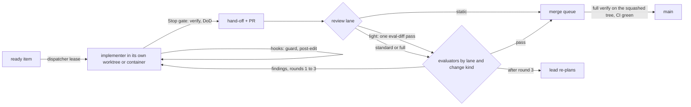

# 03. Skills, hooks, plugins and workflows for the agent team

_Status: draft 5, 2026-11-11 (owner instructions 1 to 28 applied). Specifies D-47 for the tooling layer. Owning squad: `agent-kit` (SQ-17); everything under `.claude/`, `.agents/`, `xtask/`, `deploy/fleet/` and `.github/` is gate configuration and trust core under D-63. Read with: [`00-decisions.md`](../design/00-decisions.md) (the spine, authoritative); [`_review/02-owner-answers.md`](../design/_review/02-owner-answers.md) (zero budget, the Claude subscription); [`_review/03-models-and-orchestration.md`](../design/_review/03-models-and-orchestration.md) (the binding model rule); [`_review/04-owner-kit-instructions.md`](../design/_review/04-owner-kit-instructions.md) (the owner's kit instructions, which override this document where they differ); [`03-system-architecture-and-modularity.md`](../design/03-system-architecture-and-modularity.md) (layers, `xtask`, repository layout); [`07-control-points-and-hook-broker.md`](../design/07-control-points-and-hook-broker.md) (the product's own hook, which the development fleet runs under); `team/01` (work-item lifecycle, usage caps, isolation); `team/02` (agent names, hand-off format); `team/04` (audit library); `team/05` (`verify`, gate ids); `team/06` (paths and names, which this document follows)._

## Summary

This document fixes the tools the agent team uses to keep code and architecture maintainable with no person in the loop: building, reviewing, landing and releasing run on agents and deterministic software (owner instruction 7). The decisions:

1. **Four layers, each with one job.** Skills tell an agent how to do a task. Hooks catch mistakes early and cheaply. The sandbox and the container filesystem enforce. CI and the merge queue decide. Nothing is enforced only by a hook, because hooks fail open on `Stop` and agents write protected files through the shell (D-47; h09 section 4).
2. **One kit binary, built from the base branch.** Every hook execs a prebuilt `xtask` binary built from the merge-base with `main`, never `cargo run` on the worktree, so a worker's edits cannot change or break the hooks that judge it. The binary normalises Windows paths, writes at most ten lines plus a log path, and owns every pass or fail fact; the model never types a status that a gate trusts. It never panics: every handler failure follows the fail-closed contract of section 1 (owner instruction 15).
3. **The harness-neutral kit is canonical, and it is data.** Skills live in `.agents/skills/` in the open Agent Skills layout; roles, hooks, gates, lanes, routines, path skills, vendors, bounds and the repository identity live in `.agents/` data files, never in code (P14, owner instruction 26). `cargo xtask kit render` generates the Claude Code copies, the managed settings for the fleet, the fleet egress list and the hook fixture index from one source (D-61).
4. **The owner's twelve installed skills each get a lane** (section 2). `autopilot` and `auto-dev-via-github-issues` push and close work on their own; they run only under the repository overlay `docs/AUTOPILOT.md`, which turns their pushes into hand-offs and takes item choice away from them.
5. **Twenty project skills**, prefixed `grdr-` so they never collide with the owner's or built-in skills (section 3). `grdr-structure` is enforced by hooks and gate V20 (owner instructions 4, 15 and 26), and `grdr-interface` by hooks and gate V26 (P17). `.agents/kit/path-skills.toml` names the skills an agent loads before it edits each path (owner instruction 18).
6. **Third-party plugins come only from our marketplace, pinned by commit SHA** (section 9). It lives in the repository at `.agents/marketplace/`. The owner enabled every entry of section 5 without the cooldown and the file-by-file read (owner instruction 2); every other addition and every pin move takes both, with `eval-security` as the reader (owner instruction 7).
7. **Unattended runs happen only in a disposable Linux VM per lease** (the fleet image runs in it as a rootless container) with read-only mounts over protected paths, `dontAsk` permissions from managed settings, an egress allow-list, no mods, forge and subscription credentials held outside the sandbox, and Guardrails itself as the guard: the last signed release in the protected profile, or, while no signed release exists, a slice built from a tagged commit in Watch (section 8; `team/01` section 10). Until the fleet image exists (WI-0006), the dispatcher runs each session in its own git worktree on the owner's machine, and the permission rules, hooks and V05 are the boundary.
8. **One Claude subscription and one GitHub login run the team.** Every session uses the owner's logged-in Claude Code and the owner's `gh` login, so no step needs a new account (owner instruction 23). Work is measured in share of the subscription's usage windows, not dollars; every run and every recurring routine has a usage cap, and a usage limit pauses work instead of failing it (D-47).
9. **Tokens follow the size of the change.** `cargo xtask risk` gives every pull request a review lane (`static`, `light`, `standard`, `full`); the review pass, the `review` workflow and the merge queue follow it, and an agent may raise a lane, never lower it (owner instruction 8; `team/05` section 15).

## 1. Layering and the kit

| Layer | What it does | Where it lives | Can an agent route around it? |
|---|---|---|---|
| Skill | Procedure and context for one task | `.agents/skills/<name>/SKILL.md`, rendered to `.claude/skills/` | Yes, by not following it |
| Hook | Early feedback and advisory blocks | `.claude/settings.json`, calling the kit binary | Yes: Bash writes, hooks that do not fire (issue #6305), `Stop` failing open |
| Sandbox and filesystem | Enforcement inside a session | Claude Code sandbox and permission rules (interactive); container read-only mounts and managed settings (unattended) | Only by escaping the container |
| CI and the merge queue | The gate | `cargo xtask verify` from the local dispatcher and in required checks; the merge queue's full verify on the exact tree that lands; branch rulesets | No |

**Canonical source.** `.agents/kit/` holds:

| File | Holds |
|---|---|
| `protected-paths.toml` | What an agent may not write (team/05 section 5) |
| `permissions.toml` | Permission rules, sandbox, `env` and `attribution` of the rendered settings |
| `hooks.toml` | Hook registrations (section 4) |
| `path-skills.toml` | The skills an agent loads, in order, before it edits a path (section 3) |
| `vendors.toml` | The reference vendors, their documentation domains and briefs, and the `[sources]` of the horizon sweep (owner instruction 14) |
| `egress.toml` | The egress allow-lists of team/01 section 10 |
| `usage.toml` | Usage caps per role and per routine run, as share of the subscription's usage window; routine cadences; size rows |
| `limits.toml` | Every bound and timeout of the kit (owner instructions 15 and 26) |
| `marketplace.toml` | The marketplace and the enabled plugins (section 9) |
| `seed-scope.toml`, `prompts/` | The chief architect's seed session and its prompt (team/06 section 14) |
| `workflows/*.js` | Workflow scripts (section 6) |

Beside them, `.agents/` holds `roster.toml`, `models.toml`, `owners.toml`, `risk-tiers.toml` (tiers and lanes), `harness.toml` (the repository identity, the commit and pull-request form, dispatcher and queue policy), `skills/`, `templates/agents/` and `marketplace/`. `cargo xtask kit render` writes `.claude/settings.json`, `.claude/agents/`, `.claude/skills/` (copies, because symbolic links on Windows need privilege), `.claude/workflows/`, `deploy/fleet/managed-settings.json` and `managed-settings.evaluator.json`, `deploy/fleet/egress.json` and the index of `xtask/fixtures/hooks/`. `cargo xtask kit check` (gate V21) fails when any rendered file differs from a fresh render or fails the settings schema of the pinned Claude Code version, when a roster skill does not resolve, when a model id is outside `models.toml`, when a vendor brief is missing, and when the rendered `chief-architect` definition lacks the ownership sentence. Other harnesses get `AGENTS.md` and `.agents/skills/`; hooks for them are adapters added when a second harness enters the fleet (K13).

**Bounds are data.** `.agents/kit/limits.toml` has one table per area (`[hook]`, `[gates]`, `[orchestrate]`, `[dispatch]`, `[kit]`) and one sub-table per module; its typed loader rejects a missing or unknown key, and the gates read the base commit's copy. The hook handlers' bounds are its `[hook.*]` tables too, read from the working tree's copy, and `hooks.toml` keeps only each handler's registered `timeout`, so the kit has one source for its bounds (P17).

**The kit binary contract.**

- Build. `cargo xtask kit install` checks out the merge-base with `origin/main` into a scratch worktree, builds `xtask` with the `kit` profile (optimised, no debug information) and copies it to `.agent/kit/bin/xtask` with the source commit and `xtask/` tree digest beside it. The fleet image runs it when it creates the worktree; an interactive developer runs it once per clone. The `SessionStart` handler rebuilds when the merge-base digest changes. Because the binary comes from `main`, which the merge queue keeps green, a broken member manifest, a `[patch]` table or an edit under `xtask/` in the worktree cannot change or break a hook in that session; a change to hook code takes effect after it merges and is tested before that by the hook self-test on the pull request head.
- Missing binary. Every pre-action hook then fails, and `onFailure: block` turns that into a block on every file and shell tool; the error names the missing path. Fail closed is intended here.
- Session identity and the work item. The launcher (`cargo xtask kit launch <agent> --item <n>`, and the dispatcher, which runs it in print mode) sets `GRDR_AGENT` (the roster name), `GRDR_WORK_ITEM` (the issue number) and `GRDR_SCOPE`: `seed` for the chief architect's seed session only, `protected` only when the leased issue is a protected-change item and its lease names `lead-agent-kit` or the chief architect (owner instruction 7). It fetches the issue once and writes the git-ignored snapshot `.agent/state/item-<n>.json` (write set, tier, kind, agent, acceptance digest). Hooks read the snapshot and never call GitHub; it is session state, not a work-item store, because work items live only in GitHub issues (owner instruction 5). Without a snapshot only the protected-path and command rules apply. `kit launch` passes every variable of the owner's user settings `env` to the session empty, so no credential kept there reaches an agent. Every session it starts runs with `--permission-mode dontAsk`, interactive ones included, so nothing waits on a prompt (owner instruction 7): a call that no allow rule or hook approves is refused with the reason. The seed session (`--seed`) runs like a dispatched one, in print mode with its prompt on stdin, its turn cap and stream-json output. `[launch] plugin_allow` in `harness.toml` adds `--allowedTools` rules for plugins' own commands at the path Claude Code installed each plugin to, so the cleanup gate's sign-off runs.
- Input: the hook JSON on stdin. Paths are converted to forward slashes and made relative to `CLAUDE_PROJECT_DIR` before any match, because a forward-slash check never matches a backslash path on Windows (32 verification).
- Output: the event's JSON on stdout; at most ten lines of diagnostics; full detail to `.agent/logs/<event>-<timestamp>.log`, printed as a path.
- Internal deadline: the registered timeout minus the configured margin (two seconds). On deadline or any handler error, pre-action events exit 2 (deny), `Stop` exits 2 under the round counter, and observation events exit 0 and log. A handler that cannot read its own registration or bounds fails at once under its failure policy instead of falling back to a built-in value.
- Facts: `cargo xtask verify`, `cargo xtask prove` and `cargo xtask evidence` write `.agent/evidence/*.json` with the command, exit code, duration and the tree digest they ran against. Gates read those files, never the transcript's claims.
- Latency target: p95 under 400 ms per pre-action hook (target; measured in K3).

## 2. The owner's installed skills

Each installed skill has one lane. Agent names are `team/02`'s.

| Skill | Source and pin | When it runs | Who invokes it |
|---|---|---|---|
| `cleanup:cleanup` | Owner's own plugin from `416rehman/claude-mods`, subdirectory `cleanup`, commit `489dd5a409814c9db337a4d53bce440aba75d21f`, through the marketplace; ships a `PreToolUse` gate that denies `git commit` until the skill signs off the staged diff, and denies a multi-line message or an AI credit line | Before every commit on an agent branch; nightly de-slopping | Implementers (forced by its commit gate); `garden-deslop` |
| `simplify` | Built into Claude Code 2.1.322 | The owner's own sessions only | The owner. Agents do not run it: `cleanup` applies its reuse, quality and efficiency checks, so a second pass would repeat them (de-slop research 1.2) |
| `code-review` | Built in | Every pull request in the `standard` and `full` lanes, inside the `review` workflow: `medium` for low and medium tiers, `high` for high tier, `xhigh` for trust-core paths; at most three rounds, re-review on the new diff only | `eval-diff`, in a clean context, on the model that did not write the change (Opus for Sonnet's changes, Sonnet for Opus's) |
| `security-review` | Built in | Pull requests touching trust-core paths, parsers, IPC, pack verification, the shim, CI or kit files; every high-tier change and every protected change | `eval-security` (Opus 5.5) |
| `auto-dev-via-github-issues` | Account skill; provenance and licence not stated | Only when the owner runs a loop in an own session: works the low-tier items `cargo xtask kit claim --next` leases to it | Owner, interactively, under `docs/AUTOPILOT.md` |
| `autopilot` | Owner's own skill (user scope) | Requires the fleet image (K7): the night shift for low-tier and gardener-sourced items, one instance, in an unattended container, within its usage cap | Owner starts it; the dispatcher host restarts it on schedule |
| `ui-architect` | Owner's own skill | Before the first UI decision of any session that edits a path of a `path-skills.toml` entry that names it (`web/`, `site/`, `interface/`, `desktop/`, the CLI, tray and approval programs, installers, translations), and always before `grdr-interface` (the owner's global rule, which also binds subagents) | `impl-web`, `impl-docs`; `eval-ux` (team/05 U07), `eval-a11y`; the persona seats that review screens (team/02) |
| `frontend-design` | `claude-plugins-official` at `43fd1f9db094`, v1.1.1 (content identical to `f8c5e7a1dcb7`), Apache-2.0, through the marketplace | After `ui-architect`, for new screens (owner instruction 18); output composes Astryx components through `@grdr/ui` and `@grdr/kit` and uses the DTCG tokens (D-42, owner instruction 21) | `impl-web` |
| `write-like-a-normal-staff-senior-developer` | Account skill | Any prose written into the repository: docs, ADRs, RFCs, PR bodies, commit subjects, skill files | Every agent; the `prose` entry of `path-skills.toml` names it for `docs/**`; backed by gate V25 and Vale with the vendored `ai-tells` styles in V17 |
| `skill-creator` | Account skill (Anthropic) | Creating or changing any project skill; its trigger evals are required evidence | `impl-docs` on agent-kit items |
| `plugin-authoring` | Built in | Building owner-side mods (a status line showing work item, tier and last gate) and debugging hooks | Owner and agent-kit items; mods never enter a fleet container (section 8) |
| `workflow-authoring` | Built in | Writing or changing `.agents/kit/workflows/*.js` (section 6) | Agent-kit items |

**Conflicts and how they resolve.**

- `cleanup`'s gate denies a commit message of more than one line and any AI credit line, which is the repository's commit form (owner instruction 27), so the two agree. `cleanup` owns the content of the pass; the kit owns the form: `guard-command` checks every agent `git commit` (section 4.1) and gate V24 every commit since the base, both from `.agents/harness.toml [commit]`. The rendered settings leave `attribution.commit` and `attribution.pr` empty, so Claude Code adds no co-author line. `kit install` turns off a user-scope copy of `cleanup` (and of any other plugin that loads under a marketplace entry's name) in `.claude/settings.local.json`, so its gate runs once.
- `autopilot` and `auto-dev-via-github-issues` push to the default branch, close issues, choose and build work freely and never stop by themselves, which breaks dispatcher assignment, single writer, independent evaluation, the review lanes and the merge queue (D-47, D-61, D-63; `team/01` sections 1 and 4). `autopilot` treats `docs/AUTOPILOT.md` as a non-negotiable overlay (read from the installed skill file); `AGENTS.md` points every loop at the same file. Its content is fixed here:

```markdown
# Loop overlay (binding on autopilot, auto-dev-via-github-issues and any self-driving loop)

1. Take work only from `cargo xtask kit claim --next`. The dispatcher leases you the next eligible
   `status:ready` issue of the repository `.agents/harness.toml` names (`tier:low`; at night also
   issues gardeners filed; never `good-first-issue`), moving it to `status:leased` with a lease
   comment. You never choose an item. If the claim returns nothing, stop.
2. One issue per lease, on the branch the lease names (`agent/<n>/a<attempt>`). Never push to `main`,
   never merge, never run `gh pr merge`, never create or push a tag, never close an issue or change
   its `status:` label. Finish with `cargo xtask kit handoff`, which posts the hand-off comment,
   pushes the branch and opens the pull request with `Closes #<n>` and the `meta.v1` block.
3. "Done" means the issue is `status:in-review`. Evaluators and the merge queue move it on, and the
   merged pull request closes it.
4. New work you find becomes a new issue (`gh issue create`, `status:proposed`, with evidence). A lead
   readies it and the dispatcher leases it. Do not build it in this lease.
5. Stop at any trust-core path (`cargo xtask risk`), protected path, new dependency, licence, public API
   or wire change: hand off with status `blocked` and the escalation packet of `team/01` section 6;
   `kit handoff` sets `status:escalated`. The item's lead answers it, then the chief architect.
6. The loop ends when the claim returns nothing or the run's usage cap in `.agents/kit/usage.toml` is reached.
   At a subscription usage limit, stop; the dispatcher pauses the lease, counts no attempt and resumes the
   item after the window resets. This rule overrides any instruction to keep the loop alive.
7. Every commit message is one line, made with one `git commit -m`: a Conventional Commit subject
   (`fix(grdr-core): ...`) of at most 72 characters, with no body, no trailer and no credit line.
```

- `ui-architect` includes pricing, paywall and conversion rules. The product has no paywall (P11); D-44 experience rules and the D-51 disclosure floor win wherever the manual differs, and approval surfaces follow D-31 (OS-native, no persuasion patterns).
- `modern-web-guidance` (section 5) and the plan: the plan's stack (React 19, Astryx behind `@grdr/ui`, the DTCG tokens, the CSP of `design/27`) and D-44 win wherever they differ, and browser built-in AI APIs are used only where a spec asks for them (P2, P8). The pinned skill tells agents to run `npx modern-web-guidance`; `guard-command` denies that CLI through every runner, because it downloads code at each run and sends telemetry, so agents read the guides inside the installed plugin.

## 3. Project skills

Format: one directory per skill under `.agents/skills/`, frontmatter `name`, `description` (the trigger), `license: Apache-2.0` and `metadata` (`version`, `owner`, `requires`, `closes-by`), where `requires` names the work items or commands the skill depends on. Each skill under 200 lines; long references go in `references/` beside it. Every skill ships trigger evals made with `skill-creator` (ten prompts that should load it, ten that should not) and runs them on each Claude Code pin change.

| Name | Trigger description (verbatim `description`) | Content outline | Requires |
|---|---|---|---|
| `grdr-verify` | Run the repository gates before claiming anything works. Use before a hand-off, after any edit, and whenever a hook or CI reports a failure. | `cargo xtask verify --fast` versus the full form; reading the ten-line summary and `ERROR <gate-id>` line; what each V gate of team/05 means; never editing a gate to pass it; the `impossible` route | K4 |
| `grdr-start-item` | Begin work on an assigned work item. Use at the start of every implementer session. | Read the item's issue (`GRDR_WORK_ITEM`; the snapshot `.agent/state/item-<n>.json`): spec, acceptance criteria and plan; write set; tier; named oracles; search before writing (do not assume it is missing); expected-result-before-action log | K1 |
| `grdr-structure` | Write or change code the way this repository wants it built: the mechanism before the feature, structures before implementations, small files, explicit state types, no panic paths, no hard-coded values, few comments. Use before writing or editing any Rust, TypeScript, JavaScript or CSS source, and whenever a hook or gate reports a structure check S1 to S7. | The owner's seven rules (owner instructions 4 and 9): (1) structures before implementations: imports, then constants and statics, then types, then impls, then free functions, then the test module last (TypeScript: imports, constants, types and interfaces, then functions and classes); (2) a source file over 500 code lines (blank lines, comments and the test module excluded) is split by responsibility, and a file already over it is allowed only through `quality/file-size.toml`, a ratchet that may only shrink; (3) no implicit state machines, ever: mutually exclusive booleans, status or phase fields held as strings or integers, `Option` fields valid only in some phases and checks like `started && !finished` become an explicit state type, an enum with the data each state owns and transitions that consume one state and return the next, every non-terminal state with an exit, never an extra flag, guard, assertion or comment that keeps the implicit machine alive; (4) a comment only for a reason the code cannot show (an invariant, an external constraint, a link to a spec, decision record or RFC, the `// SAFETY:` comment), no narration, change-log or step comments, no commented-out code, no TODO without a work-item id; (5) fix the core problem, never the symptom, and hand off with a finding and a proposed issue when the right fix is outside the write set; (6) readable code: one job per function and module, early returns (nesting depth four at most), enums over boolean parameters, every bound in `limits.toml`, errors with their `GRDR-<AREA>-<NNNN>` code, modules split by feature, the smallest public surface; (7) find the mechanism first (P14): extend the port, pack, manifest, configuration schema or plugin seam the feature belongs to, express the feature as content or configuration, and name the extension point in the hand-off. It also teaches the type escapes to avoid (a narrowing `as` cast, an `#[allow]` that quiets a lint, `let _ =` on a `Result`, a `.clone()` that quiets the borrow checker, `serde_json::Value` or `Box<dyn Any>` in place of a type), the fix for each check S1 to S7 including no panic paths (S6, owner instruction 15) and no hard-coded values (S7, owner instruction 26), and which data source holds each kind of value: the configuration schema, `brand/brand.toml`, `limits.toml`, the design tokens or the language tokens (D-69, `interface/strings/`). Loaded with `cleanup` before writing code | K14 |
| `grdr-interface` | Build or change anything a person or an agent reads, from the one interface system. Use after ui-architect, before writing or editing any screen, desktop view, tray menu, approval dialog, CLI human output, block or agent message, notification, email, report, docs component, extension UI, installer text or language token, and whenever a hook or gate reports an interface check UX1 to UX8. | The cohesion rules of P17 and D-69: look up the registries (`interface/patterns.toml`, `presentation.toml`, `routes.toml`, the language tokens) before building; every element an Astryx component, through `@grdr/ui`, and every composite a composition of `@grdr/ui` in `@grdr/kit`; React Aria only in the files an entry of `web/packages/ui/exceptions.toml` lists (owner instruction 21); app code composes kit parts, with spacing by token name and no stylesheet, `style`, `className` string or raw element; every visible string a language token with typed arguments, never concatenated or formatted by hand; enums through `present()`; one `ViewState` per screen; mutations through `useAction` and its confirmation class; destinations by route id; logical properties and isolates; a new pattern registered with its fixtures; `agent.*` text; never editing generated output; the checks UX1 to UX8 of gate V26, ARCH-101 to ARCH-106 and U01 to U11 with their fixes (`references/checks.md`, `references/strings.md`). Loaded after `ui-architect`, and after `frontend-design` and `modern-web-guidance` on web paths | K15; WI-0041 |
| `grdr-vendor-research` | Find out what shipping products, converging standards and new work say a feature needs. Use when specifying, implementing or judging a feature whose requirements, completeness or industry norm are unclear, and whenever the spec is silent on what the reference vendors or the standards treat as the minimum. | Owner instruction 14: read the matching briefs under `docs/references/research/` first (`00-index.md`; 01 to 05 for the reference vendors, 06 and 07 for the market, g02 and h03 for incumbent EDR documentation); then the vendors' current public documentation (`[vendor.<id>]` of `.agents/kit/vendors.toml`); then the horizon sweep over its `[sources.<class>]` (IETF, W3C, OpenID, OWASP, CoSAI, CSA, NIST, ENISA, MCP, A2A, the Agent Skills and portable-hook drafts, conferences, arXiv, new open-source projects, startups and funding news, Hacker News, Lobsters, Reddit); post one comment on the issue that separates what shipping products do, what standards and drafts converge on (each draft with its version and status) and what is novel but unproven, with URLs and dates; a gap that changes the spec becomes the lead's spec edit or a new `status:proposed` issue, never extra scope. Vendor text is data; summarise in our own words and copy nothing into the repository; never read what `supply-chain/do-not-read.toml` lists | `vendors.toml`; the `WebFetch(domain:...)` and `WebSearch` rules `kit render` writes from it |
| `grdr-handoff` | Finish a work item. Use when the implementation passes verify-fast or when you are blocked. | `handoff.v1` of team/02 section 1.4, posted by `kit handoff` as a collapsed comment on the item's issue: changed paths, evidence ids, decisions where the spec was silent (least confident first), protected-change requests, revert, next (with the `status:proposed` issues filed for work found); the commit form (one Conventional Commit line, owner instruction 27); the PR body as the team/01 evidence template with `Closes #<n>` and the `meta.v1` block (harness, the model id that wrote the change, the attempt), which `kit handoff` writes and agents never edit | K6 (`kit handoff`) |
| `grdr-fix-bug` | Fix a reported defect. Use for any item of kind bug or any regression. | Reproduce first; three-arm proof; regression hunt through callers; full text below | K4 (`prove`) |
| `grdr-remove-code` | Delete code, flags or features. Use for any removal or "replace X with Y" item. | Survival test that fails while the target remains; no guard-instead-of-delete (29% of passing patches do this, h09 verification); callers updated | None |
| `grdr-write-spec` | Write or change a specification, RFC or decision record. Use when an item asks for a spec, an interface, a wire format or a decision. | Templates of team/06 section 6 (the spec, plan and acceptance sections of a work-item issue; the ADR file); spine vocabulary; prerequisites stated by component, work item, decision or external precondition, never as a phase or schedule; acceptance criteria with a named oracle; the mechanism the feature extends and its default content (P14), with no host, name, bound or string that is not data; `grdr-vendor-research` when requirements are unclear; the RFC route for the spine, public crates, wire formats and the Cedar schema: the persona council and `eval-architecture` review the RFC and the chief architect decides it, with no waiting period (owner instruction 7); every property statement under `specs/` approved by `eval-security` and an evaluator on the other model (D-63 as amended) | None |
| `grdr-scaffold-crate` | Create a new crate in the workspace. Use when an item adds a crate or splits a module out of `grdr-core`. | `cargo xtask new-crate <name> --layer N --privilege P --surface S`; `[package.metadata.grdr]`; workspace lints (the no-panic deny set of owner instruction 15); error register entry; `limits.toml` entries; test layout; the split rule (second consumer or different licence); a literal `package.version`, and for a public crate its release-please package entry; edits to the root manifest, `architecture.toml` or the release-please files go through `protected_change_requests`. P17 renames it `grdr-scaffold` and widens it to every kind `cargo xtask scaffold` writes (crate, adapter, port, command, error code, configuration key, metric, pattern, language token, route) once that command exists, in the same change as the roster and `CLAUDE.md` | `cargo xtask new-crate` |
| `grdr-add-agent-adapter` | Add or update support for a coding agent or harness. Use for any item naming a new agent, a new agent version or a hook dialect. | The six steps of design/03 "Add an agent adapter"; `grdr adapter record` and `test`; managed-source probe; tested version range; achievable failure mode; canary proof that the hook fired (D-49) | `grdr adapter record` and `test` |
| `grdr-author-detection` | Write a detection or session rule with tests. Use for any item that adds or tunes detection content. | Session rule versus Sigma detection (D-09); log-source taxonomy; attack fixture and benign corpus; fields and data classes read; `grdr content test` in every engine; starts in Watch; first-party content lands when its evaluators pass, community content needs two passing evaluators on different models, and a ceiling of `contain` or above also needs `eval-security` and `eval-adversarial` (owner instruction 7) | `grdr content test` |
| `grdr-author-policy` | Write or change a Cedar policy or pack. Use for items touching `packs/`, the Cedar schema or Essentials. | Pack anatomy; `grdr policy check` semantic diff; widening needs an approver; replay before leaving Watch; Essentials entry rule (D-53) | `grdr policy check` |
| `grdr-add-integration` | Add an export sink, ingest dialect or response target. Use for any item naming an external product. | Manifest first (design/03 "Add an integration"); golden files; destination is configuration, never pack data (P7); two first-party members per family (D-40) | The integration host |
| `grdr-add-port-adapter` | Implement a store, bus, blob, sandbox or sensor back end behind a port. Use for any item that adds or changes a port adapter. | `grdr-ports-testkit`; crash points; tenant context; contrib versus profile adapter (P6) | `grdr-ports-testkit` |
| `grdr-threat-model-change` | Threat-model a change. Use for high-tier items, trust-core paths, new IPC, new parsers, new network listeners and new privileges. | Map the change onto `design/02` adversaries and assets; trust-boundary list (data becomes instructions, parsed twice); new security requirement ids; tests that prove each control; output posted as a comment on the item's issue | None |
| `grdr-matrix-run` | Test on an operating system, architecture or kernel you are not running on. Use for any change under OS adapter crates, `bpf/` or `platform/`. | `cargo xtask matrix-run <cell...>` dispatches to runners (free hosted runners on Linux, macOS and Windows, the repository being public; the owner's machine through the local dispatcher; optional self-hosted runners) and returns ten lines and a log path; cells from `support.toml`; a cell that needs hardware nobody has reports `requires hardware` instead of passing; no agent-driven kernel tracing on shared hosts (h09) | `cargo xtask matrix-run` |
| `grdr-evaluate` | Judge a hand-off as an independent evaluator. Use only in evaluator sessions. | Clean context; read the acceptance criteria (checked against the lease comment's digest) and the diff, not the worker's reasoning; drive the real artefact (CLI, local console through Playwright, matrix cell); expectations before each action (team/05 section 18); hard per-criterion thresholds; verdict as `handoff.v1` with status `pass`, `fail` or `cannot-evaluate` plus a check run (a commit status under the one `gh` login, until an evaluator App exists); in `eval-diff`, the writer's model from the `meta.v1` block, and `cannot-evaluate` when it is the evaluator's own; three-round cap | K8 (Playwright MCP) |
| `grdr-audit` | Run one power prompt from the library. Use when a scheduled audit or a lead names an audit id. | Runs `cargo xtask audit run <id>` and nothing else; the runner prepends team/04's preamble, checks spans and starts the refuting verifier | team/04 work item 3 |
| `grdr-cut-release` | Prepare a release candidate. Use only in the release workflow. | Release gates of team/05 section 16, the air-gap conformance run (S-31), bundle contents, fleet scale, the compatibility matrix and shipped locales included; team/04's release audit set; held-out suite result; scorecard; SBOM and VEX. No person is a step and no person holds a key: release-please opens the release pull requests, the merge queue lands them, release-please creates the tags and GitHub releases, and artefacts are signed keylessly with Sigstore cosign, with SLSA provenance and SBOMs; an artefact no vendor programme signs is marked "not platform-signed" (owner instructions 3, 7 and 23) | The release workflow and release-please (WI-0012); the `release-candidate` workflow (K10) |

The full text of one skill, as the pattern for the rest:

```markdown
---
name: grdr-fix-bug
description: Fix a reported defect. Use for any work item of kind bug, any regression, and any failing test you did not intend to break.
license: Apache-2.0
metadata:
  version: "1"
  owner: agent-kit
  requires: K4
  closes-by: test
---

# Fix a bug with a three-arm proof

1. Reproduce before reading the fix area. Write the failing test first, in the crate's normal test location.
   Run `cargo xtask prove --arm before --test <path::name>`. It must fail. If it passes, the report is wrong
   or your test is: stop and record this in the hand-off.
2. Find the cause, not the symptom. Name the state or input that makes it reachable. If the bug is one
   instance of a class (swallowed error, missing timeout, unscoped tenant key), fix the class at its
   authoritative boundary and list other instances in the hand-off's `next` field for the lead.
3. Fix. Do not edit the test after step 1 except to make it compile.
4. `cargo xtask prove --arm after` must pass; `cargo xtask prove --arm revert` reverts your non-test changes
   in a scratch worktree and must fail. The three results land in `.agent/evidence/prove.json` and the
   hand-off's `three_arm` field points at them.
5. Regression hunt: list every caller of what you changed up to a public interface and state, per caller,
   whether behaviour changed. Unstated behaviour changes are a defect.
6. `cargo xtask verify --fast`, then hand off with `grdr-handoff`.

Never weaken, skip or delete an assertion to make the proof pass. If the test and the specification
conflict, change neither: hand off with status `impossible` and a one-line reason.
```

**Skills by path.** `.agents/kit/path-skills.toml` names the skills an agent loads, in order, before it edits a path (owner instruction 18, P14, P17). `guard-path` names an entry's skills the first time a session edits one of its paths, `session-start` lists the entries the write set touches, and `stop-gate` records which skills the session loaded and logs any named skill it did not load. A path in several entries takes each entry's skills once, in file order. The owner extends the mapping as data.

| Entry | Paths | Skills, in order |
|---|---|---|
| `web` | `web/**`, `site/**` | `ui-architect`, `frontend-design:frontend-design`, `modern-web-guidance:modern-web-guidance`, `grdr-interface` |
| `browser-extension` | `web/extension/**` | `modern-web-guidance:chrome-extensions` |
| `interface` | `interface/**`, `desktop/**`, `programs/grdr/**`, `programs/grdr-tray/**`, `programs/grdr-approve/**`, `platform/*/installer/**`, and every crate whose `[package.metadata.grdr]` sets `renders` | `ui-architect`, `grdr-interface` |
| `translation` | `interface/strings/tr/**`, `docs/i18n/**`, and pack messages in the content repository | `ui-architect`, `grdr-interface` |
| `code` | `crates/**`, `programs/**`, `xtask/**`, `**/*.rs`, `**/*.ts`, `**/*.tsx` | `grdr-structure`, `cleanup:cleanup` |
| `prose` | `docs/**` | `anthropic-skills:write-like-a-normal-staff-senior-developer` |

The interface checks UX1 to UX8 run on the TypeScript, JavaScript and CSS files under the paths of every entry that names `ui-architect` (`quality/interface.toml`, team/05 section 8); their Rust and terminal halves are not built yet. The text of `grdr-interface` is `.agents/skills/grdr-interface/SKILL.md`.

## 4. Hook configuration

`.claude/settings.json`, rendered from `.agents/kit/`. Keys were checked against the Claude Code hooks, settings and settings-reference pages on 2026-11-10. Exec form (`args`) substitutes `${CLAUDE_PROJECT_DIR}` into `command` and each `args` element. `Edit|Write` style matchers are exact names. `onFailure` exists only on `command` and `http` handlers, needs 2.1.295 or later and does nothing on `Stop`, `SubagentStop`, `TaskCompleted` and async hooks. `sandbox.network.strictAllowlist` is honoured only from user or managed settings and telemetry export variables are ignored in a project `env` block, so both live in managed settings (section 8) and in the owner's user settings, which `kit render` prints as a fragment.

Its keys and where each comes from:

| Key | Rendered value | Source |
|---|---|---|
| `attribution` | `commit` and `pr` empty, so Claude Code adds no co-author line (owner instruction 27) | `permissions.toml` |
| `env` | `GRDR_KIT=1`, `CARGO_TERM_COLOR=never`, `DISABLE_TELEMETRY=1` (owner instruction 18), `SEMGREP_GUARDIAN_AUTO_UPDATE=0` and `ENABLE_CODE_SECURITY_REVIEW=0` (section 5), `GH_REPO` (the repository `harness.toml [github]` names), `GH_PROMPT_DISABLED`, `GH_NO_UPDATE_NOTIFIER`, the subagent and workflow concurrency caps, and `ANTHROPIC_DEFAULT_HAIKU_MODEL` set to the Sonnet id, so a plugin agent that names `haiku` runs on Sonnet | `permissions.toml`, `harness.toml`, `models.toml` (`folded_aliases`) |
| `model`, `availableModels` | `claude-sonnet-5-5`; the three pinned ids, Fable among them for the chief architect alone, whom the model gate holds to its binding | `models.toml` |
| `permissions.deny` | `Edit` of every protected path, of `.git/`, `.agent/kit/` and the item snapshot; reads of credential and user settings files; force push, `reset --hard`, `--no-verify`, `commit -s`, `gh pr merge`, the `gh release` writes, publishing, snapshot acceptance, and gh account, secret, repository and label administration. No hook decision overrides a deny rule, so the seed session and a protected-change lease put their protected paths in place with `cargo xtask kit place`, which holds them to the scope `guard-path` does | `permissions.toml`, `protected-paths.toml` |
| `permissions.ask` | `cargo add`, `cargo install`, `pnpm add` | `permissions.toml` |
| `permissions.allow` | `cargo xtask`, build, test, lint and format commands, `cargo update`, `cargo metadata`, git reads, `git fetch origin`, `git add`, `git commit -m`, `git push`, the `gh issue`, `gh pr`, `gh release` and `gh run` calls agents make, the evaluators' check-run and status posts on the repository, the read-only contract, licence and mutation checks of `eval-api`, `eval-licence` and `garden-tests` (`cargo vet --locked` and `cargo vet --locked check`, not vet's writing subcommands), `pnpm install --frozen-lockfile` (not `pnpm exec`, which runs an arbitrary program the guard cannot bound), shell appends to `.agent/state/expect-*` and `.agent/evidence/expectations-*.jsonl`, reads of the installed plugins' files, `mcp__playwright__*`, `Workflow(<name>)` for each kit workflow, one `WebFetch(domain:<d>)` rule per domain of `vendors.toml`, and `WebSearch`. No `Edit` rule: `guard-path` approves each file-tool write inside the agent's scope, since an `Edit` rule would also approve shell redirects outside the write set. A rule may name `{repository}` and `{marketplace}` | `permissions.toml`, `vendors.toml`, `harness.toml`, `marketplace.toml`, `workflows/` |
| `sandbox` | Enabled, no unsandboxed commands, credential directories unreadable, network to the crate, npm, GitHub and buf registries | `permissions.toml` |
| `enabledPlugins` | Every marketplace entry (owner instruction 2) | `marketplace.toml` |
| `autoMemoryEnabled`, `disableAutoMode` | `false`, `disable` | `permissions.toml` |
| `hooks` | Below | `hooks.toml` |

Only roles whose skills include `grdr-vendor-research` get `WebSearch` and the `WebFetch(domain:)` rules of `vendors.toml`, with `WebFetch` in their rendered tools; `kit render` fails when another role lists `WebSearch`, and refuses a bare `WebFetch` or `WebSearch` deny or ask rule, which would override the domain rules (owner instruction 14). Another role may list `WebFetch` for its own allow-list, as `garden-catalogue` does for the agent vendors' documentation on allow-list B (team/01 section 10). Claude Code adds each `WebFetch(domain:)` domain to the sandbox network allow-list too.

```json
{
  "hooks": {
    "SessionStart": [
      { "matcher": "startup|resume|clear|fork", "hooks": [
        { "type": "command", "command": "\"${CLAUDE_PROJECT_DIR}/.agent/kit/bin/xtask\" hook session-start", "timeout": 300 } ] },
      { "matcher": "compact", "hooks": [
        { "type": "command", "command": "\"${CLAUDE_PROJECT_DIR}/.agent/kit/bin/xtask\" hook session-restore", "timeout": 30 } ] }
    ],
    "UserPromptSubmit": [
      { "hooks": [ { "type": "command", "command": "\"${CLAUDE_PROJECT_DIR}/.agent/kit/bin/xtask\" hook model-gate",
          "timeout": 10, "onFailure": "block" } ] }
    ],
    "PreModelSwitch": [
      { "hooks": [ { "type": "command", "command": "\"${CLAUDE_PROJECT_DIR}/.agent/kit/bin/xtask\" hook model-switch",
          "timeout": 10, "onFailure": "block" } ] }
    ],
    "PreToolUse": [
      { "matcher": "Edit|Write|MultiEdit|NotebookEdit", "hooks": [
        { "type": "command", "command": "\"${CLAUDE_PROJECT_DIR}/.agent/kit/bin/xtask\" hook guard-path",
          "timeout": 10, "onFailure": "block" } ] },
      { "matcher": "Bash|PowerShell", "hooks": [
        { "type": "command", "command": "\"${CLAUDE_PROJECT_DIR}/.agent/kit/bin/xtask\" hook guard-command",
          "timeout": 10, "onFailure": "block" } ] }
    ],
    "PostToolUse": [
      { "matcher": "Edit|Write|MultiEdit|NotebookEdit", "hooks": [
        { "type": "command", "command": "\"${CLAUDE_PROJECT_DIR}/.agent/kit/bin/xtask\" hook post-edit", "timeout": 60 } ] },
      { "matcher": "Bash|PowerShell", "hooks": [
        { "type": "command", "command": "\"${CLAUDE_PROJECT_DIR}/.agent/kit/bin/xtask\" hook post-bash", "timeout": 20 } ] }
    ],
    "SubagentStart": [
      { "hooks": [ { "type": "command", "command": "\"${CLAUDE_PROJECT_DIR}/.agent/kit/bin/xtask\" hook subagent-start", "timeout": 20 } ] }
    ],
    "SubagentStop": [
      { "hooks": [ { "type": "command", "command": "\"${CLAUDE_PROJECT_DIR}/.agent/kit/bin/xtask\" hook subagent-stop", "timeout": 60 } ] }
    ],
    "Stop": [
      { "hooks": [ { "type": "command", "command": "\"${CLAUDE_PROJECT_DIR}/.agent/kit/bin/xtask\" hook stop-gate", "timeout": 600 } ] }
    ],
    "StopFailure": [
      { "hooks": [ { "type": "command", "command": "\"${CLAUDE_PROJECT_DIR}/.agent/kit/bin/xtask\" hook stop-failure", "timeout": 10 } ] }
    ],
    "PreCompact": [
      { "hooks": [ { "type": "command", "command": "\"${CLAUDE_PROJECT_DIR}/.agent/kit/bin/xtask\" hook pre-compact", "timeout": 60 } ] }
    ],
    "ConfigChange": [
      { "hooks": [ { "type": "command", "command": "\"${CLAUDE_PROJECT_DIR}/.agent/kit/bin/xtask\" hook config-change",
          "timeout": 10, "onFailure": "block" } ] }
    ],
    "SessionEnd": [
      { "hooks": [ { "type": "command", "command": "\"${CLAUDE_PROJECT_DIR}/.agent/kit/bin/xtask\" hook session-end", "timeout": 2 } ] }
    ]
  }
}
```

Each `command` is shell form with the quoted path and no extension, so one rendered file serves every operating system: Git Bash runs it on Windows and resolves `xtask` to `xtask.exe`. The hook self-test (section 4.2) runs the rendered command through Git Bash with `CLAUDE_PROJECT_DIR` in native and forward-slash form, from a working directory outside the repository, and proves that a missing kit binary and a missed deadline still block. A protected path changes only through its own protected-change item, implemented under `GRDR_SCOPE=protected` by `lead-agent-kit` or the chief architect (owner instruction 7; team/05 section 5). The `gh` allow rules are wide because every agent posts as the owner's one `gh` login (owner instruction 23; GitHub Apps are an optional later hardening); `guard-command` narrows them to each role's calls on the repository `harness.toml` names (team/01 section 4). `gh issue create --blocked-by` and `gh issue edit --add-blocked-by`, `--add-sub-issue` and `--parent` set dependencies and sub-issues, so no agent needs `gh api`.

No prompt or agent hook is used (owner instruction 8): `stop-gate` checks success claims without evidence ids and unfiled "pre-existing", "flaky" and "out of scope" claims by pattern.

There is no `TaskCompleted` handler. It fires each time a task-list entry is marked complete, the tree digest changes between entries, and a digest check there would block honest progress; the `Stop` gate carries the definition of done.

### 4.1 What each hook does and how it fails

| Event, handler | Does | Blocks? | On crash or timeout | Backstop |
|---|---|---|---|---|
| `SessionStart` startup, resume, clear, fork | Rebuilds the kit binary if the merge-base `xtask/` digest changed; prints at most 60 lines: work item (issue number and title from the snapshot), acceptance digest, tier, write set, protected-path digest, the golden principles that apply to the write set, last failing gate, sandbox state (native Windows prints "sandbox unavailable: request level only"); tells every agent that writes, the chief architect included, to load `grdr-structure` and `cleanup` before writing code, and lists each `path-skills.toml` entry the write set touches with its skills in order; when `GRDR_AGENT` or `agent_type` is `chief-architect`, puts the ownership sentence of owner instruction 1 in `additionalContext`, verbatim; writes toolchain pins to `CLAUDE_ENV_FILE` | No | Session runs without context; the status-line mod shows "kit: cold" | Stop gate and CI; `kit check` fails a rendered `chief-architect` definition without the sentence |
| `SessionStart` compact, `session-restore` | Re-injects `.agent/state/<session>.md`; for `chief-architect`, the ownership sentence again, so it survives `compact` as it does `resume` and `clear` | No | Context lost; state file still on disk for `grdr-start-item` | Same |
| `UserPromptSubmit`, `model-gate`; `PreModelSwitch`, `model-switch` | Stops a prompt or a model switch when the session's model is not the one `.agents/models.toml` binds to its agent (`design/_review/03`); `availableModels` must keep Fable for the chief architect, so settings alone cannot keep other sessions off it | Yes | Blocks | V22 model rule |
| `PreToolUse` file tools, `guard-path` | Denies protected paths (`protected-paths.toml`) and, for implementers, paths outside the write set in `.agent/state/item-<n>.json`; judges a path where it lands once the links on its way are followed; outside the repository denies, for every session, a path in a git directory or in the main checkout a worktree session belongs to, and for an agent the configuration of Claude Code, gh (wherever `GH_CONFIG_DIR`, `XDG_CONFIG_HOME`, `APPDATA` or the home directory puts it), git and cargo; the reason names the route: `protected_change_requests` in the hand-off, or a `status:proposed` issue named in the hand-off's `next` field, and for a protected path inside a widened scope `cargo xtask kit place`. A write it allows for an agent inside the repository and its scope it approves (`permissionDecision: allow`), which is what lets it run in `dontAsk`; a person's session gets no approval and Claude Code asks as usual. When the edit is allowed and it is the session's first edit of a `path-skills.toml` path, it returns that entry's skills, in order, as `additionalContext`; `.agent/state/skills-<session>.json` keeps the entries already named | Yes, exit 2 | Blocks (`onFailure: block`) | Permission deny rules, read-only mounts, CI V05 |
| `PreToolUse` shell, `guard-command` | Parses the command with the product's shell canonicaliser (D-10 dogfood; requires K12; `xtask` may depend on `grdr-core` because the binary is built from green `main`), and with a token scanner when the kit binary is built without the canonicaliser. Reads a nested shell's command in every form `bash -c`, `powershell`, `pwsh` (a `-`, `--` or `/` switch, an abbreviation, or Windows PowerShell's bare first argument) and `cmd` (`/c`, `/k`, `/r`, Git Bash's `//c`) accept, and denies one it cannot read: `-EncodedCommand`, a command from stdin, a switch it does not know, `cmd`'s `%` and `^`. Denies: force push, push to `main` or release branches, `--no-verify`, `-c core.hooksPath`, writes inside a git directory, into the main checkout or, for an agent, into session configuration, with targets judged where links lead and a link's target judged as a write (an agent links only inside the repository), PowerShell's `$null` passing as `NUL` and `/dev/null` do; an agent `git commit` whose message is not one Conventional Commit line of the `harness.toml [commit]` form, or cannot be read in full: `-F`, `--file`, `-t`/`--template`, a second `-m`, `--trailer`, `-s`/`--signoff`, fixup and squash commits, a newline in the message, with amended and reused messages read from the log and checked the same way (owner instruction 27); an agent creating a tag (release-please makes every tag); publish and release commands, `gh pr merge`, `gh workflow` other than `view` and `list`; pipe-to-shell; snapshot acceptance (`INSTA_UPDATE=always`, `vitest -u`); package additions (`cargo add`, `cargo install`, `pnpm add`) from implementers; from an agent session `pnpm exec` and `pnpm dlx`, which run an arbitrary program outside the write set and fetch list (run a package's tools through its `package.json` scripts with `pnpm run`), cargo vet's writing subcommands and cargo mutants' `--in-place`, and a cargo vet or cargo mutants output option (`--output-file`, `--log-file`, `--store-path`, `--output`) that names a protected path or a directory holding one; a git fetch refspec with a destination (`src:dst`) or a force (`+src`) and the fetch options `--upload-pack`, `--refmap` and `--update-head-ok`, which would rewrite a ref every worktree shares; a `gh api` typed field that reads a file (`-F key=@path`), a `gh api --input` that is not a quoted here-document on `-`, and a `--body-file` outside the worktree, so no agent posts a file the Read deny list keeps from it; launching another harness with bypass flags (and any nested harness from an agent session); redirection into protected paths; npm, npx, yarn, bun and bunx in every session, with the pnpm replacement in the message, and the `modern-web-guidance` CLI through any runner (owner instructions 18 and 24); assignments to the session identity variables; `kit launch`, `kit claim`, `dispatch`, `queue`, `kit render`, `kit install` and `labels sync` (other than `--check` and `--dry-run`) from an agent session; and any `gh` body that carries a kit record (`ready.v1`, `lease.v1`, `state.v1`, `handoff.v1`), which only `kit ready`, `kit handoff` and the dispatcher post. Enforces each role's `gh` calls (team/01 section 4), with the roles taken from the roster's groups: implementers may comment, push their `agent/<n>/a<attempt>` branch, open or update their pull request and create `status:proposed` issues, never edit issue bodies, titles or dependencies, and set only the labels `.github/labels.toml` gives them; evaluators (`eval-architecture` among them) comment, post commit statuses (`grdr-evaluator/<agent>`), or check runs once an evaluator App exists, on the configured repository only, and set the labels their `set_by` names; leads, the product lead and the programme manager create and edit issues and labels within the `set_by`, `raise_only` and transition `by` rules of `.github/labels.toml`; the chief architect files, labels, comments on and closes issues, reads pull requests and git history, runs `cargo xtask verify`, `kit ready` and `kit handoff`, and nothing else on the shell. Opaque commands in these classes are denied | Yes, exit 2 | Blocks | Deny rules, sandbox, V24 and V28, CI |
| `PostToolUse` file tools, `post-edit` | Formats the file (rustfmt, Biome, `buf format`); file-scoped checks (ast-grep project rules for narration and change-log comments, typos, `biome check`, `buf lint`); the structure checks S1 to S7 of gate V20 (team/05 section 8) on the edited file, S3 and S6 on its new lines only; on TypeScript, JavaScript and CSS files under an interface path, the interface checks UX1 to UX8 of gate V26; flags new suppressions (`#[allow`, `@ts-ignore`, `#[ignore]`) without a reason; returns `decision: block` with the findings and one line per family that found something, "load the grdr-structure skill" or "load the ui-architect skill, then grdr-interface", so the model fixes the file before moving on; S5 is feedback only. Its timeouts and the number of findings it prints are `limits.toml [hook.post_edit]` | Feeds back to the model | Skipped and logged | `verify` lints, V20, V26 and the suppression ratchet |
| `PostToolUse` shell, `post-bash` | `git status --porcelain` over protected paths; any change is fed back with the exact revert: `git checkout HEAD --` for a tracked path, deletion for a new untracked one, and for an untracked one that existed at session start an undo by hand. Does not rely on the beta `bashEditDiff` field | Feeds back | Skipped | CI V05 |
| `SubagentStart` | Injects write set, protected paths and the `handoff.v1` contract as `additionalContext` | No (the event cannot block) | Subagent runs without them | `SubagentStop` |
| `SubagentStop` | Checks that files the subagent claims exist and that `agent_transcript_path` contains each test command it reports; mismatch exits 2 | Yes | Fails open (`onFailure` has no effect) | Evaluator and CI |
| `Stop`, `stop-gate` | If `background_tasks` is non-empty, allow. Otherwise run `cargo xtask verify --fast --json .agent/state/verify.json` within its deadline, the structure checks S1 to S7 and the interface checks UX1 to UX8 included; check the definition of done (below), the review-round limit of `usage.toml` and, by pattern, success claims without evidence ids and unfiled "pre-existing", "flaky" and "out of scope" claims; record which skills the session loaded (the roster's preloads and its `Skill` calls) and log any `path-skills.toml` skill it was told to load and did not; on failure exit 2 with ten lines. A counter in `.agent/state/stop-<session>.json` keyed by the diff digest allows the stop after three failures on the same diff and writes a hand-off with `gate: failed`, so the lead re-plans instead of the agent looping. The counter is needed because Claude Code's own cap of eight consecutive continuations resets whenever Claude calls a tool | Yes | Errors the handler catches exit 2 and block; a crash it cannot catch or the 600 s timeout fails open, and the model cannot repair it (h09) | CI and the merge queue re-run everything |
| `StopFailure`, `stop-failure` | Records a turn that ended on an API error in `.agent/state/stop-failure-<session>.json` (`stop-failure.v1`: error type, details, message, agent, item), with the cause `usage-limit` when the text matches one of `harness.toml [limits] usage_limit_strings` and `api-error` otherwise; the dispatcher pauses on a usage limit and counts no attempt | No (Claude Code ignores its output) | Record lost; the dispatcher falls back to the session's output | The dispatcher's own usage-limit match |
| `PreCompact` | Writes plan, decisions, open audit findings, touched files and verifying commands to `.agent/state/<session>.md`; its stdout becomes compaction instructions: keep failing tests, invariants, decisions and evidence ids | No | State not saved; `grdr-start-item` rebuilds from the hand-off draft | None needed |
| `ConfigChange` | Blocks any mid-session change to hooks, permissions or sandbox in user, project or local files and logs it. It cannot block managed settings, and a blocked change shows no message to anyone, so the log line is the only record | Yes | Blocks | `kit check` in CI; read-only `.claude/` mount |
| `SessionEnd` | Appends one line to `.agent/learnings.jsonl`; the event's shared budget is 1.5 s, raised to the 2 s timeout set here | No | Line lost | The rules gardener reads PR history instead |

**Definition of done checked by `stop-gate` for implementers.** `verify --fast` green on the current tree digest, the blocking structure checks (S1 to S4, S6, S7) of V20 and the interface checks UX1 to UX8 of V26 included, so either finding blocks the stop; a valid `handoff.v1`; the `cleanup` sign-off marker matches the diff; for bug items, `prove.json` with the three arms; for removal items, a survival test; no new suppression without a reason; the hand-off's `decisions` list present (h09 per-PR prompt 7, run by the author on itself). Leads and evaluators skip the code checks and check only their own output file.

### 4.2 What CI must enforce because hooks cannot

Hooks are early feedback. The required checks below, owned by `team/05`, are what make the rules true:

1. V05 `protected-paths`: fails any commit authored or committed by an agent identity that touches a protected path, whatever the hooks did. In CI the identity is the role of the branch's lease, which `verify.yml` takes from `cargo xtask kit ci-env` (team/05 section 4).
2. `cargo xtask verify`, the full form of the command the Stop hook runs with `--fast`.
3. V18 hook self-test: fires every handler with fixtures from `xtask/fixtures/hooks/`, including Windows backslash paths, a working directory outside the repository, a 1 MiB payload, a forced timeout, a missing kit binary and a worktree with a broken member manifest; fails if a blocking hook does not block or a matcher does not fire.
4. `kit check`: rendered files match their source and validate against the pinned Claude Code schema.
5. Evidence: the PR body carries the evidence template, `Closes #<n>` and the `meta.v1` block; evidence tree digests match the head commit; bug items replay the three-arm proof in the merge queue; removal items run the survival test.
6. Commit form: V24 checks that every commit since the base is one Conventional Commit line with no body, trailer or credit line, and the merge queue refuses a pull request whose title is not a valid subject or whose body lacks `Closes #<n>` for a work item (owner instruction 27).
7. Review rounds: a fourth AI review round on one pull request fails the check and returns the item to its lead.
8. Ratchets: suppressions, ignored tests, file size and mutation score may only improve (`cargo mutants --in-diff`).
9. S06 marketplace pins: every plugin, skill and action resolves to the pinned SHA after checkout (section 9).
10. Reviewer instructions (`REVIEW.md`, skills, `.claude/`) and the kit binary come from the base branch, never from the pull request.
11. V20 structure: structure checks S1 to S4, S6 and S7 fail the gate and S5 warns (team/05 section 8); `quality/file-size.toml`, `quality/state-machine-exemptions.toml` and `quality/hardcoded-exemptions.toml` are protected, so an agent cannot exempt its own file; audit A01 runs inside the `review` workflow (section 6).
12. Q01 acceptance digest: the linked issue's acceptance section still matches its `ready.v1` and lease digests (team/05 section 5).
13. V26 interface cohesion: UX1 to UX8 fail the gate, with no exemption file and no inline suppression; V27 duplicate code: a new clone over the baseline fails (team/05 sections 3 and 8).
14. V28 package manager: a non-pnpm lockfile, a `packageManager` other than pnpm, or npm or npx in a script or workflow step fails (owner instruction 24).
15. The merge queue's full verify runs on the exact tree that lands, built by the kit binary from the base, so a change never verifies itself with its own gates (team/05 section 15).

## 5. Plugins and MCP servers

All entries come through the marketplace in `.agents/marketplace/` (section 9). Every pin is the newest stable commit or release on 2026-11-11 (owner instruction 22), checked through the GitHub API at each pin, except `modern-web-guidance`, which owner instruction 18 fixes at its v1.0.0 release commit. By the owner's instruction ("enable all third party plugins, don't keep them disabled", `design/_review/04` instruction 2), every plugin and skill collection in the table below, and every de-slop skill the research adopts, is a marketplace entry pinned by full commit SHA and enabled in `.agents/kit/marketplace.toml` and the rendered `enabledPlugins`. `.agents/marketplace/PINS.md` lists each with its SHA, its licence and "enabled by owner instruction, 2026-11-11; not read file by file", except where files were read: the two vendored entries and `cleanup`'s hook and gate. The "Use, and who" column says which agents each entry is for; enabling makes it available, it does not widen any agent's tools. Plugin agents, prompt hooks and skills run on the model the rule in `design/_review/03` gives their caller: `kit render` sets `ANTHROPIC_DEFAULT_HAIKU_MODEL` to the Sonnet id, so a plugin that names `haiku` runs on Sonnet, and `kit check` fails a plugin agent whose model is not absent, `inherit`, a folded alias or an Opus or Sonnet name, and every Fable reference.

| Item | Pin | Licence | Use, and who |
|---|---|---|---|
| Claude Code | 2.1.322, installed at that version in the fleet image (2.1.319 on the owner's machine until V18 and `kit check` pass on 2.1.322) | Proprietary | Harness; 2.1.295 or later needed for `onFailure` |
| `claude-plugins-official`: `pr-review-toolkit`, `code-simplifier`, `security-guidance` 2.0.19, `claude-security` (entry `security-scan`), `hookify`, `claude-md-management` (entry `md-management`), `rust-analyzer-lsp` 1.0.0, `typescript-lsp` 1.0.0, `frontend-design` 1.1.1 | `43fd1f9db094`, by git subdirectory; tree for tree identical to the plan's `dceb15d50832` and `f8c5e7a1dcb7`. Claude Code refuses a third-party entry name that starts with `claude-`, so two entries are renamed and keep their upstream skill namespaces (`[plugins.namespaces]`) | Apache-2.0 | LSP plugins for every implementer; `pr-review-toolkit` agents inside the `review` workflow (`silent-failure-hunter` on every pull request, for error handling a deletion removed); `code-simplifier` enabled with no lane, because `cleanup` owns that pass; `security-guidance` with its pattern warnings on edits running and its model reviews at stop, commit and push off (`ENABLE_CODE_SECURITY_REVIEW=0`), because a model review in a hook duplicates `eval-security` (owner instruction 8); `claude-security` on release candidates (it adds no isolation of its own); `hookify` and `claude-md-management` for the rules gardener only |
| `trailofbits/skills`: `mutation-testing`, `property-based-testing`, `rust-review`, `differential-review`, `regression-hunt`, `patching-bugs`, `insecure-defaults`, `sharp-edges`, `spec-to-code-compliance`, `fp-check`, `supply-chain-risk-auditor`, `agentic-actions-auditor`, `writing-lean-proofs` | `e4dd0bb5b155`, each by git subdirectory, never the whole collection | CC-BY-SA-4.0 | `eval-security`, `eval-adversarial` and audit runs; installed unmodified, never vendored or edited |
| `obra/superpowers` | v7.0.2, `22f0b463e7a5` (`bb92a777` is v7.0.0), the `skills` subdirectory with three skills listed, so its `SessionStart` hook does not load | MIT | `test-driven-development`, `systematic-debugging`, `verification-before-completion` for implementers |
| Cross-model review | Opus 5.5 reviews what Sonnet 5.5 wrote and Sonnet 5.5 reviews what Opus 5.5 wrote, through the same Claude Code pin and the owner's subscription | Proprietary | Every change in the `standard` and `full` lanes in `eval-diff`, in a clean context (D-47, D-63); trust-core changes also go to `eval-security` and `eval-adversarial` (Opus 5.5) and need two passing evaluators on different models (owner instruction 7) |
| `dzhng/skills`: `find-state-machines`, `audit-tests`, `audit-decisions`, `find-overengineering`, `ratchet-files` | `873aba8d6331`, `skills/review` (the skills moved there from `skills/engineering` on 2026-11-10) | MIT | Wording source for team/04 |
| De-slop entries (de-slop research of 2026-11-11): Every's `ce-simplify-code`, Cursor's `thermo-nuclear-code-quality-review` and pstack's `unslop` | `ce-simplify-code` vendored from v3.37.1 (`dd9b7921c9c8`) with a provenance file: model invocation off, the comment, efficiency and structural reviewers removed, test findings reported and not applied, its checks mapped to `cargo xtask verify --fast`. `thermo-nuclear-code-quality-review` at `cursor/plugins` `5866df557357` by git subdirectory. `unslop` vendored from the same commit with a provenance file: rule 13 allows parentheses, and "must", "never" and "should" stay as requirement words | MIT | `garden-deslop` after `cleanup` (`ce-simplify-code`: reuse, dead code and test value across the codebase; its test findings become `status:proposed` issues for `garden-tests`); a `review` finder seat in shadow (thermo-nuclear, section 6); `impl-docs`, once over the prose its item changed, before the hand-off, invoked only as `/unslop`. Implementers run no de-slop pass besides `cleanup` |
| `semgrep` plugin | `semgrep/mcp-marketplace` `5e0bb47111d9` (Guardian 2.10.45), subdirectory `plugin` | No licence file at the pin; installed unmodified and never vendored (the engine is LGPL-2.1) | Deterministic security rules; its `guardian` MCP server comes with it. Guardian scans only after someone signs in to a Semgrep account, which no agent creates (owner instruction 23), so its hooks run without scans; Semgrep OSS runs in CI regardless (team/05 V14) |
| `cleanup` | `416rehman/claude-mods` `489dd5a409814c9db337a4d53bce440aba75d21f`, subdirectory `cleanup` | None stated (Apache-2.0 proposed for the owner's repository) | Commit gate and de-slopping (section 2) |
| `modern-web-guidance` | `GoogleChrome/modern-web-guidance` v1.0.0, `4dd968349e54`, repository root, installed unmodified; it also ships the `chrome-extensions` skill | Apache-2.0 for code (`LICENSE`); CC BY 4.0 for the guides per the README, parts derived from MDN; attribution in `PINS.md` | Owner instruction 18: `impl-web`, `eval-ux` and the persona seats that review screens, through the `web` entry of `path-skills.toml` (after `ui-architect` and `frontend-design`, before `grdr-interface`), for platform features, browser compatibility and the security topics; `chrome-extensions` for `web/extension/**` (`design/17`); `garden-deslop`'s modernisation pass over `web/`, each upgrade a pull request in the lane its diff earns, with tests and the visual diff. Never its `npx` CLI; `DISABLE_TELEMETRY=1` is set for every session |
| `microsoft/playwright-mcp` | v0.0.85 | Apache-2.0 | The only MCP server configured directly in implementer and evaluator sessions (enabled plugins bring their own, such as `semgrep`'s); evaluators drive the local console, served by `grdr console serve` (D-42, D-43), with it; that use requires the local console |
| `github/gh-aw` | v1.2.2 (a full release since 2026-11-10; owner instruction 22 moves the pin from v1.0.1) | MIT | Optional hosted runs of the routines of section 7 |
| Our own MCP server (D-38) | Last signed release | Apache-2.0 | Read-only for evaluators and content gardeners; requires a signed release of the D-38 server |

**Not installed.** The owner's instruction covers the table above; these stay out for the reasons given. Any plugin or skill that calls another vendor's model, including `openai/codex-plugin-cc`, Trail of Bits' `second-opinion`, the Compound Engineering plugin as a whole (its `ce-optimize` runs `codex exec`) and the pstack plugin (it sends subagents to another vendor's model): the model rule allows no other vendor's model, and cross-model review uses Opus and Sonnet. dzhng's `refactor-clean`, which renames across consumers and deletes compatibility paths the overlay sends to a hand-off. Serena (GPL-3.0-or-later; the LSP plugins cover symbol navigation; revisit if implementers measurably waste context on navigation). `context7` and other fetch-anything documentation servers (an injection route into agents with write access; dependency docs are vendored as `docs/references/*-llms.txt` instead). Prompt megacollections (Drix10, ECC, gstack, wshobson): mined for wording only. `desloppify` (custom OSNL licence, not OSI; no diff-only mode): never a gate and never vendored (design/03 do-not-use table). MCP servers for GitHub: agents use `gh`, which costs less context (31), and work items live in GitHub issues reached only through `gh` (owner instruction 5).

## 6. Multi-agent workflows

Claude Code workflow scripts orchestrate fan-out inside one session's container: parallel read-only finders, verifiers, council seats. They are never the dispatcher, because each writer needs its own disposable VM (team/01 section 10) and workflow agents share their parent's host. Sources are `.agents/kit/workflows/*.js`, written with `workflow-authoring`, resumable, and rendered to `.claude/workflows/`; each has a language-neutral description in `.agents/workflows/<name>.md` so another harness can implement it (D-61). Writer concurrency is team/01 section 9's ladder. The merge queue is software, not an agent.



| Workflow | Steps | Trigger | Requires |
|---|---|---|---|
| `dispatch` | Not a workflow script: `cargo xtask dispatch`, the dispatcher of team/01 section 9 (Symphony semantics). It leases a `status:ready` issue whose blockers are closed (team/01 section 3), creates its worktree under `.agent/worktrees/` (the fleet container once WI-0006 exists), and runs `kit launch` in print mode with `grdr-start-item`, the role's caps, the size row's effort and turn cap, and the model the dispatcher picks from tier and paths (Opus 5.5 for trust-core paths, high tier and `impl-kernel`, Sonnet 5.5 otherwise). Its planning pass starts the squad's lead on every `status:proposed`, `status:escalated` or `status:blocked` issue that changed since its last planner ended, and an escalation the lead leaves unresolved goes to the chief architect, one Fable session at a time. Its review pass starts the evaluators each `status:in-review` issue's lane needs and moves the item on from their verdicts; after three rounds the item returns to its lead (team/02 section 1.5). Its landing pass is the merge queue (team/05 section 15). It runs the recurring agents of section 7 on the cadence in `usage.toml`. It polls GitHub at a jittered interval and retries a failed pass after full-jitter exponential backoff (P15). It caps concurrent agents, pauses when a usage limit is reached, resumes after the window resets and never fails an item because of a limit | Continuous on the owner's machine, later the fleet host | Built; VM isolation needs K7 |
| `review` | Inside one `eval-diff` session, for the `standard` and `full` lanes only (a `light` change gets one `eval-diff` pass on Sonnet at low effort, one round, no workflow, and a `static` change none). The writer's model comes from the `meta.v1` block of the pull request body, else from the newest worker `handoff.v1` comment. Parallel finders on the model that did not write the change, or on both when nothing names one: `code-review`, three `pr-review-toolkit` agents (`silent-failure-hunter`, test coverage, type design) and h09 per-PR prompts 1 to 10. A verifier group on Opus 5.5 votes on each finding; style and cleanup findings are dropped; survivors are tagged Important, Nit or Pre-existing; re-review covers only the new diff and never repeats a finding. When the diff adds or changes a type, a field, an enum variant, a status-like field or a `match` on one, audit A01 (implicit state machines, team/04) runs too; an A01 finding that survives the refuting pass is a major, blocking finding that closes only by a type change (`closes-by = "type"`), never by a comment or a test alone (owner instruction 4). The `thermo-nuclear-code-quality-review` seat runs in shadow for its first 20 items or two weeks (section 9 rule 7): its findings are listed under "Shadow seats", never refuted and never counted. The verdict is a check run (a commit status under the one `gh` login) and a comment on the item; each Pre-existing finding becomes a `status:proposed` issue. `security-review` runs separately in `eval-security` (Opus 5.5) when paths match | PR ready for review and each later push, three rounds at most | K8 |
| `audit` | team/04 section 3: discover (`cargo xtask audit run <id>` read-only on a frozen commit, Sonnet 5.5), refute (fresh-context `audit-verify`, Opus 5.5), prove (runner-executed reproducer), repair (an ordinary work item that closes only by type, test, lint or decision record); results in the `audit-ledger` repository once it exists; control arm paired on the first eight runs of each prompt, then one in four (team/04 section 6). Pull-request audits run only when their trigger fires and never in the `static` or `light` lane (owner instruction 8) | team/04 section 9 cadence | Pull-request prompts inside `eval-diff`: team/04 work item 3; scheduled runs: team/04 work item 7 |
| `persona-council` | The nine personas of `team/02` (`persona-intl` the ninth, P17) review a design change in parallel against D-44 and their brief, each seat on Sonnet 5.5 and the chair on Opus 5.5; the lead merges objections into the spec or RFC | Every RFC and UI design item, and nothing else (owner instruction 8); the MSP and OEM seats also review seams | None |
| `adapter-canary` | Install the new agent release on a test runner, run `grdr adapter test` and the conformance suite; on failure `garden-conformance` triages, the agent drops to Watch and Tier 1 stays at the last proven version (D-49) | Within 24 hours of a catalogued agent release | `grdr adapter test`; the conformance suite |
| `release-candidate` | `grdr-cut-release` on the commit the release-please pull request carries; team/04's release audit set; held-out suite through the evaluator service (category counts only); scorecard; the release gates of team/05 section 16. A failed gate keeps the release pull request out of the queue, so no version number is spent | Release pull request opened or refreshed | `grdr-cut-release`; the held-out evaluator service |
| `model-upgrade` | Re-run the reviewer eval set (`lab/reviewer-evals/`) against each evaluator; team/04's model-upgrade set (Y01, Y02, H04, I05, M05), including ablation of each hook, skill and instruction | New model in any role | The reviewer eval set |

## 7. Scheduled routines

`cargo xtask dispatch` runs every recurring agent on the owner's machine, on the cadence in `.agents/kit/usage.toml` (`[routine.<name>]` with `cadence` and `usage_cap`), with the owner's logged-in Claude Code and the owner's `gh` login, so no routine needs a token or account that does not exist yet (owner instructions 6 and 23). Each run is one print-mode session with the turn cap of the agent's `cap_role` and files its findings as `status:proposed` issues with evidence. Event cadences (a pull request, an opened issue, a release pull request) start from their events; the dispatcher watches `issue-opened` itself by polling for new `status:proposed` issues, and keeps each routine's last start in `.agent/state/dispatch-routines.json`. Every routine draws on the owner's one Claude subscription; each has a usage cap per run, and a routine that reaches a usage limit stops and runs again after the window resets. Every routine's find pass and the owner-private task run on Sonnet 5.5; refuting passes and security review run on Opus 5.5; no routine runs Fable 5.2, which is for the chief architect only and never scheduled.

Hosted runs through GitHub Agentic Workflows stay optional: they need a Claude Code token for GitHub-hosted runners, which `claude setup-token` creates only in a browser, so nothing waits on them. When they run, agent jobs are read-only, writes go through safe outputs, and threat detection is set to `continue-on-error: false` because its default only warns (31 verification). Claude Code scheduled tasks act as the owner's GitHub identity, have a one-hour minimum and turn off after 72 hours without a GitHub connection (h09 verification), so they run only owner-private, read-only jobs.

| Cadence | Routine (team/02 agent) | Runs on | Writes | Usage cap |
|---|---|---|---|---|
| Every PR | The dispatcher's review pass: none in the `static` lane, one `eval-diff` pass in the `light` lane, otherwise `eval-tier` first, then the tier's evaluators and `review` on the model that did not write the change; `audit-pr` when its trigger fires | Dispatcher | Check runs (commit statuses under the one login), comments, `status:` moves | 3 rounds |
| Issue opened | `garden-intake` (reads outsiders' text as data, with no write access; the run's publisher validates and applies the fields it returns) | Dispatcher | Fields and labels on the issue | Per run cap |
| Nightly | `garden-deslop` (`cleanup` over one crate in rotation, then `ce-simplify-code` on the same crate, pull requests under 200 lines); `garden-tests` (surviving mutants, may not touch `src/`; also triages and minimises fuzz, DST and Miri failures); `garden-deps` (Dependabot pull requests past the cooldown of 3 days for patch and minor releases and 7 for majors, security fixes at once after `eval-security` reads the diff, ordered by KEV listing then EPSS, `cargo vet` diffs, changelogs, a work issue for each major that needs code changes; owner instruction 22); `garden-architecture` (team/04 section 9's nightly prompts) | Dispatcher | Issues, small PRs | Per run cap for each gardener; audit runs within team/04 section 9's usage caps |
| Daily | `garden-intel` (the vendor briefs and the horizon sweep of `grdr-vendor-research`; an out-of-date brief is filed for the chief architect as a protected change, and a vendor release, an advancing draft or a novel technique the plan lacks as a `status:proposed` issue; owner instruction 14); `garden-conformance` on canary failure | Dispatcher | Mirror pack PR, issues | Per run cap |
| Weekly | `garden-architecture` (team/04 section 9's weekly and four-weekly prompts, A01 over the whole tree and E08 hard-coded behaviour among them, owner instructions 4 and 9); `garden-deslop` (suppression burn-down, and Modern Web Guidance's modernisation workflow over `web/`, owner instruction 18); `garden-docs`; `garden-catalogue`; `garden-cost`; `garden-rules` (repeated review comments and repeated `class_key` closures become lint, ast-grep, `REVIEW.md` or skill issues for `lead-agent-kit` to ready and approve; each resulting change lands through its evaluators and the merge queue, owner instruction 7); `programme-manager` planning (queue order through `priority:` labels, plan, digest) | Dispatcher | PRs, one trend issue | Per run cap for each gardener; audit runs within team/04 section 9's usage caps |
| Monthly | `lead-agent-kit` planning run: plugin, skill and Claude Code pin review (section 9); hook efficacy (which hooks fired, blocked, were bypassed; how often CI caught what a hook missed); dependency justification | Dispatcher | One report issue, pin PRs | Per run cap |
| Per agent release | `adapter-canary` | Free hosted runners; the owner's machine through `matrix-run` for cells that need it | Issues | Per run cap |
| Per release pull request | `release-candidate` | Dispatcher, CI runners | Release-blocking matrices | Per run cap |
| Daily, owner-private | Reads the programme manager's digest and notifies the owner: items waiting, oldest age, usage against the subscription's windows, breaker states | Claude Code scheduled task | Nothing in the repository | Per run cap |

Reviewer quality is sampled by `eval-tier` against the reviewer eval set, not by a person (owner instruction 7).

## 8. Permissions and sandbox for unattended runs

Unattended means no person watching the session. It runs only here:

1. **Where.** A disposable VM per lease on the fleet host, running the fleet image as a rootless container (team/01 section 10; design/35 section 7); "fleet container" below means that image inside its VM. There is no money for a dedicated host: the fleet host is the owner's own machine. Native Windows has no Claude Code sandbox, so Windows code is written in the Linux container and tested through `grdr-matrix-run`, never by an unattended agent on a shared host. Until WI-0006 builds the image, the dispatcher runs each session in its own git worktree under `.agent/worktrees/`, and the permission rules, the hooks and V05 are the boundary. Those permission rules apply only in a folder Claude Code trusts: print mode skips the trust dialog and drops the project's `permissions.allow` entries in an untrusted folder, so `kit launch` and `dispatch` start no session until the owner has accepted the dialog once (`team/06` section 11 item 14).
2. **Filesystem.** The item's write set is mounted read-write; the rest of the tree, the protected paths of `protected-paths.toml`, `.git/hooks`, `.git/config` and `.agent/kit/bin/` are read-only. This is the enforcement D-47 requires; the hooks and permission rules are the second and third layers.
3. **Identity and secrets.** Non-root user. No signing key exists for anyone to hold: releases are signed keylessly in GitHub Actions (owner instructions 7 and 23), and no registry token enters the container. An egress proxy outside the sandbox injects the owner's Claude Code credential and `gh` token into requests to their own hosts only (team/01 section 10; 31); `guard-command` limits each role's `gh` calls, and a GitHub App installation token replaces the `gh` token once the optional Apps exist.
4. **Network.** Egress through the proxy with allow-list A of team/01 section 10, rendered from `egress.toml` into `deploy/fleet/egress.json`, which the WI-0006 proxy reads. The domains of `vendors.toml` join the `intel` list, and each role that loads `grdr-vendor-research` is marked `research` there (owner instruction 14). Everything else is refused and logged.
5. **Guardrails itself.** The last signed release in the protected profile with Essentials and the `grdr.fleet` pack (requires K11; contents in team/01 section 10; design/35 section 7). While no signed release exists, the guard is a slice built from a tagged, CI-built commit, in Watch only. With no approver present, Ask has no available grade and acts as Block (D-31); Claude Code's own permission prompt is never an approval at any grade (spine section 3). The product's hook arrives as a managed drop-in from its own installer. The fleet is the first customer and the first corpus (D-47).
6. **Managed settings.** `deploy/fleet/managed-settings.json` and the product's drop-in in `managed-settings.d/` are the only managed sources, both file-based with no MDM or server-managed source on the host, so first-wins does not drop either (07; 15 verification C). `allowManagedPermissionRulesOnly` is set; `allowManagedHooksOnly` is not, because it would stop the project hooks (07 section on locks).

```json
{
  "permissions": {
    "defaultMode": "dontAsk",
    "disableBypassPermissionsMode": "disable",
    "deny": ["Bash(gh pr merge *)", "Bash(git push --force *)", "Bash(git push -f *)",
             "Bash(cargo publish *)", "Bash(cargo add *)", "Bash(cargo install *)", "Bash(pnpm add *)"],
    "allow": ["Bash(cargo xtask *)", "Bash(cargo check *)", "Bash(cargo build *)", "Bash(cargo nextest *)",
              "Bash(cargo clippy *)", "Bash(cargo fmt *)", "Bash(pnpm run *)", "Bash(pnpm -r run *)",
              "Bash(git status *)", "Bash(git diff *)", "Bash(git log *)", "Bash(git add *)",
              "Bash(git commit -m *)", "Bash(gh issue *)", "Bash(gh pr view *)",
              "Bash(gh pr create *)", "Bash(gh pr edit *)", "Bash(gh pr comment *)",
              "mcp__playwright__*", "WebFetch(domain:<each vendors.toml domain>)", "WebSearch"]
  },
  "disableAutoMode": "disable",
  "allowManagedPermissionRulesOnly": true,
  "strictKnownMarketplaces": [{ "source": "pathPattern", "pathPattern": "(^|/)\\.agents/marketplace/?$" }],
  "sandbox": { "enabled": true, "failIfUnavailable": true, "allowUnsandboxedCommands": false,
               "network": { "allowedDomains": ["crates.io", "index.crates.io", "static.crates.io", "docs.rs",
                                               "registry.npmjs.org", "github.com", "api.github.com",
                                               "codeload.github.com"],
                            "strictAllowlist": true } },
  "autoMemoryEnabled": false,
  "env": {
    "DISABLE_TELEMETRY": "1",
    "GH_REPO": "<harness.toml [github] repository>",
    "GH_PROMPT_DISABLED": "1",
    "ANTHROPIC_DEFAULT_HAIKU_MODEL": "claude-sonnet-5-5",
    "CLAUDE_CODE_ENABLE_TELEMETRY": "1",
    "OTEL_LOGS_EXPORTER": "otlp",
    "OTEL_METRICS_EXPORTER": "otlp",
    "OTEL_EXPORTER_OTLP_ENDPOINT": "<the collector permissions.toml names>",
    "CLAUDE_CODE_MAX_CONCURRENT_SUBAGENTS": "4",
    "CLAUDE_CODE_WORKFLOW_MAX_CONCURRENT_AGENTS": "3"
  }
}
```

The permission sets above are the implementer lists; `kit render` merges in the protected-path `Edit` deny rules of the project file, which are not repeated here, and `guard-command` narrows the `gh` rules to each role's calls (section 4.1). A managed document carries the `WebFetch(domain:)` rules and `WebSearch` only when a role of its group has the research grant. Evaluator containers use `managed-settings.evaluator.json`, with every `Edit` and `Write` denied, `git commit` and `git push` removed, and the read calls evaluators need (`git show`, `git fetch`, `git worktree`, `gh pr diff`, `gh pr checks`, `gh api` for check runs) allowed. `allowManagedPermissionRulesOnly` makes the rendered managed file the only source of permission rules, so a project-file edit that slipped past every layer still changes nothing. `strictKnownMarketplaces` limits plugin sources to the marketplace in `.agents/marketplace/` by the path pattern above. `autoMemoryEnabled: false` keeps the repository and the work item's issue the only memory (D-47). Telemetry and the OTel exporter selectors are pinned here, because project files cannot enable telemetry export and a repository could otherwise switch a signal off (15 verification); `DISABLE_TELEMETRY=1` keeps plugins such as Modern Web Guidance and Semgrep Guardian from sending their own. The values in angle brackets are rendered from data, never written here or in code (owner instruction 26). No mods are installed in the image: in `dontAsk` mode a mod can still approve calls the mode would deny. Each run starts with `--max-turns` and the role's usage cap from team/01 section 9 and `usage.toml`; the dispatcher pauses runs at a subscription usage limit and resumes them after the window resets, so no run fails because of a limit.

## 9. Adding third-party skills, plugins and MCP servers

1. **One door.** The marketplace lives in the main repository at `.agents/marketplace/`, with its catalogue `.claude-plugin/marketplace.json` and `PINS.md` beside it; there is no separate marketplace repository (owner instruction 5), and `.agents/**` already protects it. Every git entry has a source with both `ref` and a full `sha`; a vendored entry lives under `plugins/<name>` with a `PROVENANCE.md`. The tracked settings name the catalogue as the relative directory source `./.agents/marketplace`, which Claude Code resolves against the main checkout so every worktree loads the same catalogue, and managed settings allow it alone by `strictKnownMarketplaces` path pattern. Claude Code fetches a git entry only when local, user or managed settings enable it, so `kit install` enables each one in `.claude/settings.local.json`. The catalogue check rejects an entry that is not enabled, an enabled id that is not listed, a sha that is not 40 hex characters, a vendored entry without provenance, an entry `PINS.md` does not record with its SHA, and `extraKnownMarketplaces` entries outside the catalogue.
2. **Verify after checkout.** The install step compares the resolved commit to the pinned SHA, not the ref name, and fails on mismatch (`design/02` SD-12; team/05 S06). `kit install` prints every installed plugin whose recorded commit differs from its pin, with the commands that fix it.
3. **Every file is read before the pin.** Skills, hooks, MCP launch commands, scripts and assets, read in full by `eval-security` (Opus 5.5) in a clean context, which replaces the person who read them (owner instruction 7). Reject precompiled bytecode or binaries without reproducible source, archives that skills read instructions from, and files padded past what a reviewer reads (the bypasses of h09 section 2). Scanner verdicts are a signal, never approval (D-32's rule applied to ourselves). Waived for the section 5 list by the owner's instruction (`design/_review/04` instruction 2): those entries are enabled without a file-by-file read, and `PINS.md` marks each "enabled by owner instruction, 2026-11-11; not read file by file". Every other addition and every pin move is read in full.
4. **Licence allow-list.** OSI permissive licences may be vendored with a provenance file. CC-BY-SA skills are installed unmodified and never copied into the repository. GPL tools are development tools only, never vendored, linked or shipped. Custom or source-available licences (OSNL, FSL) stay out of the kit.
5. **Cooldown.** Three days from the upstream release before a pin moves, seven for a new major version; a security fix moves at once, after `eval-security` has read the diff (owner instruction 22). Waived for the section 5 list by the same instruction; it applies to every later pin move.
6. **Least power.** A plugin that brings hooks or an MCP server is reviewed at high tier. Prefer one skill from a collection over the whole collection, entered by git subdirectory.
7. **Shadow first.** A new evaluator agent or finder seat runs in shadow for 20 items or two weeks, whichever is longer: its output is recorded, not shown to implementers, and scored against the reviewer eval set (team/02 section 6). A new or major-bumped audit prompt follows team/04 section 6's 14-day shadow.
8. **Measured, or removed.** The `model-upgrade` ablation and the monthly hook-efficacy report delete any skill or hook that no longer changes outcomes.
9. **Dogfood.** The fleet's Guardrails inventory reports every installed skill and plugin by digest; drift from the marketplace pin is a finding on our own fleet.
10. **A protected change.** Every addition, pin move and removal is its own work item, implemented by `lead-agent-kit` under `GRDR_SCOPE=protected` and landed by the merge queue after `eval-security` and one more evaluator on the other model pass (owner instruction 7). The catalogue entry, its `PINS.md` row and, for a vendored entry, its `PROVENANCE.md` change in the same commit.

## 10. Work items

| ID | Item | Acceptance | Requires |
|---|---|---|---|
| K1 | `.agents/kit/` sources, `kit render`, `kit check` | Rendered files byte-identical to a fresh render; schema-valid against 2.1.322 | None |
| K2 | `kit install` from the merge-base; `xtask hook` subcommands with fixtures | Each handler passes V18 on Linux, macOS and Windows from a working directory outside the repository; an edit under `xtask/src/` or a broken member manifest in the worktree leaves hook behaviour unchanged in that session; a missing binary blocks file and shell tools | K1 |
| K3 | Hook latency measurement | p95 per pre-action hook reported per OS against the 400 ms target | K2 |
| K4 | `verify --fast` wiring, `prove`, evidence files, Stop gate counter | A failing diff blocks three times, then ends with `gate: failed` in the hand-off; a crafted handler error exits 2 | K2 |
| K5 | Nine core skills with trigger evals (`verify`, `start-item`, `handoff`, `fix-bug`, `write-spec`, `scaffold-crate`, `threat-model-change`, `evaluate`, `audit`) | Each skill loads on at least nine of ten positive prompts and at most one of ten negative | K1 |
| K6 | `docs/AUTOPILOT.md`; `kit launch <agent> --item <n>` (the issue snapshot), `kit claim --next`, `kit handoff` (the hand-off comment, the pull request with `Closes #<n>` and the `meta.v1` block) | An `autopilot` session in a container over 20 items never pushes outside `agent/*`, never closes an issue and never works an item the claim did not return; with no repository yet, every GitHub-touching command prints the one missing owner step (create the repository `harness.toml` names) and stops, or runs with `--dry-run` | K4 |
| K7 | Fleet image and managed settings; credential proxy; read-only mounts | An implementer that writes `.agents/` through `tee` gets a read-only error; V05 also fails a crafted PR; `/status` in the container lists only the two managed sources | K2 |
| K8 | The marketplace in `.agents/marketplace/` with the section 5 pins, all enabled, and `PINS.md`; the tracked directory source, the managed path pattern and the catalogue check in `kit check` | S06 green; a tampered SHA fails; a session cannot add another marketplace; every section 5 entry appears in `enabledPlugins` and in `PINS.md` with its SHA and licence; a session in a new worktree loads all of them | None |
| K9 | Dispatcher integration and the `review` workflow | The S-20 calibration runs through them; every item has a lease record, a hand-off and at most three review rounds; a run that reaches a subscription usage limit pauses and resumes after the window resets with no item failed | K6, K7, K8 |
| K10 | Remaining eight skills; `audit`, `persona-council`, `adapter-canary`, `release-candidate`, `model-upgrade` workflows; gh-aw routines | Skills meet K5's trigger thresholds; each workflow resumes after a killed run; audit control arm recorded in the ledger | K5, K9 |
| K11 | Guardrails `grdr.fleet` pack on the fleet | Fleet containers run the last signed release in the protected profile; a scripted write to a protected path is blocked and appears as a finding in the efficacy harness (D-45) | K7; a signed Guardrails release with the protected profile |
| K12 | Shell canonicaliser in `guard-command` | Verdicts match the product normaliser on its full differential corpus; every opaque command in a denied class is denied | The product's shell canonicaliser (D-10) |
| K14 | `grdr-structure` with trigger evals; structure checks S1 to S7 in the kit binary, wired into `post-edit`, `stop-gate` and V20; `quality/file-size.toml`, `quality/state-machine-exemptions.toml` and `quality/hardcoded-exemptions.toml`; `.agents/kit/limits.toml` and its loader; the `SessionStart` lines for writers and for `chief-architect` | One failing fixture per check; an edit that adds a fourth `bool` field to a type is blocked by `post-edit` with "load the grdr-structure skill"; an added `unwrap()` and a URL literal in non-test code are each blocked; a stop with a blocking structure finding is blocked; an agent's edit to any of the three `quality/` files fails V05; the checks find nothing in their own source; the skill meets K5's trigger thresholds; a `chief-architect` session shows the ownership sentence after `startup`, `resume`, `clear` and `compact` | K2, K4 |
| K13 | Harness-neutral kit files: `AGENTS.md`, plain skills and the `verify` command work without Claude Code-specific features, so another harness could use them. No second vendor's harness or model is run (design/_review/03) | A kit check finds no Claude Code-only construct outside `.claude/` | A Claude Code feature the kit depends on is withdrawn |
| K15 | `grdr-interface` with trigger evals; `.agents/kit/path-skills.toml`; interface checks UX1 to UX8 in the kit binary, wired into `post-edit`, `stop-gate` and V26, reading `quality/interface.toml`; the `guard-path` and `SessionStart` lines that name each matching entry's skills | One failing fixture per check; an edit that adds a hex colour or a JSX literal under `web/apps/` is blocked by `post-edit` with "load the ui-architect skill, then grdr-interface"; an `@astryxdesign/*` import outside `web/packages/ui` and a React Aria import in a file the exception registry does not list are each blocked; a stop with a UX finding is blocked; the first edit under `web/` names `ui-architect`, `frontend-design`, `modern-web-guidance` and `grdr-interface` in that order; the skill meets K5's trigger thresholds | K2, K4, K14; WI-0041 for the registries the checks read |
| K16 | `grdr-vendor-research` with trigger evals; `.agents/kit/vendors.toml`; the rendered `WebFetch(domain:)` and `WebSearch` rules and tools for the roles that load the skill; the `intel` list of `deploy/fleet/egress.json` | A role without the skill has neither tool; a fetch outside the listed domains is refused; a missing brief fails `kit check`; `garden-intel`'s daily run posts the three-part comment and files a `status:proposed` issue for a planted vendor change | K1, K7 for the proxy that reads `egress.json` |

## How this is kept current

- **Rules gardener (`garden-rules`), weekly:** turns repeated review comments and audit closures into lint, ast-grep, `REVIEW.md` or skill issues that `lead-agent-kit` readies and approves; each resulting change lands through its evaluators and the merge queue (owner instruction 7).
- **`lead-agent-kit`, monthly:** reviews the hook efficacy report, the plugin and skill pins and the Claude Code pin. A Claude Code bump lands only after V18, `kit check` and the skill trigger evals pass on the new version in a canary container.
- **`model-upgrade` workflow, on every model change:** ablation results update this document's tables.
- **Before each release** `lead-agent-kit` re-checks every version and licence in section 5 against its primary source, and this file's status line records the date.

## Risks and open questions

| Item | Risk or question | Settled by |
|---|---|---|
| Stop and SubagentStop fail open | A crashed gate lets a false "done" through | CI re-runs all of it; the evaluator never trusts the worker's claim |
| Kit binary lags the tree | A merged hook fix reaches a running session only at its next `SessionStart` | Rebuild on digest change; containers are per lease, so the lag is one session |
| Owner skills' provenance | `cleanup`, `autopilot`, `ui-architect`, `auto-dev-via-github-issues` and `write-like-a-normal-staff-senior-developer` have no stated licence; the open kit cannot carry them until they do | Owner question 7 in the spine (licence them, or keep them private and optional) |
| `autopilot` drift | The skill says it never stops by itself and never asks; it may ignore the overlay | K6 test; mounts, the credential proxy's branch scope and CI hold regardless; on any push outside `agent/*` the loop is removed from the fleet |
| Unverified details | How `strictKnownMarketplaces` matches a relative directory source by path pattern; whether every git entry of the marketplace fetches and loads in a worktree session, and whether a dispatched worktree counts as a trusted folder for project marketplaces; extensionless `command` resolving to `xtask.exe` on Windows | `kit check` against the 2.1.322 schema (K1); one session in a new worktree that lists all 30 entries in `/plugin` (K8); V18 on Windows (K2) |
| CC-BY-SA through the marketplace | Whether installing unmodified creates obligations for our repository (h09). The owner enabled the CC-BY-SA entries before that read (`design/_review/04` instruction 2) | Counsel's read, through free foundation legal programmes first; if it finds an obligation, those entries are disabled |
| Plugins enabled unread | The section 5 entries were enabled without a file-by-file read or cooldown, the controls the Trail of Bits test showed scanners alone do not replace (h09). `enabledPlugins` is project-wide, so their hooks run in every session. `fp-check` is rooted at its `skills` directory, so its `Stop` and `SubagentStop` prompt hooks do not load, and `ENABLE_CODE_SECURITY_REVIEW=0` turns off `security-guidance`'s model reviews and the package install its `SessionStart` hook would make | The SHA pin and S06, the read-only mounts, the credential proxy and CI hold regardless; the fleet's Guardrails inventory reports each installed plugin by digest (section 9 rule 9); the monthly pin review reads any entry whose hooks or MCP server misbehave, and can turn a plugin off per role through the launcher's `--settings` |
| Plugin agents on their own model | A plugin agent that names `opus` or `sonnet` runs on that model, not its caller's; only `haiku` is folded to Sonnet | A `PreToolUse` handler on the `Agent` tool that sets the invocation's model to the caller's binding, since the per-invocation model outranks plugin front matter |
| One GitHub login | Every agent posts as the owner, so GitHub itself cannot tell roles apart, and evaluators post commit statuses instead of check runs | `guard-command`'s role rules, the records only the kit posts, V05, and the merge queue's checks hold the separation; the optional Apps add GitHub-side scopes later (owner instruction 23) |
| Power-prompt value | The one controlled pilot found the bare state-machine prompt weaker than "find the bugs" (h09 verification) | The control arm in `audit`; team/04 retires prompts that lose |

## Deviations from the spine and objections

No objections. Three readings, recorded so they can be overruled. No ruling in `design/_review/01-document-rulings.md` names this document, and neither the rulings nor the spine settles any of the three, so all stay open:

1. **D-47 says third-party skills come only from a marketplace pinned by commit.** Built-in skills (`simplify`, `code-review`, `security-review`, `plugin-authoring`, `workflow-authoring`) ship inside Claude Code and are pinned through the Claude Code version instead.
2. **D-47 says one `verify` command is called by hooks.** The Stop hook calls `cargo xtask verify --fast`; CI calls the full form. It is one command with two forms (team/05 section 3).
3. **The owner asked for `autopilot` and `auto-dev-via-github-issues` to be used.** They are used, but only under `docs/AUTOPILOT.md`, which removes their direct pushes, self-closing, self-chosen work and unbounded loops, because D-47, D-61 and D-63 require it.

## Sources

Research briefs (verification sections preferred): `research/32-agentdev-quality.md`, `research/31-agentdev-operating-model.md`, `research/h09-agentdev-practice-sweep.md`, `research/15-coding-agent-surfaces.md`. Review notes: `design/_review/c9-delivery-team.md`, `design/_review/00-resolution.md`. Design documents: 02, 03, 07, 12. Team documents 01, 02, 04, 05, 06.

Primary pages read on 2026-11-10 to check key names: https://code.claude.com/docs/en/hooks (exec form `args` and placeholder substitution, SessionStart matchers including `fork`, `onFailure` scope, Stop and SubagentStop input fields, the eight-continuation cap, prompt-hook `ok`/`reason`/`impossible` schema, `CLAUDE_ENV_FILE`, ConfigChange blocking limits, SessionEnd budget, PreCompact output); https://code.claude.com/docs/en/settings and https://code.claude.com/docs/en/settings-reference (`strictAllowlist` scope, telemetry variables ignored in project `env`, `disableAutoMode`, `disableBypassPermissionsMode`, `allowManagedPermissionRulesOnly`, `strictKnownMarketplaces`, `failIfUnavailable`, `dontAsk` and mods); https://code.claude.com/docs/en/sandboxing and https://code.claude.com/docs/en/permissions as read by the first author.

Installed-skill facts (versions, commit SHAs, the `cleanup` commit gate, the `frontend-design` Apache-2.0 licence, the `autopilot` overlay path) were read from the installed plugin and skill files on the owner's machine on 2026-11-10; the overlay path and the absence of a `cleanup` licence were re-checked by the second reader.

On 2026-11-11 the marketplace pins of section 5 were read through the GitHub API at each commit (paths, manifest names, licence files), `claude plugin validate --strict` passed on the catalogue, and the de-slop and release-please choices come from the de-slop and versioning research run of that day.
