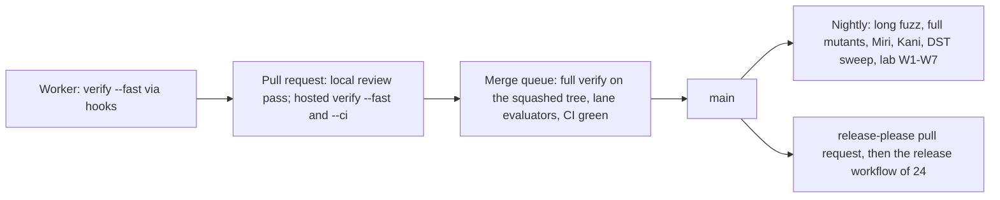
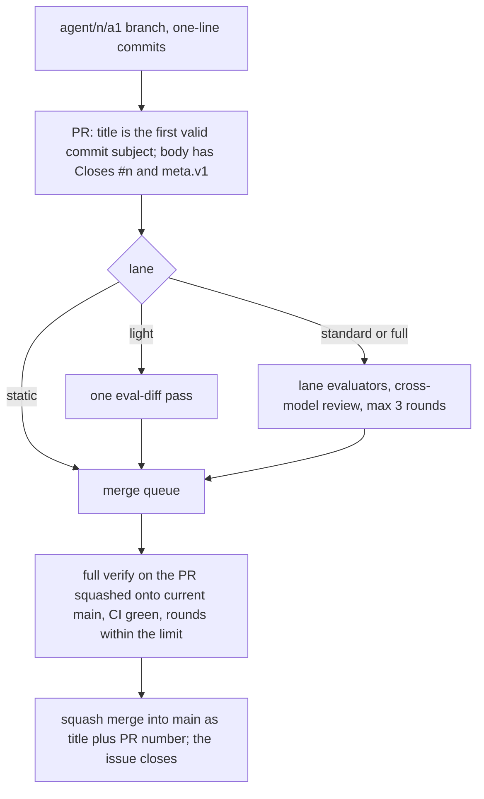

# Quality gates and continuous integration

_Status: draft for implementation, version 4 (the spine, the owner answers in `design/_review/02-owner-answers.md`, rulings R-48, R-61, R-71, and owner instructions 1 to 28 of [`design/_review/04-owner-kit-instructions.md`](../design/_review/04-owner-kit-instructions.md) applied). Date: 2026-11-11. Owner: `agent-kit` squad (`team/01` section 2; the release workflow it gates is `release`'s); gate configuration is trust core (D-63). Specifies D-45 (gate side), D-47, D-63 (merge mechanics), D-64. Read with: [spine](../design/00-decisions.md), [03](../design/03-system-architecture-and-modularity.md), [11](../design/11-endpoint-engineering.md), [12](../design/12-policy-engine.md), [24](../design/24-deployment-and-packaging.md), [27](../design/27-web-console-ux.md), [34](../design/34-documentation-support-and-lifecycle.md), [35](../design/35-product-security-programme.md), team/01, team/03, team/04._

## Summary

1. **One command, two forms.** Hooks and harnesses call `cargo xtask verify --fast` (touched crates, under 3 minutes). `cargo xtask verify` (under 15 minutes on a clean hosted runner) is the merge gate: the merge queue runs it on the exact tree that lands, with the kit binary built from the base (D-45, D-47). The local dispatcher's verify is the primary gate on every change and hosted CI is the backstop (owner instruction 22). Hardware, kernel-matrix and held-out work runs as named merge-queue and nightly jobs.
2. **The gates decide; hooks only make failures arrive earlier.** Protected paths are enforced by read-only mounts in worker VMs and gate V05 on agent commits, because agents write blocked files through the shell (h09).
3. **Scripts write pass or fail**; evidence comes from `xtask`, signed by CI. A status a model types is ignored.
4. **Required tests per component** (section 6): differential oracles for every parser and the policy evaluator, deterministic simulation for anything with time or ordering, reference models by a different worker for the trust core.
5. **Ratchets only tighten**: mutation score, suppressions, ignored tests, file size, unvetted dependencies.
6. **Merges follow the review lanes and `team/01` section 5's tiers** (triggers from 35). `cargo xtask risk` gives each pull request a lane (`static`, `light`, `standard`, `full`); the merge queue, which is deterministic software, squash-merges it into `main` once its lane's evaluators passed, CI is green where it runs, at most three review rounds were used and the full verify is green on the squashed tree. No person signs, approves or lands anything, and no approval by any identity counts (owner instructions 7 and 8; D-61 and D-63 as amended).
7. **Releases gate on the scorecard** with sample sizes: zero silent fail-open in 1,000 fault injections per Tier 1 cell; zero Essentials block failures in 3,000 attempts (99.9% at 95% confidence); held-out margin under 5 points.
8. **Gaming is countered mechanically**: held-out queries capped at three per work item, hash-chained expectations before each action, a sanctioned `impossible` outcome, seeded impossible items that measure the gaming rate.

## 1. Ownership and boundaries

Owned elsewhere: the change classifier (`.agents/risk-tiers.toml`), tier table, circuit breakers, trust-core evidence and fuzz budgets (35); release workflow, signing, SBOM and dependency policy values (24); documentation checks F1 to F12 (34); scenario format, drivers and oracles of the efficacy harness (spine D-45 and D-64; the detailed harness and lab document is pending); hook recipes and plugin pins (team/03); the audit prompt library (team/04). Everything else about gates is here.

## 2. Gate rules

| Rule | Consequence |
|---|---|
| Every gate has an id, an owner, a fixture that proves it fails, and a place in `xtask/verify.toml`. Gate ids are a letter and two digits (V01, S01, U01) and are not severities: vulnerabilities are V1 to V4 (35), support severities S1 to S4 (34) (R-48) | A gate without a failing fixture is a defect; `xtask gates selftest` runs every fixture nightly and in the merge queue |
| Output for agents is ten lines on stdout plus a log path; the first failing line is `ERROR <gate-id>: <reason>` | Agents are time-blind and context-limited (31) |
| Gate configuration is read from the base branch | A change cannot relax the gate that judges it (35, h09) |
| Every gate result is appended to `quality/gate-ledger.jsonl` (CI artefact, aggregated nightly) | Catch rates per gate are measured, so useless gates can be removed and noisy ones fixed |
| No network inside `verify` except dependency fetch before the first step | Outsiders and forks reproduce the gate (S-22, l09) |

## 3. The verify command

`cargo xtask verify [--fast | --ci] [--base <ref>] [--json <path>]`. `--base` defaults to the merge base with `origin/main`; it scopes the fast form and the diff-only steps of the full form. `--ci` runs the steps that read GitHub (Q01) and nothing else. Exit codes follow `design/23` section 11: 0 every step passed, 1 a gate failed, 2 usage; any other exit is an infrastructure error and counts as failure in CI. The `Stop` hook maps 1 to Claude Code's blocking exit 2. The kit binary still exits 2 for a failed gate and 1 for a gate that could not run, and moves to these codes (P17).

| Id | Step | Fast | Full | Tool (version pinned in `supply-chain/build-tools.toml`) |
|---|---|---|---|---|
| V01 | Format check | Changed files | All | rustfmt, Biome 2.6.6 formatter, `buf format --exit-code` |
| V02 | Compile and Clippy, warnings denied, with the workspace's no-panic deny lints (section 8) | Touched crates and direct dependents | Workspace, all targets | stable Rust, Clippy |
| V03 | Tests | Touched crates and dependents | Workspace, `ci` nextest profile, doctests | cargo-nextest 0.9.151 |
| V04 | Architecture lint ARCH-001 to ARCH-026 (03) and ARCH-101 to ARCH-106 (section 8) | Graph rules only | All rules | `xtask archlint`, dependency-cruiser 18.7.2 |
| V05 | Protected-path and identity check | Yes | Yes | `xtask protected` |
| V06 | Ratchets | Suppressions, ignores, stubs | All ratchets | `xtask ratchet check` |
| V07 | Schema: `buf lint`, `buf breaking` against the last `grdr-v*` tag (from 1.0, the last tag of every supported line), `grdr-schema-lint`; regenerated `crates/grdr-proto` code and copied `crates/grdr-schema` data byte-identical | If `proto/` or `schema/` changed | Always | buf 1.75.0, `grdr-schema-lint` (04) |
| V08 | Policy packs: `grdr policy test` under the production interpreter; golden vectors on native and `wasm32` | If packs or `grdr-core` changed | Always | `grdr`, wasmtime |
| V09 | Property tests at default case count; DST short seed set (100 seeds) | Touched crates | Workspace | proptest, turmoil 0.7.2, shuttle, loom 0.7.3 |
| V10 | Diff-scoped mutation testing | No | When non-test code changed against the base | cargo-mutants 27.1.0 `--in-diff`, Stryker 10.1.1 |
| V11 | Diff coverage | No | Changed lines | cargo-llvm-cov 0.9.1 |
| V12 | Dependency gates (section 9), reading `deny.toml` | If a manifest or lockfile changed | Always | cargo-deny 0.20.2, cargo-vet 0.10.3, cargo-machete 0.9.2 |
| V13 | Public API: semver and surface diff on layers 0 to 2 (except the generated `grdr-messages`), `grdr-ffi`, `grdr-wasm`, against each crate's last `<crate>-v*` tag; a semver-major change needs a breaking (`!`) commit touching that crate since the tag | If a public crate changed | Always | cargo-semver-checks 0.51.0, cargo-public-api 0.52.0 |
| V14 | Static security rules, secrets, workflow audit | Changed files | All | Semgrep OSS 1.185.0, ast-grep 0.51.1, gitleaks 8.30.1, zizmor 1.32.0 |
| V15 | Security register: every due SR has a passing test id; every threat has an SR or residual; SD fixtures fail (02) | No | Always | `xtask security check` |
| V16 | Web: typecheck, lint, unused code, tests | Changed packages | All packages | TypeScript 7.0.2, Oxlint 1.93.0, knip 6.44.2, Vitest 5.1.0 |
| V17 | Documentation checks F1 to F8 (F5 internal links only), F10 to F14 (34), `cargo doc` with warnings denied, typos, Vale with the vendored `ai-tells` styles (`third_party/vale/ai-tells/`) | Changed docs | All | Vale, lychee (offline), typos |
| V18 | Hook self-test: each hook fires on a fixture and blocks | If `.agents/`, `.claude/`, `xtask/src/hook/` or the hook fixtures changed | Always | `xtask hooks selftest` |
| V19 | Instruction-count benchmarks for core hot paths | No | Always | gungraun |
| V20 | Structure (the owner's gate V-structure, section 8): structure checks S1 to S7, file size through `quality/file-size.toml` | Changed files; S3 and S6 on the diff only | All files; S3 and S6 on the diff only | `xtask structure` |
| V21 | Kit check: the rendered `.claude/` and `deploy/fleet/` trees match the kit sources and the kit rules hold (team/03 section 1) | Yes | Yes | `xtask kit check` |
| V22 | Model rule (design/_review/03): the three pinned ids, Fable for the chief architect only, every model a role, hook, skill, setting, workflow step, plugin agent or audit pass names | Yes | Yes | built into `xtask verify` |
| V23 | Skills lint: front matter, name and size of every skill under `.agents/skills/`, and the licence and metadata of every project skill (team/03 section 3) | Yes | Yes | built into `xtask verify` |
| V24 | Commit form (the owner's gate V-commits): every commit since the base other than a merge commit (CI checks out GitHub's test merge, and the queue squashes) is one Conventional Commit line, `type(scope): summary`, with a type and length from `.agents/harness.toml [commit]`, a scope of lower-case letters, digits, `.`, `_`, `/` or `-`, balanced parentheses, and no body, trailer or credit line (owner instructions 3 and 27) | Commits since the base | Commits since the base | built into `xtask verify` |
| V25 | Prose: no em dash in changed Markdown (the owner's prose rules) | If Markdown changed | If Markdown changed | built into `xtask verify` |
| V26 | Interface cohesion (P17): interface checks UX1 to UX8 (section 8) and `cargo xtask interface check` (registries, the language-token checks of 34 section 15a step 3, generated output equal to a fresh generation) | Changed files under interface paths; full check of changed registries | All | built into `xtask verify` (UX1 to UX8); `xtask interface` once WI-0041 builds the registries |
| V27 | Duplicate code: no new clone of 60 tokens or 8 lines in Rust, TypeScript, protobuf, TOML, YAML or Markdown against `quality/clones-baseline.json`; tree-wide duplication may only fall | Changed files (`--baseline`) | All files | jscpd |
| V28 | Package manager (owner instruction 24): no `package-lock.json`, `npm-shrinkwrap.json`, `yarn.lock`, `bun.lockb` or `bun.lock` anywhere; no `packageManager` or `devEngines.packageManager` other than pnpm; no npm or npx call in a `package.json` script or a workflow `run` step | Yes | Yes | built into `xtask verify` |
| V29 | Release diff: a release-please pull request changes only `.release-please-manifest.json`, `release/VERSION`, `CHANGELOG.md` files, member `version` lines and member entries of `Cargo.lock`; an agent commit changes no `package.version` | If a member manifest, `Cargo.lock` or release file changed | Always | `xtask release diff` |
| V30 | Contract compatibility (D-71): every component's declared `provides` and `requires` ranges resolve through the one resolver; a change that breaks a declared range of a contract (wire major, local IPC package, C ABI header, pack `format_version`, Cedar `schema_version`, driver or eBPF interface, API package) fails unless it bumps that contract's major and adds the overlap its stability class requires | If a contract or a build manifest changed | Always | The `grdr` compatibility resolver; `buf breaking`, cargo-semver-checks and the C header diff feed it |
| Q01 | Acceptance digest (section 5) | No | No; `--ci` only, on pull requests and in the merge queue | built into `xtask verify --ci` |

V01 to V03, V05, V18, V20 to V26, V28 and Q01 are in `xtask/verify.toml` today; the other steps join as the work items that build them land. The ids V21 and V22 of the cohesion review are V26 and V27 here (numbering rules of `design/_review/04`).

Time targets: fast form under 90 seconds warm for a one-crate change and under 3 minutes worst case; full form under 15 minutes on a clean hosted 4-vCPU runner for every default member (S-22). A step that pushes the full form over its time target moves to the merge queue by an RFC-free change to `verify.toml`, which is itself high tier.

`xtask/verify.toml` encodes the table; each entry names its forms, its command or the gate built into the binary, trigger paths, timeout and fixture:

```toml
[[step]]
id = "V05"
name = "protected-paths"
forms = ["fast", "full"]
builtin = "protected-paths"
timeout_s = 30

[[step]]
id = "V10"
name = "mutants-in-diff"
forms = ["full"]
when = { changed = ["crates/**/*.rs", "programs/**/*.rs", "!**/tests/**"] }
run = ["cargo", "xtask", "mutants", "--in-diff", "{base}"]
timeout_s = 600
fixture = "xtask/fixtures/gates/V10-surviving-mutant"
```

The binary reads `verify.toml` and `.agents/kit/limits.toml` from the comparison base, so a change cannot relax the gate that judges it. The `Stop` hook (team/03) calls `cargo xtask verify --fast --json .agent/state/verify.json`, catches its own errors and exits 2 on any failure, because `onFailure` does not apply to `Stop` and a Stop hook that cannot run fails open (32, h09). Its own counter lets the stop through after three failures on one diff (team/03 section 4.1), because Claude Code's eight-continuation cap resets whenever a tool runs; the hook only shortens the loop and the gates decide.

## 4. Pipeline stages



| Stage | Trigger | Runners | Runs | Blocking |
|---|---|---|---|---|
| Worker | Edits, `Stop` (team/03) | The worker's worktree, later its VM | Fast form | Advisory |
| Pull request | The hand-off opens it | The owner's machine (the dispatcher's review pass); hosted Linux (fast form); the full form runs on Linux, macOS and Windows on `main`, the merge group and nightly | The lane's evaluators; hosted fast form built by the base's gate binary, and `verify --ci` for Q01 | Yes |
| Merge queue | The dispatcher's landing pass | The owner's machine, in `.agent/worktrees/queue` | Full form on the pull request squashed onto the current `main`, run by the kit binary built from the base; later the queue jobs: fuzz smoke per changed target (35 budgets), three-arm proof replay, egress oracle, the matrix cells the paths need, hook latency, held-out check for agent items | Yes |
| `main` | Push | Hosted Linux, macOS and Windows | Full form | Opens work items |
| Nightly | Schedule | Hosted; the owner's machine through `matrix-run` for cells that need it | Long fuzz, sharded mutation, Miri, AddressSanitizer, Kani, DST sweep (10,000 seeds), Quint, full kernel matrix, W1 to W7 (11), external links (34 F5) and lab oracles (F9), `cargo vet` import refresh and diff, `gates selftest`, held-out canary scan (section 16) | Opens work items; blocks a release pull request |
| Agent canary | Every 6 hours | Hosted runners; the owner's machine for cells a hosted image cannot run | Polls each catalogued agent; a new release is installed and its adapter conformance cells run (07), within 24 hours of release (D-49) | Opens a high-priority item; the adapter's tested range is not widened until green |
| Release | A tag release-please creates when the queue lands its release pull request | Per 24 | Section 16 | Yes |

**Where the gate runs.** The local dispatcher's verify, and the merge queue's full verify on the exact tree that lands, are the gate on every change; hosted CI is the backstop (owner instruction 22). The repository is public from its first push (owner instruction 28), so from the first commit GitHub's free standard runners take the full form on three systems, the nightly run and the matrix (section 19, tier A), and CodeQL, Scorecard, secret scanning and release attestations run. The workflows still read the repository's visibility, as the fallback for a private fork or copy, or for this repository if it is ever made private: there GitHub's free plan gives 2,000 runner minutes a month with macOS minutes counted ten times and Windows twice, so hosted CI runs Linux only, the matrix runs through `matrix-run`, and CodeQL and Scorecard are skipped. Self-hosted runners are optional: the owner's own machine, registered as tier B. A job that needs a machine and finds none reports "not run (requires hardware)", which is never counted as a pass.

**CI time.** Fast form under 3 minutes and full form under 15 minutes on a 4-vCPU hosted runner stay the targets. Pull requests build only the crates whose inputs changed (`cargo metadata` and the diff) and the queue builds the whole workspace; builds are cached (the Rust cache action in CI, sccache on local disk); a fast linker, mold on Linux and lld elsewhere, is set per target in `.cargo/config.toml` and pinned in `supply-chain/build-tools.toml` (WI-0002); `cargo nextest` partitions across jobs; the macOS, Windows and kernel matrix runs in the queue and nightly, never on every push (owner instruction 22).

**Runner rules.** Fork pull requests run only on hosted runners with read-only tokens. Self-hosted runners accept only `merge_group` and scheduled events (D-64), run each job inside a snapshot-revert guest rather than on the machine's own operating system, revert after each job, hold only a lab-scoped token and reach the network through an allow-list proxy. No `pull_request_target`; every workflow sets `permissions: {}` and every job declares its own. `step-security/harden-runner` 2.22.4 runs first in every hosted job, in `audit` mode until QG-02 confirms the generated endpoint list for that hosted OS and in `block` mode after; it is free on hosted runners for public repositories and does nothing on a private repository or a self-hosted runner (25), which is why those reach the network only through the allow-list proxy. Its coverage of the macOS and Windows hosted images is unverified and is checked in QG-02. The `allowed-endpoints` list is generated from `supply-chain/build-tools.toml` by `xtask ci-endpoints`; S05 fails when the workflow and the generated list differ.

**Models in CI.** Model jobs (the review pass, `eval-diff`, `eval-security`, the U07 UX evaluator, model-driven harness runs) run in the local dispatcher on the owner's logged-in Claude Code (owner instruction 23). Hosted model jobs are optional: they need the repository secret `CLAUDE_CODE_OAUTH_TOKEN`, made with `claude setup-token`, which needs a browser, so nothing waits on it. If it exists, the subscription's terms and usage limits are verified and recorded before any job relies on it (QG-22), and the secret is exposed only to `merge_group`, scheduled and same-repository `pull_request` jobs on hosted runners, never to fork pull requests or self-hosted runners; team/04's prompts for a fork pull request then run in the merge queue (section 11). No API key and no other vendor's model is used. Each job uses Opus 5.5 or Sonnet 5.5 as `design/_review/03-models-and-orchestration.md` assigns it: `eval-security` and any review of a Sonnet-written change run on Opus, a review of an Opus-written change on Sonnet; no Haiku and no Fable in CI. Every model job sets a usage cap per run. A job that reaches a subscription usage limit ends neutral and is re-queued after the usage window resets; the check it feeds stays pending, so a limit neither fails nor passes a change.

**Workflows.** Every `uses:` is pinned to the full SHA of its latest release (owner instruction 22; gate S05), every checkout sets `persist-credentials: false`, harden-runner is each job's first step, each workflow has a concurrency group, and tool versions and image digests come from `supply-chain/build-tools.toml`.

| Workflow | Runs | When |
|---|---|---|
| `verify.yml` | Plans the form and the systems from the event and the repository's visibility: the full form on three systems in a public repository, which this one is from its first push, and on Linux only in a private fork or copy; builds the gate binary from the base commit, so a change cannot weaken the gate that judges it; on a pull request, appends the output of `cargo xtask kit ci-env --pull-request <n> --snapshot-into ../change` to `$GITHUB_ENV`, so the gates judge a leased branch as its session's role against its item's write set (below); runs the fast form on pull requests and the full form on `main`, the merge group, a dispatched run and nightly; runs `verify --ci` on pull requests; uploads the evidence | Every pull request and push to `main`, and nightly |
| `scan.yml` | gitleaks, zizmor (its settings in `.github/zizmor.yml`), osv-scanner, Semgrep OSS failing on the finding levels `[tool.semgrep-rules] severities` of `supply-chain/build-tools.toml` names | Every pull request, every push to `main`, nightly |
| `codeql.yml`, `scorecard.yml` | CodeQL for Rust and TypeScript with GitHub secret scanning and push protection; OpenSSF Scorecard weekly, its score ratcheted by `security/scorecard.toml` | CodeQL on every pull request, every push to `main` and weekly; Scorecard weekly; both from the first push, the repository being public from it (owner instruction 28), and skipped in a private fork or copy. CodeQL has no local or private form: its terms (read 2026-11-11) allow automated analysis only of open-source code published in a public GitHub repository, so it is not a `verify` step |
| `fuzz.yml` | ClusterFuzzLite over every fuzz target | Once `.clusterfuzzlite/project.yaml` exists |
| `images.yml` | Grype beside osv-scanner over the built images | Once `dist.toml` exists |
| `dast.yml` | OWASP ZAP baseline scan of the console and API against the embedded server; targets and the start command from `deploy/ci/dast.toml` | Once that file exists |
| `release-please.yml` | release-please (section 15) and, for released crates, Sigstore keyless signing and build provenance | Pushes to `main`; signing and attestation for each release, the repository being public |

**The session's role in CI** (`cargo xtask kit ci-env`). A hosted job has no agent session, so on its own every gate would judge an agent's pull request as a person's change (section 5). `verify.yml` asks the kit for the role: `cargo xtask kit ci-env --pull-request <n> --snapshot-into <checkout>` reads the pull request (head branch, head repository, base repository, the issue it closes) and the newest `lease.v1` record on that issue, when it names the head branch: the record the merge queue reads to run its verify as the lease's writer, and prints exactly three lines on stdout, `GRDR_AGENT=<agent>`, `GRDR_WORK_ITEM=<number>` and `GRDR_SCOPE=<scope>`, ready to append to `$GITHUB_ENV`. It also saves the item's snapshot, `.agent/state/item-<n>.json`, into the change's checkout over any copy the change committed, as the queue saves it into its worktree, so V05 judges the lease's own write set and a protected-change lease covers its item in CI too. It prints and saves nothing and exits 0 when the head branch has no lease, when the pull request comes from a fork (its head repository differs from the base repository), or when the lease record was not posted by the identity the kit trusts for records (the repository's owner, the rule every record reader applies); that pull request is judged as a person's change. A GitHub error exits non-zero with a message and prints no `GRDR_` line, so the job fails instead of running without the role. It needs only read access to issues, pull requests and contents through `GH_TOKEN`, and never prints a token.

## 5. Protected paths

Two lists with different purposes. `security/trust-core.paths` (02, 35) decides which changes take the `full` lane and two passing evaluators on different models. `.agents/kit/protected-paths.toml` decides what an agent may not write at all outside a protected-change item; this section owns its contents, and `kit render` turns them into mounts, hook rules and the V05 input (team/03). Both are on the trust-core list.

```text
# Contents of .agents/kit/protected-paths.toml, one glob per entry
# Agents (worker, evaluator, gardener identities) may not create, modify or delete these.
# Read by: worker VM mount profile, PreToolUse hook (advisory), gate V05 (enforcing).
conformance/vectors/**
tests/golden/**
**/*.snap
**/__screenshots__/**
fuzz/corpus/regressions/**
spec/**
specs/**
security/**
quality/**
audits/**
architecture.toml
surfaces.toml
support.toml
limits.toml
supply-chain/**
third_party/**
governance/**
brand/**
web/packages/ui/exceptions.toml
deploy/fleet/**
dist.toml
release-please-config.json
.release-please-manifest.json
release/**
**/CHANGELOG.md
deny.toml
**/clippy.toml
rustfmt.toml
rust-toolchain.toml
.cargo/**
Cargo.toml
Cargo.lock
pnpm-lock.yaml
pnpm-workspace.yaml
.github/**
AGENTS.md
**/AGENTS.md
CLAUDE.md
**/REVIEW.md
docs/AUTOPILOT.md
docs/design/**
docs/decisions/**
docs/agents/status/**
rfcs/**
docs/team/**
docs/references/research/**
LICENSE
NOTICE
COVENANT.md
GOVERNANCE.md
CONTRIBUTING.md
CODE_OF_CONDUCT.md
SECURITY.md
MAINTAINERS.md
AI_POLICY.md
ADOPTERS.md
TRADEMARKS.md
.agents/**
.claude/**
xtask/Cargo.toml
xtask/src/config/**
xtask/src/gates/**
xtask/src/hook/**
xtask/src/kit/**
xtask/verify.toml
```

`xtask/src/hook/**`, `xtask/src/kit/**`, `xtask/src/config/**` and `xtask/Cargo.toml` are on the list because the kit binary every hook runs is built from them: an agent that could edit them could write the hooks that judge it, whenever no merge base exists to build from. `quality/**` covers the ratchets, `quality/state-machine-exemptions.toml`, `quality/hardcoded-exemptions.toml` (S7) and `quality/interface.toml`; `.agents/**` covers `.agents/kit/limits.toml` and the marketplace; `brand/**` covers the brand manifest. The Astryx exception registry `web/packages/ui/exceptions.toml` (owner instruction 21) and the release-please files (owner instruction 3) are listed on their own. `rfcs/**` and `docs/agents/status/**` sit beside the decision records, so the chief architect's whole write set lands through a protected-change lease, the one route its shell allows (owner instructions 5 and 7).

**Protected changes** (owner instruction 7). A change to a protected path is its own work item, implemented by `lead-agent-kit` (gate configuration) or the chief architect (spine and plan), with `GRDR_SCOPE=protected` set by `kit launch` only when the leased issue is that item and its lease names that agent (`harness.toml` `protected_change_agents`). It lands through the merge queue after `eval-security` and one more evaluator on the other model pass (`risk-tiers.toml [protected_change]`). An exemption or a ratchet loosening also needs `eval-architecture` to agree in a check run; an entry of the Astryx exception registry needs `eval-ux` and `lead-interfaces`. No agent changes a protected path inside an ordinary item.

**Enforcement, in order of strength.**

1. **Mounts (enforcing).** Each work item runs in a disposable VM (35 section 7) with protected globs and `.git/hooks` overlaid read-only. Windows code is written in the Linux VM and tested through `matrix-run`; the sandbox runtime has no native Windows support (31).
2. **Hooks (advisory).** `PreToolUse` denies Edit, Write and Bash patterns on the list; `PostToolUse` after each shell call runs `git status --porcelain` over the list and blocks with the exact revert command. It does not rely on the beta, best-effort `bashEditDiff` field (team/03; 32).
3. **The gate (enforcing).** V05 fails when an agent session's diff touches a protected path its scope does not cover: `ERROR V05: <path> is protected; stop with status blocked and a protected_change_requests entry`. A protected-change lease covers its own write set and the chief architect's seed session the paths of `.agents/kit/seed-scope.toml`. A session with no `GRDR_AGENT`, a person's own, passes and is high tier. V05 reads this list, the seed scope and `[dispatch] protected_change_agents` at the comparison base, as verify reads its steps, so a change never sets the rules that judge it; only a base that predates them falls back to the working tree. In CI, `verify.yml` sets the variables of a leased branch from its lease through `kit ci-env` (section 4), so an agent's pull request is judged there as its session is.

**Acceptance criteria are held by a digest, not by this list.** Work items live only in GitHub issues (owner instruction 5), so there is no `acceptance/` directory. The agent that readies an item (a squad lead, the product lead or the programme manager, never the item's implementer) posts a `ready.v1` comment naming itself and the SHA-256 of the issue's acceptance-criteria section and of its write set; the dispatcher leases only while the current section and write set match and repeats the acceptance digest in its lease comment; evaluators judge against that snapshot (team/01 section 3). A protected-change lease widens V05 only while its write set still matches the readied one, so an edit of the issue after readying widens nothing. Gate Q01 `acceptance-digest` checks it on every pull request and in the merge queue. It runs outside `verify`, because it reads the issue and `verify` uses no network (section 2), and is listed in `xtask/verify.toml` as a CI-only step with its fixture. It reads who may ready (`.github/labels.toml`) and the seed scope at the comparison base, as V05 reads its rules. The chief architect's `[WI-0000]` issue is never readied: Q01 holds it to the acceptance digest of the lease `kit handoff` posts for the `agent/seed` branch alone. It fails when:

- the linked issue's acceptance section no longer matches the lease digest: the issue drops back to `status:proposed` for a lead to re-ready;
- the write set no longer matches the `ready.v1` digest;
- the `ready.v1` comment was posted by the agent named to implement the item;
- the item's implementer edited the section: a tamper finding, escalated to the item's lead and then the chief architect (owner instruction 7).

`ERROR Q01: acceptance section of #<n> does not match the ready.v1 digest; the item returns to status:proposed`.

**Identities and their only writable protected paths.**

Every agent posts as the owner's one `gh` login (owner instruction 23), so the identity that counts is the session's role (`GRDR_AGENT`, `GRDR_SCOPE`).

| Writer | May write | Purpose |
|---|---|---|
| Implementers, evaluators, gardeners, leads | None | Work on `agent/*` |
| `lead-agent-kit` or the chief architect under a protected-change lease | That item's write set | Gate configuration; spine and plan |
| The chief architect in its seed session | The paths of `seed-scope.toml` | The seed (team/06 section 14) |
| The merge queue's ratchet and quarantine jobs (deterministic software, not a model) | Tightening edits to `quality/ratchets.json` and `quality/file-size.toml`; quarantine entries; screenshot baselines after `eval-ux` posts a passing `ux-review` check with the diff images | Mechanical upkeep |
| Dependabot | `Cargo.lock`, `pnpm-lock.yaml`, action pins | Dependency updates after cooldown (section 9) |
| release-please, with the workflow token | `.release-please-manifest.json`, `release/VERSION`, `CHANGELOG.md` files, member `version` lines and member entries of `Cargo.lock` | Release pull requests (V29, section 15) |

A worker that needs a protected change ends with status `blocked` and a `protected_change_requests` entry, or `impossible` (`team/02` section 1.4). Unit tests beside the code are worker-owned; weakening them trips the test-diff ratchet.

## 6. Test strategy by layer

| Layer | What it is here | Tools | Stage |
|---|---|---|---|
| Unit | Behaviour and contract tests, not implementation mirrors (h09) | nextest, insta with updates off | Fast, full |
| Property | Invariants, round-trips, metamorphic edits | proptest | Full; nightly at 100x cases |
| Differential | Production code against an independent reference | `grdr-policy-ref` (12), real shells and kernel (D-10), agents' parsers, `grdr-ports-testkit` | Full short; nightly long |
| Fuzzing | Every untrusted input | cargo-fuzz 0.13.2 | Queue smoke; nightly (35) |
| Deterministic simulation | Time, ordering, crash and network faults through `Clock` and `Entropy` | turmoil, shuttle, loom | Full 100 seeds; nightly 10,000 |
| Model checking, proofs | Lifecycles from team/04 A01 audits; no-panic proofs | Quint 0.33.1, Kani 0.68.0 | Nightly |
| Integration | Real processes, both topologies (D-20) | `xtask it` | Full on Linux; queue on three systems |
| End to end | Real agents via the harness and replay model endpoint (D-45) | Efficacy harness (D-45, D-64; detailed document pending) | Queue subset; nightly; release |
| Lab | Kernel and OS matrices, incumbents, soak, drills | `matrix-run` (section 19) | Queue short; nightly; release |

Required tests per component (R required, - not applicable; each is required from the component's first work item):

| Component | Unit | Prop | Diff | Fuzz | DST | Int | E2E | Lab |
|---|---|---|---|---|---|---|---|---|
| `grdr-proto`, `grdr-schema` | R | R round-trip | R cross-binding vectors (04) | R decode | - | - | - | - |
| `grdr-core` analyze: canonicaliser, path resolver | R | R | R real shells, kernel | R | - | R | R | R |
| `grdr-core` session and policy | R | R monotonicity | R `grdr-policy-ref` | R | R stale label | - | R | - |
| `grdr-core` detect, discover | R | R | R Sigma conformance vectors | R | - | - | R | - |
| `grdr-fastpath`, `grdr-ffi`, `grdr-wasm` | R | R | R against `grdr-core` | R | - | - | - | R S-21 |
| `grdr-crypto`, `grdr-wire` | R known-answer | R | - | R frames | R peer faults | R | - | - |
| `grdr-ports` and reference adapters | R | R | R test kit | - | R crash points | - | - | - |
| `grdr-sensor-linux` and BPF (observe and enforce) | R | - | R user-space model (S-13) | - | - | R | R | R kernel matrix, soak |
| `grdr-sensor-macos`, `grdr-sensor-windows` | R | - | R against OS audit sources | R event decoders | - | R | R | R hosted, tier B where a cell needs a machine |
| `grdr-agents` adapters and installer | R | R foreign bytes preserved (07) | R agent's own parser | R dialects | - | R pinned agent start | R canary | R per-version |
| `grdr-hook`, `grdr-broker` (03) | R | R | R broker reference (07) | R | R deadlines | R 2 s bound | R | R latency |
| `grdr-daemon`, `grdr-engine` | R | - | - | - | R supervision | R kill, hang, starve | R fault injection | R soak |
| `grdr-update`, `grdr-updater` | R | R | R TUF attack suite | R metadata | R handover | R | - | R upgrade drill |
| `grdr-store-local`, spool | R | R | R test kit | R segment decode | R crash consistency | R | - | - |
| `grdr-proxy`, `grdr-llm-proto`, `grdr-mcp-proto` | R | R | R reference SDK decoders | R | R streaming | R | R | R latency |
| Sandbox back ends | R | - | - | - | - | R conformance suite (D-21) | R | R per OS |
| Server targets and adapters | R | R | R test kit, tenant canaries | R API decoders | R pipeline, failover | R | R | R storage volumes |
| Web console and `ui` (local and full console) | R | - | - | - | - | R MSW | R Playwright | - |
| Desktop view-models | R | - | - | - | - | - | R if S-19 passes | R soak |
| Packs and content | R per rule, one positive and one negative (12) | - | R benign and attack corpora | - | - | - | R harness | - |

**Reference models.** A trust-core component's reference model is written by a different worker in a different session with no shared code, and its statements (properties, Quint specs, theorem statements) are approved by `eval-security` and an evaluator on the other model, because the checker proves only what was stated (35, h09; owner instruction 7). Reference models live in `layer = "tool"` crates and are never linked into a program (03).

## 7. Mutation testing and ratchets

**Diff-scoped (V10).** `cargo mutants --in-diff` over the change's non-test lines; Stryker over changed TypeScript files in `web/packages/kit` and `web/packages/ui`. Thresholds (targets; re-set once from the first nightly scores, then ratcheted):

| Scope | Gate |
|---|---|
| Layers 0 to 2, trust-core paths | Every viable mutant on changed lines is caught, or listed in `quality/mutants-exclusions.toml` with a reason (protected, so a protected change that `eval-architecture` agrees) |
| Layer 3 | At least 90% caught on changed lines |
| Layer 4 and web composites | At least 80% caught on changed lines |

Timeouts count as caught and are reported. A diff that changes only tests runs no mutants (32), so the test-diff ratchet (below) covers test edits.

**Nightly full run.** `cargo mutants --shard k/8` across eight shards; the per-crate score goes to `quality/ratchets.json`. A crate whose score drops by more than one point fails the nightly and opens a work item for `garden-tests`, which may add tests but may not edit `src/` (32).

**Ratchets.** `xtask ratchet check` compares the change with `quality/ratchets.json`; a ratcheted number may only move in its good direction. The queue's ratchet job writes tighter values nightly; loosening is a protected change that `eval-architecture` agrees in a check run (owner instruction 7).

```json
{
  "schema": "grdr.ratchets.v1",
  "per_crate": {
    "grdr-core": { "mutation_score": 0.0, "allow_attributes": 0, "ignored_tests": 0, "unsafe_blocks": 0 }
  },
  "global": {
    "todo_or_unimplemented": 0,
    "unvetted_crates": 0,
    "quarantined_tests_ratio_max": 0.01,
    "diff_coverage_min": { "layer0_3": 0.85 }
  }
}
```

| Ratchet | Rule |
|---|---|
| `todo!`, `unimplemented!`, stub markers | Zero in non-test code, always (also structure check S6 and the workspace lints) |
| `#[allow(...)]`, `@ts-ignore`, `eslint-disable` | Each needs a reason (`allow_attributes_without_reason`); the count per crate may only fall |
| `#[ignore]`, `.skip` | Count may only fall; quarantine is capped separately (section 17) |
| Test-diff | In agent-authored changes, a test function's assertion count may not fall and no assertion may be weakened |
| File size | A Rust or TypeScript source file has at most 500 code lines (blank lines, comments and the test module excluded); a file already over it is allowed only through `quality/file-size.toml`, a ratchet that may only shrink (V20, structure check S1; owner instruction 4, which replaces the earlier 400-line choice) |
| Diff coverage | 85% of changed lines in layers 0 to 3; reported only for layer 4 |
| `unsafe` | May not rise outside a high-tier change; every block registered (35) |
| Unvetted crates | May only fall (35) |

## 8. Lint sets and the architecture lint

**Rust.** No panic path in any non-test code, every crate and `xtask` included (owner instruction 15). The root `Cargo.toml` sets `[workspace.lints]` and every member inherits it with `[lints] workspace = true`; `clippy.toml` lets test code (`#[cfg(test)]` and `tests/`) unwrap, expect, panic and index. V02 runs Clippy with warnings denied.

```toml
[workspace.lints.rust]
unsafe_code = "forbid"

[workspace.lints.clippy]
unwrap_used = "deny"
expect_used = "deny"
panic = "deny"
todo = "deny"
unimplemented = "deny"
unreachable = "deny"
indexing_slicing = "deny"
string_slice = "deny"
get_unwrap = "deny"
panic_in_result_fn = "deny"
exit = "deny"
```

Cargo refuses crate entries beside `workspace = true`, so layer 0 to 2 and privileged crates add `#![deny(clippy::arithmetic_side_effects)]` at their crate root, and `grdr-ffi` and the OS adapter crates, the only ones allowed unsafe code, carry a copy of the table with `unsafe_code = "deny"` and a reasoned `#[allow(unsafe_code)]` on each unsafe item; `xtask archlint` checks both. Elsewhere, arithmetic that can overflow uses checked or saturating types. The wider warning set of brief 32 (`dbg_macro`, `await_holding_lock`, `undocumented_unsafe_blocks`, `let_underscore_must_use`, `map_err_ignore`, `allow_attributes_without_reason`, `large_futures`, `missing_docs` in public crates) joins the table as each lint is confirmed against the pinned Clippy; `print_stdout` and `print_stderr` stay off because the kit and the CLI write to their streams by design. Structure check S6 reports the same panic paths on each edit, before Clippy runs.

Layer 0 and 1 crates carry a `clippy.toml` that implements ARCH-003:

```toml
disallowed-methods = [
  { path = "std::time::SystemTime::now", reason = "take `now: Timestamp` as an argument (ARCH-003)" },
  { path = "std::time::Instant::now", reason = "take `now` from the host (ARCH-003)" },
  { path = "std::thread::spawn", reason = "the core is single-threaded; return an Effect" },
  { path = "std::env::var", reason = "configuration arrives in the bundle or HostProfile" },
]
disallowed-types = [
  { path = "std::fs::File", reason = "return an Effect; the host does I/O (ARCH-003)" },
  { path = "std::net::TcpStream", reason = "return an Effect; the host does I/O (ARCH-003)" },
  { path = "std::collections::HashMap", reason = "iteration order breaks replay; use BTreeMap or IndexMap" },
]
```

**Structural rules (ast-grep, `lint/ast-grep/`).** Change-log and narration comments, swallowed errors on enforcement paths (team/04 C01), `Ok(())` stubs, sleeps in tests, and literals from golden vectors or held-out canaries in non-test code (section 18). Example:

```yaml
id: grdr-no-history-comment
language: rust
severity: error
rule:
  kind: line_comment
  regex: '^//\s*(Added|Changed|Updated|Removed|Fixed|Now|Previously|New:)\b'
message: >
  Comments describe the code, not its history. Put history in the commit message.
  If the code needs this comment to be understood, rename or restructure it instead.
```

**TypeScript.** TypeScript 7.0.2 `--noEmit` strict; Oxlint 1.93.0 with vendored copies of the `anti-slop` rules (`no-chained-type-assertions`, `no-module-mocking`, `no-widen-then-assert`; 32) and 35's ban on `innerHTML`, `dangerouslySetInnerHTML` and `eval`; Biome 2.6.6 for formatting only; knip for unused files and exports; stylelint for the spacing scale (27 WEB-03).

**Protobuf.** `buf lint` (STANDARD) plus `grdr-schema-lint`; `buf breaking` uses `WIRE_JSON` before the wire freeze and `FILE` after it (04).

**Swift, eBPF, shell.** SwiftLint and Swift 6 strict concurrency for the macOS shell (unverified details, settled before the macOS shell's first work item); BPF programs follow 10 and must load across the kernel matrix; shellcheck for any script in `deploy/` and `lab/`.

**Architecture lint.** 03 owns ARCH-001 to ARCH-026 and their four-part messages (ARCH-017 to ARCH-024 are the code-consistency rules of P17, ARCH-025 `one-dialer` is P16's and ARCH-026 `operator-no-content` is D-70's). This document adds the web rules, enforced by dependency-cruiser and proposed for 03's register; they replace the earlier ARCH-101 to ARCH-104 and follow owner instruction 21 (Astryx first, React Aria only as a registered exception):

| Code | Rule | Fix the message states |
|---|---|---|
| ARCH-101 | Only `web/packages/ui` imports `@astryxdesign/*` (D-42) | Import the component from `@grdr/ui` |
| ARCH-102 | `web/packages/kit` imports only `@grdr/ui`, `@grdr/tokens`, `@grdr/i18n` and React; `react-aria` and `react-aria-components`, and any package an entry of `web/packages/ui/exceptions.toml` names, only in the files that entry lists | Compose `@grdr/ui` components; a gap Astryx cannot fill is an exception-registry entry |
| ARCH-103 | `lucide-react` is imported only inside `ui`, by its `Icon`; `kit` and `ui` share no export name | Pass the meaning key to `Icon`; keep one implementation |
| ARCH-104 | `web/apps/*`, `web/extension/` and `site/src/` import interface code only from `@grdr/kit`, `@grdr/ui`, `@grdr/i18n`, `@grdr/tokens` and `@grdr/api` (plus Docusaurus's own theme in `site/`) | Use the kit part, or add it to the kit |
| ARCH-105 | `fetch`, `XMLHttpRequest` and `EventSource` appear only in `web/packages/api` | Call the generated client |
| ARCH-106 | No message runtime (FormatJS, `intl-messageformat`, i18next, Fluent) in any web package except inside `ui`, where Astryx carries its own | Use the generated `@grdr/i18n` accessor |

**Structure (V20, the owner's gate V-structure).** The project skill `grdr-structure` (team/03 section 3) teaches the owner's seven rules (owner instructions 4 and 9): structures before implementations, files of at most 500 code lines, no implicit state machines, comments only where nothing else can say it, fix the core problem, readable code, and the mechanism before the feature. The kit binary checks them deterministically in `post-edit` and `stop-gate` (team/03 section 4.1) and in this gate, with every bound read from `.agents/kit/limits.toml [gates.structure]`. The check ids S1 to S7 are the owner's; the support severities of 34 use the same labels (team/04's security prompts are M01 to M05), so these are always written as structure checks and printed after the gate id (`ERROR V20 S4: ...`).

| Check | Finds | Where | Effect |
|---|---|---|---|
| S1 | A source file over 500 code lines (blank lines, comments and the test module excluded) that `quality/file-size.toml` does not list | `post-edit`, `stop-gate`, V20 | Feedback on edit; blocks the stop and the gate |
| S2 | A top-level type, constant or static declared after the first top-level `impl` or function, outside the test module | Same | Same |
| S3 | New comment lines that are narration, change-log or step comments, commented-out code, or a TODO without a work-item id (`#<n>`, or `WI-NNNN` for a reserved item) | Same, on the diff only | Same |
| S4 | Implicit state machines: three or more `bool` fields in one type; a `state`, `status`, `phase`, `stage` or `mode` field typed as a string, integer or `bool`; `Option` fields whose presence is checked together | Same | Blocks like S1 to S3. The only fixes are an explicit state type or, for a true false positive, an entry in `quality/state-machine-exemptions.toml`, which only a protected change adds, with `eval-architecture` agreeing in a check run (owner instruction 7); an agent cannot exempt itself |
| S5 | Nesting deeper than four levels | `post-edit`, V20 | Feedback and a warning; never blocks |
| S6 | A panic path on a new line outside test code: `unwrap`, `expect` and their `_err` forms, `panic!`, `todo!`, `unimplemented!`, `unreachable!`, indexing or slicing that panics on short input, `process::exit`; `process.exit`, `process.abort` and `Deno.exit` in scripts (owner instruction 15) | Same, on the diff only | Blocks |
| S7 | A hard-coded value in non-test code outside `brand/`, the schema and the data files: a URL, host, domain, email or IP literal (RFC 2606 and RFC 6761 example names and the documentation address ranges pass; loopback passes only in tests); a brand or vendor name, read from `brand/brand.toml` and `.agents/kit/vendors.toml`; a number used as a bound, timeout, retry count, size or threshold, or a constant that holds one (zero, one and index arithmetic pass); a colour or spacing literal; text a person reads written into markup (owner instruction 26) | Same, on the whole file | Blocks. The fix is the value in its data source, read through its loader; a true exception is an entry in `quality/hardcoded-exemptions.toml`, keyed by path, check and value, which only a protected change adds. On interface paths UX1 and UX3 report the colour, spacing, text and product-name findings instead, so each literal is reported once |

`post-edit` returns `decision: block` with the findings and the line "load the grdr-structure skill", so the model fixes the file before it moves on. The fix is a design change: never a silenced check, a guard around the symptom, a rename that dodges the pattern, a literal moved into a named constant, or a mechanical split to get under 500 lines. A split follows responsibilities, and a fix that belongs outside the item's write set is handed off as a finding with a `status:proposed` issue.

Beyond the deterministic checks, audit A01 (implicit state machines, team/04) runs inside the `review` workflow (team/03 section 6) on every pull request whose diff adds or changes a type, a field, an enum variant, a status-like field or a `match` on one. An A01 finding that survives the refuting pass is a blocking review finding (major), closed only by a type change (`closes-by = "type"`), never by a comment or a test alone. `garden-architecture` still runs A01 over the whole tree weekly, and each surviving finding becomes a repair issue that closes only by a type change; it also runs audit E08 (hard-coded behaviour, P14) weekly, whose results close only by a type change or a decision record. The `eval-diff` rubric treats a symptom fix, a new guard around an implicit state, a mechanical file split, or a second implementation of something a registry, kit or shared crate already provides (P17) as a failed criterion. `eval-architecture` checks every `standard` and `full` lane change for behaviour hard-coded where a pack, manifest, adapter or setting belongs (P14) and for the values S7 covers, and fails it.

**Interface checks (V26, P17).** The project skill `grdr-interface` (team/03 section 3) teaches the rules; the kit binary checks them deterministically in `post-edit` and `stop-gate` (team/03 section 4.1) and in V26, on the TypeScript, JavaScript and CSS files under the paths of every `.agents/kit/path-skills.toml` entry that names `ui-architect`. The repository's own choices (which packages each rule applies to, the registry paths, the accessor and the hook names) are data in `quality/interface.toml`, a protected path. Generated outputs, stories and tests are excluded. Each finding is printed after the gate id (`ERROR V26 UX3: ...`), blocks the edit, the stop and the gate, and carries the line "load the ui-architect skill, then grdr-interface". There is no exemption file and no inline suppression: a false positive is fixed in the check and its fixture by an agent-kit item.

| Check | Finds | Fix the message states |
|---|---|---|
| UX1 | A raw visual value (colour, length, radius, font, line height, shadow, z-index, duration or easing literal) in CSS, a `style` value or TSX, outside generated token modules | Use the token by name (`space-3`, `color-text-danger`, `motion-quick`); add a semantic token in `interface/tokens/` if none fits |
| UX2 | A one-off building block. `@astryxdesign/*` imported outside `ui`; `react-aria` or `react-aria-components` imported in a file the exception registry does not list; in `kit`, an import other than `@grdr/ui`, `@grdr/tokens`, `@grdr/i18n` and React; in `web/apps/**`, `web/extension/**`, `site/src/**` and `kit`, a stylesheet, a `style` prop, a `className` string, or a raw interactive or layout element (`button`, `input`, `select`, `a`, `table`, `dialog`, or `div`/`span` used for layout) | Compose the kit's layout primitives and patterns; if none fits, register a pattern |
| UX3 | Hand-written text: a string literal that reaches JSX text, `aria-label`, `title`, `alt`, `placeholder` or an Astryx text prop; a product name outside `brand/` | Add a language token and call its accessor; the product name is `:grdr:brand` |
| UX4 | Assembled or hand-formatted text: an accessor result concatenated, interpolated or joined with other text; `Intl.*` or `toLocale*` outside `@grdr/i18n` | Make the sentence one token with typed arguments and format through its functions |
| UX5 | An icon rendered by hand: a Lucide import outside `ui`; an Extended_Pictographic character in a token or JSX | Pass the meaning key to `Icon` |
| UX6 | Physical direction: a physical CSS property or value (`margin-left`, `left:`, `text-align: left`, `float: right`), or `text-transform` | Use the logical property (`margin-inline-start`); write casing in the message |
| UX7 | An unregistered pattern: an export of `@grdr/kit` absent from `interface/patterns.toml` | Register it with its fixtures, or use the registered one |
| UX8 | Hand-rolled navigation or confirmation: an app mutation not called through `useAction`; a confirmation dialog in app code; a route literal; a shortcut hook outside the shortcut registry | Call `useAction(Service.Method)`; link by route id; register the shortcut |

Not built yet, and part of the plan: the halves of UX1 to UX8 for Rust UI crates and terminal output (a Rune constructor outside `grdr-desktop/src/kit/`, `print!` or an ANSI escape outside `term`, `format!` building person-facing text), and the registry checks of `cargo xtask interface check`: an enum matched by hand over a presentation-registry type, an icon key without its entry and `mirror` value in `interface/icons.toml`, a fixture per declared `ViewState`, exactly one `ViewState` per screen, and routes and shortcuts present in their registries. Both need WI-0041's registries.

**Duplicate code (V27).** `.jscpd.json` sets `minTokens` 60 and `minLines` 8 (key names confirmed by WI-0041), ignores `target/`, generated code, `*.snap`, `tests/fixtures/`, `third_party/`, `docs/references/`, `conformance/vectors/` and `node_modules/`, and reports `json` and `sarif` to `target/verify-logs/jscpd/`. `--semantic` is never used: it downloads a model, which breaks air-gapped runs. A new baseline entry needs one reason from a closed list (`reference-model`, `fastpath-independence`, `kernel-model`, `generated`, `external-dialect`) matching a pair `architecture.toml` records as deliberately independent; `eval-diff` accepts it and the queue's ratchet job writes it, because `quality/` is protected. A clone between a reference model and its subject is a team/04 G05 finding, not a deduplication.

## 9. Supply-chain gates (policy values in 24 and 35)

| Gate | Check | Stage |
|---|---|---|
| S01 | `cargo deny check advisories bans licenses sources` with `deny.toml`: yanked, unmaintained and unsound crates denied, crates.io the only source, the licence allow-list of `supply-chain/licences.toml` and the do-not-use list as data (24, 03) | Full |
| S02 | `cargo vet --locked` against `supply-chain/` and the committed `imports.lock`, so `verify` needs no network; unvetted count ratchet | Full; import refresh and diff review nightly |
| S03 | Registry existence and age of every new direct dependency; new direct dependency is high tier with a justification record (35) | Full |
| S04 | Lock-age: every newly locked version is older than the cooldown, read from the crates.io index publish time, because Cargo does not check already-locked versions (cargo#17246, 32) | Merge queue (needs network) |
| S05 | Every `uses:` is a 40-hex SHA; zizmor clean; no `pull_request_target`; every job declares permissions; harden-runner endpoints match `xtask ci-endpoints` | Full |
| S06 | Plugin and skill marketplace entries all carry `sha`, verified after checkout against the resolved commit (team/03 section 9, 35) | Full |
| S07 | osv-scanner 2.7.1 over lockfiles, SBOMs and images | Merge queue and nightly |
| S08 | `cargo machete`; knip unused dependencies | Full |
| S09 | The development-fleet image pins the last signed `grdr` release and its digest matches the release manifest (D-47) | Nightly |
| S10 | OpenSSF Scorecard: the score never falls below the floor in `security/scorecard.toml`, which only rises | Weekly |
| S11 | Grype as a second scanner beside osv-scanner over every built image | Merge queue and nightly, once `dist.toml` exists |
| S12 | OWASP ZAP baseline scan of the console and API against the embedded server | Merge queue, once `deploy/ci/dast.toml` exists |

**Latest at bootstrap, current after it** (owner instruction 22). The seed pins the newest stable release of every dependency, tool, action and toolchain, with no cooldown, provided it is not yanked, has no open advisory, carries an allowed licence and has provenance or a signature where its ecosystem offers one. After that, Dependabot proposes updates with a cooldown of 3 days for patch and minor releases and 7 for majors, grouped so the pull requests stay few; it needs no account beyond the repository (owner instruction 23). `.github/dependabot.yml`, cargo entry:

```yaml
  - package-ecosystem: cargo
    directory: /
    schedule:
      interval: daily
    cooldown:
      default-days: 3
      semver-major-days: 7
      semver-minor-days: 3
      semver-patch-days: 3
    groups:
      cargo:
        applies-to: version-updates
        update-types: [minor, patch]
        patterns: ["*"]
      cargo-major:
        applies-to: version-updates
        update-types: [major]
        patterns: ["*"]
      security:
        applies-to: security-updates
        patterns: ["*"]
    commit-message:
      prefix: fix
      include: scope
    labels: ["kind:dependency"]
```

GitHub Actions take one cooldown for every update type, so action majors also wait 3 days. pnpm workspaces join as `npm` entries when `web/` exists. pnpm (`pnpm-workspace.yaml`): `minimumReleaseAge: 4320` (3 days) set explicitly so it is strict, `blockExoticSubdeps: true`, `trustPolicy: no-downgrade` (32), and `onlyBuiltDependencies` as an allow-list, so no dependency runs install scripts unless it is listed (owner instruction 24). Cargo (`.cargo/config.toml`, added when `rust-toolchain.toml` reaches 1.100, where the key is stable):

```toml
[registry]
global-min-publish-age = "3 days"
```

Security updates skip the cooldown: Dependabot opens them in their own group, `eval-security` reads the diff, and the update lands in the lane its diff earns, with no person (owner instructions 7 and 22). Dependency pull requests that pass every gate land through the merge queue, mostly in the `static` or `light` lane. Dependabot's and release-please's own commits carry message bodies, so V24 judges their pull requests by the title, which becomes the squash subject, and the queue lands them without `Closes #<n>`, because they are not work items.

**Proactive vulnerability work** (owner instruction 22). Beside the gates above and V14: CodeQL for Rust and TypeScript and GitHub secret scanning with push protection from the first push, the repository being public from it (CodeQL's terms allow no automated analysis of a private repository, section 4); ClusterFuzzLite in CI for every fuzz target; KEV and EPSS order remediation, so a KEV-listed advisory reachable from our code is fixed first, on every supported line; and variant analysis: every fixed vulnerability becomes an audit prompt run over the whole tree, and every surviving hit a work issue. The seven-day patch target, VEX reachability, CSAF, OpenVEX and OSV advisories stay as 35 sets them.

## 10. Performance regression gates

Hosted runners are too noisy for wall-clock gates, so tier A gates on instruction counts and tier B gates on wall clock. Wall-clock method, arms and workloads W1 to W7 are 11's; the gate compares the upper bound of the 95% bootstrap interval with the target.

| Spine target (section 6) | Benchmark | Where | Merge gate | Release gate | Requires |
|---|---|---|---|---|---|
| Policy evaluation, 1,000 policies, p99 under 1 ms | `bench/policy-eval` incl. request construction (S-15) | Tier A instructions; tier B wall clock | Instructions +2% fails | Target | Core |
| Embedded fast path p99 100 µs cached, 1 ms uncached | `bench/fastpath` | Tier A, tier B | +2% fails | Target | Core |
| Hook p50 10 ms, p99 50 ms (Linux, macOS); 25 and 100 ms on Windows beside Defender and one more EDR | 11 B1: 10,000 hook calls spawned as each agent spawns hooks | Hosted Windows with Defender (trend); tier B (gate) | Trend; +10% p99 opens an item | Target | Shim and daemon |
| Footprint, all processes, no models, excluding the on-demand Rune window: under 1% of a core idle, 250 MB resident, 1 GB disk | 11 I1 and S1 | Tier B | - | Target | Daemon and sensors |
| Build overhead under 3% alone, 2% added per incumbent | 11 W1 to W7 | Tier B | Nightly: regression over 5% against the last release opens an item | Target; gates only on a registered tier B reference host (11) | OS sensors |
| Proxy added p99 under 20 ms; first byte under 5 ms | `bench/proxy-stream` | Tier B | +2% instructions | Target | Proxy |
| Storage: fresh 60 s, timeline 2 s, 30-day aggregation 10 s and 60 s | S-02 harness at 5,000 and 100,000 events per endpoint-day | Tier B | - | Target | Server |

Wall-clock targets need a tier B reference host listed in `lab/reference-hosts.toml`. With none registered, the cell is reported "not run (requires hardware)" and the release notes list it; it is never reported as met.

An instruction-count regression may merge only with the `perf-accepted` label, which a lead sets after `eval-performance` agrees in a check run, and which makes the change high tier (owner instruction 7).

## 11. Security gates

| Stage | Gate |
|---|---|
| Full | V14 (Semgrep and ast-grep security rules, gitleaks, zizmor); V15 (02 register and SD fixtures); `LogSafe` lint (03); `unsafe` register complete (35); a new parser crate without a registered fuzz target fails (35) |
| Merge queue | Fuzz smoke; `grdr egress` oracle in a network namespace (03 C4); `eval-security` (Opus 5.5, clean context) on medium and higher tiers and on every trust-core change (team/02); team/04's pull-request prompts, M01 fail-open included, run inside `eval-diff` on the pull request and here for fork pull requests (team/04 section 3). The reviewer may block or comment and never approve; a blocking finding needs evidence spans and survives a refuting verifier before it counts (32) |
| Nightly | Long fuzz; Miri; AddressSanitizer on FFI and OS adapters; Kani no-panic harnesses on `grdr-fastpath`; tenant canary records (requires the server) |
| Release | A trust-core fuzz crash older than seven days blocks (35); review status per component: every trust-core change passed `eval-security` and `eval-adversarial` in clean contexts and cross-model review, with two passing evaluators on different models, and a kernel component leaving the internal ring passed the review route D-62 names, run by evaluator agents plus any free external audit that arrives (D-62, D-63, owner instruction 7); held-out bypass attempts against Essentials (12); before the server's first release, the transport review D-62 requires and any penetration test obtained through a free programme or volunteer, with findings closed |

## 12. Interface gates (local console, tray and desktop, full console)

| Gate | Check | Fails when |
|---|---|---|
| U01 | `@axe-core/playwright` 4.14.0 on every route, every story and the extension's pages | Any WCAG 2.2 AA violation |
| U02 | Pattern contracts for every registered pattern against the accessibility tree, on the web and in the Rune headless runtime | An assertion fails |
| U03 | Visual diff: Playwright screenshots in `__screenshots__/` for `en` and `ar-XB`, and Rune `--snap` goldens | More than 0.1% of a story's pixels differ. Baselines are protected: `eval-ux`, never the writer, posts a passing `ux-review` check with the diff images and sets the `ui-baseline` label, then the queue's baseline job regenerates them in a separate commit |
| U04 | `en-XA`, `ar-XB`, `ja-XC` and each shipped locale on every surface: web, Rune, tray, `grdr-approve`, CLI goldens, emails, chat cards, extension, installers, docs chrome | Truncation, overflow, clipping, a missing glyph, an unisolated placeholder or an unmirrored layout |
| U05 | Token outputs and theme validity | A semantic token missing from an output; a locked token changed by any brand, co-brand or tenant theme; a pair under 4.5:1 (text) or 3:1 (non-text) in light, dark or high contrast |
| U06 | Performance budgets of 27 on seeded data | Over budget |
| U07 | UX evaluator under `ui-architect`, then `grdr-interface` | A "never" rule or the cohesion rule (P17) is violated |
| U08 | A story and a Rune headless golden per fixture of every registered pattern, including a `scale` fixture (counts of 10,000,000, the longest `en-XA` strings, 100,000 rows) | A fixture without both, or a render failure |
| U09 | Screen-reader journeys: Guidepup driving NVDA on hosted Windows runners and VoiceOver on hosted macOS runners through each persona journey, judged by `eval-a11y`; a person's pass adds evidence and never gates | A journey cannot complete, or an announcement is missing or wrong |
| U10 | Vale over the exported English tokens and docs, with lists generated from `schema/vocabulary.toml` and 34 section 17's content standard | Any finding |
| U11 | Formatting parity: the corpus formatted by ICU4X and by Chromium, Firefox and WebKit `Intl` | A difference not listed in `parity-allow.toml` |

**U07 procedure.** For changes under the paths of a `.agents/kit/path-skills.toml` entry that names `ui-architect`, `brand/` or the tokens, the UX evaluator invokes the `ui-architect` skill and then `grdr-interface` (team/03) before reading the diff, drives the running console with Playwright, and writes `docs/agents/evidence/<n>/ux-review.md` in the skill's four sections (Evaluation; Violations and Opportunities; Actionable Fixes; Principle Cited). A hard-constraint violation blocks: an empty form where a smart default exists; a progress indicator starting at 0%; a sign-up or enrolment wall before the first-run scan shows value (D-44, D-48); emoji instead of Lucide icons; symmetric text padding where 27's optical tokens apply; off-scale spacing; more than two pricing tiers shown by default on hosted billing pages (36). UX1 and UX5 catch two of these mechanically (off-scale values, emoji and icons); the rest need the evaluator, who also applies team/02's `eval-ux` cohesion line (P17). Other findings are comments; design changes also go to the persona council (D-47).

**Desktop.** View-models live in a crate with no Rune dependency and carry the tests (D-43). Rune screenshot and accessibility tooling is unresearched (32); S-19 decides between OS accessibility-tree checks and a web-only desktop.

## 13. Documentation gates

34 owns checks F1 to F12; F1 to F8 and F10 to F12 run in the full form, F5 external links and F9 nightly. This document adds: `cargo doc` with warnings denied and `missing_docs` denied in public crates; doctests; `AGENTS.md` at most 100 lines and any `CLAUDE.md` at most 200 lines (31); user-visible changes reach changelogs only through their commit subjects (release-please writes each public crate's `CHANGELOG.md` and the release pull request; 34's `xtask release-notes` writes the product notes); every decision made where a specification was silent appears in the change's decisions list (h09 per-PR prompt 7) and, if it constrains other code, in `docs/decisions/`.

## 14. Definition of done per change type

Evidence lives in `docs/agents/evidence/<n>/`, for the work item in issue `#n`, and is produced by `xtask evidence`, which signs it in CI. The pull-request body is `team/01` section 3's evidence template with `Closes #<n>` and the `meta.v1` block; its Testing section pastes the `cargo xtask evidence summary` block, and evaluator items link `expectations.jsonl` (section 18). What a change needs from evaluators follows its lane (section 15): a `static` change needs only the deterministic proofs and a `light` change one `eval-diff` pass; the rows below apply to the `standard` and `full` lanes.

| Change type | Done means, beyond the full form |
|---|---|
| Feature | Item's acceptance tests pass; evaluator drove the real artefact; expectations log; docs per 34 F3; the feature extends a mechanism and ships its behaviour as content or configuration, and `eval-architecture` finds nothing hard-coded (P14, owner instructions 9 and 26) |
| Bug fix | Three-arm proof replayed by CI: fails on the parent, passes with the fix, fails on revert (D-47) |
| Removal | Survival test fails if the code is still reachable; deletion audit finds no guard in its place (h09: 29% of passing patches guard instead of delete) |
| Refactor | Golden vectors and receipts byte-identical; mutation score not lower |
| Performance | Before and after on the same runner class |
| Dependency | Justification, cooldown, `cargo vet` entry, allowed licence; by Dependabot, or by `garden-deps` for a major that needs code changes, never an ordinary worker |
| Schema, wire, Cedar schema or public crate API | An RFC the chief architect decided after the persona council and `eval-architecture` reviewed it, with no waiting period (owner instruction 7); `buf breaking` or V13 surface diff; V30 on every declared contract range; regenerated vectors reviewed by an evaluator |
| Pack or rule | Positive and negative test per rule under the production interpreter (12); benign corpus; enters at Watch, except an Essentials rule, which needs zero benign-corpus hits and zero block-induced task failures (D-53); first-party content lands when its evaluators pass; community content needs two passing evaluators on different models, and a community rule without them stays in Watch; a ceiling of `contain` or above also needs `eval-security` and `eval-adversarial` (D-61 and R-58 as amended by owner instruction 7) |
| Trust core | 35 section 2.3 evidence; `eval-security` and `eval-adversarial` in clean contexts, cross-model review by the model that did not write the change, two passing evaluators on different models, the full verify and the matrix cells the paths need; before leaving the internal ring, the review route D-62 names for the component, run by evaluator agents plus any free external audit that arrives (owner instruction 7) |
| Interface | V26 and U01 to U11 |
| Gate, CI, agent kit | A protected change (section 5): `eval-security` and one more evaluator on the other model, and `eval-architecture` for an exemption or a ratchet loosening; fixture still fails; `hooks selftest`; workflow dry run on a fork (35); monthly canary item through a second harness (l09) |
| Release pull request | V29; the release gates of section 16 on its commit; lands as a single-item queue entry whose parent is the current `main` (section 15) |

## 15. Merge queue, review lanes and risk tiers (D-61, D-63)

The tier and the lane come from `cargo xtask risk` (`.agents/risk-tiers.toml`, which reads `security/trust-core.paths`, both from the base commit); tiers, triggers and the low-tier limit until the incident evaluation set holds 50 cases are `team/01` section 5 and 35 section 2.2. One deterministic classifier picks the lane, and the dispatcher's review pass, the `review` workflow and the merge queue follow it (owner instruction 8). An agent may raise a tier or a lane, never lower it: `cargo xtask risk --item <n> --raise <lane> --reason <text>` posts a `lane.v1` comment, and a failed `light` round raises the item to `standard`.

| Lane | When (all must hold) | Review | Merge |
|---|---|---|---|
| `static` | The change is proven equivalent or checkable without a model: comment-, whitespace- or formatting-only Rust (token streams equal once comments and whitespace are removed), prose outside the protected paths, a generated file `kit check` re-derives and `[lanes] generated` lists outside the protected paths, or a lockfile whose packages gain no new name and no new major version | None. Deterministic proofs only: verify, the equivalence check, prose lint, link check, spelling, supply-chain gates | The queue lands on green proofs |
| `light` | At most `light_max_lines` (50) changed lines in at most `light_max_files` (3) files, no trust-core or protected path, no new dependency, no public-API or wire change, no new unsafe, no change to error codes or limits | One `eval-diff` pass on Sonnet at low effort, one round, no workflow fan-out, no council, no audits (`[lanes.light]`) | The queue lands on verify plus that pass |
| `standard` | Anything else that is not high tier | The tier's evaluators of team/02 section 10, `eval-tier` first; the `review` workflow on the model that did not write the change; A01 when types change; `eval-architecture` | The queue, as tiered |
| `full` | High tier or trust core | The `standard` set plus `eval-security` and `eval-adversarial` (`[lanes.full]`); trust-core and protected changes need passing evaluators on two different models, or the item escalates (`distinct_models`) | The queue, as tiered |

`static` never applies to a protected-change item, and on a trust-core path only to a lockfile whose packages gain no new name and no new major version, the case owner instructions 8 and 22 name so that routine dependency updates land on deterministic proofs; every other trust-core change takes `full` (D-63). The worker's tree is classified only when it is clean and at the pull request's head; otherwise the review takes at least the `standard` lane. A protected-change item adds `eval-security` and one more evaluator on the other model (`[protected_change]`), and a pass counts only from the model the evaluator was asked to run on.



**Mechanics.**

1. Workers commit on `agent/<n>/a<attempt>` under the owner's `gh` login, every commit one Conventional Commit line with no body, trailer or credit line (owner instruction 27; V24). `guard-command` keeps every session's pushes to its own branch.
2. `kit handoff` opens or updates the pull request against `main` (`.agents/harness.toml [pull_request] base`). Its title is the branch's first commit subject that is a valid one-line Conventional Commit; with none, no pull request opens and the hand-off says why. Its body is the evidence template of `team/01` section 3, the line `Closes #<n>`, so the merge closes the issue, and a collapsed `meta.v1` block with one JSON line: the harness, the model id that wrote the change and the attempt. The `handoff.v1` comment repeats the block. The title stays short enough that the title plus ` (#<pr>)` fits the 72-character subject limit.
3. AI review runs in the dispatcher's review pass under the owner's subscription, at most three rounds, each on the diff since the last, with instructions from the base branch's `REVIEW.md` and repeat findings on unchanged code dropped (h09). Every change in the `standard` and `full` lanes is reviewed by the other of Opus 5.5 and Sonnet 5.5 from the model the `meta.v1` block names, in a clean context: Opus reviews Sonnet's changes and Sonnet reviews Opus's (D-47, `design/_review/03-models-and-orchestration.md`). An evaluator's verdict is a check run (a commit status under the one `gh` login) and a `handoff.v1` comment; no approval by any identity counts.
4. The queue lands a pull request when: its lane's evaluators passed; its title is a valid subject and its body carries `Closes #<n>` for a work item; CI is green where it runs; the item used no more than its review rounds (`usage.toml [item] max_review_rounds`); and the kit binary built from the base ran the full verify green on the pull request squashed onto the current tip of `main`, in `.agent/worktrees/queue`. A passed tree is kept by pull request, head and base tip, so a moved base or a new push verifies again; one verify runs at a time.
5. It squash-merges through the GitHub API with the subject `<title> (#<pr>)` (`squash_subject`), an empty message and the verified head SHA, which is the form release-please reads, and closes the issue if it is still open. A refusal sends the item back to its worker with the reason (`pull-request-invalid`, `checks-failed`, `verify-failed`, `merge-conflict`, `evaluators-on-one-model`), recorded in a `state.v1` comment.
6. A release pull request from release-please is a single-item entry: V29 and the release gates of section 16 replace AI review for it, its title is the squash subject, and it lands only when its commit's parent is the current tip of `main`, so no commit ships uncounted in the versions and notes. release-please then creates the tags and GitHub releases from that commit (section 16).
7. Branch rules on `main` allow changes only through pull requests, with the hosted `verify` check required and no force push or deletion; they bind the one login the queue uses, so they apply to every landing.

The queue runs as the dispatcher's landing pass inside `cargo xtask dispatch`; `cargo xtask queue [--once] [--dry-run]` runs its passes alone. Owner instruction 7 removed the batch signature, `queue/pending`, `Signed-off-by`, `Batch-Approval` and `dco-verify`: nothing waits on a person, and the gates, the lane's evaluators and the verify on the exact tree that lands are what make a merge safe. Circuit breakers are 35's; above 20 queued items or an item older than 48 hours, the dispatcher cuts writers to three (spine section 9).

## 16. Release gates and the efficacy scorecard (D-45)

The harness (spine D-45 and D-64; the detailed harness and lab document is pending) runs three passes per scenario (product absent, monitor, enforce) with an oracle independent of the product (sinkhole canaries, file hashes, the driver's process tree, the model-proxy log) and AMTSO's six outcomes: prevented, detected not prevented, model refusal, model recognition, missed, inconclusive (g08). A scenario that does no harm with the product absent is excluded; model refusals are never credited to the product. Agents with no custom model endpoint (Cursor) cannot use the replay model endpoint and run model-driven scenarios only; their cells say so. Model-driven runs use the owner's Claude subscription within its usage windows, with a usage cap per run (section 4, D-47); a model-driven cell for an agent that needs another vendor's model or account runs only on an account from a design partner or a free programme, and is reported "not run" without one.

**Scorecard.** `scorecard/<version>.json`, signed with the run manifest of input hashes:

```json
{
  "schema": "grdr.scorecard.v1",
  "product": { "version": "0.1.0", "commit": "…", "profile": "protected", "packs": ["essentials@…"] },
  "cells": [{ "os": "linux-x64", "agent": "claude-code@2.1.322", "model": "…", "incumbent": "none" }],
  "tracks": {
    "prevention": { "outcomes": { "prevented": 0, "detected_not_prevented": 0, "model_refusal": 0, "model_recognition": 0, "missed": 0, "inconclusive": 0 },
                    "asr_at_attempts": { "1": 0.0, "10": 0.0, "100": 0.0 } },
    "fault_injection": { "runs": 0, "silent_fail_open": 0, "degraded_visible_within_60s": 0 }
  },
  "margin": { "tuning": 0.0, "held_out": 0.0, "points": 0.0 },
  "inconclusive": 0,
  "not_applicable": [],
  "deviations": [],
  "run_by": "…",
  "conflicts_of_interest": "self-published"
}
```

Tracks: prevention, detection, discovery of generated bespoke agents, attribution with scripted humans, fault injection, sandbox conformance, performance beside incumbents, privacy leakage. Every cell runs at least ten repetitions and reports Wilson intervals (g08).

**Statistical rules.** A zero-tolerance target is met only with zero failures in at least the stated number of trials. By the rule of three, zero failures in 3,000 trials bounds the failure rate below 0.1% at 95% confidence, which is the spine's 99.9% Essentials block reliability. Rate targets gate on the point estimate with a minimum sample, and the interval is published.

| Gate | Requirement |
|---|---|
| Harness thin slice | Thin-slice scenarios pass (Linux x64, Claude Code and one scripted bespoke agent); held-out evaluator returns category counts |
| Silent fail-open | Zero in at least 1,000 fault injections per Tier 1 cell (kill, hang, socket black-hole, disk full, corrupt bundle); Degraded visible within 60 s |
| Essentials block reliability | Zero failures in 3,000 scripted attempts per Tier 1 cell; zero block-induced task failures on the benign workload |
| First value | Inventory, timeline and a deterministic block within five minutes on a clean machine, scripted and timed |
| Coexistence | Zero detections from Defender, Falcon and one more incumbent on install, run and uninstall, read from the incumbent's own event log or API. Defender runs on hosted Windows or a tier B guest. Falcon and the other licensed incumbent run only on a licence from a design partner or the vendor's free test programme (D-64, R-61); without one the cell is reported "not run" and broad release stays blocked (D-23) |
| Prompts | Median 3 or fewer and p95 8 or fewer per developer-day on the development fleet's replayed history |
| Shipped locales | Every token of every `shipped` locale translated with a current `source_hash` and an `equivalent` or `minor` verdict; a locale that fails is demoted to `preview` for the release and the release notes say so (34 section 15a, D-69) |
| Held-out margin | Tuning minus held-out under 5 points on every track; above it the release is blocked (spine section 9) |
| Discovery | Precision 95% against LLM-calling non-agents; held-out recall 85% on at least 200 generated bespoke agents, on Linux, Windows and macOS; the macOS cell requires the Network Extension (spine section 7, R-37) |
| Hook-against-OS false rate | Under 1% on benign sessions |
| Storage, upgrade and restore drills, review findings closed | Requires the server: storage targets of spine section 6 met, upgrade and restore drills pass, and findings from the reviews D-62 requires are closed |
| Fleet scale (P15) | Requires the uplink scheduler crate: S-23's herd simulation passes at 1 million devices on every change to the uplink scheduler, admission, nudge pacing or rollout ramp, and at 10 million before each release; a seeded fixed `retry_after_ms` or an unjittered timer fails it |
| Air-gap conformance (24-28, spike S-31) | Green for `embedded` and `ha` (and `distributed` once its load test passes) from the bundle alone: every step's oracle met, zero frames outside the lab, zero DNS queries outside its zone. Required for every server release and for any release that changes the uplink, updater, importer, `Dialer`, Keys, notify or backup (P16) |
| Air-gap bundle contents | The bundle and its delta carry every artefact and third-party component every profile needs, with `THIRD-PARTY-NOTICES`, the CycloneDX SBOM and `sources/` for each copyleft component; the licence gate refuses a component that may not be redistributed, which stays optional and is never needed to install, enrol, update, detect, respond or operate (owner instruction 20) |
| Compatibility matrix (D-71) | Generated from `support.toml`: every supported sensor line against the server (N-2, N-1, N, N+1), every pack against every supported engine line, the driver and eBPF interface ranges and the upgrade path's hops, each resolved by the one compatibility resolver; the release manifest's `compat` block is generated from the same declarations |
| Hosted service | The release workflow refuses to deploy to any hosted cell until the hosted readiness record, a protected data file, names who is on call, Loonaro as the legal entity, the written incident-reporting process and the infrastructure funding (revenue, sponsorship or donated cloud credits) (D-63), and until the `distributed` load test has passed (spine section 7). The gate reads the record; no signature is involved. Self-hosting needs none of these |

**Releases have no person in them** (owner instructions 3, 7 and 23). release-please keeps one combined release pull request open, proposing every component's version and changelog from Conventional Commit subjects (`release-please-config.json`, `separate-pull-requests: false`; the Windows driver gets its own once it exists); `release-candidate` runs the gates above on its commit, the merge queue lands it, and release-please creates the tags and GitHub releases. Artefacts are signed keylessly with Sigstore cosign through GitHub's OIDC identity, with `actions/attest-build-provenance` attestations, SLSA provenance and SBOMs; the Rekor inclusion proofs travel in the bundle for offline checks (P16). An artefact only a vendor programme can sign (Authenticode, Apple notarisation) is marked "not platform-signed" in the release manifest, and nothing waits for the programme. TUF keys live in two GitHub Actions environments, the release signer's and the independent rebuilder's, with a threshold of two across them. Crate packaging, signing and attestation run for every release, because the repository is public from its first push and the free plan gives attestations only to public repositories.

**Held-out suite.** A separate repository behind an evaluator service that returns category-level counts only; readable by every human maintainer and no agent identity; each set published two releases after use (D-45, l09).

- External human changes are gated by public `verify` only; release gates catch held-out failures and a maintainer posts a public reproducer (l09).
- An agent work item in an area with held-out coverage gets at most three evaluator queries; a fourth stops the item with status `blocked` and escalates it (`team/01` section 6), because repeated submissions raise cheating (32: 33% to 38%).
- Every held-out file carries a canary GUID; the nightly scan covers the repository, pull-request text, agent transcripts and the gate ledger. A hit fails the build and retires the set (g08).

## 17. Flaky tests

`.config/nextest.toml`:

```toml
[profile.default]
retries = 0
fail-fast = false
slow-timeout = { period = "30s", terminate-after = 4 }

[profile.ci]
retries = { backoff = "fixed", count = 1, delay = "1s" }
junit = { path = "target/nextest/junit.xml" }
```

| Rule | Detail |
|---|---|
| Detection | A test that fails then passes on its one retry in `ci` is flaky. The change still merges; the queue's quarantine job adds the test to `quality/quarantine.toml` with the seed, log and failing commit, and opens a work item |
| Not quarantinable | Tests a work item's acceptance criteria run, tests under `conformance/`, fault-injection suites, trust-core crates and golden vectors. A flaky one blocks the queue until fixed |
| Quarantine life | Quarantined tests still run nightly and report. After 14 days a test is fixed or deleted by a change its evaluators pass |
| Cap | Quarantined tests above 1% of a crate's tests freeze merges to that crate |
| Seeds | Every randomised test prints its seed; a failing seed becomes a regression case in `fuzz/corpus/regressions/` or a fixed DST scenario |
| Bans | No sleeps in tests (ast-grep); time comes from `Clock` (03) |
| Diagnosis | `garden-tests` runs team/04's D06 flaky-explainers nightly over the quarantine list |

## 18. Measures against test gaming

ImpossibleBench measured 50 to 54% cheating on tasks whose tests contradicted the specification; read-only tests stopped edits but not special-casing; an explicit "flag as impossible" option cut GPT-5 from 54% to 9% (32). SpecBench found the visible versus held-out gap growing with code size (h09). Measures:

1. **Protected tests and specifications** (section 5) and the test-diff ratchet.
2. **Held-out suite** with a query budget and canaries (section 16).
3. **Expectations before action.** Before each driven step the evaluator writes `{step, action, expected}` to `docs/agents/evidence/<n>/expectations.jsonl`; the harness hash-chains the line before running the action, then appends `{observed, match}`. An observation without a prior expectation is rejected (31).
4. **The `impossible` exit.** A worker may end with `status: impossible`, naming the conflicting clause and test id. It returns to the spec author (`team/01` section 6) and never counts against the worker's metrics.
5. **Seeded impossible items.** One work item in fifty is deliberately contradictory. Human maintainers write the pool in the held-out repository; the evaluator service injects an item into the planner's queue indistinguishable from a normal one, and no agent identity can read which items are seeded. The share returned as "done" is the measured gaming rate, reported weekly over a rolling 28-day window with its count and Wilson interval; above 5% the planner tightens instructions and raises evaluator sampling and the owner is told.
6. **Special-casing detector.** Non-test code containing golden-vector ids, fixture paths, canary values or held-out GUIDs fails; held-out metamorphic variants (renamed paths, hosts, canaries) must not change outcomes (g08).
7. **Three-arm proof, survival tests and mutation testing**, run by CI, not reported (sections 7, 14).
8. **Snapshot acceptance blocked**: `cargo insta accept`, `INSTA_UPDATE=always` and `vitest -u` are denied and their outputs protected (32).
9. **Claims checked**: `SubagentStop` matches claimed commands against the transcript (team/03); a typed "tests pass" is ignored because evidence comes from `xtask`.

## 19. Test lab as a CI resource (D-64)

There is no money for lab hardware, so nothing in the lab is bought or rented.

| Tier | Hardware | Runs | Requires |
|---|---|---|---|
| A, hosted | GitHub standard runners: `ubuntu-24.04`, `ubuntu-24.04-arm`, `macos-15` arm64, `windows-2025`, `windows-11-arm`; free for public repositories; KVM on Linux x64 (31, g05) | Builds for three systems and two architectures; full form; x64 kernel matrix in VMs (`little-vm-helper`, `vmtest`); Windows with Defender active; the held-out suite (D-64) | A public repository, which this one is from its first push |
| B, self-hosted | The owner's own machine, registered as an optional self-hosted runner; snapshot-revert Windows and Linux guests where it can host them (macOS guests only on Apple hardware, two per machine under the macOS licence, g05); free incumbents (Defender, Elastic, Wazuh, osquery, Sysmon) | Wall-clock performance (11 W1 to W7), macOS system-extension work, arm64 kernel matrix where hosted arm64 has no KVM, 72-hour soak, upgrade drills, coexistence, S-19 Rune soak; for a private fork or copy, the matrix its hosted plan cannot afford (section 4) | A machine that can run the cell, registered in `lab/reference-hosts.toml` |
| C | HLK controller and clients, licensed incumbents | Windows driver; licensed coexistence | The driver's sponsor or partner (D-17); licences from design partners or free vendor programmes (D-64) |

Each `lab/jobs/*.toml` entry declares the tier and hardware it needs. When no registered runner matches, `matrix-run` reports the cell "not run (requires hardware)"; such a cell is never counted as passed, and it runs when a machine is available.

`matrix-run <job> [--cells <filter>] [--commit <sha>]` dispatches a named job from `lab/jobs/*.toml` to the right tier, waits, and prints ten lines (cells passed and failed, first error, log path) to stay usable by agents (31). It accepts only commits the merge queue is testing or that are on `main` (D-64). Kernel cells are 10's list; `lab/reference-hosts.toml` pins the tier B hardware, firmware settings and incumbent versions that performance results cite; results from different machines are never compared with each other.

## 20. Work items

Where another team document lists the same work, it is one item (`team/06` section 10): QG-01 and QG-10 are WI-0002 (team/03 K4), QG-03 is WI-0006 (team/01 TO-05, team/03 K7), QG-08 is WI-0010 (team/01 TO-03), QG-12 is WI-0013 (team/01 TO-06), QG-23 is team/03 K14, QG-26 is team/03 K15 with WI-0041.

| Id | Item | Acceptance | Requires |
|---|---|---|---|
| QG-01 | `xtask verify`, `verify.toml`, both forms, JSON report | S-22 passes; fast form under 90 s warm | - |
| QG-02 | `verify.yml` (gate binary from the base; three systems in a public repository, Linux only in a private fork or copy; `kit ci-env` for a leased branch), the `main` branch rules, harden-runner audit, `xtask ci-endpoints` | A `pull_request_target` workflow fails S05; a fork pull request receives no write token; a pull request that weakens a gate is judged by the base's gate; a pull request from a leased branch runs its gates with that lease's `GRDR_AGENT`, `GRDR_WORK_ITEM` and `GRDR_SCOPE`, and a fork pull request with none; harden-runner's report exists for each hosted OS or that OS is recorded as uncovered; a seeded EICAR file on `windows-2025` is caught by Defender real-time protection, or the Defender cells move to a tier B Windows guest and are marked "requires hardware" until one is registered (R-61) | QG-01 |
| QG-03 | `.agents/kit/protected-paths.toml`, worker mounts, V05 | A bot commit to `.agents/x` fails V05; the same write via Bash in a worker VM gets EROFS | - |
| QG-04 | Ratchets and the queue's tightening job | A reasonless `#[allow]` fails; a loosened ratchet without `eval-architecture`'s passing check run fails | QG-01 |
| QG-05 | V10 and nightly sharded mutation | Surviving-mutant fixture fails | QG-01 |
| QG-06 | Lint set (the workspace deny lints of section 8), ast-grep rules, ARCH-101 to ARCH-106 | One failing fixture per rule | QG-01 |
| QG-07 | S01 to S12, Dependabot, pnpm, Cargo cooldown | Unvetted crate, tag-pinned action, two-day-old dependency each fail; a security update reaches `eval-security` with no cooldown | QG-02 |
| QG-08 | Merge queue: `cargo xtask queue` and the dispatcher's landing pass, the lanes, the squash subject (team/01 TO-03, WI-0010) | A pull request whose title is not a valid subject or whose body lacks `Closes #<n>` is sent back with the reason; a change verified on an older base verifies again on the current `main`; a `light` pull request lands after one `eval-diff` pass and no workflow; a `full` pull request whose evaluators ran on one model escalates; the squash commit is `<title> (#<pr>)` and the issue closes | QG-02 |
| QG-09 | Held-out evaluator, query budget, canary scan | Fourth query refused; planted canary fails nightly | - |
| QG-10 | `xtask evidence`, three-arm replay, expectations chain | A test passing on the parent fails the proof | QG-01 |
| QG-11 | Instruction-count benchmarks | Seeded 3% regression fails V19 | QG-01 |
| QG-12 | `matrix-run` on tier A, short kernel matrix | One-kernel BPF load failure fails the queue; a job needing an unregistered tier B machine reports "not run (requires hardware)" and is not counted as passed | QG-02 |
| QG-13 | Scorecard and section 16 gates | Seeded silent fail-open blocks a release | Efficacy harness (D-45); QG-09 |
| QG-14 | U01 to U11 on the local console | Seeded AA violation, emoji, off-scale spacing, an unmirrored `ar-XB` layout each fail | Local console; WI-0041 |
| QG-15 | Quarantine flow | Flaky acceptance test blocks; others quarantine with seed | - |
| QG-16 | Seeded impossible items | A seeded item returned `done` raises the weekly rate; the report carries count, window and interval; no agent identity can read the seed list | QG-09 |
| QG-17 | Tier B jobs: W1 to W7, soak, coexistence oracle | A seeded 5% wall-clock regression on W1 fails the release gate; a seeded Defender detection fails the coexistence gate; the report cites `reference-hosts.toml` | QG-12; a registered tier B machine |
| QG-18 | Server gates: storage, drills, tenant canaries | A restore leaving a dangling file fails; a storage run above target at either volume fails; a cross-organisation canary read fails | The server |
| QG-19 | Tier C driver jobs (HLK, Driver Verifier) | `lab/jobs` accepts `tier = "C"` and `matrix-run` refuses it until a tier C host is registered; HLK and Driver Verifier jobs run on that host | The driver's sponsor or partner (D-17) |
| QG-20 | Security gates: V14, V15, fuzz-target registration, egress oracle | A planted secret, a threat with neither SR nor residual, each machine-checkable SD fixture (02), a parser crate without a fuzz target and an unlisted destination each fail | QG-01; the egress oracle requires 03 C4 |
| QG-21 | Remaining steps: V07, V08, V13, V16 to V18 | `gates selftest` shows each step's fixture failing; a removed public function fails V13; a hook that does not fire fails V18 | QG-01; V16 requires the web workspace |
| QG-22 | Optional: Claude Code in hosted CI under a subscription token (section 4) | If the token is added: the subscription's terms and usage limits for `claude setup-token` in CI are recorded in `docs/agents/ci-claude.md` first; a fork pull request and a self-hosted job cannot read `CLAUDE_CODE_OAUTH_TOKEN`; a run over its usage cap stops; a simulated usage-limit response leaves the check pending and re-queues the job instead of failing or passing it | QG-02; the owner's token |
| QG-23 | V20 structure checks S1 to S7, `quality/file-size.toml`, `quality/state-machine-exemptions.toml`, `quality/hardcoded-exemptions.toml`, `.agents/kit/limits.toml` (team/03 K14) | One failing fixture per check; a file shrinking below its ratchet entry tightens the entry and growth fails; an agent commit to any of the three files fails V05; S5 warns and never fails; the checks report nothing on their own source | QG-01 |
| QG-24 | Q01 acceptance digest on pull requests and in the merge queue | A pull request whose issue's acceptance section changed after `ready.v1` fails and the issue returns to `status:proposed`; a `ready.v1` posted by the item's implementer fails; an unchanged section passes | QG-02 |
| QG-25 | V24 hazards, V29, `release-please.yml`, the release pull request as a single-item queue entry | A body line, a trailer, a `(` without `)`, an unknown type and a 73-character subject each fail V24; a release-please commit touching `src/` fails V29; a release pull request generated before another entry landed is refreshed before it lands; an agent `git tag` is refused | QG-01; WI-0010 |
| QG-26 | V26 interface checks UX1 to UX8 and `quality/interface.toml` (team/03 K15) | One failing fixture per check; an Astryx import outside `ui` and a React Aria import outside the exception registry each fail; there is no suppression | QG-01; WI-0041 for the registry halves |
| QG-27 | V27 duplicate code and `quality/clones-baseline.json` | A seeded clone of 60 tokens fails; a baseline entry without a reason from the closed list fails | QG-01 |
| QG-28 | V28 package manager | A `package-lock.json`, a `packageManager` of `npm@...` and an `npx` call in a workflow step each fail | QG-01 |
| QG-29 | V30 contract compatibility and the compatibility matrix of section 16 (D-71) | A change that breaks a declared range without a major bump fails; the matrix generated from `support.toml` lists every supported pair | QG-01; the compatibility resolver |

## 21. Deviations from the spine and objections

1. **Wall-clock gates without a bought lab (D-64).** Resolved by the spine: there is no lab purchase, and tier B is the owner's own machine. The release gates on footprint (I1, S1), hook latency (B1) and build overhead (W1 to W7) need wall-clock numbers that hosted runners cannot give reliably, so they require a registered tier B reference host; without one those cells are reported "not run (requires hardware)" and the release notes list them (section 10).
2. **Falcon in the coexistence gate (D-23 against D-64).** Resolved by R-61 and spine version 4: licences for incumbents other than Defender come only through a design partner or a free vendor programme (D-23, D-64). Section 16 runs Falcon cells on such a licence or a design-partner tenant and blocks broad release while they are "not run".
3. **"One verify command" (D-47).** Open. Verify has two forms. Kernel-matrix, lab, egress-namespace and held-out jobs run outside it in the merge queue because they need hardware or private data; each is callable as its own `xtask` command. Hooks and harnesses still call one command.
4. **Held-out on agent items (D-45).** Open. Limited to three evaluator queries per item and to areas with held-out coverage; the spine sets no budget.
5. **Low tier (D-63).** Open. Follows 35: merges without per-item review are limited to documentation, additive tests and flagged layer 4 interface changes until the incident set holds 50 cases. D-63 does not bound the low tier's contents; this narrows it. The `static` and `light` lanes of owner instruction 8 apply inside it and never widen it.

## How this is kept current

The `agent-kit` squad lead owns this document; changes to it and to `verify.toml` are high tier. It is re-read whenever tool versions in `supply-chain/build-tools.toml` are re-verified. After every model upgrade `agent-kit`'s harness review (`team/01` section 14, with team/04's Y01 and Y02) re-tests each gate and ablates each hook and instruction, and reports which no longer change outcomes. The nightly gate-ledger aggregation applies two rules: a gate with no catches in the last 180 days of ledger entries and a still-failing fixture moves from the fast form to nightly; a gate with a false-failure rate above 2% is fixed before anything else in its area.

## Risks and open questions

| Item | Risk or question | Settled by |
|---|---|---|
| Evaluator capacity | Every `standard` and `full` change runs its evaluators on the owner's one subscription beside the writers | S-20 measures the share of the subscription's usage windows per item; when the usage window is the binding limit, the dispatcher cuts writers before evaluators, and the lanes keep small changes off the model (owner instruction 8) |
| Subscription token in CI | Hosted model jobs need `claude setup-token`, which needs a browser, and the subscription's terms for CI use | Optional: model jobs run in the local dispatcher, and CI runs the deterministic gates; if the token is ever added, QG-22 records the terms first |
| Queue throughput | The queue runs one full verify at a time on the exact tree that lands, and a moved base verifies again | S-20 measures landing time per item; affected-crate selection in pull requests and the dispatcher's queue order (team/01 section 7) keep the full runs for the queue |
| Cooldown value | Settled by owner instruction 22: 3 days for patch and minor releases, 7 for majors, security fixes at once after `eval-security` reads the diff (section 9) | Resolved |
| Rune test tooling | No known screenshot or accessibility tooling for Rune (32) | S-19 |
| Mutation cost | `--in-diff` on large diffs may exceed the 15-minute target | Measured by QG-05; above the target, V10 moves to the merge queue |
| Lint names | Clippy names come from brief 32 and are unverified | `unknown_lints = "deny"` on the first run |
| Incumbent event ids | The coexistence oracle reads Defender's operational log; event ids are to be confirmed | QG-17 fixture with a seeded detection |
| arm64 KVM | KVM on hosted arm64 Linux runners is unverified (g05) | QG-12 checks `ubuntu-24.04-arm`; without KVM there, arm64 kernel cells require an arm64 tier B machine and are reported "not run (requires hardware)" until one is registered |
| desloppify | Custom OSNL licence (32); not used as a gate | Only deterministic slop detectors gate |
| Cross-model review | Every change needs cross-model review | Resolved by owner answer 2 and `design/_review/03-models-and-orchestration.md`: the other of Opus 5.5 and Sonnet 5.5, clean context (D-47); no other vendor's model |
| eBPF review | There is no money to contract an external eBPF reviewer, which S-13 and trust-core evidence need | `eval-security` and `eval-adversarial`, with cross-model review and two passing evaluators on different models, review the trust core (owner instruction 7); the kernel component leaves the internal ring only through the review route D-62 names, run by evaluator agents plus any free external audit that arrives, and stays in it otherwise |
| Hosted Windows real-time protection | Whether hosted Windows runners allow Defender real-time protection is unconfirmed (R-61) | Confirmed by QG-02; if not, Defender cells run on a tier B Windows guest and require hardware until one is registered |

## Sources

- Briefs (verification sections preferred): research 32, 31, h09, g08, g05, 25. Reviews: c9, l09, and `_review/00-resolution.md`.
- Claude Code hooks, https://code.claude.com/docs/en/hooks
- ImpossibleBench, https://arxiv.org/abs/2510.20270 ; SpecBench, https://arxiv.org/abs/2605.21384 ; deletion avoidance, https://arxiv.org/abs/2607.28887
- Anthropic code review, https://claude.dev/blog/solving-code-review-at-anthropic/ ; Trail of Bits regression proof, https://blog.trailofbits.com/2026/10/21/your-ai-agent-fixed-the-bug-but-what-else-did-it-change/
- cargo-mutants in-diff, https://mutants.rs/in-diff.html ; Cargo publish age, https://doc.rust-lang.org/beta/cargo/reference/unstable.html#min-publish-age ; Dependabot cooldown, https://docs.github.com/en/code-security/dependabot/working-with-dependabot/dependabot-options-reference ; release-please, https://github.com/googleapis/release-please ; pnpm, https://pnpm.io/settings/dependency-resolution
- AMTSO agentic testing guidelines v1.0, https://www.amtso.org/wp-content/uploads/2026/09/AMTSO_Guidelines_for_Testing_of_Agentic_Security_Products_FINAL_V1.0.pdf
- GitHub-hosted runners, https://docs.github.com/en/actions/reference/runners/github-hosted-runners ; macOS Tahoe licence, https://www.apple.com/legal/sla/docs/macOSTahoe.pdf
