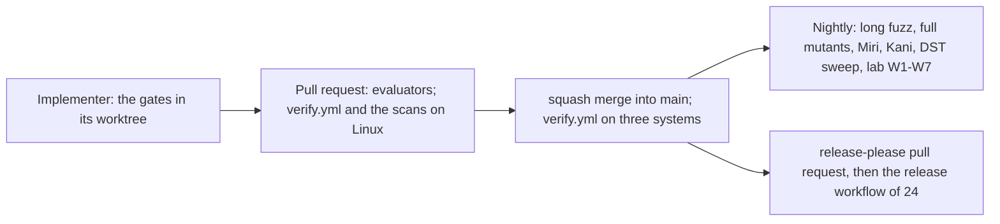
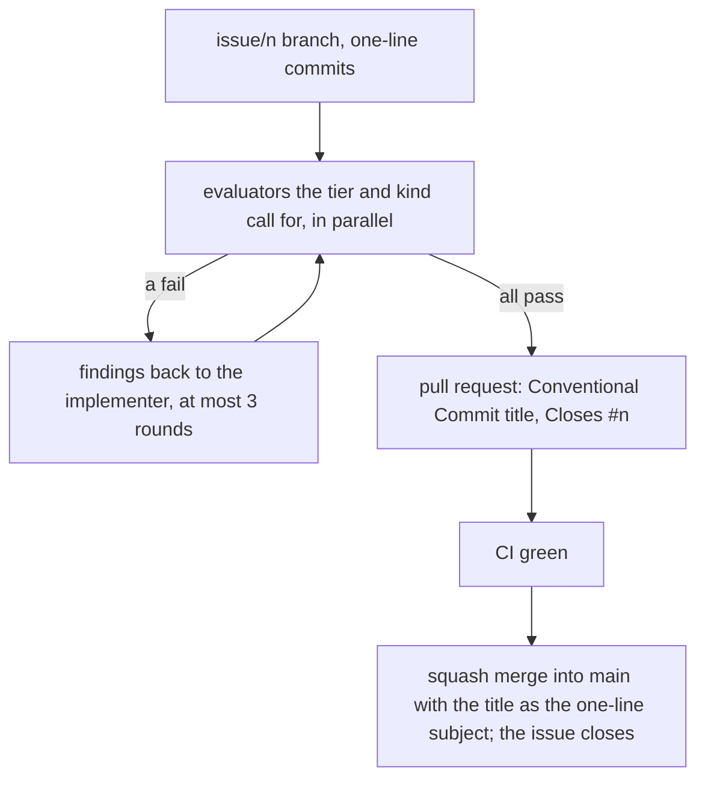

# Quality gates and continuous integration

_Status: draft for implementation, version 4 (the spine, the owner answers in `design/_review/02-owner-answers.md`, rulings R-48, R-61, R-71, and owner instructions 1 to 28 of [`design/_review/04-owner-kit-instructions.md`](../design/_review/04-owner-kit-instructions.md) applied). Date: 2026-11-11. Owner: `agent-kit` squad (`team/01` section 2; the release workflow it gates is `release`'s); gate configuration is trust core (D-63). Specifies D-45 (gate side), D-47, D-63 (review and merge), D-64. Read with: [spine](../design/00-decisions.md), [03](../design/03-system-architecture-and-modularity.md), [11](../design/11-endpoint-engineering.md), [12](../design/12-policy-engine.md), [24](../design/24-deployment-and-packaging.md), [27](../design/27-web-console-ux.md), [34](../design/34-documentation-support-and-lifecycle.md), [35](../design/35-product-security-programme.md), team/01, team/03, team/04._

## Summary

1. **Plain gates.** The gate is four commands anyone can run: `cargo fmt --all -- --check`, `cargo clippy --workspace --locked --all-targets -- -D warnings`, `cargo test --workspace --locked` and `cargo deny check`. Agents run them before they push (skill `grdr-verify`); `.github/workflows/verify.yml` runs them on every pull request and on `main`, and CI decides. The scan workflows add CodeQL, gitleaks, zizmor, osv-scanner and Semgrep. Hardware, kernel-matrix and held-out work runs as named nightly and release jobs.
2. **Review checks what no tool checks yet.** The structure rules S1 to S7 and the interface rules UX1 to UX8 are rubrics the evaluators apply (section 8). Further gates in this document are planned; each joins `verify.yml` as a plain command when the work item that builds it lands.
3. **Commands decide pass or fail**; a status a model types is ignored, and evaluators re-run what a report claims.
4. **Required tests per component** (section 6): differential oracles for every parser and the policy evaluator, deterministic simulation for anything with time or ordering, reference models by a different agent for the trust core.
5. **Ratchets only tighten**: mutation score, suppressions, ignored tests, file size, unvetted dependencies.
6. **Merges follow `team/01` section 5's tiers** (triggers from 35). The issue's `tier:` label, raised by `eval-tier` from the path rules of `.claude/risk-tiers.toml`, picks the evaluators; the session that runs skill `grdr-work-issue` squash-merges the pull request once every evaluator passed in at most three rounds and CI is green. No person signs, approves or lands anything, and no approval by any identity counts (owner instructions 7 and 8; D-61 and D-63 as amended).
7. **Releases gate on the scorecard** with sample sizes: zero silent fail-open in 1,000 fault injections per Tier 1 cell; zero Essentials block failures in 3,000 attempts (99.9% at 95% confidence); held-out margin under 5 points.
8. **Gaming is countered**: held-out queries capped at three per issue, expectations written before each action, a sanctioned `impossible` outcome, seeded impossible items that measure the gaming rate.

## 1. Ownership and boundaries

Owned elsewhere: the tier rules (`.claude/risk-tiers.toml`), tier table, circuit breakers, trust-core evidence and fuzz budgets (35); release workflow, signing, SBOM and dependency policy values (24); documentation checks F1 to F12 (34); scenario format, drivers and oracles of the efficacy harness (spine D-45 and D-64; the detailed harness and lab document is pending); skills and plugins (team/03); the audit prompt library (team/04). Everything else about gates is here.

## 2. Gate rules

| Rule | Consequence |
|---|---|
| Every gate is a plain command that a person, an agent and CI run the same way | No custom tool stands between a change and its gate; a fork reproduces it |
| A planned gate joins `verify.yml` with a fixture that proves it fails. Gate ids are a letter and two digits (V01, S01, U01) and are not severities: vulnerabilities are V1 to V4 (35), support severities S1 to S4 (34) (R-48) | A gate without a failing fixture is a defect |
| A gate's output names the failing check and the file; long output goes to a log the job uploads | Agents are time-blind and context-limited (31) |
| A change to gate configuration (`.github/`, `deny.toml`, `clippy.toml`, `rustfmt.toml`, `supply-chain/`, `security/`) is high tier, and evaluators read their own instructions from `main` | A change cannot quietly relax the gate that judges it (35, h09) |
| No network inside the Rust gates except dependency fetch before the first step | Outsiders and forks reproduce the gate (S-22, l09) |

## 3. The gates

**Running today.**

| Gate | Command or workflow | Where |
|---|---|---|
| Format | `cargo fmt --all -- --check` | `verify.yml`, every pull request and `main` |
| Lints, warnings denied, with the workspace's no-panic deny lints (section 8) | `cargo clippy --workspace --locked --all-targets -- -D warnings` | Same |
| Tests | `cargo test --workspace --locked` | Same |
| Dependencies, licences, advisories (S01) | `cargo deny check` with `deny.toml` | Same |
| Secrets, workflows, lockfiles, source | gitleaks, zizmor, osv-scanner, Semgrep OSS (`scan.yml`) | Every pull request, `main`, nightly |
| Docs rules of design/34 a script can check | `.claude/hooks/docs-check.mjs --ci` from the base branch (`docs.yml`); the same script is the session's PreToolUse hook | Every pull request |
| Code scanning, repository health | CodeQL (`codeql.yml`), OpenSSF Scorecard (`scorecard.yml`) | Pull requests and weekly; Scorecard weekly |

While no crate exists under `crates/` or `programs/`, the workspace has no members, Cargo refuses every command, and `verify.yml` skips the Rust jobs.

**Checked in review.** No tool checks these yet; the implementer checks its own diff and the evaluators check again: the structure rules S1 to S7 (section 8, skill `grdr-structure`, `eval-diff` and `eval-architecture`); the interface rules UX1 to UX8 (section 8, skill `grdr-interface`, `eval-ux`); one-line Conventional Commit subjects with no body or trailer (owner instruction 27); no em dash in prose; pnpm only (owner instruction 24).

**Planned gates.** Each joins `verify.yml` as a plain command, with its failing fixture, in the work item that builds it. Tool versions are pinned in `supply-chain/build-tools.toml` when they join.

| Id | Step | Tool |
|---|---|---|
| V04 | Architecture lint ARCH-001 to ARCH-026 (03) and ARCH-101 to ARCH-106 (section 8) | The architecture lint (WI-0003), dependency-cruiser |
| V06 | Ratchets: suppressions, ignores, stubs, file size, mutation score (section 7) | A ratchet check |
| V07 | Schema: `buf lint`, `buf breaking` against the last `grdr-v*` tag (from 1.0, the last tag of every supported line), `grdr-schema-lint`; regenerated `crates/grdr-proto` code and copied `crates/grdr-schema` data byte-identical | buf, `grdr-schema-lint` (04) |
| V08 | Policy packs: `grdr policy test` under the production interpreter; golden vectors on native and `wasm32` | `grdr`, wasmtime |
| V09 | Property tests at default case count; DST short seed set (100 seeds) | proptest, turmoil, shuttle, loom |
| V10 | Diff-scoped mutation testing | cargo-mutants `--in-diff`, Stryker |
| V11 | Diff coverage | cargo-llvm-cov |
| V12 | Dependency gates beyond `cargo deny` (section 9) | cargo-vet, cargo-machete |
| V13 | Public API: semver and surface diff on layers 0 to 2 (except the generated `grdr-messages`), `grdr-ffi`, `grdr-wasm`, against each crate's last `<crate>-v*` tag; a semver-major change needs a breaking (`!`) commit touching that crate since the tag | cargo-semver-checks, cargo-public-api |
| V15 | Security register: every due SR has a passing test id; every threat has an SR or residual; SD fixtures fail (02) | A register check |
| V16 | Web: typecheck, lint, unused code, tests | TypeScript, Oxlint, knip, Vitest |
| V17 | Documentation checks F1 to F8 (F5 internal links only), F10 to F14 (34), `cargo doc` with warnings denied, typos, Vale with the vendored `ai-tells` styles (`third_party/vale/ai-tells/`) | Vale, lychee (offline), typos |
| V19 | Instruction-count benchmarks for core hot paths | gungraun |
| V27 | Duplicate code: no new clone of 60 tokens or 8 lines in Rust, TypeScript, protobuf, TOML, YAML or Markdown; tree-wide duplication may only fall | jscpd |
| V28 | Package manager (owner instruction 24): no `package-lock.json`, `npm-shrinkwrap.json`, `yarn.lock`, `bun.lockb` or `bun.lock`; no `packageManager` other than pnpm; no npm or npx call in a `package.json` script or a workflow `run` step | A file check in `verify.yml` |
| V29 | Release diff: a release-please pull request changes only `.release-please-manifest.json`, `release/VERSION`, `CHANGELOG.md` files, member `version` lines and member entries of `Cargo.lock`; an agent commit changes no `package.version` | A diff check in `verify.yml` |
| V30 | Contract compatibility (D-71): every component's declared `provides` and `requires` ranges resolve through the one resolver; a change that breaks a declared range of a contract (wire major, local IPC package, C ABI header, pack `format_version`, Cedar `schema_version`, driver or eBPF interface, API package) fails unless it bumps that contract's major and adds the overlap its stability class requires | The `grdr` compatibility resolver; `buf breaking`, cargo-semver-checks and the C header diff feed it |

Time targets: the Rust gates under 3 minutes warm for a one-crate change and under 15 minutes on a clean hosted 4-vCPU runner for every default member (S-22). A step that pushes a pull request over its target moves to nightly in a high-tier change to `verify.yml`.

## 4. Pipeline stages



| Stage | Trigger | Runners | Runs | Blocking |
|---|---|---|---|---|
| Implementer | Before each push | The implementer's worktree | The gates (skill `grdr-verify`) | Its report says what ran |
| Pull request | The session that runs `grdr-work-issue` opens it | The owner's machine for the evaluators; hosted Linux for `verify.yml` and the scans | The evaluators the tier calls for; the gates; later the planned gates, fuzz smoke per changed target (35 budgets), three-arm proof replay, egress oracle, the matrix cells the paths need, hook latency, held-out check for agent issues | Yes |
| `main` | Push | Hosted Linux, macOS and Windows | The gates | Opens issues |
| Nightly | Schedule | Hosted; the owner's machine through `matrix-run` for cells that need it | The gates on three systems; later long fuzz, sharded mutation, Miri, AddressSanitizer, Kani, DST sweep (10,000 seeds), Quint, full kernel matrix, W1 to W7 (11), external links (34 F5) and lab oracles (F9), `cargo vet` import refresh and diff, held-out canary scan (section 16) | Opens issues; blocks a release pull request |
| Agent canary | Every 6 hours, once built | Hosted runners; the owner's machine for cells a hosted image cannot run | Polls each catalogued agent; a new release is installed and its adapter conformance cells run (07), within 24 hours of release (D-49) | Opens a high-priority issue; the adapter's tested range is not widened until green |
| Release | A tag release-please creates when its release pull request merges | Per 24 | Section 16 | Yes |

**Where the gate runs.** CI decides. The repository is public from its first push (owner instruction 28), so GitHub's free standard runners take the gates on three systems on `main` and nightly, the matrix (section 19, tier A), and CodeQL, Scorecard, secret scanning and release attestations. The workflows still read the repository's visibility, as the fallback for a private fork or copy, or for this repository if it is ever made private: there GitHub's free plan gives 2,000 runner minutes a month with macOS minutes counted ten times and Windows twice, so hosted CI runs Linux only with no nightly run, the matrix runs through `matrix-run`, and CodeQL and Scorecard are skipped. Self-hosted runners are optional: the owner's own machine, registered as tier B. A job that needs a machine and finds none reports "not run (requires hardware)", which is never counted as a pass.

**CI time.** The Rust gates under 3 minutes for a one-crate change and under 15 minutes on a 4-vCPU hosted runner stay the targets. Builds are cached (the Rust cache action in CI, sccache on local disk); a fast linker, mold on Linux and lld elsewhere, is set per target in `.cargo/config.toml` and pinned in `supply-chain/build-tools.toml` (WI-0002); `cargo nextest` partitions across jobs once it joins; the macOS, Windows and kernel matrix runs on `main` and nightly, never on every pull request (owner instruction 22).

**Runner rules.** Fork pull requests run only on hosted runners with read-only tokens. Self-hosted runners accept only `merge_group` and scheduled events (D-64), run each job inside a snapshot-revert guest rather than on the machine's own operating system, revert after each job, hold only a lab-scoped token and reach the network through an allow-list proxy. No `pull_request_target`; every workflow sets `permissions: {}` and every job declares its own. `step-security/harden-runner` 2.22.4 runs first in every hosted job, in `audit` mode until QG-02 confirms the generated endpoint list for that hosted OS and in `block` mode after; it is free on hosted runners for public repositories and does nothing on a private repository or a self-hosted runner (25), which is why those reach the network only through the allow-list proxy. Its coverage of the macOS and Windows hosted images is unverified and is checked in QG-02. The `allowed-endpoints` list follows `supply-chain/build-tools.toml`; S05 fails when the workflow and that file differ.

**Models in CI.** Model work (the evaluators, `eval-security`, the U07 UX evaluator, model-driven harness runs) runs in the owner's Claude Code session through skill `grdr-work-issue`, on the owner's logged-in subscription (owner instruction 23). Hosted model jobs are optional: they need the repository secret `CLAUDE_CODE_OAUTH_TOKEN`, made with `claude setup-token`, which needs a browser, so nothing waits on it. If it exists, the subscription's terms and usage limits are verified and recorded before any job relies on it (QG-22), and the secret is exposed only to scheduled and same-repository `pull_request` jobs on hosted runners, never to fork pull requests or self-hosted runners. No API key and no other vendor's model is used. Each agent uses Opus 5.5 or Sonnet 5.5 as `design/_review/03-models-and-orchestration.md` assigns it: `eval-security` and the second `eval-diff` on a high-tier or trust-core change run on the model that did not write it; no Haiku and no Fable in CI. A run that reaches a subscription usage limit stops; the pull request waits, so a limit neither fails nor passes a change.

**Workflows.** Every `uses:` is pinned to the full SHA of its latest release (owner instruction 22; gate S05), every checkout sets `persist-credentials: false`, harden-runner is each job's first step, each workflow has a concurrency group, and tool versions and image digests come from `supply-chain/build-tools.toml`.

| Workflow | Runs | When |
|---|---|---|
| `verify.yml` | Plans the systems from the event and the repository's visibility: Linux on pull requests; Linux, macOS and Windows on `main`, nightly and a manual run in a public repository, which this one is from its first push, and Linux only in a private fork or copy; skips the Rust jobs while the workspace has no members; runs `cargo fmt`, `cargo clippy` and `cargo test`, and `cargo deny check` | Every pull request and push to `main`, and nightly |
| `scan.yml` | gitleaks, zizmor (its settings in `.github/zizmor.yml`), osv-scanner, Semgrep OSS failing on the finding levels `[tool.semgrep-rules] severities` of `supply-chain/build-tools.toml` names | Every pull request, every push to `main`, nightly |
| `codeql.yml`, `scorecard.yml` | CodeQL for Rust and TypeScript with GitHub secret scanning and push protection; OpenSSF Scorecard weekly, its score ratcheted by `security/scorecard.toml` | CodeQL on every pull request, every push to `main` and weekly; Scorecard weekly; both from the first push, the repository being public from it (owner instruction 28), and skipped in a private fork or copy. CodeQL has no local or private form: its terms (read 2026-11-11) allow automated analysis only of open-source code published in a public GitHub repository, so it runs only in CI |
| `fuzz.yml` | ClusterFuzzLite over every fuzz target | Once `.clusterfuzzlite/project.yaml` exists |
| `dast.yml` | OWASP ZAP baseline scan of the console and API against the embedded server; targets and the start command from `deploy/ci/dast.toml` | Once that file exists |
| `release-please.yml` | release-please (section 15) and, for released crates, Sigstore keyless signing and build provenance | Pushes to `main`; signing and attestation for each release, the repository being public |

## 5. Protected files and acceptance criteria

Two lists with different purposes. `security/trust-core.paths` (02, 35) decides which changes are high tier and need two passing evaluators on different models (`.claude/risk-tiers.toml` reads it). The protected files, which an ordinary issue must not change, are those the protected-path list of `team/06` section 2.1 names, among them: golden vectors and snapshots, specifications, `security/`, `audits/`, `supply-chain/`, `third_party/`, governance and brand files, the release files, lint, deny, toolchain and Cargo configuration, lockfiles, `.github/`, the design documents, decision records and RFCs, the licence and policy files, `CLAUDE.md`, `docs/team/` and `.claude/`, `.claude/settings.json` included. No session permission refuses an edit to them (ADR-0035): the evaluators check every diff against its issue's write set, a write outside it is a `blocker`, and CI judges the diff.

A change to one of these files is its own issue whose write set names it, worked by `lead-agent-kit` (gate configuration) or the chief architect (spine and plan), high tier, landing after `eval-security` and a second evaluator on the other model pass (owner instruction 7). An exemption or a ratchet loosening also needs `eval-architecture` to agree; an entry of the Astryx exception registry `web/packages/ui/exceptions.toml` needs `eval-ux` and `lead-interfaces`.

**Acceptance criteria live in the issue.** Work items live only in GitHub issues (owner instruction 5), so there is no `acceptance/` directory. The agent that writes an issue's spec and acceptance criteria (a squad lead, the product lead or the programme manager) never implements it. Evaluators judge against the acceptance section; when the issue's history shows the section changed after work started, that is a `blocker` finding, and an edit by the implementer is a tamper finding escalated to the issue's lead and then the chief architect (owner instruction 7).

**Who else writes protected files.**

| Writer | May write | Purpose |
|---|---|---|
| Dependabot | `Cargo.lock`, `pnpm-lock.yaml`, action pins | Dependency updates after cooldown (section 9) |
| release-please, with the workflow token | `.release-please-manifest.json`, `release/VERSION`, `CHANGELOG.md` files, member `version` lines and member entries of `Cargo.lock` | Release pull requests (V29, section 15) |

An implementer that needs a protected change reports `blocked` and files the issue, or `impossible` (`team/02` section 1.4). Unit tests beside the code are the implementer's; weakening them is a `blocker` in review.

## 6. Test strategy by layer

| Layer | What it is here | Tools | Stage |
|---|---|---|---|
| Unit | Behaviour and contract tests, not implementation mirrors (h09) | nextest, insta with updates off | Every pull request |
| Property | Invariants, round-trips, metamorphic edits | proptest | Every pull request; nightly at 100x cases |
| Differential | Production code against an independent reference | `grdr-policy-ref` (12), real shells and kernel (D-10), agents' parsers, `grdr-ports-testkit` | Pull request short; nightly long |
| Fuzzing | Every untrusted input | cargo-fuzz 0.13.2 | Pull-request smoke; nightly (35) |
| Deterministic simulation | Time, ordering, crash and network faults through `Clock` and `Entropy` | turmoil, shuttle, loom | Pull request 100 seeds; nightly 10,000 |
| Model checking, proofs | Lifecycles from team/04 A01 audits; no-panic proofs | Quint 0.33.1, Kani 0.68.0 | Nightly |
| Integration | Real processes, both topologies (D-20) | An integration test harness | Pull request on Linux; `main` on three systems |
| End to end | Real agents via the harness and replay model endpoint (D-45) | Efficacy harness (D-45, D-64; detailed document pending) | Pull-request subset; nightly; release |
| Lab | Kernel and OS matrices, incumbents, soak, drills | `matrix-run` (section 19) | Short on pull requests; nightly; release |

Required tests per component (R required, - not applicable; each is required from the component's first work item):

| Component | Unit | Prop | Diff | Fuzz | DST | Int | E2E | Lab |
|---|---|---|---|---|---|---|---|---|
| `grdr-proto`, `grdr-schema` | R | R round-trip | R cross-binding vectors (04) | R decode | - | - | - | - |
| `grdr-core` analyze: canonicaliser, path resolver | R | R | R real shells, kernel | R | - | R | R | R |
| `grdr-core` session and policy | R | R monotonicity | R `grdr-policy-ref` | R | R stale label | - | R | - |
| `grdr-core` detect, discover | R | R | R Sigma conformance vectors | R | - | - | R | - |
| `grdr-fastpath`, `grdr-ffi`, `grdr-wasm` | R | R | R against `grdr-core` | R | - | - | - | R S-21 |
| `grdr-crypto`, `grdr-wire` | R known-answer | R | - | R frames | R peer faults | R | - | - |
| `grdr-ports` and reference adapters | R | R | R test kit | - | R crash points | - | - | - |
| `grdr-sensor-linux` and BPF (observe and enforce) | R | - | R user-space model (S-13) | - | - | R | R | R kernel matrix, soak |
| `grdr-sensor-macos`, `grdr-sensor-windows` | R | - | R against OS audit sources | R event decoders | - | R | R | R hosted, tier B where a cell needs a machine |
| `grdr-agents` adapters and installer | R | R foreign bytes preserved (07) | R agent's own parser | R dialects | - | R pinned agent start | R canary | R per-version |
| `grdr-hook`, `grdr-broker` (03) | R | R | R broker reference (07) | R | R deadlines | R 2 s bound | R | R latency |
| `grdr-daemon`, `grdr-engine` | R | - | - | - | R supervision | R kill, hang, starve | R fault injection | R soak |
| `grdr-update`, `grdr-updater` | R | R | R TUF attack suite | R metadata | R handover | R | - | R upgrade drill |
| `grdr-store-local`, spool | R | R | R test kit | R segment decode | R crash consistency | R | - | - |
| `grdr-proxy`, `grdr-llm-proto`, `grdr-mcp-proto` | R | R | R reference SDK decoders | R | R streaming | R | R | R latency |
| Sandbox back ends | R | - | - | - | - | R conformance suite (D-21) | R | R per OS |
| Server targets and adapters | R | R | R test kit, tenant canaries | R API decoders | R pipeline, failover | R | R | R storage volumes |
| Web console and `ui` (local and full console) | R | - | - | - | - | R MSW | R Playwright | - |
| Desktop view-models | R | - | - | - | - | - | R if S-19 passes | R soak |
| Packs and content | R per rule, one positive and one negative (12) | - | R benign and attack corpora | - | - | - | R harness | - |

**Reference models.** A trust-core component's reference model is written by a different agent in a different session with no shared code, and its statements (properties, Quint specs, theorem statements) are approved by `eval-security` and an evaluator on the other model, because the checker proves only what was stated (35, h09; owner instruction 7). Reference models live in `layer = "tool"` crates and are never linked into a program (03).

## 7. Mutation testing and ratchets

**Diff-scoped (planned gate V10).** `cargo mutants --in-diff` over the change's non-test lines; Stryker over changed TypeScript files in `web/packages/kit` and `web/packages/ui`. Thresholds (targets; re-set once from the first nightly scores, then ratcheted):

| Scope | Gate |
|---|---|
| Layers 0 to 2, trust-core paths | Every viable mutant on changed lines is caught, or listed with a reason in the mutants exclusion file, which only a high-tier change that `eval-architecture` agrees to edits |
| Layer 3 | At least 90% caught on changed lines |
| Layer 4 and web composites | At least 80% caught on changed lines |

Timeouts count as caught and are reported. A diff that changes only tests runs no mutants (32), so the test-diff ratchet (below) covers test edits.

**Nightly full run.** `cargo mutants --shard k/8` across eight shards; the per-crate score goes to the ratchet file. A crate whose score drops by more than one point fails the nightly and opens an issue for `garden-tests`, which may add tests but may not edit `src/` (32).

**Ratchets** (planned gate V06). A ratchet check compares the change with the ratchet file; a ratcheted number may only move in its good direction. A nightly job writes tighter values; loosening is a high-tier change that `eval-architecture` agrees to (owner instruction 7).

```json
{
  "schema": "grdr.ratchets.v1",
  "per_crate": {
    "grdr-core": { "mutation_score": 0.0, "allow_attributes": 0, "ignored_tests": 0, "unsafe_blocks": 0 }
  },
  "global": {
    "todo_or_unimplemented": 0,
    "unvetted_crates": 0,
    "quarantined_tests_ratio_max": 0.01,
    "diff_coverage_min": { "layer0_3": 0.85 }
  }
}
```

| Ratchet | Rule |
|---|---|
| `todo!`, `unimplemented!`, stub markers | Zero in non-test code, always (the workspace lints and structure rule S6) |
| `#[allow(...)]`, `@ts-ignore`, `eslint-disable` | Each needs a reason (`allow_attributes_without_reason`); the count per crate may only fall |
| `#[ignore]`, `.skip` | Count may only fall; quarantine is capped separately (section 17) |
| Test-diff | In agent-written changes, a test function's assertion count may not fall and no assertion may be weakened |
| File size | A Rust or TypeScript source file has at most 500 code lines (blank lines, comments and the test module excluded); a file over it is split by responsibility (structure rule S1; owner instruction 4, which replaces the earlier 400-line choice) |
| Diff coverage | 85% of changed lines in layers 0 to 3; reported only for layer 4 |
| `unsafe` | May not rise outside a high-tier change; every block registered (35) |
| Unvetted crates | May only fall (35) |

## 8. Lint sets and the architecture lint

**Rust.** No panic path in any non-test code, in every crate (owner instruction 15). The root `Cargo.toml` sets `[workspace.lints]` and every member inherits it with `[lints] workspace = true`; `clippy.toml` lets test code (`#[cfg(test)]` and `tests/`) unwrap, expect, panic and index. `verify.yml` runs Clippy with warnings denied.

```toml
[workspace.lints.rust]
unsafe_code = "forbid"

[workspace.lints.clippy]
unwrap_used = "deny"
expect_used = "deny"
panic = "deny"
todo = "deny"
unimplemented = "deny"
unreachable = "deny"
indexing_slicing = "deny"
string_slice = "deny"
get_unwrap = "deny"
panic_in_result_fn = "deny"
exit = "deny"
```

Cargo refuses crate entries beside `workspace = true`, so layer 0 to 2 and privileged crates add `#![deny(clippy::arithmetic_side_effects)]` at their crate root, and `grdr-ffi` and the OS adapter crates, the only ones allowed unsafe code, carry a copy of the table with `unsafe_code = "deny"` and a reasoned `#[allow(unsafe_code)]` on each unsafe item; the architecture lint (WI-0003) will check both. Elsewhere, arithmetic that can overflow uses checked or saturating types. The wider warning set of brief 32 (`dbg_macro`, `await_holding_lock`, `undocumented_unsafe_blocks`, `let_underscore_must_use`, `map_err_ignore`, `allow_attributes_without_reason`, `large_futures`, `missing_docs` in public crates) joins the table as each lint is confirmed against the pinned Clippy; `print_stdout` and `print_stderr` stay off because the CLI writes to its streams by design.

Layer 0 and 1 crates carry a `clippy.toml` that implements ARCH-003:

```toml
disallowed-methods = [
  { path = "std::time::SystemTime::now", reason = "take `now: Timestamp` as an argument (ARCH-003)" },
  { path = "std::time::Instant::now", reason = "take `now` from the host (ARCH-003)" },
  { path = "std::thread::spawn", reason = "the core is single-threaded; return an Effect" },
  { path = "std::env::var", reason = "configuration arrives in the bundle or HostProfile" },
]
disallowed-types = [
  { path = "std::fs::File", reason = "return an Effect; the host does I/O (ARCH-003)" },
  { path = "std::net::TcpStream", reason = "return an Effect; the host does I/O (ARCH-003)" },
  { path = "std::collections::HashMap", reason = "iteration order breaks replay; use BTreeMap or IndexMap" },
]
```

**Structural rules (ast-grep, `lint/ast-grep/`).** Change-log and narration comments, swallowed errors on enforcement paths (team/04 C01), `Ok(())` stubs, sleeps in tests, and literals from golden vectors or held-out canaries in non-test code (section 18). Example:

```yaml
id: grdr-no-history-comment
language: rust
severity: error
rule:
  kind: line_comment
  regex: '^//\s*(Added|Changed|Updated|Removed|Fixed|Now|Previously|New:)\b'
message: >
  Comments describe the code, not its history. Put history in the commit message.
  If the code needs this comment to be understood, rename or restructure it instead.
```

**TypeScript.** TypeScript 7.0.2 `--noEmit` strict; Oxlint 1.93.0 with vendored copies of the `anti-slop` rules (`no-chained-type-assertions`, `no-module-mocking`, `no-widen-then-assert`; 32) and 35's ban on `innerHTML`, `dangerouslySetInnerHTML` and `eval`; Biome 2.6.6 for formatting only; knip for unused files and exports; stylelint for the spacing scale (27 WEB-03).

**Protobuf.** `buf lint` (STANDARD) plus `grdr-schema-lint`; `buf breaking` uses `WIRE_JSON` before the wire freeze and `FILE` after it (04).

**Swift, eBPF, shell.** SwiftLint and Swift 6 strict concurrency for the macOS shell (unverified details, settled before the macOS shell's first work item); BPF programs follow 10 and must load across the kernel matrix; shellcheck for any script in `deploy/` and `lab/`.

**Architecture lint.** 03 owns ARCH-001 to ARCH-026 and their four-part messages (ARCH-017 to ARCH-024 are the code-consistency rules of P17, ARCH-025 `one-dialer` is P16's and ARCH-026 `operator-no-content` is D-70's). This document adds the web rules, enforced by dependency-cruiser and proposed for 03's register; they replace the earlier ARCH-101 to ARCH-104 and follow owner instruction 21 (Astryx first, React Aria only as a registered exception):

| Code | Rule | Fix the message states |
|---|---|---|
| ARCH-101 | Only `web/packages/ui` imports `@astryxdesign/*` (D-42) | Import the component from `@grdr/ui` |
| ARCH-102 | `web/packages/kit` imports only `@grdr/ui`, `@grdr/tokens`, `@grdr/i18n` and React; `react-aria` and `react-aria-components`, and any package an entry of `web/packages/ui/exceptions.toml` names, only in the files that entry lists | Compose `@grdr/ui` components; a gap Astryx cannot fill is an exception-registry entry |
| ARCH-103 | `lucide-react` is imported only inside `ui`, by its `Icon`; `kit` and `ui` share no export name | Pass the meaning key to `Icon`; keep one implementation |
| ARCH-104 | `web/apps/*`, `web/extension/` and `site/src/` import interface code only from `@grdr/kit`, `@grdr/ui`, `@grdr/i18n`, `@grdr/tokens` and `@grdr/api` (plus Docusaurus's own theme in `site/`) | Use the kit part, or add it to the kit |
| ARCH-105 | `fetch`, `XMLHttpRequest` and `EventSource` appear only in `web/packages/api` | Call the generated client |
| ARCH-106 | No message runtime (FormatJS, `intl-messageformat`, i18next, Fluent) in any web package except inside `ui`, where Astryx carries its own | Use the generated `@grdr/i18n` accessor |

**Structure (the owner's rules S1 to S7).** The project skill `grdr-structure` (team/03 section 3) teaches the owner's seven rules (owner instructions 4 and 9): structures before implementations, files of at most 500 code lines, no implicit state machines, comments only where nothing else can say it, fix the core problem, readable code, and the mechanism before the feature. No tool checks them yet: the implementer checks its own diff, `eval-diff` checks every change, and `eval-architecture` checks S7 and hard-coded behaviour on medium and high tier changes. A finding of S1 to S4, S6 or S7 is `major`. The check ids S1 to S7 are the owner's; the support severities of 34 use the same labels (team/04's security prompts are M01 to M05), so these are always written as structure rules.

| Rule | Finds |
|---|---|
| S1 | A source file over 500 code lines (blank lines, comments and the test module excluded) |
| S2 | A top-level type, constant or static declared after the first top-level `impl` or function, outside the test module |
| S3 | New comment lines that are narration, change-log or step comments, commented-out code, or a TODO without an issue number (`#<n>`, or `WI-NNNN` for a reserved item) |
| S4 | Implicit state machines: three or more `bool` fields in one type; a `state`, `status`, `phase`, `stage` or `mode` field typed as a string, integer or `bool`; `Option` fields whose presence is checked together. The only fix is an explicit state type |
| S5 | Nesting deeper than four levels (a remark, never blocking) |
| S6 | A panic path on a new line outside test code: `unwrap`, `expect` and their `_err` forms, `panic!`, `todo!`, `unimplemented!`, `unreachable!`, indexing or slicing that panics on short input, `process::exit`; `process.exit`, `process.abort` and `Deno.exit` in scripts (owner instruction 15) |
| S7 | A hard-coded value in non-test code outside `brand/`, the schema and the data files: a URL, host, domain, email or IP literal (RFC 2606 and RFC 6761 example names and the documentation address ranges pass; loopback passes only in tests); a brand or vendor name; a number used as a bound, timeout, retry count, size or threshold, or a constant that holds one (zero, one and index arithmetic pass); a colour or spacing literal; text a person reads written into markup (owner instruction 26). The fix is the value in its data source, read through its loader. On interface paths UX1 and UX3 report the colour, spacing, text and product-name findings instead |

The fix is a design change: never a silenced check, a guard around the symptom, a rename that dodges the pattern, a literal moved into a named constant, or a mechanical split to get under 500 lines. A split follows responsibilities, and a fix that belongs outside the issue's write set becomes its own issue.

Beyond these rules, audit A01 (implicit state machines, team/04) runs inside `eval-diff`'s round on every pull request whose diff adds or changes a type, a field, an enum variant, a status-like field or a `match` on one. An A01 finding that survives the refuting pass is a blocking review finding (major), closed only by a type change (`closes-by = "type"`), never by a comment or a test alone. `garden-architecture` runs A01 over the whole tree on request, and each surviving finding becomes a repair issue that closes only by a type change; it also runs audit E08 (hard-coded behaviour, P14), whose results close only by a type change or a decision record. The `eval-diff` rubric treats a symptom fix, a new guard around an implicit state, a mechanical file split, or a second implementation of something a registry, kit or shared crate already provides (P17) as a failed criterion. `eval-architecture` checks every medium and high tier change for behaviour hard-coded where a pack, manifest, adapter or setting belongs (P14) and for the values S7 covers, and fails it.

**Interface rules (UX1 to UX8, P17).** The project skill `grdr-interface` (team/03 section 3) teaches the rules, and `eval-ux` applies them to every change under the `[interface]` paths of `.claude/risk-tiers.toml`. Generated outputs, stories and tests are excluded. There is no exemption: a rule that is wrong is fixed in the skill.

| Rule | Finds | Fix |
|---|---|---|
| UX1 | A raw visual value (colour, length, radius, font, line height, shadow, z-index, duration or easing literal) in CSS, a `style` value or TSX, outside generated token modules | Use the token by name (`space-3`, `color-text-danger`, `motion-quick`); add a semantic token in `interface/tokens/` if none fits |
| UX2 | A one-off building block. `@astryxdesign/*` imported outside `ui`; `react-aria` or `react-aria-components` imported in a file the exception registry does not list; in `kit`, an import other than `@grdr/ui`, `@grdr/tokens`, `@grdr/i18n` and React; in `web/apps/**`, `web/extension/**`, `site/src/**` and `kit`, a stylesheet, a `style` prop, a `className` string, or a raw interactive or layout element (`button`, `input`, `select`, `a`, `table`, `dialog`, or `div`/`span` used for layout) | Compose the kit's layout primitives and patterns; if none fits, register a pattern |
| UX3 | Hand-written text: a string literal that reaches JSX text, `aria-label`, `title`, `alt`, `placeholder` or an Astryx text prop; a product name outside `brand/` | Add a language token and call its accessor; the product name is `:grdr:brand` |
| UX4 | Assembled or hand-formatted text: an accessor result concatenated, interpolated or joined with other text; `Intl.*` or `toLocale*` outside `@grdr/i18n` | Make the sentence one token with typed arguments and format through its functions |
| UX5 | An icon rendered by hand: a Lucide import outside `ui`; an Extended_Pictographic character in a token or JSX | Pass the meaning key to `Icon` |
| UX6 | Physical direction: a physical CSS property or value (`margin-left`, `left:`, `text-align: left`, `float: right`), or `text-transform` | Use the logical property (`margin-inline-start`); write casing in the message |
| UX7 | An unregistered pattern: an export of `@grdr/kit` absent from `interface/patterns.toml` | Register it with its fixtures, or use the registered one |
| UX8 | Hand-rolled navigation or confirmation: an app mutation not called through `useAction`; a confirmation dialog in app code; a route literal; a shortcut hook outside the shortcut registry | Call `useAction(Service.Method)`; link by route id; register the shortcut |

Part of the plan: the halves of UX1 to UX8 for Rust UI crates and terminal output (a Rune constructor outside `grdr-desktop/src/kit/`, `print!` or an ANSI escape outside `term`, `format!` building person-facing text), and registry checks run in CI: an enum matched by hand over a presentation-registry type, an icon key without its entry and `mirror` value in `interface/icons.toml`, a fixture per declared `ViewState`, exactly one `ViewState` per screen, and routes and shortcuts present in their registries. Both need WI-0041's registries.

**Duplicate code (planned gate V27).** `.jscpd.json` sets `minTokens` 60 and `minLines` 8 (key names confirmed by WI-0041), ignores `target/`, generated code, `*.snap`, `tests/fixtures/`, `third_party/`, `docs/references/`, `conformance/vectors/` and `node_modules/`, and reports `json` and `sarif` to `target/jscpd/`. `--semantic` is never used: it downloads a model, which breaks air-gapped runs. A new baseline entry needs one reason from a closed list (`reference-model`, `fastpath-independence`, `kernel-model`, `generated`, `external-dialect`) matching a pair `architecture.toml` records as deliberately independent; `eval-diff` and `eval-architecture` accept it in a high-tier change. A clone between a reference model and its subject is a team/04 G05 finding, not a deduplication.

## 9. Supply-chain gates (policy values in 24 and 35)

| Gate | Check | Stage |
|---|---|---|
| S01 | `cargo deny check` (advisories, bans, licences, sources) with `deny.toml`: yanked, unmaintained and unsound crates denied, crates.io the only source, the licence allow-list of `supply-chain/licences.toml` and the do-not-use list as data (24, 03) | Every pull request, running today |
| S02 | `cargo vet --locked` against `supply-chain/` and the committed `imports.lock`, so the gate needs no network; unvetted count ratchet | Pull request; import refresh and diff review nightly |
| S03 | Registry existence and age of every new direct dependency; new direct dependency is high tier with a justification record (35) | Pull request |
| S04 | Lock-age: every newly locked version is older than the cooldown, read from the crates.io index publish time, because Cargo does not check already-locked versions (cargo#17246, 32) | Pull request (needs network) |
| S05 | Every `uses:` is a 40-hex SHA; zizmor clean; no `pull_request_target`; every job declares permissions; harden-runner endpoints match `supply-chain/build-tools.toml` | Every pull request (zizmor running today) |
| S06 | Any plugin or skill the project settings enable is pinned by commit (team/03, 35); today they enable none | Pull request |
| S07 | osv-scanner 2.7.1 over lockfiles, SBOMs and images | Every pull request and nightly, running today |
| S08 | `cargo machete`; knip unused dependencies | Pull request |
| S10 | OpenSSF Scorecard: the score never falls below the floor in `security/scorecard.toml`, which only rises | Weekly |
| S11 | Grype as a second scanner beside osv-scanner over every built image | Nightly, once the packaging work item builds images |
| S12 | OWASP ZAP baseline scan of the console and API against the embedded server | Pull request, once `deploy/ci/dast.toml` exists |

**Latest at bootstrap, current after it** (owner instruction 22). The seed pins the newest stable release of every dependency, tool, action and toolchain, with no cooldown, provided it is not yanked, has no open advisory, carries an allowed licence and has provenance or a signature where its ecosystem offers one. After that, Dependabot proposes updates with a cooldown of 3 days for patch and minor releases and 7 for majors, grouped so the pull requests stay few; it needs no account beyond the repository (owner instruction 23). `.github/dependabot.yml`, cargo entry:

```yaml
  - package-ecosystem: cargo
    directory: /
    schedule:
      interval: daily
    cooldown:
      default-days: 3
      semver-major-days: 7
      semver-minor-days: 3
      semver-patch-days: 3
    groups:
      cargo:
        applies-to: version-updates
        update-types: [minor, patch]
        patterns: ["*"]
      cargo-major:
        applies-to: version-updates
        update-types: [major]
        patterns: ["*"]
      security:
        applies-to: security-updates
        patterns: ["*"]
    commit-message:
      prefix: fix
      include: scope
    labels: ["kind:dependency"]
```

GitHub Actions take one cooldown for every update type, so action majors also wait 3 days. pnpm workspaces join as `npm` entries when `web/` exists. pnpm (`pnpm-workspace.yaml`): `minimumReleaseAge: 4320` (3 days) set explicitly so it is strict, `blockExoticSubdeps: true`, `trustPolicy: no-downgrade` (32), and `onlyBuiltDependencies` as an allow-list, so no dependency runs install scripts unless it is listed (owner instruction 24). Cargo (`.cargo/config.toml`, added when `rust-toolchain.toml` reaches 1.100, where the key is stable):

```toml
[registry]
global-min-publish-age = "3 days"
```

Security updates skip the cooldown: Dependabot opens them in their own group, `eval-security` reads the diff, and the update lands once its evaluators pass, with no person (owner instructions 7 and 22). Dependency pull requests that pass every gate are squash-merged with their title as the subject; `garden-deps` reviews those past their cooldown on request. They carry no `Closes #<n>`, because they are not work items.

**Proactive vulnerability work** (owner instruction 22). Beside the gates above and the scan workflows: CodeQL for Rust and TypeScript and GitHub secret scanning with push protection from the first push, the repository being public from it (CodeQL's terms allow no automated analysis of a private repository, section 4); ClusterFuzzLite in CI for every fuzz target; KEV and EPSS order remediation, so a KEV-listed advisory reachable from our code is fixed first, on every supported line; and variant analysis: every fixed vulnerability becomes an audit prompt run over the whole tree, and every surviving hit a work issue. The seven-day patch target, VEX reachability, CSAF, OpenVEX and OSV advisories stay as 35 sets them.

## 10. Performance regression gates

Hosted runners are too noisy for wall-clock gates, so tier A gates on instruction counts and tier B gates on wall clock. Wall-clock method, arms and workloads W1 to W7 are 11's; the gate compares the upper bound of the 95% bootstrap interval with the target.

| Spine target (section 6) | Benchmark | Where | Pull-request gate | Release gate | Requires |
|---|---|---|---|---|---|
| Policy evaluation, 1,000 policies, p99 under 1 ms | `bench/policy-eval` incl. request construction (S-15) | Tier A instructions; tier B wall clock | Instructions +2% fails | Target | Core |
| Embedded fast path p99 100 µs cached, 1 ms uncached | `bench/fastpath` | Tier A, tier B | +2% fails | Target | Core |
| Hook p50 10 ms, p99 50 ms (Linux, macOS); 25 and 100 ms on Windows beside Defender and one more EDR | 11 B1: 10,000 hook calls spawned as each agent spawns hooks | Hosted Windows with Defender (trend); tier B (gate) | Trend; +10% p99 opens an item | Target | Shim and daemon |
| Footprint, all processes, no models, excluding the on-demand Rune window: under 1% of a core idle, 250 MB resident, 1 GB disk | 11 I1 and S1 | Tier B | - | Target | Daemon and sensors |
| Build overhead under 3% alone, 2% added per incumbent | 11 W1 to W7 | Tier B | Nightly: regression over 5% against the last release opens an item | Target; gates only on a registered tier B reference host (11) | OS sensors |
| Proxy added p99 under 20 ms; first byte under 5 ms | `bench/proxy-stream` | Tier B | +2% instructions | Target | Proxy |
| Storage: fresh 60 s, timeline 2 s, 30-day aggregation 10 s and 60 s | S-02 harness at 5,000 and 100,000 events per endpoint-day | Tier B | - | Target | Server |

Wall-clock targets need a tier B reference host listed in `lab/reference-hosts.toml`. With none registered, the cell is reported "not run (requires hardware)" and the release notes list it; it is never reported as met.

An instruction-count regression may merge only with the `perf-accepted` label, which a lead sets after `eval-performance` agrees, and which makes the change high tier (owner instruction 7).

## 11. Security gates

| Stage | Gate |
|---|---|
| Every pull request | Running today: Semgrep, gitleaks, zizmor, osv-scanner, CodeQL. Planned: ast-grep security rules; V15 (02 register and SD fixtures); `LogSafe` lint (03); `unsafe` register complete (35); a new parser crate without a registered fuzz target fails (35); fuzz smoke; `grdr egress` oracle in a network namespace (03 C4) |
| Review | `eval-security` (Opus 5.5, clean context) on medium and higher tiers and on every trust-core change (team/02); team/04's pull-request prompts, M01 fail-open included, inside `eval-diff`'s round (team/04 section 3). A reviewer may block or comment and never approves; a blocking finding needs evidence spans and survives a refuting verifier before it counts (32) |
| Nightly | Long fuzz; Miri; AddressSanitizer on FFI and OS adapters; Kani no-panic harnesses on `grdr-fastpath`; tenant canary records (requires the server) |
| Release | A trust-core fuzz crash older than seven days blocks (35); review status per component: every trust-core change passed `eval-security` and `eval-adversarial` in clean contexts and cross-model review, with two passing evaluators on different models, and a kernel component leaving the internal ring passed the review route D-62 names, run by evaluator agents plus any free external audit that arrives (D-62, D-63, owner instruction 7); held-out bypass attempts against Essentials (12); before the server's first release, the transport review D-62 requires and any penetration test obtained through a free programme or volunteer, with findings closed |

## 12. Interface gates (local console, tray and desktop, full console)

| Gate | Check | Fails when |
|---|---|---|
| U01 | `@axe-core/playwright` 4.14.0 on every route, every story and the extension's pages | Any WCAG 2.2 AA violation |
| U02 | Pattern contracts for every registered pattern against the accessibility tree, on the web and in the Rune headless runtime | An assertion fails |
| U03 | Visual diff: Playwright screenshots in `__screenshots__/` for `en` and `ar-XB`, and Rune `--snap` goldens | More than 0.1% of a story's pixels differ. Baselines are protected: `eval-ux`, never the writer, passes the change with the diff images and sets the `ui-baseline` label, then the implementer regenerates them in a separate commit |
| U04 | `en-XA`, `ar-XB`, `ja-XC` and each shipped locale on every surface: web, Rune, tray, `grdr-approve`, CLI goldens, emails, chat cards, extension, installers, docs chrome | Truncation, overflow, clipping, a missing glyph, an unisolated placeholder or an unmirrored layout |
| U05 | Token outputs and theme validity | A semantic token missing from an output; a locked token changed by any brand, co-brand or tenant theme; a pair under 4.5:1 (text) or 3:1 (non-text) in light, dark or high contrast |
| U06 | Performance budgets of 27 on seeded data | Over budget |
| U07 | UX evaluator under `ui-architect`, then `grdr-interface` | A "never" rule or the cohesion rule (P17) is violated |
| U08 | A story and a Rune headless golden per fixture of every registered pattern, including a `scale` fixture (counts of 10,000,000, the longest `en-XA` strings, 100,000 rows) | A fixture without both, or a render failure |
| U09 | Screen-reader journeys: Guidepup driving NVDA on hosted Windows runners and VoiceOver on hosted macOS runners through each persona journey, judged by `eval-a11y`; a person's pass adds evidence and never gates | A journey cannot complete, or an announcement is missing or wrong |
| U10 | Vale over the exported English tokens and docs, with lists generated from `schema/vocabulary.toml` and 34 section 17's content standard | Any finding |
| U11 | Formatting parity: the corpus formatted by ICU4X and by Chromium, Firefox and WebKit `Intl` | A difference not listed in `parity-allow.toml` |

**U07 procedure.** For changes under the `[interface]` paths of `.claude/risk-tiers.toml`, `brand/` or the tokens, the UX evaluator invokes the `ui-architect` skill and then `grdr-interface` (team/03) before reading the diff, drives the running console with Playwright, and returns its review in the skill's four sections (Evaluation; Violations and Opportunities; Actionable Fixes; Principle Cited). A hard-constraint violation blocks: an empty form where a smart default exists; a progress indicator starting at 0%; a sign-up or enrolment wall before the first-run scan shows value (D-44, D-48); emoji instead of Lucide icons; symmetric text padding where 27's optical tokens apply; off-scale spacing; more than two pricing tiers shown by default on hosted billing pages (36). UX1 and UX5 cover two of these (off-scale values, emoji and icons); the evaluator judges the rest, who also applies team/02's `eval-ux` cohesion line (P17). Other findings are comments; design changes also go to the persona council (D-47).

**Desktop.** View-models live in a crate with no Rune dependency and carry the tests (D-43). Rune screenshot and accessibility tooling is unresearched (32); S-19 decides between OS accessibility-tree checks and a web-only desktop.

## 13. Documentation gates

34 owns checks F1 to F12; F1 to F8 and F10 to F12 join `verify.yml` as they are built, F5 external links and F9 nightly. This document adds: `cargo doc` with warnings denied and `missing_docs` denied in public crates; doctests; `AGENTS.md` at most 100 lines and any `CLAUDE.md` at most 200 lines (31); user-visible changes reach changelogs only through their commit subjects (release-please writes each public crate's `CHANGELOG.md` and the release pull request; 34's release-notes generator writes the product notes); every decision made where a specification was silent appears in the change's decisions list (h09 per-PR prompt 7) and, if it constrains other code, in `docs/decisions/`.

## 14. Definition of done per change type

Evidence is the implementer's report (skill `grdr-handoff`): the gate commands with their exit codes, each acceptance criterion with the command that checked it, the decisions where the spec was silent, and what was not verified. The pull-request body carries the summary, the decisions list and `Closes #<n>`; evaluators re-run what the report claims, and their expectation lines go in their verdicts (section 18).

| Change type | Done means, beyond the gates |
|---|---|
| Feature | The issue's acceptance tests pass; evaluator drove the real artefact; expectations log; docs per 34 F3; the feature extends a mechanism and ships its behaviour as content or configuration, and `eval-architecture` finds nothing hard-coded (P14, owner instructions 9 and 26) |
| Bug fix | Three-arm proof, replayed by the evaluator: fails on the parent, passes with the fix, fails on revert (D-47) |
| Removal | Survival test fails if the code is still reachable; deletion audit finds no guard in its place (h09: 29% of passing patches guard instead of delete) |
| Refactor | Golden vectors and receipts byte-identical; mutation score not lower |
| Performance | Before and after on the same runner class |
| Dependency | Justification, cooldown, `cargo vet` entry, allowed licence; by Dependabot, or by `garden-deps` for a major that needs code changes, never an ordinary implementer |
| Schema, wire, Cedar schema or public crate API | An RFC the chief architect decided after the persona council and `eval-architecture` reviewed it, with no waiting period (owner instruction 7); `buf breaking` or V13 surface diff; V30 on every declared contract range; regenerated vectors reviewed by an evaluator |
| Pack or rule | Positive and negative test per rule under the production interpreter (12); benign corpus; enters at Watch, except an Essentials rule, which needs zero benign-corpus hits and zero block-induced task failures (D-53); first-party content lands when its evaluators pass; community content needs two passing evaluators on different models, and a community rule without them stays in Watch; a ceiling of `contain` or above also needs `eval-security` and `eval-adversarial` (D-61 and R-58 as amended by owner instruction 7) |
| Trust core | 35 section 2.3 evidence; `eval-security` and `eval-adversarial` in clean contexts, cross-model review by the model that did not write the change, two passing evaluators on different models, the gates and the matrix cells the paths need; before leaving the internal ring, the review route D-62 names for the component, run by evaluator agents plus any free external audit that arrives (owner instruction 7) |
| Interface | UX1 to UX8 in review (`eval-ux`) and U01 to U11 as they are built |
| Gate, CI, agent definitions | A high-tier change (section 5): `eval-security` and a second evaluator on the other model, and `eval-architecture` for an exemption or a ratchet loosening; a gate's fixture still fails; workflow dry run on a fork (35) |
| Release pull request | V29 once built; the release gates of section 16 on its commit; merged only when its parent is the current `main` (section 15) |

## 15. Review and merge (D-61, D-63)

The tier is the issue's `tier:` label and `trust-core` flag; tiers, triggers and the low-tier limit until the incident evaluation set holds 50 cases are `team/01` section 5 and 35 section 2.2. `eval-tier` raises the tier when the diff matches a higher path rule or trigger of `.claude/risk-tiers.toml`, which reads `security/trust-core.paths`; nothing lowers one.



**Mechanics** (skill `grdr-work-issue`).

1. The implementer commits on `issue/<n>`, every commit one Conventional Commit line with no body, trailer or credit line (owner instruction 27), and pushes the branch.
2. The session runs the evaluators in clean contexts: always `eval-diff`; at `tier:medium` also `eval-acceptance`, `eval-security` and `eval-architecture`; at `tier:high` or `trust-core` also `eval-adversarial` and a second `eval-diff` on the model that did not write the change, so two evaluators on different models pass (D-47, owner instruction 7, `design/_review/03-models-and-orchestration.md`); the `[kinds]` row of the issue's kind; `eval-ux` and `eval-a11y` on interface paths. Each reads its instructions from `main`. No approval by any identity counts.
3. At most three rounds; each later round reviews only the commits since the last, and repeat findings on unchanged code are dropped (h09). After a third failed round the session stops and reports.
4. When every evaluator passed, the session opens the pull request against `main` with a Conventional Commit title of at most 72 characters and `Closes #<n>` in the body, waits for CI, and squash-merges it with the title as the subject and an empty body, the form release-please reads.
5. A release pull request from release-please is merged once V29 (when built) and the release gates of section 16 pass on its commit and its parent is the current tip of `main`, so no commit ships uncounted in the versions and notes. release-please then creates the tags and GitHub releases from that commit (section 16).
6. Branch rules on `main` (WI-0010) allow changes only through pull requests with the hosted `verify` check required and no force push or deletion; until they land, nothing but the owner's direct pushes bypass that route.

Owner instruction 7 removed the batch signature, `Signed-off-by`, `Batch-Approval` and `dco-verify`: nothing waits on a person, and the gates and the evaluators the tier calls for make a merge safe. Circuit breakers are 35's.

## 16. Release gates and the efficacy scorecard (D-45)

The harness (spine D-45 and D-64; the detailed harness and lab document is pending) runs three passes per scenario (product absent, monitor, enforce) with an oracle independent of the product (sinkhole canaries, file hashes, the driver's process tree, the model-proxy log) and AMTSO's six outcomes: prevented, detected not prevented, model refusal, model recognition, missed, inconclusive (g08). A scenario that does no harm with the product absent is excluded; model refusals are never credited to the product. Agents with no custom model endpoint (Cursor) cannot use the replay model endpoint and run model-driven scenarios only; their cells say so. Model-driven runs use the owner's Claude subscription within its usage windows, with a usage cap per run (section 4, D-47); a model-driven cell for an agent that needs another vendor's model or account runs only on an account from a design partner or a free programme, and is reported "not run" without one.

**Scorecard.** `scorecard/<version>.json`, signed with the run manifest of input hashes:

```json
{
  "schema": "grdr.scorecard.v1",
  "product": { "version": "0.1.0", "commit": "…", "profile": "protected", "packs": ["essentials@…"] },
  "cells": [{ "os": "linux-x64", "agent": "claude-code@2.1.322", "model": "…", "incumbent": "none" }],
  "tracks": {
    "prevention": { "outcomes": { "prevented": 0, "detected_not_prevented": 0, "model_refusal": 0, "model_recognition": 0, "missed": 0, "inconclusive": 0 },
                    "asr_at_attempts": { "1": 0.0, "10": 0.0, "100": 0.0 } },
    "fault_injection": { "runs": 0, "silent_fail_open": 0, "degraded_visible_within_60s": 0 }
  },
  "margin": { "tuning": 0.0, "held_out": 0.0, "points": 0.0 },
  "inconclusive": 0,
  "not_applicable": [],
  "deviations": [],
  "run_by": "…",
  "conflicts_of_interest": "self-published"
}
```

Tracks: prevention, detection, discovery of generated bespoke agents, attribution with scripted humans, fault injection, sandbox conformance, performance beside incumbents, privacy leakage. Every cell runs at least ten repetitions and reports Wilson intervals (g08).

**Statistical rules.** A zero-tolerance target is met only with zero failures in at least the stated number of trials. By the rule of three, zero failures in 3,000 trials bounds the failure rate below 0.1% at 95% confidence, which is the spine's 99.9% Essentials block reliability. Rate targets gate on the point estimate with a minimum sample, and the interval is published.

| Gate | Requirement |
|---|---|
| Harness thin slice | Thin-slice scenarios pass (Linux x64, Claude Code and one scripted bespoke agent); held-out evaluator returns category counts |
| Silent fail-open | Zero in at least 1,000 fault injections per Tier 1 cell (kill, hang, socket black-hole, disk full, corrupt bundle); Degraded visible within 60 s |
| Essentials block reliability | Zero failures in 3,000 scripted attempts per Tier 1 cell; zero block-induced task failures on the benign workload |
| First value | Inventory, timeline and a deterministic block within five minutes on a clean machine, scripted and timed |
| Coexistence | Zero detections from Defender, Falcon and one more incumbent on install, run and uninstall, read from the incumbent's own event log or API. Defender runs on hosted Windows or a tier B guest. Falcon and the other licensed incumbent run only on a licence from a design partner or the vendor's free test programme (D-64, R-61); without one the cell is reported "not run" and broad release stays blocked (D-23) |
| Prompts | Median 3 or fewer and p95 8 or fewer per developer-day on the development fleet's replayed history |
| Shipped locales | Every token of every `shipped` locale translated with a current `source_hash` and an `equivalent` or `minor` verdict; a locale that fails is demoted to `preview` for the release and the release notes say so (34 section 15a, D-69) |
| Held-out margin | Tuning minus held-out under 5 points on every track; above it the release is blocked (spine section 9) |
| Discovery | Precision 95% against LLM-calling non-agents; held-out recall 85% on at least 200 generated bespoke agents, on Linux, Windows and macOS; the macOS cell requires the Network Extension (spine section 7, R-37) |
| Hook-against-OS false rate | Under 1% on benign sessions |
| Storage, upgrade and restore drills, review findings closed | Requires the server: storage targets of spine section 6 met, upgrade and restore drills pass, and findings from the reviews D-62 requires are closed |
| Fleet scale (P15) | Requires the uplink scheduler crate: S-23's herd simulation passes at 1 million devices on every change to the uplink scheduler, admission, nudge pacing or rollout ramp, and at 10 million before each release; a seeded fixed `retry_after_ms` or an unjittered timer fails it |
| Air-gap conformance (24-28, spike S-31) | Green for `embedded` and `ha` (and `distributed` once its load test passes) from the bundle alone: every step's oracle met, zero frames outside the lab, zero DNS queries outside its zone. Required for every server release and for any release that changes the uplink, updater, importer, `Dialer`, Keys, notify or backup (P16) |
| Air-gap bundle contents | The bundle and its delta carry every artefact and third-party component every profile needs, with `THIRD-PARTY-NOTICES`, the CycloneDX SBOM and `sources/` for each copyleft component; the licence gate refuses a component that may not be redistributed, which stays optional and is never needed to install, enrol, update, detect, respond or operate (owner instruction 20) |
| Compatibility matrix (D-71) | Generated from `support.toml`: every supported sensor line against the server (N-2, N-1, N, N+1), every pack against every supported engine line, the driver and eBPF interface ranges and the upgrade path's hops, each resolved by the one compatibility resolver; the release manifest's `compat` block is generated from the same declarations |
| Hosted service | The release workflow refuses to deploy to any hosted cell until the hosted readiness record, a protected data file, names who is on call, Loonaro as the legal entity, the written incident-reporting process and the infrastructure funding (revenue, sponsorship or donated cloud credits) (D-63), and until the `distributed` load test has passed (spine section 7). The gate reads the record; no signature is involved. Self-hosting needs none of these |

**Releases have no person in them** (owner instructions 3, 7 and 23). release-please keeps one combined release pull request open, proposing every component's version and changelog from Conventional Commit subjects (`release-please-config.json`, `separate-pull-requests: false`; the Windows driver gets its own once it exists); `release-candidate` runs the gates above on its commit, it is squash-merged once they pass, and release-please creates the tags and GitHub releases. Artefacts are signed keylessly with Sigstore cosign through GitHub's OIDC identity, with `actions/attest-build-provenance` attestations, SLSA provenance and SBOMs; the Rekor inclusion proofs travel in the bundle for offline checks (P16). An artefact only a vendor programme can sign (Authenticode, Apple notarisation) is marked "not platform-signed" in the release manifest, and nothing waits for the programme. TUF keys live in two GitHub Actions environments, the release signer's and the independent rebuilder's, with a threshold of two across them. Crate packaging, signing and attestation run for every release, because the repository is public from its first push and the free plan gives attestations only to public repositories.

**Held-out suite.** A separate repository behind an evaluator service that returns category-level counts only; readable by every human maintainer and no agent identity; each set published two releases after use (D-45, l09).

- External human changes are gated by the public gates only; release gates catch held-out failures and a maintainer posts a public reproducer (l09).
- An agent issue in an area with held-out coverage gets at most three evaluator queries; a fourth stops the item with status `blocked` and escalates it (`team/01` section 6), because repeated submissions raise cheating (32: 33% to 38%).
- Every held-out file carries a canary GUID; the nightly scan covers the repository, pull-request text and agent reports. A hit fails the build and retires the set (g08).

## 17. Flaky tests

`.config/nextest.toml`:

```toml
[profile.default]
retries = 0
fail-fast = false
slow-timeout = { period = "30s", terminate-after = 4 }

[profile.ci]
retries = { backoff = "fixed", count = 1, delay = "1s" }
junit = { path = "target/nextest/junit.xml" }
```

| Rule | Detail |
|---|---|
| Detection | A test that fails then passes on its one retry in `ci` is flaky. The change still merges; the test goes on the quarantine list with the seed, log and failing commit, and an issue is filed |
| Not quarantinable | Tests a work item's acceptance criteria run, tests under `conformance/`, fault-injection suites, trust-core crates and golden vectors. A flaky one blocks merging until fixed |
| Quarantine life | Quarantined tests still run nightly and report. After 14 days a test is fixed or deleted by a change its evaluators pass |
| Cap | Quarantined tests above 1% of a crate's tests freeze merges to that crate |
| Seeds | Every randomised test prints its seed; a failing seed becomes a regression case in `fuzz/corpus/regressions/` or a fixed DST scenario |
| Bans | No sleeps in tests (ast-grep); time comes from `Clock` (03) |
| Diagnosis | `garden-tests` runs team/04's D06 flaky-explainers over the quarantine list on request |

## 18. Measures against test gaming

ImpossibleBench measured 50 to 54% cheating on tasks whose tests contradicted the specification; read-only tests stopped edits but not special-casing; an explicit "flag as impossible" option cut GPT-5 from 54% to 9% (32). SpecBench found the visible versus held-out gap growing with code size (h09). Measures:

1. **Protected tests and specifications** (section 5) and the test-diff ratchet.
2. **Held-out suite** with a query budget and canaries (section 16).
3. **Expectations before action.** Before each driven step the evaluator writes down `{step, action, expected}`, then runs the action and adds `{observed, match}`; the lines go in its verdict. An observation without a prior expectation does not count (31).
4. **The `impossible` exit.** An implementer may end with status `impossible`, naming the conflicting clause and test id. It returns to the spec author (`team/01` section 6) and never counts against the implementer.
5. **Seeded impossible items.** One work item in fifty is deliberately contradictory. Human maintainers write the pool in the held-out repository; the evaluator service files an issue indistinguishable from a normal one, and no agent identity can read which items are seeded. The share returned as "done" is the measured gaming rate, reported weekly over a rolling 28-day window with its count and Wilson interval; above 5% the planner tightens instructions and raises evaluator sampling and the owner is told.
6. **Special-casing detector.** Non-test code containing golden-vector ids, fixture paths, canary values or held-out GUIDs fails; held-out metamorphic variants (renamed paths, hosts, canaries) must not change outcomes (g08).
7. **Three-arm proof, survival tests and mutation testing**, re-run by the evaluators and CI, not taken from a report (sections 7, 14).
8. **Snapshot acceptance blocked**: `cargo insta accept`, `INSTA_UPDATE=always` and `vitest -u` are never run and their outputs are protected, a rule the evaluators check (32, ADR-0035).
9. **Claims checked**: evaluators re-run every command a report claims; a typed "tests pass" counts for nothing.

## 19. Test lab as a CI resource (D-64)

There is no money for lab hardware, so nothing in the lab is bought or rented.

| Tier | Hardware | Runs | Requires |
|---|---|---|---|
| A, hosted | GitHub standard runners: `ubuntu-24.04`, `ubuntu-24.04-arm`, `macos-15` arm64, `windows-2025`, `windows-11-arm`; free for public repositories; KVM on Linux x64 (31, g05) | Builds for three systems and two architectures; full form; x64 kernel matrix in VMs (`little-vm-helper`, `vmtest`); Windows with Defender active; the held-out suite (D-64) | A public repository, which this one is from its first push |
| B, self-hosted | The owner's own machine, registered as an optional self-hosted runner; snapshot-revert Windows and Linux guests where it can host them (macOS guests only on Apple hardware, two per machine under the macOS licence, g05); free incumbents (Defender, Elastic, Wazuh, osquery, Sysmon) | Wall-clock performance (11 W1 to W7), macOS system-extension work, arm64 kernel matrix where hosted arm64 has no KVM, 72-hour soak, upgrade drills, coexistence, S-19 Rune soak; for a private fork or copy, the matrix its hosted plan cannot afford (section 4) | A machine that can run the cell, registered in `lab/reference-hosts.toml` |
| C | HLK controller and clients, licensed incumbents | Windows driver; licensed coexistence | The driver's sponsor or partner (D-17); licences from design partners or free vendor programmes (D-64) |

Each `lab/jobs/*.toml` entry declares the tier and hardware it needs. When no registered runner matches, `matrix-run` reports the cell "not run (requires hardware)"; such a cell is never counted as passed, and it runs when a machine is available.

`matrix-run <job> [--cells <filter>] [--commit <sha>]` dispatches a named job from `lab/jobs/*.toml` to the right tier, waits, and prints ten lines (cells passed and failed, first error, log path) to stay usable by agents (31). It accepts only commits of an open pull request or on `main` (D-64). Kernel cells are 10's list; `lab/reference-hosts.toml` pins the tier B hardware, firmware settings and incumbent versions that performance results cite; results from different machines are never compared with each other.

## 20. Work items

Where another team document lists the same work, it is one item (`team/06` section 10): QG-02 is part of WI-0002 and WI-0010, QG-12 is WI-0013.

| Id | Item | Acceptance | Requires |
|---|---|---|---|
| QG-02 | `verify.yml` hardening and the `main` branch rules: harden-runner in `block` mode per hosted OS, the hosted `verify` check required | A `pull_request_target` workflow fails S05; a fork pull request receives no write token; harden-runner's report exists for each hosted OS or that OS is recorded as uncovered; a seeded EICAR file on `windows-2025` is caught by Defender real-time protection, or the Defender cells move to a tier B Windows guest and are marked "requires hardware" until one is registered (R-61) | - |
| QG-04 | Ratchets (V06) and the nightly tightening job | A reasonless `#[allow]` fails; a loosened ratchet without `eval-architecture`'s agreement fails | - |
| QG-05 | V10 and nightly sharded mutation | Surviving-mutant fixture fails | - |
| QG-06 | Lint set (the workspace deny lints of section 8), ast-grep rules, ARCH-101 to ARCH-106 | One failing fixture per rule | - |
| QG-07 | S02 to S12, Dependabot, pnpm, Cargo cooldown | Unvetted crate, tag-pinned action, two-day-old dependency each fail; a security update reaches `eval-security` with no cooldown | QG-02 |
| QG-09 | Held-out evaluator, query budget, canary scan | Fourth query refused; planted canary fails nightly | - |
| QG-10 | Three-arm replay and survival-test replay in CI | A test passing on the parent fails the proof | - |
| QG-11 | Instruction-count benchmarks | Seeded 3% regression fails V19 | - |
| QG-12 | `matrix-run` on tier A, short kernel matrix | One-kernel BPF load failure fails the pull request; a job needing an unregistered tier B machine reports "not run (requires hardware)" and is not counted as passed | QG-02 |
| QG-13 | Scorecard and section 16 gates | Seeded silent fail-open blocks a release | Efficacy harness (D-45); QG-09 |
| QG-14 | U01 to U11 on the local console | Seeded AA violation, emoji, off-scale spacing, an unmirrored `ar-XB` layout each fail | Local console; WI-0041 |
| QG-15 | Quarantine flow | Flaky acceptance test blocks; others quarantine with seed | - |
| QG-16 | Seeded impossible items | A seeded item returned `done` raises the weekly rate; the report carries count, window and interval; no agent identity can read the seed list | QG-09 |
| QG-17 | Tier B jobs: W1 to W7, soak, coexistence oracle | A seeded 5% wall-clock regression on W1 fails the release gate; a seeded Defender detection fails the coexistence gate; the report cites `reference-hosts.toml` | QG-12; a registered tier B machine |
| QG-18 | Server gates: storage, drills, tenant canaries | A restore leaving a dangling file fails; a storage run above target at either volume fails; a cross-organisation canary read fails | The server |
| QG-19 | Tier C driver jobs (HLK, Driver Verifier) | `lab/jobs` accepts `tier = "C"` and `matrix-run` refuses it until a tier C host is registered; HLK and Driver Verifier jobs run on that host | The driver's sponsor or partner (D-17) |
| QG-20 | Security gates: ast-grep security rules, V15, fuzz-target registration, egress oracle | A planted secret, a threat with neither SR nor residual, each machine-checkable SD fixture (02), a parser crate without a fuzz target and an unlisted destination each fail | The egress oracle requires 03 C4 |
| QG-21 | Remaining steps: V04, V07, V08, V13, V16, V17 | Each step's fixture fails; a removed public function fails V13 | V16 requires the web workspace |
| QG-22 | Optional: Claude Code in hosted CI under a subscription token (section 4) | If the token is added: the subscription's terms and usage limits for `claude setup-token` in CI are recorded first; a fork pull request and a self-hosted job cannot read `CLAUDE_CODE_OAUTH_TOKEN`; a simulated usage-limit response leaves the check pending instead of failing or passing it | QG-02; the owner's token |
| QG-25 | V29 and `release-please.yml` | A release-please commit touching `src/` fails V29; a release pull request generated before another change merged is refreshed before it merges | WI-0010 |
| QG-26 | The registry halves of UX1 to UX8 as CI checks | An Astryx import outside `ui` and a React Aria import outside the exception registry each fail | WI-0041 |
| QG-27 | V27 duplicate code and its baseline | A seeded clone of 60 tokens fails; a baseline entry without a reason from the closed list fails | - |
| QG-28 | V28 package manager | A `package-lock.json`, a `packageManager` of `npm@...` and an `npx` call in a workflow step each fail | - |
| QG-29 | V30 contract compatibility and the compatibility matrix of section 16 (D-71) | A change that breaks a declared range without a major bump fails; the matrix generated from `support.toml` lists every supported pair | The compatibility resolver |

QG-01 (a custom verify command), QG-03 (protected paths enforced by a gate), QG-08 (a landing queue), QG-23 and QG-24 (custom structure and acceptance-digest gates) are dropped: the gates are plain tools, and review covers the rest.

## 21. Deviations from the spine and objections

1. **Wall-clock gates without a bought lab (D-64).** Resolved by the spine: there is no lab purchase, and tier B is the owner's own machine. The release gates on footprint (I1, S1), hook latency (B1) and build overhead (W1 to W7) need wall-clock numbers that hosted runners cannot give reliably, so they require a registered tier B reference host; without one those cells are reported "not run (requires hardware)" and the release notes list them (section 10).
2. **Falcon in the coexistence gate (D-23 against D-64).** Resolved by R-61 and spine version 4: licences for incumbents other than Defender come only through a design partner or a free vendor programme (D-23, D-64). Section 16 runs Falcon cells on such a licence or a design-partner tenant and blocks broad release while they are "not run".
3. **"One verify command" (D-47).** Changed. There is no custom verify command: the gate is the plain commands of section 3, which a person, an agent and CI run the same way. Kernel-matrix, lab, egress-namespace and held-out jobs run as their own CI jobs because they need hardware or private data.
4. **Held-out on agent items (D-45).** Open. Limited to three evaluator queries per item and to areas with held-out coverage; the spine sets no budget.
5. **Low tier (D-63).** Open. Follows 35: merges without per-item review are limited to documentation, additive tests and flagged layer 4 interface changes until the incident set holds 50 cases. D-63 does not bound the low tier's contents; this narrows it.

## How this is kept current

The `agent-kit` squad lead owns this document; changes to it and to `.github/workflows/` are high tier. It is re-read whenever tool versions in `supply-chain/build-tools.toml` are re-verified. After every model upgrade, team/04's Y01 and Y02 re-test the evaluators and report which instructions no longer change outcomes. A gate with a false-failure rate above 2% is fixed before anything else in its area.

## Risks and open questions

| Item | Risk or question | Settled by |
|---|---|---|
| Evaluator capacity | Every medium and high tier change runs its evaluators on the owner's one subscription beside the implementers | S-20 measures the share of the subscription's usage windows per issue; when the usage window is the binding limit, fewer issues run in parallel, and low-tier changes take one evaluator (owner instruction 8) |
| Subscription token in CI | Hosted model jobs need `claude setup-token`, which needs a browser, and the subscription's terms for CI use | Optional: model work runs in the owner's Claude Code session, and CI runs the deterministic gates; if the token is ever added, QG-22 records the terms first |
| Cooldown value | Settled by owner instruction 22: 3 days for patch and minor releases, 7 for majors, security fixes at once after `eval-security` reads the diff (section 9) | Resolved |
| Rune test tooling | No known screenshot or accessibility tooling for Rune (32) | S-19 |
| Mutation cost | `--in-diff` on large diffs may exceed the 15-minute target | Measured by QG-05; above the target, V10 moves to nightly |
| Lint names | Clippy names come from brief 32 and are unverified | `unknown_lints = "deny"` on the first run |
| Incumbent event ids | The coexistence oracle reads Defender's operational log; event ids are to be confirmed | QG-17 fixture with a seeded detection |
| arm64 KVM | KVM on hosted arm64 Linux runners is unverified (g05) | QG-12 checks `ubuntu-24.04-arm`; without KVM there, arm64 kernel cells require an arm64 tier B machine and are reported "not run (requires hardware)" until one is registered |
| desloppify | Custom OSNL licence (32); not used as a gate | Only deterministic slop detectors gate |
| Cross-model review | Every change needs cross-model review | Resolved by owner answer 2 and `design/_review/03-models-and-orchestration.md`: the other of Opus 5.5 and Sonnet 5.5, clean context (D-47); no other vendor's model |
| eBPF review | There is no money to contract an external eBPF reviewer, which S-13 and trust-core evidence need | `eval-security` and `eval-adversarial`, with cross-model review and two passing evaluators on different models, review the trust core (owner instruction 7); the kernel component leaves the internal ring only through the review route D-62 names, run by evaluator agents plus any free external audit that arrives, and stays in it otherwise |
| Hosted Windows real-time protection | Whether hosted Windows runners allow Defender real-time protection is unconfirmed (R-61) | Confirmed by QG-02; if not, Defender cells run on a tier B Windows guest and require hardware until one is registered |

## Sources

- Briefs (verification sections preferred): research 32, 31, h09, g08, g05, 25. Reviews: c9, l09, and `_review/00-resolution.md`.
- ImpossibleBench, https://arxiv.org/abs/2510.20270 ; SpecBench, https://arxiv.org/abs/2605.21384 ; deletion avoidance, https://arxiv.org/abs/2607.28887
- Anthropic code review, https://claude.dev/blog/solving-code-review-at-anthropic/ ; Trail of Bits regression proof, https://blog.trailofbits.com/2026/10/21/your-ai-agent-fixed-the-bug-but-what-else-did-it-change/
- cargo-mutants in-diff, https://mutants.rs/in-diff.html ; Cargo publish age, https://doc.rust-lang.org/beta/cargo/reference/unstable.html#min-publish-age ; Dependabot cooldown, https://docs.github.com/en/code-security/dependabot/working-with-dependabot/dependabot-options-reference ; release-please, https://github.com/googleapis/release-please ; pnpm, https://pnpm.io/settings/dependency-resolution
- AMTSO agentic testing guidelines v1.0, https://www.amtso.org/wp-content/uploads/2026/09/AMTSO_Guidelines_for_Testing_of_Agentic_Security_Products_FINAL_V1.0.pdf
- GitHub-hosted runners, https://docs.github.com/en/actions/reference/runners/github-hosted-runners ; macOS Tahoe licence, https://www.apple.com/legal/sla/docs/macOSTahoe.pdf
