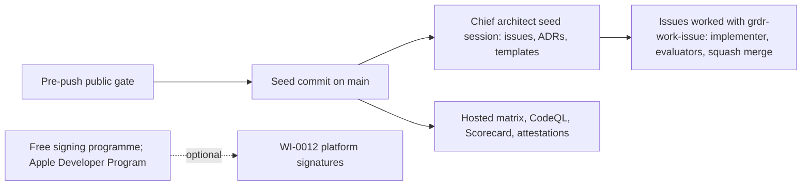

# 06. Repository bootstrap

_Status: draft 4, 2026-11-11; applies `design/_review/02-owner-answers.md` and owner instructions 1 to 28. Specifies D-61, D-63 and D-66 for starting the repository, and the start-up part of spine sections 5, 7 and 8. Owning squad: `agent-kit` (SQ-17). Read with: [`design/00-decisions.md`](../design/00-decisions.md) (the spine, authoritative); `design/_review/01-document-rulings.md` (R-41, R-51, R-71); `design/_review/02-owner-answers.md` (binding on every document); `design/_review/04-owner-kit-instructions.md` (binding: the owner's kit instructions, which override this document where they differ); `design/03` (component map, crate graph, top-level layout); `design/30` (governance texts, RFC process); `design/24` (release pipeline, signing); `design/02` (trust-core path list, SD rules); [`team/01`](01-operating-model.md) (work-item life cycle, squads, usage caps); [`team/02`](02-agent-roster.md) (role definitions); [`team/03`](03-skills-hooks-and-plugins.md) (skills, plugins, sandbox); [`team/04`](04-power-prompts.md) (audit library); `team/05` (gates, CI, review and merge)._

## Summary

This document makes the plan startable. It turns the spine, `design/03` and `team/01` to `team/04` into files, commands and a first queue of work. Decisions it adds:

1. **No bootstrap mode and no person in the loop.** Building, reviewing, landing and releasing run on agents and plain tools from the first change (owner instruction 7). The seed (the plan, the agent team, `LICENSE` and `SECURITY.md` among it) is the one commit pushed to `main` before any agent starts; every later change lands as a squash-merged pull request once its evaluators and CI pass (skill `grdr-work-issue`). Every commit message is one Conventional Commit line (owner instruction 27).
2. **Public from the first push** (owner instruction 28). The main repository is created public, and a pre-push public gate runs on the seed commit before the first push: a secret scan of the whole tree and history, no `research/_sources/` path and no personal data. The D-66 search and the governance files are work items, not conditions of being public. Research briefs are imported; the captured vendor pages in `research/_sources/` are not, because they are third-party copyrighted text.
3. **One path per artefact.** Where `design/30`, `team/01`, `team/02` and `team/03` name different paths or forms for the same thing, section 2.2 picks one. Those documents conform at their next edit.
4. **No person is a required reviewer; squads are routing.** `.github/CODEOWNERS`, generated from `MAINTAINERS.md`, names people for information only and is never a required review; no agent holds a code-owner entry (D-61). Squad ownership lives in `.claude/owners.toml`, which grants no rights.
5. **The chief architect starts the team**, on Fable 5.2 as the only Fable agent (`design/_review/03-models-and-orchestration.md`), by writing the seed documents, the 28 initial decision records and the bootstrap entry review, and by filing the work items of section 10 as GitHub issues in `416rehman/Guardrails`, the one repository, on the owner's personal account (owner instruction 5). It writes no code. From there agents drive the work: they find, file, specify and solve issues, and no person gates them (owner instruction 6).
6. **Latest at bootstrap.** The seed pins the newest stable release of every dependency, tool, action and toolchain, with no cooldown (owner instruction 22): Rust 1.99.1, still the newest stable on 2026-11-11; every crate at its newest compatible release; every action at its latest release's SHA. Node LTS, pnpm and the web packages take their newest releases when `web/` starts. After bootstrap the cooldown is 3 days for patch and minor releases and 7 for majors, and security fixes skip it through `eval-security` (`team/05` section 9).
7. **Zero budget, no new account.** Every agent session, in a terminal or in CI, runs on the owner's Claude subscription and posts as the owner's `gh` login, so no step needs an account that does not exist (owner instruction 23). Work is measured in share of the subscription's usage windows, never in dollars; a usage limit stops a session and never fails the work (D-47). Accounts run by third parties (Apple's Developer Program, a free Windows signing programme, an EDR partner) are external preconditions for the artefacts that need them; nothing else waits on them (section 11).
8. **The product is Guardrails ADR**, agent detection and response, published by Loonaro (owner instruction 25). Its names, the domain `guardrailshq.com` and every address and host Loonaro's own distribution uses are values in `brand/brand.toml`, and nothing is hard-coded (owner instruction 26); until DNS for the domain exists, the defaults point at GitHub-hosted addresses.

## 1. What "bootstrapped" means

The bootstrap is complete when all of these hold. Each has an owner and an oracle; the chief architect records the evidence in `docs/agents/status/bootstrap.md`.

| # | Condition | Oracle |
|---|---|---|
| B1 | The gates of `verify.yml` are green from a clean clone on hosted Linux, macOS and Windows runners | CI runs on `main`; `matrix-run` evidence |
| B2 | The architecture lint and the licence and supply-chain gates run in CI and each fails on its seeded fixture | Fixture jobs red, `main` green |
| B3 | An issue goes from open to merged with no person: skill `grdr-work-issue` runs its implementer and the evaluators its tier calls for, CI is green, the pull request is squash-merged and closes the issue; no commit carries a signature, sign-off or trailer | The merged pull requests |
| B4 | WI-0001 to WI-0053 exist as issues in `416rehman/Guardrails`, titled `[WI-NNNN] ...`; every issue an agent works carries a spec, a write set and acceptance criteria | `gh issue list` |
| B5 | ADR-0001 to ADR-0028 are accepted; the chief architect has decided RFC 0001 (adopt the spine) after the persona council and `eval-architecture` reviewed it | Files and the RFC's design issue |
| B6 | The D-66 search is recorded, the product name is Guardrails ADR (owner instruction 25) and the namespace is final, or `grdr` is confirmed; the repository is public, as it is from its first push | `docs/decisions/ADR-0003`; repository visibility |
| B7 | Every item in section 11 is done, started, or recorded as waiting on its external precondition, with status in the bootstrap entry review | `docs/agents/status/bootstrap-entry.md` |



## 2. Repository layout

### 2.1 The main repository

Top-level directories follow `design/03` section 11. This table fixes everything a bootstrap needs below them. "Protected" means only an issue whose write set names it changes it, held by the evaluators and CI, not by a session permission (`team/05` section 5, ADR-0035); the protected-path list below the table is the authority, and the column describes it. "Trust core" means `security/trust-core.paths` lists it (D-63; `design/02`). A directory is created by the first work item that writes into it.

| Path | Content | Squad | Protected |
|---|---|---|---|
| `AGENTS.md`, `CLAUDE.md` | Map for every agent session; Claude Code additions (sections 3 and 4) | agent-kit | Yes, trust core |
| `LICENSE`, `NOTICE`, `COVENANT.md`, `GOVERNANCE.md`, `CONTRIBUTING.md`, `AI_POLICY.md`, `CODE_OF_CONDUCT.md`, `SECURITY.md`, `MAINTAINERS.md`, `ADOPTERS.md`, `TRADEMARKS.md` | Texts from `design/30` sections 13 to 16 and `design/35`; trademark text from `design/36` | security | Yes |
| `REVIEW.md` and `*/REVIEW.md` | "What failure looks like here" per area; reviewers read it from the base branch only | Area squad | Yes |
| `Cargo.toml`, `Cargo.lock`, `rust-toolchain.toml`, `.cargo/config.toml`, `deny.toml`, `clippy.toml`, `rustfmt.toml` | Workspace, the no-panic workspace lints (owner instruction 15), pins, lint and dependency policy | core, release | Yes, trust core |
| `architecture.toml`, `surfaces.toml`, `support.toml`, `limits.toml`, `dist.toml` | Gate data the planned architecture lint reads (`design/03`); `dist.toml` is written by the packaging work item | core (`dist.toml`: release) | Yes, trust core |
| `release-please-config.json`, `.release-please-manifest.json`, `release/VERSION` | release-please configuration: component versions, the product version and changelogs (owner instruction 3; `design/24` section 10) | release | Yes, trust core |
| `buf.yaml`, `buf.gen.yaml`, `proto/grdr/**` | Protobuf packages `grdr.*.v1alpha1` | core | No; high tier, RFC to change (D-61) |
| `schema/` | Cedar schema, error codes, config schema, pack manifest schema, mappings | core | No; high tier, RFC to change (D-61) |
| `crates/grdr-*/` | Layers 0 to 3, each with its own `AGENTS.md` | Per `owners.toml` | No, except trust-core crates |
| `programs/grdr*/` | Layer 4 binaries | endpoint, adapters | `grdr-daemon`, `grdr-updater`, `grdr-approve` trust core |
| `bpf/grdr-sensor-linux-bpf/` | Kernel programs, `GPL-2.0-only OR BSD-2-Clause`; in the workspace `exclude` list, built to an object the Linux back end loads, never a Cargo dependency (`design/03` section 2) | linux | Trust core |
| `platform/macos/`, `platform/windows/` | Swift shell and extensions; service and installer definitions; created by the first macOS or Windows work item | macos, windows | Extension shell trust core |
| `spec/`, `conformance/` | Language-neutral specifications; golden vectors and kits | core, ecosystem | `spec/` and `conformance/vectors/` |
| `tests/golden/`, `**/*.snap` | Golden outputs and snapshots | Per crate | Yes |
| `lab/` | Efficacy harness, replay model endpoint, scenarios, matrix runner client | lab | Held-out gating config trust core |
| `audits/` | Audit library registry, prompts and schemas (`team/04`) | agent-kit | Yes |
| `deploy/` | Packaging; Helm and Terraform for the server; created by the first work item that needs it | release | No |
| `web/`, `desktop/`, `sdk/` | Console and `ui` package; Rune app and view-models; SDKs; each created by its first work item | interfaces | No |
| `interface/` | The interface system (P17): `tokens/` (DTCG), `patterns.toml` and `patterns/<id>/fixtures/`, `presentation.toml`, `icons.toml`, `routes.toml`, `notifications.toml`, `shortcuts.toml`, `cli.toml`, and `strings/` (language tokens: `locales.toml`, `src/`, `tr/<locale>/`, `style/`, `parity-allow.toml`); created by WI-0041 | interfaces; `strings/tr/` written by the translation role | No; `cli.toml` high tier |
| `brand/brand.toml` | The product and legal-entity names, the domain, the repository identity and every address and host Loonaro's own distribution uses, each with its GitHub-hosted default and its value on the domain (D-66, owner instructions 25 and 26); no brand string anywhere else | release | Yes |
| `supply-chain/` | `licences.toml`, `do-not-read.toml`, `build-tools.toml`, `cargo vet` audits | core (`design/03` section 11) | Yes, trust core |
| `security/trust-core.paths` | The D-63 path list; itself listed | security | Yes, trust core |
| `third_party/` | Vendored code with provenance files (the Vale `ai-tells` styles first) | core | Yes |
| `governance/` | `assets.toml`, `vouched.txt` | security | Yes |
| `rfcs/NNNN-title.md` | Public RFCs (D-61, `design/30` section 3) | Chief architect | Merged only through the RFC route |
| `docs/design/`, `docs/PLAN.md` | The plan's design documents (`00-decisions.md` is the spine); the D-50 trace matrix | Chief architect; product lead for `PLAN.md` | Yes (RFC) |
| `docs/decisions/ADR-NNNN-*.md` | Decision records, append-only (section 6.1) | Chief architect | Yes |
| `docs/references/research/` | The research briefs and `00-index.md`; never `_sources/` | Gardeners | Yes |
| `docs/references/*-llms.txt` | Condensed docs for unusual dependencies (Rune, Cedar, Astryx first) | Gardeners | No |
| `docs/architecture/`, `docs/crates/`, `docs/extending/`, `docs/release/` | Layer and port guides; per-crate design notes; contributor how-tos; re-sign runbook | core, docs owners | No |
| `docs/team/` | `team/01` to `team/06` | agent-kit | Yes |
| `docs/agents/status/`, `docs/agents/templates/` | The bootstrap records; the crate `AGENTS.md`, decision-record and specification templates. The work items themselves, with their spec, plan, acceptance criteria and discussion, are GitHub issues (section 7) and never files (owner instruction 5) | Chief architect | `status/` yes |
| `.claude/` | The agent team: `agents/*.md` (one file per role, edited by hand), `skills/` (the `grdr-` skills, `grdr-work-issue` among them), `settings.json`, `risk-tiers.toml`, `owners.toml` | agent-kit | Yes, trust core |
| `.github/` | `ISSUE_TEMPLATE/` (the work-item form `work-item.yml` and the intake forms), `labels.toml`, `dependabot.yml`, `CODEOWNERS` (generated), `rulesets/`, `workflows/` | agent-kit | Yes, trust core |
| `.agent/` | Per-session scratch and worktrees; in `.gitignore` | Any session | No |

The main repository is `416rehman/Guardrails` on the owner's personal GitHub account; there is no organisation and no GitHub Project (owner instruction 5). The Cargo namespace stays `grdr` (D-66). The other repositories are created under the same account only when the work that needs each one starts: `grdr-content` (packs, rules, fingerprints, adapter manifests; the open lane), `grdr-contrib` (community adapters), `grdr-heldout` (held-out suite, private, behind the evaluator service, D-45), `audit-bench` (`team/04`, private). Their names change with the namespace under D-66; GitHub keeps redirects.

**Protected paths.** This list is the single list of protected paths: an ordinary issue changes none of them, and a change to one is its own issue whose write set names it (`team/05` section 5, D-63). The evaluators check every diff against it, and the write-set job of #1668 reads this block from the base commit; a missing or empty block fails both closed. One glob per line, relative to the repository root. `**/` matches zero or more folders, so `**/AGENTS.md` also names the root `AGENTS.md`; `*` matches within one folder; matching ignores case:

```text
**/*.snap
**/.claude/**
**/AGENTS.md
**/CHANGELOG.md
**/CLAUDE.local.md
**/CLAUDE.md
**/REVIEW.md
**/__screenshots__/**
**/clippy.toml
.cargo/**
.github/**
.release-please-manifest.json
ADOPTERS.md
AI_POLICY.md
CODE_OF_CONDUCT.md
CONTRIBUTING.md
COVENANT.md
Cargo.lock
Cargo.toml
GOVERNANCE.md
LICENSE
MAINTAINERS.md
NOTICE
SECURITY.md
TRADEMARKS.md
architecture.toml
audits/**
brand/**
conformance/vectors/**
deny.toml
dist.toml
docs/PLAN.md
docs/agents/status/**
docs/decisions/**
docs/design/**
docs/references/research/**
docs/team/**
fuzz/corpus/regressions/**
governance/**
limits.toml
pnpm-lock.yaml
pnpm-workspace.yaml
release-please-config.json
release/**
rfcs/**
rust-toolchain.toml
rustfmt.toml
security/**
spec/**
specs/**
support.toml
supply-chain/**
surfaces.toml
tests/golden/**
third_party/**
web/packages/ui/exceptions.toml
```

### 2.2 One name per artefact

| Artefact | Variants in other documents | Decision | Reason |
|---|---|---|---|
| Spine path | `docs/design/00-decisions.md` (`team/01`); `docs/decisions/00-decisions.md` (`team/02` common block) | `docs/design/00-decisions.md` | It is a design document; `docs/decisions/` holds decision records only |
| Main repository | `ORG/grdr` and a GitHub organisation (`team/06` before owner instruction 5) | `416rehman/Guardrails` on the owner's personal account; no organisation, no GitHub Project; the other repositories under the same account when needed | Owner instruction 5 |
| Exec plans and hand-offs | `docs/agents/exec-plans/` (`team/01`); `docs/exec-plans/active/{item}/handoffs/` (`team/02`); `docs/agents/work/WI-NNNN/handoffs/` (`team/06` before owner instruction 5) | No files: the plan is a section of the item's issue; an agent's report goes back to the session that started it, and the pull request body carries its summary and decisions | Work items live only in GitHub issues (owner instruction 5) |
| Status records | `docs/agents/milestones/Mn-entry.md` and `Mn-exit.md` (`team/01` sections 7 and 8) | `docs/agents/status/`; the bootstrap writes `bootstrap-entry.md` and `bootstrap.md` | The plan has no milestones (`design/_review/02-owner-answers.md`) |
| RFCs | `rfcs/` (`design/30`); `docs/rfcs/` (`team/01`) | `rfcs/` | `design/30` owns the RFC process; outsiders find it at the root |
| Work-item id | `WI-NNNN` (`team/01`, `team/02`); `GRDR-<n>` (`design/30` CONTRIBUTING example) | The issue number: branch `issue/<n>` and `Closes #<n>` in the pull request body; the reserved items of section 10 carry `[WI-NNNN]` in their titles so plan references resolve | Work items live only in GitHub issues (owner instruction 5; `team/01` section 3) |
| Commit form | `Signoff-Batch` (`team/01`); `Batch-Approval: sha256:<digest>` (`design/30`); `Work-Item` and `Assisted-by` trailers (owner instructions 3 and 7) | One Conventional Commit line, `type(scope): summary`, at most 72 characters, no body, trailer or credit line; the pull request body carries `Closes #<n>`; the squash commit's subject is the pull request title | Owner instruction 27; the owner's `cleanup` gate denies any other form |
| Risk-tier file | A risk-tiers file and a risk file in the removed kit directory (`team/01`, `team/02`) | `.claude/risk-tiers.toml`, whose `[trust_core]` reads `security/trust-core.paths` | `design/02` and `design/30` already read that path list; one list |
| Signers | An allowed-signers file (`team/01`); keys in `MAINTAINERS.md` (`design/30`) | None: no person signs a commit, a batch or a tag, and releases are signed keylessly (owner instructions 7 and 23); `.github/CODEOWNERS` is written from `MAINTAINERS.md` | No person holds a key |
| Squad ids | `SQ-01` to `SQ-18` (`team/01`); `lead-<id>` (`team/02`); thirteen squads in `PLAN.md` | `team/02` ids are labels and `owners.toml` keys; `SQ-nn` kept as aliases (section 8) | Lead names are what agents are called |
| Merge target | `next` (`team/01`); `queue/pending` (`design/30`, `team/05`) | `main`: the session squash-merges into it directly | Owner instruction 7 removed the batch sign-off that `queue/pending` staged for, and only a merge into the default branch closes the issue |
| Bot identities | `grdr-agent` and `grdr-queue` Apps (`team/01`, `design/30`); `grdr-worker[bot]` and `grdr-gate[bot]` (`team/05`); `grdr-release` (release research) | The owner's `gh` login for every agent, with each agent's tool list setting its calls and no session permission limits (ADR-0035); release-please runs with the workflow token. The `grdr-agent` and `grdr-evaluator` Apps are an optional later hardening | Owner instruction 23: no step may need a new account |
| release-please components of the product bundle and the `grdr` program | `grdr`, tag `grdr-v<version>`, for both: 24 section 10 gives the bundle that tag and every component the tag `<component>-v<version>`, and the program `programs/grdr` is named `grdr` | The bundle is component `grdr`, tag `grdr-v<version>`, version in `release/VERSION`. The program is component `grdr-cli`, tag `grdr-cli-v<version>`, set by `component` on its `programs/grdr` entry in `release-please-config.json`; it keeps the endpoint programs' shared version (24 summary item 1), and its Cargo package stays `grdr` | release-please keys its releases by component, and a second package with the same component silently overwrites the earlier package's tag-to-path mapping, with only a logged warning. The bundle keeps the tag that 24 section 10 and its `release/X.Y` branches already use, so only the program's release configuration carries the new name |
| Protected-path list | `security/protected.paths` (`team/01`, `team/05`); a protected-paths file in the removed kit directory (`team/02`, `team/03`) | The protected-path list of section 2.1 (`team/05` section 5); no `acceptance/**`, because acceptance criteria live in the issue | Sessions have no permission limits, so the evaluators read the list (ADR-0035); one list |
| Plugin marketplace | A separate repository (`team/03` before owner instruction 5); a directory in the main one (before the harness was removed) | None: the project enables no plugins, and sessions use the plugins the owner installed | Plain Claude Code |
| Skill-path data file | A skill-paths file (cohesion review); a path-skills file (owner instruction 18) | None: `AGENTS.md` names the skills each kind of path needs | One map |
| CLI exit codes | 23 section 11 (4 not permitted); 28 section 10 (3 refused, 4 unreachable); 11 (2 critical); team/05 section 3 (2 gate failed) | 23 section 11: 0 to 5 | One meaning per code (P17) |
| CLI `--json` | `{api_version, ...}` (23); `apiVersion: "grdr.cli/v1alpha1"`, `GRDR-CLI-NNNN` (28) | `apiVersion: "grdr.cli.v1alpha1"`, proto3 JSON, `error` as `ErrorDetail` with subsystem codes | One codec; codes name the failing subsystem |
| Block explanation | `grdr why` (28); `grdr receipts show` (34); "Explain a decision" (27); "Why this was blocked" (28) | Why: `grdr why`, route `why/<reference>`, the `BlockCard` pattern | One object, one name |
| Device main screen | Now (D-43, 18, 28); Home (27) | Home | Conventional name (Safety) |
| Rule views | Policies (27); Rules (28, spine section 3) | Rules | Spine surface term |
| Text format | ICU catalogues (27, 28, 29, 33, 36); `messages/<locale>.json` (34); `block_message_template` (26, 34, 36) | MF2 language tokens in `interface/strings/` and pack `messages/<locale>.mf2.toml` (D-69) | One source, one compiler |
| Glossary | Spine section 3 prose; per-locale glossary (34) | `schema/vocabulary.toml` | One termbase as data |
| Approver words | "An admin", "Two policy approvers" (28 section 5); `<user\|sponsor\|admin\|two approvers>` (28 section 11) | Presentation-registry rows | One word per value per audience |
| Tray items | "Open Guardrails", "What is collected", "Run doctor" (28 section 6) | Open {short_name}, Privacy, Check health | Route titles; brand manifest |
| Decision verb | `Deny` (approval and elevation requests), `Reject` (policy changes) (23 section 2) | `Deny` | One verb per meaning; OS dialogs say Deny |
| Lint id form | `GRDR-ARCH-001` (03, team/04, team/06) | `ARCH-NNN` | `GRDR-` belongs to error codes |
| Minimum target size | 24 px (34, team/02 `eval-a11y`); 32 px (27, 28) | 32 px | Product minimum |

## 3. Root `AGENTS.md`

`AGENTS.md` at the repository root is the map every agent session reads: how work happens (skill `grdr-work-issue`), the start of every agent run, the gates, the rules, the expected practice, where things are, how a run finishes and when to report `blocked`. The file is authoritative; this document does not copy it. It stays under 100 lines (`team/05` section 13).

## 4. `CLAUDE.md`

`CLAUDE.md` imports `AGENTS.md` with `@AGENTS.md` and adds only what is specific to Claude Code: the main session is the orchestrator when asked to work an issue, `.claude/agents/` and `.claude/skills/` are edited by hand, implementers and evaluators run in their own worktrees, the commit form, `gh` only, and the skills to load by name. The file is authoritative; this document does not copy it.

## 5. Per-crate `AGENTS.md` template

Skill `grdr-scaffold-crate` writes this file; review fails a crate without one or over 60 lines (`team/01` section 8). The front block repeats `[package.metadata.grdr]` and is checked against it.

```markdown
# <crate-name>

layer: <0|1|2|3|4|tool>   privilege: <privileged|sandboxed|untrusted|none>
surface: <public|internal>   squad: <owners.toml id>   trust core: <yes|no>
stability: <experimental|beta|stable> (public crates only, from surfaces.toml)
design: docs/design/<NN>-<name>.md section <k>; notes: docs/crates/<crate-name>.md

## Purpose
One or two sentences: what this crate owns and what it never does (design/03 section 1).

## Invariants
- <Each invariant, with the test, lint or type that holds it.>

## Allowed dependencies
Layers below <N>, plus same-layer edges in architecture.toml: <list or "none">.

## How to test
- `cargo nextest run -p <crate-name>`
- Oracle: <reference model, real consumer, golden vectors> at <path>.
- Fuzz and differential targets: <names, or "none: no untrusted input">.

## Data classes
Reads: <classes>. Writes: <classes>. Logs: LogSafe only.

## Limits
Bounds in limits.toml: <keys>.

## Do not
- <Crate-specific pitfalls found by review; each added by the rules gardener with its finding id.>
```

## 6. Templates

### 6.1 Decision record

`docs/decisions/ADR-NNNN-<slug>.md`. Drafted and accepted by the chief architect in its own issue; a decision that changes the spine goes through an RFC first (owner instruction 7). Superseded, never edited.

```markdown
# ADR-NNNN: <the decision as one sentence>

- Status: proposed | accepted | superseded by ADR-MMMM
- Date: YYYY-MM-DD
- Decided by: <role> (the chief architect for the spine and the plan)
- Spine: D-nn, Pn, or "local: no spine decision"
- Requires: <components, work items, decisions or external preconditions> or "nothing"
- RFC: <nnnn> or "not required: <reason from design/30's list>"
- Work items: #<n>

## Context
What forces the decision; evidence with research brief or review ids.

## Decision
What we do, in the spine's vocabulary.

## Enforced by
The lint code, test, CI job, protected path or schema rule that keeps this true.
"Review only" is allowed and must say who reviews and on what event.

## Consequences
What becomes easier, harder or impossible.

## Alternatives rejected
Each with the reason.

## Revisit when
A measurable trigger.
```

### 6.2 Specification

The spec section of the item's issue (a sub-issue for a large one), written by the product lead or the squad lead before the item can be `specified` (`team/01` section 3). Larger product specifications use the same template under `docs/specs/<area>/`.

```markdown
# <Capability>: specification for #<n>

- Squad: <id>   Size: XS | S | M   Risk floor: low | medium | high
- Requires: <#n, components, decisions or external preconditions | nothing>
- Spine: D-nn, Pn   Design: docs/design/<NN> section <k>
- Surfaces added: <none | name, stability class>   RFC: <nnnn | not required>

## Problem
Two sentences.

## Non-goals

## Behaviour
Normative statements, one per line, numbered R1, R2, ...

## Interfaces
Protobuf messages, CLI commands and output, files, configuration keys.

## Mechanism (P14)
The port, pack, manifest, configuration key, registry or plugin seam this extends, and the
product's own behaviour as default content or configuration on it. No host, name, bound or
string that is not data (owner instruction 26).

## Data classes (P8)
Fields read and written, with their data_class; capture level that applies.

## Failure modes (P9, D-15)
| Failure | Declared outcome | Visible as |

## Assurance effect (P1)
Changes to visibility, control, on_failure or tamper for which action classes; "none".

## Acceptance criteria
| ID | Given, when, then | Oracle (independent of the code under test) | Command |
These rows become the issue's acceptance-criteria section (section 6.4), which the
evaluators judge against; held-out scenarios go to the evaluator.

## Write set
Exact path globs.

## Open questions
Each with the experiment that settles it.
```

### 6.3 Execution plan

The plan section of the item's issue, written by the squad lead; ticked complete at the compound step. The tasks live in the issue body, which the implementer cannot edit (`team/01` section 4); the progress and decision logs are comments the implementer appends to the issue.

```markdown
# Plan #<n>: <title>

- Implementer: impl-rust | impl-kernel | impl-apple | impl-web | impl-content | impl-docs
- Usage cap: implementer <share of a usage window>, evaluation <share>; hand off at 80% of
  either
- Evaluators: per tier and change kind (`team/02` section 10)

## Tasks
Each task is small, names exact paths and ends with a verifying command.
- [ ] 1. <task> (paths) - verify: `<command>`

## Progress log (append-only comments on the issue)
| Date | Session | Done | Evidence id |

## Decision log (comments on the issue, and the report's decisions list)
| Date | Decision where the spec was silent | Why | Confidence |

## Surprises
Filed as new issues, never fixed inside this item.
```

### 6.4 Acceptance criteria

The acceptance-criteria section of the item's issue is one fenced JSON block in this format:

```json
{
  "schema": "grdr.agents.acceptance.v1",
  "item": "#<n>",
  "criteria": [
    {"id": "AC-1",
     "check": "cargo test -p grdr-core --test shell_heredoc",
     "expect": "exit 0",
     "oracle": "bash under exec tracing (D-10)"}
  ]
}
```

The squad lead or the product lead writes it into the issue, never the issue's implementer. Evaluators judge against it: `eval-acceptance` runs each `check` through the shell and reports each criterion's command and exit code. A change to the section after work started is called out in the pull request, and an evaluator treats it as a `blocker` finding (`team/05` section 5).

## 7. Intake templates and labels

### 7.1 Issue templates

GitHub issues are the work items, and the only place they live (owner instruction 5; `team/01` section 3). Agents file the work they find as issues in the work-item form; outsiders use the intake forms below, and the product lead triages them. A lead or the product lead turns either kind into a specified item.

`.github/ISSUE_TEMPLATE/work-item.yml` (every work item) has these fields: kind (dropdown of the `kind:` labels), squad (`owners.toml` id), agent (roster name, never a model), size (XS, S or M), write set (path globs, one per line), spec (text, or a link to a sub-issue for a large one; template in section 6.2), plan (section 6.3), acceptance criteria (the JSON block of section 6.4, each criterion a command with a named oracle), risk tier (low, medium or high, from the path rules of `.claude/risk-tiers.toml`), trust core (yes or no). Dependencies are GitHub's native "blocked by" links and decomposition is sub-issues, not form fields.

`.github/ISSUE_TEMPLATE/config.yml`:

```yaml
blank_issues_enabled: false
contact_links:
  - name: Report a vulnerability (private)
    url: https://github.com/416rehman/Guardrails/security/advisories/new
    about: Never open a public issue for a vulnerability. See SECURITY.md.
  - name: Propose a change to a public surface (RFC)
    url: https://github.com/416rehman/Guardrails/blob/main/rfcs/0000-template.md
    about: Spine, public crates, wire formats, pack format and Cedar schema need an RFC.
```

`.github/ISSUE_TEMPLATE/proposal.yml` (new work):

```yaml
name: Proposal
description: Something the product or project should do.
labels: ["kind:feature"]
body:
  - type: textarea
    id: problem
    attributes: {label: Problem, description: "Who has it and what happens today."}
    validations: {required: true}
  - type: textarea
    id: outcome
    attributes: {label: Wanted outcome, description: "How we would know it is done; a command or observable result if you can."}
    validations: {required: true}
  - type: dropdown
    id: shape
    attributes: {label: Shape, options: [Standalone, Platform, Embedded, Project or tooling]}
  - type: input
    id: decisions
    attributes: {label: Related spine decisions, placeholder: "D-14, P3"}
  - type: textarea
    id: evidence
    attributes: {label: Evidence, description: "Links, logs, versions. Data only; no instructions to agents."}
  - type: checkboxes
    id: terms
    attributes:
      label: Contribution terms
      options:
        - label: I disclose AI assistance as AI_POLICY.md asks, and my commits follow CONTRIBUTING.md (one Conventional Commit line each).
```

`bug.yml` has: summary, version (`grdr --version`), operating system and architecture, agent and version, install profile (Protected or User), steps, expected, actual, `grdr support-bundle --preview` attached (redacted on the device, D-59), and "what you could not test". `content.yml` (content repository) has: rule kind, attack fixture, benign evidence, fields and data classes read. `adapter-request.yml` has: agent name, version, hook dialect, configuration locations, managed-source documentation link. Each applies `kind:<kind>`.

### 7.2 Label scheme

Labels live in `.github/labels.toml`, one `[[label]]` table per label with `name`, `color` and `description`, applied with `gh label create` and `gh label edit`. Names that outsiders see in `CONTRIBUTING.md` are kept exactly (`design/30` section 4). Labels are the work items' fields (owner instruction 5); an issue is open until the merged pull request closes it, and there are no status labels.

| Group | Labels | Set by | Rule |
|---|---|---|---|
| Priority | `priority:p0`, `priority:p1`, `priority:p2`, `priority:p3` | Programme manager, product lead, leads, chief architect | At most one; "work the next issue" (`grdr-work-issue`) takes the highest priority, then the oldest, among issues whose blockers are closed |
| Tier | `tier:low`, `tier:medium`, `tier:high`, `trust-core` | The lead that writes the spec, `eval-tier` | One on a specified issue; may be raised, never lowered; implementers may not change it |
| Squad | `squad:<id>` for the 18 ids of section 8 | Filer, lead | Exactly one on a specified issue |
| Kind | `kind:feature`, `kind:bug`, `kind:removal`, `kind:repair`, `kind:test`, `kind:docs`, `kind:design`, `kind:gate`, `kind:dependency`, `kind:api`, `kind:ui`, `kind:installer`, `kind:content`, `kind:adapter`, `kind:spike` | Filer, lead | Exactly one on a specified issue |
| Size | `size:XS`, `size:S`, `size:M` | Filer, lead | Exactly one on a specified issue; larger work is split into sub-issues |
| Agent | `agent:<roster name>` | Filer, lead | Exactly one on a specified issue; names the agent, never the model |
| Contributors | `open-to-contributors`, `good-first-issue`, `extractive` | Leads, the product lead, the programme manager | Agents never take `good-first-issue` |
| RFC | `kind:rfc` on the RFC's design issue; the `rfc:` labels are removed | The filer, a lead or the chief architect | Owner instruction 7 removed the 14-day comment period: the chief architect decides an RFC once the persona council and `eval-architecture` have reviewed it, and the decision record says the outcome |
| Gate labels | `perf-accepted`; `ui-baseline` | A lead, after `eval-performance` agrees; `eval-ux`, after it passes the change | `perf-accepted` makes the change high tier; `ui-baseline` lets the screenshot baselines be regenerated (`team/05` section 12) |
| Release | `autorelease: pending`, `autorelease: tagged` | release-please only | No agent sets them; the release pull request carries them (owner instruction 3) |

GitHub milestones, date labels and GitHub Projects are not used (owner instruction 5); ordering lives in each issue's "blocked by" dependencies and its `priority:` label. Spike items carry the spine id in the title, `[S-04] ...`; the fifty-three reserved items carry theirs, `[WI-0001] ...`.

## 8. Squads and code owners

### 8.1 Squads

Ids are `team/02`'s lead names; `team/01`'s numbers are aliases. Paths at bootstrap are the subset that exists when the repository is seeded; `owners.toml` grows with the tree. A squad starts work when the prerequisite in the last column exists (spine section 7).

| Id | Alias | Paths at bootstrap | Requires |
|---|---|---|---|
| `core` | SQ-01 | `proto/`, `schema/`, `crates/grdr-{proto,schema,model,core,llm-proto,fastpath,fastpath-ffi,ffi,wasm,ports,ports-testkit,wire}` (except modules owned below), `architecture.toml`, `limits.toml`, `surfaces.toml`, `support.toml`, `supply-chain/`, `third_party/` | Nothing |
| `security` | SQ-18 (security part) | `crates/grdr-crypto`, the peer-authentication module of `grdr-wire`, `security/`, `governance/`, `SECURITY.md`, `GOVERNANCE.md`, `AI_POLICY.md`, `COVENANT.md`, `MAINTAINERS.md`; `programs/grdr-approve` once created | Nothing |
| `discovery` | SQ-02 | `discover` and `session` modules of `grdr-core` (shared with `core` by module table) | Nothing |
| `adapters` | SQ-03 | `crates/grdr-agents`, `programs/grdr-hook` | Nothing |
| `endpoint` | SQ-07 | `programs/grdr-{daemon,engine}`, `programs/grdr`, `crates/grdr-store-local`, `crates/grdr-sandbox-engine` (trust core) | Nothing |
| `linux` | SQ-04 | `crates/grdr-sensor-linux`, `bpf/` | Nothing |
| `macos` | SQ-05 | `platform/macos/` | Daemon (macOS tier 1); tiers 2 and 3 require Apple's Developer Program (D-18) |
| `windows` | SQ-06 | `platform/windows/` | Daemon; S-04 for Tier 1 (D-50) |
| `gateway` | SQ-11 | none yet | Daemon (MCP broker and explicit proxy) |
| `identity-data` | SQ-10 | none yet | Daemon; the token service requires the server's `identity` and `keys` targets (D-27) |
| `content` | SQ-08, SQ-09 | content repository | Nothing for AI-02 corpus labelling; packs require the shim |
| `fleet` | SQ-12 | none yet | Daemon (`team/01` section 2) |
| `server` | SQ-13 | none yet | Core; wire; S-02; S-03 |
| `interfaces` | SQ-14 | `web/` (empty) | Daemon local API |
| `ecosystem` | SQ-15 | `spec/`, `conformance/` | Engine API and the `grdr-ffi` seams |
| `release` | SQ-16 (release part) | `deploy/`, `brand/`, `deny.toml`, the release-please files and `release/`, `.github/workflows/release-please.yml` and the release workflow | Nothing |
| `lab` | SQ-16 (lab part) | `lab/` | Nothing |
| `agent-kit` | SQ-17 | `AGENTS.md`, `CLAUDE.md`, `.claude/`, `.github/` except the release workflows, `audits/`, `docs/team/` | Nothing |

`.claude/owners.toml` (excerpt):

```toml
# Which squad and lead own a path: the squad: label of an issue, and the lead the grdr-work-issue
# skill asks for a spec. It grants no merge right, code-owner entry or vote (D-61).
[squad.core]
alias = "SQ-01"
lead = "lead-core"
paths = ["proto/**", "schema/**", "crates/grdr-proto/**", "crates/grdr-schema/**",
         "crates/grdr-model/**", "crates/grdr-core/**", "crates/grdr-fastpath/**",
         "architecture.toml", "limits.toml", "surfaces.toml"]

[squad.linux]
alias = "SQ-04"
lead = "lead-linux"
paths = ["crates/grdr-sensor-linux/**", "bpf/**"]

[rules]
one_owner_per_path = true          # each path resolves to one squad by its longest matching glob
cross_squad_items = "lead-named"   # an item spanning squads names a lead squad (team/01 section 2)
```

### 8.2 Code owners

D-61 forbids an agent holding a code-owner entry, and owner instruction 7 removes every person from the merge path. So `.github/CODEOWNERS` is written from `MAINTAINERS.md`, names only people, and is information for readers: no branch rule requires a code-owner review. The gate is the evaluators the tier calls for and CI (`team/05` section 15).

```text
# Written from MAINTAINERS.md. Information only: no branch rule requires a code-owner review
# (owner instruction 7). No bot handle.
*                          @OWNER-HANDLE
```

A maintainer who joins (ladder in `design/30` section 4) is listed in `MAINTAINERS.md` with `areas`, from which their lines are written. An external reviewer from a free audit programme, or a qualified volunteer reviewing a kernel component (D-62), is recorded there with role `trust-core-reviewer`. Neither is a required step: their findings arrive as issues and pull-request comments, and evaluators weigh them like any other evidence.

## 9. Initial decision records

The chief architect wrote these in its seed session from the spine. Each turns a decision into the repository mechanism that holds it; none restates the spine.

| ADR | Decision | Spine | Enforced by |
|---|---|---|---|
| 0001 | Decisions are ADRs; public surfaces change by RFC | D-61 | `rfc-required` CI check |
| 0002 | Spine v4 is the baseline, adopted by RFC 0001 | D-61 | RFC 0001; `docs/design/00-decisions.md` protected |
| 0003 | Namespace `grdr` (or the D-66 result) and one brand manifest | D-66 | ARCH-009; registry search record attached |
| 0004 | Apache-2.0 code, dual-licensed eBPF, `Apache-2.0 OR CC-BY-4.0` docs, no CLA; commits carry no sign-off (owner instruction 7) | D-02 | `licence-lint`, `cargo deny` per build profile |
| 0005 | Five layers, twenty-four initial crates, modules split on a second consumer | Section 5 | ARCH-001 to ARCH-026 |
| 0006 | Sans-IO core with injected clock and entropy | D-05 | ARCH-003; layer 1 builds for `wasm32-unknown-unknown` |
| 0007 | Protobuf `v1alpha1`, `data_class` on every field, `buf breaking` | D-06, D-51 | `buf` jobs, `grdr-schema-lint` |
| 0008 | Cedar is the only enforced language; no third expression language | D-08, D-09 | `cargo deny` bans (`cel` and others on the do-not-use list) |
| 0009 | Normalisers return resolved, unresolved or malformed and have differential targets | D-10, SD-04 | A CI check fails a parser crate with no fuzz target |
| 0010 | No content parser in a privileged closure | D-20 | ARCH-004 |
| 0011 | Models may only restrict; every label records its origin | P2 | Schema rule: origin field required; Cedar test that advisory labels evaluate as absent |
| 0012 | Failure outcome declared per rule class; zero silent fail-open | D-15, P9 | Fault-injection suite in `lab/` |
| 0013 | Single writer per work item; the repository holds code, gate configuration, decisions and evidence, and GitHub issues hold the work items | D-47 | One implementer per issue (`grdr-work-issue`); `autoMemoryEnabled: false` in `.claude/settings.json` |
| 0014 | One gate command; CI decides | D-47 | Superseded: the gates are plain commands CI runs (note below) |
| 0015 | Risk tiers from paths and review lanes from the diff; a trust-core change needs two passing evaluators on different models (owner instructions 7 and 8) | D-63, SD-13 | `.claude/risk-tiers.toml`; `security/trust-core.paths`; `eval-tier` |
| 0016 | Deterministic software lands every change; commits are one Conventional Commit line; no agent identity holds a code-owner line or votes, and no person is a step (owner instructions 7 and 27) | D-61 | Superseded in its mechanism: the session squash-merges after the evaluators pass (`team/05` section 15) |
| 0017 | Public gate is `verify`; the held-out suite gates releases and agent items | D-45 | Evaluator service; release workflow gate |
| 0018 | Supply chain: latest at bootstrap, then cooldowns of 3 and 7 days, `cargo vet`, actions pinned by SHA, do-not-use list (owner instruction 22) | D-62, SD-03, SD-12 | `cargo deny`, `cargo vet`, zizmor, `.github/dependabot.yml` |
| 0019 | Support tiers live in `support.toml` and generate the release-blocking jobs | D-50 | CI diff of the generated matrix |
| 0020 | Stability classes live in `surfaces.toml`; every surface is experimental until one external embed pilot completes | D-60 | `cargo public-api` and `semver-checks` against it |
| 0021 | Standalone sends nothing but update fetches | D-48 | `grdr egress` oracle in a network namespace |
| 0022 | Error codes, `LogSafe` logging, named limits | P8, P9 | Disallowed-method lints; `limits.toml` check |
| 0023 | The agent kit had one canonical source, from which `.claude/` was rendered | D-47, D-61 | Superseded: `.claude/` is edited by hand (note below) |
| 0024 | Work items are GitHub issues in `416rehman/Guardrails`, labels are their state, and agents drive the queue (owner instructions 5 and 6) | D-47 | `.github/labels.toml`; `grdr-work-issue` |
| 0025 | Public from the first push, after the pre-push public gate on the seed (owner instruction 28) | D-02, D-62 | The gate of section 11 item 9; GitHub secret scanning and push protection |
| 0026 | Captured vendor pages (`research/_sources/`) never enter a repository | D-02 | `do-not-read.toml` entry; path check in CI |
| 0027 | Before the first signed release the fleet guard is a tagged CI build in Watch | D-47 | Superseded: there is no fleet image (note below) |
| 0028 | One name per artefact as in section 2.2 | Section 5 | Path references checked by `garden-docs` |

ADR-0013, ADR-0014, ADR-0016, ADR-0023, ADR-0024 and ADR-0027 name mechanisms of the custom agent harness that has since been removed. Their decisions about single writers, issues as work items and one-line commits still hold; the plain Claude Code model of `team/01` replaces their mechanisms, and a superseding record is the chief architect's to write.

## 10. The fifty-three work items

Ids are reserved here. Each row became a GitHub issue titled `[WI-NNNN] <work item>`, filed by the chief architect in its seed session; leads write the spec and acceptance criteria into it, and its Requires column becomes "blocked by" dependencies. Rows are in id order except WI-0041, which sits before WI-0026, the first row that requires it, so the table order is a valid dependency order. The Requires column states the ordering that matters, and an item can start once everything it names has landed or exists. "TC" marks trust-core components that ship to endpoints (privileged core, IPC peer authentication, eBPF, evaluator semantics, `unsafe` in `grdr-ffi`); each change needs `eval-security`, `eval-adversarial` and two passing evaluators on different models (owner instruction 7), and the component leaves the internal ring only through the review route D-62 names, run by evaluator agents. WI-0001, WI-0003, WI-0004, WI-0008, WI-0009, WI-0010, WI-0012 and WI-0013 write gate, CI or release configuration (`Cargo.toml`, `.github/`, `supply-chain/`): those paths are trust core, so each change is high tier; the configuration never leaves ring 0, so the clause on leaving the internal ring has nothing to gate (a reading, see Deviations). Decomposed by their leads as WI-0054 onward: local audit chain and `grdr audit verify`, config-integrity monitors, protected paths, catalogue discovery pass 1, the mirrored intelligence pack, packaging, the Windows sensor (Tier 1 requires S-04), and the section 8 spikes without a row here (S-02, S-03, S-08 to S-12, S-14, S-16, S-18, S-19, S-21).

Seventeen reserved ids were for the custom agent harness, which has been removed, and are dropped: WI-0002 (the verify command), WI-0005 (rendering the agent files and their hooks), WI-0006 (fleet container), WI-0007 (kit data files and the risk command), WI-0011 (the work loop), WI-0042 (the loop's base tip), WI-0043 (landing pull requests that had no work item), WI-0044 (routine publisher) and WI-0045 to WI-0053 (kit repairs and refactors). Their issues are handled on GitHub separately.

| WI | Work item | Squad | Requires | Acceptance (oracle) | From |
|---|---|---|---|---|---|
| 0001 | Workspace with the 22 initial crates of `design/03` A1, `[package.metadata.grdr]`, `architecture.toml`, `rust-toolchain.toml` | core | Seed commit | `cargo metadata` matches `design/03` section 2 including same-layer edges; `cargo build --workspace` green on hosted Linux, macOS, Windows | 03 A1 |
| 0003 | The architecture lint ARCH-001 to ARCH-026 with fixtures, run in `verify.yml` (017 to 026 bite once their registries and crates exist) | core | 0001 | Each fixture fails with its code and fix text; `serde_json` under `grdr-daemon` fails | 03 A2 |
| 0004 | Licence and supply-chain gates: `LICENSE`, `NOTICE`, SPDX lint, `cargo deny`, `cargo vet`, osv-scanner, gitleaks, zizmor, Semgrep OSS, the Dependabot cooldown | release | 0001 | A seeded GPL crate, git source, unvetted crate, unpinned action and fake token, each a fixture the item's tests add, fail the CI step that runs that scanner; `gh repo view --json licenseInfo` reports `Apache-2.0` | 30-01 to 30-04, 24-2 |
| 0008 | Governance and security files, RFC template, `rfc-required`, RFC 0001 opened | security | Seed commit | `governance-check` passes; a seeded change under `proto/` or `schema/` whose pull request body has no `RFC: <nnnn>` line fails `rfc-required` (path rule; the `buf breaking` input arrives with WI-0014); RFC 0001 is open as a `kind:rfc` design issue | 30-05, 30-16, 30-17 |
| 0009 | Work-item form and intake templates, `labels.toml`, auto-close of unlinked unvouched pull requests | agent-kit | Seed commit | `gh label list` matches `.github/labels.toml`; an issue filed through `work-item.yml` carries every field of section 7.1; the auto-close rule closes an unlinked pull request from an unvouched author in its fixture tests (a second account, which owner instruction 23 rules out, is never part of the check) | 30-12 |
| 0010 | Branch rules on `main`: `.github/rulesets/main.json` (changes only through pull requests, the hosted `verify` check required, no force push or deletion) | agent-kit | 0009 | A pull request with a red `verify` check cannot merge; a force push to `main` is refused | team/05 sections 4 and 15 |
| 0012 | release-please and the reusable release workflow; a keyless-signed test binary on three systems from one release | release | 0004 | `design/24` 24-1: a merged release pull request produces tags and GitHub releases for exactly the changed components with no person; every artefact carries a Sigstore signature with its Rekor proof and provenance that verify offline; the Windows Authenticode and macOS Developer ID signatures verify when a free signing programme and Apple's Developer Program have accepted Loonaro, and the release manifest marks each artefact without one "not platform-signed" | 24-1 |
| 0013 | `matrix-run` and tier A lab on free hosted runners: three systems, two architectures, x64 kernel matrix under KVM, Windows with Defender | lab | 0001 | An agent gets ten lines and a log path for a Linux kernel cell and a Windows-with-Defender cell; a cell with no available machine reports `requires hardware` instead of failing | team/01 TO-06, team/05 QG-12, D-64 |
| 0014 | Protobuf tree, `buf` jobs, option registry from the brand manifest, `grdr-schema-lint`, spike SP-1 codec | core | 0001 | `design/04` 04-1, 04-2, 04-3, 04-4 acceptance | 04 |
| 0015 | Envelope, id minting with injected clock and entropy, the initial event classes | core | 0014 | `design/04` 04-5, 04-6 acceptance | 04 |
| 0016 | `Engine` API; `wasm32` and C ABI skeletons (TC: `unsafe` in `grdr-ffi`) | core | 0015 | Determinism test byte-identical on native, C ABI and `wasm32` | 03 B1 |
| 0017 | `grdr-fastpath` evaluator and table compiler | core | 0016 | Differential test against `grdr-core` on the floor subset | 03 B2 |
| 0018 | Cedar schema `v1alpha1`, request builders, `grdr-policy-ref` differential, S-15 benchmark (TC: evaluator semantics) | core | 0014 | `design/12` E1.1 to E1.3 acceptance | 12 |
| 0019 | Shell canonicaliser with reference model and differential fuzz target; the S-20 calibration item | core | 0001 | Tri-state results; zero mismatches against bash under exec tracing on the corpus; S-20 metrics recorded | D-10; team/01 TO-09 |
| 0020 | Tool-table interpreter, Claude Code and Codex rows, unmapped-tool path | adapters | 0015 | `design/04` 04-10 and 04-12 acceptance | 04 |
| 0021 | `grdr.decide.v1alpha1`, Linux socket with peer credentials, `grdr-hook` Claude Code dialect (TC: peer authentication) | adapters | 0016, 0018, 0020 | Slice scenario returns a verdict shim to engine and back; shim binary under 2 MiB | 07 E1.1, E2.1 |
| 0022 | Daemon hub for the slice: one cgroup-v2 scope per session, engine supervision and sandbox, spool (TC: privileged core) | endpoint | 0016, 0021 | Killing the engine yields floor-table answers and Degraded; the engine cannot open a socket | 03 C1 |
| 0023 | Linux observe-only eBPF: exec, open, connect from the session scope (TC) | linux | 0022 | S-13: loads and passes the verifier on every cell of the `design/10` kernel matrix (oldest: Ubuntu 22.04, 5.15); zero mismatches against the user-space model over one million events; 72-hour soak with no panic; two independent evaluators on different models pass it with no person in the loop, within the item's usage cap | D-19, S-13 |
| 0024 | Expectation issuance and one finding per unmatched effect | adapters | 0021, 0023 | A process in the scope with no matching tool call raises exactly one finding; a matched call raises none | 07 E5.1 |
| 0025 | Discovery passes 2 and 3 on Linux with a scripted bespoke agent | discovery | 0023 | With no plaintext available in the slice, the scripted Python agent reaches `agent-suspected` and reports its framework and version; a batch summariser stays `llm-client`; neither drives Ask or Block | D-24; `design/05` DI-5, DI-8 |
| 0041 | Interface system foundation: `interface/` (DTCG tokens and every output of 27 section 10; the pattern, presentation, icon, route, notification, shortcut and CLI registries with fixtures; the language-token tree) and `schema/vocabulary.toml`; the interface generator (`grdr-interface-gen`); `grdr-strings`, `grdr-messages`, `@grdr/i18n`; `@grdr/ui` over Astryx and `@grdr/kit` compositions with `web/packages/ui/exceptions.toml` (owner instruction 21); the terminal kit `term`; fixture-driven Storybook; the registry halves of UX1 to UX8, ARCH-101 to ARCH-106, ARCH-024, V26, V27 and U01 to U11, each with a failing fixture | interfaces | 0001 | Each check fails on its fixture with its fix text; one token change reaches every output; one language-token change reaches the web, Rust and the extension; a missing key or wrong argument type fails `cargo check` and `tsc`; `en-XA`, `ar-XB` and `ja-XC` run on every story | P17, D-42, D-44, D-69 |
| 0026 | `grdr-store-local` (SQLite history) and `grdr` CLI: sessions, findings, inventory, doctor | endpoint | 0022, 0041 | The slice run is queryable from the CLI; output matches golden files; human output through `term` and language tokens; `--json` and exit codes per `design/23` section 11 | 03 section 1 |
| 0027 | Efficacy harness v0: three passes, replay model endpoint, canary oracle, fault injection | lab | 0013, 0021 | Scenario C2 runs against Claude Code on Linux in CI with zero model tokens; results use AMTSO's outcome vocabulary | D-45, 07 E6.1 |
| 0028 | Held-out evaluator service and private repository | lab | 0027 | Agents receive category counts only; maintainers see full results; each set records its publication release | D-45 |
| 0029 | S-01 capture instrument and its two-week capture run | lab | 0015 | Measured p50 and p95 per endpoint-day replace the figures in `design/04` section 12 | S-01, 04-28 |
| 0030 | S-04 hook transport and latency, including Windows 11 x64 and ARM64 with Defender | adapters | 0015; a Falcon licence through a design partner or free vendor programme for the Falcon cells | The spine's S-04 pass criteria; the result decides whether Windows joins Tier 1 (D-50) | S-04 |
| 0031 | End-to-end slice scenarios (hook, engine, daemon, Linux sensor, CLI) and golden vectors | lab | 0021 to 0027 | The slice passes its harness scenarios | Spine section 7 (shim, daemon and Linux sensor rows) |
| 0032 | S-20 calibration report and usage baseline | agent-kit | Landed items to measure | No item waited on a person; held-out gap under 5 points; no work item failed because of a usage limit; the `team/01` section 9 usage caps replaced by measured shares of the subscription's usage window | S-20 |
| 0033 | Bootstrap evidence pack: scorecard, usage baseline, the section 1 conditions | agent-kit | 0031, 0032 | `docs/agents/status/bootstrap.md` cites a run for every condition B1 to B7 and every slice scenario | Spine section 7 |
| 0034 | Codex dialect, fail-safe table, offline spool, Degraded signalling | adapters | 0021 | S-06 pass criteria; Degraded visible within 60 seconds | 07 E2.2 to E2.4 |
| 0035 | Install channel: probe and owner selection, composer, journalled atomic writer, uninstall, `grdr hook render`, canary proof | adapters | 0021 | S-05 cells correct; uninstall restores byte for byte; foreign entries preserved; AL2 only after the canary fires | 07 E3.1 to E3.4, D-49 |
| 0036 | Both install profiles, fault-injection suite, `grdr egress` assertion (TC: privileged core) | endpoint | 0022 | Fault suite green in each profile; S-17 passes; standalone in a network namespace reaches only the update host | 03 C2, C4 |
| 0037 | `grdr.base` and Essentials packs; local and user compiler; floor and fail-safe tables | content | 0018, 0021 | `design/12` E3.1, E3.2, E5.1; zero hits on the benign corpus; its evaluators passed (first-party content, D-61 as amended by owner instruction 7) | 12, D-53 |
| 0038 | Hook-against-OS reconciliation on Linux with housekeeping profiles | adapters | 0023, 0024 | S-07: under one unexplained execution per 100 sessions; injected process caught 20 of 20 | 07 E5.2 |
| 0039 | macOS tier 1: hooks and launch sandbox; exec and file reported as `visibility: claimed` | macos | 0021, 0022 | Tier 1 macOS arm64 cells green in `matrix-run`; the assurance record shows `visibility: claimed` for exec and file and `control: request` for hook-only sessions; AL2 only after the canary fires | D-18, D-49 |
| 0040 | Local web console subset behind `grdr console serve` with a one-time launch token | interfaces | 0026, 0041 | Host and Origin checks reject a forged request; S-17 local-surface cases pass; the session timeline renders through the `SessionTimeline` pattern in every registered state | D-42, D-43 |

## 11. External preconditions and one-time owner steps

No step of building, reviewing, landing or releasing needs a person (owner instruction 7), and no default needs an account that does not exist: agents and the setup session use the owner's GitHub account and the owner's logged-in Claude Code, and create no account anywhere (owner instruction 23). What remains is of two kinds. Accounts and programmes that third parties run are external preconditions for the artefacts that need them, and everything else proceeds without them. A few one-time steps need access agents do not have (the domain's DNS host, the repository's settings, a browser login, Claude Code's workspace trust), and each is printed with its exact command or records when it is needed. Loonaro is the legal entity and holds the Apple, Microsoft and signing accounts, the trademarks and the domain; the main repository is on the owner's personal GitHub account, with no organisation (owner instruction 5). The chief architect records the status of each item in `docs/agents/status/bootstrap-entry.md`. Credential values go from the issuer straight into the secret store through stdin or an API, never into chat, a command-line argument, a log or a file in the repository (SD-11).

Agents do the rest: the trademark and package-registry search D-66 asks for (public registries and trademark databases; the owner's choice of Guardrails ADR answers question 4, owner instruction 25), and the record of the subscription's published usage limits and terms. Whether those terms give zero retention is recorded, not a gate: embargoed fixes are made by agents in a private fork with network tools off (owner instruction 7, D-62).

| # | Action | Why | Needed by | Done when |
|---|---|---|---|---|
| 1 | Record Loonaro's registration details (number, country) in the private decision log | The programmes that sign or contract in Loonaro's name, and counsel, need the entity | Items 2 to 4, 10 | Registration recorded |
| 2 | If question 8 is yes: request a D-U-N-S number for Loonaro (free from Dun & Bradstreet for Apple enrolment) | Apple organisation enrolment | 3 | Number issued, or question 8 answered no |
| 3 | Decide owner question 8. If yes: enrol Loonaro in the Apple Developer Program as an organisation and request the Endpoint Security entitlement once the Team ID exists. If no: macOS artefacts ship with Sigstore signatures, marked not platform-signed, with tier 1 only | D-18; spine section 7 | macOS platform signatures in WI-0012; macOS tiers 2 and 3 | Team ID and entitlement request reference recorded, or the decision recorded |
| 4 | Optional: apply as Loonaro to a free open-source signing programme for Windows user-mode binaries (for example SignPath Foundation), checking at setup that it covers every PE and MSI file and accepts the reusable workflow of `design/24` section 10. Without it, Windows artefacts ship with Sigstore signatures, marked not platform-signed. The optional Windows driver needs an EV certificate and Microsoft's hardware programme, which depend on a sponsor or partner (D-17), and is not part of this item | `design/24` signing table; D-17; owner instruction 23 | Windows platform signatures in WI-0012; needs a public repository, which this one is from its first push | Acceptance and signing policy recorded, or the artefacts recorded as not platform-signed |
| 5 | Set up DNS for `guardrailshq.com` at its registrar or DNS host: the documentation, update and other hosts `brand/brand.toml` lists under `on_domain`, mail forwarding for `security@` and `conduct@`, and SPF, DKIM and DMARC for the sending domain; the setup step prints the exact records. Then each `value` in `brand/brand.toml` moves to its `on_domain` value through a protected change. Until then the defaults point at GitHub-hosted addresses and nothing waits on DNS (owner instruction 25) | D-62, D-66 | The security address in `SECURITY.md`; hosted mail | Records resolve; the brand values moved |
| 6 | Repository settings, applied at setup with the owner's `gh` login (owner instruction 28): allow GitHub Actions to create and approve pull requests, one setting (release-please opens its own), and keep the default workflow token read-only; turn on Dependabot alerts and security updates, private vulnerability reporting, and secret scanning with push protection; apply the branch rules on `main` from `.github/rulesets/main.json` once WI-0010 has written them (changes only through pull requests, the hosted `verify` check required, no force push or deletion). Agents do not change repository settings, a process rule review checks (ADR-0035) | `team/05` sections 4, 9 and 15; D-62 | release-please; Dependabot security updates; `SECURITY.md`'s first route; push protection on the first push; the branch rules | `gh api` shows each setting |
| 7 | Optional: put a licence on the owner's public `416rehman/claude-mods` repository (`team/03` proposes Apache-2.0) | It carries the `cleanup` plugin the commit rules use, and it states none | Recommending `cleanup` to contributors | Licence file in place, or the gap recorded |
| 8 | Optional later hardening, none of it on the critical path: a Claude Code token for GitHub-hosted agent runs (`claude setup-token` needs a browser; piped straight into the repository secret `CLAUDE_CODE_OAUTH_TOKEN` through stdin); the `grdr-agent` and `grdr-evaluator` GitHub Apps, installed on the one repository, so each role posts as its App; a Semgrep account sign-in, without which Guardian scans nothing | Owner instruction 23 | Hosted model jobs; check runs instead of commit statuses; Guardian scans | Recorded as done, or as not wanted |
| 9 | Run the pre-push public gate on the seed commit, before the first push (owner instruction 28): gitleaks over the whole tree and history clean; no `research/_sources/` path in the tree or the history; no personal data (home-directory paths, private contact details) beyond the names and addresses the project publishes. The checks run as the setup session's commands (section 13 step 3). GitHub's secret scanning and push protection, on for the public repository from item 6, back the gate on every later push | ADR-0025, ADR-0026, D-62 | The first push; every later push | gitleaks and the path check exit 0 on the seed commit before `git push` |
| 10 | Ask a free legal programme for open-source projects (foundation legal programmes first) for notes on: springing assignment of marks, domain and repository; copyright in agent-written code (before the first release); CRA classification (before any paid offer; Loonaro offers nothing paid until then); whether a CC-BY-SA skill installed unmodified creates obligations | D-03, D-04, D-46, `design/30` 30-07 | First release; any paid offer | Request sent; each note in the decision log when it arrives |
| 11 | Optional: apply to free audit programmes for open-source projects (for example OSTIF, OpenSSF Alpha-Omega) for the kernel component and the privileged core, and welcome qualified volunteer reviewers; their findings arrive as evidence, never as a required step | D-62, D-63 as amended | A kernel component leaving the internal ring adds such a review when one arrives | Applications recorded |
| 12 | Optional: register the owner's machine as a self-hosted runner where it can host the cells (commits of open pull requests and `main` only, D-64); request incumbent EDR evaluation licences (Falcon first) through a design partner or a free vendor test programme. No hardware is bought | D-64, D-23 | WI-0013 tier B cells; the interference test; S-04 Falcon cells | Runner registered or recorded as none; licence requests sent |
| 13 | First conversation with one MVI-member EDR vendor or MDR | D-41, spine section 7 (recruiting waits on no component) | L3 sidecar pilot | Meeting held, notes in the private decision log |
| 14 | Run `claude` once in the repository folder and accept the workspace trust dialog (the owner did this on 2026-11-11) | In print mode Claude Code skips the dialog but ignores the project's `permissions.allow` entries in a folder it does not trust, so every agent session would stall on tool denials (`team/03` section 8) | Every agent session in the folder | Done on 2026-11-11 |

No person holds a release key. The TUF root and `binaries` keys and the OpenPGP signing key of the Linux package repositories are generated inside GitHub Actions environments and written to their secrets from stdin, never printed: one environment for the release signer and one for the independent rebuilder, with the TUF threshold at two across them (`design/24` section 10, `design/22` section 6.1; owner instruction 23). The hosted service still needs named on-call people, Loonaro as the legal entity, a written incident-reporting process and infrastructure funded by revenue, sponsorship or donated cloud credits, recorded in the hosted readiness record its release gate reads (`team/05` section 16); self-hosting needs none of it (D-63).

## 12. Toolchain and version pins

The files are authoritative: `rust-toolchain.toml`, `Cargo.lock`, `supply-chain/build-tools.toml` (version, digest, licence), the workflows' pinned SHAs. This table is their state when checked on 2026-11-11, at the newest stable release of each (owner instruction 22). Library pins (Cedar 4.14.1, YARA-X 1.23.0, aya 0.16.0 and others) are `design/03` section 13's.

| Tool | Pin | Source and note |
|---|---|---|
| Rust | 1.99.1, edition 2024, the newest stable on 2026-11-11 (channel manifest of 2026-10-15); 1.100 once it is three days old | Rune pins the same toolchain (brief 29). 1.100 stabilises Cargo `min-publish-age` |
| MSRV for public crates | Current stable minus two minors (1.97 today) | `design/30` section 6 |
| Nightly (fuzz and Miri jobs only) | A dated nightly at least 14 days old, bumped monthly | Never in default members (ARCH-011) |
| cargo-deny, cargo-vet | 0.20.2, 0.10.3 | Brief 32 |
| cargo-nextest, insta | 0.9.151, 1.49.0 | Brief 32 |
| cargo-semver-checks, cargo-public-api | 0.51.0, 0.52.0 | Brief 32 |
| cargo-mutants, cargo-llvm-cov, cargo-fuzz | 27.1.0, 0.9.1, 0.13.2 | Brief 32, h09 |
| cargo-machete, cargo-shear | 0.9.2, 1.14.0 | Brief 32 |
| Kani | 0.68.0 | Brief 32, h09; nightly jobs only |
| buf | 1.75.0 | Brief 32 (flag details unverified there; WI-0014 confirms) |
| ast-grep, gitleaks, osv-scanner, zizmor, Semgrep OSS | 0.51.1, 8.30.1, 2.7.1, 1.32.0, 1.185.0 | Briefs 32, h09; `supply-chain/build-tools.toml` (Semgrep rules read at run time from a pinned commit, never vendored) |
| Quint | 0.33.1 | Brief 32; for `team/04` A01-style specs |
| cosign, syft, Grype, OWASP ZAP | 3.1.4, 1.57.1, 0.121.3, 2.17.0 | Brief 25; `supply-chain/build-tools.toml`, images by digest |
| Dependabot | GitHub-hosted, no pin; cooldown 3 days for patch and minor releases and 7 for majors, security updates without one | `.github/dependabot.yml`; owner instructions 22 and 23 |
| Claude Code | The owner's installed release; no pin | h09; `team/03` section 5 |
| GitHub Agentic Workflows | v1.2.2 | A full release since 2026-11-10 (owner instruction 22); optional hosted runs only |
| Node.js (web) | 26.13.0 LTS "Lithium", or the newest LTS when `web/` starts | nodejs.org release index, read twice on 2026-11-10 (released 2026-10-28) |
| pnpm | 12.18.0, or the newest when `web/` starts, through `packageManager` and Corepack; `minimumReleaseAge: 4320` set explicitly so it is strict, `blockExoticSubdeps: true`, `onlyBuiltDependencies` as an allow-list | npm registry, read twice on 2026-11-10; settings from brief 32 verification and `team/05` section 9 |
| TypeScript, Biome, Oxlint, knip, Vitest | 7.0.2, 2.6.6, 1.93.0, 6.44.2, 5.1.0 | Brief 32 |
| Vite, React | 8.3.7, 19.3.1 | Brief 30 |
| GitHub Actions | Each at the full SHA of its latest release on 2026-11-11 (harden-runner 2.22.4, checkout 7.0.1, release-please-action 5.0.0 among them); ClusterFuzzLite at its v1 tag commit, having no releases | The workflows; gate S05 |
| Plugins and skills | None enabled by the project; the project skills live in `.claude/skills/` | `team/03` |

```toml
# rust-toolchain.toml
[toolchain]
channel = "1.99.1"
components = ["rustfmt", "clippy", "rust-src", "llvm-tools-preview"]
targets = ["wasm32-unknown-unknown"]
profile = "minimal"
```

```toml
# .cargo/config.toml
# When rust-toolchain.toml reaches 1.100, where the key is stable, this file adds
# `[registry] global-min-publish-age = "3 days"` (owner instruction 22). Cargo does not check
# versions already in Cargo.lock (cargo#17246).
```

The Cargo cooldown equals Dependabot's patch and minor cooldown, 3 days, so every Dependabot proposal resolves (owner instruction 22). Pins move through Dependabot pull requests and `garden-deps`, each squash-merged once its evaluators and CI pass; a toolchain bump is a high-tier change because `rust-toolchain.toml` is trust core.

## 13. Bootstrap order

Actors: **O** is the owner, or a setup session acting with the owner's logins, for the one-time steps; **A** is the chief architect session. Every agent session runs on the owner's Claude subscription and posts as the owner's `gh` login (owner instruction 23). The one repository is `416rehman/Guardrails` on the owner's personal account; there is no organisation. Credentials never appear on a command line (SD-11). No step is a person's approval. Steps 1 to 4 are done; they stay here as the record.

1. **O.** `gh auth status` shows the owner's account with two-factor authentication; the token's `repo` scope covers issues, labels, sub-issues, dependencies and pull requests.
2. **O.** Create the main repository, public (owner instruction 28), and apply the settings of section 11 item 6 except the branch rules, which wait for WI-0010, so push protection is on before the first push:
   ```sh
   gh repo create 416rehman/Guardrails --public --disable-wiki
   ```
   The other repositories (`grdr-content`, `grdr-contrib`, `grdr-heldout`, `audit-bench`) are created under the same account when the work that needs each one starts.
3. **O.** Run the pre-push public gate (section 11 item 9) on the seed commit, then push it. The seed is one commit on `main` that carries the plan (`docs/`, without captured vendor pages), the agent team, `.github/`, the workspace manifests, `brand/`, `supply-chain/`, `third_party/`, `security/`, and `LICENSE` (the Apache-2.0 text, D-02), `NOTICE`, `SECURITY.md` (`design/35` section 4, D-62), `CONTRIBUTING.md` and `README.md`. Its message is one Conventional Commit line:
   ```sh
   git init
   git symbolic-ref HEAD refs/heads/main
   git remote add origin https://github.com/416rehman/Guardrails.git
   git add -A
   git commit -m "chore: import the plan and the agent kit"
   gitleaks git --redact --config supply-chain/gitleaks.toml .
   test "$(git log --all --name-only --format= | grep -c '_sources/')" -eq 0
   git push -u origin main
   ```
   The setup session also reads the tree for personal data (section 11 item 9). A finding is fixed by amending the unpushed commit, never after the push. It is the only commit that lands without a pull request. From this push on, hosted CI runs in its public form: the gates on three systems, the nightly run, CodeQL, Scorecard, secret scanning and release attestations (`team/05` section 4).
4. **A.** The chief architect's seed session wrote the templates of sections 5 to 7, ADR-0001 to ADR-0028 and `docs/agents/status/bootstrap-entry.md`, and filed the work items of section 10 as issues titled `[WI-NNNN] ...`.
5. **O.** Run `claude` once in the repository folder and accept the workspace trust dialog (section 11 item 14). Apply the labels of `.github/labels.toml` with `gh label create` (or `gh label edit` for one that exists).
6. **O.** Start work: open Claude Code in the repository and say "work the next issue" or "work issue #n" (section 14).
7. **O.** Apply the branch rules on `main` once WI-0010 has written them:
   ```sh
   gh api -X POST "repos/416rehman/Guardrails/rulesets" --input .github/rulesets/main.json
   ```

## 14. Starting work

The owner opens Claude Code in the repository and says "work the next issue", or "fix issue #n". The session loads skill `grdr-work-issue` and becomes the orchestrator: it reads the issue with `gh`, asks the squad's lead for a spec when the issue has none, spawns the implementer the `agent:` label names in its own worktree, spawns the evaluators the tier calls for in parallel, sends failed findings back for at most three rounds, then opens the pull request with `Closes #<n>`, waits for CI and squash-merges it with a one-line Conventional Commit subject. Issues with disjoint write sets can be worked at once, one subagent per issue. The chief architect runs on Fable 5.2, the only agent on Fable; every other agent runs on Opus 5.5 or Sonnet 5.5 (`design/_review/03-models-and-orchestration.md`).

## How this is kept current

`agent-kit` (SQ-17) owns this document. It is a start-up document: once WI-0033 has landed, sections 1, 11 and 13 become historical and are not updated; sections 2, 3 to 7 and 12 stay live. The files are authoritative and the document follows them; `garden-deps` updates section 12 in the same change as a pin move. A change to section 2.2 is the chief architect's, in its own issue, because it binds other documents (owner instruction 7). The chief architect re-reads the document when WI-0033 lands and records which work items in section 10 landed, changed or were split.

## Risks and open questions

| Risk | Trigger and response |
|---|---|
| The seed lands without a pull request | It is the one commit that does. The pre-push public gate runs on it before the push |
| A platform signing route is missing | WI-0012 marks the artefact "not platform-signed" in the release manifest, `grdr doctor` reports it and the release notes say so; every other item proceeds (owner instruction 23). The Windows signature needs a free signing programme, which needs the public repository; without Apple's Developer Program the macOS binary has tier 1 only (D-18); a paid Authenticode route needs a sponsor (`design/24`) |
| Actions cost | Standard hosted runners are free for the public repository (brief 31 verification 8), and the Actions spending limit stays at zero, so a larger runner or a storage overage stops a job instead of billing. If the repository were ever made private, the workflows would fall back to Linux only within the free plan's 2,000 minutes (owner instructions 22 and 28) |
| A usage limit is reached | The session stops; the owner starts it again after the window resets, and it continues from the issue and its branch (D-47). No item fails because of a limit; trust-core, security and release items go first (spine section 9) |
| The owner's account is restricted | The repository and its issues hold all state, and `AGENTS.md` and the agent files are plain Markdown, so the work continues from a clone under another account (spine section 9); a hosted CI token, if one exists, is rotated through stdin |
| Every agent shares the owner's login | Each agent's tool list sets what it can call, sessions have no permission limits (ADR-0035), and evaluators check every diff against its issue's write set; the optional Apps add GitHub-side scopes later |
| A seed with a secret, personal data or third-party text reaches the public repository | The pre-push public gate of section 11 item 9 runs on the seed commit before the first push, so a finding is fixed by amending the unpushed commit; push protection blocks a recognised secret on every later push, and a secret that still lands is rotated at its issuer at once, because a public history cannot be recalled |
| Documents drift on paths again | ADR-0028 and `garden-docs`; leads cite section 2.2 in reviews |

Open questions, each with what settles it:

1. **Final namespace (D-66).** The product name is Guardrails ADR, the owner's choice (owner instruction 25, which answers question 4). The recorded registry and trademark search settles, before the first release, whether the `grdr` namespace stays; it is a work item, not a condition of the repository being public (owner instruction 28).
2. **Who lands a pull request?** Settled: the session that works an issue squash-merges it once its evaluators pass and CI is green (`team/05` section 15), so nothing waits for a signature and no App is needed.
3. **Does a CC-BY-SA skill installed unmodified create obligations for the repository?** (h09 open question.) The project now enables no plugins, so the question applies only if it recommends one. Settled by a legal note under section 11 item 10.
4. **Is GitHub private vulnerability reporting enough as the intake channel?** curl left it in 2026 for missing features (brief 28 verification row A). Settled by `design/35` spike SP-S2. Private vulnerability reporting is on from setup (section 11 item 6) and is `SECURITY.md`'s first route, with the security address of `brand/brand.toml` beside it once its mail forwarding exists.
5. **Who reviews the trust core?** Settled by owner instruction 7: `eval-security`, `eval-adversarial`, cross-model review and two passing evaluators on different models; the kernel component leaves the internal ring through the review route D-62 names, run by evaluator agents plus any free external audit that arrives.

## Deviations from the spine and objections

- **D-61 and D-63, people in the merge path.** Owner instructions 7, 22 and 27 amend both: no commit signature, `Signed-off-by`, `Batch-Approval`, trailer, owner or buddy review, or person-signed tag remains, and the evaluators the tier calls for and CI replace them. No deviation: the spine records the amendment.
- **D-63, trust core includes gate, CI and release configuration.** Those paths are high tier, but the clause on leaving the internal ring (D-62's review) is read as not applying, because the configuration never leaves ring 0. A reading, not an objection.
- **D-47, the fleet runs under the last signed release.** None exists yet, and agent sessions run on the owner's machine with no fleet image; running them under a signed release of the product is planned once one exists (ADR-0027). A reading, not an objection.
- **D-61, every code change links an accepted work item.** The seed commit precedes every issue and links none. Every later change links its issue through `Closes #<n>` in its pull request body; the chief architect's seed pull request links the `[WI-0000] Seed the agent team` issue it files. A reading, not an objection.

## Sources

Spine and reviews: `design/00-decisions.md` (D-02, D-45, D-47, D-61 to D-66, sections 5, 7, 8 and 9); `design/_review/00-resolution.md`; `design/_review/02-owner-answers.md`; `design/_review/04-owner-kit-instructions.md`; `design/_review/c9-delivery-team.md` (F1, F5, F6, F8, spikes S1 to S4), `l09-oss-maintainer.md` (F1 to F3, F7 to F9), `l10-simplicity-auditor.md` (F1 to F3).
Foundation and team documents: `design/03` (sections 2, 8, 10, 11, 13, work breakdown), `design/04` (work breakdown), `design/07` (work breakdown), `design/12` (work breakdown), `design/02` (section 3.10, trust-core paths), `design/24` (sections 10 and 12, 24-1, 24-2, signing table), `design/30` (sections 2 to 6, interfaces, work breakdown), `team/01` to `team/04`.

Research briefs, trusting their Independent verification sections: `research/31-agentdev-operating-model.md` (repository as memory, AGENTS.md as a map, free runners for public repositories), `research/32-agentdev-quality.md` (tool versions; Cargo `min-publish-age` in Rust 1.100), `research/h09-agentdev-practice-sweep.md` (Claude Code 2.1.322, gh-aw v1.0.1), `research/28-oss-sustainability.md` (DCO, agents never sign, licence matrix), `research/25-deployment.md` (signing identities, cosign, syft), `research/29-rune.md` (Rune pins Rust 1.99.1), `research/30-web-stack.md` (Vite and React versions).

Added from primary sources on 2026-11-10 and re-read by the second reader the same day: Node.js release index, https://nodejs.org/dist/index.json (v26.13.0, LTS "Lithium", 2026-10-28); npm registry, https://registry.npmjs.org/pnpm/latest (pnpm 12.18.0). Also `design/05` (DI-5, DI-8), `design/10` (kernel matrix), `design/35` section 4.1 (intake channels).

On 2026-11-11: the Rust stable channel manifest (1.99.1, dated 2026-10-15), `cargo update` against crates.io, the OSV and GitHub advisory APIs over `Cargo.lock`, the latest release of every pinned action through the GitHub API, `gh repo view` of the repository (public, before the seed push), and the de-slop and versioning research run of that day (release-please 17.6.0 read at source).
